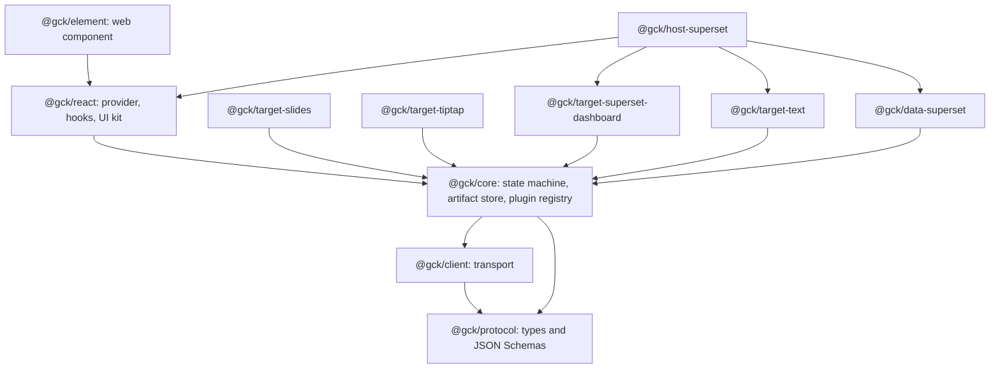
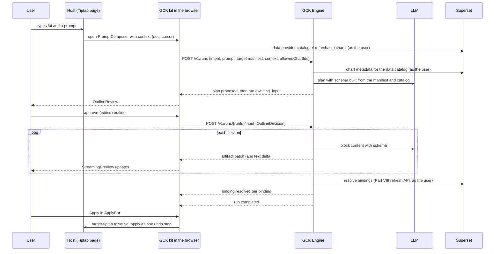

# Architecture

**Reads:** `servers/fastapi/templates/v2/schema.py`, `servers/fastapi/utils/llm_calls/generate_presentation_outlines.py`, `servers/nextjs/app/(presentation-generator)/outline/hooks/useOutlineStreaming.ts`, `servers/nextjs/package.json`  ·  **Builds on:** [Part IX landing](index.md)  ·  **Time:** ~30 min

This chapter lays out the Generative Content Kit (GCK) end to end: the layers, the packages and their dependency rules, the three interactions every host needs (generate, transform, edit), how a run flows through the system, and the decisions that shape everything else. Later chapters zoom into each layer.

## Step 1: Separate the four concerns

Every "type a sentence, get content" feature mixes four concerns. Presenton mixes them inside one Next.js app and one FastAPI service. The kit separates them so each can change independently.

| Concern | Question it answers | GCK layer | Presenton today |
| --- | --- | --- | --- |
| **Host** | Where is the user, and how is the result inserted? | Host adapters: context providers plus a `HostApi` (`@gck/host-superset`, the Tiptap extension `GckGenerate` shipped in `@gck/target-tiptap`, `@gck/element`) | The Presenton web app itself |
| **Target** | What kind of content is produced, and what can it hold? | Target adapters with manifests (`@gck/target-*`) | Slides only, shaped by Template v2 layouts |
| **Run** | How does a request become streamed, structured content? | `@gck/protocol`, `@gck/client`, `@gck/core`, GCK Engine | Outline, structure and content steps (for example `generate_ppt_outline`, `servers/fastapi/utils/llm_calls/generate_presentation_outlines.py:252`) streamed with Presenton-specific SSE |
| **Data** | Where do numbers come from, and how are they refreshed? | Data providers (`@gck/data-superset`) for the chart catalog and refresh; the engine resolves bindings during a run | The LLM invents chart values; Part VIII adds bindings |

The rule that makes this work: **hosts and targets are plugins, the run layer is shared, and the only thing the model produces is the Artifact Spec** ([Artifact Spec and targets](62-artifact-spec-and-targets.md)).

## Step 2: Lay out the packages

Dependency rules, enforced in CI:

1. `@gck/protocol` has no runtime dependencies. The engine shares its JSON Schemas, so the frontend and backend cannot drift apart.
2. `@gck/core` has no DOM and no React, not even as a type (its runtime dependencies are `@gck/protocol`, `@gck/client`, `jsonrepair` and `d3-format`). It runs in a browser, a web worker, Node, or a test.
3. A target's main entry (manifest, `toNative`, `apply`) depends only on `@gck/core` and `@gck/protocol`, plus its host library as a **peer** dependency, for example `@tiptap/core`. A Tiptap host must never get a second copy of Tiptap. React node views and previews live in the target's `/react` subpath.
4. Host packages may depend on React and targets, never the other way round.
5. Renderers that are heavy (the slides renderer and its Chart.js runtime) are lazy-loaded through the target's `loadPreview`, so a Tiptap-only host never downloads them.

## Step 3: Define the three interactions

Every host needs the same three interactions. The protocol carries them as an `intent` ([Run protocol and client](63-run-protocol-and-client.md)).

| Intent | User story | Context sent | Apply mode |
| --- | --- | --- | --- |
| `generate` | "Create a QBR page for EMEA from the Sales dashboard." | `context.surface`, host ids (for example `dashboardId`), `locale`, `theme`; chart ids in `data.allowedChartIds` | `replace`, `append` or `insert_at_cursor` |
| `transform` | Select three paragraphs, "turn this into a chart and a summary." | `context.selection`, converted to Artifact blocks by the target's `fromHost` | `replace` the selection |
| `edit` | "Make section 2 shorter and add a revenue KPI." | `context.document`: the artifact applied earlier, read back with `fromHost` | `patch` |

All three intents run end to end through one call. The run controller in [React SDK and UI kit](64-react-sdk-and-ui-kit.md) takes them in `submit({ prompt, intent, selection, baseArtifact, apply })`: `transform` requires a `selection` and defaults to `replace`, `edit` requires a `baseArtifact` and defaults to `patch`. For an edit the engine streams `artifact.patch` ops against the base (the stream starts from the base as version 0), and the controller hands the target a block diff (added, removed and changed block ids) that it also exposes as `run.diff` for review UI. The Tiptap and text targets implement the `patch` apply mode ([Artifact Spec and targets](62-artifact-spec-and-targets.md)); the slides and dashboard targets do not list it in v1 and apply `"patch"` as `replace` with a `patch_unsupported` warning.

!!! warning "Gotcha: `patch` needs ids that survive in the host"
    A patch finds content in the host by block id. The Tiptap target stores every top-level node's block id in a `gckBlockId` global attribute, so an edit can replace, delete and insert single blocks in one undo step. Content the user pasted from another generated page carries that page's ids, and content typed by hand has none; both are handled by `fromHost`, which stamps fresh ids before it reads the document back, so always build `baseArtifact` with `fromHost`, never from a cached copy of the last run.

A fourth, non-AI interaction is **refresh**: re-resolve data bindings without calling a model. It reuses Part VIII's refresh API ([Story 1](../delivery/42-story1-dynamic-data.md)).

## Step 4: Follow one run end to end

What runs where:

| Step | Runs in | Why |
| --- | --- | --- |
| Context capture | Host adapter (`ContextProvider`s collected by `@gck/core`), browser | Only the host knows the selection, cursor and current page |
| Chart catalog (`allowedChartIds`) | Browser (`DataProvider.catalog` in `@gck/data-superset`) | Only charts the user can see are offered to the model |
| Schema assembly from the manifest and data catalog | Engine (`build_response_schema`) | The engine must enforce it on the model response |
| Planning and content generation | Engine | Secrets, provider keys and model choice stay server-side |
| Validation of the Artifact | Engine first (`validate_artifact`), then the browser again (`validateArtifact`, same issue codes) | The browser treats model output as untrusted |
| Binding resolution | Engine during the run (`resolving_data`, sent as `binding.resolved`); browser (`@gck/data-superset`) for later refresh | Both go through the Part VIII refresh API with the user's identity; snapshots live in an overlay beside the artifact, so a browser refresh never forks the engine's version line |
| Conversion to native format | Target adapter (`toNative`) | Deterministic, testable, close to the host API |
| Apply and undo | Target adapter's `apply`, through capabilities the host exposes on `HostApi` (for example `tiptap.editor`) | Each host has its own transaction model |

!!! note "Headless runs"
    Scheduled or event-triggered generation (for example, a weekly KPI page or an alert narrative) has no browser. The engine still resolves bindings itself, and `@gck/client`, `@gck/core` (with its `runToCompletion(client, request)` helper, which starts a run and resolves with the final artifact) and a target's main entry are plain TypeScript with no DOM, so they run in a small Node worker next to the (Python) engine ([Host integrations](65-host-integrations.md)). That is a second reason `@gck/core` and the targets' main entries must stay DOM-free.

## Step 5: Record the decisions

| Decision | Choice | Alternatives considered | Reason |
| --- | --- | --- | --- |
| Integration style | Headless SDK plus thin UI kit, with a web component and an iframe fallback | Embed Presenton everywhere as an iframe | An iframe cannot insert into a host editor's undo history, read its selection, or match its theme |
| What the model produces | The Artifact Spec, constrained by a schema built from the target manifest | Host-native formats directly (HTML, ProseMirror JSON, `position_json`) | One validation path, one safety model, many outputs; adapters are deterministic and testable |
| Schema source | Target manifest per run | Fixed global schema | Matches how Presenton builds a schema from each Template v2 layout (`get_template_schema`, `servers/fastapi/templates/v2/schema.py:257`), and lets each host restrict blocks and limits |
| Streaming | Own versioned run protocol (`GCK-Protocol: 1`), JSON Patch over fetch-based SSE, with an optional AG-UI adapter (`toAgUi`) | `EventSource`, as Presenton uses now (`servers/nextjs/app/(presentation-generator)/outline/hooks/useOutlineStreaming.ts:107`); WebSockets | `EventSource` cannot POST or send an `Authorization` header; a patch protocol is simple to replay and resume with `Last-Event-ID` |
| UI framework | Framework-agnostic core, React kit, web component for everyone else | React-only | Superset and Presenton are React, but Tiptap pages may live in any framework |
| Numbers | Only through data bindings and tokens | Let the model write numbers | Same discipline as Parts VII and VIII; numbers stay correct and refreshable |
| Engine | Generalize Presenton's FastAPI backend | Write a new service from scratch | Reuses the provider layer, schema utilities, streaming and async tasks; the slides target keeps working |
| Where state lives | `@gck/core` artifact store, bridged to host stores at apply time | Host Redux only | Hosts differ; Presenton keeps its Redux, streams into the core store and touches Redux once at apply (one undo entry, one save) |

## Step 6: Know the boundaries

What the kit **does not** do:

- It does not own the host's document. It proposes content and applies it through the host's own API.
- It does not store artifacts long-term by default. Hosts persist what they apply; the engine keeps the run event log for resume and audit.
- It does not bypass host permissions. Data comes through the user's identity ([Story 8](../delivery/49-story8-analytics-mcp.md)), and dashboard creation uses the user's own Superset rights.
- It does not replace Presenton's PPTX export. The slides target hands its output to Presenton's existing export path ([PPTX and PDF export](../presenton/24-export-pipeline.md)).

!!! warning "Gotcha: Tiptap is already inside Presenton"
    Presenton depends on `@tiptap/*` 3.30.5 (`servers/nextjs/package.json:40-44`) for inline slide text editing (`servers/nextjs/components/slide-editor/text/TiptapInlineTextEditor.tsx`). The Tiptap target must declare Tiptap as a peer dependency and support the host's major version. Otherwise Presenton, or any other Tiptap host, ends up with two copies of ProseMirror, and nodes created by one copy fail schema checks in the other.

## What you now know

- The four concerns (host, target, run, data) and the package that owns each.
- The package graph and the five dependency rules that keep the kit portable.
- The three interactions every host gets: generate, transform, edit, plus data refresh.
- What runs in the browser, in the engine and in the host, for one complete run.
- The decisions behind the design, and what the kit deliberately does not do.

## Next

Continue with [Artifact Spec and targets](62-artifact-spec-and-targets.md).
