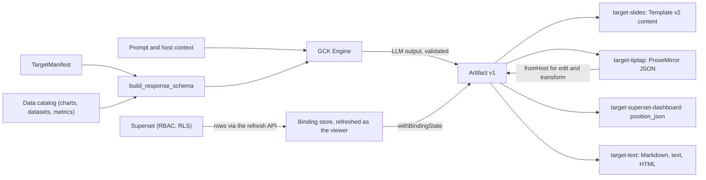
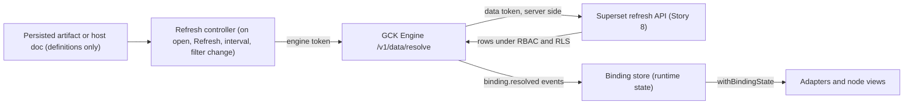
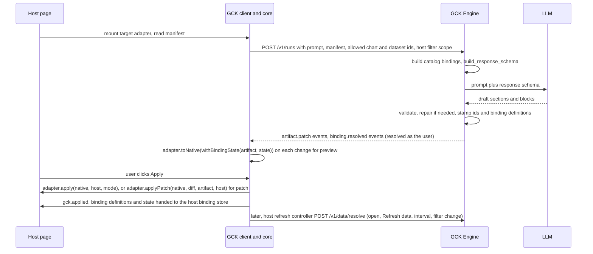

# Artifact Spec and targets

<div class="chapter-meta" markdown>
**Reads:** `servers/fastapi/templates/v2/schema.py`, `servers/fastapi/templates/v2/content.py`, `servers/fastapi/templates/v2/models/elements.py`, `servers/fastapi/api/v1/ppt/endpoints/presentation.py`, `servers/fastapi/utils/schema_utils.py`, `apache/superset: superset-frontend/src/dashboard/util/constants.ts`, `apache/superset: superset/dashboards/schemas.py`, `apache/superset: superset/daos/dashboard.py`, `apache/superset: superset/charts/schemas.py`, `apache/superset: superset-frontend/plugins/plugin-chart-handlebars/src/`, `apache/superset: superset/dashboards/filter_scope.py`  ·  **Builds on:** [Architecture](61-architecture.md)  ·  **Time:** ~90 min
</div>

This chapter defines the one data structure every part of the Generative Content Kit agrees on, the **Artifact** (Artifact Spec v1), and the four adapters that turn it into host-native content: Presenton Template v2 slides, Tiptap (ProseMirror) documents, Apache Superset dashboards, and plain text, Markdown or HTML. You will see the full TypeScript types, the JSON Schema and Pydantic equivalents, the invariants the engine and the client both enforce, how a target manifest becomes the LLM response schema for a run, and complete adapter code for each target. Every target shows **live Superset data**: a `DataBinding` is a refreshable definition (a saved chart, a dataset query or a saved metric), resolved as the viewing user on open, on demand, on an interval and on filter change, and each adapter documents what stays live in its host and what becomes a stamped snapshot. A worked example takes one prompt through one refreshable Artifact into all four outputs, and the chapter closes with the test strategy that keeps adapters deterministic.

All new code in this chapter (the `gck/` packages, the `gck_engine/` modules, and one proposed Presenton endpoint) is marked "(new)" in its block title; everything else is quoted from source. Types marked "protocol 1.1" are additive to `gck.artifact/1` and ship as a minor bump of `@gck/protocol`. Presenton code is quoted from the source snapshot used throughout this site (commit `571461f`); Superset paths, prefixed `apache/superset:`, refer to a clone of `apache/superset` master at `cabd8d4` (2 November 2026), so line numbers can differ on the 6.1 release. The resolution side of live data (the refresh endpoint, the binding store, the refresh controller, identity and caching) is the subject of [Live Superset data](69-live-superset-data.md); this chapter covers the data model and what each adapter does with it.

## Step 1: Why an intermediate representation

There are two ways to make a model produce "a page" for a host.

1. **Direct emission.** Ask the LLM for the host's own format: ProseMirror JSON for Tiptap, a `position_json` tree for a Superset dashboard, Template v2 layout JSON for a slide.
2. **IR plus adapters.** Ask the LLM for a small, target-neutral document (the Artifact), constrained by a JSON Schema derived from the target's capabilities, and convert it to the native format with a deterministic adapter.

GCK uses the second design everywhere. The table records why.

| Concern | Direct emission | IR + deterministic adapters |
| --- | --- | --- |
| Validation | Every host format needs its own schema for the LLM; most are not designed for it (`position_json` is an id-keyed graph with `parents` back-references; ProseMirror needs a live schema to validate) | One schema family, assembled per run from a manifest; validated with the same JSON Schema in the browser and in the engine |
| Safety | The model can emit any node, mark, URL, `chartId` or HTML the format allows | The model can only choose block types the manifest lists and `bindingId`s from an enum; URLs and numbers pass validators before an adapter sees them |
| Numbers | The model writes chart values and KPI figures, frozen at generation time | Numbers come only from `DataBinding` snapshots through tokens (Part VII number discipline, [Data-bound slide model](../superset/33-data-bound-model.md)), and a binding is a query definition, so every number can be re-resolved after generation |
| Multi-target | One prompt engineering effort per host format | One generation pipeline; a new host is a new adapter, not a new prompt |
| Editing | "Change the second chart" requires the model to understand the host format | `fromHost` imports existing content into an Artifact; the model edits the IR; the adapter re-serializes |
| Streaming | Partial native JSON is often invalid for the host (a ProseMirror node without its children) | `artifact.patch` events add whole blocks; each patch is renderable ([Run protocol and client](63-run-protocol-and-client.md)) |
| Testability | Model output must be checked against a running host | Adapters are pure functions: golden files and round-trip tests without an LLM |
| Token cost | Host formats are verbose (styling, geometry, ids) | The IR carries content only; styling and geometry are added by the adapter |

### 1.1 Presenton already does this, for one target

Presenton never asks the LLM for a slide layout. It builds a JSON Schema from a Template v2 layout, the LLM fills that schema, and a hydrator writes the values back into a copy of the layout. [From template to schema to slide](../presenton/17-template-to-slide.md) walks through it in detail; the two halves are short enough to recall here.

The schema half emits one strict object per component, keyed by component id, with one property per editable element (`_template_layout_schema`, `servers/fastapi/templates/v2/schema.py:585`; the excerpt starts at `:623`):

```python title="servers/fastapi/templates/v2/schema.py (excerpt)"
    schema = None
    if properties:
        schema = {
            "$schema": JSON_SCHEMA_URI,
            "type": "object",
            "title": layout.get("id") or f"slide_{slide_index}",
            "description": layout.get("description"),
            "additionalProperties": False,
            "properties": properties,
            "required": required,
        }
```

An element is a field only when it is not decorative (`_is_editable_element`, `schema.py:53`) and its type is in `CONTENT_TYPES` (`schema.py:15`). Text becomes `{"type": "string", "minLength", "maxLength"}`; a chart becomes `{chart_type, categories, series}` with at most 24 categories and 12 series (`_chart_content_schema`, `schema.py:1490`).

The hydration half is `_apply_template_content_to_ui` (`servers/fastapi/api/v1/ppt/endpoints/presentation.py:575`), which deep-copies the layout, finds each component's content object by the same key the schema used, and dispatches by element type (`_apply_template_content_value`, `presentation.py:865`). Repeated regions are delegated to helpers in `servers/fastapi/templates/v2/content.py`:

```python title="servers/fastapi/templates/v2/content.py (excerpt)"
    hydrated: list[Any] = []
    for index, value in enumerate(values):
        source_index = repeated_child_source_index(
            index,
            template_count=len(elements),
            content_count=len(values),
            center_when_reduced=True,
        )
        source = copy.deepcopy(elements[source_index])
        if not isinstance(source, dict):
            return None
        hydrated.append(apply_item(source, value))
    return hydrated
```

GCK generalizes each piece:

| Presenton (one target) | GCK (any target) |
| --- | --- |
| Template v2 layout | `TargetManifest` (block types, limits, layout catalog) |
| `get_template_schema` (`schema.py:257`) | `build_response_schema(manifest, catalog)` (Step 6) |
| Slide content JSON keyed by component and element name | Artifact: sections of typed blocks |
| `_apply_template_content_to_ui` | `TargetAdapter.toNative` |
| LLM-written `categories` and `series` | `DataBinding` definitions referenced by `bindingId`, resolved live into snapshots |
| Markdown emphasis in strings (`**x**`) | `RichText` segments with explicit `marks` |

The slides target (Step 7) is in fact a thin layer on top of Presenton's own schema and hydrator: the Artifact is mapped onto the content JSON that `_apply_template_content_to_ui` already accepts.



## Step 2: The Artifact Spec v1 in TypeScript

The types live in `@gck/protocol`, which has no runtime dependencies. They are the blueprint's types, with the supporting aliases spelled out, plus the protocol 1.1 data additions (`parameters`, `refresh`, `dataContext`, the `embed` block, and the data types of 2.3, which live in `src/data.ts` and are re-exported here).

```ts title="gck/packages/protocol/src/artifact.ts (new)"
import type { ArtifactParameter, DataBinding, HostDataScope, RefreshPolicy } from "./data";
export type * from "./data";

export const ARTIFACT_VERSION = "gck.artifact/1" as const;

export type TargetId = "slides" | "tiptap-doc" | "superset-dashboard" | "text";
export type ChartKind =                     // matches Presenton ChartType (templates/v2/models/elements.py:76-87)
  | "bar" | "horizontal_bar" | "stacked_bar" | "horizontal_stacked_bar" | "line" | "area"
  | "pie" | "donut" | "polar_area" | "scatter" | "radar";

export type Artifact = {
  id: string;                               // "art_" + ULID
  version: typeof ARTIFACT_VERSION;
  title: string;
  language?: string;                        // BCP 47, e.g. "en", "de-CH"
  target: TargetId;                         // the target the run was planned for
  sections: Section[];                      // ordered
  bindings: Record<string, DataBinding>;    // keyed by bindingId, referenced by blocks
  provenance: { runId: string; model?: string; createdAt: string; prompt: string };
  // protocol 1.1, all optional (2.3)
  parameters?: Record<string, ArtifactParameter>;   // viewer-changeable inputs (region, time range)
  refresh?: RefreshPolicy;                          // default refresh policy for every binding
  dataContext?: HostDataScope;                      // host filter state captured at generation
};

export type Section = {
  id: string;                               // "sec_..."
  kind: "slide" | "page" | "row" | "section";
  title?: string;
  layoutHint?: string;                      // target-specific: slides layout id, dashboard row pattern
  blocks: Block[];
};

export type Block =
  | { id: string; type: "heading"; level: 1 | 2 | 3; text: RichText }
  | { id: string; type: "paragraph"; text: RichText }
  | { id: string; type: "list"; ordered: boolean; items: RichText[] }
  | { id: string; type: "callout"; tone: "info" | "warning" | "success"; text: RichText }
  | { id: string; type: "chart"; bindingId: string; chartType: ChartKind; title?: string }
  | { id: string; type: "metric"; bindingId: string; label: string; compare?: "previous_period" | null }
  | { id: string; type: "table"; bindingId: string; columns?: string[]; maxRows?: number }
  | { id: string; type: "image"; prompt?: string; url?: string; alt: string }
  | { id: string; type: "quote"; text: RichText }
  | { id: string; type: "divider" }
  | { id: string; type: "embed"; bindingId: string; title?: string };   // protocol 1.1: live Superset chart, no snapshot

export type BlockType = Block["type"];
export type Mark = "bold" | "italic" | "code" | "link";

export type TextSegment = {
  text: string;                             // for token segments: the last rendered display
  marks?: Mark[];
  href?: string;                            // only with the "link" mark
  token?: { bindingId: string; field: string; format?: string };
};
export type RichText = TextSegment[];
// DataBinding, its source union, mapping, format, refresh policy, parameters and the snapshot
// shapes are defined in src/data.ts (2.3) and re-exported above.
```

### 2.1 Identifiers

| Id | Pattern | Assigned by | Stable across |
| --- | --- | --- | --- |
| `Artifact.id` | `^art_[0-9A-HJKMNP-TV-Z]{26}$` (ULID) | engine, at `run.started` | every later edit of the same artifact |
| `Section.id` | `^sec_[a-z0-9]{4,24}$` | engine, after validating LLM output | patches, edits, host round-trips |
| `Block.id` | `^blk_[a-z0-9]{4,24}$` | engine, same | patches, edits, host round-trips |
| binding key | `^b_[a-z0-9_]{1,48}$` (same as Part VII) | engine, from the data catalog before the LLM call | the artifact's life |

The LLM never writes `id` fields. Ids are stamped after validation (Step 6.3), so the model cannot collide them, and an edit run receives existing ids in its input and must return them unchanged. Ids are the anchor for three things: RFC 6902 patches address blocks by array index, but the client resolves index paths to block ids after each patch ([Run protocol and client](63-run-protocol-and-client.md)); every top-level Tiptap node the target creates carries a `gckBlockId` attribute (data nodes also keep `gckId`) and Superset components get ids derived from block ids, so `fromHost` can map content back and a `patch` apply can find the node to change (Step 8.6); and golden-file tests diff by id.

### 2.2 RichText and data tokens

`RichText` is a flat list of segments. A segment is plain text with optional marks, or a **token**: a reference to one value of one binding. Tokens are the only way a number enters prose.

| Binding kind | Token `field` | Value |
| --- | --- | --- |
| `metric` | `value`, `previous`, `delta`, `delta_pct` | numbers from `MetricSnapshot`; `delta_pct` is `(value - previous) / abs(previous)` |
| `chart` | `total:<series>`, `last:<series>`, `max:<series>` | numbers over one series (first series only when the name is empty, as in `total:`) |
| `chart` | `argmax:<series>`, `last_category` | category labels (strings) |
| `table` | `cell:<row>:<column>`, `row_count` | one cell by row index and column (raw result name first, then display label); the row count |
| any (protocol 1.1) | `period` | the effective time range of the last resolve, from `snapshot.meta.time_range` (`label`, else `from` to `to` formatted with `format.date`) |

`period` exists so that a sentence about live data does not carry a frozen calendar label. "Revenue in Q3 2026 was ..." is wrong one quarter later even though the number refreshed; "Revenue for {period} was ..." stays true. Plain calendar labels next to data tokens raise the `I16_PERIOD_LABELS` warning (Step 4).

`format` is a [d3-format](https://d3js.org/d3-format) specifier such as `,.3s` or `.0%`, or one of Superset's `SMART_NUMBER` and `SMART_NUMBER_SIGNED` formatter ids, the same notation Superset uses for number formats and that Part VIII's `format.number` holds. `@gck/core` ports `SMART_NUMBER` from `createSmartNumberFormatter` (`apache/superset: superset-frontend/packages/superset-ui-core/src/number-format/factories/createSmartNumberFormatter.ts:54`), so a binding that has no explicit format renders the way the same metric renders in Superset. Resolution order is `token.format`, then the column's spec in `binding.format.columns` (a plain string, the Part VIII shape, for `cell:` fields), then `binding.format.number`, then `SMART_NUMBER`; the effective `prefix` and `suffix` (or `currency.symbol` at `currency.symbolPosition`) wrap the result. `delta_pct` uses `binding.format.delta` (default `+.1%`) unless the token overrides it, and never takes the binding's currency prefix. Because the prefix is added outside d3, a token spec must not repeat it (`$,.3s` on a binding with `prefix: "$"` would print `$$591k`). An invalid spec never throws: it falls back to `","` and the validator rejects it in authored tokens (`I14_FORMAT`).

A token segment's `text` is **not** a value store. The engine blanks it in every artifact it sends to a host, hosts persist it as `""` (Tiptap, Step 8), and every adapter renders tokens through `resolveToken` from the binding's current snapshot. That is what makes a saved page show today's number when it is reopened. One resolver in `@gck/core` serves every adapter:

```ts title="gck/packages/core/src/tokens.ts (new)"
import type { BindingErrorCode, DataBinding, RichText, ChartSnapshot, MetricSnapshot, TableSnapshot } from "@gck/protocol";
import { formatNumber } from "./format";        // d3-format plus SMART_NUMBER, SMART_NUMBER_SIGNED, never throws
import { periodLabel } from "./period";          // meta.time_range -> "Jul 2026 to Sep 2026" or the Superset label

export type Resolved = { value: number | string | null; display: string; stale: boolean; issue?: BindingErrorCode };
export type ResolveOptions = { viewerKey?: string | null; sharedSnapshotPolicy?: "redact" | "show" };

class MissingSeries extends Error {}

function rawValue(b: DataBinding, field: string): number | string | null {
  const [op, a, c] = field.split(":");
  if (op === "period") return periodLabel(b.snapshot?.meta, b.format?.date);
  if (b.kind === "metric") {
    const s = b.snapshot as MetricSnapshot;
    const v = s.value ?? null, p = s.previous ?? null;
    if (op === "value") return v;
    if (op === "previous") return p;
    if (op === "delta") return v != null && p != null ? v - p : null;
    if (op === "delta_pct") return v != null && p ? (v - p) / Math.abs(p) : null;
  }
  if (b.kind === "chart") {
    const s = b.snapshot as ChartSnapshot;
    // A named series that is gone (renamed metric, changed groupby) is an error, never "the first series".
    const named = a ? s.series.find((x) => x.name === a) ?? s.series.find((x) => x.key === a) : s.series[0];
    if (a && !named) throw new MissingSeries(a);
    const values = named?.values ?? [];
    if (op === "total") return values.reduce((x, y) => x + y, 0);
    if (op === "last") return values.at(-1) ?? null;
    if (op === "max") return values.length ? Math.max(...values) : null;
    if (op === "argmax") return values.length ? s.categories[values.indexOf(Math.max(...values))] ?? null : null;
    if (op === "last_category") return s.categories.at(-1) ?? null;
  }
  if (b.kind === "table") {
    const s = b.snapshot as TableSnapshot;
    if (op === "row_count") return s.rows.length;
    if (op === "cell") {
      const i = s.columns.indexOf(c) >= 0 ? s.columns.indexOf(c) : (s.labels ?? []).indexOf(c);
      const v = s.rows[Number(a)]?.[i];
      return v == null || typeof v === "boolean" ? (v == null ? null : String(v)) : v;
    }
  }
  return null;
}

export function resolveToken(b: DataBinding | undefined, field: string, spec?: string, o: ResolveOptions = {}): Resolved {
  const nullText = b?.format?.null_text ?? "n/a";
  if (!b?.snapshot || b.status === "forbidden" || b.status === "error")
    return { value: null, display: "n/a", stale: false, ...(b?.error ? { issue: b.error.code } : {}) };
  // Redact: a snapshot resolved for another viewer is never shown; the viewer's own refresh replaces it.
  if ((o.sharedSnapshotPolicy ?? "redact") === "redact" && o.viewerKey !== undefined
      && b.snapshot.meta?.resolved_by && b.snapshot.meta.resolved_by !== o.viewerKey)
    return { value: null, display: "…", stale: true };
  const stale = b.status === "stale";
  let value: number | string | null;
  try { value = rawValue(b, field); }
  catch (e) {
    if (e instanceof MissingSeries) return { value: null, display: nullText, stale, issue: "mapping_changed" };
    throw e;
  }
  if (value === null || typeof value === "string") return { value, display: value ?? nullText, stale };
  const f = b.format ?? {};
  const column = field.startsWith("cell:") ? field.split(":")[2] : undefined;
  const number = field === "delta_pct" ? f.delta ?? "+.1%" : (column && f.columns?.[column]) || f.number || "SMART_NUMBER";
  const body = formatNumber(spec ?? number, value);
  if (field === "delta_pct") return { value, display: body, stale };
  const cur = f.currency;
  const pre = `${f.prefix ?? ""}${cur?.symbolPosition === "prefix" ? cur.symbol : ""}`;
  const suf = `${cur?.symbolPosition === "suffix" ? ` ${cur.symbol}` : ""}${f.suffix ?? ""}`;
  return { value, display: `${pre}${body}${suf}`, stale };
}

export function plainText(rt: RichText, bindings: Record<string, DataBinding>, o?: ResolveOptions): string {
  return rt.map((s) => (s.token ? resolveToken(bindings[s.token.bindingId], s.token.field, s.token.format, o).display : s.text)).join("");
}
```

`stale: true` tells the adapter that the value is the last good snapshot, because the latest refresh failed or it is older than the policy's `staleAfterSec`. Views that can draw a badge (Tiptap node views, kit previews) draw one; outputs that cannot (Markdown, plain text, a PPTX file) add a "Data as of" stamp instead (Steps 7, 9 and 10).

!!! warning "Gotcha: a forbidden binding must not leak through `text`, and neither may the author's snapshot"
    When a viewer's binding resolves to `forbidden` ([Security, RLS, auth](../superset/38-security.md)), `resolveToken` returns `n/a`, but an adapter that printed `segment.text` would show the value the author saw. Every adapter in this chapter renders tokens through `resolveToken` and never through `segment.text`, and the engine blanks `text` in token segments. A stored snapshot is the same risk one level down: it was resolved under someone's row level security. `snapshot.meta.resolved_by` records whose view it is (an HMAC of the Superset user id), and under the default `redact` policy a snapshot resolved by another user renders as a placeholder until the viewer's own refresh lands. [Live Superset data](69-live-superset-data.md) covers the viewer key and the `show` policy.

### 2.3 DataBinding: a live definition plus runtime state

A `DataBinding` is two things, and the split is what keeps every target live:

- A **definition**: `kind`, `source`, `mapping`, `format`, `params` and `refresh`. It says *which* Superset data to fetch and how to turn the result rows into a chart, a metric or a table. Hosts persist definitions only.
- **Runtime state**: `snapshot`, `snapshotAt`, `status` and `error`. It is the result of the last resolve **as the current viewer**. It lives in a binding store in the browser (or in the engine during a run), is refreshed after generation, and is persisted only as an offline fallback (redacted for other viewers, 2.2).

The definition keeps the field names of Part VIII's `slide_data_bindings` row ([Architecture and contracts](../delivery/41-architecture-and-contracts.md)), minus the slide coordinates, so one snapshot JSON serves both stores. Protocol 1.1 widens it in four ways: `source` becomes a discriminated union over Superset's data sources, `mapping` and `format` get real types, and `params` and `refresh` say how the binding reacts to viewer inputs and when it re-resolves.

```ts title="gck/packages/protocol/src/data.ts (new, protocol 1.1)"
export type TimeGrain = "PT1M" | "PT1H" | "P1D" | "P1W" | "P1M" | "P3M" | "P1Y";   // Superset grain ids
export type FilterOp = "==" | "!=" | ">" | "<" | ">=" | "<=" | "IN" | "NOT IN" | "LIKE" | "ILIKE"
                     | "IS NULL" | "IS NOT NULL" | "TEMPORAL_RANGE";                 // Story 8 allowlist
export type FilterClause = { col: string; op: FilterOp; val?: string | number | boolean | (string | number)[] | null };
export type ExtraFormData = {                    // subset of Superset extra_form_data
  filters?: FilterClause[]; time_range?: string; time_grain_sqla?: TimeGrain; granularity_sqla?: string;
};
export type BindingOverrides = {                 // scope pinned on this binding (author, or model via `scope`)
  time_range?: string; time_grain_sqla?: TimeGrain; extra_filters?: FilterClause[];   // max 10
};
export type FilterContext = {                    // how dashboard native filters apply (69)
  dashboard_id: number;
  mode: "captured" | "follow_host" | "defaults" | "none";
  data_mask?: Record<string, { extraFormData: ExtraFormData }>;   // native filter id -> mask at generation
  permalink_key?: string;                                          // durable capture
};

// ---- Sources: where the rows come from -------------------------------------------------
export type SupersetChartSource = {               // v1: a saved chart
  type: "superset_chart"; chart_id: number; dashboard_id?: number;
  viz_type?: string; datasource?: string;        // informational, from the catalog ("12__table")
  filter_context?: FilterContext; overrides?: BindingOverrides;
  row_limit?: number;                            // default 50, server cap 500
};
export type SimpleAdhocMetric = {                 // never a SQL expression
  expressionType: "SIMPLE"; column: { column_name: string };
  aggregate: "SUM" | "AVG" | "MIN" | "MAX" | "COUNT" | "COUNT_DISTINCT";
  label: string;                                 // ^[a-z][a-z0-9_]{0,40}$
};
export type SupersetDatasetSource = {             // 1.1: an ad hoc query over a dataset the user can read
  type: "superset_dataset"; dataset_id: number; datasource_type?: "table";
  metrics: (string | SimpleAdhocMetric)[];       // saved metric names or SIMPLE adhoc, 1 to 6
  columns?: string[];                            // groupby dimensions, 0 to 3
  x_axis?: { column: string; time_grain?: TimeGrain };
  filters?: FilterClause[]; time_range?: string;
  orderby?: { by: string; ascending: boolean }[];
  row_limit?: number;                            // default 100, max 500
  pivot?: boolean;                               // groupby values become series
  filter_context?: FilterContext; overrides?: BindingOverrides;
};
export type SupersetMetricSource = {              // 1.1: one saved metric, optionally over time and compared
  type: "superset_metric"; dataset_id: number;
  datasource_type?: "table" | "semantic_view";   // semantic_view: protocol 1.2, Superset master only
  metric: string;                                // a saved metric_name
  time_column?: string; time_grain?: TimeGrain;
  compare?: { time_offset: string } | null;      // "1 year ago" -> MetricSnapshot.previous
  filters?: FilterClause[]; time_range?: string;
  filter_context?: FilterContext; overrides?: BindingOverrides;
};
export type SupersetSqlSource =                   // 1.2, off by default (GCK_SQL_SOURCES_ENABLED=false)
  | { type: "superset_sql"; saved_query_id: number; row_limit?: number }
  | { type: "superset_sql"; database_id: number; sql: string; catalog?: string; schema?: string; row_limit?: number };
export type BindingSource = SupersetChartSource | SupersetDatasetSource | SupersetMetricSource | SupersetSqlSource;

// ---- Mapping and format: rows -> snapshot -> display -------------------------------------
export type ChartMapping = {
  x: string; series: string[];                   // ["*"]: every numeric column except x (dynamic groupby)
  series_labels?: Record<string, string>;
  sort?: "x_asc" | "x_desc" | "value_asc" | "value_desc"; top_n?: number;   // top_n <= 24
};
export type MetricMapping = { metric: string; x?: string; compare?: "previous_period" | null; previous_column?: string };
export type TableMapping = { columns: string[]; max_rows?: number; labels?: Record<string, string> };
export type BindingMapping = ChartMapping | MetricMapping | TableMapping;

export type BindingFormat = {
  number?: string;                               // d3 spec or "SMART_NUMBER" | "SMART_NUMBER_SIGNED"
  currency?: { symbol: string; symbolPosition: "prefix" | "suffix" } | null;
  prefix?: string; suffix?: string;
  date?: string;                                 // strftime-style for category labels, "%b %Y"
  delta?: string;                                // default "+.1%"
  columns?: Record<string, string>;              // per-column d3 spec (Part VIII shape)
  null_text?: string;                            // default "n/a"
};

// ---- Viewer inputs and refresh ------------------------------------------------------------
export type ParamValue = string | number | (string | number)[] | null;
export type ArtifactParameter = {
  id: string;                                    // ^p_[a-z0-9_]{1,32}$
  label: string;
  type: "time_range" | "time_grain" | "select" | "multi_select";
  default: ParamValue;
  column?: string;
  options?: { values: (string | number)[] } | { from: { dataset_id: number; column: string; limit?: number } };
  hostFilterId?: string;                         // follow a Superset native filter
};
export type ParamBinding = { param: string; as: "time_range" | "time_grain" | "filter"; column?: string; op?: "IN" | "==" };

export type RefreshMode = "on_open" | "manual" | "interval" | "on_filter_change" | "on_schedule";
export type RefreshPolicy = {
  modes: RefreshMode[];
  intervalSec?: number;                          // required with "interval", >= 60
  schedule?: { cron: string; timezone: string }; // "on_schedule" only, headless surfaces only
  staleAfterSec?: number;                        // default 3600 (Part VIII AI_SLIDES_STALE_AFTER_SECONDS)
  onVisible?: boolean;                           // default true: refresh on tab return when stale
  beforeExport?: boolean;                        // default true for targets that export files
  cache?: "prefer" | "bypass";                   // "manual" always bypasses
};
export type HostDataScope = {
  host: "superset_dashboard" | "superset_embedded_dashboard" | "superset_explore" | "none";
  dashboardId?: number;
  dataMask?: Record<string, { extraFormData?: ExtraFormData }>;
  permalinkKey?: string;
  capturedAt: string;
};

// ---- The binding ---------------------------------------------------------------------------
export type BindingStatus = "pending" | "ok" | "stale" | "error" | "forbidden";
export type BindingErrorCode = string;           // closed list in Live Superset data (69)
export type BindingError = { code: BindingErrorCode; message: string; retryable: boolean };

export type DataBinding = {
  kind: "chart" | "metric" | "table" | "embed";  // "embed": a live Superset chart, never a snapshot
  source: BindingSource;
  mapping: BindingMapping | Record<string, never>;   // {} only for kind "embed"
  format?: BindingFormat;
  params?: ParamBinding[];
  refresh?: Partial<RefreshPolicy>;              // overrides Artifact.refresh for this binding
  generatedAgainst?: { snapshot_hash: string; snapshotAt: string };   // what the prose was written against
  // runtime state: never authored, stripped before persistence (stripRuntime)
  snapshot?: ChartSnapshot | MetricSnapshot | TableSnapshot;
  snapshotAt?: string;
  status?: BindingStatus;
  error?: BindingError;
};
export type BindingDefinition = Omit<DataBinding, "snapshot" | "snapshotAt" | "status" | "error">;
export type BindingState = Pick<DataBinding, "snapshot" | "snapshotAt" | "status" | "error">;

// ---- Snapshots (normative; Part VIII rows store the same JSON) ------------------------------
export type SnapshotMeta = {
  rowcount: number; truncated: boolean; nulls_coerced?: number; is_cached: boolean;
  force_throttled?: boolean;                     // a manual force was downgraded (once per binding per viewer per 30 s)
  query_ts: string;                              // the "data as of" stamp (UTC)
  query_context_source?: "saved_query_context" | "rebuilt_from_form_data" | "built_from_source";
  resolved_by: string;                           // viewer key: whose RLS view this is
  scope_hash: string;                            // hash of the effective filters and params
  time_range?: { from?: string; to?: string; label?: string };
  applied_filters?: { column: string }[];
  rejected_filters?: { column: string; reason: string }[];
  dashboard_filters?: { id: string; name: string; status: string; column?: string }[];   // per native filter
  schema: { x?: string; series?: string[]; columns?: string[] };   // drift detection
};
export type ChartSnapshot = { categories: string[]; series: { name: string; key?: string; values: number[] }[]; meta?: SnapshotMeta };
export type MetricSnapshot = { value: number | null; previous?: number | null; previous_label?: string; meta?: SnapshotMeta };
export type TableSnapshot = {
  columns: string[];                             // raw result column names
  labels?: string[];                             // display labels, same length
  coltypes?: ("number" | "string" | "temporal" | "boolean")[];
  rows: (string | number | boolean | null)[][];  // raw values; temporal as ISO 8601 UTC
  meta?: SnapshotMeta;
};
```

The snapshot shapes are normative per kind, so adapters can read them without knowing where they came from: a chart snapshot's `{categories, series}` is exactly what Presenton's `Chart` element stores (`categories: Optional[list[str]]`, `series: Optional[list[ChartSeries]]`, `servers/fastapi/templates/v2/models/elements.py:361`), and Part VIII's `slide_data_bindings.snapshot` stores the same JSON. Tables keep raw values plus labels, and every adapter formats at render time through `resolveToken`, so a refreshed table never carries strings formatted for someone else's locale or currency.

#### Data sources covered

| `source.type` | What it reads | How it resolves (inside Superset, as the viewer) | Version |
| --- | --- | --- | --- |
| `superset_chart` | a saved chart: its query, viz type and saved filters | the chart's saved query context, with dashboard filters, parameters and pinned overrides merged into `extra_form_data` (the keys Superset accepts there are listed in `apache/superset: superset/constants.py:209-234`) | v1 |
| `superset_dataset` | any physical or virtual dataset the user can read; saved metrics or SIMPLE aggregates, up to 3 groupby columns, a temporal x axis | a query context built from the source and loaded through `ChartDataQueryContextSchema` (`apache/superset: superset/charts/schemas.py:1677`); `pivot` adds Superset's pivot post-processing (`ChartDataPivotOptionsSchema`, `schemas.py:972`) | 1.1 |
| `superset_metric` | one saved metric (with its `d3format` and currency), optionally per time grain and compared with an offset | the same builder with `time_offsets`; the previous value arrives as column `<metric>__<offset>` (`TIME_COMPARISON = "__"`, `apache/superset: superset/utils/core.py:148`) | 1.1 (`semantic_view`: 1.2, needs `SEMANTIC_LAYERS`, default `False`, `apache/superset: superset/config.py:776`) |
| `superset_sql` | a saved query, or the SQL of the user's current SQL Lab tab | only with the SQL Lab execute permission and a server flag; the model never writes SQL | 1.2, opt-in |

Every source resolves **server side inside Superset** through one refresh endpoint (Part VIII [Story 8](../delivery/49-story8-analytics-mcp.md), extended with source-typed items), under the viewing user's identity, so Superset's RBAC and row level security apply to every number in every target. The browser never holds a data token. The endpoint, the engine route `/v1/data/resolve`, batching, caching and rate limits are in [Live Superset data](69-live-superset-data.md).

#### Effective scope and refresh

For each resolve, the binding's effective filters are four layers, highest wins per column: the source's own query, then the dashboard filter context (`filter_context`), then the viewer's artifact parameter values (`params`), then the binding's pinned `overrides`. A higher layer **replaces** a lower layer's filter on the same column rather than adding to it, because Superset ANDs extra filters and `region IN [APAC]` on top of a pinned `region IN [EMEA]` would return nothing.

The effective refresh policy is `binding.refresh` over `artifact.refresh` over the target's default:

| Target | Default modes | Interval | Who refreshes |
| --- | --- | --- | --- |
| `slides` (Presenton) | `on_open`, `manual`, `beforeExport` | opt-in, at least 60 s while presenting | Part VIII refresh service, as the viewer (Step 7.6) |
| `tiptap-doc` | `on_open`, `manual`, `on_filter_change` | opt-in | host refresh controller -> engine (Step 8.7) |
| `superset-dashboard` | Superset's own: open, native filter change, dashboard refresh | `json_metadata.refresh_frequency`, opt-in, at least 60 s | Superset frontend (Step 9.5) |
| `text`, rendered by the kit | `on_open`, `manual`, `on_filter_change` | opt-in | refresh controller |
| `text`, exported | snapshot with a "Data as of" stamp, or `on_schedule` (re-rendered per send) | n/a | scheduler as the executor (Step 10) |



Bindings are resolved during a run by the engine and afterwards by the host's refresh controller, and both paths arrive as `binding.resolved` events. **An adapter never fetches data itself**: `toNative` and `apply` receive `withBindingState(artifact, state)`, the definitions merged with the store's current state, and are re-run when the store changes.

### 2.4 Versioning rules

| Change | Allowed in `gck.artifact/1`? | How |
| --- | --- | --- |
| New optional field on an existing type | yes | minor bump of `@gck/protocol`; readers ignore unknown fields only when the reader's protocol minor is older |
| New token `field` grammar | yes | minor bump; `resolveToken` returns `n/a` for unknown fields |
| New block type or mark | yes, as a minor bump | adapters must apply the unknown-block rule below |
| New `source.type` (1.1: `superset_dataset`, `superset_metric`; 1.2: `superset_sql`) | yes | minor bump, engine first; a reader that does not know the type marks the binding `error` with code `source_unsupported` and renders its fallback, never a guess |
| Renaming or removing a field, changing a meaning | no | `gck.artifact/2` plus an `upgrade_1_to_2` function shipped in `@gck/protocol` and the engine |

Protocol 1.1 is entirely additive: `Artifact.parameters`, `refresh` and `dataContext`, the `embed` block, the source union, typed `mapping` and `format`, `params`, `refresh`, `generatedAgainst` and `error` on bindings, and `meta` on snapshots. A 1.0 artifact is a valid 1.1 artifact. The engine ships first, so a 1.0 client never receives a field it cannot ignore.

The unknown-block rule: an adapter that meets a block type it does not support renders it through `@gck/target-text` as a paragraph if the block has `text` or `items`, otherwise drops it and records a warning in its result. Validation is strict on write (the engine rejects unknown fields with `extra="forbid"`) and tolerant on read (adapters accept newer minors). This asymmetry keeps old hosts working while preventing the model from inventing structure.

## Step 3: The JSON Schema and the Pydantic models

`@gck/protocol` publishes `schemas/artifact-1.schema.json` (draft 2020-12). It is the contract artifact both codebases test against (Step 12). An excerpt:

```json title="gck/packages/protocol/schemas/artifact-1.schema.json (new, excerpt)"
{
  "$schema": "https://json-schema.org/draft/2020-12/schema",
  "$id": "https://gck.dev/schemas/artifact-1.schema.json",
  "type": "object",
  "additionalProperties": false,
  "required": ["id", "version", "title", "target", "sections", "bindings", "provenance"],
  "properties": {
    "id": {"type": "string", "pattern": "^art_[0-9A-HJKMNP-TV-Z]{26}$"},
    "version": {"const": "gck.artifact/1"},
    "title": {"type": "string", "minLength": 1, "maxLength": 200},
    "target": {"enum": ["slides", "tiptap-doc", "superset-dashboard", "text"]},
    "sections": {"type": "array", "items": {"$ref": "#/$defs/section"}},
    "bindings": {"type": "object", "propertyNames": {"pattern": "^b_[a-z0-9_]{1,48}$"},
                 "additionalProperties": {"$ref": "#/$defs/dataBinding"}},
    "parameters": {"type": "object", "maxProperties": 3, "propertyNames": {"pattern": "^p_[a-z0-9_]{1,32}$"},
                   "additionalProperties": {"$ref": "#/$defs/artifactParameter"}},
    "refresh": {"$ref": "#/$defs/refreshPolicy"},
    "dataContext": {"$ref": "#/$defs/hostDataScope"}
  },
  "$defs": {
    "dataBinding": {
      "type": "object", "additionalProperties": false, "required": ["kind", "source", "mapping"],
      "properties": {
        "kind": {"enum": ["chart", "metric", "table", "embed"]},
        "source": {"oneOf": [{"$ref": "#/$defs/chartSource"}, {"$ref": "#/$defs/datasetSource"},
                             {"$ref": "#/$defs/metricSource"}, {"$ref": "#/$defs/sqlSource"}]},
        "mapping": {"type": "object"}, "format": {"$ref": "#/$defs/bindingFormat"},
        "params": {"type": "array", "items": {"$ref": "#/$defs/paramBinding"}},
        "refresh": {"$ref": "#/$defs/refreshPolicyPartial"},
        "generatedAgainst": {"type": "object", "required": ["snapshot_hash", "snapshotAt"]},
        "snapshot": {"type": "object"}, "snapshotAt": {"type": "string", "format": "date-time"},
        "status": {"enum": ["pending", "ok", "stale", "error", "forbidden"]},
        "error": {"type": "object", "required": ["code", "message", "retryable"]}
      }
    },
    "chartSource": {
      "type": "object", "additionalProperties": false, "required": ["type", "chart_id"],
      "properties": {
        "type": {"const": "superset_chart"}, "chart_id": {"type": "integer", "minimum": 1},
        "dashboard_id": {"type": "integer", "minimum": 1}, "viz_type": {"type": "string"},
        "datasource": {"type": "string", "pattern": "^[0-9]+__[a-z_]+$"},
        "filter_context": {"$ref": "#/$defs/filterContext"}, "overrides": {"$ref": "#/$defs/overrides"},
        "row_limit": {"type": "integer", "minimum": 1, "maximum": 500}
      }
    },
    "metricSource": {
      "type": "object", "additionalProperties": false, "required": ["type", "dataset_id", "metric"],
      "properties": {
        "type": {"const": "superset_metric"}, "dataset_id": {"type": "integer", "minimum": 1},
        "datasource_type": {"enum": ["table", "semantic_view"]}, "metric": {"type": "string", "maxLength": 250},
        "time_column": {"type": "string"}, "time_grain": {"$ref": "#/$defs/timeGrain"},
        "compare": {"anyOf": [{"type": "null"}, {"type": "object", "required": ["time_offset"],
                    "properties": {"time_offset": {"type": "string", "maxLength": 40}}}]},
        "filters": {"type": "array", "maxItems": 10, "items": {"$ref": "#/$defs/filterClause"}},
        "time_range": {"type": "string", "maxLength": 100},
        "filter_context": {"$ref": "#/$defs/filterContext"}, "overrides": {"$ref": "#/$defs/overrides"}
      }
    },
    "refreshPolicy": {
      "type": "object", "additionalProperties": false, "required": ["modes"],
      "properties": {
        "modes": {"type": "array", "uniqueItems": true,
                  "items": {"enum": ["on_open", "manual", "interval", "on_filter_change", "on_schedule"]}},
        "intervalSec": {"type": "integer", "minimum": 60},
        "schedule": {"type": "object", "required": ["cron", "timezone"]},
        "staleAfterSec": {"type": "integer", "minimum": 60}, "onVisible": {"type": "boolean"},
        "beforeExport": {"type": "boolean"}, "cache": {"enum": ["prefer", "bypass"]}
      }
    },
    "segment": {
      "type": "object", "additionalProperties": false, "required": ["text"],
      "properties": {
        "text": {"type": "string"},
        "marks": {"type": "array", "uniqueItems": true,
                  "items": {"enum": ["bold", "italic", "code", "link"]}},
        "href": {"type": "string", "pattern": "^(https?:|mailto:)"},
        "token": {"type": "object", "additionalProperties": false, "required": ["bindingId", "field"],
                  "properties": {"bindingId": {"type": "string"}, "field": {"type": "string"},
                                 "format": {"type": "string", "maxLength": 32}}}
      }
    },
    "richText": {"type": "array", "items": {"$ref": "#/$defs/segment"}},
    "block": {
      "oneOf": [
        {"type": "object", "additionalProperties": false, "required": ["id", "type", "level", "text"],
         "properties": {"id": {"$ref": "#/$defs/blockId"}, "type": {"const": "heading"},
                        "level": {"enum": [1, 2, 3]}, "text": {"$ref": "#/$defs/richText"}}},
        {"type": "object", "additionalProperties": false, "required": ["id", "type", "bindingId", "chartType"],
         "properties": {"id": {"$ref": "#/$defs/blockId"}, "type": {"const": "chart"},
                        "bindingId": {"type": "string"}, "title": {"type": "string"},
                        "chartType": {"enum": ["bar", "horizontal_bar", "stacked_bar", "horizontal_stacked_bar",
                                               "line", "area", "pie", "donut", "polar_area", "scatter", "radar"]}}},
        {"type": "object", "additionalProperties": false, "required": ["id", "type", "bindingId"],
         "properties": {"id": {"$ref": "#/$defs/blockId"}, "type": {"const": "embed"},
                        "bindingId": {"type": "string"}, "title": {"type": "string"}}},
        {"type": "object", "additionalProperties": false, "required": ["id", "type"],
         "properties": {"id": {"$ref": "#/$defs/blockId"}, "type": {"const": "divider"}}}
      ]
    }
  }
}
```

The other block variants and the remaining `$defs` (`datasetSource`, `sqlSource`, `filterContext`, `overrides`, `filterClause`, `bindingFormat`, `paramBinding`, `artifactParameter`, `hostDataScope`) follow the same pattern and mirror the TypeScript types of 2.3 field for field. `oneOf` is safe here because every block variant and every source variant pins `type` with `const`, so at most one can match. (The per-run LLM schema in Step 6 uses `anyOf` instead, for a different reason.) The binding's `snapshot` stays an open `object` in the artifact schema: snapshots are runtime state written by the resolver, validated by `gck_data`'s own models, and never authored.

The engine's models mirror the schema. Field names match the JSON exactly, camelCase included, so there is no alias layer to drift:

```python title="gck_engine/spec/artifact.py (new)"
from typing import Annotated, Literal, Optional, Union
from pydantic import BaseModel, ConfigDict, Field

from .data import ArtifactParameter, DataBinding, HostDataScope, ParamKey, RefreshPolicy   # protocol 1.1

BlockId = Annotated[str, Field(pattern=r"^blk_[a-z0-9]{4,24}$")]
SectionId = Annotated[str, Field(pattern=r"^sec_[a-z0-9]{4,24}$")]
BindingKey = Annotated[str, Field(pattern=r"^b_[a-z0-9_]{1,48}$")]
ChartKind = Literal["bar", "horizontal_bar", "stacked_bar", "horizontal_stacked_bar", "line", "area",
                    "pie", "donut", "polar_area", "scatter", "radar"]


class _M(BaseModel):
    model_config = ConfigDict(extra="forbid")


class Token(_M):
    bindingId: BindingKey
    field: str = Field(max_length=64)
    format: Optional[str] = Field(default=None, max_length=32)


class Segment(_M):
    text: str
    marks: list[Literal["bold", "italic", "code", "link"]] = []
    href: Optional[str] = Field(default=None, pattern=r"^(https?:|mailto:)")
    token: Optional[Token] = None


RichText = list[Segment]


class Heading(_M):
    id: BlockId; type: Literal["heading"]; level: Literal[1, 2, 3]; text: RichText
class Paragraph(_M):
    id: BlockId; type: Literal["paragraph"]; text: RichText
class ListBlock(_M):
    id: BlockId; type: Literal["list"]; ordered: bool; items: list[RichText]
class Callout(_M):
    id: BlockId; type: Literal["callout"]; tone: Literal["info", "warning", "success"]; text: RichText
class ChartBlock(_M):
    id: BlockId; type: Literal["chart"]; bindingId: BindingKey; chartType: ChartKind; title: Optional[str] = None
class MetricBlock(_M):
    id: BlockId; type: Literal["metric"]; bindingId: BindingKey; label: str
    compare: Optional[Literal["previous_period"]] = None
class TableBlock(_M):
    id: BlockId; type: Literal["table"]; bindingId: BindingKey
    columns: Optional[list[str]] = None; maxRows: Optional[int] = Field(default=None, ge=1, le=50)
class ImageBlock(_M):
    id: BlockId; type: Literal["image"]; prompt: Optional[str] = None; url: Optional[str] = None; alt: str
class Quote(_M):
    id: BlockId; type: Literal["quote"]; text: RichText
class Divider(_M):
    id: BlockId; type: Literal["divider"]
class EmbedBlock(_M):                                   # protocol 1.1
    id: BlockId; type: Literal["embed"]; bindingId: BindingKey; title: Optional[str] = None


Block = Annotated[
    Union[Heading, Paragraph, ListBlock, Callout, ChartBlock, MetricBlock,
          TableBlock, ImageBlock, Quote, Divider, EmbedBlock],
    Field(discriminator="type"),
]


class Section(_M):
    id: SectionId
    kind: Literal["slide", "page", "row", "section"]
    title: Optional[str] = None
    layoutHint: Optional[str] = None
    blocks: list[Block]


class Provenance(_M):
    runId: str; model: Optional[str] = None; createdAt: str; prompt: str


class Artifact(_M):
    id: str = Field(pattern=r"^art_[0-9A-HJKMNP-TV-Z]{26}$")
    version: Literal["gck.artifact/1"] = "gck.artifact/1"
    title: str = Field(min_length=1, max_length=200)
    language: Optional[str] = None
    target: Literal["slides", "tiptap-doc", "superset-dashboard", "text"]
    sections: list[Section]
    bindings: dict[BindingKey, DataBinding]                       # from .data (below)
    provenance: Provenance
    parameters: Optional[dict[ParamKey, ArtifactParameter]] = Field(default=None, max_length=3)   # 1.1
    refresh: Optional[RefreshPolicy] = None                                                        # 1.1
    dataContext: Optional[HostDataScope] = None                                                    # 1.1
```

The data models live in their own module so that Presenton's backend can import the same source and snapshot models through the shared `gck_data` package (Part VIII's mappers, moved and extended) without importing the whole Artifact:

```python title="gck_engine/spec/data.py (new, protocol 1.1, excerpt)"
from typing import Annotated, Literal, Optional, Union
from pydantic import BaseModel, ConfigDict, Field, model_validator

Op = Literal["==", "!=", ">", "<", ">=", "<=", "IN", "NOT IN", "LIKE", "ILIKE",
             "IS NULL", "IS NOT NULL", "TEMPORAL_RANGE"]
Grain = Literal["PT1M", "PT1H", "P1D", "P1W", "P1M", "P3M", "P1Y"]
ParamKey = Annotated[str, Field(pattern=r"^p_[a-z0-9_]{1,32}$")]
Strict = ConfigDict(extra="forbid")


class FilterClause(BaseModel):
    model_config = Strict
    col: str = Field(max_length=250)
    op: Op
    val: Union[str, int, float, bool, list[Union[str, int, float]], None] = None


class Overrides(BaseModel):
    model_config = Strict
    time_range: Optional[str] = Field(None, max_length=100)
    time_grain_sqla: Optional[Grain] = None
    extra_filters: list[FilterClause] = Field(default_factory=list, max_length=10)


class FilterContext(BaseModel):
    model_config = Strict
    dashboard_id: int = Field(gt=0)
    mode: Literal["captured", "follow_host", "defaults", "none"] = "captured"
    data_mask: Optional[dict[str, dict]] = None
    permalink_key: Optional[str] = Field(None, max_length=64)


class ChartSource(BaseModel):
    model_config = Strict
    type: Literal["superset_chart"]
    chart_id: int = Field(gt=0)
    dashboard_id: Optional[int] = Field(None, gt=0)
    viz_type: Optional[str] = None
    datasource: Optional[str] = None
    filter_context: Optional[FilterContext] = None
    overrides: Optional[Overrides] = None
    row_limit: int = Field(50, ge=1, le=500)


class AdhocMetric(BaseModel):
    model_config = Strict
    expressionType: Literal["SIMPLE"]
    column: dict[Literal["column_name"], str]
    aggregate: Literal["SUM", "AVG", "MIN", "MAX", "COUNT", "COUNT_DISTINCT"]
    label: str = Field(pattern=r"^[a-z][a-z0-9_]{0,40}$")


class DatasetSource(BaseModel):
    model_config = Strict
    type: Literal["superset_dataset"]
    dataset_id: int = Field(gt=0)
    datasource_type: Literal["table"] = "table"
    metrics: list[Union[str, AdhocMetric]] = Field(min_length=1, max_length=6)
    columns: list[str] = Field(default_factory=list, max_length=3)
    x_axis: Optional[dict] = None                    # {column, time_grain?}
    filters: list[FilterClause] = Field(default_factory=list, max_length=10)
    time_range: Optional[str] = Field(None, max_length=100)
    orderby: list[dict] = Field(default_factory=list, max_length=3)
    row_limit: int = Field(100, ge=1, le=500)
    pivot: bool = False
    filter_context: Optional[FilterContext] = None
    overrides: Optional[Overrides] = None


class MetricSource(BaseModel):
    model_config = Strict
    type: Literal["superset_metric"]
    dataset_id: int = Field(gt=0)
    datasource_type: Literal["table", "semantic_view"] = "table"
    metric: str = Field(max_length=250)
    time_column: Optional[str] = None
    time_grain: Optional[Grain] = None
    compare: Optional[dict] = None                   # {time_offset: str}
    filters: list[FilterClause] = Field(default_factory=list, max_length=10)
    time_range: Optional[str] = Field(None, max_length=100)
    filter_context: Optional[FilterContext] = None
    overrides: Optional[Overrides] = None


class SqlSource(BaseModel):
    model_config = Strict
    type: Literal["superset_sql"]
    saved_query_id: Optional[int] = Field(None, gt=0)
    database_id: Optional[int] = Field(None, gt=0)
    sql: Optional[str] = Field(None, max_length=20_000)
    catalog: Optional[str] = None
    schema_: Optional[str] = Field(None, alias="schema")
    row_limit: int = Field(200, ge=1, le=1000)

    @model_validator(mode="after")
    def _one_origin(self):
        if (self.saved_query_id is None) == (self.database_id is None or self.sql is None):
            raise ValueError("superset_sql needs saved_query_id, or database_id plus sql")
        return self


Source = Annotated[Union[ChartSource, DatasetSource, MetricSource, SqlSource], Field(discriminator="type")]


class RefreshPolicy(BaseModel):
    model_config = Strict
    modes: list[Literal["on_open", "manual", "interval", "on_filter_change", "on_schedule"]]
    intervalSec: Optional[int] = Field(None, ge=60)
    schedule: Optional[dict] = None                  # {cron, timezone}
    staleAfterSec: int = Field(3600, ge=60)
    onVisible: bool = True
    beforeExport: Optional[bool] = None
    cache: Literal["prefer", "bypass"] = "prefer"


class ParamBinding(BaseModel):
    model_config = Strict
    param: ParamKey
    as_: Literal["time_range", "time_grain", "filter"] = Field(alias="as")
    column: Optional[str] = None
    op: Optional[Literal["IN", "=="]] = None


class BindingError(BaseModel):
    model_config = Strict
    code: str; message: str; retryable: bool


class DataBinding(BaseModel):
    model_config = Strict
    kind: Literal["chart", "metric", "table", "embed"]
    source: Source
    mapping: dict                                    # typed per kind by gck_data; {} only for "embed" (I4)
    format: Optional[dict] = None
    params: list[ParamBinding] = Field(default_factory=list)
    refresh: Optional[dict] = None                   # Partial[RefreshPolicy], checked by I13
    generatedAgainst: Optional[dict] = None
    # runtime state
    snapshot: Optional[dict] = None
    snapshotAt: Optional[str] = None
    status: Optional[Literal["pending", "ok", "stale", "error", "forbidden"]] = None
    error: Optional[BindingError] = None

# ArtifactParameter and HostDataScope mirror the TypeScript types of 2.3 one to one.
```

The engine's old `Source` model had a single `superset_chart` variant, `mapping: dict = {}` and an untyped `overrides: dict`. All three were the frozen-data gaps of v1: an empty mapping cannot be resolved by Part VIII's mappers, and an untyped override is a SQL surface. Protocol 1.1 types the overrides, requires a mapping (Step 6.3 derives it), and caps every list the resolver will turn into a query.

`Field(discriminator="type")` is the same construction Presenton uses for its element union (`SlideElement`, `servers/fastapi/templates/v2/models/elements.py`, chapter 16), with one deliberate difference: GCK sets `extra="forbid"` on every model. Presenton's element models do not (only a few infographic data sub-models set `extra`, `elements.py:458`), which is why unknown keys in template bundles are silently dropped ([Template v2 format](../presenton/16-template-v2-format.md)).

## Step 4: Invariants and validators

Schema validation catches shape errors. The invariants below need cross-references or rendering, so they live in a validator that runs in the engine after every LLM response (feeding a repair retry) and in `@gck/core` before `toNative` (`validateArtifact(artifact, manifest, { allowedChartIds, allowedDatasetIds })`, feeding a warning UI). Both implementations share issue codes.

| Code | Invariant | Severity |
| --- | --- | --- |
| `I1_VERSION` | `version == "gck.artifact/1"` | error |
| `I2_IDS` | Section and block ids are unique within the artifact and match their patterns | error |
| `I3_BINDING_REF` | Every block `bindingId` and every `token.bindingId` is a key of `bindings` | error |
| `I4_BINDING_KIND` | `chart` blocks reference `chart` bindings, `metric` to `metric`, `table` to `table`, `embed` to `embed`; token fields are valid for the binding's kind (`period` for any kind, no tokens on `embed`); `mapping` is non-empty except for `embed` | error |
| `I5_NUMBERS_IN_TOKENS` | Plain segments contain no digits, except allowlisted calendar labels (years `19xx`/`20xx`, `Q1` to `Q4`, `H1`/`H2`, `FY` plus two or four digits) | error |
| `I6_MANIFEST_BLOCKS` | Block types and section kinds are in the target manifest | error |
| `I7_LIMITS` | Section count, blocks per section, and rendered characters per block (tokens counted by their display) are within manifest limits | error |
| `I8_LAYOUT_HINT` | `layoutHint`, when set, is an id in the manifest's `layoutCatalog` | error |
| `I9_LINKS` | `href` is present if and only if the segment has the `link` mark; scheme is `https`, `http` or `mailto` | error |
| `I10_ALLOWED_SOURCES` | Every binding's source is allowed for the run: `superset_chart.chart_id` in `data.allowedChartIds`; `superset_dataset` and `superset_metric` `dataset_id` in `data.allowedDatasetIds`; `superset_sql` only when the run's data scope grants SQL sources | error |
| `I11_IMAGES` | An image block has `prompt` or `url`; `url` is `https` | error |
| `I12_PARAMS` (1.1) | Every `binding.params[].param` exists in `artifact.parameters`; `as` and `column` fit the parameter type and the source dataset; no column is both pinned in `overrides` and parameterized | error |
| `I13_REFRESH_POLICY` (1.1) | `intervalSec >= 60` whenever `interval` is a mode; `on_schedule` only with a `schedule` and only for headless surfaces | error |
| `I14_FORMAT` (1.1) | `token.format`, `format.number`, `format.delta` and every `format.columns` value parse as d3 specs or `SMART_NUMBER[_SIGNED]` | error |
| `I15_OVERRIDES` (1.1) | Filter columns are filterable columns of the source dataset, operators are in the allowlist, `time_range` is at most 100 characters, and `superset_sql` bindings carry no overrides or params | error |
| `I16_PERIOD_LABELS` (1.1) | A block that contains data tokens has no plain calendar labels (years, quarters, months); suggest the `period` token | warning (`frozen_period_label`) |

```python title="gck_engine/spec/validate.py (new)"
import re
from dataclasses import dataclass

from .artifact import Artifact, ChartBlock, EmbedBlock, MetricBlock, TableBlock
from .validate_data import AllowedSources, source_allowed, validate_data

CALENDAR = re.compile(r"\b(?:(?:19|20)\d{2}|Q[1-4]|H[12]|FY(?:\d{4}|\d{2}))\b")
FIELDS = {
    "metric": re.compile(r"^(value|previous|delta|delta_pct|period)$"),
    "chart": re.compile(r"^((total|last|max|argmax):[^:]*|last_category|period)$"),
    "table": re.compile(r"^(cell:\d+:[^:]+|row_count|period)$"),
    "embed": re.compile(r"^$"),                  # an embed has no snapshot, so no token can read it
}
BLOCK_KIND = {ChartBlock: "chart", MetricBlock: "metric", TableBlock: "table", EmbedBlock: "embed"}


@dataclass
class Issue:
    code: str
    path: str
    message: str


def _segments(block):
    if hasattr(block, "text") and isinstance(block.text, list):
        yield from block.text
    for item in getattr(block, "items", None) or []:
        yield from item


def validate_artifact(a: Artifact, manifest, allowed: AllowedSources, display) -> list[Issue]:
    issues: list[Issue] = []
    seen: set[str] = set()
    limits = manifest.limits
    layout_ids = {l.id for l in manifest.layoutCatalog or []}
    if limits.maxSections and len(a.sections) > limits.maxSections:
        issues.append(Issue("I7_LIMITS", "sections", f"{len(a.sections)} > {limits.maxSections}"))
    for key, b in a.bindings.items():
        if not source_allowed(b.source, allowed):
            issues.append(Issue("I10_ALLOWED_SOURCES", f"bindings.{key}", f"{b.source.type} not allowed for this run"))
        if b.kind != "embed" and not b.mapping:
            issues.append(Issue("I4_BINDING_KIND", f"bindings.{key}", "empty mapping on a data binding"))
    issues += validate_data(a, allowed.dataset_columns)        # I12 to I16, below
    for si, s in enumerate(a.sections):
        sp = f"sections[{si}]"
        for ident, path in [(s.id, sp)] + [(b.id, f"{sp}.blocks[{bi}]") for bi, b in enumerate(s.blocks)]:
            if ident in seen:
                issues.append(Issue("I2_IDS", path, f"duplicate id {ident}"))
            seen.add(ident)
        if s.kind not in manifest.sectionKinds:
            issues.append(Issue("I6_MANIFEST_BLOCKS", sp, f"section kind {s.kind}"))
        if s.layoutHint and layout_ids and s.layoutHint not in layout_ids:
            issues.append(Issue("I8_LAYOUT_HINT", sp, f"unknown layout {s.layoutHint}"))
        if limits.maxBlocksPerSection and len(s.blocks) > limits.maxBlocksPerSection:
            issues.append(Issue("I7_LIMITS", sp, "too many blocks"))
        for bi, block in enumerate(s.blocks):
            bp = f"{sp}.blocks[{bi}]"
            if block.type not in manifest.blocks:
                issues.append(Issue("I6_MANIFEST_BLOCKS", bp, f"block type {block.type}"))
            if block.type == "image" and not (block.prompt or (block.url or "").startswith("https:")):
                issues.append(Issue("I11_IMAGES", bp, "image needs a prompt or an https url"))
            if (kind := BLOCK_KIND.get(type(block))) is not None:
                bound = a.bindings.get(block.bindingId)
                if bound is None:
                    issues.append(Issue("I3_BINDING_REF", bp, f"missing binding {block.bindingId}"))
                elif bound.kind != kind:
                    issues.append(Issue("I4_BINDING_KIND", bp, f"{kind} block on {bound.kind} binding"))
            chars = 0
            for seg in _segments(block):
                if seg.token:
                    bound = a.bindings.get(seg.token.bindingId)
                    if bound is None:
                        issues.append(Issue("I3_BINDING_REF", bp, f"token on {seg.token.bindingId}"))
                    elif not FIELDS[bound.kind].match(seg.token.field):
                        issues.append(Issue("I4_BINDING_KIND", bp, f"field {seg.token.field}"))
                    chars += len(display(bound, seg.token)) if bound else 0
                    continue
                if re.search(r"\d", CALENDAR.sub("", seg.text)):
                    issues.append(Issue("I5_NUMBERS_IN_TOKENS", bp, f"digits in {seg.text[:40]!r}"))
                if ("link" in seg.marks) != (seg.href is not None):
                    issues.append(Issue("I9_LINKS", bp, "href and link mark must go together"))
                chars += len(seg.text)
            if limits.maxCharsPerBlock and chars > limits.maxCharsPerBlock:
                issues.append(Issue("I7_LIMITS", bp, f"{chars} chars > {limits.maxCharsPerBlock}"))
    return issues
```

The data rules added in protocol 1.1 sit in their own module, because the client runs the same checks when a user edits parameters or a refresh policy by hand:

```python title="gck_engine/spec/validate_data.py (new, protocol 1.1, excerpt)"
from __future__ import annotations   # annotations stay strings, so v.Issue is not needed at import time

import re
from dataclasses import dataclass, field

from . import validate as v          # module import: validate.py imports this module at its top

ALLOWED_OPS = {"==", "!=", ">", "<", ">=", "<=", "IN", "NOT IN", "LIKE", "ILIKE",
               "IS NULL", "IS NOT NULL", "TEMPORAL_RANGE"}
MONTHS = re.compile(r"\b(Jan|Feb|Mar|Apr|May|Jun|Jul|Aug|Sep|Oct|Nov|Dec)[a-z]*\b")


@dataclass
class AllowedSources:
    chart_ids: set[int]
    dataset_ids: set[int] = field(default_factory=set)
    sql: bool = False                                          # data scope ai_slides:sql granted
    dataset_columns: dict[int, set[str]] = field(default_factory=dict)   # filterable columns per dataset


def source_allowed(s, allowed: AllowedSources) -> bool:
    if s.type == "superset_chart":
        return s.chart_id in allowed.chart_ids
    if s.type in ("superset_dataset", "superset_metric"):
        return s.dataset_id in allowed.dataset_ids
    return s.type == "superset_sql" and allowed.sql


def _filters(b) -> list:
    o = b.source.overrides
    return [*(getattr(b.source, "filters", None) or []), *((o.extra_filters if o else None) or [])]


def validate_data(a, dataset_columns: dict[int, set[str]]) -> list[v.Issue]:
    issues: list[v.Issue] = []
    params = a.parameters or {}
    for key, b in a.bindings.items():
        p = f"bindings.{key}"
        pinned = {f.col for f in ((b.source.overrides.extra_filters if getattr(b.source, "overrides", None) else []) or [])}
        for pb in b.params:                                                    # I12
            spec = params.get(pb.param)
            if spec is None:
                issues.append(v.Issue("I12_PARAMS", p, f"unknown parameter {pb.param}"))
            elif pb.as_ == "filter" and (not pb.column or spec.type not in ("select", "multi_select")):
                issues.append(v.Issue("I12_PARAMS", p, f"{pb.param} cannot filter here"))
            elif pb.as_ == "filter" and pb.column in pinned:
                issues.append(v.Issue("I12_PARAMS", p, f"{pb.column} is both pinned and parameterized"))
        r = b.refresh or {}                                                    # I13 (artifact level checked the same way)
        if "interval" in r.get("modes", []) and (r.get("intervalSec") or 0) < 60:
            issues.append(v.Issue("I13_REFRESH_POLICY", p, "interval refresh needs intervalSec >= 60"))
        if b.source.type == "superset_sql":                                    # I15
            if b.params or getattr(b.source, "overrides", None):
                issues.append(v.Issue("I15_OVERRIDES", p, "superset_sql accepts no params or overrides"))
            continue
        cols = dataset_columns.get(getattr(b.source, "dataset_id", None) or -1)
        for f in _filters(b):
            if f.op not in ALLOWED_OPS or (cols is not None and f.col not in cols):
                issues.append(v.Issue("I15_OVERRIDES", p, f"filter {f.col} {f.op} not allowed"))
    for si, s in enumerate(a.sections):                                        # I16, warning
        for bi, block in enumerate(s.blocks):
            segs = list(v._segments(block))
            if any(x.token for x in segs) and any(v.CALENDAR.search(x.text) or MONTHS.search(x.text)
                                                    for x in segs if not x.token):
                issues.append(v.Issue("I16_PERIOD_LABELS", f"sections[{si}].blocks[{bi}]",
                                    "frozen_period_label: use the period token"))
    return issues
```

`dataset_columns` comes from the catalog (Step 6.1), which reads each allowed dataset's columns through `GET /api/v1/dataset/<pk>` (`show_select_columns`, `apache/superset: superset/datasets/api.py:331`). For chart sources the engine uses the chart's datasource columns. The same names are checked again server side by the refresh endpoint, which answers `invalid_query` for anything the engine missed: the engine check is for a fast repair prompt, not the security boundary. `I14_FORMAT` (a d3 spec parse) is omitted from the excerpt.

`display` is the Python twin of `resolveToken` (it renders one token from a binding snapshot). The engine passes the issues back to the model in a repair prompt, the same loop Presenton runs when a response fails its schema (`get_schema_validation_errors`, `servers/fastapi/utils/schema_utils.py:292`, which formats each error as a `$.path: message` line).

!!! warning "Gotcha: why `I5` is a validator and not a schema `pattern`"
    Part VII put the number rule into a JSON Schema regex ([Data-bound slide model](../superset/33-data-bound-model.md)). GCK keeps it out of the response schema because the allowlist (years, quarters) makes the expression long, and long patterns are where provider support for structured outputs is least consistent. A validator failure costs one repair round trip; a schema the provider rejects costs the whole run.

## Step 5: Target manifests and the adapter interface

A target describes what it can render (the manifest) and implements a deterministic serializer (the adapter). These types refine the blueprint's: the manifest is unchanged, the host context and patch types reuse the run protocol's (`RunContext` and `JsonPatchOp` from `run.ts`, [Run protocol and client](63-run-protocol-and-client.md)), and the adapter's preview is lazy and React-free (below).

```ts title="gck/packages/protocol/src/target.ts (new)"
import type { Artifact, BlockType, Section, TargetId } from "./artifact";
import type { JsonPatchOp, RunContext } from "./run";

export type LayoutSummary = {
  id: string;
  label?: string;
  description?: string;
  capacity: Partial<Record<BlockType, number>>;    // how many blocks of each type it can hold
  meta?: Record<string, unknown>;                   // target-specific, e.g. a content schema
};

export type ApplyMode = "replace" | "insert_at_cursor" | "append" | "patch";

export type TargetManifest = {
  id: TargetId;
  version: string;                                  // semver of the target package
  blocks: BlockType[];
  sectionKinds: Section["kind"][];
  limits: { maxSections?: number; maxBlocksPerSection?: number; maxCharsPerBlock?: number };
  layoutCatalog?: LayoutSummary[];
  applyModes: ApplyMode[];
  promptHints: string;                              // at most ~600 characters, sent to the engine
};

/** The run request's context object: one type, two names. */
export type HostContext = RunContext;

export type ArtifactPatch = { ops: JsonPatchOp[] };

/** Block-level difference between an edit run's base artifact and its result, as block ids. */
export type ArtifactDiff = { added: string[]; removed: string[]; changed: string[] };

export type ApplyResult = {
  ok: boolean;
  mode: ApplyMode;
  nativeRef?: unknown;              // what was created or changed (dashboard id, slide ids, ...)
  warnings: string[];
  undo?: () => Promise<void>;       // present when the kit can revert; absent = host-native undo or none
};
```

```ts title="gck/packages/core/src/adapter.ts (new)"
import type {
  Artifact, ApplyMode, ApplyResult, ArtifactDiff, HostContext, TargetManifest,
} from "@gck/protocol";

export type { ApplyMode, ApplyResult, ArtifactDiff, HostContext } from "@gck/protocol";

export interface HostApi {
  readonly id: string;                                       // "superset" | "tiptap" | "presenton" | "web" | ...
  capability<T>(name: string): T | undefined;                // e.g. "tiptap.editor", "superset.http"
  emit?(event: string, detail: unknown): void;
}

export interface TargetAdapter<Native = unknown, Preview = unknown> {
  manifest: TargetManifest;
  fromHost?(ctx: HostContext): Partial<Artifact>;
  toNative(artifact: Artifact): Native;                      // pure, deterministic, no I/O; receives withBindingState(...)
  preview?: Preview;                                         // eager (tiny targets only)
  loadPreview?: () => Promise<Preview>;                      // lazy, from the target's /react subpath
  apply(native: Native, host: HostApi, mode: ApplyMode): Promise<ApplyResult>;
  /** Used when mode === "patch": change host content in place, block by block. Absent = no patch support. */
  applyPatch?(native: Native, diff: ArtifactDiff, artifact: Artifact, host: HostApi): Promise<ApplyResult>;
}

/** Optional helper: build a HostApi from a plain capability map. */
export function createHost(
  id: string,
  capabilities: Record<string, unknown>,
  emit?: (event: string, detail: unknown) => void,
): HostApi {
  return { id, capability: <T>(name: string) => capabilities[name] as T | undefined, ...(emit ? { emit } : {}) };
}
```

`@gck/core` never imports React, not even as a type, so the core bundle stays React-free and DOM-free. `Preview` is a type parameter that `@gck/react` narrows to `ComponentType<PreviewProps>` (`PreviewProps = { artifact: Artifact; streaming: boolean }`), and each target supplies its preview through `loadPreview` from its `/react` subpath, never as an eager import in the target's main entry ([React SDK and UI kit](64-react-sdk-and-ui-kit.md)). `ApplyResult` and `ApplyMode` live in `@gck/protocol` and are re-exported by `@gck/core`. After every apply the run controller calls `host.emit?.("gck.applied", { result, artifact })`, so a host can react without wrapping the adapter.

### 5.1 Intents, diffs and the patch apply mode

The run controller's `submit` takes the run's intent ([React SDK and UI kit](64-react-sdk-and-ui-kit.md)): `submit({ prompt, intent?, selection?, baseArtifact?, apply? })`, with `RunIntent = "generate" | "transform" | "edit"` from `@gck/protocol`. The adapter supplies the inputs for the two non-generate intents through `fromHost`:

| Intent | Input from the target | Sent as | Default apply mode |
| --- | --- | --- | --- |
| `generate` | none (context only) | `RunRequest.context` | none: the mode chosen in the apply bar |
| `transform` | `selection`: the target's `fromHost` output for the user's selection | `RunRequest.context.selection` (as Artifact blocks) | `replace` |
| `edit` | `baseArtifact`: the artifact previously applied, re-read with `fromHost` | `RunRequest.context.document` | `patch` |

For `edit`, the engine streams `artifact.patch` ops against the base artifact (the stream starts from `baseArtifact` as version 0), and `run.completed` carries the final version. The controller keeps the base and computes an `ArtifactDiff` (the ids of added, removed and changed blocks), which it exposes as `run.diff` for review UI and passes to the adapter.

The adapter interface has two apply entry points, and the controller picks one. When the mode is `"patch"` and the adapter has `applyPatch`, it calls `adapter.applyPatch(native, diff, artifact, host)` as a method, where `native` is `toNative` of the final artifact. Every other case goes through `apply(native, host, mode)`. A target that does not list `"patch"` in `manifest.applyModes` never gets `applyPatch` called; if it still receives `"patch"` through `apply` (a host that passes a mode through without checking the manifest), it applies as `replace` and adds a `patch_unsupported` warning. The streaming patches themselves never reach an adapter: the run store applies them to the Artifact, and the preview re-runs `toNative`.

| Target | `applyModes` | `applyPatch` |
| --- | --- | --- |
| `slides` | `append`, `replace` | none; `"patch"` falls back to `replace` with a warning (Step 7.3) |
| `tiptap-doc` | `replace`, `insert_at_cursor`, `append`, plus `patch` when `GckBlockIds` is registered | one ProseMirror transaction over the changed blocks (Step 8.6) |
| `superset-dashboard` | `append`, `replace` | none; `"patch"` falls back to `replace` with a warning (Step 9.4) |
| `text` | `replace`, `append`, `insert_at_cursor`, `patch` | re-renders the whole text: patch equals replace (Step 10) |

The well-known capability names the adapters in this chapter read are `presenton.api` (Step 7), `tiptap.editor` (Step 8), and `superset.http` and `superset.positionLimit` (Step 9).



The last two arrows are what keeps applied content live. At `gck.applied` the run controller copies the binding definitions (runtime state stripped) and the run store's current binding state into the host's binding store, and the host's refresh controller takes over: every later refresh arrives as `binding.resolved` updates in that store, and the host re-runs `toNative` (previews, kit views) or lets the target's own refresh path run (Presenton's refresh service for slides, Superset's chart queries for dashboards). Adapters never fetch; the protocol for these refreshes is in [Live Superset data](69-live-superset-data.md).

## Step 6: From manifest to the per-run response schema

The engine turns `(manifest, data catalog)` into the JSON Schema it hands the LLM. This is the general form of `_template_layout_schema`: Presenton derives fields from a layout's editable elements; GCK derives them from the manifest's block list and the catalog of bindings the user may use.

### 6.1 The data catalog

Before the LLM call, the engine turns the run's data scope (`data.allowedChartIds`, `data.allowedDatasetIds` and the host's filter state, [Run protocol and client](63-run-protocol-and-client.md)) into **candidate bindings**. A candidate is a complete binding definition, so whatever the model picks is refreshable the moment it is stamped. Candidates come from three places, all read as the user who submitted the run:

| Candidate | Read from | Key | Kind |
| --- | --- | --- | --- |
| a saved chart | Part VIII Story 8's catalog (`GET /api/v1/ai_slides/catalog`, [Story 8](../delivery/49-story8-analytics-mcp.md)): the charts the user can see, each with Story 8's refreshable flag, reason and Presenton chart type | `b_c<chart_id>` | from the viz type: `chart`, `metric` (`big_number_total`, `big_number`, `pop_kpi`), `table` (`table`, `ag-grid-table`, `pivot_table_v2`); a non-refreshable chart becomes `embed` |
| a saved metric of an allowed dataset (protocol 1.1) | `GET /api/v1/dataset/<pk>`, whose show columns include `metrics.metric_name`, `metrics.verbose_name`, `metrics.d3format` and `metrics.currency` (`apache/superset: superset/datasets/api.py:380-389`) | `b_m<dataset_id>_<metric>` | `metric` with a `superset_metric` source; `compare: {time_offset: "1 year ago"}` when the dataset has a temporal column |
| a metric over time (protocol 1.1) | the same dataset response: `columns.column_name`, `columns.filterable`, `columns.groupby`, `columns.is_dttm` (`api.py:360-369`) and `main_dttm_col` | `b_d<dataset_id>_<metric>` | `chart` with a `superset_dataset` source: the metric by month over `main_dttm_col` |

Non-refreshable charts (maps, deck.gl, Sankey and the other viz types Story 8 cannot map to rows) are **kept** as `embed` entries rather than dropped: the model may place them as live Superset charts, but it cannot read numbers from them, and the engine sends one `run.warning` with code `data_source_unsupported` naming each such chart and Story 8's reason. How each target renders an embed is in Steps 7.5, 8.7, 9.5 and 10.

Each candidate is then resolved once, through the same Story 8 call a refresh uses (`row_limit` 25, `force: false`), and its `mapping` and `format` are **derived from the actual result columns**, using the chart's form data only to decide roles. The model never writes a mapping:

| Source (Story 8 kind) | `mapping` | `format` |
| --- | --- | --- |
| time series bar, line, area, scatter, step, smooth | `x` = form data `x_axis` (or `granularity_sqla`); `series` = numeric result columns minus `x`, or `["*"]` when the chart has a `groupby` (the series set changes with the data); `series_labels` from the dataset's verbose names; `sort: "x_asc"` | metric `d3format`, else `y_axis_format`, else `SMART_NUMBER`; currency from the metric or `currency_format`; `date` from the time grain (`P1M` gives `%b %Y`) |
| `pie`, `funnel`, `radar`, `histogram_v2` | `x` = the groupby or bin column, `series` = the metric column; `sort: "value_desc"`, `top_n: 12` | `number_format`, then the metric's `d3format` |
| `big_number_total` | `{metric}`, no compare (one row) | `y_axis_format`, `currency_format` |
| `big_number` | `{metric, x, compare: "previous_period"}` (the previous row) | as above |
| `pop_kpi` | `{metric, previous_column: "<metric>__<offset>"}` from the chart's `time_compare` (Superset names offset columns with `TIME_COMPARISON = "__"`, `apache/superset: superset/utils/core.py:148`) | as above |
| `table`, `ag-grid-table`, `pivot_table_v2` | `{columns: <first 8 result columns>, max_rows: 10, labels}` | `columns`: each metric column's `d3format` |
| `superset_dataset` | `x` = the x axis column, `series` = the metric labels (or `["*"]` with `pivot`) | the metric's `d3format` and currency |
| `superset_metric` | `{metric, previous_column?}` | the metric's `d3format` and currency |

The sample resolve also yields each candidate's filterable columns (for chart sources, the chart's datasource columns) and up to 20 sample values per filterable column, read through Superset's column values route (`GET /api/v1/datasource/<datasource_type>/<datasource_id>/column/<column_name>/values/`, `apache/superset: superset/datasource/api.py:225-227`) as the same user. Those values become enums in the schema below, which is how a prompt such as "for EMEA, last quarter" turns into a structured, validated filter instead of words in a sentence. The catalog is printed into the prompt (key, kind, title, a short shape description) and its keys become enums. The engine caps the printed catalog at 40 candidates, ranked by the host context (charts on the current dashboard first), which is a GCK default and not a provider limit.

### 6.2 The builder

```python title="gck_engine/schema/response_schema.py (new)"
from dataclasses import dataclass, field

CHART_KINDS = ["bar", "horizontal_bar", "stacked_bar", "horizontal_stacked_bar", "line", "area",
               "pie", "donut", "polar_area", "scatter", "radar"]
TIME_RANGES = ["Last week", "Last month", "Last quarter", "Last year", "previous calendar month",
               "previous calendar quarter", "previous calendar year", "No filter"]   # Superset time_range presets


@dataclass(frozen=True)
class CatalogEntry:
    key: str                              # "b_c412", "b_m12_revenue", "b_d12_revenue"
    kind: str                             # "chart" | "metric" | "table" | "embed"
    title: str
    source: dict                          # a validated BindingSource; dashboard_id and filter_context filled in
    mapping: dict                         # derived in 6.1; {} only for "embed"
    format: dict
    chart_type: str | None = None         # Presenton ChartType from Story 8's viz map
    compatible_kinds: tuple[str, ...] = ()
    supports_compare: bool = False        # big_number, pop_kpi, superset_metric with compare
    refreshable: bool = True
    reason: str | None = None             # Story 8's reason, e.g. "not_refreshable:deck.gl"
    filterable_columns: tuple[str, ...] = ()
    sample_values: dict = field(default_factory=dict)   # column -> values from the column values route


def _nullable(schema: dict) -> dict:
    return {"anyOf": [schema, {"type": "null"}]}


def _strict(properties: dict) -> dict:
    return {"type": "object", "additionalProperties": False,
            "properties": properties, "required": list(properties)}


def _rich_text(max_chars: int, token_keys: list[str]) -> dict:
    token = _strict({"bindingId": {"enum": token_keys}, "field": {"type": "string", "maxLength": 64},
                     "format": _nullable({"type": "string", "maxLength": 32})})
    segment = _strict({
        "text": {"type": "string", "maxLength": max_chars},
        "marks": {"type": "array", "maxItems": 4, "items": {"enum": ["bold", "italic", "code", "link"]}},
        "href": _nullable({"type": "string", "maxLength": 500}),
        "token": _nullable(token) if token_keys else {"type": "null"},
    })
    return {"type": "array", "minItems": 1, "maxItems": 24, "items": segment}


def _scope(c: CatalogEntry) -> dict:
    """Optional per-block scope: becomes source.overrides at stamp. Columns and values are enums."""
    filters = [_strict({"col": {"const": col}, "op": {"const": "IN"},
                        "val": {"type": "array", "minItems": 1, "maxItems": 5, "items": {"enum": vals}}})
               for col, vals in sorted(c.sample_values.items()) if col in c.filterable_columns and vals]
    return _nullable(_strict({
        "time_range": _nullable({"enum": TIME_RANGES}),
        "filters": {"type": "array", "maxItems": 3, "items": {"anyOf": filters}} if filters
                   else {"type": "array", "maxItems": 0},
    }))


def _variants(block_type: str, rich: dict, entries: dict[str, list[CatalogEntry]]) -> list[dict]:
    t = {"type": {"const": block_type}}
    if block_type == "heading":
        return [_strict({**t, "level": {"enum": [1, 2, 3]}, "text": rich})]
    if block_type in ("paragraph", "quote"):
        return [_strict({**t, "text": rich})]
    if block_type == "list":
        return [_strict({**t, "ordered": {"type": "boolean"},
                         "items": {"type": "array", "minItems": 1, "maxItems": 12, "items": rich}})]
    if block_type == "callout":
        return [_strict({**t, "tone": {"enum": ["info", "warning", "success"]}, "text": rich})]
    if block_type == "divider":
        return [_strict(t)]
    if block_type == "image":
        return [_strict({**t, "prompt": {"type": "string", "maxLength": 300}, "alt": {"type": "string", "maxLength": 150}})]
    # Data blocks: one variant per candidate, so each binding carries its own chartType, compare and scope.
    # No candidates means no variant: never an empty enum.
    out = []
    for c in entries[block_type]:
        b = {**t, "bindingId": {"const": c.key}}
        if block_type == "chart":
            kinds = list(c.compatible_kinds) or [c.chart_type or "bar"]
            out.append(_strict({**b, "chartType": {"enum": kinds},
                                "title": _nullable({"type": "string", "maxLength": 80}), "scope": _scope(c)}))
        elif block_type == "metric":
            compare = _nullable({"enum": ["previous_period"]}) if c.supports_compare else {"type": "null"}
            out.append(_strict({**b, "label": {"type": "string", "maxLength": 60}, "compare": compare, "scope": _scope(c)}))
        elif block_type == "table":
            out.append(_strict({**b, "maxRows": _nullable({"type": "integer", "minimum": 1, "maximum": 50}),
                                "scope": _scope(c)}))
        elif block_type == "embed":
            out.append(_strict({**b, "title": _nullable({"type": "string", "maxLength": 80})}))
    return out


def _parameters(data: list[CatalogEntry]) -> dict:
    """At most 3 viewer-changeable inputs, over columns every data candidate can filter on."""
    common = set.intersection(*(set(c.filterable_columns) for c in data))
    values = {col: next((c.sample_values[col] for c in data if c.sample_values.get(col)), []) for col in common}
    label = {"type": "string", "maxLength": 40}
    time = _strict({"label": label, "type": {"const": "time_range"}, "column": {"type": "null"},
                    "default": {"enum": TIME_RANGES}})
    selects = [_strict({"label": label, "type": {"enum": ["select", "multi_select"]}, "column": {"const": col},
                        "default": {"type": "array", "minItems": 1, "maxItems": 5, "items": {"enum": vals}}})
               for col, vals in sorted(values.items()) if vals]
    return _nullable({"type": "array", "maxItems": 3, "items": {"anyOf": [time, *selects]}})


def build_response_schema(manifest, catalog: list[CatalogEntry]) -> dict:
    entries = {k: [c for c in catalog if c.kind == k] for k in ("chart", "metric", "table", "embed")}
    data = [c for c in catalog if c.kind != "embed"]
    limits = manifest.limits
    rich = _rich_text(limits.maxCharsPerBlock or 600, [c.key for c in data])   # tokens never read an embed
    variants = [v for b in manifest.blocks for v in _variants(b, rich, entries)]
    layout_ids = [l.id for l in manifest.layoutCatalog or []]
    section = _strict({
        "kind": {"enum": list(manifest.sectionKinds)},
        "title": _nullable({"type": "string", "maxLength": 120}),
        "layoutHint": _nullable({"enum": layout_ids}) if layout_ids else {"type": "null"},
        "blocks": {"type": "array", "minItems": 1,
                   "maxItems": limits.maxBlocksPerSection or 12, "items": {"anyOf": variants}},
    })
    top = {
        "title": {"type": "string", "minLength": 1, "maxLength": 200},
        "sections": {"type": "array", "minItems": 1, "maxItems": limits.maxSections or 12, "items": section},
        **({"parameters": _parameters(data)} if data else {}),
    }
    return {"$schema": "https://json-schema.org/draft/2020-12/schema", **_strict(top)}
```

What each manifest field and catalog fact becomes:

| Input | Schema output |
| --- | --- |
| `blocks` | the `anyOf` list of block variants; data block types without a candidate are dropped |
| `sectionKinds` | `kind` enum |
| `limits.maxSections` | `sections.maxItems` |
| `limits.maxBlocksPerSection` | `blocks.maxItems` |
| `limits.maxCharsPerBlock` | `maxLength` on every segment's `text` (the validator checks the sum, `I7`) |
| `layoutCatalog[].id` | `layoutHint` enum, nullable |
| catalog keys | one data-block variant per candidate (`bindingId` as a `const`); `token.bindingId` enum over every key except embeds |
| `compatible_kinds` | `chartType` enum for that candidate: bar, horizontal bar and the stacked bars are mutually compatible (stacked kinds only with two or more series), line with area, pie with donut and polar area (one series), scatter and radar alone. The default is the candidate's own chart type. The dashboard target ignores `chartType` (it renders the saved chart) |
| `supports_compare` | `compare` exists only for candidates that can produce a previous value (`big_number`, `pop_kpi`, a `superset_metric` with `compare`); for the others it is `null` |
| filterable columns and sample values | the optional per-block `scope` (time range preset, up to 3 `IN` filters over enum columns and values) and the top-level `parameters` (at most 3) |
| `promptHints` | not schema: appended to the system prompt |

Three choices make the schema acceptable to strict structured-output modes. Every object lists all of its properties as required and sets `additionalProperties: false`, with optional fields expressed as nullable unions; that is the same normalization Presenton applies in `ensure_strict_json_schema` (`servers/fastapi/utils/schema_utils.py:92`), which forces `required` to every property key. Unions use `anyOf`, because that normalizer walks `anyOf` (`schema_utils.py:159`) and has no `oneOf` branch. And ids, binding definitions, snapshots and provenance are absent: the model chooses content, a candidate key, a chart kind from that candidate's list and, at most, a scope from enums; the engine writes everything else.

!!! warning "Gotcha: the model's scope is never prose"
    "Revenue for EMEA last quarter" must not be a sentence over an unfiltered binding: on refresh it would show the global number under an EMEA label. The only way the model can narrow data is the `scope` field, whose columns and values are enums from the sample resolve, and the engine also checks the reverse: when prose names a value that appears in the catalog's sample values for a filterable column, and no binding in that section carries that value in its dashboard filter context, parameters or overrides, it adds the warning `scope_mismatch` with the block id ([Live Superset data](69-live-superset-data.md)).

### 6.3 From draft to Artifact

`stamp` copies each used candidate's **complete definition** into the Artifact. The old version wrote `{"type": "superset_chart", "chart_id": ...}` with `mapping: {}`, which Part VIII's mappers cannot resolve, so every binding it produced was frozen at whatever the run resolved. The new one copies `source`, `mapping` and `format`, adds the host's captured filter context, turns a block's `scope` into pinned `source.overrides` on a scoped copy of the binding, attaches the model's parameters, and sets the target's default refresh policy:

```python title="gck_engine/schema/stamp.py (new)"
import copy
import hashlib
import json
import re

from ulid import ULID

TARGET_REFRESH = {                                # 2.3 "Effective scope and refresh"
    "slides": {"modes": ["on_open", "manual"], "beforeExport": True},
    "tiptap-doc": {"modes": ["on_open", "manual", "on_filter_change"]},
    "superset-dashboard": {"modes": ["on_open", "manual", "on_filter_change"]},   # Superset's own behavior
    "text": {"modes": ["on_open", "manual", "on_filter_change"]},
}


def _segments(block: dict):
    yield from block.get("text") or []
    for item in block.get("items") or []:
        yield from item


def stamp(draft: dict, *, run_id: str, catalog: dict[str, "CatalogEntry"], prompt: str, target: str,
          model: str | None, now: str, scope: dict | None = None) -> dict:
    short = run_id[-6:].lower()
    bindings: dict[str, dict] = {}

    def define(key: str, overrides: dict | None = None) -> str:
        c = catalog[key]
        src = copy.deepcopy(c.source)
        if scope and scope.get("dashboardId") and src["type"] != "superset_sql":
            src["filter_context"] = {"dashboard_id": scope["dashboardId"], "mode": "captured",
                                     "data_mask": scope.get("dataMask") or {},
                                     **({"permalink_key": scope["permalinkKey"]} if scope.get("permalinkKey") else {})}
        if overrides:
            src["overrides"] = overrides
            key = f"{key}_s{hashlib.sha256(json.dumps(overrides, sort_keys=True).encode()).hexdigest()[:6]}"
        bindings.setdefault(key, {"kind": c.kind, "source": src, "mapping": copy.deepcopy(c.mapping),
                                  "format": copy.deepcopy(c.format), "status": "pending"})
        return key

    for si, section in enumerate(draft["sections"]):
        section["id"] = f"sec_{short}{si:02d}"
        renamed: dict[str, str] = {}
        for bi, block in enumerate(section["blocks"]):
            block["id"] = f"blk_{short}{si:02d}{bi:02d}"
            if "bindingId" in block:
                s = block.pop("scope", None) or {}
                overrides = {k: v for k, v in {"time_range": s.get("time_range"),
                                               "extra_filters": s.get("filters") or None}.items() if v}
                key = define(block["bindingId"], overrides or None)
                if key != block["bindingId"]:
                    renamed[block["bindingId"]] = key       # prose in this section follows the scoped data
                block["bindingId"] = key
        for block in section["blocks"]:
            for seg in _segments(block):
                if seg.get("token"):
                    seg["token"]["bindingId"] = renamed.get(seg["token"]["bindingId"]) or define(seg["token"]["bindingId"])
                    seg["text"] = ""                         # never a value store (2.2)

    parameters: dict[str, dict] = {}
    for p in draft.get("parameters") or []:
        pid = "p_" + re.sub(r"[^a-z0-9_]", "_", (p["column"] or "period").lower())[:32]
        is_filter = p["type"] in ("select", "multi_select")
        parameters[pid] = {"id": pid, "label": p["label"], "type": p["type"],
                           "default": p["default"][0] if p["type"] == "select" else p["default"],
                           **({"column": p["column"]} if p["column"] else {})}
        for b in bindings.values():
            src = b["source"]
            if src["type"] == "superset_sql" or b["kind"] == "embed":
                continue                                      # I15: no params on SQL; embeds render natively
            pinned = {f["col"] for f in (src.get("overrides") or {}).get("extra_filters") or []}
            if is_filter and (p["column"] not in catalog_columns(catalog, src) or p["column"] in pinned):
                continue                                      # I12: never pin and parameterize one column
            b.setdefault("params", []).append({"param": pid, "as": "filter" if is_filter else "time_range",
                                               **({"column": p["column"]} if is_filter else {})})

    return {"id": f"art_{ULID()}", "version": "gck.artifact/1", "title": draft["title"],
            "target": target, "sections": draft["sections"], "bindings": bindings,
            **({"parameters": parameters} if parameters else {}),
            "refresh": TARGET_REFRESH[target],
            **({"dataContext": scope} if scope else {}),
            "provenance": {"runId": run_id, "model": model, "createdAt": now, "prompt": prompt}}
```

`catalog_columns` (omitted) returns the filterable columns of the source's dataset from the catalog. Every binding leaves `stamp` with `status: "pending"` and a non-empty mapping (except embeds), so `I4` and `I10` to `I15` run on the stamped artifact before the first patch is streamed. When the engine then resolves the bindings, it records `generatedAgainst: {snapshot_hash, snapshotAt}` on each, which is what lets a view say later that the prose was written against older data ([Live Superset data](69-live-superset-data.md)).

Null optionals are then dropped (`exclude_none` when dumping the Pydantic model), so the stored Artifact matches the TypeScript types, where optional means absent.

!!! warning "Gotcha: an empty enum is a broken schema"
    If the user allowed no table charts, a table variant with `{"enum": []}` for its `bindingId` would match nothing, and some providers reject an empty enum outright. `_variants` emits one variant per candidate, so a data block type without candidates simply has no variant and disappears from the run, and `_parameters` is omitted when there is no data candidate at all. The engine also sends a `run.warning` (`data_block_unavailable`) so the client can explain why the result has no tables. Part VII applies the same rule to slot menus.

!!! warning "Gotcha: one variant per candidate grows the schema"
    Per-candidate variants are what let `chartType`, `compare` and `scope` differ by binding, but a catalog of 40 candidates is 40 data variants, each with its own scope enums. The engine keeps the printed catalog at 40 candidates and sample values at 20 per column, and the schema snapshot test (Step 12) records the schema size per manifest so a growth in either shows up in review.

## Step 7: `@gck/target-slides`

The slides target maps an Artifact onto Presenton Template v2. Its native output is not layout geometry. It is, per section, a chosen layout id plus the **content JSON** that Presenton's hydrator accepts, which is the same shape the layout's content schema describes.

```ts title="gck/packages/target-slides/src/types.ts (new)"
import type { BindingFormat, BindingMapping, BindingSource, BindingStatus,
              ChartSnapshot, MetricSnapshot, TableSnapshot } from "@gck/protocol";

/** One Part VIII slide_data_bindings row to create for a filled slot (protocol 1.1). */
export type SlideBindingOut = {
  binding_key: string;                 // the Artifact binding key
  element_name: string;                // Template v2 element name of the filled slot (last path segment)
  element_index?: number;              // repeated groups (metric grids): index within the group
  kind: "chart" | "metric" | "table";  // "text_template" joins in phase 4 (7.6)
  source: BindingSource; mapping: BindingMapping; format?: BindingFormat;
  snapshot?: ChartSnapshot | MetricSnapshot | TableSnapshot; snapshot_at?: string; status: BindingStatus;
};
export type SlideOut = { sectionId: string; layoutId: string; content: Record<string, unknown>;
                         bindings: SlideBindingOut[]; warnings: string[] };
export type SlidesNative = { templateId: string; slides: SlideOut[] };
```

`bindings` is what makes a generated slide refreshable. Without it the slide holds only the values that were current at apply time; with it, the apply endpoint (7.4) creates the same `slide_data_bindings` rows Part VIII creates for its own charts ([Story 1, dynamic data and refresh](../delivery/42-story1-dynamic-data.md)), and from then on Presenton's refresh service re-resolves the slide as each viewer opens it (7.6).

### 7.1 The layout catalog

The engine builds the slides manifest from a deck's layout payload: for each layout it runs Presenton's `get_template_schema` (`servers/fastapi/templates/v2/schema.py:257`), keeps the layout id and description, and puts the stripped content schema into `LayoutSummary.meta.contentSchema`. The adapter classifies the schema's leaves into slots by shape, which is reliable because `_component_content_field_schema` (`schema.py:1200`) emits a distinct shape per element type:

| Schema shape | Element | Slot |
| --- | --- | --- |
| `string` with `maxLength` | `text` | text slot |
| array of strings | `text-list` | list slot |
| object with `chart_type`, `categories`, `series` | `chart` | chart slot |
| object with `columns`, `rows` | `table` | table slot |
| object with `image_prompt` or `icon_query` | `image` | image slot |
| array of objects | repeated `flex`, `grid` or `group` | repeat slot, items classified recursively |

```ts title="gck/packages/target-slides/src/slots.ts (new)"
type S = Record<string, any>;
export type Slot =
  | { kind: "text"; path: string[]; min: number; max: number }
  | { kind: "list"; path: string[]; maxItems: number; maxItemLength: number }
  | { kind: "chart"; path: string[]; hasTitle: boolean }
  | { kind: "table"; path: string[]; minColumns: number; maxColumns: number; minRows: number; maxRows: number }
  | { kind: "image"; path: string[]; key: "image_prompt" | "icon_query" }
  | { kind: "repeat"; path: string[]; minItems: number; maxItems: number; item: Slot[] };

export function slotsOf(schema: S, path: string[] = []): Slot[] {
  if (schema.type === "string") return [{ kind: "text", path, min: schema.minLength ?? 0, max: schema.maxLength ?? 200 }];
  if (schema.type === "array" && schema.items?.type === "string")
    return [{ kind: "list", path, maxItems: schema.maxItems ?? 8, maxItemLength: schema.items.maxLength ?? 120 }];
  if (schema.type === "array" && schema.items?.type === "object")
    return [{ kind: "repeat", path, minItems: schema.minItems ?? 0, maxItems: schema.maxItems ?? 8, item: slotsOf(schema.items) }];
  const p: S = schema.properties ?? {};
  if ("chart_type" in p && "series" in p) return [{ kind: "chart", path, hasTitle: "title" in p }];
  if ("columns" in p && "rows" in p)
    return [{ kind: "table", path, minColumns: p.columns.minItems ?? 1, maxColumns: p.columns.maxItems ?? 6,
              minRows: p.rows.minItems ?? 1, maxRows: p.rows.maxItems ?? 8 }];
  if ("image_prompt" in p || "icon_query" in p)
    return [{ kind: "image", path, key: "image_prompt" in p ? "image_prompt" : "icon_query" }];
  return Object.entries(p).flatMap(([k, v]) => slotsOf(v as S, [...path, k]));
}
```

A repeat slot whose item has a short text field (`max <= 12`) and a longer one is **metric-capable**: General's `title_metrics_description` has a `metric_columns` grid of exactly three items, each `{metric_value (2 to 10 chars), metric_description (45 to 200 chars)}`, and that is where metric blocks go.

### 7.2 Choosing a layout per section

The engine already put a `layoutHint` on each section when the manifest had a catalog. The adapter still scores layouts, because hints can be absent (a transform from a Tiptap document), and because the hint must survive data reality (a binding that came back `forbidden` drops a chart).

```ts title="gck/packages/target-slides/src/choose.ts (new)"
import type { LayoutSummary, Section } from "@gck/protocol";
import { slotsOf, type Slot } from "./slots";

const count = (s: Section, t: string) => s.blocks.filter((b) => b.type === t).length;
export const metricRepeat = (x: Slot) =>
  x.kind === "repeat" && x.item.some((i) => i.kind === "text" && i.max <= 12) && x.item.some((i) => i.kind === "text" && i.max > 12);

export function score(section: Section, layout: LayoutSummary): number {
  const slots = slotsOf((layout.meta as any).contentSchema);
  const charts = slots.filter((x) => x.kind === "chart").length;
  const tables = slots.filter((x) => x.kind === "table").length;
  const images = slots.filter((x) => x.kind === "image").length;
  const metricSlots = slots.filter(metricRepeat) as Extract<Slot, { kind: "repeat" }>[];
  const need = { chart: count(section, "chart"), table: count(section, "table"),
                 metric: count(section, "metric"), image: count(section, "image"), list: count(section, "list") };
  // Hard rules: an unfilled chart or table slot would show the template's sample data.
  if (charts !== need.chart || tables !== need.table) return -Infinity;
  if (need.metric > 0 && !metricSlots.some((r) => need.metric <= r.maxItems)) return -Infinity;
  let s = 0;
  if (section.layoutHint === layout.id) s += 100;
  s += 10 * need.chart + 6 * need.table;
  if (need.metric) s += 8 - Math.abs((metricSlots[0]?.minItems ?? 0) - need.metric) * 3;
  if (need.list && slots.some((x) => x.kind === "list" || (x.kind === "repeat" && !metricRepeat(x)))) s += 4;
  s -= 4 * Math.max(0, images - need.image);          // unfilled photo keeps the placeholder image
  s -= slots.filter((x) => x.kind === "text").length > 6 ? 2 : 0;
  return s;
}

export function chooseLayout(section: Section, catalog: LayoutSummary[]): LayoutSummary | null {
  const ranked = catalog.map((l) => ({ l, s: score(section, l) })).filter((x) => x.s > -Infinity);
  ranked.sort((a, b) => b.s - a.s || a.l.id.localeCompare(b.l.id));   // deterministic tie-break
  return ranked[0]?.l ?? null;
}
```

### 7.3 Filling the content JSON

```ts title="gck/packages/target-slides/src/fill.ts (new)"
import type { Artifact, Block, ChartSnapshot, DataBinding, MetricSnapshot, RichText, Section, TableSnapshot } from "@gck/protocol";
import { resolveToken } from "@gck/core";
import { slotsOf, type Slot } from "./slots";
import type { SlideBindingOut } from "./types";

const setAt = (o: any, path: string[], v: unknown) => {
  path.slice(0, -1).forEach((k) => (o = o[k] ??= {}));
  o[path.at(-1)!] = v;
};
const live = (b?: DataBinding) => b?.status === "ok" || b?.status === "stale";
/** "2026-11-03 09:12 UTC": the stamp on a number that cannot refresh (same format as the text target). */
const asOf = (b?: DataBinding) => (b?.snapshotAt ? `${b.snapshotAt.slice(0, 10)} ${b.snapshotAt.slice(11, 16)} UTC` : null);

// Presenton's hydrator turns **x** into bold runs and *x* into italic runs; code and links are not supported.
export function md(rt: RichText, a: Artifact, warn?: (m: string) => void): string {
  return rt.map((s) => {
    // Until text bindings exist (7.6), a number in a text slot is written once and never refreshed,
    // so it says so: warning plus an "(as of ...)" stamp, never a bare number presented as current.
    if (s.token) warn?.(`stale_number_in_slide: ${s.token.bindingId} ${s.token.field} is in a text slot`);
    const b = s.token ? a.bindings[s.token.bindingId] : undefined;
    const r = s.token ? resolveToken(b, s.token.field, s.token.format) : null;
    const at = typeof r?.value === "number" ? asOf(b) : null;
    const t = r ? (at ? `${r.display} (as of ${at})` : r.display) : s.text;
    if (s.marks?.includes("bold")) return `**${t}**`;
    if (s.marks?.includes("italic")) return `*${t}*`;
    return t;
  }).join("");
}

export function clip(text: string, max: number): string {
  if (text.length <= max) return text;
  const cut = text.slice(0, max - 1);
  return `${cut.slice(0, Math.max(cut.lastIndexOf(" "), max - 12)).replace(/\*+$/, "")}…`;
}

/** The row Part VIII will store for this slot. Never carries a snapshot the viewer may not see. */
function row(key: string, b: DataBinding, kind: SlideBindingOut["kind"], element: string, index?: number): SlideBindingOut {
  return { binding_key: key, element_name: element, ...(index != null ? { element_index: index } : {}), kind,
           source: b.source, mapping: b.mapping as SlideBindingOut["mapping"], ...(b.format ? { format: b.format } : {}),
           ...(live(b) && b.snapshot ? { snapshot: b.snapshot, snapshot_at: b.snapshotAt } : {}),
           status: b.status ?? "pending" };
}

/** ok and stale: the snapshot. pending, error, forbidden: an explicit empty value, never sample data. */
function metricText(b: DataBinding | undefined): string {
  if (b?.status === "forbidden") return " ";                        // blank, and the sample text is cleared
  if (!live(b)) return b?.status === "error" ? "n/a" : b?.format?.null_text ?? "n/a";
  return resolveToken(b, "value").display;
}

export function fillSection(section: Section, a: Artifact, contentSchema: object, warn: (m: string) => void,
                            bindings: SlideBindingOut[] = []) {
  const out: Record<string, unknown> = {};
  const slots = slotsOf(contentSchema as any);
  const textBlocks = section.blocks.filter((b) => ["paragraph", "callout", "quote", "heading"].includes(b.type));
  const take = <T extends Block["type"]>(t: T) => section.blocks.filter((b) => b.type === t) as Extract<Block, { type: T }>[];
  const charts = take("chart"), tables = take("table"), metrics = take("metric"), lists = take("list"), images = take("image");
  type TextSlot = Extract<Slot, { kind: "text" }>;
  const put = (target: object, slot: TextSlot, text: string) => {
    const v = clip(text, slot.max);
    if (v.trim() && v.length < slot.min) warn(`${slot.path.join(".")}: ${v.length} chars, template expects ${slot.min}`);
    setAt(target, slot.path, v);
  };
  const texts = slots.filter((x): x is TextSlot => x.kind === "text");
  // Shortest text slot is the title; the others take text blocks in order, longest budget first.
  const [titleSlot, ...bodySlots] = [...texts].sort((x, y) => x.max - y.max);
  if (titleSlot) put(out, titleSlot, section.title ?? a.title);
  bodySlots.sort((x, y) => y.max - x.max).forEach((slot, i) => {
    const b = textBlocks[i] as any;
    if (b) put(out, slot, md(b.text, a, warn));
    else { setAt(out, slot.path, " "); warn(`empty text slot ${slot.path.join(".")}`); }   // " " clears the sample text
  });
  textBlocks.slice(bodySlots.length).forEach((b) => warn(`${b.id} has no text slot in this layout`));
  for (const slot of slots) {
    if (slot.kind === "chart") {
      const c = charts.shift();
      if (!c) { warn(`chart slot ${slot.path.join(".")} left empty`); continue; }
      const b = a.bindings[c.bindingId];
      const snap = (live(b) && b.snapshot ? b.snapshot : { categories: [], series: [] }) as ChartSnapshot;
      const series = (["pie", "donut", "polar_area"].includes(c.chartType) ? snap.series.slice(0, 1) : snap.series.slice(0, 12))
        .map((s) => ({ name: s.name, values: s.values.slice(0, 24) }));
      const title = b?.status === "error" ? "Data unavailable" : c.title ?? "";
      setAt(out, slot.path, { chart_type: c.chartType, categories: snap.categories.slice(0, 24), series,
                              ...(slot.hasTitle ? { title } : {}) });
      if (b) bindings.push(row(c.bindingId, b, "chart", slot.path.at(-1)!));
    } else if (slot.kind === "table") {
      const t = tables.shift();
      if (!t) { warn(`table slot ${slot.path.join(".")} left empty`); continue; }
      const b = a.bindings[t.bindingId];
      const snap = (live(b) && b.snapshot ? b.snapshot : { columns: [], rows: [] }) as TableSnapshot;
      const cols = (t.columns ?? snap.columns).slice(0, slot.maxColumns);
      const idx = cols.map((c) => snap.columns.indexOf(c));
      const rows = snap.rows.slice(0, Math.min(t.maxRows ?? slot.maxRows, slot.maxRows)).map((r, ri) =>
        idx.map((i, j) => (typeof r[i] === "number" ? resolveToken(b, `cell:${ri}:${cols[j]}`).display : String(r[i] ?? ""))));
      setAt(out, slot.path, { columns: cols, rows });
      if (b) bindings.push(row(t.bindingId, b, "table", slot.path.at(-1)!));
      if (live(b) && (cols.length < slot.minColumns || rows.length < slot.minRows))
        warn(`${slot.path.join(".")}: ${cols.length} columns and ${rows.length} rows, template expects ${slot.minColumns} by ${slot.minRows}`);
    } else if (slot.kind === "list") {
      const l = lists.shift();
      if (l) setAt(out, slot.path, l.items.slice(0, slot.maxItems).map((it) => clip(md(it, a, warn), slot.maxItemLength)));
    } else if (slot.kind === "image") {
      const img = images.shift();
      if (img) setAt(out, slot.path, { [slot.key]: img.prompt ?? img.alt, ...(img.url ? { image_url: img.url } : {}) });
    } else if (slot.kind === "repeat") {
      const shortF = slot.item.find((i) => i.kind === "text" && i.max <= 12) as any;
      const longF = slot.item.filter((i) => i.kind === "text" && i !== shortF) as any[];
      const items = metrics.length
        ? metrics.splice(0).map((m, i) => {
            const b = a.bindings[m.bindingId];
            const prev = (b?.snapshot as MetricSnapshot | undefined)?.previous_label ?? "previous period";
            // The value slot is bound (a row refreshes it); the change in the description is text, so it is stamped.
            const at = asOf(b);
            const delta = m.compare && live(b)
              ? ` (${resolveToken(b, "delta_pct").display} vs ${prev}${at ? `, as of ${at}` : ""})` : "";
            if (delta) warn(`stale_number_in_slide: ${m.bindingId} delta_pct is in a metric description`);
            if (b && shortF) bindings.push(row(m.bindingId, b, "metric", shortF.path.at(-1), i));
            return { short: metricText(b), long: `${m.label}${delta}` };
          })
        : (lists.shift()?.items ?? []).map((it) => {
            const [head, ...rest] = md(it, a, warn).split(": ");
            return { short: head, long: rest.join(": ") || head };
          });
      setAt(out, slot.path, items.slice(0, slot.maxItems).map((x) => {
        const item: Record<string, unknown> = {};
        if (shortF) put(item, shortF, x.short);
        longF.forEach((f, i) => put(item, f, i === 0 && !shortF ? x.short : x.long));
        return item;
      }));
      if (items.length < slot.minItems) warn(`${slot.path.join(".")}: ${items.length} items, template expects ${slot.minItems}`);
    }
  }
  return out;
}
```

`fillSection` treats binding status the way Part VIII's writer does, and never falls back to the template's sample data or to a snapshot the viewer may not see:

| Binding status at fill time | Chart or table slot | Metric slot | Row written |
| --- | --- | --- | --- |
| `ok`, `stale` | the snapshot's values | `resolveToken(b, "value")` | with the snapshot; `stale` keeps its status, so the slide gets the "Data as of" footnote |
| `pending` | an explicit empty chart or table | the binding's `null_text` (default `n/a`) | without a snapshot; the inline resolve after apply fills it (7.4) |
| `error` | empty, and "Data unavailable" as the chart title | `n/a` | without a snapshot, status `error` |
| `forbidden` | empty | blank | without a snapshot, never the author's |

`chooseLayout`'s hard rule (7.2) still counts chart and table blocks, so a layout is never picked for slots the section cannot fill; a block whose binding is `forbidden` is still placed (as an empty slot that the viewer's own refresh may fill) rather than dropped, because a different viewer of the same deck may have access.

```ts title="gck/packages/target-slides/src/index.ts (new)"
import type { TargetAdapter } from "@gck/core";
import type { Artifact, LayoutSummary, TargetManifest } from "@gck/protocol";
import { chooseLayout } from "./choose";
import { fillSection } from "./fill";
import type { SlideBindingOut, SlidesNative } from "./types";

export function createSlidesTarget(templateId: string, catalog: LayoutSummary[]): TargetAdapter<SlidesNative> {
  const manifest: TargetManifest = {
    id: "slides", version: "1.0.0",
    blocks: ["heading", "paragraph", "list", "callout", "chart", "metric", "table", "image", "quote"],
    sectionKinds: ["slide"], limits: { maxSections: 20, maxBlocksPerSection: 5, maxCharsPerBlock: 280 },
    layoutCatalog: catalog, applyModes: ["append", "replace"],
    promptHints: "One idea per slide. At most one chart or one table per slide. Short headline titles. " +
                 "Numbers only in chart, metric and table blocks, not in slide text.",   // text slots do not refresh yet (7.6)
  };
  return {
    manifest,
    toNative(a: Artifact): SlidesNative {
      // `a` is withBindingState(artifact, state): definitions plus the current state of every binding.
      return { templateId, slides: a.sections.map((section) => {
        const warnings: string[] = [];
        const bindings: SlideBindingOut[] = [];
        const layout = chooseLayout(section, catalog);
        if (!layout) {
          warnings.push("no compatible layout, data blocks dropped");
          const textOnly = { ...section, blocks: section.blocks.filter((b) => !["chart", "table", "metric", "embed"].includes(b.type)) };
          const fallback = chooseLayout(textOnly, catalog) ?? catalog[0];
          return { sectionId: section.id, layoutId: fallback.id, warnings, bindings,
                   content: fillSection(textOnly, a, (fallback.meta as any).contentSchema, (m) => warnings.push(m), bindings) };
        }
        return { sectionId: section.id, layoutId: layout.id, warnings, bindings,
                 content: fillSection(section, a, (layout.meta as any).contentSchema, (m) => warnings.push(m), bindings) };
      }) };
    },
    loadPreview: () => import("./react/preview").then((m) => m.SlidesPreview),   // renderer and Chart.js load on demand
    // No applyPatch in v1: "patch" is not in applyModes and falls back to "replace".
    async apply(native, host, requested) {
      const mode = requested === "patch" ? "replace" : requested;
      const notes = requested === "patch" ? ["patch_unsupported: slides has no patch mode in v1, applied as replace"] : [];
      const api = host.capability<{ fetch: typeof fetch; presentationId: string; afterIndex: number }>("presenton.api");
      if (!api) return { ok: false, mode, warnings: ["host has no presenton.api capability"] };
      const res = await api.fetch(`/api/v1/ppt/presentation/${api.presentationId}/slides/from-content`, {
        method: "POST", headers: { "Content-Type": "application/json" },
        body: JSON.stringify({ mode, after_index: api.afterIndex,
          slides: native.slides.map((s) => ({ layout_id: s.layoutId, content: s.content, bindings: s.bindings })) }),
      });
      // The host then re-reads GET .../bindings and opens the refresh stream (Part VIII Story 4), as on deck open.
      return { ok: res.ok, mode, nativeRef: res.ok ? await res.json() : undefined,
               warnings: [...notes, ...native.slides.flatMap((s) => s.warnings)] };
    },
  };
}
```

### 7.4 Applying slides in Presenton

Presenton has no endpoint that creates new slides from content with a chosen layout. `POST /api/v1/ppt/presentation/edit` (`presentation.py:3301`) deep-merges content into the slides that already exist at the given indexes and re-hydrates them, but it cannot change a layout or add a slide, and it exports the deck as a side effect. The slides target therefore needs one new endpoint, built entirely from existing functions. It is the browser-side counterpart of the engine's slides materializer in [Extracting the engine from Presenton](66-extracting-from-presenton.md), which uses the same `_template_slide_ui` and hydration functions when a run creates a whole deck:

```python title="servers/fastapi/api/v1/ppt/endpoints/gck_slides.py (new, sketch)"
@PRESENTATION_ROUTER.post("/{id}/slides/from-content")
async def add_slides_from_content(id: uuid.UUID, body: SlidesFromContent, sql_session=Depends(get_async_session)):
    presentation = await sql_session.get(PresentationModel, id)
    # ... 404, editor check, shift indexes after body.after_index
    created: list[SlideModel] = []
    for offset, item in enumerate(body.slides):                             # item: layout_id, content, bindings
        ui = _template_slide_ui(presentation.layout, item.layout_id)        # presentation.py:490
        if ui is None:
            raise HTTPException(400, f"Unknown layout {item.layout_id}")
        slide = SlideModel(presentation=id, layout_group=presentation.layout.get("name"),
                           layout=item.layout_id, index=body.after_index + 1 + offset, content=item.content)
        # image_prompt fields without image_url: process_slide_and_fetch_assets (utils/process_slides.py:173)
        slide.ui = _apply_template_content_to_ui(ui, slide.content)         # presentation.py:575
        clear_unresolved_charts(slide.ui, item.bindings)                    # see the gotcha below
        sql_session.add(slide)
        created.append(slide)
    # Part VIII Story 1: the same slide_data_bindings rows its own generation path creates, in the same commit.
    plan = {"slides": [{"bindings": [b.model_dump() for b in item.bindings]} for item in body.slides]}
    bindings = await persist_bindings_from_plan(sql_session, presentation, created, plan)
    await sql_session.commit()
    if bindings:                                                            # resolve once as the requesting user
        await resolve_new_bindings_inline(sql_session, presentation_id=id, slides=created,
                                          token=await get_request_data_token(sql_session),
                                          user_key=str(get_current_owner_id()), timeout_s=10.0)
```

`persist_bindings_from_plan`, `resolve_new_bindings_inline` and `get_request_data_token` are Part VIII functions ([Story 1, dynamic data and refresh](../delivery/42-story1-dynamic-data.md), [Story 2, platform integration](../delivery/43-story2-platform-integration.md)), not Presenton source; the call mirrors the one Story 1 adds to Presenton's own streaming path. `persist_bindings_from_plan` locates each element by `element_name` in the hydrated `slide.ui` and stores an RFC 6901 `element_path`, writes the row `pending`, and the inline resolve (10 s budget) fills it as the requesting user; on timeout the row stays `pending` and the refresh-on-open stream resolves it.

!!! warning "Gotcha: an empty chart value does not clear Presenton's sample data"
    `_apply_template_chart_content` (`servers/fastapi/api/v1/ppt/endpoints/presentation.py:1367`) copies `categories` and `series` only when the incoming lists are non-empty (`presentation.py:1395-1398`). The explicit empty chart that `fillSection` writes for a `pending`, `error` or `forbidden` binding therefore leaves the layout's sample `Q1, Q1, Q1` values in place after hydration. `clear_unresolved_charts` (new) walks the hydrated `slide.ui` and sets `categories` and `series` to `[]` on every chart element whose binding has no snapshot, which is what Part VIII's writer does for the same case; Story 1's notes recommend the same empty state for bound elements so that a timeout shows a loading state rather than invented numbers.

!!! warning "Gotcha: metric grids repeat element names"
    The three items of General's `metric_columns` grid all contain an element named `metric_value`, so a lookup by name alone finds the first one three times. Rows created from a repeat slot carry `element_index`, and Story 1's locator must use it to pick the n-th match instead of falling back to the first match by name; a path that no longer resolves after an edit becomes the binding error `element_missing`, listed as an orphaned binding rather than written into the wrong card.

The preview component renders the same content through a browser port of the hydrator and Presenton's `templateV2UiToHtmlFragment` (`servers/nextjs/lib/template-v2-json-to-html.ts:172`); chapter 66 covers moving that renderer into `@gck/target-slides/renderer`. The preview component itself is exported from the `/react` subpath and reached only through `loadPreview`.

### 7.5 What does not map, and the fallbacks

| Artifact feature | Template v2 reality | Fallback |
| --- | --- | --- |
| `code` and `link` marks | the hydrator only parses `**`/`__` (bold) and `*`/`_` (italic) emphasis (`_template_text_runs_from_markdown`, `presentation.py:1157`) | text kept, mark dropped, warning |
| more chart blocks than chart slots in any layout | no layout fits (hard rule) | data blocks dropped from that slide, warning; split the section in a transform run |
| `callout` tone | no tone styling | rendered as a text block |
| `divider` | no content slot | ignored |
| `image` with `prompt` only | hydration needs `image_url` (`_apply_template_image_content`, `presentation.py:965`) | the apply endpoint runs Presenton's asset fetch first |
| pie or donut with several series | `Chart` keeps only the first series (`_pie_and_donut_use_only_first_series`, `elements.py:396`) | adapter sends one series, so the preview matches |
| table cells longer than 80 characters | hydration cuts every cell to 80 (`_read_template_table_text`, `presentation.py:1319`) | adapter formats numbers compactly through `resolveToken` |
| fewer metrics than a fixed metric grid | template expects `min_children` items | rendered with fewer items (flex and grid re-flow), warning |
| data tokens in a text slot, and the change shown in a metric grid's description | a text element has no binding row until phase 4 | value written once with an "(as of ...)" stamp, warning `stale_number_in_slide`; `promptHints` keep numbers in chart, metric and table blocks |
| `embed` block (a chart Story 8 cannot refresh: maps, deck.gl, Sankey and similar) | Template v2 has no live Superset chart element, and a screenshot is never used | when the chart has a single query and a saved query context, the slides catalog offers it as a `table` candidate over that query (Story 8 `kind: table`), so the slide holds a refreshable table plus an "Open live chart" link in its text; otherwise a text link only and the run warning `data_source_unsupported` |

!!! warning "Gotcha: an unfilled slot shows the template's sample content"
    Hydration leaves an element untouched when its value is missing or an empty string (`_apply_template_text_content`, `presentation.py:946`). A chart slot without a value keeps the sample `categories` and `series` baked into the layout (General's `primary_bar_chart` ships with `["Q1", "Q1", "Q1"]` and values `5, 5, 5`), and a text slot keeps "Product Overview". That is why `score` refuses any layout with more chart or table slots than the section has blocks, and why `fillSection` writes a single space into text slots it cannot fill.

!!! warning "Gotcha: Presenton's limits are prompt-time limits"
    `minLength`, `maxItems` and friends in a layout's content schema only constrain the LLM. The hydrator does not check them: a three-row table goes into a slot designed for exactly four rows (General's `comparison_matrix_table` has `min_rows` and `max_rows` of 4) and is simply drawn with three. The adapter is now the only enforcer, so it clips to every `max` and warns about every `min` it cannot meet. It never pads text to reach a minimum.

### 7.6 Live data after apply

Once the rows exist, a GCK slide is indistinguishable from a slide Part VIII generated itself, and it inherits all of Part VIII's refresh behavior ([Story 1](../delivery/42-story1-dynamic-data.md), [Story 4, native charts and refresh UX](../delivery/45-story4-native-charts-ux.md)):

| Trigger | What happens | As whom |
| --- | --- | --- |
| deck open (`on_open`) | Story 4's refresh-on-open stream re-resolves every binding older than `staleAfterSec` (3600 s by default) and patches the charts, metrics and tables in place | the viewer; only the owner's results are persisted into `slides.ui` and `slides.content`, other viewers see their own values without writing them |
| "Refresh data" (`manual`) | the same stream with `force: true` | the viewer |
| interval (opt-in, at least 60 s, while presenting) | Story 4's refresh hook does not poll today; GCK adds `intervalMs` and `onVisible` options that re-arm the same stream, paused while the tab is hidden | the viewer |
| before export (`beforeExport`) | Part VIII Flow C: owner exports refresh first (`AI_SLIDES_EXPORT_REFRESH_TIMEOUT_SECONDS`, 20 s, then fail open), non-owner exports follow the shared snapshot policy; slides whose refresh failed carry the `ai_slides_data_as_of` footnote, to which GCK adds a link to the live deck | the exporting user |
| a binding is `forbidden` for this viewer | the slot renders empty with Story 4's forbidden state; the owner's stored snapshot is never shown | the viewer |

A downloaded PPTX or PDF is a **snapshot**: it carries the values of the last refresh and the "Data as of" footnote, and never refreshes inside PowerPoint. Whether Presenton's export writes bound charts as native, editable PowerPoint charts rather than pictures is not verified in this tutorial ([PPTX and PDF export](../presenton/24-export-pipeline.md)); the acceptance check for GCK slides unzips the exported file and expects one `ppt/charts/chart*.xml` with an embedded workbook per bound chart, and if that fails, an export post-processor replaces each bound chart's picture with a python-pptx native chart built from the binding's snapshot (the approach of [Native rendering, no screenshots](../superset/35-native-rendering.md)).

Two later steps complete the slides story. Text bindings (phase 4) add a Part VIII binding kind `text_template` whose mapping holds the text's segments and the bindings it depends on; Story 1 re-renders the text element after its dependencies resolve, through a Python port of `resolveToken` that is parity-tested against `@gck/core`, and from then on tokens are allowed in text slots and `stale_number_in_slide` goes away. And when Presenton's own UI moves onto the kit, it registers `createSupersetDataProvider` with the Presenton transport, so the kit's refresh controller drives Part VIII's deck-scoped refresh stream and Story 4's hook becomes a thin wrapper over it ([Live Superset data](69-live-superset-data.md)).

## Step 8: `@gck/target-tiptap`

The Tiptap target converts between Artifacts and ProseMirror JSON, both ways. Built-in content uses StarterKit's node and mark names; data blocks use four custom nodes. In Tiptap 3, StarterKit includes the `doc`, `paragraph`, `text`, `heading`, `bulletList`, `orderedList`, `listItem`, `blockquote`, `horizontalRule`, `codeBlock` and `hardBreak` nodes and the `bold`, `italic`, `code`, `strike`, `underline` and `link` marks ([StarterKit docs](https://tiptap.dev/docs/editor/extensions/functionality/starterkit)). Presenton itself pins `@tiptap/core`, `@tiptap/react` and `@tiptap/starter-kit` at 3.30.5 (`servers/nextjs/package.json:40-44`).

### 8.1 Mapping table

| Artifact | ProseMirror JSON | Reverse (`fromHost`) |
| --- | --- | --- |
| `title` (only with `includeTitle`; the adapter leaves it off) | `heading` `{level: 1}` first in the doc | first H1 becomes `title` |
| `section.title` | `heading` `{level: 2}` | each H2 starts a new section |
| `heading` level 1, 2, 3 | `heading` level 3, 4, 5 | H3 to H5 back to 1 to 3; H6 to 3 |
| `paragraph` | `paragraph` | same |
| `list` | `bulletList` or `orderedList` with `listItem > paragraph` | same; nested lists are flattened into the parent item |
| `quote` | `blockquote > paragraph` | same |
| `callout` | `blockquote` whose first text is a bold `Note:`, `Warning:` or `Success:` | label pattern restores the tone |
| `divider` | `horizontalRule` | same |
| `chart`, `metric`, `table` | `gckChart`, `gckMetric`, `gckDataTable` atoms, each with a `binding` attribute holding the binding definition (no snapshot) | same; `binding` attributes rebuild `Artifact.bindings` |
| `embed` (protocol 1.1) | `gckEmbed` atom: a live Superset chart (8.7) | same |
| token segment | inline atom `gckToken` with `text: ""` and the binding definition | same |
| marks | `bold`, `italic`, `code`, `link` with `attrs.href` | same; other marks (strike, underline) are dropped |
| `image` | `image` node if the host schema has one, else a paragraph with a link | same |
| `Block.id`, `Section.id`, `Artifact.id` | `attrs.gckBlockId` on every top-level node the target creates (block node, section H2, title H1) | `gckBlockId` restores the id; H2 ids starting with `sec_` restore the section id |

Every top-level node the target creates carries the block id in a `gckBlockId` attribute. StarterKit nodes do not declare such an attribute, so the target ships a small extension, `GckBlockIds`, that adds it with Tiptap's `addGlobalAttributes` to exactly the node types the target emits (8.2). The cost is a schema change in the host: one optional attribute with a `null` default, so existing documents still load unchanged. The gain is that ids survive the round trip through the host document: `fromHost` returns the same block ids the engine stamped, an edit run's patches refer to blocks the user can still see, and `applyPatch` (8.6) finds the node for each changed block by id instead of by position. The data nodes keep their own `gckId` attribute as well, for documents written before `GckBlockIds` existed. Without the extension, `applyPatch` is not offered (the manifest omits `"patch"`) and `fromHost` assigns fresh `blk_h` ids, as before.

### 8.2 The block id extension and the custom nodes

`GckBlockIds` has no React and no node views, so it lives in the package's main entry next to `createTiptapTarget`, `toProseMirror`, `fromProseMirror`, `applyToEditor` and `patchEditor`, which all stay React-free and DOM-free.

```ts title="gck/packages/target-tiptap/src/block-ids.ts (new)"
import { Extension } from "@tiptap/core";

/** The top-level node types the target emits. A name the host has not registered gets nothing. */
export const BLOCK_ID_TYPES = ["heading", "paragraph", "bulletList", "orderedList", "blockquote",
  "horizontalRule", "image", "gckChart", "gckMetric", "gckDataTable", "gckEmbed"];

declare module "@tiptap/core" {
  interface Commands<ReturnType> {
    gckBlockIds: { stampGckBlockIds: () => ReturnType };
  }
}

const freshId = (prefix: "sec" | "blk") => `${prefix}_u${Math.random().toString(36).slice(2, 12)}`;

export const GckBlockIds = Extension.create({
  name: "gckBlockIds",
  addGlobalAttributes() {
    return [{
      types: BLOCK_ID_TYPES,
      attributes: {
        gckBlockId: {
          default: null,
          keepOnSplit: false,                       // Enter must not copy the id into the new paragraph
          parseHTML: (el) => el.getAttribute("data-gck-block-id"),
          renderHTML: (attrs) => (attrs.gckBlockId ? { "data-gck-block-id": attrs.gckBlockId } : {}),
        },
      },
    }];
  },
  addCommands() {
    return {
      // Gives every top-level node without an id (typed by the user, or a pasted duplicate) a fresh one.
      stampGckBlockIds: () => ({ tr, dispatch }) => {
        const seen = new Set<string>();
        tr.doc.forEach((node, pos) => {
          if (!("gckBlockId" in node.attrs)) return;            // codeBlock, tables, host nodes
          const id = node.attrs.gckBlockId as string | null;
          if (id && !seen.has(id)) { seen.add(id); return; }
          const prefix = node.type.name === "heading" && node.attrs.level === 2 ? "sec" : "blk";
          if (dispatch) tr.setNodeAttribute(pos, "gckBlockId", freshId(prefix));
        });
        if (dispatch) tr.setMeta("addToHistory", false);       // stamping is not a user edit
        return true;
      },
    };
  },
});
```

The attribute options (`default`, `parseHTML`, `renderHTML`, `keepOnSplit`) and the `types` list follow Tiptap's [global attributes guide](https://tiptap.dev/docs/editor/extensions/custom-extensions/extend-existing) and its `Attribute` type. `keepOnSplit: false` matters: Tiptap copies attributes into both halves of a split node by default, so without it every Enter would create two paragraphs with the same id. `stampGckBlockIds` uses ProseMirror's `Transaction.setNodeAttribute`, which does not move any position, so the loop can keep using the offsets from `tr.doc.forEach`.

The data nodes import `@tiptap/react` and `@gck/react` for their node views, so they live in the `@gck/target-tiptap/react` subpath. `gckNodes` includes `GckBlockIds`, so a host that registers `gckNodes` gets the ids too.

```tsx title="gck/packages/target-tiptap/src/react/nodes.tsx (new)"
import type { FC } from "react";
import { Node, mergeAttributes } from "@tiptap/core";
import { NodeViewWrapper, ReactNodeViewRenderer, type NodeViewProps } from "@tiptap/react";
import { GckChartView, GckEmbedView, GckMetricView, GckTableView, useGckToken } from "@gck/react";
import { GckBlockIds } from "../block-ids";

const attr = (name: string, html: string, parse: (v: string | null) => unknown = (v) => v) => ({
  [name]: {
    default: null,
    parseHTML: (el: HTMLElement) => parse(el.getAttribute(html)),
    renderHTML: (attrs: Record<string, unknown>) => (attrs[name] == null ? {} : { [html]: String(attrs[name]) }),
  },
});

// protocol 1.1: the binding definition travels with the node (about 300 bytes), never its snapshot.
const binding = {
  binding: {
    default: null,
    parseHTML: (el: HTMLElement) => { const v = el.getAttribute("data-binding"); return v ? JSON.parse(v) : null; },
    renderHTML: (attrs: Record<string, unknown>) => (attrs.binding ? { "data-binding": JSON.stringify(attrs.binding) } : {}),
  },
};

function dataNode(name: string, tag: string, extra: Record<string, unknown>, View: FC<NodeViewProps>) {
  return Node.create({
    name,
    group: "block",
    atom: true,
    selectable: true,
    draggable: true,
    addAttributes() {
      return { ...attr("gckId", "data-gck-id"), ...attr("bindingId", "data-binding-id"), ...binding, ...extra };
    },
    parseHTML() {
      return [{ tag: `div[data-type="${tag}"]` }];
    },
    renderHTML({ HTMLAttributes }) {
      return ["div", mergeAttributes(HTMLAttributes, { "data-type": tag })];
    },
    addNodeView() {
      return ReactNodeViewRenderer(View);
    },
  });
}

export const GckChart = dataNode("gckChart", "gck-chart",
  { ...attr("chartType", "data-chart-type"), ...attr("title", "data-title") },
  (p) => <NodeViewWrapper><GckChartView bindingId={p.node.attrs.bindingId} chartType={p.node.attrs.chartType}
           title={p.node.attrs.title ?? undefined} /></NodeViewWrapper>);

export const GckMetric = dataNode("gckMetric", "gck-metric",
  { ...attr("label", "data-label"), ...attr("compare", "data-compare") },
  (p) => <NodeViewWrapper><GckMetricView bindingId={p.node.attrs.bindingId} label={p.node.attrs.label}
           compare={p.node.attrs.compare ?? undefined} /></NodeViewWrapper>);

export const GckDataTable = dataNode("gckDataTable", "gck-table",
  { ...attr("columns", "data-columns", (v) => (v ? v.split(",") : null)),
    ...attr("maxRows", "data-max-rows", (v) => (v ? Number(v) : null)) },
  (p) => <NodeViewWrapper><GckTableView bindingId={p.node.attrs.bindingId} columns={p.node.attrs.columns ?? undefined}
           maxRows={p.node.attrs.maxRows ?? undefined} /></NodeViewWrapper>);

export const GckEmbed = dataNode("gckEmbed", "gck-embed", { ...attr("title", "data-title") },   // protocol 1.1
  (p) => <NodeViewWrapper><GckEmbedView bindingId={p.node.attrs.bindingId} title={p.node.attrs.title ?? undefined} /></NodeViewWrapper>);

export const GckToken = Node.create({
  name: "gckToken",
  group: "inline",
  inline: true,
  atom: true,
  addAttributes() {
    return { ...attr("bindingId", "data-binding-id"), ...attr("field", "data-field"),
             ...attr("format", "data-format"), ...attr("text", "data-text"), ...binding };
  },
  parseHTML() {
    return [{ tag: 'span[data-type="gck-token"]' }];
  },
  renderHTML({ HTMLAttributes }) {
    // Never a value: saved HTML and getHTML() carry the reference, the node view shows the live number.
    const { "data-text": _cached, ...rest } = HTMLAttributes;
    return ["span", mergeAttributes(rest, { "data-type": "gck-token" }), "…"];
  },
  renderText() {
    return "…";                                   // a host that copies values serializes with @gck/target-text instead
  },
  addNodeView() {
    return ReactNodeViewRenderer((p: NodeViewProps) => {
      const { bindingId, field, format } = p.node.attrs;
      const display = useGckToken({ bindingId, field, ...(format ? { format } : {}) });
      return <NodeViewWrapper as="span" className="gck-token">{display}</NodeViewWrapper>;
    });
  },
});

export const gckNodes = [GckBlockIds, GckChart, GckMetric, GckDataTable, GckEmbed, GckToken];
```

The node views read live values through `@gck/react` ([React SDK and UI kit](64-react-sdk-and-ui-kit.md)): `GckChartView({ bindingId, chartType, title? })`, `GckMetricView({ bindingId, label, compare? })`, `GckTableView({ bindingId, columns?, maxRows? })` and `useGckToken(token)`, which returns the formatted string. All of them read the nearest `GckBindingsProvider`, which holds either the binding overlay of a run's store or a live binding store the host created for a saved document (8.7), so a `binding.resolved` event updates every chart and token in the document without touching the ProseMirror document. The views render the same loading, stale, error and forbidden states as Part VIII ([Story 4, native charts and refresh UX](../delivery/45-story4-native-charts-ux.md)), and `GckChartView` loads Chart.js on demand with a dynamic import, like `loadPreview`. Null attributes are passed as `undefined`, because the view props are optional rather than nullable.

The document stores **references, never values**. Each data node and token carries its `binding` definition, so a pasted node or a page opened months later can still be re-resolved, and `gckToken.text` is always `""`. `renderHTML` writes `<span data-type="gck-token" data-binding-id="b_c412" data-field="last:Revenue" data-binding="{...}">…</span>`, so `editor.getHTML()`, server-side `generateHTML` and the stored JSON contain no numbers that could go stale or leak another viewer's rows. The cost is that `editor.getText()` and plain-text copy outside the editor show `…` for tokens; a host that wants values in copied text serializes the selection with `@gck/target-text` (Step 10), which resolves tokens from the viewer's binding store. The patterns used here (`Node.create`, `atom`, `addAttributes` with per-attribute `parseHTML` and `renderHTML`, `ReactNodeViewRenderer`, `NodeViewWrapper`) follow the [custom node](https://tiptap.dev/docs/editor/extensions/custom-extensions/create-new/node) and [React node view](https://tiptap.dev/docs/editor/extensions/custom-extensions/node-views/react) guides.

### 8.3 `toNative`

```ts title="gck/packages/target-tiptap/src/to-native.ts (new)"
import type { Artifact, Block, BindingDefinition, RichText } from "@gck/protocol";

export type PMNode = { type: string; attrs?: Record<string, unknown>; content?: PMNode[];
                       text?: string; marks?: { type: string; attrs?: Record<string, unknown> }[] };
export type TiptapOptions = { includeTitle: boolean; hasImageNode: boolean; maxHeading: number };

const LABEL = { info: "Note:", warning: "Warning:", success: "Success:" } as const;

/** The definition only: snapshot, snapshotAt, status and error never enter the document. */
export function definition(a: Artifact, key: string): BindingDefinition | null {
  const b = a.bindings[key];
  if (!b) return null;
  const { snapshot: _s, snapshotAt: _t, status: _st, error: _e, ...def } = b;
  return def;
}

export function inline(rt: RichText, a: Artifact): PMNode[] {
  return rt.flatMap((s): PMNode[] => {
    const marks = (s.marks ?? []).map((m) => (m === "link" ? { type: "link", attrs: { href: s.href } } : { type: m }));
    if (s.token) {
      // No value in the document: the node view resolves it from the viewer's binding store.
      return [{ type: "gckToken", attrs: { ...s.token, format: s.token.format ?? null, text: "",
                                           binding: definition(a, s.token.bindingId) },
                ...(marks.length ? { marks } : {}) }];         // inline atoms carry marks like text does
    }
    if (!s.text) return [];                                   // ProseMirror rejects empty text nodes
    return [{ type: "text", text: s.text, ...(marks.length ? { marks } : {}) }];
  });
}

const para = (content: PMNode[]): PMNode => ({ type: "paragraph", ...(content.length ? { content } : {}) });

export function blockToPM(b: Block, a: Artifact, o: TiptapOptions): PMNode[] {
  switch (b.type) {
    case "heading": return [{ type: "heading", attrs: { level: Math.min(b.level + 2, o.maxHeading) }, content: inline(b.text, a) }];
    case "paragraph": return [para(inline(b.text, a))];
    case "quote": return [{ type: "blockquote", content: [para(inline(b.text, a))] }];
    case "callout": return [{ type: "blockquote", content: [para([
      { type: "text", text: `${LABEL[b.tone]} `, marks: [{ type: "bold" }] }, ...inline(b.text, a)])] }];
    case "list": return [{ type: b.ordered ? "orderedList" : "bulletList",
      content: b.items.map((it) => ({ type: "listItem", content: [para(inline(it, a))] })) }];
    case "divider": return [{ type: "horizontalRule" }];
    case "chart": return [{ type: "gckChart", attrs: { gckId: b.id, bindingId: b.bindingId, binding: definition(a, b.bindingId),
      chartType: b.chartType, title: b.title ?? null } }];
    case "metric": return [{ type: "gckMetric", attrs: { gckId: b.id, bindingId: b.bindingId, binding: definition(a, b.bindingId),
      label: b.label, compare: b.compare ?? null } }];
    case "table": return [{ type: "gckDataTable", attrs: { gckId: b.id, bindingId: b.bindingId, binding: definition(a, b.bindingId),
      columns: b.columns ?? null, maxRows: b.maxRows ?? null } }];
    case "embed": return [{ type: "gckEmbed", attrs: { gckId: b.id, bindingId: b.bindingId, binding: definition(a, b.bindingId),
      title: b.title ?? null } }];
    case "image":
      if (o.hasImageNode && b.url) return [{ type: "image", attrs: { src: b.url, alt: b.alt } }];
      return [para(b.url ? [{ type: "text", text: b.alt, marks: [{ type: "link", attrs: { href: b.url } }] }] : [])];
  }
}

const withId = (x: PMNode, id: string): PMNode => ({ ...x, attrs: { ...x.attrs, gckBlockId: id } });

export function toProseMirror(a: Artifact, o: TiptapOptions): PMNode {
  const content: PMNode[] = [];
  if (o.includeTitle) content.push({ type: "heading", attrs: { level: 1, gckBlockId: a.id }, content: [{ type: "text", text: a.title }] });
  for (const s of a.sections) {
    if (s.title) content.push({ type: "heading", attrs: { level: 2, gckBlockId: s.id }, content: [{ type: "text", text: s.title }] });
    for (const b of s.blocks) content.push(...blockToPM(b, a, o).map((x) => withId(x, b.id)));   // one node per block
  }
  return { type: "doc", content };
}
```

`toNative` no longer calls `resolveToken`: the Tiptap output is identical whatever the bindings' current values are, so a refresh never changes the document (and never creates an undo step or a collaboration update); only the node views re-render. Every block becomes exactly one top-level node, which is what lets `applyPatch` treat "block" and "top-level node" as the same thing. `gckBlockId` is written unconditionally: in an editor without `GckBlockIds`, ProseMirror's `NodeType.create` keeps only the attributes a node type declares, so the extra key is dropped on the way in instead of failing the schema check.

### 8.4 `fromHost`: the reverse direction

Transform and edit intents ("turn this page into a dashboard", "rewrite the second section shorter") start from the host's content (5.1). `fromHost` reads the whole document, or the current selection when there is one (`editor.state.doc.cut(from, to).toJSON()`), and builds a partial Artifact: for `transform` its blocks become `submit`'s `selection`; for `edit` the host merges it over the artifact it applied earlier (keeping `id`, `bindings` and `provenance`) and passes that as `baseArtifact`. Ids come from `gckBlockId`, so the base artifact's block ids are the ones in the document, including blocks the user edited by hand since the apply. Plain digits found in host text are kept, but the engine's edit prompt tells the model they are user-authored and the validator reports them as `I5` warnings instead of errors for edit intents.

```ts title="gck/packages/target-tiptap/src/from-host.ts (new)"
import type { Artifact, BindingDefinition, Block, Mark, RichText, Section, TextSegment } from "@gck/protocol";
import type { PMNode } from "./to-native";

let n = 0;
const nextId = (p: "sec" | "blk") => `${p}_h${(n++).toString(36).padStart(4, "0")}`;
const TONES: Record<string, "info" | "warning" | "success"> = { "Note:": "info", "Warning:": "warning", "Success:": "success" };

function rich(nodes: PMNode[] = []): RichText {
  return nodes.flatMap((x): TextSegment[] => {
    if (x.type === "hardBreak") return [{ text: "\n" }];
    if (x.type !== "text" && x.type !== "gckToken") return [];
    const marks = (x.marks ?? []).map((m) => m.type).filter((m) => ["bold", "italic", "code", "link"].includes(m)) as Mark[];
    const href = x.marks?.find((m) => m.type === "link")?.attrs?.href as string | undefined;
    const styled = { ...(marks.length ? { marks } : {}), ...(href ? { href } : {}) };
    if (x.type === "gckToken") {
      const { bindingId, field, format, text } = x.attrs as any;
      return [{ text: text ?? "", ...styled, token: { bindingId, field, ...(format ? { format } : {}) } }];
    }
    return [{ text: x.text ?? "", ...styled }];
  });
}

const textOf = (x: PMNode): PMNode[] => x.content?.flatMap((c) => (c.type === "paragraph" ? c.content ?? [] : [])) ?? [];

function block(x: PMNode): Block | null {
  const id = (x.attrs?.gckBlockId as string) ?? (x.attrs?.gckId as string) ?? nextId("blk");
  switch (x.type) {
    case "paragraph": return x.content?.length ? { id, type: "paragraph", text: rich(x.content) } : null;
    case "heading": return { id, type: "heading", level: Math.min(Math.max((x.attrs!.level as number) - 2, 1), 3) as 1 | 2 | 3, text: rich(x.content) };
    case "bulletList": case "orderedList":
      return { id, type: "list", ordered: x.type === "orderedList", items: (x.content ?? []).map((li) => rich(textOf(li))) };
    case "blockquote": {
      const t = rich(textOf(x));
      const tone = t[0]?.marks?.includes("bold") ? TONES[t[0].text.trim()] : undefined;
      return tone ? { id, type: "callout", tone, text: t.slice(1) } : { id, type: "quote", text: t };
    }
    case "horizontalRule": return { id, type: "divider" };
    case "gckChart": return { id, type: "chart", bindingId: x.attrs!.bindingId as string, chartType: x.attrs!.chartType as any,
                              ...(x.attrs!.title ? { title: x.attrs!.title as string } : {}) };
    case "gckMetric": return { id, type: "metric", bindingId: x.attrs!.bindingId as string, label: x.attrs!.label as string,
                               compare: (x.attrs!.compare as any) ?? null };
    case "gckDataTable": return { id, type: "table", bindingId: x.attrs!.bindingId as string,
                                  ...(x.attrs!.columns ? { columns: x.attrs!.columns as string[] } : {}),
                                  ...(x.attrs!.maxRows ? { maxRows: x.attrs!.maxRows as number } : {}) };
    case "gckEmbed": return { id, type: "embed", bindingId: x.attrs!.bindingId as string,
                              ...(x.attrs!.title ? { title: x.attrs!.title as string } : {}) };
    case "image": return { id, type: "image", url: x.attrs!.src as string, alt: (x.attrs!.alt as string) ?? "" };
    default: return null;                       // codeBlock, tables, host-specific nodes: not imported
  }
}

/** Every binding definition the document references, from node and token attributes (protocol 1.1). */
export function collectBindings(doc: PMNode, out: Record<string, BindingDefinition> = {}): Record<string, BindingDefinition> {
  const key = doc.attrs?.bindingId as string | undefined;
  if (key && doc.attrs?.binding && !out[key]) out[key] = doc.attrs.binding as BindingDefinition;
  doc.content?.forEach((c) => collectBindings(c, out));
  return out;
}

export function fromProseMirror(doc: PMNode): Partial<Artifact> {
  const sections: Section[] = [];
  let title: string | undefined;
  let current: Section | null = null;
  for (const x of doc.content ?? []) {
    const level = x.type === "heading" ? (x.attrs!.level as number) : 0;
    if (level === 1 && !title && sections.length === 0) { title = rich(x.content).map((s) => s.text).join(""); continue; }
    if (level === 2 || !current) {
      const stored = level === 2 ? (x.attrs!.gckBlockId as string | null) : null;
      current = { id: stored?.startsWith("sec_") ? stored : nextId("sec"), kind: "section", blocks: [],
                  ...(level === 2 ? { title: rich(x.content).map((s) => s.text).join("") } : {}) };
      sections.push(current);
      if (level === 2) continue;
    }
    const b = block(x);
    if (b) current.blocks.push(b);
  }
  return { ...(title ? { title } : {}), sections, bindings: collectBindings(doc) };
}
```

Because the definitions travel in the nodes, `fromHost` returns a partial Artifact whose `bindings` are complete and refreshable even for a document that was saved, closed and edited by hand since the apply. The edit run's engine re-resolves every binding the result references, so an edited page never mixes fresh and old numbers.

The import is lossy by design for anything the IR does not model (code blocks, native tables, host nodes such as mentions). The client shows which nodes were not imported, and a `replace` apply only replaces the range that was imported, so unmodeled content outside it is never deleted.

### 8.5 Apply: one transaction, one undo step

```ts title="gck/packages/target-tiptap/src/apply.ts (new)"
import type { Editor } from "@tiptap/core";
import type { ApplyMode, ApplyResult } from "@gck/protocol";
import type { HostApi } from "@gck/core";
import type { PMNode } from "./to-native";

/** Validate against the host's real schema before touching the document. */
export function schemaProblem(editor: Editor, doc: PMNode): string | null {
  const missing = new Set<string>();
  const walk = (x: PMNode) => {
    if (!editor.schema.nodes[x.type]) missing.add(x.type);
    x.marks?.forEach((m) => !editor.schema.marks[m.type] && missing.add(m.type));
    x.content?.forEach(walk);
  };
  walk(doc);
  if (missing.size) return `host schema lacks: ${[...missing].join(", ")}`;
  editor.schema.nodeFromJSON(doc).check();          // throws on content-expression violations
  return null;
}

export async function applyToEditor(doc: PMNode, host: HostApi, mode: ApplyMode): Promise<ApplyResult> {
  const editor = host.capability<Editor>("tiptap.editor");
  if (!editor) return { ok: false, mode, warnings: ["no tiptap.editor capability"] };
  const problem = schemaProblem(editor, doc);
  if (problem) return { ok: false, mode, warnings: [problem] };
  const content = doc.content ?? [];
  const { from, to } = editor.state.selection;
  const chain = editor.chain().focus();
  if (mode === "replace") chain.insertContentAt({ from, to }, content);
  else if (mode === "append") chain.insertContentAt(editor.state.doc.content.size, content);
  else chain.insertContentAt(from, content);
  const ok = chain.run();                           // one chain = one transaction = one undo step
  return { ok, mode, warnings: [], undo: async () => { editor.commands.undo(); } };   // valid while no later edit exists
}
```

A chain dispatches a single transaction, so the history extension (`undoRedo` in StarterKit) records the whole generation as one undo step, which is the undo rule the blueprint fixes for every host. The adapter itself is assembled the same way as the slides target; the difference is that `createTiptapTarget(editor)` inspects the editor once to compute its manifest: a block type is listed only when the nodes it needs exist in `editor.schema`, `maxHeading` comes from the `heading` extension's `options.levels`, and `"patch"` is listed only when `GckBlockIds` is registered.

```ts title="gck/packages/target-tiptap/src/index.ts (new)"
import type { Editor } from "@tiptap/core";
import type { TargetAdapter } from "@gck/core";
import type { BlockType } from "@gck/protocol";
import { applyToEditor } from "./apply";
import { fromProseMirror } from "./from-host";
import { patchEditor } from "./patch";
import { toProseMirror, type PMNode, type TiptapOptions } from "./to-native";

export { GckBlockIds } from "./block-ids";
export { collectBindings } from "./from-host";
export { applyToEditor, fromProseMirror, patchEditor, toProseMirror };
export type { PMNode, TiptapOptions };

/** Serializer options read from the editor; GckGenerate (Host integrations) serializes with the same ones. */
export function tiptapOptions(editor: Editor): TiptapOptions {
  const levels = (editor.extensionManager.extensions.find((e) => e.name === "heading")?.options.levels as number[] | undefined)
    ?? [1, 2, 3, 4, 5, 6];
  return { includeTitle: false, hasImageNode: !!editor.schema.nodes.image, maxHeading: Math.max(...levels) };
}

export function createTiptapTarget(editor: Editor): TargetAdapter<PMNode> {
  const has = (...names: string[]) => names.every((n) => !!editor.schema.nodes[n]);
  const blockIds = editor.extensionManager.extensions.some((e) => e.name === "gckBlockIds");
  const o = tiptapOptions(editor);
  const support: [BlockType, boolean][] = [
    ["heading", has("heading")], ["paragraph", true], ["list", has("bulletList", "orderedList", "listItem")],
    ["callout", has("blockquote")], ["quote", has("blockquote")], ["divider", has("horizontalRule")],
    ["chart", has("gckChart")], ["metric", has("gckMetric")], ["table", has("gckDataTable")],
    ["embed", has("gckEmbed")], ["image", true],
  ];
  return {
    manifest: {
      id: "tiptap-doc", version: "1.0.0",
      blocks: support.filter(([, ok]) => ok).map(([b]) => b),
      sectionKinds: ["section"],
      limits: { maxSections: 12, maxBlocksPerSection: 12, maxCharsPerBlock: 1200 },
      applyModes: ["replace", "insert_at_cursor", "append", ...(blockIds ? (["patch"] as const) : [])],
      promptHints: "Document prose with short sections. Charts, metrics and tables only from the data catalog.",
    },
    fromHost() {
      if (blockIds) editor.commands.stampGckBlockIds();          // every top-level node gets an id first
      const { from, to, empty } = editor.state.selection;
      const doc = empty ? editor.state.doc : editor.state.doc.cut(from, to);
      return fromProseMirror(doc.toJSON() as PMNode);
    },
    toNative: (a) => toProseMirror(a, o),                         // the page title belongs to the host page
    // loadPreview: the document preview from "@gck/target-tiptap/react"
    apply: (doc, host, mode) => applyToEditor(doc, host, mode),
    applyPatch: (doc, diff, artifact, host) => patchEditor(doc, diff, artifact, host),
  };
}
```

`image` is always listed because `blockToPM` falls back to a linked paragraph when the host has no image node (8.1). The limits and `promptHints` are this target's defaults; a host that needs others spreads the adapter and replaces `manifest`. `fromHost` stamps ids before it reads, in a transaction kept out of the undo history, so that every block of an edit run's base artifact, including paragraphs the user typed after the last apply, can be found again by `applyPatch`.

!!! warning "Gotcha: the host editor's schema is not StarterKit's"
    A Tiptap host can disable any StarterKit node. Presenton's own inline text editor is an example: it configures StarterKit with `heading`, `bulletList`, `orderedList`, `blockquote`, `codeBlock`, `horizontalRule` and `link` all set to `false` (`servers/nextjs/components/slide-editor/text/TiptapInlineTextEditor.tsx:266`). Inserting a GCK document there would fail on the first heading. Tiptap's [invalid schema guide](https://tiptap.dev/docs/guides/invalid-schema) describes stripping unknown content as the default behavior for initial content, with `enableContentCheck` and the `contentError` event as the opt-in check; neither is something an adapter should rely on, because stripped content means lost charts. The adapter therefore computes its manifest from `editor.schema`, so the engine never generates a block type the host cannot hold, and `applyToEditor` checks every node and mark type, then calls ProseMirror's `Schema.nodeFromJSON` and `Node.check` ([ProseMirror reference](https://prosemirror.net/docs/ref/)) before inserting.

!!! warning "Gotcha: the GCK nodes must be registered in every editor that opens the document"
    A document saved with `gckChart` nodes and later opened in an editor without `gckNodes` loses them (stripped as unknown content). Hosts that store ProseMirror JSON must register `gckNodes` in every editor instance, including read-only viewers and server-side `generateHTML` from `@tiptap/html` ([HTML utility](https://tiptap.dev/docs/editor/api/utilities/html)). The `renderHTML` output (`div[data-type="gck-chart"]` with data attributes) also lets `generateJSON` parse saved HTML back into the nodes. The same holds for `GckBlockIds` (it is part of `gckNodes`): an editor without it drops every `gckBlockId` when it loads the document, and the next edit run can no longer patch in place.

### 8.6 `applyPatch`: changing blocks in place

An edit run ends with a final artifact and the controller's `ArtifactDiff` against the base. `patchEditor` turns that into one ProseMirror transaction: it indexes the top-level nodes of the current document by `gckBlockId`, replaces each changed block's node with the new one from `native` (`toNative` of the final artifact), deletes removed blocks, and inserts added blocks next to their nearest neighbor that is already in the document. Section headings are not blocks and do not appear in the diff, so `patchEditor` reconciles them from the artifact itself: a changed section title replaces its H2, a new section with a title inserts one, and an H2 whose section is gone is deleted only when the first block under it is also being removed (so headings that belong to other content in the document are never touched).

```ts title="gck/packages/target-tiptap/src/patch.ts (new)"
import type { Editor } from "@tiptap/core";
import type { Node as ProseMirrorNode } from "@tiptap/pm/model";
import type { ApplyResult, Artifact, ArtifactDiff } from "@gck/protocol";
import type { HostApi } from "@gck/core";
import { schemaProblem } from "./apply";
import type { PMNode } from "./to-native";

type Top = { id: string; pos: number; node: ProseMirrorNode };

/** Top-level nodes that carry a gckBlockId, in document order; a repeated id keeps its first node. */
function index(doc: ProseMirrorNode, warnings?: string[]): Map<string, Top> {
  const out = new Map<string, Top>();
  doc.forEach((node, pos) => {                    // for top-level children the offset is the document position
    const id = node.attrs.gckBlockId as string | null | undefined;
    if (!id) return;
    if (out.has(id)) warnings?.push(`patch_duplicate_id: ${id}`);
    else out.set(id, { id, pos, node });
  });
  return out;
}

export async function patchEditor(native: PMNode, diff: ArtifactDiff, a: Artifact, host: HostApi): Promise<ApplyResult> {
  const mode = "patch" as const;
  const editor = host.capability<Editor>("tiptap.editor");
  if (!editor) return { ok: false, mode, warnings: ["no tiptap.editor capability"] };
  if (!editor.extensionManager.extensions.some((e) => e.name === "gckBlockIds"))
    return { ok: false, mode, warnings: ["patch_unsupported: register GckBlockIds to patch in place"] };
  const problem = schemaProblem(editor, native);
  if (problem) return { ok: false, mode, warnings: [problem] };

  const warnings: string[] = [];
  const fresh = new Map((native.content ?? []).map((n) => [n.attrs?.gckBlockId as string, n]));
  const tr = editor.state.tr;
  const before = index(tr.doc, warnings);
  const missing = diff.changed.filter((id) => !before.has(id));
  if (missing.length) return { ok: false, mode, warnings: [`patch_anchor_missing: ${missing.join(", ")}`] };

  const changed = [...diff.changed], removed = [...diff.removed], added = [...diff.added];
  const sections = new Set(a.sections.map((s) => s.id));
  const tops = [...before.values()];
  for (const top of tops) {                       // H2s whose section lost its title or disappeared
    if (!top.id.startsWith("sec_") || fresh.has(top.id)) continue;
    const first = tops.find((t) => t.pos > top.pos && !t.id.startsWith("sec_"));
    if (sections.has(top.id) || (first && diff.removed.includes(first.id))) removed.push(top.id);
  }
  for (const s of a.sections) {                   // H2s that are new or renamed
    const now = fresh.get(s.id), was = before.get(s.id);
    if (!now) continue;
    if (!was) added.push(s.id);
    else if (JSON.stringify(was.node.toJSON().content ?? []) !== JSON.stringify(now.content ?? [])) changed.push(s.id);
  }

  // 1. Replace and delete from the end of the document backwards, so earlier positions stay valid.
  const edits = [...changed.map((id) => ({ id, remove: false })),
                 ...removed.filter((id) => before.has(id)).map((id) => ({ id, remove: true }))]
    .sort((x, y) => before.get(y.id)!.pos - before.get(x.id)!.pos);
  for (const e of edits) {
    const { pos, node } = before.get(e.id)!;
    if (e.remove) tr.delete(pos, pos + node.nodeSize);
    else tr.replaceWith(pos, pos + node.nodeSize, editor.schema.nodeFromJSON(fresh.get(e.id)!));
  }

  // 2. Insert in artifact order, after the nearest earlier neighbor already in the document.
  const order = a.sections.flatMap((s) => [...(fresh.has(s.id) ? [s.id] : []), ...s.blocks.map((b) => b.id)]);
  const pending = new Set(added);
  for (const [i, id] of order.entries()) {
    if (!pending.has(id) || !fresh.has(id)) continue;
    const now = index(tr.doc);
    const prev = order.slice(0, i).reverse().find((x) => now.has(x));
    const next = order.slice(i + 1).find((x) => now.has(x));
    const at = prev ? now.get(prev)!.pos + now.get(prev)!.node.nodeSize
             : next ? now.get(next)!.pos
             : tr.doc.content.size;
    tr.insert(at, editor.schema.nodeFromJSON(fresh.get(id)!));
  }

  if (!tr.docChanged) return { ok: true, mode, warnings: [...warnings, "patch_no_changes"] };
  editor.view.dispatch(tr.scrollIntoView());      // one transaction = one undo step
  return { ok: true, mode, warnings,
           nativeRef: { changed: changed.length, added: added.length, removed: removed.length },
           undo: async () => { editor.commands.undo(); } };   // valid while no later edit exists
}
```

Three properties of the code are deliberate. Nothing is dispatched until every position is computed, and all steps share one `Transaction`, so the history records the whole edit as one undo step, the same rule as 8.5. A changed block that is no longer in the document (the user deleted it after the apply) fails the whole patch with `patch_anchor_missing` instead of silently skipping it; the apply bar then offers `replace`. Removed blocks that are already gone are ignored, since the end state is the one the user asked for. `editor.view.dispatch` also works before the editor is mounted: Tiptap 3 returns a stub view with a `dispatch` that applies the transaction to the editor state, which is what the test below relies on.

!!! warning "Gotcha: ids are copied by paste and lost by editors without the extension"
    Copying a paragraph and pasting it elsewhere copies its `gckBlockId`. `index` keeps the first node with a given id and reports the rest as `patch_duplicate_id`, so a patch can change the wrong copy if the user moved the original. `fromHost` runs `stampGckBlockIds` before every edit run, which gives each later duplicate a fresh id, so the base artifact and the document agree again. Splitting a node with Enter does not duplicate the id, because the attribute is declared with `keepOnSplit: false`.

!!! warning "Gotcha: `patch` does not move blocks"
    The diff lists added, removed and changed ids, not moves. If an edit run only reorders two blocks, neither is in the diff and the document keeps its order. A reordering edit is applied with `replace` (the apply bar offers it next to `patch`), which rebuilds the selected range from the final artifact.

### 8.7 Live data in the editor

A saved Tiptap page is live because the host wraps the editor in a live `GckBindingsProvider` built from the definitions in the document. The provider creates a binding store and a refresh controller ([React SDK and UI kit](64-react-sdk-and-ui-kit.md)), resolves every binding as the viewer on mount, and keeps resolving according to the refresh policy:

```tsx title="host app: LivePage.tsx (new, example)"
import { useEffect, useState } from "react";
import type { Editor } from "@tiptap/core";
import { EditorContent, useEditor } from "@tiptap/react";
import StarterKit from "@tiptap/starter-kit";
import type { ArtifactParameter, BindingDefinition, HostDataScope } from "@gck/protocol";
import { GckBindingsProvider, GckParameterBar, GckRefreshButton } from "@gck/react";
import { collectBindings, type PMNode } from "@gck/target-tiptap";
import { gckNodes } from "@gck/target-tiptap/react";

function useDocBindings(editor: Editor | null) {
  const [bindings, setBindings] = useState<Record<string, BindingDefinition>>({});
  useEffect(() => {
    if (!editor) return;
    let last = "";
    const sync = () => {
      const next = collectBindings(editor.getJSON() as PMNode);
      const key = JSON.stringify(next);
      if (key !== last) { last = key; setBindings(next); }   // only when definitions change, not on every keystroke
    };
    sync();
    editor.on("update", sync);
    return () => { editor.off("update", sync); };
  }, [editor]);
  return bindings;
}

export function LivePage(p: { doc: PMNode; scope: HostDataScope | null; parameters?: Record<string, ArtifactParameter> }) {
  const editor = useEditor({ extensions: [StarterKit, ...gckNodes], content: p.doc });
  const bindings = useDocBindings(editor);
  return (
    <GckBindingsProvider bindings={bindings} live={{ modes: ["on_open", "manual", "on_filter_change"] }}
                         parameters={p.parameters} scope={p.scope}>
      <div className="toolbar"><GckRefreshButton /><GckParameterBar /></div>
      <EditorContent editor={editor} />
    </GckBindingsProvider>
  );
}
```

| Trigger | Effect in the page |
| --- | --- |
| page open (`on_open`) | every node view shows its skeleton or the viewer's own cached snapshot, then the resolved value as the viewer |
| tab returns after `staleAfterSec` (`onVisible`, default on) | bindings older than the threshold re-resolve |
| "Refresh data" (`GckRefreshButton`, `manual`) | every binding re-resolves with `force: true` (at most once per binding per 30 s) |
| interval (opt-in, `live={{ modes: [..., "interval"], intervalSec: 300 }}`, at least 60 s) | timed re-resolve, paused while the tab is hidden, stopped after three failed rounds until a manual refresh |
| a parameter changes (`GckParameterBar`) | only the bindings whose `params` reference it re-resolve |
| the host's dashboard filters change (`scope`, bindings with `filter_context.mode: "follow_host"`) | only those bindings re-resolve |

The rest of the editor lifecycle keeps that property:

- **Copy and paste** carry the `binding` attribute with each node, so a pasted chart in another document is refreshable there. A paste whose binding key already exists in the target document with a different definition is re-keyed by the node extension's `transformPasted` hook before it lands, so two different queries never share one key.
- **Collaboration**: the shared Y.Doc holds definitions only. Each peer's provider refreshes as that peer, so a collaborator without access to a dataset sees the `forbidden` state, never another collaborator's values.
- **Offline first paint**: a host may seed the store from its own storage, keyed by viewer; under the default `redact` policy a seed resolved by someone else renders as a skeleton (2.2).
- **Export** of a page to HTML or email goes through the engine's render endpoint as the viewer and is stamped "Data as of" (Step 10), because an exported file cannot refresh.
- **Embeds**: `GckEmbedView` renders an `embed` binding as a same-site iframe to `/explore/?slice_id=<id>&standalone=1` (URL parameters `standalone` and `slice_id`, `apache/superset: superset-frontend/src/constants.ts:26-27, 62-63`), the URL family behind Superset's own "Embed code" (`apache/superset: superset-frontend/src/explore/components/EmbedCodeContent.tsx:82`, gated by `EMBEDDABLE_CHARTS`, default `True`, `apache/superset: superset/config.py:987`). It loads with the viewer's Superset session, so it is live and row level security applies; cross-site or without a session it degrades to an "Open in Superset" link card. Never a screenshot.

!!! warning "Gotcha: a Tiptap app outside Superset needs a data identity"
    The refresh controller calls the engine, and the engine resolves as the viewer through a data token it obtains server side. A Tiptap app on another origin has no Superset session to start from. It needs either a same-site Superset session (to call Superset's engine-token endpoint) or a shared identity provider whose ID token the token exchange accepts ([Live Superset data](69-live-superset-data.md)). Without either, the provider reports `no_data_identity`, node views show the "connect to Superset" message, and no number is rendered; the page never falls back to values someone else resolved.

## Step 9: `@gck/target-superset-dashboard`

The dashboard target turns an Artifact into a Superset dashboard layout: the `position_json` component tree, the matching `json_metadata`, and references to charts. A dashboard is the one target that is live without the kit: every `CHART` component queries Superset as the viewer when the dashboard opens, when a native filter changes and when the dashboard refreshes. So the adapter's job is to make sure **every number on the generated tab is a chart**:

| Artifact content | Dashboard component |
| --- | --- |
| `chart`, `metric`, `table` or `embed` block over a saved chart with no pinned scope | `CHART` pointing at the binding's `source.chart_id`, which already exists and which the user can already read |
| data block with pinned scope (`source.overrides`), or a `superset_dataset` or `superset_metric` source | `CHART` pointing at a **derived chart** the adapter creates at apply: the saved chart's form data plus the pinned filters, or form data built from the dataset or metric source (9.3) |
| paragraph whose tokens are all `value` fields of metric bindings over one dataset and one scope | `CHART` of a derived **Handlebars** chart that renders the sentence with live values (9.3) |
| other text | `MARKDOWN`: qualitative; a token that remains is written with an "(as of ...)" stamp and the warning `stale_number_in_markdown` |

Creating charts needs `can_write` on `Chart` (`POST /api/v1/chart/`, `apache/superset: superset/charts/api.py:694`; `class_permission_name = "Chart"`, `api.py:265`; `"post": "write"`, `apache/superset: superset/constants.py:154`). The adapter option `allowChartCreation` (default `true`) can turn it off; without it, live text falls back to stamped Markdown and pinned scope cannot be honored (9.4).

### 9.1 The layout vocabulary, verified

| Item | Value | Source |
| --- | --- | --- |
| Component types | `ROOT`, `GRID`, `HEADER`, `ROW`, `COLUMN`, `CHART`, `MARKDOWN`, `TABS`, `TAB`, `DIVIDER`, `DYNAMIC` | `apache/superset: superset-frontend/src/dashboard/util/componentTypes.ts:19-32` |
| Fixed ids | `ROOT_ID`, `GRID_ID`, `HEADER_ID`, plus the `DASHBOARD_VERSION_KEY` entry with value `v2` | `constants.ts:20-23`, `getEmptyLayout.ts:43-57` |
| Node shape | `{type, id, children: string[], parents?: string[], meta}` | `apache/superset: superset-frontend/src/dashboard/types.ts:312-318` |
| Meta fields | `chartId`, `width`, `height`, `uuid`, `sliceName`, `sliceNameOverride`, `text`, `headerSize`, `code`, `background` | `types.ts:292-309` |
| Grid | 12 columns, `GRID_BASE_UNIT` 8 px, height units 5 to 100, default chart width 4 | `constants.ts:38-46` |
| Defaults for new components | `CHART` and `MARKDOWN` `{width: 4, height: 50}`; `HEADER` `{text, headerSize: MEDIUM_HEADER, background: BACKGROUND_TRANSPARENT}`; `DIVIDER` none; ids `TYPE-<nanoid>` | `newComponentFactory.ts:47-75` |
| Header sizes | `SMALL_HEADER`, `MEDIUM_HEADER`, `LARGE_HEADER` | `constants.ts:49-51` |
| Allowed nesting | `GRID` and `TAB` hold `ROW`, `HEADER`, `DIVIDER`, `TABS`, `CHART`, `MARKDOWN`, `COLUMN`; `ROW` holds only `CHART`, `MARKDOWN`, `COLUMN`, `DYNAMIC` | `isValidChild.ts:58-112` |
| Height unit to pixels | one `height` unit is one `GRID_BASE_UNIT` step | `apache/superset: superset-frontend/src/dashboard/components/resizable/ResizableContainer.tsx:217` |

File names without a directory in the table are in `superset-frontend/src/dashboard/util/`. A real example shows the shape, here abridged from the bundled Sales dashboard (`apache/superset: superset/examples/sales_dashboard/dashboard.yaml`): a `TABS` node directly under `ROOT_ID`, `TAB` nodes with `meta.text`, `ROW` nodes with `meta.background: BACKGROUND_TRANSPARENT`, `CHART` nodes with `chartId`, `sliceName`, `uuid`, `width` and `height` (a `big_number` chart at `width: 2, height: 25`, an `echarts_timeseries_bar` chart at `width: 6, height: 50`), and a `MARKDOWN` node with `meta.code`.

### 9.2 Packing rules (new)

These are GCK's rules, chosen to produce dashboards that look hand-built at 12 columns.

| Blocks in a section | Components |
| --- | --- |
| section title | `HEADER` (`MEDIUM_HEADER`) in the grid or tab, never in a row (rows cannot hold headers) |
| `heading` block | `HEADER` (`LARGE_HEADER` for level 1, `MEDIUM_HEADER` for 2, `SMALL_HEADER` for 3) |
| 1 to 4 consecutive `metric` blocks | one `ROW`; width `floor(12 / n)`, remainder added to the last; height 25 (the bundled example's big number height) |
| more than 4 metrics | rows of 4 at width 3 |
| `chart` followed by text blocks, or `layoutHint: "chart_with_notes"` | one `ROW`: `CHART` width 8 height 50 and a `MARKDOWN` width 4 height 50 with the following text blocks |
| `chart` alone, or two consecutive charts with `layoutHint: "two_up"` | `ROW` with one chart at width 12 or two at width 6; height 50 |
| `table` or `embed` (protocol 1.1) | `ROW` with a `CHART` at width 12, height 50 |
| `paragraph` whose tokens are all metric `value` fields over one dataset and one scope (protocol 1.1) | `ROW` with a derived Handlebars `CHART` at width 12, height estimated from text length |
| consecutive text blocks (paragraph, list, quote, callout, image) | one `MARKDOWN` at width 12, height estimated from text length, clamped to 5 to 100 units |
| `divider` | `DIVIDER` in the grid or tab |

The layout catalog for this target lists the hints the engine may choose: `auto`, `kpi_strip`, `chart_with_notes`, `two_up` and `full_width`.

### 9.3 `toNative`

```ts title="gck/packages/target-superset-dashboard/src/to-native.ts (new)"
import type { Artifact, Block, Section } from "@gck/protocol";
import { plainText } from "@gck/core";
import { toMarkdown } from "@gck/target-text";
import { derivedChart, liveTextChart, type NewChart } from "./derived";

export type LayoutNode = { type: string; id: string; children: string[]; parents?: string[]; meta?: Record<string, unknown> };
export type Positions = Record<string, LayoutNode | string>;
export type DashboardNative = { key: string; title: string; positions: Positions; rootContainerId: string;
                                chartIds: number[]; newCharts: NewChart[];   // created at apply, ids filled in then
                                refreshFrequency: number; warnings: string[] };
export type DashboardOptions = {
  tabs: boolean;
  chartNames: Record<number, string>;
  chartParams: Record<number, Record<string, any>>;   // each catalog chart's saved params (form data), read by the host
  allowChartCreation?: boolean;                       // default true
};

const GRID_COLUMNS = 12, MIN_UNITS = 5, MAX_UNITS = 100;
const HEADER_SIZE = { 1: "LARGE_HEADER", 2: "MEDIUM_HEADER", 3: "SMALL_HEADER" } as const;
const TEXT = new Set(["paragraph", "list", "quote", "callout", "image"]);

export function markdownHeight(md: string, width: number): number {
  const charsPerLine = Math.max(20, width * 9);                     // about 9 characters per column
  const lines = md.split("\n").reduce((n, l) => n + Math.max(1, Math.ceil(l.length / charsPerLine)), 0);
  return Math.min(MAX_UNITS, Math.max(MIN_UNITS, Math.ceil((lines * 24) / 8) + 4));   // 24 px lines, 8 px units
}

export function toPositions(a: Artifact, o: DashboardOptions): DashboardNative {
  const p: Positions = { DASHBOARD_VERSION_KEY: "v2" };
  const warnings: string[] = [];
  const chartIds = new Set<number>();
  const newCharts: NewChart[] = [];
  const create = o.allowChartCreation !== false;
  const add = (n: LayoutNode, parent: string) => { p[n.id] = n; (p[parent] as LayoutNode).children.push(n.id); return n.id; };
  const md = (blocks: Block[]) => {
    const art = { ...a, sections: [{ id: "sec_tmp0", kind: "section" as const, blocks }] };
    if (blocks.some((b) => "text" in b && Array.isArray(b.text) && b.text.some((s) => s.token)))
      warnings.push(`stale_number_in_markdown: ${blocks[0].id}`);   // Markdown cannot query: stamped, not live
    return toMarkdown(art, { headings: false, dataAsOf: "inline" });
  };
  const newChartNode = (id: string, spec: Omit<NewChart, "nodeId">, width: number, height: number): LayoutNode => {
    newCharts.push({ nodeId: id, ...spec });
    return { type: "CHART", id, children: [], meta: { chartId: null, width, height, sliceName: spec.slice_name } };
  };
  const chartNode = (b: Extract<Block, { bindingId: string }>, width: number, height: number): LayoutNode => {
    const binding = a.bindings[b.bindingId];
    const src = binding.source;
    const title = b.type === "metric" ? b.label : "title" in b ? b.title : undefined;
    const id = `CHART-gck-${b.id}`;
    if (src.type === "superset_chart" && !src.overrides) {         // the saved chart as saved: live as it is
      chartIds.add(src.chart_id);
      const name = o.chartNames[src.chart_id] ?? `Chart ${src.chart_id}`;
      return { type: "CHART", id, children: [],
               meta: { chartId: src.chart_id, width, height, sliceName: name, ...(title && title !== name ? { sliceNameOverride: title } : {}) } };
    }
    const spec = create ? derivedChart(binding, b, o.chartParams) : null;   // pinned scope, dataset or metric source
    if (!spec) {
      warnings.push(`dashboard_overrides_ignored: ${b.bindingId}`);         // 9.4 refuses to apply
      return { type: "MARKDOWN", id: `MARKDOWN-gck-${b.id}`, children: [], meta: { code: md([b]), width, height } };
    }
    return newChartNode(id, { ...spec, slice_name: title ?? spec.slice_name, fallbackCode: md([b]), reason: "scope" }, width, height);
  };

  p.ROOT_ID = { type: "ROOT", id: "ROOT_ID", children: [] };
  p.GRID_ID = { type: "GRID", id: "GRID_ID", children: [], parents: ["ROOT_ID"] };
  let tabsId: string | null = null;
  if (o.tabs) {
    tabsId = add({ type: "TABS", id: `TABS-gck-${a.id.slice(-10).toLowerCase()}`, children: [], meta: {} }, "ROOT_ID");
  } else {
    (p.ROOT_ID as LayoutNode).children.push("GRID_ID");
  }

  for (const s of a.sections) {
    const container = tabsId
      ? add({ type: "TAB", id: `TAB-gck-${s.id}`, children: [], meta: { text: s.title ?? a.title } }, tabsId)
      : "GRID_ID";
    if (s.title && !tabsId)
      add({ type: "HEADER", id: `HEADER-gck-${s.id}`, children: [],
            meta: { text: s.title, headerSize: "MEDIUM_HEADER", background: "BACKGROUND_TRANSPARENT" } }, container);
    packSection(s, container);
  }

  function row(container: string, key: string) {
    return add({ type: "ROW", id: `ROW-gck-${key}`, children: [], meta: { background: "BACKGROUND_TRANSPARENT" } }, container);
  }

  function packSection(s: Section, container: string) {
    const blocks = s.blocks;
    for (let i = 0; i < blocks.length; ) {
      const b = blocks[i];
      if (b.type === "heading") {
        add({ type: "HEADER", id: `HEADER-gck-${b.id}`, children: [],
              meta: { text: plainText(b.text, a.bindings), headerSize: HEADER_SIZE[b.level], background: "BACKGROUND_TRANSPARENT" } }, container);
        i++;
      } else if (b.type === "divider") {
        add({ type: "DIVIDER", id: `DIVIDER-gck-${b.id}`, children: [], meta: {} }, container);
        i++;
      } else if (b.type === "metric") {
        let j = i;
        while (j < blocks.length && blocks[j].type === "metric") j++;
        const metrics = blocks.slice(i, j) as Extract<Block, { type: "metric" }>[];
        for (let k = 0; k < metrics.length; k += 4) {
          const group = metrics.slice(k, k + 4);
          const r = row(container, group[0].id);
          const w = Math.floor(GRID_COLUMNS / group.length);
          group.forEach((m, idx) => add(chartNode(m, idx === group.length - 1 ? GRID_COLUMNS - w * (group.length - 1) : w, 25), r));
        }
        i = j;
      } else if (b.type === "chart" || b.type === "table" || b.type === "embed") {
        const r = row(container, b.id);
        const next = blocks[i + 1];
        if (b.type === "chart" && next?.type === "chart" && s.layoutHint === "two_up") {
          add(chartNode(b, 6, 50), r); add(chartNode(next, 6, 50), r); i += 2;
        } else if (b.type === "chart" && s.layoutHint !== "full_width" && next && TEXT.has(next.type)) {
          let j = i + 1;
          while (j < blocks.length && TEXT.has(blocks[j].type)) j++;
          add(chartNode(b, 8, 50), r);
          add({ type: "MARKDOWN", id: `MARKDOWN-gck-${blocks[i + 1].id}`, children: [],
                meta: { code: md(blocks.slice(i + 1, j)), width: 4, height: 50 } }, r);
          i = j;
        } else {
          add(chartNode(b, 12, 50), r); i++;
        }
      } else if (b.type === "paragraph" && create && liveTextChart(b.text, a, o.chartParams)) {
        // A sentence over live metrics becomes a Handlebars chart: it re-queries with the dashboard.
        const spec = liveTextChart(b.text, a, o.chartParams)!;
        const h = markdownHeight(plainText(b.text, a.bindings), GRID_COLUMNS);
        if (b.text.some((s) => s.token && (s.token.format ?? a.bindings[s.token.bindingId].format?.number ?? ",") !== ","))
          warnings.push(`format_approximated: ${b.id}`);                  // Handlebars formats with toLocaleString
        add(newChartNode(`CHART-gck-${b.id}`, { ...spec, fallbackCode: md([b]), reason: "live_text" }, GRID_COLUMNS, h),
            row(container, b.id));
        i++;
      } else if (!TEXT.has(b.type)) {
        warnings.push(`unsupported_block: ${b.id}`); i++;                 // unknown-block rule (2.4)
      } else {
        let j = i;
        while (j < blocks.length && TEXT.has(blocks[j].type)
               && (j === i || !(blocks[j].type === "paragraph" && create && liveTextChart((blocks[j] as any).text, a, o.chartParams)))) j++;
        const code = md(blocks.slice(i, j));
        add({ type: "MARKDOWN", id: `MARKDOWN-gck-${b.id}`, children: [],
              meta: { code, width: GRID_COLUMNS, height: markdownHeight(code, GRID_COLUMNS) } }, row(container, b.id));
        i = j;
      }
    }
  }

  // parents: every node lists its ancestors from ROOT_ID down, as Superset stores them
  const visit = (id: string, trail: string[]) => {
    const n = p[id] as LayoutNode;
    if (id !== "ROOT_ID") n.parents = trail;
    n.children.forEach((c) => visit(c, [...trail, id]));
  };
  visit("ROOT_ID", []);
  if (tabsId) (p.GRID_ID as LayoutNode).parents = ["ROOT_ID"];   // kept but unused, like the bundled examples
  p.HEADER_ID = { type: "HEADER", id: "HEADER_ID", children: [], meta: { text: a.title } };
  // Interval refresh is Superset's own dashboard auto-refresh: never below 60 s (cost gotcha in 9.5).
  const r = a.refresh;
  const refreshFrequency = r?.modes.includes("interval") ? Math.max(60, r.intervalSec ?? 300) : 0;
  return { key: a.id.slice(-10).toLowerCase(), title: a.title, positions: p,
           rootContainerId: tabsId ?? "GRID_ID", chartIds: [...chartIds], newCharts, refreshFrequency, warnings };
}
```

The derived charts are plain form data. A dashboard renders a chart from its saved `params` in the browser, so a chart created with `params` only (no `query_context`) is live on the dashboard from the first load; `ChartPostSchema` accepts `slice_name`, `viz_type`, `datasource_id`, `datasource_type`, `params`, `query_context`, `query_context_generation` and `dashboards` (`apache/superset: superset/charts/schemas.py:294-347`). The form data shapes follow Superset's bundled examples: a time filter is a `SIMPLE` adhoc filter with `operator: TEMPORAL_RANGE` on the temporal column, and `big_number_total` takes `metric`, `adhoc_filters` and `y_axis_format` (`apache/superset: superset/examples/featured_charts/charts/Big_Number.yaml`); a time series takes `x_axis`, `time_grain_sqla`, `metrics` and `groupby` (`.../charts/Line.yaml`).

```ts title="gck/packages/target-superset-dashboard/src/derived.ts (new)"
import type { Artifact, Block, DataBinding, FilterClause, RichText } from "@gck/protocol";

export type NewChart = {
  nodeId: string; slice_name: string; viz_type: string; datasource: string;   // "12__table"
  params: Record<string, unknown>;    // form data only; the dashboard queries it as each viewer
  fallbackCode: string;               // Markdown used when creation fails (live text only)
  reason: "live_text" | "scope";
};
type Spec = Omit<NewChart, "nodeId" | "fallbackCode" | "reason">;
type Adhoc = { expressionType: "SIMPLE"; clause: "WHERE"; subject: string; operator: string; comparator?: unknown };

const adhoc = (f: FilterClause): Adhoc => ({ expressionType: "SIMPLE", clause: "WHERE", subject: f.col, operator: f.op,
  ...(f.op === "IS NULL" || f.op === "IS NOT NULL" ? {} : { comparator: f.val }) });
const timeRange = (col: string | undefined, range: string | undefined): Adhoc[] =>
  col && range ? [{ expressionType: "SIMPLE", clause: "WHERE", subject: col, operator: "TEMPORAL_RANGE", comparator: range }] : [];
/** Layer rule (2.3): a higher layer replaces a lower layer's filter on the same column. */
const merge = (lower: Adhoc[], higher: Adhoc[]) =>
  [...lower.filter((l) => !higher.some((h) => h.subject === l.subject && (h.operator === "TEMPORAL_RANGE") === (l.operator === "TEMPORAL_RANGE"))), ...higher];
const TIMESERIES: Record<string, string> = { line: "echarts_timeseries_line", area: "echarts_area",
  scatter: "echarts_timeseries_scatter", bar: "echarts_timeseries_bar", stacked_bar: "echarts_timeseries_bar",
  horizontal_bar: "echarts_timeseries_bar", horizontal_stacked_bar: "echarts_timeseries_bar" };

export function derivedChart(b: DataBinding, block: Block | null, saved: Record<number, Record<string, any>>): Spec | null {
  const s = b.source;
  if (s.type === "superset_sql" || (s.type === "superset_metric" && s.datasource_type === "semantic_view")) return null;
  const o = s.overrides;
  const pinned = (o?.extra_filters ?? []).map(adhoc);
  if (s.type === "superset_chart") {                       // saved form data plus the pinned scope
    const fd = saved[s.chart_id];
    if (!fd) return null;
    const tcol = (fd.adhoc_filters ?? []).find((f: Adhoc) => f.operator === "TEMPORAL_RANGE")?.subject ?? fd.x_axis;
    return { slice_name: fd.slice_name ?? `Chart ${s.chart_id}`, viz_type: fd.viz_type, datasource: fd.datasource,
             params: { ...fd, adhoc_filters: merge(fd.adhoc_filters ?? [], [...pinned, ...timeRange(tcol, o?.time_range)]),
                       ...(o?.time_grain_sqla ? { time_grain_sqla: o.time_grain_sqla } : {}) } };
  }
  const datasource = `${s.dataset_id}__table`;
  const fmt = { y_axis_format: b.format?.number ?? "SMART_NUMBER" };
  if (s.type === "superset_metric") {                      // one KPI: Big Number, or period over period
    const filters = merge([...(s.filters ?? []).map(adhoc), ...timeRange(s.time_column, s.time_range)],
                          [...pinned, ...timeRange(s.time_column, o?.time_range)]);
    const offset = s.compare?.time_offset;
    const viz_type = offset ? "pop_kpi" : "big_number_total";
    return { slice_name: s.metric, viz_type, datasource,
             params: { viz_type, datasource, metric: s.metric, adhoc_filters: filters, ...fmt,
                       ...(offset ? { time_compare: [offset] } : block?.type === "metric" ? { subtitle: block.label } : {}) } };
  }
  const x = s.x_axis?.column;                              // superset_dataset
  const filters = merge([...(s.filters ?? []).map(adhoc), ...timeRange(x, s.time_range)], [...pinned, ...timeRange(x, o?.time_range)]);
  const kind = block?.type === "chart" ? block.chartType : "line";
  const viz_type = x ? TIMESERIES[kind] ?? "echarts_timeseries_line" : "table";
  return { slice_name: block && "title" in block && block.title ? block.title : "Generated chart", viz_type, datasource,
           params: x
             ? { viz_type, datasource, x_axis: x, time_grain_sqla: o?.time_grain_sqla ?? s.x_axis?.time_grain ?? "P1M",
                 metrics: s.metrics, groupby: s.columns ?? [], adhoc_filters: filters, row_limit: s.row_limit ?? 100, ...fmt }
             : { viz_type, datasource, query_mode: "aggregate", metrics: s.metrics, groupby: s.columns ?? [],
                 adhoc_filters: filters, row_limit: s.row_limit ?? 100 } };
}

/** A sentence whose tokens are all `value` fields of metric bindings over one dataset and one scope. */
export function liveTextChart(rt: RichText, a: Artifact, saved: Record<number, Record<string, any>>): Spec | null {
  const tokens = rt.filter((x) => x.token);
  if (!tokens.length) return null;
  const metrics: unknown[] = [];
  let base = null as Spec | null;                          // assigned inside the callback below
  const template = rt.map((seg) => {
    const t = seg.token;
    if (!t) return (seg.marks?.includes("bold") ? `**${seg.text}**` : seg.text).replace(/{{/g, "\\{{");
    const b = a.bindings[t.bindingId];
    const d = b?.kind === "metric" && t.field === "value" ? derivedChart(b, null, saved) : null;
    const metric = d?.params.metric as string | { label?: string } | undefined;
    const label = typeof metric === "string" ? metric : metric?.label;
    const scope = d && JSON.stringify([d.datasource, d.params.adhoc_filters]);
    if (!d || !label || label.includes("]") || (base && scope !== JSON.stringify([base.datasource, base.params.adhoc_filters]))) {
      base = null; return null;                            // mixed datasets, scopes or fields: stays Markdown
    }
    base ??= d;
    metrics.push(metric);
    const f = b.format ?? {};
    const pre = `${f.prefix ?? ""}${f.currency?.symbolPosition === "prefix" ? f.currency.symbol : ""}`;
    const suf = `${f.currency?.symbolPosition === "suffix" ? ` ${f.currency.symbol}` : ""}${f.suffix ?? ""}`;
    const v = `${pre}{{formatNumber data.[0].[${label}]}}${suf}`;
    return seg.marks?.includes("bold") ? `**${v}**` : v;
  });
  if (!base || template.includes(null)) return null;
  const b0 = base as Spec;
  return { slice_name: "Live text", viz_type: "handlebars", datasource: b0.datasource,
           params: { viz_type: "handlebars", datasource: b0.datasource, query_mode: "aggregate", metrics, groupby: [],
                     adhoc_filters: b0.params.adhoc_filters, row_limit: 1, handlebarsTemplate: template.join("") } };
}
```

The Handlebars chart (`VizType.Handlebars = "handlebars"`, `apache/superset: superset-frontend/packages/superset-ui-core/src/chart/types/VizType.ts:39`, registered in `superset-frontend/src/visualizations/presets/MainPreset.ts:199`) is Superset's own way to put query results into text. Its controls are `handlebarsTemplate` (`apache/superset: superset-frontend/plugins/plugin-chart-handlebars/src/plugin/controls/handlebarTemplate.tsx:80`), `styleTemplate` (`.../controls/style.tsx:80`), `query_mode`, `metrics`, `groupby` and `row_limit` (`.../controls/limits.ts:26`); the template receives the rows as `data` (`.../src/Handlebars.tsx:45-47`, `data={{ data }}`), and the result is rendered through `SafeMarkdown` with Superset's `HTML_SANITIZATION` setting (`.../components/Handlebars/HandlebarsViewer.tsx:50, 89-97`). With `query_mode: "aggregate"`, metrics and no `groupby`, the query returns one row, so `data.[0].[revenue]` is the live value of the `revenue` metric for the chart's filters; the `[...]` segment syntax is used because metric labels can contain characters such as parentheses.

!!! warning "Gotcha: Handlebars `formatNumber` is not d3"
    The plugin's `formatNumber` helper is `number.toLocaleString(locale)` (`apache/superset: superset-frontend/plugins/plugin-chart-handlebars/src/components/Handlebars/HandlebarsViewer.tsx:121-130`), so `SMART_NUMBER`, `,.3s` and other d3 specs cannot be reproduced: `$591k` in the other targets is `$591,190` in the dashboard sentence. The adapter keeps the binding's prefix, suffix and currency symbol as literal text and adds the warning `format_approximated` when a token's format is not plain grouping. For a lone KPI the better component is a Big Number chart, which has `y_axis_format` and `currency_format` (`apache/superset: superset-frontend/plugins/plugin-chart-echarts/src/BigNumber/BigNumberTotal/controlPanel.ts:43-55`): the target's `promptHints` ask the model to put headline numbers in metric blocks, which `derivedChart` turns into `big_number_total` or `pop_kpi` charts.

The package depends on `@gck/target-text` for the Markdown inside `MARKDOWN` components (Step 10). Component ids are derived from block ids (`CHART-gck-blk_...`) instead of random nanoids, so the output is deterministic and golden-testable, and `fromHost` can map a component back to its block. They still follow Superset's `TYPE-suffix` convention from `generateId` (`newComponentFactory.ts:73`). `uuid` is not set: the backend fills it from the chart id when it rebuilds membership (`apache/superset: superset/daos/dashboard.py:917`).

### 9.4 `json_metadata` and apply

Superset's own editor does not save layouts through `position_json`. It puts the layout into `json_metadata.positions` and PUTs that (`apache/superset: superset-frontend/src/dashboard/components/Header/index.tsx:465`). On the backend, `DashboardDAO.set_dash_metadata` (`apache/superset: superset/daos/dashboard.py:820`) reads `positions`, rebuilds the dashboard's chart membership (`dashboard.slices`) from the `CHART` nodes, writes `uuid` into every chart node, and stores the result as `position_json` (`dashboard.py:920`). Create runs the same function when `json_metadata` is present (`apache/superset: superset/commands/dashboard/create.py:67`). The adapter therefore always sends the layout inside `json_metadata.positions`, and also as `position_json`.

`DashboardPostSchema` (`apache/superset: superset/dashboards/schemas.py:460`) accepts `dashboard_title` (up to 500 characters), `slug`, `description`, `editors`, `viewers`, `position_json` (validated only as JSON, `validate_json`, `schemas.py:115`), `css`, `theme_id`, `json_metadata` (validated against `DashboardJSONMetadataSchema`, which includes `positions`, `schemas.py:201` and `:222`), `published`, `certified_by`, `certification_details`, `is_managed_externally`, `external_url` and `uuid`. The endpoint is `POST /api/v1/dashboard/` (`apache/superset: superset/dashboards/api.py:1029`), answering `201` with `id`, `result` and `uuid` (`api.py:1085`). Updates go to `PUT /api/v1/dashboard/<pk>` (`api.py:1097`, schema `DashboardPutSchema`, `schemas.py:535`).

```ts title="gck/packages/target-superset-dashboard/src/apply.ts (new)"
import type { ApplyMode, ApplyResult } from "@gck/protocol";
import type { HostApi } from "@gck/core";
import type { DashboardNative, LayoutNode, Positions } from "./to-native";

type SupersetHttp = { request(path: string, init: { method: string; body?: unknown }): Promise<any> };  // CSRF handled by host
const POSITION_LIMIT_DEFAULT = 65535;

export async function applyDashboard(n: DashboardNative, host: HostApi, requested: ApplyMode,
                                     target?: { dashboardId: number }): Promise<ApplyResult> {
  // No applyPatch in v1: "patch" is not in applyModes and falls back to "replace".
  const mode: ApplyMode = requested === "patch" ? "replace" : requested;
  const warnings = [...(requested === "patch"
    ? ["patch_unsupported: superset-dashboard has no patch mode in v1, applied as replace"] : []), ...n.warnings];
  const http = host.capability<SupersetHttp>("superset.http");
  const limit = host.capability<number>("superset.positionLimit") ?? POSITION_LIMIT_DEFAULT;
  if (!http) return { ok: false, mode, warnings: ["no superset.http capability"] };
  const blocked = n.warnings.filter((w) => w.startsWith("dashboard_overrides_ignored"));
  if (blocked.length) return { ok: false, mode, warnings };          // scoped numbers would show unscoped data

  // Derived charts first: the layout may only reference chart ids that exist.
  let created: Positions;
  try { created = await createCharts(n, http, warnings); }
  catch (e) { return { ok: false, mode, warnings: [...warnings, `chart_create_failed: ${(e as Error).message}`] }; }
  const native = { ...n, positions: created };

  if (!target) {                                                    // new dashboard
    const positions = native.positions;
    if (JSON.stringify(positions).length >= limit) return { ok: false, mode, warnings: ["layout exceeds position limit"] };
    const metadata = { positions, color_scheme: "", label_colors: {}, refresh_frequency: n.refreshFrequency,
                       expanded_slices: {}, timed_refresh_immune_slices: [], cross_filters_enabled: true };
    const res = await http.request("/api/v1/dashboard/", { method: "POST", body: {
      dashboard_title: n.title.slice(0, 500), published: false,
      position_json: JSON.stringify(positions), json_metadata: JSON.stringify(metadata) } });
    return { ok: true, mode, nativeRef: { dashboardId: res.id, uuid: res.uuid }, warnings };
  }

  // Add one tab to an existing dashboard (or rebuild this artifact's own tab), keeping every existing id.
  const current = (await http.request(`/api/v1/dashboard/${target.dashboardId}`, { method: "GET" })).result;
  const before = JSON.parse(current.position_json || "{}") as Positions;
  const meta = JSON.parse(current.json_metadata || "{}");
  const merged = addAsTab(before, native, mode === "replace");
  if (JSON.stringify(merged).length >= limit) return { ok: false, mode, warnings: ["layout exceeds position limit"] };
  // A native filter scoped to particular tabs does not cover the new tab: the user decides (9.5).
  for (const f of meta.native_filter_configuration ?? [])
    if (!(f.scope?.rootPath ?? []).includes("ROOT_ID")) warnings.push(`filter_scope_review: ${f.id}`);
  const refresh = n.refreshFrequency && !meta.refresh_frequency ? { refresh_frequency: n.refreshFrequency } : {};
  await http.request(`/api/v1/dashboard/${target.dashboardId}`, { method: "PUT", body: {
    position_json: JSON.stringify(merged), json_metadata: JSON.stringify({ ...meta, ...refresh, positions: merged }) } });
  return { ok: true, mode, nativeRef: { dashboardId: target.dashboardId }, warnings,
           undo: async () => { await http.request(`/api/v1/dashboard/${target.dashboardId}`, { method: "PUT", body: {
             position_json: JSON.stringify(before), json_metadata: JSON.stringify({ ...meta, positions: before }) } }); } };
}

/** POST each derived chart as the user; substitute its id, or fall back to stamped Markdown for live text. */
async function createCharts(n: DashboardNative, http: SupersetHttp, warnings: string[]): Promise<Positions> {
  const p: Positions = structuredClone(n.positions);
  for (const c of n.newCharts) {
    const [id, type] = c.datasource.split("__");
    try {
      const res = await http.request("/api/v1/chart/", { method: "POST", body: {
        slice_name: c.slice_name.slice(0, 250), viz_type: c.viz_type, datasource_id: Number(id), datasource_type: type,
        params: JSON.stringify(c.params) } });
      (p[c.nodeId] as LayoutNode).meta = { ...(p[c.nodeId] as LayoutNode).meta, chartId: res.id };
    } catch (e) {
      if (c.reason !== "live_text") throw e;                     // scoped data must not degrade silently
      const node = p[c.nodeId] as LayoutNode;                    // no can_write on Chart: stamped Markdown
      const md: LayoutNode = { ...node, type: "MARKDOWN", id: node.id.replace(/^CHART-/, "MARKDOWN-"),
                               meta: { code: c.fallbackCode, width: node.meta!.width, height: node.meta!.height } };
      delete p[c.nodeId]; p[md.id] = md;
      for (const v of Object.values(p)) if (typeof v === "object") v.children = v.children.map((x) => (x === c.nodeId ? md.id : x));
      warnings.push(`live_text_as_markdown: ${c.nodeId}`);
    }
  }
  return p;
}

export function addAsTab(before: Positions, n: DashboardNative, replace = false): Positions {
  const p: Positions = structuredClone(before);
  if (!p.ROOT_ID) {                                          // legacy dashboards can have an empty position_json
    p.DASHBOARD_VERSION_KEY = "v2";
    p.ROOT_ID = { type: "ROOT", id: "ROOT_ID", children: ["GRID_ID"] };
    p.GRID_ID = { type: "GRID", id: "GRID_ID", children: [], parents: ["ROOT_ID"] };
  }
  const root = p.ROOT_ID as LayoutNode;
  let tabs = (p[root.children[0]] as LayoutNode | undefined);
  if (!tabs || tabs.type !== "TABS") {                       // wrap the flat grid into a first tab
    const grid = p.GRID_ID as LayoutNode;
    tabs = { type: "TABS", id: "TABS-gck-root", children: [], meta: {} };
    const first: LayoutNode = { type: "TAB", id: "TAB-gck-overview", children: [...grid.children], meta: { text: "Overview" } };
    p[tabs.id] = tabs; p[first.id] = first; tabs.children.push(first.id);
    grid.children = []; root.children = [tabs.id];
  }
  const tabId = `TAB-gck-${n.key}`;
  const existing = p[tabId] as LayoutNode | undefined;
  if (existing && !replace) throw new Error("this artifact was already added to the dashboard");
  const newTab: LayoutNode = existing ?? { type: "TAB", id: tabId, children: [], meta: {} };
  if (existing) {                                            // replace: empty the artifact's own tab, keep its id
    const drop = (id: string) => { (p[id] as LayoutNode).children.forEach(drop); delete p[id]; };
    existing.children.forEach(drop);
    existing.children = [];
  } else {
    p[tabId] = newTab; tabs.children.push(tabId);
  }
  newTab.meta = { ...newTab.meta, text: n.title };
  const src = n.positions[n.rootContainerId] as LayoutNode;  // GRID_ID of the generated layout (tabs: false)
  const copy = (id: string) => {
    if (p[id]) throw new Error(`component ${id} already exists`);
    const c = structuredClone(n.positions[id] as LayoutNode); p[id] = c; c.children.forEach(copy);
  };
  src.children.forEach((id) => { copy(id); newTab.children.push(id); });
  const visit = (id: string, trail: string[]) => {           // recompute parents for the whole tree
    const node = p[id] as LayoutNode;
    if (id !== "ROOT_ID") node.parents = trail;
    node.children.forEach((c) => visit(c, [...trail, id]));
  };
  visit("ROOT_ID", []);
  return p;
}
```

The undo for an existing dashboard is "PUT the previous layout back", which is the blueprint's rule for this host (keep the previous `position_json` for revert). For a new dashboard, undo is deletion, which the UI offers as an explicit action rather than an automatic one.

The adapter, `createSupersetDashboardTarget({ tabs, chartNames, chartParams, allowChartCreation?, dashboardId? })`, returns a `TargetAdapter<DashboardNative>` whose `toNative` is `toPositions` and whose `apply` is `applyDashboard`; its `promptHints` ask for headline numbers in metric blocks and for qualitative prose around them, because only metric-only sentences can become live text. `chartParams` are the parsed `params` of the catalog's charts, which the host reads together with their names. Derived charts are ordinary charts owned by the user, named after their block; an undo restores the previous layout but leaves them in the chart list. without `dashboardId` it creates a new dashboard, with one it adds the artifact as a tab of that dashboard, and in that case it always calls `toPositions` with `tabs: false`, because `addAsTab` copies the children of the generated `GRID_ID`. Its manifest lists `applyModes: ["append", "replace"]`. On an existing dashboard, `append` adds the artifact's tab and refuses if it is already there; `replace` rebuilds the artifact's own tab (`TAB-gck-<key>`, where the key comes from the artifact id, which an edit run keeps) and leaves every other tab alone. The adapter has no `applyPatch` in v1: position-level patching would need block-to-component bookkeeping across `ROW` packing, and rebuilding one tab is cheap. A `"patch"` request is applied as `replace` with a `patch_unsupported` warning.

!!! warning "Gotcha: replace keeps the tab id on purpose"
    `addAsTab` with `replace` empties the existing `TAB-gck-<key>` and refills it, instead of deleting the tab and adding a new one. A report scheduled on that tab therefore survives the edit; a new tab id would make `process_tab_diff` deactivate it (see "keep existing tab ids" below). Component ids inside the tab are derived from block ids, so unchanged blocks also get their old component ids back.

!!! warning "Gotcha: charts must exist and be readable, and the dashboard must be yours to edit"
    `set_dash_metadata` resolves every `chartId` in the layout. A node whose chart does not resolve to any row is replaced by a markdown placeholder (`_repair_dangling_chart_nodes`, `apache/superset: superset/daos/dashboard.py:185`), a non-numeric `chartId` fails the save (`_reject_malformed_chart_nodes`, `:254`), and a chart the caller cannot read is refused unless the caller is an admin (`_raise_for_unreadable_new_charts`, `:325`). A PUT additionally requires the user to be an editor of the dashboard (`security_manager.raise_for_editorship`, `apache/superset: superset/commands/dashboard/update.py:170`). The engine's `I10` check (only `allowedChartIds`) and the catalog's per-user listing make the first two unlikely; the third is checked by the host before it offers "Add as tab", using the dashboard's editors.

!!! warning "Gotcha: always send the full metadata back"
    When `positions` is present, `set_dash_metadata` rebuilds `default_filters` from the payload (`dashboard.py:952`), drops `color_namespace` if absent (`:965`), and resets `shared_label_colors`, `map_label_colors` and `color_scheme_domain` to empty when they are missing. A PUT whose `json_metadata` is only `{"positions": ...}` would quietly reset those. `applyDashboard` spreads the dashboard's current `json_metadata` and replaces only `positions`, exactly as Superset's own save does.

!!! warning "Gotcha: keep existing tab ids"
    `UpdateDashboardCommand.process_tab_diff` (`apache/superset: superset/commands/dashboard/update.py:286`) compares the incoming `position_json` with the stored tabs and **deactivates every report** that targeted a tab that disappeared, emailing its owners. Regenerating ids for existing tabs while adding a new one would trigger that. `addAsTab` only adds nodes; when it wraps a flat grid into a first tab, no tab existed before, so nothing can be deactivated.

!!! warning "Gotcha: the layout has a size limit"
    `SUPERSET_DASHBOARD_POSITION_DATA_LIMIT` defaults to 65,535 characters (`apache/superset: superset/config.py:251`), and Superset's editor refuses to save a larger layout (`Header/index.tsx:472`). Markdown `code` counts toward that limit, so long generated narratives in many `MARKDOWN` components can exceed it on a busy dashboard. The adapter checks before sending, and the host can pass the server's configured value as the `superset.positionLimit` capability.

!!! note "Chart types come from the saved chart"
    A `chart` block's `chartType` is ignored by this target: the `CHART` component renders the saved chart with its own visualization type. The engine's prompt for this target says so, and the preview draws the saved chart's thumbnail instead of a Chart.js rendering.

### 9.5 Live data on the dashboard

Once applied, the generated tab needs no kit code to stay live; Superset's frontend does the refreshing, as the viewer, for every `CHART` on it, including the derived and Handlebars charts:

| Trigger | Superset behavior | Kit involvement |
| --- | --- | --- |
| dashboard open | every chart queries with the viewer's identity, so RBAC and row level security apply per viewer | none |
| native filter change | charts in the filter's scope re-query | the generated tab is in scope when the filter's `scope.rootPath` covers it (below) |
| dashboard "Refresh" | every chart re-queries | none |
| auto refresh (`interval`) | `json_metadata.refresh_frequency` (`apache/superset: superset/dashboards/schemas.py:215`), read by the frontend at `superset-frontend/src/dashboard/actions/hydrate.ts:411` | `toPositions` writes it from `artifact.refresh.intervalSec`, never below 60 s, and never overwrites a value the dashboard already has |
| a viewer without access to a chart's dataset | Superset's own error for that chart | none: the generated tab holds no copied numbers that could leak |

Embeds need no special handling here: an `embed` block is a `CHART` of its saved chart, rendered natively whatever its viz type (maps, deck.gl, Sankey), which is the one target where every Superset visualization is fully live.

Native filter scope is decided by layout, not by the cached chart lists. On master, `chartsInScope` and `tabsInScope` in `native_filter_configuration` are documented as denormalized caches that the client recomputes from each filter's `scope` and the layout on every load (`apache/superset: superset/dashboards/filter_scope.py:17-35`); a chart is in scope when one of its layout `parents` is in `scope.rootPath` and it is not in `scope.excluded` (`get_chart_ids_in_scope`, `filter_scope.py:71`). A filter scoped to the whole dashboard (`rootPath: ["ROOT_ID"]`) therefore covers the new tab's charts without any change to `json_metadata`, because every node's `parents` starts at `ROOT_ID`. A filter scoped to specific tabs does not, and `applyDashboard` reports it as `filter_scope_review` instead of guessing. This file is on master only; on 6.1 the same client-side recomputation is assumed but not verified here, so the integration test opens the dashboard and checks which filters apply.

When the artifact was generated on this same dashboard, its saved-chart bindings carry the captured filter context (`filter_context.mode: "captured"`), but on the dashboard itself the live native filters win: the generated charts behave exactly like the charts next to them. Artifact `parameters` map to native filters on the generated tab rather than to a parameter bar ([Live Superset data](69-live-superset-data.md)).

!!! warning "Gotcha: dashboard auto refresh bypasses the cache by default"
    `DASHBOARD_AUTO_REFRESH_MODE` defaults to `"force"` (`apache/superset: superset/config.py:2045`), so every auto-refresh tick re-runs every chart's query against the database, and `DASHBOARD_AUTO_REFRESH_INTERVALS` offers intervals from 10 seconds to 24 hours (`config.py:2047-2058`). The adapter never writes a `refresh_frequency` below 60 seconds and recommends 300 or more, or `"fetch"` mode per deployment, before an interval is offered to users.

!!! warning "Gotcha: a Markdown component cannot hold a live number"
    The dashboard's Markdown component renders `component.meta.code` through `SafeMarkdown` and never queries (`apache/superset: superset-frontend/src/dashboard/components/gridComponents/Markdown/Markdown.tsx:29, 160, 348`). Any token left in Markdown (a sentence that mixes datasets, chart fields such as `last:Revenue`, or `delta_pct`) is written with an "(as of ...)" stamp and reported as `stale_number_in_markdown`, so a reader can tell the number is a snapshot. The Handlebars chart covers metric values only, because its aggregate query has no time comparison.

## Step 10: `@gck/target-text`

The text target is the simplest and the most reused: the dashboard target uses it for `MARKDOWN` components, and the Superset host uses it for alert and report narratives and for the "text" surfaces described in [Host integrations](65-host-integrations.md). It has four output profiles.

Text is live or a snapshot depending on where it is shown, and the target is explicit about which:

| Where the text lives | Data | How |
| --- | --- | --- |
| rendered by the kit: previews, the `<gck-data binding="b_c412" field="last:Revenue">` and `<gck-artifact>` web components | **live**: same binding store and refresh controller as a Tiptap page (on open, Refresh, interval of at least 60 s through a `refresh-interval` attribute, filter change) | `render` re-runs whenever the store changes |
| exported: a Markdown file, plain text, HTML, an email body, a Superset Markdown component | **snapshot**, stamped "Data as of" | `render(..., { dataAsOf: "footer" })`, the default |
| scheduled report or alert narrative | **re-resolved per send**, as the schedule's executor | the schedule calls the engine's render endpoint, which resolves the definitions and renders with this target ([Live Superset data](69-live-superset-data.md)); a schedule that cannot re-render must not carry tokens, and the validator for the `alert` and `report` surfaces rejects them with `tokens_not_live` |

| Profile | Used for | Headings | Data blocks | Escaping |
| --- | --- | --- | --- | --- |
| `markdown` | Superset Markdown components, chat | `#` levels | chart and table as a Markdown table from the snapshot, metric as bold value | Markdown punctuation escaped in plain segments |
| `plain` | SMS, notifications, `title` fields | none (uppercased line) | `Label: value` lines | none |
| `html` | Superset Markdown components when HTML is wanted | `h2` to `h4` | `<table>` | full HTML escaping, then sanitizing |
| `email` | report `description` (email body) | `<p><strong>` | `<table>` | allowlist of Superset's email sanitizer |

Superset renders Markdown components with `SafeMarkdown` (`apache/superset: superset-frontend/src/dashboard/components/gridComponents/Markdown/Markdown.tsx:348`), which uses `remark-gfm` (so pipe tables work) and `rehype-sanitize` when `HTML_SANITIZATION` is on, its default (`apache/superset: superset/config.py:1646`). Report emails take the schedule's `description` (`apache/superset: superset/commands/report/execute.py:1729`) and clean it with `nh3` against a fixed allowlist: `a`, `abbr`, `acronym`, `b`, `blockquote`, `br`, `code`, `div`, `em`, `i`, `li`, `ol`, `p`, `strong`, `ul` and the table tags (`ALLOWED_TAGS`, `apache/superset: superset/reports/notifications/email.py:50`; `nh3.clean`, `:295`).

```ts title="gck/packages/target-text/src/index.ts (new)"
import type { Artifact, Block, ChartSnapshot, MetricSnapshot, RichText, TableSnapshot } from "@gck/protocol";
import { dataAsOf, resolveToken } from "@gck/core";

export type TextProfile = "markdown" | "plain" | "html" | "email";
export type TextOptions = {
  headings?: boolean; maxChars?: number;
  dataAsOf?: "footer" | "inline" | "none";        // protocol 1.1, default "footer": exported text is a snapshot
  exploreBase?: string;                           // e.g. "https://superset.example.com", for embed links
};
const stampDate = (iso: string) => `${iso.slice(0, 10)} ${iso.slice(11, 16)} UTC`;

const escMd = (s: string) => s.replace(/([\\`*_[\]#|<>])/g, "\\$1");
const escHtml = (s: string) => s.replace(/[&<>"']/g, (c) => ({ "&": "&amp;", "<": "&lt;", ">": "&gt;", '"': "&quot;", "'": "&#39;" })[c]!);
const safeHref = (h?: string) => (h && /^(https?:|mailto:)/i.test(h) ? h : undefined);

function inline(rt: RichText, a: Artifact, p: TextProfile, o: TextOptions = {}): string {
  return rt.map((s) => {
    const r = s.token ? resolveToken(a.bindings[s.token.bindingId], s.token.field, s.token.format) : null;
    let raw = r ? r.display : s.text;
    const at = s.token && a.bindings[s.token.bindingId]?.snapshotAt;
    // Markdown components have no footer slot: stamp each number (labels such as "Sep 2026" are not stamped).
    if (at && o.dataAsOf === "inline" && typeof r?.value === "number") raw += ` (as of ${stampDate(at)})`;
    if (p === "plain") return raw;
    const m = new Set(s.marks ?? []);
    if (p === "markdown") {
      let t = escMd(raw);
      if (m.has("code")) t = `\`${raw.replace(/`/g, "")}\``;
      if (m.has("bold")) t = `**${t}**`;
      if (m.has("italic")) t = `*${t}*`;
      const href = safeHref(s.href);
      return m.has("link") && href ? `[${t}](${href})` : t;
    }
    let t = escHtml(raw);
    if (m.has("code")) t = `<code>${t}</code>`;
    if (m.has("bold")) t = `<strong>${t}</strong>`;
    if (m.has("italic")) t = `<em>${t}</em>`;
    const href = safeHref(s.href);
    return m.has("link") && href ? `<a href="${escHtml(href)}">${t}</a>` : t;
  }).join("");
}

function dataRows(b: Extract<Block, { bindingId: string }>, a: Artifact): { head: string[]; rows: string[][] } | null {
  const binding = a.bindings[b.bindingId];
  if (!binding?.snapshot || binding.status === "forbidden" || binding.status === "error") return null;
  if (binding.kind === "chart") {
    const s = binding.snapshot as ChartSnapshot;
    return { head: ["", ...s.series.map((x) => x.name)],
             rows: s.categories.map((c, i) => [c, ...s.series.map((x) => resolveFormatted(binding, x.values[i]))]) };
  }
  if (binding.kind === "table") {
    const s = binding.snapshot as TableSnapshot;
    const cols = (b.type === "table" && b.columns) || s.columns;
    const limit = (b.type === "table" && b.maxRows) || 10;
    return { head: cols, rows: s.rows.slice(0, limit).map((_, r) =>
      cols.map((c) => resolveToken(binding, `cell:${r}:${c}`).display)) };
  }
  return null;
}
const resolveFormatted = (b: any, v: number | undefined) =>
  v == null ? "" : resolveToken({ ...b, kind: "metric", snapshot: { value: v } }, "value").display;

function blockText(b: Block, a: Artifact, p: TextProfile, o: TextOptions): string {
  const md = p === "markdown", html = p === "html" || p === "email";
  switch (b.type) {
    case "heading": {
      if (o.headings === false || p === "plain") return p === "plain" ? inline(b.text, a, p, o).toUpperCase() : `**${inline(b.text, a, p, o)}**`;
      if (md) return `${"#".repeat(b.level + 1)} ${inline(b.text, a, p, o)}`;
      return p === "email" ? `<p><strong>${inline(b.text, a, p, o)}</strong></p>` : `<h${b.level + 1}>${inline(b.text, a, p, o)}</h${b.level + 1}>`;
    }
    case "paragraph": return html ? `<p>${inline(b.text, a, p, o)}</p>` : inline(b.text, a, p, o);
    case "quote": case "callout": {
      const label = b.type === "callout" ? { info: "Note", warning: "Warning", success: "Success" }[b.tone] : "";
      const body = inline(b.text, a, p, o);
      if (md) return `> ${label ? `**${label}:** ` : ""}${body}`;
      if (html) return `<blockquote>${label ? `<strong>${label}:</strong> ` : ""}${body}</blockquote>`;
      return `${label ? `${label}: ` : ""}${body}`;
    }
    case "list": {
      const items = b.items.map((it) => inline(it, a, p, o));
      if (html) return `<${b.ordered ? "ol" : "ul"}>${items.map((i) => `<li>${i}</li>`).join("")}</${b.ordered ? "ol" : "ul"}>`;
      return items.map((i, n) => `${b.ordered ? `${n + 1}.` : "-"} ${i}`).join("\n");
    }
    case "metric": {
      const binding = a.bindings[b.bindingId];
      const value = resolveToken(binding, "value").display;
      const prev = (binding?.snapshot as MetricSnapshot | undefined)?.previous_label ?? "previous period";
      const delta = b.compare && binding?.snapshot ? ` (${resolveToken(binding, "delta_pct").display} vs ${prev})` : "";
      if (md) return `**${escMd(b.label)}:** ${value}${delta}`;
      if (html) return `<p><strong>${escHtml(b.label)}:</strong> ${escHtml(value + delta)}</p>`;
      return `${b.label}: ${value}${delta}`;
    }
    case "chart": case "table": {
      const t = dataRows(b, a);
      const caption = b.type === "chart" ? b.title ?? "" : "";
      if (!t) return md ? `*${escMd(caption || "Data not available")}*` : caption || "Data not available";
      if (md) return [caption && `**${escMd(caption)}**`, `| ${t.head.map(escMd).join(" | ")} |`,
        `|${t.head.map(() => " --- ").join("|")}|`, ...t.rows.map((r) => `| ${r.map(escMd).join(" | ")} |`)].filter(Boolean).join("\n");
      if (html) return `<table><thead><tr>${t.head.map((h) => `<th>${escHtml(h)}</th>`).join("")}</tr></thead><tbody>${
        t.rows.map((r) => `<tr>${r.map((c) => `<td>${escHtml(c)}</td>`).join("")}</tr>`).join("")}</tbody></table>`;
      return t.rows.map((r) => r.join(", ")).join("\n");
    }
    case "image": {
      if (!b.url || !/^https:/.test(b.url) || p === "email" || p === "plain") return b.alt;
      return md ? `` : ``;
    }
    case "divider": return md ? "---" : html ? (p === "email" ? "<br>" : "<hr>") : "";
    case "embed": {                              // a live Superset chart: a link, never a picture or copied numbers
      const src = a.bindings[b.bindingId]?.source;
      const title = b.title ?? "Chart";
      const href = o.exploreBase && src?.type === "superset_chart" ? `${o.exploreBase}/explore/?slice_id=${src.chart_id}` : undefined;
      if (!href || p === "plain") return `${title} (live chart in Superset)`;
      return md ? `[${escMd(title)}](${href}) (live chart in Superset)` : `<p><a href="${escHtml(href)}">${escHtml(title)}</a> (live chart in Superset)</p>`;
    }
  }
}

/** Every binding the text actually shows: blocks and tokens. */
function usedBindings(a: Artifact): string[] {
  const ids = new Set<string>();
  for (const s of a.sections) for (const b of s.blocks) {
    if ("bindingId" in b && b.type !== "embed") ids.add(b.bindingId);
    const rts = "text" in b && Array.isArray(b.text) ? [b.text] : "items" in b ? b.items : [];
    for (const rt of rts) for (const seg of rt) if (seg.token) ids.add(seg.token.bindingId);
  }
  return [...ids];
}

function footer(a: Artifact, p: TextProfile): string {
  const d = dataAsOf(a, usedBindings(a));                  // oldest snapshotAt, anyStale, anyMissing
  if (!d.oldest && !d.anyMissing) return "";
  const text = [d.oldest ? `Data as of ${stampDate(d.oldest)}.` : "",
                d.anyStale || d.anyMissing ? "Some values could not be refreshed." : ""].filter(Boolean).join(" ");
  return p === "markdown" ? `*${text}*` : p === "plain" ? text : `<p><em>${escHtml(text)}</em></p>`;
}

export function render(a: Artifact, p: TextProfile, o: TextOptions = {}): string {
  const out: string[] = [];
  const max = o.maxChars ?? Infinity;
  const stamp = (o.dataAsOf ?? "footer") === "footer" ? footer(a, p) : "";   // exported text is a snapshot: say so
  let used = stamp.length + 2;                     // the stamp is never truncated away
  outer: for (const s of a.sections) {
    const parts = [
      ...(s.title && o.headings !== false ? [blockText({ id: s.id, type: "heading", level: 1, text: [{ text: s.title }] }, a, p, o)] : []),
      ...s.blocks.map((b) => blockText(b, a, p, o)),
    ].filter(Boolean);
    for (const part of parts) {
      if (used + part.length + 2 > max) { out.push(p === "markdown" || p === "plain" ? "…" : "<p>…</p>"); break outer; }
      out.push(part); used += part.length + 2;
    }
  }
  out.push(stamp);
  return out.filter(Boolean).join(p === "html" || p === "email" ? "\n" : "\n\n");
}

export const toMarkdown = (a: Artifact, o?: TextOptions) => render(a, "markdown", o);
```

Two details carry the safety story. Every plain segment is escaped for its profile before any markup is added, so model text can never introduce tags or Markdown links; and links pass `safeHref`, which allows only `http`, `https` and `mailto`. The HTML the adapter produces is still sanitized again by the consumer (Superset's `rehype-sanitize` or `nh3`), which is the right layering: treat model output as untrusted twice. Truncation (`maxChars`) only cuts at block boundaries and appends an ellipsis block, so a table or list is never cut in half; this is how the text target honors limits such as a notification length. The package's adapter, `textTarget: TargetAdapter<TextNative>`, uses `type TextNative = { markdown: string }` and fills it with `toMarkdown`; hosts that need another profile call `render` directly.

Three rules make exported text honest about its data. Every rendering ends with a "Data as of" line built by `dataAsOf` from `@gck/core` over the bindings the text actually uses: the **oldest** `snapshotAt` among them (one stale table makes the whole text as old as that table), plus "Some values could not be refreshed" when any of them is `stale` or has no snapshot. Tokens whose binding is `error` or `forbidden` render `n/a` through `resolveToken`, and `dataRows` returns nothing for them, so neither an error nor another viewer's snapshot leaks into a table. And `dataAsOf: "inline"` stamps each token instead of adding a footer, for places with no footer slot such as a Superset Markdown component (Step 9). Embeds become a link to the live chart when the host passes `exploreBase`, otherwise their title with "(live chart in Superset)"; text never carries a picture of a chart.

!!! warning "Gotcha: text does not refresh itself once it leaves the kit"
    A Markdown string pasted into a chat, a report email or a Superset Markdown component is frozen the moment it is rendered. That is acceptable only because it says so. Hosts must not strip the stamp (`dataAsOf: "none"` is meant for kit-rendered previews, which are live), and a scheduled send must re-render from the stored definitions per send rather than reuse a rendered string.

```ts title="gck/packages/target-text/src/adapter.ts (new, excerpt)"
import type { TargetAdapter } from "@gck/core";
import { toMarkdown } from "./index";

export type TextNative = { markdown: string };

export const textTarget: TargetAdapter<TextNative> = {
  manifest: {
    id: "text", version: "1.0.0",
    blocks: ["heading", "paragraph", "list", "callout", "quote", "divider"],
    sectionKinds: ["section"],
    limits: { maxSections: 6, maxBlocksPerSection: 12, maxCharsPerBlock: 1200 },
    applyModes: ["replace", "append", "insert_at_cursor", "patch"],
    promptHints: "Plain business prose. Short paragraphs. Numbers only as data tokens. No HTML.",
  },
  toNative: (a) => ({ markdown: toMarkdown(a) }),
  // loadPreview: the text preview from "@gck/target-text/react"
  // apply: commits nothing itself; hosts act on gck.applied or wrap apply (Host integrations)
  async apply(_native, _host, mode) { return { ok: true, mode, warnings: [] }; },
  // Text has no stable sub-structure to patch: re-render the final artifact and commit it as a replace.
  async applyPatch(_native, _diff, artifact, host) {
    const result = await this.apply({ markdown: toMarkdown(artifact) }, host, "replace");
    return { ...result, mode: "patch" };
  },
};
```

`applyPatch` goes through `this.apply` rather than calling the function above directly, so a host that spreads `textTarget` and replaces `apply` with its own commit (the Superset Markdown target in [Host integrations](65-host-integrations.md)) also gets patch for free: an edit run on a Markdown component overwrites `meta.code` exactly like `replace`. The controller calls `applyPatch` as a method of the registered adapter, which is what makes `this` the host's wrapper.

!!! warning "Gotcha: the email profile has no headings and no images"
    `ALLOWED_TAGS` for report emails contains no `h1` to `h6` and no `img`, so `nh3` would strip them and leave bare text. The `email` profile renders headings as `<p><strong>` and images as their alt text, which survives the sanitizer unchanged.

## Step 11: Worked example

A user has the Sales dashboard (id 37) open, filtered to EMEA through its "Region" native filter, and types into the Tiptap page panel next to it:

> Write a QBR summary for EMEA from the Sales dashboard: headline numbers, the revenue trend, and where revenue came from.

The run carries `target: tiptap-doc`, `data.allowedChartIds: [411, 412, 413, 414]`, `data.allowedDatasetIds: [12]` (the `sales` dataset behind the dashboard) and, as `data.scope`, the dashboard's filter state with a permalink key. The catalog (Step 6.1) turns them into five candidates, each resolved once as the user so its mapping could be derived from real result columns:

| Key | Source | Kind | Derived mapping |
| --- | --- | --- | --- |
| `b_m12_revenue` | saved metric `revenue` of dataset 12, last quarter, compared with one year earlier | metric | `{metric: "revenue", previous_column: "revenue__1 year ago"}` |
| `b_c411` | chart 411, `big_number` (orders by month with trendline) | metric | `{metric: "count", x: "order_date", compare: "previous_period"}` |
| `b_c412` | chart 412, `big_number_total` (average deal size) | metric | `{metric: "AVG(deal_size)"}` |
| `b_c413` | chart 413, `echarts_timeseries_bar` (revenue by month) | chart | `{x: "order_date", series: ["SUM(revenue)"], series_labels: {...}, sort: "x_asc"}` |
| `b_c414` | chart 414, `table` (top countries) | table | `{columns: ["country", "revenue", "revenue_share"], max_rows: 10}` |

Every binding carries the captured filter context (Region = EMEA, permalink `Xk2pQ9`), so a later refresh asks for the same EMEA scope the text was written about. Snapshot values are illustrative; `meta` is shown on the first binding only.

??? example "The Artifact (full JSON)"
    ```json
    {
      "id": "art_01JCB7Q2Z8X4N5K6M7P8R9S0T1",
      "version": "gck.artifact/1",
      "title": "EMEA quarterly business review",
      "language": "en",
      "target": "tiptap-doc",
      "sections": [
        {
          "id": "sec_k3m9q200", "kind": "section", "title": "Quarter at a glance", "layoutHint": null,
          "blocks": [
            {"id": "blk_k3m9q20000", "type": "paragraph", "text": [
              {"text": "EMEA closed the quarter at "},
              {"text": "", "marks": ["bold"], "token": {"bindingId": "b_m12_revenue", "field": "value"}},
              {"text": " in revenue."}]},
            {"id": "blk_k3m9q20001", "type": "metric", "bindingId": "b_m12_revenue", "label": "Total revenue across EMEA this quarter", "compare": "previous_period"},
            {"id": "blk_k3m9q20002", "type": "metric", "bindingId": "b_c411", "label": "Orders closed across all EMEA markets", "compare": "previous_period"},
            {"id": "blk_k3m9q20003", "type": "metric", "bindingId": "b_c412", "label": "Average deal size for closed orders", "compare": null}
          ]
        },
        {
          "id": "sec_k3m9q201", "kind": "section", "title": "Revenue trend", "layoutHint": null,
          "blocks": [
            {"id": "blk_k3m9q20100", "type": "chart", "bindingId": "b_c413", "chartType": "bar", "title": "Monthly revenue"},
            {"id": "blk_k3m9q20101", "type": "paragraph", "text": [
              {"text": "Revenue rose every month of the quarter, peaking at "},
              {"text": "", "token": {"bindingId": "b_c413", "field": "max:Revenue", "format": ",.3s"}},
              {"text": " in "},
              {"text": "", "token": {"bindingId": "b_c413", "field": "argmax:Revenue"}},
              {"text": "."}]},
            {"id": "blk_k3m9q20102", "type": "list", "ordered": false, "items": [
              [{"text": "Renewals: enterprise renewals drove most of the growth"}],
              [{"text": "Pipeline: late-quarter deals closed faster than usual"}],
              [{"text": "Risk: smaller markets were flat across the quarter"}]]}
          ]
        },
        {
          "id": "sec_k3m9q202", "kind": "section", "title": "Top countries", "layoutHint": null,
          "blocks": [
            {"id": "blk_k3m9q20200", "type": "table", "bindingId": "b_c414", "columns": ["country", "revenue", "revenue_share"], "maxRows": 3},
            {"id": "blk_k3m9q20201", "type": "callout", "tone": "info", "text": [
              {"text": "", "token": {"bindingId": "b_c414", "field": "cell:0:country"}},
              {"text": " alone contributed "},
              {"text": "", "token": {"bindingId": "b_c414", "field": "cell:0:revenue_share", "format": ".0%"}},
              {"text": " of revenue among the top markets, so concentration risk should be watched next quarter."}]}
          ]
        }
      ],
      "bindings": {
        "b_m12_revenue": {
          "kind": "metric",
          "source": {"type": "superset_metric", "dataset_id": 12, "metric": "revenue", "time_column": "order_date",
                     "time_range": "Last quarter", "compare": {"time_offset": "1 year ago"},
                     "filter_context": {"dashboard_id": 37, "mode": "captured", "permalink_key": "Xk2pQ9",
                       "data_mask": {"NATIVE_FILTER-r1": {"extraFormData": {"filters": [{"col": "region", "op": "IN", "val": ["EMEA"]}]}}}}},
          "mapping": {"metric": "revenue", "previous_column": "revenue__1 year ago"},
          "format": {"number": "SMART_NUMBER", "currency": {"symbol": "$", "symbolPosition": "prefix"}},
          "generatedAgainst": {"snapshot_hash": "sha256:5d1e07c2", "snapshotAt": "2026-11-03T09:12:00Z"},
          "snapshot": {"value": 591190, "previous": 520000, "previous_label": "1 year ago",
                       "meta": {"rowcount": 1, "truncated": false, "is_cached": false, "query_ts": "2026-11-03T09:11:58Z",
                                "query_context_source": "built_from_source", "resolved_by": "q3Zt8LmA0bC1dE2f",
                                "scope_hash": "9f2c41aa", "applied_filters": [{"column": "region"}],
                                "schema": {"columns": ["revenue", "revenue__1 year ago"]}}},
          "snapshotAt": "2026-11-03T09:12:00Z", "status": "ok"},
        "b_c411": {
          "kind": "metric",
          "source": {"type": "superset_chart", "chart_id": 411, "dashboard_id": 37, "viz_type": "big_number", "datasource": "12__table",
                     "filter_context": {"dashboard_id": 37, "mode": "captured", "permalink_key": "Xk2pQ9", "data_mask": {"...": "as above"}}},
          "mapping": {"metric": "count", "x": "order_date", "compare": "previous_period"}, "format": {"number": ",.0f"},
          "snapshot": {"value": 1284, "previous": 1190, "previous_label": "Aug 2026"}, "snapshotAt": "2026-11-03T09:12:00Z", "status": "ok"},
        "b_c412": {
          "kind": "metric",
          "source": {"type": "superset_chart", "chart_id": 412, "dashboard_id": 37, "viz_type": "big_number_total", "datasource": "12__table",
                     "filter_context": {"...": "as above"}},
          "mapping": {"metric": "AVG(deal_size)"}, "format": {"number": ",.0f", "prefix": "$"},
          "snapshot": {"value": 460}, "snapshotAt": "2026-11-03T09:12:00Z", "status": "ok"},
        "b_c413": {
          "kind": "chart",
          "source": {"type": "superset_chart", "chart_id": 413, "dashboard_id": 37, "viz_type": "echarts_timeseries_bar", "datasource": "12__table",
                     "filter_context": {"...": "as above"}},
          "mapping": {"x": "order_date", "series": ["SUM(revenue)"], "series_labels": {"SUM(revenue)": "Revenue"}, "sort": "x_asc"},
          "format": {"number": ",.0f", "prefix": "$", "date": "%b %Y"},
          "snapshot": {"categories": ["Jul 2026", "Aug 2026", "Sep 2026"],
                       "series": [{"name": "Revenue", "key": "SUM(revenue)", "values": [182340, 197800, 211050]}]},
          "snapshotAt": "2026-11-03T09:12:00Z", "status": "ok"},
        "b_c414": {
          "kind": "table",
          "source": {"type": "superset_chart", "chart_id": 414, "dashboard_id": 37, "viz_type": "table", "datasource": "12__table",
                     "filter_context": {"...": "as above"}},
          "mapping": {"columns": ["country", "revenue", "revenue_share"], "max_rows": 10},
          "format": {"columns": {"revenue": "$,.0f", "revenue_share": ".1%"}},
          "snapshot": {"columns": ["country", "revenue", "revenue_share"], "coltypes": ["string", "number", "number"],
                       "rows": [["Germany", 212400, 0.359], ["France", 154300, 0.261], ["United Kingdom", 98700, 0.167]]},
          "snapshotAt": "2026-11-03T09:12:00Z", "status": "ok"}
      },
      "refresh": {"modes": ["on_open", "manual", "on_filter_change"]},
      "dataContext": {"host": "superset_dashboard", "dashboardId": 37, "permalinkKey": "Xk2pQ9", "capturedAt": "2026-11-03T09:11:40Z",
                      "dataMask": {"NATIVE_FILTER-r1": {"extraFormData": {"filters": [{"col": "region", "op": "IN", "val": ["EMEA"]}]}}}},
      "provenance": {"runId": "run_01JCB7Q2Z8K3M9Q2", "model": "example-model", "createdAt": "2026-11-03T09:12:04Z",
                     "prompt": "Write a QBR summary for EMEA from the Sales dashboard: headline numbers, the revenue trend, and where revenue came from."}
    }
    ```

Four properties make this artifact refreshable rather than a record of one moment. Every number in prose is a token with `text: ""`, so there is nothing to go stale in the prose itself and `I5` passes. Every binding has a populated mapping and the captured EMEA filter context, so any resolver (the engine, Part VIII's refresh service, a host's refresh controller) can re-run it as whoever is viewing. "Sep 2026" is a token (`argmax:Revenue`) because it is data: the best month changes when the data does, and as plain text it would pass `I5` through the calendar allowlist but be frozen. And `generatedAgainst` records which snapshot the prose was written against, so a later refresh that changes the numbers can tell the reader the sentences may be outdated ([Live Superset data](69-live-superset-data.md)). The table binding shows why per-column formats exist: without `format.columns.revenue_share` the share column would render through `SMART_NUMBER` instead of as a percentage. Defects like that are what the golden files of Step 12 catch.

The four native outputs, rendered from `withBindingState(artifact, state)` with the snapshots above (abbreviated):

=== "Slides (Template v2 content)"

    ```json
    {"templateId": "general", "slides": [
      {"sectionId": "sec_k3m9q200", "layoutId": "title_metrics_description", "warnings": [
         "blk_k3m9q20000 has no text slot in this layout",
         "stale_number_in_slide: b_m12_revenue delta_pct is in a metric description",
         "stale_number_in_slide: b_c411 delta_pct is in a metric description",
         "metric_description: 35 chars, template expects 45"],
       "content": {
         "centered_title": {"main_heading": "Quarter at a glance"},
         "three_metric_grid": {"metric_columns": [
           {"metric_value": "$591k", "metric_description": "Total revenue across EMEA this quarter (+13.7% vs 1 year ago, as of 2026-11-03 09:12 UTC)"},
           {"metric_value": "1,284", "metric_description": "Orders closed across all EMEA markets (+7.9% vs Aug 2026, as of 2026-11-03 09:12 UTC)"},
           {"metric_value": "$460", "metric_description": "Average deal size for closed orders"}]}},
       "bindings": [
         {"binding_key": "b_m12_revenue", "element_name": "metric_value", "element_index": 0, "kind": "metric", "status": "ok", "...": "source, mapping, format, snapshot"},
         {"binding_key": "b_c411", "element_name": "metric_value", "element_index": 1, "kind": "metric", "status": "ok", "...": "..."},
         {"binding_key": "b_c412", "element_name": "metric_value", "element_index": 2, "kind": "metric", "status": "ok", "...": "..."}]},
      {"sectionId": "sec_k3m9q201", "layoutId": "title_description_chart_cards", "warnings": [
         "stale_number_in_slide: b_c413 max:Revenue is in a text slot",
         "stale_number_in_slide: b_c413 argmax:Revenue is in a text slot",
         "card_title: 8 chars, template expects 14", "..."],
       "content": {
         "header_text_block": {"main_heading": "Revenue trend",
           "intro_paragraph": "Revenue rose every month of the quarter, peaking at $211k (as of 2026-11-03 09:12 UTC) in Sep 2026."},
         "large_chart_card": {"primary_bar_chart": {"chart_type": "bar",
           "categories": ["Jul 2026", "Aug 2026", "Sep 2026"],
           "series": [{"name": "Revenue", "values": [182340, 197800, 211050]}]}},
         "right_info_cards": {"stacked_card_list": [
           {"card_title": "Renewals", "card_body": "enterprise renewals drove most of the growth"},
           {"card_title": "Pipeline", "card_body": "late-quarter deals closed faster than usual"},
           {"card_title": "Risk", "card_body": "smaller markets were flat across the quarter"}]}},
       "bindings": [{"binding_key": "b_c413", "element_name": "primary_bar_chart", "kind": "chart", "status": "ok", "...": "..."}]},
      {"sectionId": "sec_k3m9q202", "layoutId": "title_table_description", "warnings": [
         "stale_number_in_slide: b_c414 cell:0:country is in a text slot", "...",
         "comparison_table_card.comparison_matrix_table: 3 columns and 3 rows, template expects 4 by 4"],
       "content": {
         "title_header": {"main_title": "Top countries"},
         "comparison_table_card": {"comparison_matrix_table": {
           "columns": ["country", "revenue", "revenue_share"],
           "rows": [["Germany", "$212,400", "35.9%"], ["France", "$154,300", "26.1%"], ["United Kingdom", "$98,700", "16.7%"]]}},
         "bottom_note": {"supporting_note": "Germany alone contributed 36% (as of 2026-11-03 09:12 UTC) of revenue among the top markets, so concentration risk should be watched next quarter."}},
       "bindings": [{"binding_key": "b_c414", "element_name": "comparison_matrix_table", "kind": "table", "status": "ok", "...": "..."}]}
    ]}
    ```

    The layouts and slot names are General's real ones (`templates/general/template.json`): `title_metrics_description` has a fixed three-item `metric_columns` grid with `metric_value` limited to 10 characters, which fits formatted tokens such as `$591k`; `title_description_chart_cards` has exactly one chart slot (`primary_bar_chart`) and a two-to-three item card list; `title_table_description` has one table slot. The minimum-length warnings are reported, not hidden, and so is the dropped opening paragraph. The five `bindings` rows are what keep the deck live: the apply endpoint stores them as `slide_data_bindings` rows (7.4), so the three KPIs, the chart and the table refresh on the next open and before export. The intro paragraph, the bottom note and the changes in the metric descriptions are the exception the warnings name: their numbers are written once, each with an "(as of ...)" stamp so no reader takes them for current values, until text bindings arrive (7.6).

=== "Tiptap (ProseMirror JSON)"

    ```json
    {"type": "doc", "content": [
      {"type": "heading", "attrs": {"level": 2, "gckBlockId": "sec_k3m9q200"}, "content": [{"type": "text", "text": "Quarter at a glance"}]},
      {"type": "paragraph", "attrs": {"gckBlockId": "blk_k3m9q20000"}, "content": [
        {"type": "text", "text": "EMEA closed the quarter at "},
        {"type": "gckToken", "attrs": {"bindingId": "b_m12_revenue", "field": "value", "format": null, "text": "",
          "binding": {"kind": "metric", "source": {"type": "superset_metric", "dataset_id": 12, "metric": "revenue", "...": "..."},
                      "mapping": {"metric": "revenue", "previous_column": "revenue__1 year ago"}, "format": {"...": "..."}}},
         "marks": [{"type": "bold"}]},
        {"type": "text", "text": " in revenue."}]},
      {"type": "gckMetric", "attrs": {"gckId": "blk_k3m9q20001", "bindingId": "b_m12_revenue", "binding": {"...": "as above"},
        "label": "Total revenue across EMEA this quarter", "compare": "previous_period", "gckBlockId": "blk_k3m9q20001"}},
      {"type": "gckMetric", "attrs": {"gckId": "blk_k3m9q20002", "bindingId": "b_c411", "binding": {"...": "..."}, "label": "...", "compare": "previous_period", "gckBlockId": "blk_k3m9q20002"}},
      {"type": "gckMetric", "attrs": {"gckId": "blk_k3m9q20003", "bindingId": "b_c412", "binding": {"...": "..."}, "label": "...", "compare": null, "gckBlockId": "blk_k3m9q20003"}},
      {"type": "heading", "attrs": {"level": 2, "gckBlockId": "sec_k3m9q201"}, "content": [{"type": "text", "text": "Revenue trend"}]},
      {"type": "gckChart", "attrs": {"gckId": "blk_k3m9q20100", "bindingId": "b_c413", "binding": {"...": "..."}, "chartType": "bar", "title": "Monthly revenue", "gckBlockId": "blk_k3m9q20100"}},
      {"type": "paragraph", "attrs": {"gckBlockId": "blk_k3m9q20101"}, "content": ["..."]},
      {"type": "bulletList", "attrs": {"gckBlockId": "blk_k3m9q20102"}, "content": [
        {"type": "listItem", "content": [{"type": "paragraph", "content": [
          {"type": "text", "text": "Renewals: enterprise renewals drove most of the growth"}]}]}, "..."]},
      {"type": "heading", "attrs": {"level": 2, "gckBlockId": "sec_k3m9q202"}, "content": [{"type": "text", "text": "Top countries"}]},
      {"type": "gckDataTable", "attrs": {"gckId": "blk_k3m9q20200", "bindingId": "b_c414", "binding": {"...": "..."},
        "columns": ["country", "revenue", "revenue_share"], "maxRows": 3, "gckBlockId": "blk_k3m9q20200"}},
      {"type": "blockquote", "attrs": {"gckBlockId": "blk_k3m9q20201"}, "content": [{"type": "paragraph", "content": [
        {"type": "text", "text": "Note: ", "marks": [{"type": "bold"}]},
        {"type": "gckToken", "attrs": {"bindingId": "b_c414", "field": "cell:0:country", "format": null, "text": "", "binding": {"...": "..."}}},
        "..."]}]}
    ]}
    ```

    The document holds no value at all: tokens have `text: ""` and every data node carries its binding definition instead of a snapshot. The node views show `$591k`, `1,284 (+7.9% vs Aug 2026)` and the chart from the viewer's binding store, and the same document opened next month by a colleague shows that colleague's current numbers (or the `forbidden` state). Running `fromProseMirror` on this document returns the same sections, blocks, ids and binding definitions (Step 12 tests exactly that). Nested nodes (the paragraph inside a list item or a blockquote) have the `gckBlockId` attribute too, with its `null` default; only top-level nodes are read.

=== "Superset dashboard (positions)"

    ```json
    {
      "positions": {
        "DASHBOARD_VERSION_KEY": "v2",
        "ROOT_ID": {"type": "ROOT", "id": "ROOT_ID", "children": ["GRID_ID"]},
        "GRID_ID": {"type": "GRID", "id": "GRID_ID", "parents": ["ROOT_ID"], "children": [
          "HEADER-gck-sec_k3m9q200", "ROW-gck-blk_k3m9q20000", "ROW-gck-blk_k3m9q20001",
          "HEADER-gck-sec_k3m9q201", "ROW-gck-blk_k3m9q20100",
          "HEADER-gck-sec_k3m9q202", "ROW-gck-blk_k3m9q20200", "ROW-gck-blk_k3m9q20201"]},
        "ROW-gck-blk_k3m9q20000": {"type": "ROW", "id": "ROW-gck-blk_k3m9q20000", "parents": ["ROOT_ID", "GRID_ID"],
          "meta": {"background": "BACKGROUND_TRANSPARENT"}, "children": ["CHART-gck-blk_k3m9q20000"]},
        "CHART-gck-blk_k3m9q20000": {"type": "CHART", "id": "CHART-gck-blk_k3m9q20000", "children": [],
          "parents": ["ROOT_ID", "GRID_ID", "ROW-gck-blk_k3m9q20000"],
          "meta": {"chartId": null, "width": 12, "height": 7, "sliceName": "Live text"}},
        "ROW-gck-blk_k3m9q20001": {"type": "ROW", "id": "ROW-gck-blk_k3m9q20001", "parents": ["ROOT_ID", "GRID_ID"],
          "meta": {"background": "BACKGROUND_TRANSPARENT"},
          "children": ["CHART-gck-blk_k3m9q20001", "CHART-gck-blk_k3m9q20002", "CHART-gck-blk_k3m9q20003"]},
        "CHART-gck-blk_k3m9q20001": {"type": "CHART", "id": "CHART-gck-blk_k3m9q20001", "children": [],
          "parents": ["ROOT_ID", "GRID_ID", "ROW-gck-blk_k3m9q20001"],
          "meta": {"chartId": null, "width": 4, "height": 25, "sliceName": "Total revenue across EMEA this quarter"}},
        "CHART-gck-blk_k3m9q20002": {"type": "CHART", "id": "CHART-gck-blk_k3m9q20002", "children": [],
          "parents": ["ROOT_ID", "GRID_ID", "ROW-gck-blk_k3m9q20001"],
          "meta": {"chartId": 411, "width": 4, "height": 25, "sliceName": "Orders",
                   "sliceNameOverride": "Orders closed across all EMEA markets"}},
        "ROW-gck-blk_k3m9q20100": {"type": "ROW", "id": "ROW-gck-blk_k3m9q20100", "parents": ["ROOT_ID", "GRID_ID"],
          "meta": {"background": "BACKGROUND_TRANSPARENT"},
          "children": ["CHART-gck-blk_k3m9q20100", "MARKDOWN-gck-blk_k3m9q20101"]},
        "CHART-gck-blk_k3m9q20100": {"type": "CHART", "id": "CHART-gck-blk_k3m9q20100", "children": [],
          "parents": ["ROOT_ID", "GRID_ID", "ROW-gck-blk_k3m9q20100"],
          "meta": {"chartId": 413, "width": 8, "height": 50, "sliceName": "Revenue by month", "sliceNameOverride": "Monthly revenue"}},
        "MARKDOWN-gck-blk_k3m9q20101": {"type": "MARKDOWN", "id": "MARKDOWN-gck-blk_k3m9q20101", "children": [],
          "parents": ["ROOT_ID", "GRID_ID", "ROW-gck-blk_k3m9q20100"],
          "meta": {"width": 4, "height": 50, "code": "Revenue rose every month of the quarter, peaking at $211k (as of 2026-11-03 09:12 UTC) in Sep 2026.\n\n- Renewals: enterprise renewals drove most of the growth\n- ..."}},
        "HEADER_ID": {"type": "HEADER", "id": "HEADER_ID", "children": [], "meta": {"text": "EMEA quarterly business review"}}
      },
      "newCharts": [
        {"nodeId": "CHART-gck-blk_k3m9q20000", "reason": "live_text", "viz_type": "handlebars", "datasource": "12__table",
         "params": {"viz_type": "handlebars", "datasource": "12__table", "query_mode": "aggregate", "metrics": ["revenue"], "groupby": [],
                    "adhoc_filters": [{"expressionType": "SIMPLE", "clause": "WHERE", "subject": "order_date",
                                       "operator": "TEMPORAL_RANGE", "comparator": "Last quarter"}],
                    "row_limit": 1,
                    "handlebarsTemplate": "EMEA closed the quarter at **${{formatNumber data.[0].[revenue]}}** in revenue."}},
        {"nodeId": "CHART-gck-blk_k3m9q20001", "reason": "scope", "viz_type": "pop_kpi", "datasource": "12__table",
         "params": {"viz_type": "pop_kpi", "datasource": "12__table", "metric": "revenue", "adhoc_filters": ["... as above"],
                    "y_axis_format": "SMART_NUMBER", "time_compare": ["1 year ago"]}}
      ],
      "refreshFrequency": 0,
      "warnings": ["format_approximated: blk_k3m9q20000", "stale_number_in_markdown: blk_k3m9q20101", "..."]
    }
    ```

    Abridged: the section headers, the `b_c412` chart node, the table row and the callout row are omitted. Everything that shows a number is a chart: the opening sentence becomes a Handlebars chart over dataset 12 (it prints `$591,190`, because Handlebars formats with `toLocaleString`, hence `format_approximated`), the revenue KPI becomes a `pop_kpi` chart because its source is a saved metric rather than a saved chart, and the other KPIs, the trend and the table are the saved charts themselves. `applyDashboard` creates the two new charts first and writes their ids into `chartId` before saving the layout. The derived charts do not repeat the EMEA filter: on dashboard 37 the live Region native filter applies to them like to every other chart in its scope. Only the trend paragraph stays Markdown, because it reads chart fields (`max:Revenue`) that no single aggregate can express, and its number is stamped.

=== "Text (Markdown)"

    ```markdown
    ## Quarter at a glance

    EMEA closed the quarter at **$591k** in revenue.

    **Total revenue across EMEA this quarter:** $591k (+13.7% vs 1 year ago)

    **Orders closed across all EMEA markets:** 1,284 (+7.9% vs Aug 2026)

    **Average deal size for closed orders:** $460

    ## Revenue trend

    **Monthly revenue**
    |  | Revenue |
    | --- | --- |
    | Jul 2026 | $182,340 |
    | Aug 2026 | $197,800 |
    | Sep 2026 | $211,050 |

    Revenue rose every month of the quarter, peaking at $211k in Sep 2026.

    - Renewals: enterprise renewals drove most of the growth
    - ...

    ## Top countries

    | country | revenue | revenue\_share |
    | --- | --- | --- |
    | Germany | $212,400 | 35.9% |
    | ...

    > **Note:** Germany alone contributed 36% of revenue among the top markets, ...

    *Data as of 2026-11-03 09:12 UTC.*
    ```

    In the actual output `$` signs are not escaped (they are not Markdown punctuation), but `_` in `revenue_share` is, which is why the header reads `revenue\_share`. The last line is the snapshot stamp: this Markdown is a copy, and it says when the copy was taken.

What a refresh changes when a viewer opens the outputs a month later and the revenue metric for the same scope has moved to 604,300:

| Output | After the refresh | Who refreshed it |
| --- | --- | --- |
| Tiptap page | `$604k` in the sentence and the KPI; the delta, chart and table re-render; the document itself is unchanged | the page's refresh controller, as the viewer, on open |
| Presenton deck | the three KPIs, the chart and the table update on open; the intro paragraph still says `$211k (as of 2026-11-03 09:12 UTC)` and the KPI descriptions keep their stamped changes (warned at generation, live from phase 4's `text_template`) | Part VIII's refresh service, as the viewer |
| Superset dashboard tab | every chart, including the Handlebars sentence, re-queries on open and on every Region filter change | Superset, as the viewer |
| Markdown exported on 3 November | unchanged, still stamped "Data as of 2026-11-03 09:12 UTC" | nobody: re-render to get a new copy |

Because the new snapshot hash differs from `generatedAgainst`, the Tiptap and kit views also offer "Text was written against data as of 3 Nov 2026. Regenerate?", which starts an edit run with the current artifact.

## Step 12: Testing adapters

Adapters are pure, so their tests need no LLM and no running host.

**Golden files.** Each target keeps `fixtures/artifacts/*.json` (shared across targets, including the worked example and edge cases: empty sections, forbidden bindings, unknown block types, maximum limits) and `golden/<target>/*.json|md|html`. The test serializes, pretty-prints with sorted keys, and compares. Updating a golden file is an explicit command, so a change in output always shows up in review.

```ts title="gck/packages/target-superset-dashboard/test/golden.test.ts (new)"
import { readdirSync, readFileSync } from "node:fs";
import { expect, test } from "vitest";
import { toPositions } from "../src/to-native";

const dir = new URL("../../../fixtures/artifacts/", import.meta.url);
for (const file of readdirSync(dir)) {
  test(`positions for ${file}`, async () => {
    const artifact = JSON.parse(readFileSync(new URL(file, dir), "utf8"));
    const out = toPositions(artifact, { tabs: false, chartNames: { 411: "Orders", 413: "Revenue by month" },
                                        chartParams: JSON.parse(readFileSync(new URL("../../../fixtures/chart-params.json", import.meta.url), "utf8")) });
    await expect(JSON.stringify(out, null, 2)).toMatchFileSnapshot(`../golden/${file}`);
  });
}
```

**Structural checks against the host's own rules.** Golden files prove stability, not validity. The dashboard tests also walk every generated layout with a port of Superset's nesting table (`isValidChild.ts:58`) and assert that every row's widths sum to at most 12; the Tiptap tests build a real editor schema from `[StarterKit, ...gckNodes]` with `getSchema` from `@tiptap/core` and call `schema.nodeFromJSON(doc).check()` on every output; the text tests run the `email` profile through an `nh3`-equivalent sanitizer with Superset's allowlist and assert the output is unchanged by sanitizing.

**Round-trip tests.** For the Tiptap target the core property is `fromHost(toNative(a))` equals `a`, ids included (they travel in `gckBlockId`), except for the lossy cases listed in 8.1 and the section fields the document does not hold (`layoutHint`):

```ts title="gck/packages/target-tiptap/test/roundtrip.test.ts (new)"
import { expect, test } from "vitest";
import { toProseMirror } from "../src/to-native";
import { fromProseMirror } from "../src/from-host";
import example from "../../../fixtures/artifacts/qbr-emea.json";

const normalize = (sections: any[]) => sections.map((s) => ({ id: s.id, title: s.title, blocks: s.blocks }));

test("tiptap round trip keeps ids, blocks, tokens and data nodes", () => {
  const doc = toProseMirror(example as any, { includeTitle: true, hasImageNode: false, maxHeading: 6 });
  const back = fromProseMirror(doc);
  expect(back.title).toBe(example.title);
  expect(normalize(back.sections!)).toEqual(normalize(example.sections));
  const definitions = Object.fromEntries(Object.entries(example.bindings).map(
    ([k, { snapshot, snapshotAt, status, error, ...def }]: [string, any]) => [k, def]));
  expect(back.bindings).toEqual(definitions);                 // refreshable after the round trip, no values inside
  expect(JSON.stringify(doc)).not.toMatch(/591190|"\$591k"/);  // the document stores references, never numbers
});
```

Token segments compare exactly, `text` included, because both sides hold `""`; binding definitions come back through `collectBindings` and are compared with the fixture's bindings minus runtime state. Marks on token segments (the bold revenue token) survive because `inline` puts them on the `gckToken` node and `rich` reads them back.

**Patch tests.** `patchEditor` runs against a real editor. Tiptap 3 can create an editor without an element (`element: null`), so the test needs no mounting; it checks the document after the patch, that content the artifact does not own survives, and that one undo restores the original:

```ts title="gck/packages/target-tiptap/test/patch.test.ts (new)"
// @vitest-environment jsdom
import { Editor } from "@tiptap/core";
import StarterKit from "@tiptap/starter-kit";
import { expect, test } from "vitest";
import { createHost } from "@gck/core";
import type { Artifact } from "@gck/protocol";
import { GckBlockIds } from "../src/block-ids";
import { fromProseMirror } from "../src/from-host";
import { patchEditor } from "../src/patch";
import { toProseMirror, type TiptapOptions } from "../src/to-native";

const o: TiptapOptions = { includeTitle: false, hasImageNode: false, maxHeading: 6 };
const para = (id: string, text: string) => ({ id, type: "paragraph" as const, text: [{ text }] });
const base: Artifact = {
  id: "art_01JCB7Q2Z8X4N5K6M7P8R9S0T1", version: "gck.artifact/1", title: "Notes", target: "tiptap-doc",
  bindings: {}, provenance: { runId: "run_test", createdAt: "2026-11-03T09:00:00Z", prompt: "notes" },
  sections: [{ id: "sec_test00", kind: "section", title: "Plan",
               blocks: [para("blk_test0000", "First idea"), para("blk_test0001", "Second idea")] }],
};
const handTyped = { type: "paragraph", content: [{ type: "text", text: "Typed by hand" }] };
const text = (e: Editor) => e.getText({ blockSeparator: "|" });

test("patch changes, removes and adds blocks in one undo step", async () => {
  const editor = new Editor({ element: null, extensions: [StarterKit, GckBlockIds],
    content: { type: "doc", content: [...toProseMirror(base, o).content!, handTyped] } });
  const next: Artifact = { ...base, sections: [{ ...base.sections[0], title: "Plan B",
    blocks: [para("blk_test0000", "First idea, sharper"), para("blk_test0002", "Third idea")] }] };

  const result = await patchEditor(toProseMirror(next, o),
    { added: ["blk_test0002"], removed: ["blk_test0001"], changed: ["blk_test0000"] },
    next, createHost("tiptap", { "tiptap.editor": editor }));

  expect(result.ok).toBe(true);
  expect(text(editor)).toBe("Plan B|First idea, sharper|Third idea|Typed by hand");
  const back = fromProseMirror(editor.getJSON() as any);
  expect(back.sections![0].id).toBe("sec_test00");
  expect(back.sections![0].blocks.slice(0, 2).map((b) => b.id)).toEqual(["blk_test0000", "blk_test0002"]);

  editor.commands.undo();
  expect(text(editor)).toBe("Plan|First idea|Second idea|Typed by hand");
});

test("a changed block the user deleted fails the patch instead of skipping it", async () => {
  const editor = new Editor({ element: null, extensions: [StarterKit, GckBlockIds], content: { type: "doc", content: [handTyped] } });
  const result = await patchEditor(toProseMirror(base, o), { added: [], removed: [], changed: ["blk_test0000"] },
    base, createHost("tiptap", { "tiptap.editor": editor }));
  expect(result).toMatchObject({ ok: false, warnings: ["patch_anchor_missing: blk_test0000"] });
});
```

The section title change ("Plan" to "Plan B") is not in the diff; the first test also proves that `patchEditor` reconciles headings from the artifact. The text target's equivalent test is a single assertion in its own package: `textTarget.applyPatch` hands `apply` the Markdown of the final artifact with mode `replace`, and returns that result with `mode: "patch"`. A property-based variant (fast-check) generates random Artifacts within the manifest and checks the same equality, which is how mark-ordering and empty-segment bugs are found.

**Live-data tests.** Golden files prove an adapter is stable for one set of values; these prove it is live for any. Each fixture artifact comes with a second binding state (a "v2" snapshot set with different numbers, a renamed series, a dropped row) and with one state per status, and every adapter runs over `withBindingState(artifact, state)`:

```ts title="gck/packages/target-text/test/live.test.ts (new)"
import { expect, test } from "vitest";
import { withBindingState } from "@gck/core";
import { toPositions } from "@gck/target-superset-dashboard";
import { createSlidesTarget } from "@gck/target-slides";
import { toProseMirror } from "@gck/target-tiptap";
import { render } from "../src";
import example from "../../../fixtures/artifacts/qbr-emea.json";
import v2 from "../../../fixtures/states/qbr-emea.v2.json";          // same bindings, new snapshots
import forbidden from "../../../fixtures/states/qbr-emea.forbidden.json";
import { layouts } from "../../../fixtures/layouts/general";

const a = example as any;
const slides = createSlidesTarget("general", layouts);
const outputs = (x: any) => ({
  text: render(x, "markdown"), slides: JSON.stringify(slides.toNative(x)),
  tiptap: JSON.stringify(toProseMirror(x, { includeTitle: false, hasImageNode: false, maxHeading: 6 })),
  dashboard: JSON.stringify(toPositions(x, { tabs: false, chartNames: {}, chartParams: {} })),
});

test("a refresh changes every value-bearing output and leaves no old value behind", () => {
  const before = outputs(a), after = outputs(withBindingState(a, v2));
  expect(after.text).not.toEqual(before.text);
  expect(after.slides).not.toEqual(before.slides);
  for (const out of [after.text, after.slides]) expect(out).not.toMatch(/\$591k|\$212,400/);
  expect(after.tiptap).toEqual(before.tiptap);                 // references only: refresh never edits the document
  expect(after.text).toMatch(/Data as of 2026-12-03/);         // the stamp follows the new snapshots
});

test("forbidden never shows the author's snapshot or template sample data", () => {
  const out = outputs(withBindingState(a, forbidden));
  for (const s of [out.text, out.slides]) expect(s).not.toMatch(/591|212,400|Q1/);
  expect(out.text).toMatch(/n\/a/);
});
```

The same tier covers the rest of the live contract: a renamed series yields `mapping_changed` and `n/a`, never the first series; `pending` and `error` produce the explicit empty states of 7.3 and no sample data; slides output carries one `bindings` row per filled data slot; a dashboard paragraph over metric bindings of one dataset becomes a Handlebars chart and any token left in Markdown is stamped; the text footer names the oldest snapshot among the bindings used. One contract test is shared with Part VIII: a recorded Story 8 refresh response goes through `gck_data`'s mapper into both Part VIII's `write_value` and `resolveToken`, and the two displays must be identical, so a slide and a Tiptap page never format the same snapshot differently ([Live Superset data](69-live-superset-data.md)). Tests against a real Superset (two users with different row level security opening the same applied artifact in every target) live with the integration suites, not here.

**Schema contract tests shared with the engine.** `@gck/protocol` publishes `artifact-1.schema.json` and a fixture corpus split into `valid/` and `invalid/` (each invalid file names the expected issue code). Three suites consume the same files:

| Suite | Language | Assertion |
| --- | --- | --- |
| protocol | TypeScript (Ajv, draft 2020-12) | every `valid/` file passes the schema, every `invalid/` file that is a shape error fails it |
| engine models | Python (pytest) | `Artifact.model_validate` accepts `valid/` and rejects shape errors; `validate_artifact` returns exactly the expected codes for invariant errors |
| schema drift | Python | every property in `Artifact.model_json_schema()` exists in `artifact-1.schema.json` with a compatible type, and vice versa |

```python title="gck_engine/tests/test_contract.py (new)"
import json
import pathlib

import pytest
from jsonschema import Draft202012Validator

from gck_engine.spec.artifact import Artifact
from gck_engine.spec.validate import validate_artifact

ROOT = pathlib.Path(__file__).parents[2] / "gck" / "packages" / "protocol"
SCHEMA = json.loads((ROOT / "schemas" / "artifact-1.schema.json").read_text())


@pytest.mark.parametrize("path", sorted((ROOT / "fixtures" / "valid").glob("*.json")))
def test_valid_fixtures(path, test_manifest, allowed_ids, display):
    doc = json.loads(path.read_text())
    Draft202012Validator(SCHEMA).validate(doc)
    assert validate_artifact(Artifact.model_validate(doc), test_manifest, allowed_ids, display) == []


@pytest.mark.parametrize("path", sorted((ROOT / "fixtures" / "invalid").glob("*.json")))
def test_invalid_fixtures(path, test_manifest, allowed_ids, display):
    case = json.loads(path.read_text())
    try:
        artifact = Artifact.model_validate(case["artifact"])
    except Exception:
        assert case["expect"] == "SHAPE"
        return
    codes = {i.code for i in validate_artifact(artifact, test_manifest, allowed_ids, display)}
    assert case["expect"] in codes
```

The engine also snapshot-tests `build_response_schema` for every published manifest against a fixed catalog (recording the schema's size, which grows with per-candidate variants), and runs each resulting schema through `ensure_strict_json_schema` (`servers/fastapi/utils/schema_utils.py:92`): a manifest change that produced a schema the strict normalizer would rewrite (a missing `required`, an object without `additionalProperties`) fails CI before any provider sees it. Storybook stories for each target's preview component (loaded through `loadPreview`) replay these same fixtures through a mock engine ([Frontend engineering and quality](67-frontend-engineering.md)).

## What you now know

- The Artifact is a small, versioned IR (`gck.artifact/1`, with the additive protocol 1.1 data fields): ordered sections of eleven block types, `RichText` segments whose numbers are always tokens, and `DataBinding`s that are refreshable definitions (a saved chart, a dataset query or a saved metric, with a derived mapping, a format, parameters and a refresh policy) plus runtime state that is resolved as the viewer and never persisted as truth. Ids and binding definitions are stamped by the engine, never written by the model.
- The same contract exists three times (TypeScript types, a draft 2020-12 JSON Schema, Pydantic models with `extra="forbid"`), held together by a shared fixture corpus and sixteen invariants, including "numbers only in tokens", valid parameters and refresh policies, and no frozen period labels next to data.
- A `TargetManifest` and a catalog of candidate bindings become the per-run response schema: one variant per candidate, so `chartType`, `compare` and an optional scope are constrained per binding by enums from a sample resolve, and data block types without candidates disappear. `stamp` copies each candidate's full definition, the captured dashboard filters and the target's refresh policy into the Artifact.
- Every target is live where its host can be: slides become Part VIII `slide_data_bindings` rows that refresh on open and before export; Tiptap documents store binding definitions in node attributes and resolve them through a live provider; dashboards express every number as a Superset chart (saved, derived or Handlebars live text) that Superset queries as the viewer; kit-rendered text is live. What cannot refresh (a PPTX file, exported Markdown, a Markdown component, an email) is a stamped snapshot, and embeds are live Superset charts or links, never pictures.
- Edit runs end in an `ArtifactDiff` applied in place by the Tiptap and text targets, and as `replace` with a warning by the slides and dashboard targets; each target checks its host-specific failure modes (sample data in unfilled slots, reduced editor schemas, chart readability and editorship, metadata resets, report deactivation, layout size limits, chart creation rights) before applying.
- Adapters are tested without an LLM: golden files, host-rule checks, Tiptap round trips and patch tests on an unmounted editor, live-data tests over changed and failed binding states, and schema contract tests shared with the engine.

## Next

Continue with [Run protocol and client](63-run-protocol-and-client.md) to see how Artifacts are streamed to the browser as patches, how runs are started, reviewed, cancelled and resumed, and how `@gck/client` reads the event stream.
