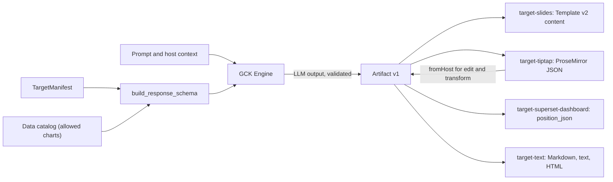
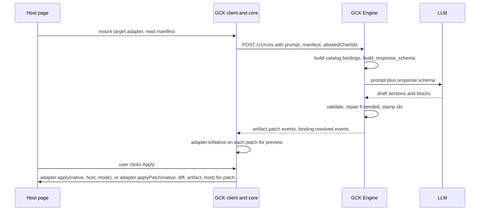

# Artifact Spec and targets

<div class="chapter-meta" markdown>
**Reads:** `servers/fastapi/templates/v2/schema.py`, `servers/fastapi/templates/v2/content.py`, `servers/fastapi/templates/v2/models/elements.py`, `servers/fastapi/api/v1/ppt/endpoints/presentation.py`, `servers/fastapi/utils/schema_utils.py`, `apache/superset: superset-frontend/src/dashboard/util/constants.ts`, `apache/superset: superset/dashboards/schemas.py`, `apache/superset: superset/daos/dashboard.py`  ·  **Builds on:** [Architecture](61-architecture.md)  ·  **Time:** ~55 min
</div>

This chapter defines the one data structure every part of the Generative Content Kit agrees on, the **Artifact** (Artifact Spec v1), and the four adapters that turn it into host-native content: Presenton Template v2 slides, Tiptap (ProseMirror) documents, Apache Superset dashboards, and plain text, Markdown or HTML. You will see the full TypeScript types, the JSON Schema and Pydantic equivalents, the invariants the engine and the client both enforce, how a target manifest becomes the LLM response schema for a run, and complete adapter code for each target. A worked example takes one prompt through one Artifact into all four outputs, and the chapter closes with the test strategy that keeps adapters deterministic.

All new code in this chapter (the `gck/` packages, the `gck_engine/` modules, and one proposed Presenton endpoint) is marked "(new)" in its block title; everything else is quoted from source. Presenton code is quoted from the source snapshot used throughout this site (commit `571461f`); Superset paths, prefixed `apache/superset:`, refer to a clone of `apache/superset` master taken in November 2026, so line numbers can differ on the 6.1 release.

## Step 1: Why an intermediate representation

There are two ways to make a model produce "a page" for a host.

1. **Direct emission.** Ask the LLM for the host's own format: ProseMirror JSON for Tiptap, a `position_json` tree for a Superset dashboard, Template v2 layout JSON for a slide.
2. **IR plus adapters.** Ask the LLM for a small, target-neutral document (the Artifact), constrained by a JSON Schema derived from the target's capabilities, and convert it to the native format with a deterministic adapter.

GCK uses the second design everywhere. The table records why.

| Concern | Direct emission | IR + deterministic adapters |
| --- | --- | --- |
| Validation | Every host format needs its own schema for the LLM; most are not designed for it (`position_json` is an id-keyed graph with `parents` back-references; ProseMirror needs a live schema to validate) | One schema family, assembled per run from a manifest; validated with the same JSON Schema in the browser and in the engine |
| Safety | The model can emit any node, mark, URL, `chartId` or HTML the format allows | The model can only choose block types the manifest lists and `bindingId`s from an enum; URLs and numbers pass validators before an adapter sees them |
| Numbers | The model writes chart values and KPI figures | Numbers come only from `DataBinding` snapshots through tokens (Part VII number discipline, [Data-bound slide model](../superset/33-data-bound-model.md)) |
| Multi-target | One prompt engineering effort per host format | One generation pipeline; a new host is a new adapter, not a new prompt |
| Editing | "Change the second chart" requires the model to understand the host format | `fromHost` imports existing content into an Artifact; the model edits the IR; the adapter re-serializes |
| Streaming | Partial native JSON is often invalid for the host (a ProseMirror node without its children) | `artifact.patch` events add whole blocks; each patch is renderable ([Run protocol and client](63-run-protocol-and-client.md)) |
| Testability | Model output must be checked against a running host | Adapters are pure functions: golden files and round-trip tests without an LLM |
| Token cost | Host formats are verbose (styling, geometry, ids) | The IR carries content only; styling and geometry are added by the adapter |

### 1.1 Presenton already does this, for one target

Presenton never asks the LLM for a slide layout. It builds a JSON Schema from a Template v2 layout, the LLM fills that schema, and a hydrator writes the values back into a copy of the layout. [From template to schema to slide](../presenton/17-template-to-slide.md) walks through it in detail; the two halves are short enough to recall here.

The schema half emits one strict object per component, keyed by component id, with one property per editable element (`_template_layout_schema`, `servers/fastapi/templates/v2/schema.py:585`; the excerpt starts at `:623`):

```python title="servers/fastapi/templates/v2/schema.py (excerpt)"
    schema = None
    if properties:
        schema = {
            "$schema": JSON_SCHEMA_URI,
            "type": "object",
            "title": layout.get("id") or f"slide_{slide_index}",
            "description": layout.get("description"),
            "additionalProperties": False,
            "properties": properties,
            "required": required,
        }
```

An element is a field only when it is not decorative (`_is_editable_element`, `schema.py:53`) and its type is in `CONTENT_TYPES` (`schema.py:15`). Text becomes `{"type": "string", "minLength", "maxLength"}`; a chart becomes `{chart_type, categories, series}` with at most 24 categories and 12 series (`_chart_content_schema`, `schema.py:1490`).

The hydration half is `_apply_template_content_to_ui` (`servers/fastapi/api/v1/ppt/endpoints/presentation.py:575`), which deep-copies the layout, finds each component's content object by the same key the schema used, and dispatches by element type (`_apply_template_content_value`, `presentation.py:865`). Repeated regions are delegated to helpers in `servers/fastapi/templates/v2/content.py`:

```python title="servers/fastapi/templates/v2/content.py (excerpt)"
    hydrated: list[Any] = []
    for index, value in enumerate(values):
        source_index = repeated_child_source_index(
            index,
            template_count=len(elements),
            content_count=len(values),
            center_when_reduced=True,
        )
        source = copy.deepcopy(elements[source_index])
        if not isinstance(source, dict):
            return None
        hydrated.append(apply_item(source, value))
    return hydrated
```

GCK generalizes each piece:

| Presenton (one target) | GCK (any target) |
| --- | --- |
| Template v2 layout | `TargetManifest` (block types, limits, layout catalog) |
| `get_template_schema` (`schema.py:257`) | `build_response_schema(manifest, catalog)` (Step 6) |
| Slide content JSON keyed by component and element name | Artifact: sections of typed blocks |
| `_apply_template_content_to_ui` | `TargetAdapter.toNative` |
| LLM-written `categories` and `series` | `DataBinding` snapshots referenced by `bindingId` |
| Markdown emphasis in strings (`**x**`) | `RichText` segments with explicit `marks` |

The slides target (Step 7) is in fact a thin layer on top of Presenton's own schema and hydrator: the Artifact is mapped onto the content JSON that `_apply_template_content_to_ui` already accepts.



## Step 2: The Artifact Spec v1 in TypeScript

The types live in `@gck/protocol`, which has no runtime dependencies. They are exactly the blueprint's types, with the supporting aliases spelled out.

```ts title="gck/packages/protocol/src/artifact.ts (new)"
export const ARTIFACT_VERSION = "gck.artifact/1" as const;

export type TargetId = "slides" | "tiptap-doc" | "superset-dashboard" | "text";
export type ChartKind =
  | "bar" | "horizontal_bar" | "stacked_bar" | "line" | "area"
  | "pie" | "donut" | "scatter" | "radar";

export type Artifact = {
  id: string;                               // "art_" + ULID
  version: typeof ARTIFACT_VERSION;
  title: string;
  language?: string;                        // BCP 47, e.g. "en", "de-CH"
  target: TargetId;                         // the target the run was planned for
  sections: Section[];                      // ordered
  bindings: Record<string, DataBinding>;    // keyed by bindingId, referenced by blocks
  provenance: { runId: string; model?: string; createdAt: string; prompt: string };
};

export type Section = {
  id: string;                               // "sec_..."
  kind: "slide" | "page" | "row" | "section";
  title?: string;
  layoutHint?: string;                      // target-specific: slides layout id, dashboard row pattern
  blocks: Block[];
};

export type Block =
  | { id: string; type: "heading"; level: 1 | 2 | 3; text: RichText }
  | { id: string; type: "paragraph"; text: RichText }
  | { id: string; type: "list"; ordered: boolean; items: RichText[] }
  | { id: string; type: "callout"; tone: "info" | "warning" | "success"; text: RichText }
  | { id: string; type: "chart"; bindingId: string; chartType: ChartKind; title?: string }
  | { id: string; type: "metric"; bindingId: string; label: string; compare?: "previous_period" | null }
  | { id: string; type: "table"; bindingId: string; columns?: string[]; maxRows?: number }
  | { id: string; type: "image"; prompt?: string; url?: string; alt: string }
  | { id: string; type: "quote"; text: RichText }
  | { id: string; type: "divider" };

export type BlockType = Block["type"];
export type Mark = "bold" | "italic" | "code" | "link";

export type TextSegment = {
  text: string;                             // for token segments: the last rendered display
  marks?: Mark[];
  href?: string;                            // only with the "link" mark
  token?: { bindingId: string; field: string; format?: string };
};
export type RichText = TextSegment[];

export type DataBinding = {
  kind: "chart" | "metric" | "table";
  source: {
    type: "superset_chart"; chart_id: number; dashboard_id?: number;
    overrides?: object; row_limit?: number;
  };
  mapping: object;                          // Part VIII mapping: x, series, labels, sort, top_n
  format?: object;                          // Part VIII format: number (d3 spec), prefix, suffix
  snapshot?: object;                        // ChartSnapshot | MetricSnapshot | TableSnapshot
  snapshotAt?: string;                      // ISO 8601
  status?: "pending" | "ok" | "stale" | "error" | "forbidden";
};

// Snapshot shapes per binding kind (normative for adapters)
export type ChartSnapshot = { categories: string[]; series: { name: string; values: number[] }[] };
export type MetricSnapshot = { value: number | null; previous?: number | null };
export type TableSnapshot = { columns: string[]; rows: (string | number | null)[][] };
```

### 2.1 Identifiers

| Id | Pattern | Assigned by | Stable across |
| --- | --- | --- | --- |
| `Artifact.id` | `^art_[0-9A-HJKMNP-TV-Z]{26}$` (ULID) | engine, at `run.started` | every later edit of the same artifact |
| `Section.id` | `^sec_[a-z0-9]{4,24}$` | engine, after validating LLM output | patches, edits, host round-trips |
| `Block.id` | `^blk_[a-z0-9]{4,24}$` | engine, same | patches, edits, host round-trips |
| binding key | `^b_[a-z0-9_]{1,48}$` (same as Part VII) | engine, from the data catalog before the LLM call | the artifact's life |

The LLM never writes `id` fields. Ids are stamped after validation (Step 6.3), so the model cannot collide them, and an edit run receives existing ids in its input and must return them unchanged. Ids are the anchor for three things: RFC 6902 patches address blocks by array index, but the client resolves index paths to block ids after each patch ([Run protocol and client](63-run-protocol-and-client.md)); every top-level Tiptap node the target creates carries a `gckBlockId` attribute (data nodes also keep `gckId`) and Superset components get ids derived from block ids, so `fromHost` can map content back and a `patch` apply can find the node to change (Step 8.6); and golden-file tests diff by id.

### 2.2 RichText and data tokens

`RichText` is a flat list of segments. A segment is plain text with optional marks, or a **token**: a reference to one value of one binding. Tokens are the only way a number enters prose.

| Binding kind | Token `field` | Value |
| --- | --- | --- |
| `metric` | `value`, `previous`, `delta`, `delta_pct` | numbers from `MetricSnapshot`; `delta_pct` is `(value - previous) / abs(previous)` |
| `chart` | `total:<series>`, `last:<series>`, `max:<series>` | numbers over one series (first series if the name is omitted) |
| `chart` | `argmax:<series>`, `last_category` | category labels (strings) |
| `table` | `cell:<row>:<column>`, `row_count` | one cell by row index and column name; the row count |

`format` is a [d3-format](https://d3js.org/d3-format) specifier such as `,.3s` or `.0%`, the same notation Superset uses for number formats and that Part VIII's `format.number` holds. Resolution order is `token.format`, then the column's entry in `binding.format.columns` (for `cell:` fields), then `binding.format.number`, then `","`; the effective `prefix` and `suffix` wrap the result. `delta_pct` always uses `+.1%` unless the token overrides it, and never takes the binding's currency prefix. Because the prefix is added outside d3, a token spec must not repeat it (`$,.3s` on a binding with `prefix: "$"` would print `$$591k`). A token segment's `text` holds the display string at the time the artifact was produced, so a naive consumer still shows something readable; adapters always re-render from the snapshot. One resolver in `@gck/core` serves every adapter:

```ts title="gck/packages/core/src/tokens.ts (new)"
import { format as d3Format } from "d3-format";
import type { DataBinding, RichText, ChartSnapshot, MetricSnapshot, TableSnapshot } from "@gck/protocol";

export type Resolved = { value: number | string | null; display: string };

function rawValue(b: DataBinding, field: string): number | string | null {
  const [op, a, c] = field.split(":");
  if (b.kind === "metric") {
    const s = b.snapshot as MetricSnapshot;
    const v = s.value ?? null, p = s.previous ?? null;
    if (op === "value") return v;
    if (op === "previous") return p;
    if (op === "delta") return v != null && p != null ? v - p : null;
    if (op === "delta_pct") return v != null && p ? (v - p) / Math.abs(p) : null;
  }
  if (b.kind === "chart") {
    const s = b.snapshot as ChartSnapshot;
    const values = (s.series.find((x) => x.name === a) ?? s.series[0])?.values ?? [];
    if (op === "total") return values.reduce((x, y) => x + y, 0);
    if (op === "last") return values.at(-1) ?? null;
    if (op === "max") return values.length ? Math.max(...values) : null;
    if (op === "argmax") return values.length ? s.categories[values.indexOf(Math.max(...values))] ?? null : null;
    if (op === "last_category") return s.categories.at(-1) ?? null;
  }
  if (b.kind === "table") {
    const s = b.snapshot as TableSnapshot;
    if (op === "row_count") return s.rows.length;
    if (op === "cell") return s.rows[Number(a)]?.[s.columns.indexOf(c)] ?? null;
  }
  return null;
}

type Fmt = { number?: string; prefix?: string; suffix?: string };

export function resolveToken(b: DataBinding | undefined, field: string, spec?: string): Resolved {
  if (!b?.snapshot || b.status === "forbidden" || b.status === "error") return { value: null, display: "n/a" };
  const value = rawValue(b, field);
  if (value === null || typeof value === "string") return { value, display: value ?? "n/a" };
  const base = (b.format ?? {}) as Fmt & { columns?: Record<string, Fmt> };
  const column = field.startsWith("cell:") ? field.split(":")[2] : undefined;
  const f: Fmt = field === "delta_pct" ? { number: "+.1%" } : { ...base, ...(column ? base.columns?.[column] : {}) };
  const body = d3Format(spec ?? f.number ?? ",")(value);
  return { value, display: `${f.prefix ?? ""}${body}${f.suffix ?? ""}` };
}

export function plainText(rt: RichText, bindings: Record<string, DataBinding>): string {
  return rt.map((s) => (s.token ? resolveToken(bindings[s.token.bindingId], s.token.field, s.token.format).display : s.text)).join("");
}
```

!!! warning "Gotcha: a forbidden binding must not leak through `text`"
    The `text` of a token segment is a cached display. When a viewer's binding resolves to `forbidden` ([Security, RLS, auth](../superset/38-security.md)), `resolveToken` returns `n/a`, but an adapter that printed `segment.text` would show the value the author saw. Every adapter in this chapter renders tokens through `resolveToken` and never through `segment.text`, and the engine blanks `text` in token segments before sending an artifact to a viewer other than its author.

### 2.3 DataBinding

`DataBinding` has the same shape as Part VIII's `slide_data_bindings` row ([Architecture and contracts](../delivery/41-architecture-and-contracts.md)), minus the slide coordinates: `kind`, `source` (a saved Superset chart), `mapping`, `format`, `snapshot`, `snapshotAt` and `status`. The statuses keep their Part VIII meaning. GCK makes the snapshot shapes normative per kind, so adapters can read them without knowing where they came from: a chart snapshot is exactly the `{categories, series}` element patch Part VIII's resolver already produces, which is also exactly what Presenton's `Chart` element stores (`categories: Optional[list[str]]`, `series: Optional[list[ChartSeries]]`, `servers/fastapi/templates/v2/models/elements.py:361`).

Bindings are resolved by `@gck/data-superset` in the browser or by the engine (both through the Part VIII refresh API, [Story 8](../delivery/49-story8-analytics-mcp.md)), and arrive as `binding.resolved` events. An adapter never fetches data itself.

### 2.4 Versioning rules

| Change | Allowed in `gck.artifact/1`? | How |
| --- | --- | --- |
| New optional field on an existing type | yes | minor bump of `@gck/protocol`; readers ignore unknown fields only when the reader's protocol minor is older |
| New token `field` grammar | yes | minor bump; `resolveToken` returns `n/a` for unknown fields |
| New block type or mark | yes, as a minor bump | adapters must apply the unknown-block rule below |
| Renaming or removing a field, changing a meaning | no | `gck.artifact/2` plus an `upgrade_1_to_2` function shipped in `@gck/protocol` and the engine |

The unknown-block rule: an adapter that meets a block type it does not support renders it through `@gck/target-text` as a paragraph if the block has `text` or `items`, otherwise drops it and records a warning in its result. Validation is strict on write (the engine rejects unknown fields with `extra="forbid"`) and tolerant on read (adapters accept newer minors). This asymmetry keeps old hosts working while preventing the model from inventing structure.

## Step 3: The JSON Schema and the Pydantic models

`@gck/protocol` publishes `schemas/artifact-1.schema.json` (draft 2020-12). It is the contract artifact both codebases test against (Step 12). An excerpt:

```json title="gck/packages/protocol/schemas/artifact-1.schema.json (new, excerpt)"
{
  "$schema": "https://json-schema.org/draft/2020-12/schema",
  "$id": "https://gck.dev/schemas/artifact-1.schema.json",
  "type": "object",
  "additionalProperties": false,
  "required": ["id", "version", "title", "target", "sections", "bindings", "provenance"],
  "properties": {
    "id": {"type": "string", "pattern": "^art_[0-9A-HJKMNP-TV-Z]{26}$"},
    "version": {"const": "gck.artifact/1"},
    "title": {"type": "string", "minLength": 1, "maxLength": 200},
    "target": {"enum": ["slides", "tiptap-doc", "superset-dashboard", "text"]},
    "sections": {"type": "array", "items": {"$ref": "#/$defs/section"}},
    "bindings": {"type": "object", "propertyNames": {"pattern": "^b_[a-z0-9_]{1,48}$"},
                 "additionalProperties": {"$ref": "#/$defs/dataBinding"}}
  },
  "$defs": {
    "segment": {
      "type": "object", "additionalProperties": false, "required": ["text"],
      "properties": {
        "text": {"type": "string"},
        "marks": {"type": "array", "uniqueItems": true,
                  "items": {"enum": ["bold", "italic", "code", "link"]}},
        "href": {"type": "string", "pattern": "^(https?:|mailto:)"},
        "token": {"type": "object", "additionalProperties": false, "required": ["bindingId", "field"],
                  "properties": {"bindingId": {"type": "string"}, "field": {"type": "string"},
                                 "format": {"type": "string", "maxLength": 32}}}
      }
    },
    "richText": {"type": "array", "items": {"$ref": "#/$defs/segment"}},
    "block": {
      "oneOf": [
        {"type": "object", "additionalProperties": false, "required": ["id", "type", "level", "text"],
         "properties": {"id": {"$ref": "#/$defs/blockId"}, "type": {"const": "heading"},
                        "level": {"enum": [1, 2, 3]}, "text": {"$ref": "#/$defs/richText"}}},
        {"type": "object", "additionalProperties": false, "required": ["id", "type", "bindingId", "chartType"],
         "properties": {"id": {"$ref": "#/$defs/blockId"}, "type": {"const": "chart"},
                        "bindingId": {"type": "string"}, "title": {"type": "string"},
                        "chartType": {"enum": ["bar", "horizontal_bar", "stacked_bar", "line", "area",
                                               "pie", "donut", "scatter", "radar"]}}},
        {"type": "object", "additionalProperties": false, "required": ["id", "type"],
         "properties": {"id": {"$ref": "#/$defs/blockId"}, "type": {"const": "divider"}}}
      ]
    }
  }
}
```

The other block variants follow the same pattern; `oneOf` is safe here because every variant pins `type` with `const`, so at most one can match. (The per-run LLM schema in Step 6 uses `anyOf` instead, for a different reason.)

The engine's models mirror the schema. Field names match the JSON exactly, camelCase included, so there is no alias layer to drift:

```python title="gck_engine/spec/artifact.py (new)"
from typing import Annotated, Literal, Optional, Union
from pydantic import BaseModel, ConfigDict, Field

BlockId = Annotated[str, Field(pattern=r"^blk_[a-z0-9]{4,24}$")]
SectionId = Annotated[str, Field(pattern=r"^sec_[a-z0-9]{4,24}$")]
BindingKey = Annotated[str, Field(pattern=r"^b_[a-z0-9_]{1,48}$")]
ChartKind = Literal["bar", "horizontal_bar", "stacked_bar", "line", "area", "pie", "donut", "scatter", "radar"]


class _M(BaseModel):
    model_config = ConfigDict(extra="forbid")


class Token(_M):
    bindingId: BindingKey
    field: str = Field(max_length=64)
    format: Optional[str] = Field(default=None, max_length=32)


class Segment(_M):
    text: str
    marks: list[Literal["bold", "italic", "code", "link"]] = []
    href: Optional[str] = Field(default=None, pattern=r"^(https?:|mailto:)")
    token: Optional[Token] = None


RichText = list[Segment]


class Heading(_M):
    id: BlockId; type: Literal["heading"]; level: Literal[1, 2, 3]; text: RichText
class Paragraph(_M):
    id: BlockId; type: Literal["paragraph"]; text: RichText
class ListBlock(_M):
    id: BlockId; type: Literal["list"]; ordered: bool; items: list[RichText]
class Callout(_M):
    id: BlockId; type: Literal["callout"]; tone: Literal["info", "warning", "success"]; text: RichText
class ChartBlock(_M):
    id: BlockId; type: Literal["chart"]; bindingId: BindingKey; chartType: ChartKind; title: Optional[str] = None
class MetricBlock(_M):
    id: BlockId; type: Literal["metric"]; bindingId: BindingKey; label: str
    compare: Optional[Literal["previous_period"]] = None
class TableBlock(_M):
    id: BlockId; type: Literal["table"]; bindingId: BindingKey
    columns: Optional[list[str]] = None; maxRows: Optional[int] = Field(default=None, ge=1, le=50)
class ImageBlock(_M):
    id: BlockId; type: Literal["image"]; prompt: Optional[str] = None; url: Optional[str] = None; alt: str
class Quote(_M):
    id: BlockId; type: Literal["quote"]; text: RichText
class Divider(_M):
    id: BlockId; type: Literal["divider"]


Block = Annotated[
    Union[Heading, Paragraph, ListBlock, Callout, ChartBlock, MetricBlock,
          TableBlock, ImageBlock, Quote, Divider],
    Field(discriminator="type"),
]


class Section(_M):
    id: SectionId
    kind: Literal["slide", "page", "row", "section"]
    title: Optional[str] = None
    layoutHint: Optional[str] = None
    blocks: list[Block]


class Source(_M):
    type: Literal["superset_chart"]; chart_id: int; dashboard_id: Optional[int] = None
    overrides: Optional[dict] = None; row_limit: Optional[int] = Field(default=None, ge=1, le=5000)


class DataBinding(_M):
    kind: Literal["chart", "metric", "table"]
    source: Source
    mapping: dict = {}
    format: Optional[dict] = None
    snapshot: Optional[dict] = None
    snapshotAt: Optional[str] = None
    status: Optional[Literal["pending", "ok", "stale", "error", "forbidden"]] = None


class Provenance(_M):
    runId: str; model: Optional[str] = None; createdAt: str; prompt: str


class Artifact(_M):
    id: str = Field(pattern=r"^art_[0-9A-HJKMNP-TV-Z]{26}$")
    version: Literal["gck.artifact/1"] = "gck.artifact/1"
    title: str = Field(min_length=1, max_length=200)
    language: Optional[str] = None
    target: Literal["slides", "tiptap-doc", "superset-dashboard", "text"]
    sections: list[Section]
    bindings: dict[BindingKey, DataBinding]
    provenance: Provenance
```

`Field(discriminator="type")` is the same construction Presenton uses for its element union (`SlideElement`, `servers/fastapi/templates/v2/models/elements.py`, chapter 16), with one deliberate difference: GCK sets `extra="forbid"` on every model. Presenton's element models do not (only a few infographic data sub-models set `extra`, `elements.py:458`), which is why unknown keys in template bundles are silently dropped ([Template v2 format](../presenton/16-template-v2-format.md)).

## Step 4: Invariants and validators

Schema validation catches shape errors. The invariants below need cross-references or rendering, so they live in a validator that runs in the engine after every LLM response (feeding a repair retry) and in `@gck/core` before `toNative` (`validateArtifact(artifact, manifest, { allowedChartIds })`, feeding a warning UI). Both implementations share issue codes.

| Code | Invariant |
| --- | --- |
| `I1_VERSION` | `version == "gck.artifact/1"` |
| `I2_IDS` | Section and block ids are unique within the artifact and match their patterns |
| `I3_BINDING_REF` | Every block `bindingId` and every `token.bindingId` is a key of `bindings` |
| `I4_BINDING_KIND` | `chart` blocks reference `chart` bindings, `metric` to `metric`, `table` to `table`; token fields are valid for the binding's kind |
| `I5_NUMBERS_IN_TOKENS` | Plain segments contain no digits, except allowlisted calendar labels (years `19xx`/`20xx`, `Q1` to `Q4`, `H1`/`H2`, `FY` plus two or four digits) |
| `I6_MANIFEST_BLOCKS` | Block types and section kinds are in the target manifest |
| `I7_LIMITS` | Section count, blocks per section, and rendered characters per block (tokens counted by their display) are within manifest limits |
| `I8_LAYOUT_HINT` | `layoutHint`, when set, is an id in the manifest's `layoutCatalog` |
| `I9_LINKS` | `href` is present if and only if the segment has the `link` mark; scheme is `https`, `http` or `mailto` |
| `I10_ALLOWED_SOURCES` | Every binding's `source.chart_id` is in the run's `data.allowedChartIds` |
| `I11_IMAGES` | An image block has `prompt` or `url`; `url` is `https` |

```python title="gck_engine/spec/validate.py (new)"
import re
from dataclasses import dataclass

from .artifact import Artifact, ChartBlock, MetricBlock, TableBlock

CALENDAR = re.compile(r"\b(?:(?:19|20)\d{2}|Q[1-4]|H[12]|FY(?:\d{4}|\d{2}))\b")
FIELDS = {
    "metric": re.compile(r"^(value|previous|delta|delta_pct)$"),
    "chart": re.compile(r"^((total|last|max|argmax):[^:]*|last_category)$"),
    "table": re.compile(r"^(cell:\d+:[^:]+|row_count)$"),
}
BLOCK_KIND = {ChartBlock: "chart", MetricBlock: "metric", TableBlock: "table"}


@dataclass
class Issue:
    code: str
    path: str
    message: str


def _segments(block):
    if hasattr(block, "text") and isinstance(block.text, list):
        yield from block.text
    for item in getattr(block, "items", None) or []:
        yield from item


def validate_artifact(a: Artifact, manifest, allowed_chart_ids: set[int], display) -> list[Issue]:
    issues: list[Issue] = []
    seen: set[str] = set()
    limits = manifest.limits
    layout_ids = {l.id for l in manifest.layoutCatalog or []}
    if limits.maxSections and len(a.sections) > limits.maxSections:
        issues.append(Issue("I7_LIMITS", "sections", f"{len(a.sections)} > {limits.maxSections}"))
    for key, b in a.bindings.items():
        if b.source.chart_id not in allowed_chart_ids:
            issues.append(Issue("I10_ALLOWED_SOURCES", f"bindings.{key}", "chart not allowed for this run"))
    for si, s in enumerate(a.sections):
        sp = f"sections[{si}]"
        for ident, path in [(s.id, sp)] + [(b.id, f"{sp}.blocks[{bi}]") for bi, b in enumerate(s.blocks)]:
            if ident in seen:
                issues.append(Issue("I2_IDS", path, f"duplicate id {ident}"))
            seen.add(ident)
        if s.kind not in manifest.sectionKinds:
            issues.append(Issue("I6_MANIFEST_BLOCKS", sp, f"section kind {s.kind}"))
        if s.layoutHint and layout_ids and s.layoutHint not in layout_ids:
            issues.append(Issue("I8_LAYOUT_HINT", sp, f"unknown layout {s.layoutHint}"))
        if limits.maxBlocksPerSection and len(s.blocks) > limits.maxBlocksPerSection:
            issues.append(Issue("I7_LIMITS", sp, "too many blocks"))
        for bi, block in enumerate(s.blocks):
            bp = f"{sp}.blocks[{bi}]"
            if block.type not in manifest.blocks:
                issues.append(Issue("I6_MANIFEST_BLOCKS", bp, f"block type {block.type}"))
            if block.type == "image" and not (block.prompt or (block.url or "").startswith("https:")):
                issues.append(Issue("I11_IMAGES", bp, "image needs a prompt or an https url"))
            if (kind := BLOCK_KIND.get(type(block))) is not None:
                bound = a.bindings.get(block.bindingId)
                if bound is None:
                    issues.append(Issue("I3_BINDING_REF", bp, f"missing binding {block.bindingId}"))
                elif bound.kind != kind:
                    issues.append(Issue("I4_BINDING_KIND", bp, f"{kind} block on {bound.kind} binding"))
            chars = 0
            for seg in _segments(block):
                if seg.token:
                    bound = a.bindings.get(seg.token.bindingId)
                    if bound is None:
                        issues.append(Issue("I3_BINDING_REF", bp, f"token on {seg.token.bindingId}"))
                    elif not FIELDS[bound.kind].match(seg.token.field):
                        issues.append(Issue("I4_BINDING_KIND", bp, f"field {seg.token.field}"))
                    chars += len(display(bound, seg.token)) if bound else 0
                    continue
                if re.search(r"\d", CALENDAR.sub("", seg.text)):
                    issues.append(Issue("I5_NUMBERS_IN_TOKENS", bp, f"digits in {seg.text[:40]!r}"))
                if ("link" in seg.marks) != (seg.href is not None):
                    issues.append(Issue("I9_LINKS", bp, "href and link mark must go together"))
                chars += len(seg.text)
            if limits.maxCharsPerBlock and chars > limits.maxCharsPerBlock:
                issues.append(Issue("I7_LIMITS", bp, f"{chars} chars > {limits.maxCharsPerBlock}"))
    return issues
```

`display` is the Python twin of `resolveToken` (it renders one token from a binding snapshot). The engine passes the issues back to the model in a repair prompt, the same loop Presenton runs when a response fails its schema (`get_schema_validation_errors`, `servers/fastapi/utils/schema_utils.py:292`, which formats each error as a `$.path: message` line).

!!! warning "Gotcha: why `I5` is a validator and not a schema `pattern`"
    Part VII put the number rule into a JSON Schema regex ([Data-bound slide model](../superset/33-data-bound-model.md)). GCK keeps it out of the response schema because the allowlist (years, quarters) makes the expression long, and long patterns are where provider support for structured outputs is least consistent. A validator failure costs one repair round trip; a schema the provider rejects costs the whole run.

## Step 5: Target manifests and the adapter interface

A target describes what it can render (the manifest) and implements a deterministic serializer (the adapter). These types refine the blueprint's: the manifest is unchanged, the host context and patch types reuse the run protocol's (`RunContext` and `JsonPatchOp` from `run.ts`, [Run protocol and client](63-run-protocol-and-client.md)), and the adapter's preview is lazy and React-free (below).

```ts title="gck/packages/protocol/src/target.ts (new)"
import type { Artifact, BlockType, Section, TargetId } from "./artifact";
import type { JsonPatchOp, RunContext } from "./run";

export type LayoutSummary = {
  id: string;
  label?: string;
  description?: string;
  capacity: Partial<Record<BlockType, number>>;    // how many blocks of each type it can hold
  meta?: Record<string, unknown>;                   // target-specific, e.g. a content schema
};

export type ApplyMode = "replace" | "insert_at_cursor" | "append" | "patch";

export type TargetManifest = {
  id: TargetId;
  version: string;                                  // semver of the target package
  blocks: BlockType[];
  sectionKinds: Section["kind"][];
  limits: { maxSections?: number; maxBlocksPerSection?: number; maxCharsPerBlock?: number };
  layoutCatalog?: LayoutSummary[];
  applyModes: ApplyMode[];
  promptHints: string;                              // at most ~600 characters, sent to the engine
};

/** The run request's context object: one type, two names. */
export type HostContext = RunContext;

export type ArtifactPatch = { ops: JsonPatchOp[] };

/** Block-level difference between an edit run's base artifact and its result, as block ids. */
export type ArtifactDiff = { added: string[]; removed: string[]; changed: string[] };

export type ApplyResult = {
  ok: boolean;
  mode: ApplyMode;
  nativeRef?: unknown;              // what was created or changed (dashboard id, slide ids, ...)
  warnings: string[];
  undo?: () => Promise<void>;       // present when the kit can revert; absent = host-native undo or none
};
```

```ts title="gck/packages/core/src/adapter.ts (new)"
import type {
  Artifact, ApplyMode, ApplyResult, ArtifactDiff, HostContext, TargetManifest,
} from "@gck/protocol";

export type { ApplyMode, ApplyResult, ArtifactDiff, HostContext } from "@gck/protocol";

export interface HostApi {
  readonly id: string;                                       // "superset" | "tiptap" | "presenton" | "web" | ...
  capability<T>(name: string): T | undefined;                // e.g. "tiptap.editor", "superset.http"
  emit?(event: string, detail: unknown): void;
}

export interface TargetAdapter<Native = unknown, Preview = unknown> {
  manifest: TargetManifest;
  fromHost?(ctx: HostContext): Partial<Artifact>;
  toNative(artifact: Artifact): Native;                      // pure, deterministic, no I/O
  preview?: Preview;                                         // eager (tiny targets only)
  loadPreview?: () => Promise<Preview>;                      // lazy, from the target's /react subpath
  apply(native: Native, host: HostApi, mode: ApplyMode): Promise<ApplyResult>;
  /** Used when mode === "patch": change host content in place, block by block. Absent = no patch support. */
  applyPatch?(native: Native, diff: ArtifactDiff, artifact: Artifact, host: HostApi): Promise<ApplyResult>;
}

/** Optional helper: build a HostApi from a plain capability map. */
export function createHost(
  id: string,
  capabilities: Record<string, unknown>,
  emit?: (event: string, detail: unknown) => void,
): HostApi {
  return { id, capability: <T>(name: string) => capabilities[name] as T | undefined, ...(emit ? { emit } : {}) };
}
```

`@gck/core` never imports React, not even as a type, so the core bundle stays React-free and DOM-free. `Preview` is a type parameter that `@gck/react` narrows to `ComponentType<PreviewProps>` (`PreviewProps = { artifact: Artifact; streaming: boolean }`), and each target supplies its preview through `loadPreview` from its `/react` subpath, never as an eager import in the target's main entry ([React SDK and UI kit](64-react-sdk-and-ui-kit.md)). `ApplyResult` and `ApplyMode` live in `@gck/protocol` and are re-exported by `@gck/core`. After every apply the run controller calls `host.emit?.("gck.applied", { result, artifact })`, so a host can react without wrapping the adapter.

### 5.1 Intents, diffs and the patch apply mode

The run controller's `submit` takes the run's intent ([React SDK and UI kit](64-react-sdk-and-ui-kit.md)): `submit({ prompt, intent?, selection?, baseArtifact?, apply? })`, with `RunIntent = "generate" | "transform" | "edit"` from `@gck/protocol`. The adapter supplies the inputs for the two non-generate intents through `fromHost`:

| Intent | Input from the target | Sent as | Default apply mode |
| --- | --- | --- | --- |
| `generate` | none (context only) | `RunRequest.context` | none: the mode chosen in the apply bar |
| `transform` | `selection`: the target's `fromHost` output for the user's selection | `RunRequest.context.selection` (as Artifact blocks) | `replace` |
| `edit` | `baseArtifact`: the artifact previously applied, re-read with `fromHost` | `RunRequest.context.document` | `patch` |

For `edit`, the engine streams `artifact.patch` ops against the base artifact (the stream starts from `baseArtifact` as version 0), and `run.completed` carries the final version. The controller keeps the base and computes an `ArtifactDiff` (the ids of added, removed and changed blocks), which it exposes as `run.diff` for review UI and passes to the adapter.

The adapter interface has two apply entry points, and the controller picks one. When the mode is `"patch"` and the adapter has `applyPatch`, it calls `adapter.applyPatch(native, diff, artifact, host)` as a method, where `native` is `toNative` of the final artifact. Every other case goes through `apply(native, host, mode)`. A target that does not list `"patch"` in `manifest.applyModes` never gets `applyPatch` called; if it still receives `"patch"` through `apply` (a host that passes a mode through without checking the manifest), it applies as `replace` and adds a `patch_unsupported` warning. The streaming patches themselves never reach an adapter: the run store applies them to the Artifact, and the preview re-runs `toNative`.

| Target | `applyModes` | `applyPatch` |
| --- | --- | --- |
| `slides` | `append`, `replace` | none; `"patch"` falls back to `replace` with a warning (Step 7.3) |
| `tiptap-doc` | `replace`, `insert_at_cursor`, `append`, plus `patch` when `GckBlockIds` is registered | one ProseMirror transaction over the changed blocks (Step 8.6) |
| `superset-dashboard` | `append`, `replace` | none; `"patch"` falls back to `replace` with a warning (Step 9.4) |
| `text` | `replace`, `append`, `insert_at_cursor`, `patch` | re-renders the whole text: patch equals replace (Step 10) |

The well-known capability names the adapters in this chapter read are `presenton.api` (Step 7), `tiptap.editor` (Step 8), and `superset.http` and `superset.positionLimit` (Step 9).



## Step 6: From manifest to the per-run response schema

The engine turns `(manifest, data catalog)` into the JSON Schema it hands the LLM. This is the general form of `_template_layout_schema`: Presenton derives fields from a layout's editable elements; GCK derives them from the manifest's block list and the catalog of bindings the user may use.

### 6.1 The data catalog

Before the LLM call, the engine converts `data.allowedChartIds` into candidate bindings. Each saved chart gets a key such as `b_c412`, a `kind` from its viz type (`big_number_total` and `big_number` become `metric`, `table` becomes `table`, the chart types listed as refreshable in Part VIII become `chart`), a title from the chart's name, and a short shape description (columns, row count of a sample). The catalog is printed into the prompt and its keys become enums in the schema. Charts that do not map are left out, so the model cannot pick them.

### 6.2 The builder

```python title="gck_engine/schema/response_schema.py (new)"
from dataclasses import dataclass

CHART_KINDS = ["bar", "horizontal_bar", "stacked_bar", "line", "area", "pie", "donut", "scatter", "radar"]


@dataclass(frozen=True)
class CatalogEntry:
    key: str          # "b_c412"
    kind: str         # "chart" | "metric" | "table"
    title: str
    chart_id: int


def _nullable(schema: dict) -> dict:
    return {"anyOf": [schema, {"type": "null"}]}


def _strict(properties: dict) -> dict:
    return {"type": "object", "additionalProperties": False,
            "properties": properties, "required": list(properties)}


def _rich_text(max_chars: int, token_keys: list[str]) -> dict:
    token = _strict({"bindingId": {"enum": token_keys}, "field": {"type": "string", "maxLength": 64},
                     "format": _nullable({"type": "string", "maxLength": 32})})
    segment = _strict({
        "text": {"type": "string", "maxLength": max_chars},
        "marks": {"type": "array", "maxItems": 4, "items": {"enum": ["bold", "italic", "code", "link"]}},
        "href": _nullable({"type": "string", "maxLength": 500}),
        "token": _nullable(token) if token_keys else {"type": "null"},
    })
    return {"type": "array", "minItems": 1, "maxItems": 24, "items": segment}


def _variant(block_type: str, rich: dict, keys: dict[str, list[str]]) -> dict | None:
    t = {"type": {"const": block_type}}
    if block_type == "heading":
        return _strict({**t, "level": {"enum": [1, 2, 3]}, "text": rich})
    if block_type in ("paragraph", "quote"):
        return _strict({**t, "text": rich})
    if block_type == "list":
        return _strict({**t, "ordered": {"type": "boolean"},
                        "items": {"type": "array", "minItems": 1, "maxItems": 12, "items": rich}})
    if block_type == "callout":
        return _strict({**t, "tone": {"enum": ["info", "warning", "success"]}, "text": rich})
    if block_type == "divider":
        return _strict(t)
    if block_type == "image":
        return _strict({**t, "prompt": {"type": "string", "maxLength": 300}, "alt": {"type": "string", "maxLength": 150}})
    data_kind = {"chart": "chart", "metric": "metric", "table": "table"}[block_type]
    if not keys[data_kind]:
        return None                                       # never emit an empty enum
    binding = {"bindingId": {"enum": keys[data_kind]}}
    if block_type == "chart":
        return _strict({**t, **binding, "chartType": {"enum": CHART_KINDS},
                        "title": _nullable({"type": "string", "maxLength": 80})})
    if block_type == "metric":
        return _strict({**t, **binding, "label": {"type": "string", "maxLength": 60},
                        "compare": _nullable({"enum": ["previous_period"]})})
    return _strict({**t, **binding, "maxRows": _nullable({"type": "integer", "minimum": 1, "maximum": 50})})


def build_response_schema(manifest, catalog: list[CatalogEntry]) -> dict:
    keys = {k: [c.key for c in catalog if c.kind == k] for k in ("chart", "metric", "table")}
    limits = manifest.limits
    rich = _rich_text(limits.maxCharsPerBlock or 600, [c.key for c in catalog])
    variants = [v for b in manifest.blocks if (v := _variant(b, rich, keys)) is not None]
    layout_ids = [l.id for l in manifest.layoutCatalog or []]
    section = _strict({
        "kind": {"enum": list(manifest.sectionKinds)},
        "title": _nullable({"type": "string", "maxLength": 120}),
        "layoutHint": _nullable({"enum": layout_ids}) if layout_ids else {"type": "null"},
        "blocks": {"type": "array", "minItems": 1,
                   "maxItems": limits.maxBlocksPerSection or 12, "items": {"anyOf": variants}},
    })
    return {
        "$schema": "https://json-schema.org/draft/2020-12/schema",
        **_strict({
            "title": {"type": "string", "minLength": 1, "maxLength": 200},
            "sections": {"type": "array", "minItems": 1, "maxItems": limits.maxSections or 12, "items": section},
        }),
    }
```

What each manifest field becomes:

| Manifest input | Schema output |
| --- | --- |
| `blocks` | the `anyOf` list of block variants; data blocks without a compatible binding are dropped |
| `sectionKinds` | `kind` enum |
| `limits.maxSections` | `sections.maxItems` |
| `limits.maxBlocksPerSection` | `blocks.maxItems` |
| `limits.maxCharsPerBlock` | `maxLength` on every segment's `text` (the validator checks the sum, `I7`) |
| `layoutCatalog[].id` | `layoutHint` enum, nullable |
| data catalog | `bindingId` enums per kind; `token.bindingId` enum over all keys |
| `promptHints` | not schema: appended to the system prompt |

Three choices make the schema acceptable to strict structured-output modes. Every object lists all of its properties as required and sets `additionalProperties: false`, with optional fields expressed as nullable unions; that is the same normalization Presenton applies in `ensure_strict_json_schema` (`servers/fastapi/utils/schema_utils.py:92`), which forces `required` to every property key. Unions use `anyOf`, because that normalizer walks `anyOf` (`schema_utils.py:159`) and has no `oneOf` branch. And ids, bindings, snapshots and provenance are absent: the model writes content, the engine writes everything else.

### 6.3 From draft to Artifact

```python title="gck_engine/schema/stamp.py (new)"
from ulid import ULID


def stamp(draft: dict, *, run_id: str, catalog: dict[str, "CatalogEntry"], prompt: str,
          target: str, model: str | None, now: str) -> dict:
    short = run_id[-6:].lower()
    used: set[str] = set()
    for si, section in enumerate(draft["sections"]):
        section["id"] = f"sec_{short}{si:02d}"
        for bi, block in enumerate(section["blocks"]):
            block["id"] = f"blk_{short}{si:02d}{bi:02d}"
            if "bindingId" in block:
                used.add(block["bindingId"])
            for seg in block.get("text") or [s for item in block.get("items") or [] for s in item]:
                if seg.get("token"):
                    used.add(seg["token"]["bindingId"])
    bindings = {key: {"kind": catalog[key].kind,
                      "source": {"type": "superset_chart", "chart_id": catalog[key].chart_id},
                      "mapping": {}, "status": "pending"} for key in sorted(used)}
    return {"id": f"art_{ULID()}", "version": "gck.artifact/1", "title": draft["title"],
            "target": target, "sections": draft["sections"], "bindings": bindings,
            "provenance": {"runId": run_id, "model": model, "createdAt": now, "prompt": prompt}}
```

Null optionals are then dropped (`exclude_none` when dumping the Pydantic model), so the stored Artifact matches the TypeScript types, where optional means absent.

!!! warning "Gotcha: an empty enum is a broken schema"
    If the user allowed no table charts, `{"enum": []}` for a table block's `bindingId` would match nothing, and some providers reject an empty enum outright. `_variant` returns `None` and the block type disappears from the run. The engine also sends a `run.warning` (`data_block_unavailable`) so the client can explain why the result has no tables. Part VII applies the same rule to slot menus.

## Step 7: `@gck/target-slides`

The slides target maps an Artifact onto Presenton Template v2. Its native output is not layout geometry. It is, per section, a chosen layout id plus the **content JSON** that Presenton's hydrator accepts, which is the same shape the layout's content schema describes.

```ts title="gck/packages/target-slides/src/types.ts (new)"
export type SlideOut = { sectionId: string; layoutId: string; content: Record<string, unknown>; warnings: string[] };
export type SlidesNative = { templateId: string; slides: SlideOut[] };
```

### 7.1 The layout catalog

The engine builds the slides manifest from a deck's layout payload: for each layout it runs Presenton's `get_template_schema` (`servers/fastapi/templates/v2/schema.py:257`), keeps the layout id and description, and puts the stripped content schema into `LayoutSummary.meta.contentSchema`. The adapter classifies the schema's leaves into slots by shape, which is reliable because `_component_content_field_schema` (`schema.py:1200`) emits a distinct shape per element type:

| Schema shape | Element | Slot |
| --- | --- | --- |
| `string` with `maxLength` | `text` | text slot |
| array of strings | `text-list` | list slot |
| object with `chart_type`, `categories`, `series` | `chart` | chart slot |
| object with `columns`, `rows` | `table` | table slot |
| object with `image_prompt` or `icon_query` | `image` | image slot |
| array of objects | repeated `flex`, `grid` or `group` | repeat slot, items classified recursively |

```ts title="gck/packages/target-slides/src/slots.ts (new)"
type S = Record<string, any>;
export type Slot =
  | { kind: "text"; path: string[]; min: number; max: number }
  | { kind: "list"; path: string[]; maxItems: number; maxItemLength: number }
  | { kind: "chart"; path: string[]; hasTitle: boolean }
  | { kind: "table"; path: string[]; minColumns: number; maxColumns: number; minRows: number; maxRows: number }
  | { kind: "image"; path: string[]; key: "image_prompt" | "icon_query" }
  | { kind: "repeat"; path: string[]; minItems: number; maxItems: number; item: Slot[] };

export function slotsOf(schema: S, path: string[] = []): Slot[] {
  if (schema.type === "string") return [{ kind: "text", path, min: schema.minLength ?? 0, max: schema.maxLength ?? 200 }];
  if (schema.type === "array" && schema.items?.type === "string")
    return [{ kind: "list", path, maxItems: schema.maxItems ?? 8, maxItemLength: schema.items.maxLength ?? 120 }];
  if (schema.type === "array" && schema.items?.type === "object")
    return [{ kind: "repeat", path, minItems: schema.minItems ?? 0, maxItems: schema.maxItems ?? 8, item: slotsOf(schema.items) }];
  const p: S = schema.properties ?? {};
  if ("chart_type" in p && "series" in p) return [{ kind: "chart", path, hasTitle: "title" in p }];
  if ("columns" in p && "rows" in p)
    return [{ kind: "table", path, minColumns: p.columns.minItems ?? 1, maxColumns: p.columns.maxItems ?? 6,
              minRows: p.rows.minItems ?? 1, maxRows: p.rows.maxItems ?? 8 }];
  if ("image_prompt" in p || "icon_query" in p)
    return [{ kind: "image", path, key: "image_prompt" in p ? "image_prompt" : "icon_query" }];
  return Object.entries(p).flatMap(([k, v]) => slotsOf(v as S, [...path, k]));
}
```

A repeat slot whose item has a short text field (`max <= 12`) and a longer one is **metric-capable**: General's `title_metrics_description` has a `metric_columns` grid of exactly three items, each `{metric_value (2 to 10 chars), metric_description (45 to 200 chars)}`, and that is where metric blocks go.

### 7.2 Choosing a layout per section

The engine already put a `layoutHint` on each section when the manifest had a catalog. The adapter still scores layouts, because hints can be absent (a transform from a Tiptap document), and because the hint must survive data reality (a binding that came back `forbidden` drops a chart).

```ts title="gck/packages/target-slides/src/choose.ts (new)"
import type { LayoutSummary, Section } from "@gck/protocol";
import { slotsOf, type Slot } from "./slots";

const count = (s: Section, t: string) => s.blocks.filter((b) => b.type === t).length;
export const metricRepeat = (x: Slot) =>
  x.kind === "repeat" && x.item.some((i) => i.kind === "text" && i.max <= 12) && x.item.some((i) => i.kind === "text" && i.max > 12);

export function score(section: Section, layout: LayoutSummary): number {
  const slots = slotsOf((layout.meta as any).contentSchema);
  const charts = slots.filter((x) => x.kind === "chart").length;
  const tables = slots.filter((x) => x.kind === "table").length;
  const images = slots.filter((x) => x.kind === "image").length;
  const metricSlots = slots.filter(metricRepeat) as Extract<Slot, { kind: "repeat" }>[];
  const need = { chart: count(section, "chart"), table: count(section, "table"),
                 metric: count(section, "metric"), image: count(section, "image"), list: count(section, "list") };
  // Hard rules: an unfilled chart or table slot would show the template's sample data.
  if (charts !== need.chart || tables !== need.table) return -Infinity;
  if (need.metric > 0 && !metricSlots.some((r) => need.metric <= r.maxItems)) return -Infinity;
  let s = 0;
  if (section.layoutHint === layout.id) s += 100;
  s += 10 * need.chart + 6 * need.table;
  if (need.metric) s += 8 - Math.abs((metricSlots[0]?.minItems ?? 0) - need.metric) * 3;
  if (need.list && slots.some((x) => x.kind === "list" || (x.kind === "repeat" && !metricRepeat(x)))) s += 4;
  s -= 4 * Math.max(0, images - need.image);          // unfilled photo keeps the placeholder image
  s -= slots.filter((x) => x.kind === "text").length > 6 ? 2 : 0;
  return s;
}

export function chooseLayout(section: Section, catalog: LayoutSummary[]): LayoutSummary | null {
  const ranked = catalog.map((l) => ({ l, s: score(section, l) })).filter((x) => x.s > -Infinity);
  ranked.sort((a, b) => b.s - a.s || a.l.id.localeCompare(b.l.id));   // deterministic tie-break
  return ranked[0]?.l ?? null;
}
```

### 7.3 Filling the content JSON

```ts title="gck/packages/target-slides/src/fill.ts (new)"
import type { Artifact, Block, ChartSnapshot, RichText, Section, TableSnapshot } from "@gck/protocol";
import { resolveToken } from "@gck/core";
import { slotsOf, type Slot } from "./slots";

const setAt = (o: any, path: string[], v: unknown) => {
  path.slice(0, -1).forEach((k) => (o = o[k] ??= {}));
  o[path.at(-1)!] = v;
};

// Presenton's hydrator turns **x** into bold runs and *x* into italic runs; code and links are not supported.
export function md(rt: RichText, a: Artifact): string {
  return rt.map((s) => {
    const t = s.token ? resolveToken(a.bindings[s.token.bindingId], s.token.field, s.token.format).display : s.text;
    if (s.marks?.includes("bold")) return `**${t}**`;
    if (s.marks?.includes("italic")) return `*${t}*`;
    return t;
  }).join("");
}

export function clip(text: string, max: number): string {
  if (text.length <= max) return text;
  const cut = text.slice(0, max - 1);
  return `${cut.slice(0, Math.max(cut.lastIndexOf(" "), max - 12)).replace(/\*+$/, "")}…`;
}

export function fillSection(section: Section, a: Artifact, contentSchema: object, warn: (m: string) => void) {
  const out: Record<string, unknown> = {};
  const slots = slotsOf(contentSchema as any);
  const textBlocks = section.blocks.filter((b) => ["paragraph", "callout", "quote", "heading"].includes(b.type));
  const take = <T extends Block["type"]>(t: T) => section.blocks.filter((b) => b.type === t) as Extract<Block, { type: T }>[];
  const charts = take("chart"), tables = take("table"), metrics = take("metric"), lists = take("list"), images = take("image");
  type TextSlot = Extract<Slot, { kind: "text" }>;
  const put = (target: object, slot: TextSlot, text: string) => {
    const v = clip(text, slot.max);
    if (v.trim() && v.length < slot.min) warn(`${slot.path.join(".")}: ${v.length} chars, template expects ${slot.min}`);
    setAt(target, slot.path, v);
  };
  const texts = slots.filter((x): x is TextSlot => x.kind === "text");
  // Shortest text slot is the title; the others take text blocks in order, longest budget first.
  const [titleSlot, ...bodySlots] = [...texts].sort((x, y) => x.max - y.max);
  if (titleSlot) put(out, titleSlot, section.title ?? a.title);
  bodySlots.sort((x, y) => y.max - x.max).forEach((slot, i) => {
    const b = textBlocks[i] as any;
    if (b) put(out, slot, md(b.text, a));
    else { setAt(out, slot.path, " "); warn(`empty text slot ${slot.path.join(".")}`); }   // " " clears the sample text
  });
  textBlocks.slice(bodySlots.length).forEach((b) => warn(`${b.id} has no text slot in this layout`));
  for (const slot of slots) {
    if (slot.kind === "chart") {
      const c = charts.shift();
      if (!c) { warn(`chart slot ${slot.path.join(".")} left empty`); continue; }
      const snap = (a.bindings[c.bindingId]?.snapshot ?? { categories: [], series: [] }) as ChartSnapshot;
      const series = (["pie", "donut"].includes(c.chartType) ? snap.series.slice(0, 1) : snap.series.slice(0, 12))
        .map((s) => ({ name: s.name, values: s.values.slice(0, 24) }));
      setAt(out, slot.path, { chart_type: c.chartType, categories: snap.categories.slice(0, 24), series,
                              ...(slot.hasTitle ? { title: c.title ?? "" } : {}) });
    } else if (slot.kind === "table") {
      const t = tables.shift();
      if (!t) { warn(`table slot ${slot.path.join(".")} left empty`); continue; }
      const b = a.bindings[t.bindingId];
      const snap = (b?.snapshot ?? { columns: [], rows: [] }) as TableSnapshot;
      const cols = (t.columns ?? snap.columns).slice(0, slot.maxColumns);
      const idx = cols.map((c) => snap.columns.indexOf(c));
      const rows = snap.rows.slice(0, Math.min(t.maxRows ?? slot.maxRows, slot.maxRows)).map((r) =>
        idx.map((i, j) => (typeof r[i] === "number" ? resolveToken(b, `cell:${snap.rows.indexOf(r)}:${cols[j]}`).display : String(r[i] ?? ""))));
      setAt(out, slot.path, { columns: cols, rows });
      if (cols.length < slot.minColumns || rows.length < slot.minRows)
        warn(`${slot.path.join(".")}: ${cols.length} columns and ${rows.length} rows, template expects ${slot.minColumns} by ${slot.minRows}`);
    } else if (slot.kind === "list") {
      const l = lists.shift();
      if (l) setAt(out, slot.path, l.items.slice(0, slot.maxItems).map((it) => clip(md(it, a), slot.maxItemLength)));
    } else if (slot.kind === "image") {
      const img = images.shift();
      if (img) setAt(out, slot.path, { [slot.key]: img.prompt ?? img.alt, ...(img.url ? { image_url: img.url } : {}) });
    } else if (slot.kind === "repeat") {
      const shortF = slot.item.find((i) => i.kind === "text" && i.max <= 12) as any;
      const longF = slot.item.filter((i) => i.kind === "text" && i !== shortF) as any[];
      const items = metrics.length
        ? metrics.splice(0).map((m) => {
            const b = a.bindings[m.bindingId];
            const delta = m.compare ? ` (${resolveToken(b, "delta_pct").display} vs previous period)` : "";
            return { short: resolveToken(b, "value").display, long: `${m.label}${delta}` };
          })
        : (lists.shift()?.items ?? []).map((it) => {
            const [head, ...rest] = md(it, a).split(": ");
            return { short: head, long: rest.join(": ") || head };
          });
      setAt(out, slot.path, items.slice(0, slot.maxItems).map((x) => {
        const item: Record<string, unknown> = {};
        if (shortF) put(item, shortF, x.short);
        longF.forEach((f, i) => put(item, f, i === 0 && !shortF ? x.short : x.long));
        return item;
      }));
      if (items.length < slot.minItems) warn(`${slot.path.join(".")}: ${items.length} items, template expects ${slot.minItems}`);
    }
  }
  return out;
}
```

```ts title="gck/packages/target-slides/src/index.ts (new)"
import type { TargetAdapter } from "@gck/core";
import type { Artifact, LayoutSummary, TargetManifest } from "@gck/protocol";
import { chooseLayout } from "./choose";
import { fillSection } from "./fill";
import type { SlidesNative } from "./types";

export function createSlidesTarget(templateId: string, catalog: LayoutSummary[]): TargetAdapter<SlidesNative> {
  const manifest: TargetManifest = {
    id: "slides", version: "1.0.0",
    blocks: ["heading", "paragraph", "list", "callout", "chart", "metric", "table", "image", "quote"],
    sectionKinds: ["slide"], limits: { maxSections: 20, maxBlocksPerSection: 5, maxCharsPerBlock: 280 },
    layoutCatalog: catalog, applyModes: ["append", "replace"],
    promptHints: "One idea per slide. At most one chart or one table per slide. Short headline titles.",
  };
  return {
    manifest,
    toNative(a: Artifact): SlidesNative {
      return { templateId, slides: a.sections.map((section) => {
        const warnings: string[] = [];
        const layout = chooseLayout(section, catalog);
        if (!layout) {
          warnings.push("no compatible layout, data blocks dropped");
          const textOnly = { ...section, blocks: section.blocks.filter((b) => !["chart", "table", "metric"].includes(b.type)) };
          const fallback = chooseLayout(textOnly, catalog) ?? catalog[0];
          return { sectionId: section.id, layoutId: fallback.id, warnings,
                   content: fillSection(textOnly, a, (fallback.meta as any).contentSchema, (m) => warnings.push(m)) };
        }
        return { sectionId: section.id, layoutId: layout.id, warnings,
                 content: fillSection(section, a, (layout.meta as any).contentSchema, (m) => warnings.push(m)) };
      }) };
    },
    loadPreview: () => import("./react/preview").then((m) => m.SlidesPreview),   // renderer and Chart.js load on demand
    // No applyPatch in v1: "patch" is not in applyModes and falls back to "replace".
    async apply(native, host, requested) {
      const mode = requested === "patch" ? "replace" : requested;
      const notes = requested === "patch" ? ["patch_unsupported: slides has no patch mode in v1, applied as replace"] : [];
      const api = host.capability<{ fetch: typeof fetch; presentationId: string; afterIndex: number }>("presenton.api");
      if (!api) return { ok: false, mode, warnings: ["host has no presenton.api capability"] };
      const res = await api.fetch(`/api/v1/ppt/presentation/${api.presentationId}/slides/from-content`, {
        method: "POST", headers: { "Content-Type": "application/json" },
        body: JSON.stringify({ mode, after_index: api.afterIndex,
          slides: native.slides.map((s) => ({ layout_id: s.layoutId, content: s.content })) }),
      });
      return { ok: res.ok, mode, nativeRef: res.ok ? await res.json() : undefined,
               warnings: [...notes, ...native.slides.flatMap((s) => s.warnings)] };
    },
  };
}
```

### 7.4 Applying slides in Presenton

Presenton has no endpoint that creates new slides from content with a chosen layout. `POST /api/v1/ppt/presentation/edit` (`presentation.py:3301`) deep-merges content into the slides that already exist at the given indexes and re-hydrates them, but it cannot change a layout or add a slide, and it exports the deck as a side effect. The slides target therefore needs one new endpoint, built entirely from existing functions. It is the browser-side counterpart of the engine's slides materializer in [Extracting the engine from Presenton](66-extracting-from-presenton.md), which uses the same `_template_slide_ui` and hydration functions when a run creates a whole deck:

```python title="servers/fastapi/api/v1/ppt/endpoints/gck_slides.py (new, sketch)"
@PRESENTATION_ROUTER.post("/{id}/slides/from-content")
async def add_slides_from_content(id: uuid.UUID, body: SlidesFromContent, sql_session=Depends(get_async_session)):
    presentation = await sql_session.get(PresentationModel, id)
    # ... 404, editor check, shift indexes after body.after_index
    for offset, item in enumerate(body.slides):
        ui = _template_slide_ui(presentation.layout, item.layout_id)        # presentation.py:490
        if ui is None:
            raise HTTPException(400, f"Unknown layout {item.layout_id}")
        slide = SlideModel(presentation=id, layout_group=presentation.layout.get("name"),
                           layout=item.layout_id, index=body.after_index + 1 + offset, content=item.content)
        # image_prompt fields without image_url: process_slide_and_fetch_assets (utils/process_slides.py:173)
        slide.ui = _apply_template_content_to_ui(ui, slide.content)         # presentation.py:575
        sql_session.add(slide)
    await sql_session.commit()
```

The preview component renders the same content through a browser port of the hydrator and Presenton's `templateV2UiToHtmlFragment` (`servers/nextjs/lib/template-v2-json-to-html.ts:172`); chapter 66 covers moving that renderer into `@gck/target-slides/renderer`. The preview component itself is exported from the `/react` subpath and reached only through `loadPreview`.

### 7.5 What does not map, and the fallbacks

| Artifact feature | Template v2 reality | Fallback |
| --- | --- | --- |
| `code` and `link` marks | the hydrator only parses `**`/`__` (bold) and `*`/`_` (italic) emphasis (`_template_text_runs_from_markdown`, `presentation.py:1157`) | text kept, mark dropped, warning |
| more chart blocks than chart slots in any layout | no layout fits (hard rule) | data blocks dropped from that slide, warning; split the section in a transform run |
| `callout` tone | no tone styling | rendered as a text block |
| `divider` | no content slot | ignored |
| `image` with `prompt` only | hydration needs `image_url` (`_apply_template_image_content`, `presentation.py:965`) | the apply endpoint runs Presenton's asset fetch first |
| pie or donut with several series | `Chart` keeps only the first series (`_pie_and_donut_use_only_first_series`, `elements.py:396`) | adapter sends one series, so the preview matches |
| table cells longer than 80 characters | hydration cuts every cell to 80 (`_read_template_table_text`, `presentation.py:1319`) | adapter formats numbers compactly through `resolveToken` |
| fewer metrics than a fixed metric grid | template expects `min_children` items | rendered with fewer items (flex and grid re-flow), warning |

!!! warning "Gotcha: an unfilled slot shows the template's sample content"
    Hydration leaves an element untouched when its value is missing or an empty string (`_apply_template_text_content`, `presentation.py:946`). A chart slot without a value keeps the sample `categories` and `series` baked into the layout (General's `primary_bar_chart` ships with `["Q1", "Q1", "Q1"]` and values `5, 5, 5`), and a text slot keeps "Product Overview". That is why `score` refuses any layout with more chart or table slots than the section has blocks, and why `fillSection` writes a single space into text slots it cannot fill.

!!! warning "Gotcha: Presenton's limits are prompt-time limits"
    `minLength`, `maxItems` and friends in a layout's content schema only constrain the LLM. The hydrator does not check them: a three-row table goes into a slot designed for exactly four rows (General's `comparison_matrix_table` has `min_rows` and `max_rows` of 4) and is simply drawn with three. The adapter is now the only enforcer, so it clips to every `max` and warns about every `min` it cannot meet. It never pads text to reach a minimum.

## Step 8: `@gck/target-tiptap`

The Tiptap target converts between Artifacts and ProseMirror JSON, both ways. Built-in content uses StarterKit's node and mark names; data blocks use four custom nodes. In Tiptap 3, StarterKit includes the `doc`, `paragraph`, `text`, `heading`, `bulletList`, `orderedList`, `listItem`, `blockquote`, `horizontalRule`, `codeBlock` and `hardBreak` nodes and the `bold`, `italic`, `code`, `strike`, `underline` and `link` marks ([StarterKit docs](https://tiptap.dev/docs/editor/extensions/functionality/starterkit)). Presenton itself pins `@tiptap/core`, `@tiptap/react` and `@tiptap/starter-kit` at 3.30.5 (`servers/nextjs/package.json:40-44`).

### 8.1 Mapping table

| Artifact | ProseMirror JSON | Reverse (`fromHost`) |
| --- | --- | --- |
| `title` (only with `includeTitle`; the adapter leaves it off) | `heading` `{level: 1}` first in the doc | first H1 becomes `title` |
| `section.title` | `heading` `{level: 2}` | each H2 starts a new section |
| `heading` level 1, 2, 3 | `heading` level 3, 4, 5 | H3 to H5 back to 1 to 3; H6 to 3 |
| `paragraph` | `paragraph` | same |
| `list` | `bulletList` or `orderedList` with `listItem > paragraph` | same; nested lists are flattened into the parent item |
| `quote` | `blockquote > paragraph` | same |
| `callout` | `blockquote` whose first text is a bold `Note:`, `Warning:` or `Success:` | label pattern restores the tone |
| `divider` | `horizontalRule` | same |
| `chart`, `metric`, `table` | `gckChart`, `gckMetric`, `gckDataTable` atoms | same |
| token segment | inline atom `gckToken` | same |
| marks | `bold`, `italic`, `code`, `link` with `attrs.href` | same; other marks (strike, underline) are dropped |
| `image` | `image` node if the host schema has one, else a paragraph with a link | same |
| `Block.id`, `Section.id`, `Artifact.id` | `attrs.gckBlockId` on every top-level node the target creates (block node, section H2, title H1) | `gckBlockId` restores the id; H2 ids starting with `sec_` restore the section id |

Every top-level node the target creates carries the block id in a `gckBlockId` attribute. StarterKit nodes do not declare such an attribute, so the target ships a small extension, `GckBlockIds`, that adds it with Tiptap's `addGlobalAttributes` to exactly the node types the target emits (8.2). The cost is a schema change in the host: one optional attribute with a `null` default, so existing documents still load unchanged. The gain is that ids survive the round trip through the host document: `fromHost` returns the same block ids the engine stamped, an edit run's patches refer to blocks the user can still see, and `applyPatch` (8.6) finds the node for each changed block by id instead of by position. The data nodes keep their own `gckId` attribute as well, for documents written before `GckBlockIds` existed. Without the extension, `applyPatch` is not offered (the manifest omits `"patch"`) and `fromHost` assigns fresh `blk_h` ids, as before.

### 8.2 The block id extension and the custom nodes

`GckBlockIds` has no React and no node views, so it lives in the package's main entry next to `createTiptapTarget`, `toProseMirror`, `fromProseMirror`, `applyToEditor` and `patchEditor`, which all stay React-free and DOM-free.

```ts title="gck/packages/target-tiptap/src/block-ids.ts (new)"
import { Extension } from "@tiptap/core";

/** The top-level node types the target emits. A name the host has not registered gets nothing. */
export const BLOCK_ID_TYPES = ["heading", "paragraph", "bulletList", "orderedList", "blockquote",
  "horizontalRule", "image", "gckChart", "gckMetric", "gckDataTable"];

declare module "@tiptap/core" {
  interface Commands<ReturnType> {
    gckBlockIds: { stampGckBlockIds: () => ReturnType };
  }
}

const freshId = (prefix: "sec" | "blk") => `${prefix}_u${Math.random().toString(36).slice(2, 12)}`;

export const GckBlockIds = Extension.create({
  name: "gckBlockIds",
  addGlobalAttributes() {
    return [{
      types: BLOCK_ID_TYPES,
      attributes: {
        gckBlockId: {
          default: null,
          keepOnSplit: false,                       // Enter must not copy the id into the new paragraph
          parseHTML: (el) => el.getAttribute("data-gck-block-id"),
          renderHTML: (attrs) => (attrs.gckBlockId ? { "data-gck-block-id": attrs.gckBlockId } : {}),
        },
      },
    }];
  },
  addCommands() {
    return {
      // Gives every top-level node without an id (typed by the user, or a pasted duplicate) a fresh one.
      stampGckBlockIds: () => ({ tr, dispatch }) => {
        const seen = new Set<string>();
        tr.doc.forEach((node, pos) => {
          if (!("gckBlockId" in node.attrs)) return;            // codeBlock, tables, host nodes
          const id = node.attrs.gckBlockId as string | null;
          if (id && !seen.has(id)) { seen.add(id); return; }
          const prefix = node.type.name === "heading" && node.attrs.level === 2 ? "sec" : "blk";
          if (dispatch) tr.setNodeAttribute(pos, "gckBlockId", freshId(prefix));
        });
        if (dispatch) tr.setMeta("addToHistory", false);       // stamping is not a user edit
        return true;
      },
    };
  },
});
```

The attribute options (`default`, `parseHTML`, `renderHTML`, `keepOnSplit`) and the `types` list follow Tiptap's [global attributes guide](https://tiptap.dev/docs/editor/extensions/custom-extensions/extend-existing) and its `Attribute` type. `keepOnSplit: false` matters: Tiptap copies attributes into both halves of a split node by default, so without it every Enter would create two paragraphs with the same id. `stampGckBlockIds` uses ProseMirror's `Transaction.setNodeAttribute`, which does not move any position, so the loop can keep using the offsets from `tr.doc.forEach`.

The data nodes import `@tiptap/react` and `@gck/react` for their node views, so they live in the `@gck/target-tiptap/react` subpath. `gckNodes` includes `GckBlockIds`, so a host that registers `gckNodes` gets the ids too.

```tsx title="gck/packages/target-tiptap/src/react/nodes.tsx (new)"
import type { FC } from "react";
import { Node, mergeAttributes } from "@tiptap/core";
import { NodeViewWrapper, ReactNodeViewRenderer, type NodeViewProps } from "@tiptap/react";
import { GckChartView, GckMetricView, GckTableView, useGckToken } from "@gck/react";
import { GckBlockIds } from "../block-ids";

const attr = (name: string, html: string, parse: (v: string | null) => unknown = (v) => v) => ({
  [name]: {
    default: null,
    parseHTML: (el: HTMLElement) => parse(el.getAttribute(html)),
    renderHTML: (attrs: Record<string, unknown>) => (attrs[name] == null ? {} : { [html]: String(attrs[name]) }),
  },
});

function dataNode(name: string, tag: string, extra: Record<string, unknown>, View: FC<NodeViewProps>) {
  return Node.create({
    name,
    group: "block",
    atom: true,
    selectable: true,
    draggable: true,
    addAttributes() {
      return { ...attr("gckId", "data-gck-id"), ...attr("bindingId", "data-binding-id"), ...extra };
    },
    parseHTML() {
      return [{ tag: `div[data-type="${tag}"]` }];
    },
    renderHTML({ HTMLAttributes }) {
      return ["div", mergeAttributes(HTMLAttributes, { "data-type": tag })];
    },
    addNodeView() {
      return ReactNodeViewRenderer(View);
    },
  });
}

export const GckChart = dataNode("gckChart", "gck-chart",
  { ...attr("chartType", "data-chart-type"), ...attr("title", "data-title") },
  (p) => <NodeViewWrapper><GckChartView bindingId={p.node.attrs.bindingId} chartType={p.node.attrs.chartType}
           title={p.node.attrs.title ?? undefined} /></NodeViewWrapper>);

export const GckMetric = dataNode("gckMetric", "gck-metric",
  { ...attr("label", "data-label"), ...attr("compare", "data-compare") },
  (p) => <NodeViewWrapper><GckMetricView bindingId={p.node.attrs.bindingId} label={p.node.attrs.label}
           compare={p.node.attrs.compare ?? undefined} /></NodeViewWrapper>);

export const GckDataTable = dataNode("gckDataTable", "gck-table",
  { ...attr("columns", "data-columns", (v) => (v ? v.split(",") : null)),
    ...attr("maxRows", "data-max-rows", (v) => (v ? Number(v) : null)) },
  (p) => <NodeViewWrapper><GckTableView bindingId={p.node.attrs.bindingId} columns={p.node.attrs.columns ?? undefined}
           maxRows={p.node.attrs.maxRows ?? undefined} /></NodeViewWrapper>);

export const GckToken = Node.create({
  name: "gckToken",
  group: "inline",
  inline: true,
  atom: true,
  addAttributes() {
    return { ...attr("bindingId", "data-binding-id"), ...attr("field", "data-field"),
             ...attr("format", "data-format"), ...attr("text", "data-text") };
  },
  parseHTML() {
    return [{ tag: 'span[data-type="gck-token"]' }];
  },
  renderHTML({ node, HTMLAttributes }) {
    return ["span", mergeAttributes(HTMLAttributes, { "data-type": "gck-token" }), node.attrs.text ?? ""];
  },
  renderText({ node }) {
    return node.attrs.text ?? "";
  },
  addNodeView() {
    return ReactNodeViewRenderer((p: NodeViewProps) => {
      const { bindingId, field, format } = p.node.attrs;
      const display = useGckToken({ bindingId, field, ...(format ? { format } : {}) });
      return <NodeViewWrapper as="span" className="gck-token">{display}</NodeViewWrapper>;
    });
  },
});

export const gckNodes = [GckBlockIds, GckChart, GckMetric, GckDataTable, GckToken];
```

The node views read live values through `@gck/react` ([React SDK and UI kit](64-react-sdk-and-ui-kit.md)): `GckChartView({ bindingId, chartType, title? })`, `GckMetricView({ bindingId, label, compare? })`, `GckTableView({ bindingId, columns?, maxRows? })` and `useGckToken(token)`, which returns the formatted string. All four read the nearest `GckBindingsProvider`, which holds either the binding overlay of a run's store or a host-supplied map of bindings (for a saved document opened outside a run), so a `binding.resolved` event updates every chart and token in the document without touching the ProseMirror document. The views render the same loading, stale, error and forbidden states as Part VIII ([Story 4, native charts and refresh UX](../delivery/45-story4-native-charts-ux.md)), and `GckChartView` loads Chart.js on demand with a dynamic import, like `loadPreview`. Null attributes are passed as `undefined`, because the view props are optional rather than nullable. `renderHTML` and `renderText` write the cached display, so `editor.getHTML()`, `editor.getText()` and copy-paste outside the editor still contain readable text. The patterns used here (`Node.create`, `atom`, `addAttributes` with per-attribute `parseHTML` and `renderHTML`, `ReactNodeViewRenderer`, `NodeViewWrapper`) follow the [custom node](https://tiptap.dev/docs/editor/extensions/custom-extensions/create-new/node) and [React node view](https://tiptap.dev/docs/editor/extensions/custom-extensions/node-views/react) guides.

### 8.3 `toNative`

```ts title="gck/packages/target-tiptap/src/to-native.ts (new)"
import type { Artifact, Block, RichText } from "@gck/protocol";
import { resolveToken } from "@gck/core";

export type PMNode = { type: string; attrs?: Record<string, unknown>; content?: PMNode[];
                       text?: string; marks?: { type: string; attrs?: Record<string, unknown> }[] };
export type TiptapOptions = { includeTitle: boolean; hasImageNode: boolean; maxHeading: number };

const LABEL = { info: "Note:", warning: "Warning:", success: "Success:" } as const;

export function inline(rt: RichText, a: Artifact): PMNode[] {
  return rt.flatMap((s): PMNode[] => {
    const marks = (s.marks ?? []).map((m) => (m === "link" ? { type: "link", attrs: { href: s.href } } : { type: m }));
    if (s.token) {
      const display = resolveToken(a.bindings[s.token.bindingId], s.token.field, s.token.format).display;
      return [{ type: "gckToken", attrs: { ...s.token, format: s.token.format ?? null, text: display },
                ...(marks.length ? { marks } : {}) }];         // inline atoms carry marks like text does
    }
    if (!s.text) return [];                                   // ProseMirror rejects empty text nodes
    return [{ type: "text", text: s.text, ...(marks.length ? { marks } : {}) }];
  });
}

const para = (content: PMNode[]): PMNode => ({ type: "paragraph", ...(content.length ? { content } : {}) });

export function blockToPM(b: Block, a: Artifact, o: TiptapOptions): PMNode[] {
  switch (b.type) {
    case "heading": return [{ type: "heading", attrs: { level: Math.min(b.level + 2, o.maxHeading) }, content: inline(b.text, a) }];
    case "paragraph": return [para(inline(b.text, a))];
    case "quote": return [{ type: "blockquote", content: [para(inline(b.text, a))] }];
    case "callout": return [{ type: "blockquote", content: [para([
      { type: "text", text: `${LABEL[b.tone]} `, marks: [{ type: "bold" }] }, ...inline(b.text, a)])] }];
    case "list": return [{ type: b.ordered ? "orderedList" : "bulletList",
      content: b.items.map((it) => ({ type: "listItem", content: [para(inline(it, a))] })) }];
    case "divider": return [{ type: "horizontalRule" }];
    case "chart": return [{ type: "gckChart", attrs: { gckId: b.id, bindingId: b.bindingId, chartType: b.chartType, title: b.title ?? null } }];
    case "metric": return [{ type: "gckMetric", attrs: { gckId: b.id, bindingId: b.bindingId, label: b.label, compare: b.compare ?? null } }];
    case "table": return [{ type: "gckDataTable", attrs: { gckId: b.id, bindingId: b.bindingId,
      columns: b.columns ?? null, maxRows: b.maxRows ?? null } }];
    case "image":
      if (o.hasImageNode && b.url) return [{ type: "image", attrs: { src: b.url, alt: b.alt } }];
      return [para(b.url ? [{ type: "text", text: b.alt, marks: [{ type: "link", attrs: { href: b.url } }] }] : [])];
  }
}

const withId = (x: PMNode, id: string): PMNode => ({ ...x, attrs: { ...x.attrs, gckBlockId: id } });

export function toProseMirror(a: Artifact, o: TiptapOptions): PMNode {
  const content: PMNode[] = [];
  if (o.includeTitle) content.push({ type: "heading", attrs: { level: 1, gckBlockId: a.id }, content: [{ type: "text", text: a.title }] });
  for (const s of a.sections) {
    if (s.title) content.push({ type: "heading", attrs: { level: 2, gckBlockId: s.id }, content: [{ type: "text", text: s.title }] });
    for (const b of s.blocks) content.push(...blockToPM(b, a, o).map((x) => withId(x, b.id)));   // one node per block
  }
  return { type: "doc", content };
}
```

Every block becomes exactly one top-level node, which is what lets `applyPatch` treat "block" and "top-level node" as the same thing. `gckBlockId` is written unconditionally: in an editor without `GckBlockIds`, ProseMirror's `NodeType.create` keeps only the attributes a node type declares, so the extra key is dropped on the way in instead of failing the schema check.

### 8.4 `fromHost`: the reverse direction

Transform and edit intents ("turn this page into a dashboard", "rewrite the second section shorter") start from the host's content (5.1). `fromHost` reads the whole document, or the current selection when there is one (`editor.state.doc.cut(from, to).toJSON()`), and builds a partial Artifact: for `transform` its blocks become `submit`'s `selection`; for `edit` the host merges it over the artifact it applied earlier (keeping `id`, `bindings` and `provenance`) and passes that as `baseArtifact`. Ids come from `gckBlockId`, so the base artifact's block ids are the ones in the document, including blocks the user edited by hand since the apply. Plain digits found in host text are kept, but the engine's edit prompt tells the model they are user-authored and the validator reports them as `I5` warnings instead of errors for edit intents.

```ts title="gck/packages/target-tiptap/src/from-host.ts (new)"
import type { Artifact, Block, Mark, RichText, Section, TextSegment } from "@gck/protocol";
import type { PMNode } from "./to-native";

let n = 0;
const nextId = (p: "sec" | "blk") => `${p}_h${(n++).toString(36).padStart(4, "0")}`;
const TONES: Record<string, "info" | "warning" | "success"> = { "Note:": "info", "Warning:": "warning", "Success:": "success" };

function rich(nodes: PMNode[] = []): RichText {
  return nodes.flatMap((x): TextSegment[] => {
    if (x.type === "hardBreak") return [{ text: "\n" }];
    if (x.type !== "text" && x.type !== "gckToken") return [];
    const marks = (x.marks ?? []).map((m) => m.type).filter((m) => ["bold", "italic", "code", "link"].includes(m)) as Mark[];
    const href = x.marks?.find((m) => m.type === "link")?.attrs?.href as string | undefined;
    const styled = { ...(marks.length ? { marks } : {}), ...(href ? { href } : {}) };
    if (x.type === "gckToken") {
      const { bindingId, field, format, text } = x.attrs as any;
      return [{ text: text ?? "", ...styled, token: { bindingId, field, ...(format ? { format } : {}) } }];
    }
    return [{ text: x.text ?? "", ...styled }];
  });
}

const textOf = (x: PMNode): PMNode[] => x.content?.flatMap((c) => (c.type === "paragraph" ? c.content ?? [] : [])) ?? [];

function block(x: PMNode): Block | null {
  const id = (x.attrs?.gckBlockId as string) ?? (x.attrs?.gckId as string) ?? nextId("blk");
  switch (x.type) {
    case "paragraph": return x.content?.length ? { id, type: "paragraph", text: rich(x.content) } : null;
    case "heading": return { id, type: "heading", level: Math.min(Math.max((x.attrs!.level as number) - 2, 1), 3) as 1 | 2 | 3, text: rich(x.content) };
    case "bulletList": case "orderedList":
      return { id, type: "list", ordered: x.type === "orderedList", items: (x.content ?? []).map((li) => rich(textOf(li))) };
    case "blockquote": {
      const t = rich(textOf(x));
      const tone = t[0]?.marks?.includes("bold") ? TONES[t[0].text.trim()] : undefined;
      return tone ? { id, type: "callout", tone, text: t.slice(1) } : { id, type: "quote", text: t };
    }
    case "horizontalRule": return { id, type: "divider" };
    case "gckChart": return { id, type: "chart", bindingId: x.attrs!.bindingId as string, chartType: x.attrs!.chartType as any,
                              ...(x.attrs!.title ? { title: x.attrs!.title as string } : {}) };
    case "gckMetric": return { id, type: "metric", bindingId: x.attrs!.bindingId as string, label: x.attrs!.label as string,
                               compare: (x.attrs!.compare as any) ?? null };
    case "gckDataTable": return { id, type: "table", bindingId: x.attrs!.bindingId as string,
                                  ...(x.attrs!.columns ? { columns: x.attrs!.columns as string[] } : {}),
                                  ...(x.attrs!.maxRows ? { maxRows: x.attrs!.maxRows as number } : {}) };
    case "image": return { id, type: "image", url: x.attrs!.src as string, alt: (x.attrs!.alt as string) ?? "" };
    default: return null;                       // codeBlock, tables, host-specific nodes: not imported
  }
}

export function fromProseMirror(doc: PMNode): Partial<Artifact> {
  const sections: Section[] = [];
  let title: string | undefined;
  let current: Section | null = null;
  for (const x of doc.content ?? []) {
    const level = x.type === "heading" ? (x.attrs!.level as number) : 0;
    if (level === 1 && !title && sections.length === 0) { title = rich(x.content).map((s) => s.text).join(""); continue; }
    if (level === 2 || !current) {
      const stored = level === 2 ? (x.attrs!.gckBlockId as string | null) : null;
      current = { id: stored?.startsWith("sec_") ? stored : nextId("sec"), kind: "section", blocks: [],
                  ...(level === 2 ? { title: rich(x.content).map((s) => s.text).join("") } : {}) };
      sections.push(current);
      if (level === 2) continue;
    }
    const b = block(x);
    if (b) current.blocks.push(b);
  }
  return { ...(title ? { title } : {}), sections };
}
```

The import is lossy by design for anything the IR does not model (code blocks, native tables, host nodes such as mentions). The client shows which nodes were not imported, and a `replace` apply only replaces the range that was imported, so unmodeled content outside it is never deleted.

### 8.5 Apply: one transaction, one undo step

```ts title="gck/packages/target-tiptap/src/apply.ts (new)"
import type { Editor } from "@tiptap/core";
import type { ApplyMode, ApplyResult } from "@gck/protocol";
import type { HostApi } from "@gck/core";
import type { PMNode } from "./to-native";

/** Validate against the host's real schema before touching the document. */
export function schemaProblem(editor: Editor, doc: PMNode): string | null {
  const missing = new Set<string>();
  const walk = (x: PMNode) => {
    if (!editor.schema.nodes[x.type]) missing.add(x.type);
    x.marks?.forEach((m) => !editor.schema.marks[m.type] && missing.add(m.type));
    x.content?.forEach(walk);
  };
  walk(doc);
  if (missing.size) return `host schema lacks: ${[...missing].join(", ")}`;
  editor.schema.nodeFromJSON(doc).check();          // throws on content-expression violations
  return null;
}

export async function applyToEditor(doc: PMNode, host: HostApi, mode: ApplyMode): Promise<ApplyResult> {
  const editor = host.capability<Editor>("tiptap.editor");
  if (!editor) return { ok: false, mode, warnings: ["no tiptap.editor capability"] };
  const problem = schemaProblem(editor, doc);
  if (problem) return { ok: false, mode, warnings: [problem] };
  const content = doc.content ?? [];
  const { from, to } = editor.state.selection;
  const chain = editor.chain().focus();
  if (mode === "replace") chain.insertContentAt({ from, to }, content);
  else if (mode === "append") chain.insertContentAt(editor.state.doc.content.size, content);
  else chain.insertContentAt(from, content);
  const ok = chain.run();                           // one chain = one transaction = one undo step
  return { ok, mode, warnings: [], undo: async () => { editor.commands.undo(); } };   // valid while no later edit exists
}
```

A chain dispatches a single transaction, so the history extension (`undoRedo` in StarterKit) records the whole generation as one undo step, which is the undo rule the blueprint fixes for every host. The adapter itself is assembled the same way as the slides target; the difference is that `createTiptapTarget(editor)` inspects the editor once to compute its manifest: a block type is listed only when the nodes it needs exist in `editor.schema`, `maxHeading` comes from the `heading` extension's `options.levels`, and `"patch"` is listed only when `GckBlockIds` is registered.

```ts title="gck/packages/target-tiptap/src/index.ts (new)"
import type { Editor } from "@tiptap/core";
import type { TargetAdapter } from "@gck/core";
import type { BlockType } from "@gck/protocol";
import { applyToEditor } from "./apply";
import { fromProseMirror } from "./from-host";
import { patchEditor } from "./patch";
import { toProseMirror, type PMNode, type TiptapOptions } from "./to-native";

export { GckBlockIds } from "./block-ids";
export { applyToEditor, fromProseMirror, patchEditor, toProseMirror };
export type { PMNode, TiptapOptions };

/** Serializer options read from the editor; GckGenerate (Host integrations) serializes with the same ones. */
export function tiptapOptions(editor: Editor): TiptapOptions {
  const levels = (editor.extensionManager.extensions.find((e) => e.name === "heading")?.options.levels as number[] | undefined)
    ?? [1, 2, 3, 4, 5, 6];
  return { includeTitle: false, hasImageNode: !!editor.schema.nodes.image, maxHeading: Math.max(...levels) };
}

export function createTiptapTarget(editor: Editor): TargetAdapter<PMNode> {
  const has = (...names: string[]) => names.every((n) => !!editor.schema.nodes[n]);
  const blockIds = editor.extensionManager.extensions.some((e) => e.name === "gckBlockIds");
  const o = tiptapOptions(editor);
  const support: [BlockType, boolean][] = [
    ["heading", has("heading")], ["paragraph", true], ["list", has("bulletList", "orderedList", "listItem")],
    ["callout", has("blockquote")], ["quote", has("blockquote")], ["divider", has("horizontalRule")],
    ["chart", has("gckChart")], ["metric", has("gckMetric")], ["table", has("gckDataTable")], ["image", true],
  ];
  return {
    manifest: {
      id: "tiptap-doc", version: "1.0.0",
      blocks: support.filter(([, ok]) => ok).map(([b]) => b),
      sectionKinds: ["section"],
      limits: { maxSections: 12, maxBlocksPerSection: 12, maxCharsPerBlock: 1200 },
      applyModes: ["replace", "insert_at_cursor", "append", ...(blockIds ? (["patch"] as const) : [])],
      promptHints: "Document prose with short sections. Charts, metrics and tables only from the data catalog.",
    },
    fromHost() {
      if (blockIds) editor.commands.stampGckBlockIds();          // every top-level node gets an id first
      const { from, to, empty } = editor.state.selection;
      const doc = empty ? editor.state.doc : editor.state.doc.cut(from, to);
      return fromProseMirror(doc.toJSON() as PMNode);
    },
    toNative: (a) => toProseMirror(a, o),                         // the page title belongs to the host page
    // loadPreview: the document preview from "@gck/target-tiptap/react"
    apply: (doc, host, mode) => applyToEditor(doc, host, mode),
    applyPatch: (doc, diff, artifact, host) => patchEditor(doc, diff, artifact, host),
  };
}
```

`image` is always listed because `blockToPM` falls back to a linked paragraph when the host has no image node (8.1). The limits and `promptHints` are this target's defaults; a host that needs others spreads the adapter and replaces `manifest`. `fromHost` stamps ids before it reads, in a transaction kept out of the undo history, so that every block of an edit run's base artifact, including paragraphs the user typed after the last apply, can be found again by `applyPatch`.

!!! warning "Gotcha: the host editor's schema is not StarterKit's"
    A Tiptap host can disable any StarterKit node. Presenton's own inline text editor is an example: it configures StarterKit with `heading`, `bulletList`, `orderedList`, `blockquote`, `codeBlock`, `horizontalRule` and `link` all set to `false` (`servers/nextjs/components/slide-editor/text/TiptapInlineTextEditor.tsx:266`). Inserting a GCK document there would fail on the first heading. Tiptap's [invalid schema guide](https://tiptap.dev/docs/guides/invalid-schema) describes stripping unknown content as the default behavior for initial content, with `enableContentCheck` and the `contentError` event as the opt-in check; neither is something an adapter should rely on, because stripped content means lost charts. The adapter therefore computes its manifest from `editor.schema`, so the engine never generates a block type the host cannot hold, and `applyToEditor` checks every node and mark type, then calls ProseMirror's `Schema.nodeFromJSON` and `Node.check` ([ProseMirror reference](https://prosemirror.net/docs/ref/)) before inserting.

!!! warning "Gotcha: the GCK nodes must be registered in every editor that opens the document"
    A document saved with `gckChart` nodes and later opened in an editor without `gckNodes` loses them (stripped as unknown content). Hosts that store ProseMirror JSON must register `gckNodes` in every editor instance, including read-only viewers and server-side `generateHTML` from `@tiptap/html` ([HTML utility](https://tiptap.dev/docs/editor/api/utilities/html)). The `renderHTML` output (`div[data-type="gck-chart"]` with data attributes) also lets `generateJSON` parse saved HTML back into the nodes. The same holds for `GckBlockIds` (it is part of `gckNodes`): an editor without it drops every `gckBlockId` when it loads the document, and the next edit run can no longer patch in place.

### 8.6 `applyPatch`: changing blocks in place

An edit run ends with a final artifact and the controller's `ArtifactDiff` against the base. `patchEditor` turns that into one ProseMirror transaction: it indexes the top-level nodes of the current document by `gckBlockId`, replaces each changed block's node with the new one from `native` (`toNative` of the final artifact), deletes removed blocks, and inserts added blocks next to their nearest neighbor that is already in the document. Section headings are not blocks and do not appear in the diff, so `patchEditor` reconciles them from the artifact itself: a changed section title replaces its H2, a new section with a title inserts one, and an H2 whose section is gone is deleted only when the first block under it is also being removed (so headings that belong to other content in the document are never touched).

```ts title="gck/packages/target-tiptap/src/patch.ts (new)"
import type { Editor } from "@tiptap/core";
import type { Node as ProseMirrorNode } from "@tiptap/pm/model";
import type { ApplyResult, Artifact, ArtifactDiff } from "@gck/protocol";
import type { HostApi } from "@gck/core";
import { schemaProblem } from "./apply";
import type { PMNode } from "./to-native";

type Top = { id: string; pos: number; node: ProseMirrorNode };

/** Top-level nodes that carry a gckBlockId, in document order; a repeated id keeps its first node. */
function index(doc: ProseMirrorNode, warnings?: string[]): Map<string, Top> {
  const out = new Map<string, Top>();
  doc.forEach((node, pos) => {                    // for top-level children the offset is the document position
    const id = node.attrs.gckBlockId as string | null | undefined;
    if (!id) return;
    if (out.has(id)) warnings?.push(`patch_duplicate_id: ${id}`);
    else out.set(id, { id, pos, node });
  });
  return out;
}

export async function patchEditor(native: PMNode, diff: ArtifactDiff, a: Artifact, host: HostApi): Promise<ApplyResult> {
  const mode = "patch" as const;
  const editor = host.capability<Editor>("tiptap.editor");
  if (!editor) return { ok: false, mode, warnings: ["no tiptap.editor capability"] };
  if (!editor.extensionManager.extensions.some((e) => e.name === "gckBlockIds"))
    return { ok: false, mode, warnings: ["patch_unsupported: register GckBlockIds to patch in place"] };
  const problem = schemaProblem(editor, native);
  if (problem) return { ok: false, mode, warnings: [problem] };

  const warnings: string[] = [];
  const fresh = new Map((native.content ?? []).map((n) => [n.attrs?.gckBlockId as string, n]));
  const tr = editor.state.tr;
  const before = index(tr.doc, warnings);
  const missing = diff.changed.filter((id) => !before.has(id));
  if (missing.length) return { ok: false, mode, warnings: [`patch_anchor_missing: ${missing.join(", ")}`] };

  const changed = [...diff.changed], removed = [...diff.removed], added = [...diff.added];
  const sections = new Set(a.sections.map((s) => s.id));
  const tops = [...before.values()];
  for (const top of tops) {                       // H2s whose section lost its title or disappeared
    if (!top.id.startsWith("sec_") || fresh.has(top.id)) continue;
    const first = tops.find((t) => t.pos > top.pos && !t.id.startsWith("sec_"));
    if (sections.has(top.id) || (first && diff.removed.includes(first.id))) removed.push(top.id);
  }
  for (const s of a.sections) {                   // H2s that are new or renamed
    const now = fresh.get(s.id), was = before.get(s.id);
    if (!now) continue;
    if (!was) added.push(s.id);
    else if (JSON.stringify(was.node.toJSON().content ?? []) !== JSON.stringify(now.content ?? [])) changed.push(s.id);
  }

  // 1. Replace and delete from the end of the document backwards, so earlier positions stay valid.
  const edits = [...changed.map((id) => ({ id, remove: false })),
                 ...removed.filter((id) => before.has(id)).map((id) => ({ id, remove: true }))]
    .sort((x, y) => before.get(y.id)!.pos - before.get(x.id)!.pos);
  for (const e of edits) {
    const { pos, node } = before.get(e.id)!;
    if (e.remove) tr.delete(pos, pos + node.nodeSize);
    else tr.replaceWith(pos, pos + node.nodeSize, editor.schema.nodeFromJSON(fresh.get(e.id)!));
  }

  // 2. Insert in artifact order, after the nearest earlier neighbor already in the document.
  const order = a.sections.flatMap((s) => [...(fresh.has(s.id) ? [s.id] : []), ...s.blocks.map((b) => b.id)]);
  const pending = new Set(added);
  for (const [i, id] of order.entries()) {
    if (!pending.has(id) || !fresh.has(id)) continue;
    const now = index(tr.doc);
    const prev = order.slice(0, i).reverse().find((x) => now.has(x));
    const next = order.slice(i + 1).find((x) => now.has(x));
    const at = prev ? now.get(prev)!.pos + now.get(prev)!.node.nodeSize
             : next ? now.get(next)!.pos
             : tr.doc.content.size;
    tr.insert(at, editor.schema.nodeFromJSON(fresh.get(id)!));
  }

  if (!tr.docChanged) return { ok: true, mode, warnings: [...warnings, "patch_no_changes"] };
  editor.view.dispatch(tr.scrollIntoView());      // one transaction = one undo step
  return { ok: true, mode, warnings,
           nativeRef: { changed: changed.length, added: added.length, removed: removed.length },
           undo: async () => { editor.commands.undo(); } };   // valid while no later edit exists
}
```

Three properties of the code are deliberate. Nothing is dispatched until every position is computed, and all steps share one `Transaction`, so the history records the whole edit as one undo step, the same rule as 8.5. A changed block that is no longer in the document (the user deleted it after the apply) fails the whole patch with `patch_anchor_missing` instead of silently skipping it; the apply bar then offers `replace`. Removed blocks that are already gone are ignored, since the end state is the one the user asked for. `editor.view.dispatch` also works before the editor is mounted: Tiptap 3 returns a stub view with a `dispatch` that applies the transaction to the editor state, which is what the test below relies on.

!!! warning "Gotcha: ids are copied by paste and lost by editors without the extension"
    Copying a paragraph and pasting it elsewhere copies its `gckBlockId`. `index` keeps the first node with a given id and reports the rest as `patch_duplicate_id`, so a patch can change the wrong copy if the user moved the original. `fromHost` runs `stampGckBlockIds` before every edit run, which gives each later duplicate a fresh id, so the base artifact and the document agree again. Splitting a node with Enter does not duplicate the id, because the attribute is declared with `keepOnSplit: false`.

!!! warning "Gotcha: `patch` does not move blocks"
    The diff lists added, removed and changed ids, not moves. If an edit run only reorders two blocks, neither is in the diff and the document keeps its order. A reordering edit is applied with `replace` (the apply bar offers it next to `patch`), which rebuilds the selected range from the final artifact.

## Step 9: `@gck/target-superset-dashboard`

The dashboard target turns an Artifact into a Superset dashboard layout: the `position_json` component tree, the matching `json_metadata`, and references to saved charts. It never creates charts. Every `chart`, `metric` and `table` block becomes a `CHART` component pointing at the binding's `source.chart_id`, which already exists and which the user can already read.

### 9.1 The layout vocabulary, verified

| Item | Value | Source |
| --- | --- | --- |
| Component types | `ROOT`, `GRID`, `HEADER`, `ROW`, `COLUMN`, `CHART`, `MARKDOWN`, `TABS`, `TAB`, `DIVIDER`, `DYNAMIC` | `apache/superset: superset-frontend/src/dashboard/util/componentTypes.ts:19-32` |
| Fixed ids | `ROOT_ID`, `GRID_ID`, `HEADER_ID`, plus the `DASHBOARD_VERSION_KEY` entry with value `v2` | `constants.ts:20-23`, `getEmptyLayout.ts:43-57` |
| Node shape | `{type, id, children: string[], parents?: string[], meta}` | `apache/superset: superset-frontend/src/dashboard/types.ts:312-318` |
| Meta fields | `chartId`, `width`, `height`, `uuid`, `sliceName`, `sliceNameOverride`, `text`, `headerSize`, `code`, `background` | `types.ts:292-309` |
| Grid | 12 columns, `GRID_BASE_UNIT` 8 px, height units 5 to 100, default chart width 4 | `constants.ts:38-46` |
| Defaults for new components | `CHART` and `MARKDOWN` `{width: 4, height: 50}`; `HEADER` `{text, headerSize: MEDIUM_HEADER, background: BACKGROUND_TRANSPARENT}`; `DIVIDER` none; ids `TYPE-<nanoid>` | `newComponentFactory.ts:47-75` |
| Header sizes | `SMALL_HEADER`, `MEDIUM_HEADER`, `LARGE_HEADER` | `constants.ts:49-51` |
| Allowed nesting | `GRID` and `TAB` hold `ROW`, `HEADER`, `DIVIDER`, `TABS`, `CHART`, `MARKDOWN`, `COLUMN`; `ROW` holds only `CHART`, `MARKDOWN`, `COLUMN`, `DYNAMIC` | `isValidChild.ts:58-112` |
| Height unit to pixels | one `height` unit is one `GRID_BASE_UNIT` step | `apache/superset: superset-frontend/src/dashboard/components/resizable/ResizableContainer.tsx:217` |

File names without a directory in the table are in `superset-frontend/src/dashboard/util/`. A real example shows the shape, here abridged from the bundled Sales dashboard (`apache/superset: superset/examples/sales_dashboard/dashboard.yaml`): a `TABS` node directly under `ROOT_ID`, `TAB` nodes with `meta.text`, `ROW` nodes with `meta.background: BACKGROUND_TRANSPARENT`, `CHART` nodes with `chartId`, `sliceName`, `uuid`, `width` and `height` (a `big_number` chart at `width: 2, height: 25`, an `echarts_timeseries_bar` chart at `width: 6, height: 50`), and a `MARKDOWN` node with `meta.code`.

### 9.2 Packing rules (new)

These are GCK's rules, chosen to produce dashboards that look hand-built at 12 columns.

| Blocks in a section | Components |
| --- | --- |
| section title | `HEADER` (`MEDIUM_HEADER`) in the grid or tab, never in a row (rows cannot hold headers) |
| `heading` block | `HEADER` (`LARGE_HEADER` for level 1, `MEDIUM_HEADER` for 2, `SMALL_HEADER` for 3) |
| 1 to 4 consecutive `metric` blocks | one `ROW`; width `floor(12 / n)`, remainder added to the last; height 25 (the bundled example's big number height) |
| more than 4 metrics | rows of 4 at width 3 |
| `chart` followed by text blocks, or `layoutHint: "chart_with_notes"` | one `ROW`: `CHART` width 8 height 50 and a `MARKDOWN` width 4 height 50 with the following text blocks |
| `chart` alone, or two consecutive charts with `layoutHint: "two_up"` | `ROW` with one chart at width 12 or two at width 6; height 50 |
| `table` | `ROW` with a `CHART` at width 12, height 50 |
| consecutive text blocks (paragraph, list, quote, callout, image) | one `MARKDOWN` at width 12, height estimated from text length, clamped to 5 to 100 units |
| `divider` | `DIVIDER` in the grid or tab |

The layout catalog for this target lists the hints the engine may choose: `auto`, `kpi_strip`, `chart_with_notes`, `two_up` and `full_width`.

### 9.3 `toNative`

```ts title="gck/packages/target-superset-dashboard/src/to-native.ts (new)"
import type { Artifact, Block, Section } from "@gck/protocol";
import { plainText } from "@gck/core";
import { toMarkdown } from "@gck/target-text";

export type LayoutNode = { type: string; id: string; children: string[]; parents?: string[]; meta?: Record<string, unknown> };
export type Positions = Record<string, LayoutNode | string>;
export type DashboardNative = { key: string; title: string; positions: Positions; rootContainerId: string;
                                chartIds: number[]; warnings: string[] };
export type DashboardOptions = { tabs: boolean; chartNames: Record<number, string> };

const GRID_COLUMNS = 12, MIN_UNITS = 5, MAX_UNITS = 100;
const HEADER_SIZE = { 1: "LARGE_HEADER", 2: "MEDIUM_HEADER", 3: "SMALL_HEADER" } as const;
const TEXT = new Set(["paragraph", "list", "quote", "callout", "image"]);

export function markdownHeight(md: string, width: number): number {
  const charsPerLine = Math.max(20, width * 9);                     // about 9 characters per column
  const lines = md.split("\n").reduce((n, l) => n + Math.max(1, Math.ceil(l.length / charsPerLine)), 0);
  return Math.min(MAX_UNITS, Math.max(MIN_UNITS, Math.ceil((lines * 24) / 8) + 4));   // 24 px lines, 8 px units
}

export function toPositions(a: Artifact, o: DashboardOptions): DashboardNative {
  const p: Positions = { DASHBOARD_VERSION_KEY: "v2" };
  const warnings: string[] = [];
  const chartIds = new Set<number>();
  const add = (n: LayoutNode, parent: string) => { p[n.id] = n; (p[parent] as LayoutNode).children.push(n.id); return n.id; };
  const chartNode = (b: Extract<Block, { bindingId: string }>, width: number, height: number): LayoutNode => {
    const chartId = a.bindings[b.bindingId].source.chart_id;
    chartIds.add(chartId);
    const name = o.chartNames[chartId] ?? `Chart ${chartId}`;
    const title = b.type === "chart" ? b.title : b.type === "metric" ? b.label : undefined;
    return { type: "CHART", id: `CHART-gck-${b.id}`, children: [],
             meta: { chartId, width, height, sliceName: name, ...(title && title !== name ? { sliceNameOverride: title } : {}) } };
  };
  const md = (blocks: Block[]) => toMarkdown({ ...a, sections: [{ id: "sec_tmp0", kind: "section", blocks }] }, { headings: false });

  p.ROOT_ID = { type: "ROOT", id: "ROOT_ID", children: [] };
  p.GRID_ID = { type: "GRID", id: "GRID_ID", children: [], parents: ["ROOT_ID"] };
  let tabsId: string | null = null;
  if (o.tabs) {
    tabsId = add({ type: "TABS", id: `TABS-gck-${a.id.slice(-10).toLowerCase()}`, children: [], meta: {} }, "ROOT_ID");
  } else {
    (p.ROOT_ID as LayoutNode).children.push("GRID_ID");
  }

  for (const s of a.sections) {
    const container = tabsId
      ? add({ type: "TAB", id: `TAB-gck-${s.id}`, children: [], meta: { text: s.title ?? a.title } }, tabsId)
      : "GRID_ID";
    if (s.title && !tabsId)
      add({ type: "HEADER", id: `HEADER-gck-${s.id}`, children: [],
            meta: { text: s.title, headerSize: "MEDIUM_HEADER", background: "BACKGROUND_TRANSPARENT" } }, container);
    packSection(s, container);
  }

  function row(container: string, key: string) {
    return add({ type: "ROW", id: `ROW-gck-${key}`, children: [], meta: { background: "BACKGROUND_TRANSPARENT" } }, container);
  }

  function packSection(s: Section, container: string) {
    const blocks = s.blocks;
    for (let i = 0; i < blocks.length; ) {
      const b = blocks[i];
      if (b.type === "heading") {
        add({ type: "HEADER", id: `HEADER-gck-${b.id}`, children: [],
              meta: { text: plainText(b.text, a.bindings), headerSize: HEADER_SIZE[b.level], background: "BACKGROUND_TRANSPARENT" } }, container);
        i++;
      } else if (b.type === "divider") {
        add({ type: "DIVIDER", id: `DIVIDER-gck-${b.id}`, children: [], meta: {} }, container);
        i++;
      } else if (b.type === "metric") {
        let j = i;
        while (j < blocks.length && blocks[j].type === "metric") j++;
        const metrics = blocks.slice(i, j) as Extract<Block, { type: "metric" }>[];
        for (let k = 0; k < metrics.length; k += 4) {
          const group = metrics.slice(k, k + 4);
          const r = row(container, group[0].id);
          const w = Math.floor(GRID_COLUMNS / group.length);
          group.forEach((m, idx) => add(chartNode(m, idx === group.length - 1 ? GRID_COLUMNS - w * (group.length - 1) : w, 25), r));
        }
        i = j;
      } else if (b.type === "chart" || b.type === "table") {
        const r = row(container, b.id);
        const next = blocks[i + 1];
        if (b.type === "chart" && next?.type === "chart" && s.layoutHint === "two_up") {
          add(chartNode(b, 6, 50), r); add(chartNode(next, 6, 50), r); i += 2;
        } else if (b.type === "chart" && s.layoutHint !== "full_width" && next && TEXT.has(next.type)) {
          let j = i + 1;
          while (j < blocks.length && TEXT.has(blocks[j].type)) j++;
          add(chartNode(b, 8, 50), r);
          add({ type: "MARKDOWN", id: `MARKDOWN-gck-${blocks[i + 1].id}`, children: [],
                meta: { code: md(blocks.slice(i + 1, j)), width: 4, height: 50 } }, r);
          i = j;
        } else {
          add(chartNode(b, 12, 50), r); i++;
        }
      } else {
        let j = i;
        while (j < blocks.length && TEXT.has(blocks[j].type)) j++;
        const code = md(blocks.slice(i, j));
        add({ type: "MARKDOWN", id: `MARKDOWN-gck-${b.id}`, children: [],
              meta: { code, width: GRID_COLUMNS, height: markdownHeight(code, GRID_COLUMNS) } }, row(container, b.id));
        i = j;
      }
    }
  }

  // parents: every node lists its ancestors from ROOT_ID down, as Superset stores them
  const visit = (id: string, trail: string[]) => {
    const n = p[id] as LayoutNode;
    if (id !== "ROOT_ID") n.parents = trail;
    n.children.forEach((c) => visit(c, [...trail, id]));
  };
  visit("ROOT_ID", []);
  if (tabsId) (p.GRID_ID as LayoutNode).parents = ["ROOT_ID"];   // kept but unused, like the bundled examples
  p.HEADER_ID = { type: "HEADER", id: "HEADER_ID", children: [], meta: { text: a.title } };
  return { key: a.id.slice(-10).toLowerCase(), title: a.title, positions: p,
           rootContainerId: tabsId ?? "GRID_ID", chartIds: [...chartIds], warnings };
}
```

The package depends on `@gck/target-text` for the Markdown inside `MARKDOWN` components (Step 10). Component ids are derived from block ids (`CHART-gck-blk_...`) instead of random nanoids, so the output is deterministic and golden-testable, and `fromHost` can map a component back to its block. They still follow Superset's `TYPE-suffix` convention from `generateId` (`newComponentFactory.ts:73`). `uuid` is not set: the backend fills it from the chart id when it rebuilds membership (`apache/superset: superset/daos/dashboard.py:917`).

### 9.4 `json_metadata` and apply

Superset's own editor does not save layouts through `position_json`. It puts the layout into `json_metadata.positions` and PUTs that (`apache/superset: superset-frontend/src/dashboard/components/Header/index.tsx:465`). On the backend, `DashboardDAO.set_dash_metadata` (`apache/superset: superset/daos/dashboard.py:820`) reads `positions`, rebuilds the dashboard's chart membership (`dashboard.slices`) from the `CHART` nodes, writes `uuid` into every chart node, and stores the result as `position_json` (`dashboard.py:920`). Create runs the same function when `json_metadata` is present (`apache/superset: superset/commands/dashboard/create.py:67`). The adapter therefore always sends the layout inside `json_metadata.positions`, and also as `position_json`.

`DashboardPostSchema` (`apache/superset: superset/dashboards/schemas.py:460`) accepts `dashboard_title` (up to 500 characters), `slug`, `description`, `editors`, `viewers`, `position_json` (validated only as JSON, `validate_json`, `schemas.py:115`), `css`, `theme_id`, `json_metadata` (validated against `DashboardJSONMetadataSchema`, which includes `positions`, `schemas.py:201` and `:222`), `published`, `certified_by`, `certification_details`, `is_managed_externally`, `external_url` and `uuid`. The endpoint is `POST /api/v1/dashboard/` (`apache/superset: superset/dashboards/api.py:1029`), answering `201` with `id`, `result` and `uuid` (`api.py:1085`). Updates go to `PUT /api/v1/dashboard/<pk>` (`api.py:1097`, schema `DashboardPutSchema`, `schemas.py:535`).

```ts title="gck/packages/target-superset-dashboard/src/apply.ts (new)"
import type { ApplyMode, ApplyResult } from "@gck/protocol";
import type { HostApi } from "@gck/core";
import type { DashboardNative, LayoutNode, Positions } from "./to-native";

type SupersetHttp = { request(path: string, init: { method: string; body?: unknown }): Promise<any> };  // CSRF handled by host
const POSITION_LIMIT_DEFAULT = 65535;

export async function applyDashboard(n: DashboardNative, host: HostApi, requested: ApplyMode,
                                     target?: { dashboardId: number }): Promise<ApplyResult> {
  // No applyPatch in v1: "patch" is not in applyModes and falls back to "replace".
  const mode: ApplyMode = requested === "patch" ? "replace" : requested;
  const warnings = [...(requested === "patch"
    ? ["patch_unsupported: superset-dashboard has no patch mode in v1, applied as replace"] : []), ...n.warnings];
  const http = host.capability<SupersetHttp>("superset.http");
  const limit = host.capability<number>("superset.positionLimit") ?? POSITION_LIMIT_DEFAULT;
  if (!http) return { ok: false, mode, warnings: ["no superset.http capability"] };

  if (!target) {                                                    // new dashboard
    const positions = n.positions;
    if (JSON.stringify(positions).length >= limit) return { ok: false, mode, warnings: ["layout exceeds position limit"] };
    const metadata = { positions, color_scheme: "", label_colors: {}, refresh_frequency: 0,
                       expanded_slices: {}, timed_refresh_immune_slices: [], cross_filters_enabled: true };
    const res = await http.request("/api/v1/dashboard/", { method: "POST", body: {
      dashboard_title: n.title.slice(0, 500), published: false,
      position_json: JSON.stringify(positions), json_metadata: JSON.stringify(metadata) } });
    return { ok: true, mode, nativeRef: { dashboardId: res.id, uuid: res.uuid }, warnings };
  }

  // Add one tab to an existing dashboard (or rebuild this artifact's own tab), keeping every existing id.
  const current = (await http.request(`/api/v1/dashboard/${target.dashboardId}`, { method: "GET" })).result;
  const before = JSON.parse(current.position_json || "{}") as Positions;
  const meta = JSON.parse(current.json_metadata || "{}");
  const merged = addAsTab(before, n, mode === "replace");
  if (JSON.stringify(merged).length >= limit) return { ok: false, mode, warnings: ["layout exceeds position limit"] };
  await http.request(`/api/v1/dashboard/${target.dashboardId}`, { method: "PUT", body: {
    position_json: JSON.stringify(merged), json_metadata: JSON.stringify({ ...meta, positions: merged }) } });
  return { ok: true, mode, nativeRef: { dashboardId: target.dashboardId }, warnings,
           undo: async () => { await http.request(`/api/v1/dashboard/${target.dashboardId}`, { method: "PUT", body: {
             position_json: JSON.stringify(before), json_metadata: JSON.stringify({ ...meta, positions: before }) } }); } };
}

export function addAsTab(before: Positions, n: DashboardNative, replace = false): Positions {
  const p: Positions = structuredClone(before);
  if (!p.ROOT_ID) {                                          // legacy dashboards can have an empty position_json
    p.DASHBOARD_VERSION_KEY = "v2";
    p.ROOT_ID = { type: "ROOT", id: "ROOT_ID", children: ["GRID_ID"] };
    p.GRID_ID = { type: "GRID", id: "GRID_ID", children: [], parents: ["ROOT_ID"] };
  }
  const root = p.ROOT_ID as LayoutNode;
  let tabs = (p[root.children[0]] as LayoutNode | undefined);
  if (!tabs || tabs.type !== "TABS") {                       // wrap the flat grid into a first tab
    const grid = p.GRID_ID as LayoutNode;
    tabs = { type: "TABS", id: "TABS-gck-root", children: [], meta: {} };
    const first: LayoutNode = { type: "TAB", id: "TAB-gck-overview", children: [...grid.children], meta: { text: "Overview" } };
    p[tabs.id] = tabs; p[first.id] = first; tabs.children.push(first.id);
    grid.children = []; root.children = [tabs.id];
  }
  const tabId = `TAB-gck-${n.key}`;
  const existing = p[tabId] as LayoutNode | undefined;
  if (existing && !replace) throw new Error("this artifact was already added to the dashboard");
  const newTab: LayoutNode = existing ?? { type: "TAB", id: tabId, children: [], meta: {} };
  if (existing) {                                            // replace: empty the artifact's own tab, keep its id
    const drop = (id: string) => { (p[id] as LayoutNode).children.forEach(drop); delete p[id]; };
    existing.children.forEach(drop);
    existing.children = [];
  } else {
    p[tabId] = newTab; tabs.children.push(tabId);
  }
  newTab.meta = { ...newTab.meta, text: n.title };
  const src = n.positions[n.rootContainerId] as LayoutNode;  // GRID_ID of the generated layout (tabs: false)
  const copy = (id: string) => {
    if (p[id]) throw new Error(`component ${id} already exists`);
    const c = structuredClone(n.positions[id] as LayoutNode); p[id] = c; c.children.forEach(copy);
  };
  src.children.forEach((id) => { copy(id); newTab.children.push(id); });
  const visit = (id: string, trail: string[]) => {           // recompute parents for the whole tree
    const node = p[id] as LayoutNode;
    if (id !== "ROOT_ID") node.parents = trail;
    node.children.forEach((c) => visit(c, [...trail, id]));
  };
  visit("ROOT_ID", []);
  return p;
}
```

The undo for an existing dashboard is "PUT the previous layout back", which is the blueprint's rule for this host (keep the previous `position_json` for revert). For a new dashboard, undo is deletion, which the UI offers as an explicit action rather than an automatic one.

The adapter, `createSupersetDashboardTarget({ tabs, chartNames, dashboardId? })`, returns a `TargetAdapter<DashboardNative>` whose `toNative` is `toPositions` and whose `apply` is `applyDashboard`: without `dashboardId` it creates a new dashboard, with one it adds the artifact as a tab of that dashboard, and in that case it always calls `toPositions` with `tabs: false`, because `addAsTab` copies the children of the generated `GRID_ID`. Its manifest lists `applyModes: ["append", "replace"]`. On an existing dashboard, `append` adds the artifact's tab and refuses if it is already there; `replace` rebuilds the artifact's own tab (`TAB-gck-<key>`, where the key comes from the artifact id, which an edit run keeps) and leaves every other tab alone. The adapter has no `applyPatch` in v1: position-level patching would need block-to-component bookkeeping across `ROW` packing, and rebuilding one tab is cheap. A `"patch"` request is applied as `replace` with a `patch_unsupported` warning.

!!! warning "Gotcha: replace keeps the tab id on purpose"
    `addAsTab` with `replace` empties the existing `TAB-gck-<key>` and refills it, instead of deleting the tab and adding a new one. A report scheduled on that tab therefore survives the edit; a new tab id would make `process_tab_diff` deactivate it (see "keep existing tab ids" below). Component ids inside the tab are derived from block ids, so unchanged blocks also get their old component ids back.

!!! warning "Gotcha: charts must exist and be readable, and the dashboard must be yours to edit"
    `set_dash_metadata` resolves every `chartId` in the layout. A node whose chart does not resolve to any row is replaced by a markdown placeholder (`_repair_dangling_chart_nodes`, `apache/superset: superset/daos/dashboard.py:185`), a non-numeric `chartId` fails the save (`_reject_malformed_chart_nodes`, `:254`), and a chart the caller cannot read is refused unless the caller is an admin (`_raise_for_unreadable_new_charts`, `:325`). A PUT additionally requires the user to be an editor of the dashboard (`security_manager.raise_for_editorship`, `apache/superset: superset/commands/dashboard/update.py:170`). The engine's `I10` check (only `allowedChartIds`) and the catalog's per-user listing make the first two unlikely; the third is checked by the host before it offers "Add as tab", using the dashboard's editors.

!!! warning "Gotcha: always send the full metadata back"
    When `positions` is present, `set_dash_metadata` rebuilds `default_filters` from the payload (`dashboard.py:952`), drops `color_namespace` if absent (`:965`), and resets `shared_label_colors`, `map_label_colors` and `color_scheme_domain` to empty when they are missing. A PUT whose `json_metadata` is only `{"positions": ...}` would quietly reset those. `applyDashboard` spreads the dashboard's current `json_metadata` and replaces only `positions`, exactly as Superset's own save does.

!!! warning "Gotcha: keep existing tab ids"
    `UpdateDashboardCommand.process_tab_diff` (`apache/superset: superset/commands/dashboard/update.py:286`) compares the incoming `position_json` with the stored tabs and **deactivates every report** that targeted a tab that disappeared, emailing its owners. Regenerating ids for existing tabs while adding a new one would trigger that. `addAsTab` only adds nodes; when it wraps a flat grid into a first tab, no tab existed before, so nothing can be deactivated.

!!! warning "Gotcha: the layout has a size limit"
    `SUPERSET_DASHBOARD_POSITION_DATA_LIMIT` defaults to 65,535 characters (`apache/superset: superset/config.py:251`), and Superset's editor refuses to save a larger layout (`Header/index.tsx:472`). Markdown `code` counts toward that limit, so long generated narratives in many `MARKDOWN` components can exceed it on a busy dashboard. The adapter checks before sending, and the host can pass the server's configured value as the `superset.positionLimit` capability.

!!! note "Chart types come from the saved chart"
    A `chart` block's `chartType` is ignored by this target: the `CHART` component renders the saved chart with its own visualization type. The engine's prompt for this target says so, and the preview draws the saved chart's thumbnail instead of a Chart.js rendering.

## Step 10: `@gck/target-text`

The text target is the simplest and the most reused: the dashboard target uses it for `MARKDOWN` components, and the Superset host uses it for alert and report narratives and for the "text" surfaces described in [Host integrations](65-host-integrations.md). It has four output profiles.

| Profile | Used for | Headings | Data blocks | Escaping |
| --- | --- | --- | --- | --- |
| `markdown` | Superset Markdown components, chat | `#` levels | chart and table as a Markdown table from the snapshot, metric as bold value | Markdown punctuation escaped in plain segments |
| `plain` | SMS, notifications, `title` fields | none (uppercased line) | `Label: value` lines | none |
| `html` | Superset Markdown components when HTML is wanted | `h2` to `h4` | `<table>` | full HTML escaping, then sanitizing |
| `email` | report `description` (email body) | `<p><strong>` | `<table>` | allowlist of Superset's email sanitizer |

Superset renders Markdown components with `SafeMarkdown` (`apache/superset: superset-frontend/src/dashboard/components/gridComponents/Markdown/Markdown.tsx:348`), which uses `remark-gfm` (so pipe tables work) and `rehype-sanitize` when `HTML_SANITIZATION` is on, its default (`apache/superset: superset/config.py:1646`). Report emails take the schedule's `description` (`apache/superset: superset/commands/report/execute.py:1729`) and clean it with `nh3` against a fixed allowlist: `a`, `abbr`, `acronym`, `b`, `blockquote`, `br`, `code`, `div`, `em`, `i`, `li`, `ol`, `p`, `strong`, `ul` and the table tags (`ALLOWED_TAGS`, `apache/superset: superset/reports/notifications/email.py:50`; `nh3.clean`, `:295`).

```ts title="gck/packages/target-text/src/index.ts (new)"
import type { Artifact, Block, ChartSnapshot, RichText, TableSnapshot } from "@gck/protocol";
import { resolveToken } from "@gck/core";

export type TextProfile = "markdown" | "plain" | "html" | "email";
export type TextOptions = { headings?: boolean; maxChars?: number };

const escMd = (s: string) => s.replace(/([\\`*_[\]#|<>])/g, "\\$1");
const escHtml = (s: string) => s.replace(/[&<>"']/g, (c) => ({ "&": "&amp;", "<": "&lt;", ">": "&gt;", '"': "&quot;", "'": "&#39;" })[c]!);
const safeHref = (h?: string) => (h && /^(https?:|mailto:)/i.test(h) ? h : undefined);

function inline(rt: RichText, a: Artifact, p: TextProfile): string {
  return rt.map((s) => {
    const raw = s.token ? resolveToken(a.bindings[s.token.bindingId], s.token.field, s.token.format).display : s.text;
    if (p === "plain") return raw;
    const m = new Set(s.marks ?? []);
    if (p === "markdown") {
      let t = escMd(raw);
      if (m.has("code")) t = `\`${raw.replace(/`/g, "")}\``;
      if (m.has("bold")) t = `**${t}**`;
      if (m.has("italic")) t = `*${t}*`;
      const href = safeHref(s.href);
      return m.has("link") && href ? `[${t}](${href})` : t;
    }
    let t = escHtml(raw);
    if (m.has("code")) t = `<code>${t}</code>`;
    if (m.has("bold")) t = `<strong>${t}</strong>`;
    if (m.has("italic")) t = `<em>${t}</em>`;
    const href = safeHref(s.href);
    return m.has("link") && href ? `<a href="${escHtml(href)}">${t}</a>` : t;
  }).join("");
}

function dataRows(b: Extract<Block, { bindingId: string }>, a: Artifact): { head: string[]; rows: string[][] } | null {
  const binding = a.bindings[b.bindingId];
  if (!binding?.snapshot || binding.status === "forbidden") return null;
  if (binding.kind === "chart") {
    const s = binding.snapshot as ChartSnapshot;
    return { head: ["", ...s.series.map((x) => x.name)],
             rows: s.categories.map((c, i) => [c, ...s.series.map((x) => resolveFormatted(binding, x.values[i]))]) };
  }
  if (binding.kind === "table") {
    const s = binding.snapshot as TableSnapshot;
    const cols = (b.type === "table" && b.columns) || s.columns;
    const limit = (b.type === "table" && b.maxRows) || 10;
    return { head: cols, rows: s.rows.slice(0, limit).map((_, r) =>
      cols.map((c) => resolveToken(binding, `cell:${r}:${c}`).display)) };
  }
  return null;
}
const resolveFormatted = (b: any, v: number | undefined) =>
  v == null ? "" : resolveToken({ ...b, kind: "metric", snapshot: { value: v } }, "value").display;

function blockText(b: Block, a: Artifact, p: TextProfile, o: TextOptions): string {
  const md = p === "markdown", html = p === "html" || p === "email";
  switch (b.type) {
    case "heading": {
      if (o.headings === false || p === "plain") return p === "plain" ? inline(b.text, a, p).toUpperCase() : `**${inline(b.text, a, p)}**`;
      if (md) return `${"#".repeat(b.level + 1)} ${inline(b.text, a, p)}`;
      return p === "email" ? `<p><strong>${inline(b.text, a, p)}</strong></p>` : `<h${b.level + 1}>${inline(b.text, a, p)}</h${b.level + 1}>`;
    }
    case "paragraph": return html ? `<p>${inline(b.text, a, p)}</p>` : inline(b.text, a, p);
    case "quote": case "callout": {
      const label = b.type === "callout" ? { info: "Note", warning: "Warning", success: "Success" }[b.tone] : "";
      const body = inline(b.text, a, p);
      if (md) return `> ${label ? `**${label}:** ` : ""}${body}`;
      if (html) return `<blockquote>${label ? `<strong>${label}:</strong> ` : ""}${body}</blockquote>`;
      return `${label ? `${label}: ` : ""}${body}`;
    }
    case "list": {
      const items = b.items.map((it) => inline(it, a, p));
      if (html) return `<${b.ordered ? "ol" : "ul"}>${items.map((i) => `<li>${i}</li>`).join("")}</${b.ordered ? "ol" : "ul"}>`;
      return items.map((i, n) => `${b.ordered ? `${n + 1}.` : "-"} ${i}`).join("\n");
    }
    case "metric": {
      const binding = a.bindings[b.bindingId];
      const value = resolveToken(binding, "value").display;
      const delta = b.compare ? ` (${resolveToken(binding, "delta_pct").display} vs previous period)` : "";
      if (md) return `**${escMd(b.label)}:** ${value}${delta}`;
      if (html) return `<p><strong>${escHtml(b.label)}:</strong> ${escHtml(value + delta)}</p>`;
      return `${b.label}: ${value}${delta}`;
    }
    case "chart": case "table": {
      const t = dataRows(b, a);
      const caption = b.type === "chart" ? b.title ?? "" : "";
      if (!t) return md ? `*${escMd(caption || "Data not available")}*` : caption || "Data not available";
      if (md) return [caption && `**${escMd(caption)}**`, `| ${t.head.map(escMd).join(" | ")} |`,
        `|${t.head.map(() => " --- ").join("|")}|`, ...t.rows.map((r) => `| ${r.map(escMd).join(" | ")} |`)].filter(Boolean).join("\n");
      if (html) return `<table><thead><tr>${t.head.map((h) => `<th>${escHtml(h)}</th>`).join("")}</tr></thead><tbody>${
        t.rows.map((r) => `<tr>${r.map((c) => `<td>${escHtml(c)}</td>`).join("")}</tr>`).join("")}</tbody></table>`;
      return t.rows.map((r) => r.join(", ")).join("\n");
    }
    case "image": {
      if (!b.url || !/^https:/.test(b.url) || p === "email" || p === "plain") return b.alt;
      return md ? `` : ``;
    }
    case "divider": return md ? "---" : html ? (p === "email" ? "<br>" : "<hr>") : "";
  }
}

export function render(a: Artifact, p: TextProfile, o: TextOptions = {}): string {
  const out: string[] = [];
  const max = o.maxChars ?? Infinity;
  let used = 0;
  for (const s of a.sections) {
    const parts = [
      ...(s.title && o.headings !== false ? [blockText({ id: s.id, type: "heading", level: 1, text: [{ text: s.title }] }, a, p, o)] : []),
      ...s.blocks.map((b) => blockText(b, a, p, o)),
    ].filter(Boolean);
    for (const part of parts) {
      if (used + part.length + 2 > max) { out.push(p === "markdown" || p === "plain" ? "…" : "<p>…</p>"); return out.join("\n\n"); }
      out.push(part); used += part.length + 2;
    }
  }
  return out.join(p === "html" || p === "email" ? "\n" : "\n\n");
}

export const toMarkdown = (a: Artifact, o?: TextOptions) => render(a, "markdown", o);
```

Two details carry the safety story. Every plain segment is escaped for its profile before any markup is added, so model text can never introduce tags or Markdown links; and links pass `safeHref`, which allows only `http`, `https` and `mailto`. The HTML the adapter produces is still sanitized again by the consumer (Superset's `rehype-sanitize` or `nh3`), which is the right layering: treat model output as untrusted twice. Truncation (`maxChars`) only cuts at block boundaries and appends an ellipsis block, so a table or list is never cut in half; this is how the text target honors limits such as a notification length. The package's adapter, `textTarget: TargetAdapter<TextNative>`, uses `type TextNative = { markdown: string }` and fills it with `toMarkdown`; hosts that need another profile call `render` directly.

```ts title="gck/packages/target-text/src/adapter.ts (new, excerpt)"
import type { TargetAdapter } from "@gck/core";
import { toMarkdown } from "./index";

export type TextNative = { markdown: string };

export const textTarget: TargetAdapter<TextNative> = {
  manifest: {
    id: "text", version: "1.0.0",
    blocks: ["heading", "paragraph", "list", "callout", "quote", "divider"],
    sectionKinds: ["section"],
    limits: { maxSections: 6, maxBlocksPerSection: 12, maxCharsPerBlock: 1200 },
    applyModes: ["replace", "append", "insert_at_cursor", "patch"],
    promptHints: "Plain business prose. Short paragraphs. Numbers only as data tokens. No HTML.",
  },
  toNative: (a) => ({ markdown: toMarkdown(a) }),
  // loadPreview: the text preview from "@gck/target-text/react"
  // apply: commits nothing itself; hosts act on gck.applied or wrap apply (Host integrations)
  async apply(_native, _host, mode) { return { ok: true, mode, warnings: [] }; },
  // Text has no stable sub-structure to patch: re-render the final artifact and commit it as a replace.
  async applyPatch(_native, _diff, artifact, host) {
    const result = await this.apply({ markdown: toMarkdown(artifact) }, host, "replace");
    return { ...result, mode: "patch" };
  },
};
```

`applyPatch` goes through `this.apply` rather than calling the function above directly, so a host that spreads `textTarget` and replaces `apply` with its own commit (the Superset Markdown target in [Host integrations](65-host-integrations.md)) also gets patch for free: an edit run on a Markdown component overwrites `meta.code` exactly like `replace`. The controller calls `applyPatch` as a method of the registered adapter, which is what makes `this` the host's wrapper.

!!! warning "Gotcha: the email profile has no headings and no images"
    `ALLOWED_TAGS` for report emails contains no `h1` to `h6` and no `img`, so `nh3` would strip them and leave bare text. The `email` profile renders headings as `<p><strong>` and images as their alt text, which survives the sanitizer unchanged.

## Step 11: Worked example

A user on the EMEA Sales dashboard types:

> Write a QBR summary for EMEA from the Sales dashboard: headline numbers, the revenue trend, and where revenue came from.

The run carries `target: tiptap-doc` (the user is in a Tiptap page) and `data.allowedChartIds: [410, 411, 412, 413, 414]`. The catalog turns them into `b_c410` (revenue, big number, metric), `b_c411` (orders, metric), `b_c412` (average deal size, metric), `b_c413` (revenue by month, bar, chart) and `b_c414` (top countries, table). Snapshot values are illustrative.

??? example "The Artifact (full JSON)"
    ```json
    {
      "id": "art_01JCB7Q2Z8X4N5K6M7P8R9S0T1",
      "version": "gck.artifact/1",
      "title": "EMEA quarterly business review",
      "language": "en",
      "target": "tiptap-doc",
      "sections": [
        {
          "id": "sec_k3m9q200", "kind": "section", "title": "Quarter at a glance", "layoutHint": null,
          "blocks": [
            {"id": "blk_k3m9q20000", "type": "paragraph", "text": [
              {"text": "EMEA closed the quarter at "},
              {"text": "$591k", "marks": ["bold"], "token": {"bindingId": "b_c413", "field": "total:Revenue", "format": ",.3s"}},
              {"text": " in revenue, with "},
              {"text": "Sep 2026", "token": {"bindingId": "b_c413", "field": "argmax:Revenue"}},
              {"text": " the strongest month."}]},
            {"id": "blk_k3m9q20001", "type": "metric", "bindingId": "b_c410", "label": "Total revenue across EMEA this quarter", "compare": "previous_period"},
            {"id": "blk_k3m9q20002", "type": "metric", "bindingId": "b_c411", "label": "Orders closed across all EMEA markets", "compare": "previous_period"},
            {"id": "blk_k3m9q20003", "type": "metric", "bindingId": "b_c412", "label": "Average deal size for closed orders", "compare": null}
          ]
        },
        {
          "id": "sec_k3m9q201", "kind": "section", "title": "Revenue trend", "layoutHint": null,
          "blocks": [
            {"id": "blk_k3m9q20100", "type": "chart", "bindingId": "b_c413", "chartType": "bar", "title": "Monthly revenue"},
            {"id": "blk_k3m9q20101", "type": "paragraph", "text": [
              {"text": "Revenue rose every month of the quarter, ending at "},
              {"text": "$211k", "token": {"bindingId": "b_c413", "field": "last:Revenue", "format": ",.3s"}},
              {"text": " in "},
              {"text": "Sep 2026", "token": {"bindingId": "b_c413", "field": "last_category"}},
              {"text": "."}]},
            {"id": "blk_k3m9q20102", "type": "list", "ordered": false, "items": [
              [{"text": "Renewals: enterprise renewals drove most of the growth"}],
              [{"text": "Pipeline: late-quarter deals closed faster than usual"}],
              [{"text": "Risk: smaller markets were flat across the quarter"}]]}
          ]
        },
        {
          "id": "sec_k3m9q202", "kind": "section", "title": "Top countries", "layoutHint": null,
          "blocks": [
            {"id": "blk_k3m9q20200", "type": "table", "bindingId": "b_c414", "columns": ["country", "revenue", "revenue_share"], "maxRows": 3},
            {"id": "blk_k3m9q20201", "type": "callout", "tone": "info", "text": [
              {"text": "Germany", "token": {"bindingId": "b_c414", "field": "cell:0:country"}},
              {"text": " alone contributed "},
              {"text": "36%", "token": {"bindingId": "b_c414", "field": "cell:0:revenue_share", "format": ".0%"}},
              {"text": " of revenue among the top markets, so concentration risk should be watched next quarter."}]}
          ]
        }
      ],
      "bindings": {
        "b_c410": {"kind": "metric", "source": {"type": "superset_chart", "chart_id": 410, "dashboard_id": 37},
                   "mapping": {"metric": "SUM(revenue)"}, "format": {"number": ",.3s", "prefix": "$"},
                   "snapshot": {"value": 591190, "previous": 520000}, "snapshotAt": "2026-11-03T09:12:00Z", "status": "ok"},
        "b_c411": {"kind": "metric", "source": {"type": "superset_chart", "chart_id": 411, "dashboard_id": 37},
                   "mapping": {"metric": "COUNT(*)"}, "format": {"number": ",.0f"},
                   "snapshot": {"value": 1284, "previous": 1190}, "snapshotAt": "2026-11-03T09:12:00Z", "status": "ok"},
        "b_c412": {"kind": "metric", "source": {"type": "superset_chart", "chart_id": 412, "dashboard_id": 37},
                   "mapping": {"metric": "AVG(deal_size)"}, "format": {"number": ",.0f", "prefix": "$"},
                   "snapshot": {"value": 460, "previous": null}, "snapshotAt": "2026-11-03T09:12:00Z", "status": "ok"},
        "b_c413": {"kind": "chart", "source": {"type": "superset_chart", "chart_id": 413, "dashboard_id": 37},
                   "mapping": {"x": "order_date", "series": ["SUM(revenue)"], "series_labels": {"SUM(revenue)": "Revenue"}},
                   "format": {"number": ",.0f", "prefix": "$"},
                   "snapshot": {"categories": ["Jul 2026", "Aug 2026", "Sep 2026"],
                                "series": [{"name": "Revenue", "values": [182340, 197800, 211050]}]},
                   "snapshotAt": "2026-11-03T09:12:00Z", "status": "ok"},
        "b_c414": {"kind": "table", "source": {"type": "superset_chart", "chart_id": 414, "dashboard_id": 37},
                   "mapping": {"columns": ["country", "revenue", "revenue_share"]}, "format": {"number": ",.0f", "prefix": "$", "columns": {"revenue_share": {"number": ".1%", "prefix": ""}}},
                   "snapshot": {"columns": ["country", "revenue", "revenue_share"],
                                "rows": [["Germany", 212400, 0.359], ["France", 154300, 0.261], ["United Kingdom", 98700, 0.167]]},
                   "snapshotAt": "2026-11-03T09:12:00Z", "status": "ok"}
      },
      "provenance": {"runId": "run_01JCB7Q2Z8K3M9Q2", "model": "example-model", "createdAt": "2026-11-03T09:12:04Z",
                     "prompt": "Write a QBR summary for EMEA from the Sales dashboard: headline numbers, the revenue trend, and where revenue came from."}
    }
    ```

Every number in prose is a token and the labels contain no digits, so `I5` passes. "Sep 2026" is a token here because it is data (the best month could change on refresh); written as plain text it would also pass, through the calendar allowlist, but it would then be frozen. The table binding shows why per-column formats exist: without `format.columns.revenue_share`, the share column would be rendered through the binding's currency format and print `$0` for 0.359. Defects like that are what the golden files of Step 12 catch.

The four native outputs (abbreviated):

=== "Slides (Template v2 content)"

    ```json
    {"templateId": "general", "slides": [
      {"sectionId": "sec_k3m9q200", "layoutId": "title_metrics_description", "warnings": [
         "blk_k3m9q20000 has no text slot in this layout",
         "metric_description: 35 chars, template expects 45"],
       "content": {
         "centered_title": {"main_heading": "Quarter at a glance"},
         "three_metric_grid": {"metric_columns": [
           {"metric_value": "$591k", "metric_description": "Total revenue across EMEA this quarter (+13.7% vs previous period)"},
           {"metric_value": "1,284", "metric_description": "Orders closed across all EMEA markets (+7.9% vs previous period)"},
           {"metric_value": "$460", "metric_description": "Average deal size for closed orders"}]}}},
      {"sectionId": "sec_k3m9q201", "layoutId": "title_description_chart_cards", "warnings": ["card_title: 8 chars, template expects 14", "..."],
       "content": {
         "header_text_block": {"main_heading": "Revenue trend",
           "intro_paragraph": "Revenue rose every month of the quarter, ending at $211k in Sep 2026."},
         "large_chart_card": {"primary_bar_chart": {"chart_type": "bar",
           "categories": ["Jul 2026", "Aug 2026", "Sep 2026"],
           "series": [{"name": "Revenue", "values": [182340, 197800, 211050]}]}},
         "right_info_cards": {"stacked_card_list": [
           {"card_title": "Renewals", "card_body": "enterprise renewals drove most of the growth"},
           {"card_title": "Pipeline", "card_body": "late-quarter deals closed faster than usual"},
           {"card_title": "Risk", "card_body": "smaller markets were flat across the quarter"}]}}},
      {"sectionId": "sec_k3m9q202", "layoutId": "title_table_description", "warnings": [
         "comparison_table_card.comparison_matrix_table: 3 columns and 3 rows, template expects 4 by 4"],
       "content": {
         "title_header": {"main_title": "Top countries"},
         "comparison_table_card": {"comparison_matrix_table": {
           "columns": ["country", "revenue", "revenue_share"],
           "rows": [["Germany", "$212,400", "35.9%"], ["France", "$154,300", "26.1%"], ["United Kingdom", "$98,700", "16.7%"]]}},
         "bottom_note": {"supporting_note": "Germany alone contributed 36% of revenue among the top markets, so concentration risk should be watched next quarter."}}}
    ]}
    ```

    The layouts and slot names are General's real ones (`templates/general/template.json`): `title_metrics_description` has a fixed three-item `metric_columns` grid with `metric_value` limited to 10 characters, which fits formatted tokens such as `$591k`; `title_description_chart_cards` has exactly one chart slot (`primary_bar_chart`) and a two-to-three item card list; `title_table_description` has one table slot. The second and third slides also carry minimum-length warnings (elided above): `card_title` expects at least 14 characters and "Renewals" has 8, and the table is 3 by 3 where the slot was designed for 4 by 4. The first slide drops the opening paragraph, because `title_metrics_description` has no body text slot; that is reported, not hidden.

=== "Tiptap (ProseMirror JSON)"

    ```json
    {"type": "doc", "content": [
      {"type": "heading", "attrs": {"level": 2, "gckBlockId": "sec_k3m9q200"}, "content": [{"type": "text", "text": "Quarter at a glance"}]},
      {"type": "paragraph", "attrs": {"gckBlockId": "blk_k3m9q20000"}, "content": [
        {"type": "text", "text": "EMEA closed the quarter at "},
        {"type": "gckToken", "attrs": {"bindingId": "b_c413", "field": "total:Revenue", "format": ",.3s", "text": "$591k"},
         "marks": [{"type": "bold"}]},
        {"type": "text", "text": " in revenue, with "},
        {"type": "gckToken", "attrs": {"bindingId": "b_c413", "field": "argmax:Revenue", "format": null, "text": "Sep 2026"}},
        {"type": "text", "text": " the strongest month."}]},
      {"type": "gckMetric", "attrs": {"gckId": "blk_k3m9q20001", "bindingId": "b_c410",
        "label": "Total revenue across EMEA this quarter", "compare": "previous_period", "gckBlockId": "blk_k3m9q20001"}},
      {"type": "gckMetric", "attrs": {"gckId": "blk_k3m9q20002", "bindingId": "b_c411", "label": "...", "compare": "previous_period", "gckBlockId": "blk_k3m9q20002"}},
      {"type": "gckMetric", "attrs": {"gckId": "blk_k3m9q20003", "bindingId": "b_c412", "label": "...", "compare": null, "gckBlockId": "blk_k3m9q20003"}},
      {"type": "heading", "attrs": {"level": 2, "gckBlockId": "sec_k3m9q201"}, "content": [{"type": "text", "text": "Revenue trend"}]},
      {"type": "gckChart", "attrs": {"gckId": "blk_k3m9q20100", "bindingId": "b_c413", "chartType": "bar", "title": "Monthly revenue", "gckBlockId": "blk_k3m9q20100"}},
      {"type": "paragraph", "attrs": {"gckBlockId": "blk_k3m9q20101"}, "content": ["..."]},
      {"type": "bulletList", "attrs": {"gckBlockId": "blk_k3m9q20102"}, "content": [
        {"type": "listItem", "content": [{"type": "paragraph", "content": [
          {"type": "text", "text": "Renewals: enterprise renewals drove most of the growth"}]}]}, "..."]},
      {"type": "heading", "attrs": {"level": 2, "gckBlockId": "sec_k3m9q202"}, "content": [{"type": "text", "text": "Top countries"}]},
      {"type": "gckDataTable", "attrs": {"gckId": "blk_k3m9q20200", "bindingId": "b_c414",
        "columns": ["country", "revenue", "revenue_share"], "maxRows": 3, "gckBlockId": "blk_k3m9q20200"}},
      {"type": "blockquote", "attrs": {"gckBlockId": "blk_k3m9q20201"}, "content": [{"type": "paragraph", "content": [
        {"type": "text", "text": "Note: ", "marks": [{"type": "bold"}]},
        {"type": "gckToken", "attrs": {"bindingId": "b_c414", "field": "cell:0:country", "format": null, "text": "Germany"}},
        "..."]}]}
    ]}
    ```

    Running `fromProseMirror` on this document returns the same sections and blocks with the same ids, because every top-level node carries its block or section id in `gckBlockId` (Step 12 tests exactly that). Nested nodes (the paragraph inside a list item or a blockquote) have the attribute too, with its `null` default; only top-level nodes are read.

=== "Superset dashboard (positions)"

    ```json
    {
      "DASHBOARD_VERSION_KEY": "v2",
      "ROOT_ID": {"type": "ROOT", "id": "ROOT_ID", "children": ["GRID_ID"]},
      "GRID_ID": {"type": "GRID", "id": "GRID_ID", "parents": ["ROOT_ID"], "children": [
        "HEADER-gck-sec_k3m9q200", "ROW-gck-blk_k3m9q20000", "ROW-gck-blk_k3m9q20001",
        "HEADER-gck-sec_k3m9q201", "ROW-gck-blk_k3m9q20100",
        "HEADER-gck-sec_k3m9q202", "ROW-gck-blk_k3m9q20200", "ROW-gck-blk_k3m9q20201"]},
      "HEADER-gck-sec_k3m9q200": {"type": "HEADER", "id": "HEADER-gck-sec_k3m9q200", "children": [],
        "parents": ["ROOT_ID", "GRID_ID"],
        "meta": {"text": "Quarter at a glance", "headerSize": "MEDIUM_HEADER", "background": "BACKGROUND_TRANSPARENT"}},
      "ROW-gck-blk_k3m9q20001": {"type": "ROW", "id": "ROW-gck-blk_k3m9q20001", "parents": ["ROOT_ID", "GRID_ID"],
        "meta": {"background": "BACKGROUND_TRANSPARENT"},
        "children": ["CHART-gck-blk_k3m9q20001", "CHART-gck-blk_k3m9q20002", "CHART-gck-blk_k3m9q20003"]},
      "CHART-gck-blk_k3m9q20001": {"type": "CHART", "id": "CHART-gck-blk_k3m9q20001", "children": [],
        "parents": ["ROOT_ID", "GRID_ID", "ROW-gck-blk_k3m9q20001"],
        "meta": {"chartId": 410, "width": 4, "height": 25, "sliceName": "Revenue",
                 "sliceNameOverride": "Total revenue across EMEA this quarter"}},
      "ROW-gck-blk_k3m9q20100": {"type": "ROW", "id": "ROW-gck-blk_k3m9q20100", "parents": ["ROOT_ID", "GRID_ID"],
        "meta": {"background": "BACKGROUND_TRANSPARENT"},
        "children": ["CHART-gck-blk_k3m9q20100", "MARKDOWN-gck-blk_k3m9q20101"]},
      "CHART-gck-blk_k3m9q20100": {"type": "CHART", "id": "CHART-gck-blk_k3m9q20100", "children": [],
        "parents": ["ROOT_ID", "GRID_ID", "ROW-gck-blk_k3m9q20100"],
        "meta": {"chartId": 413, "width": 8, "height": 50, "sliceName": "Revenue by month", "sliceNameOverride": "Monthly revenue"}},
      "MARKDOWN-gck-blk_k3m9q20101": {"type": "MARKDOWN", "id": "MARKDOWN-gck-blk_k3m9q20101", "children": [],
        "parents": ["ROOT_ID", "GRID_ID", "ROW-gck-blk_k3m9q20100"],
        "meta": {"width": 4, "height": 50, "code": "Revenue rose every month of the quarter, ending at $211k in Sep 2026.\n\n- Renewals: enterprise renewals drove most of the growth\n- ..."}},
      "HEADER_ID": {"type": "HEADER", "id": "HEADER_ID", "children": [], "meta": {"text": "EMEA quarterly business review"}}
    }
    ```

    Abridged: the paragraph row of section 1, the table row and the callout row are omitted. The paragraph in section 1 precedes the metrics, so it becomes its own full-width `MARKDOWN` row; the chart in section 2 is followed by text, so it gets the 8 plus 4 split.

=== "Text (Markdown)"

    ```markdown
    ## Quarter at a glance

    EMEA closed the quarter at **$591k** in revenue, with Sep 2026 the strongest month.

    **Total revenue across EMEA this quarter:** $591k (+13.7% vs previous period)

    **Orders closed across all EMEA markets:** 1,284 (+7.9% vs previous period)

    **Average deal size for closed orders:** $460

    ## Revenue trend

    **Monthly revenue**
    |  | Revenue |
    | --- | --- |
    | Jul 2026 | $182,340 |
    | Aug 2026 | $197,800 |
    | Sep 2026 | $211,050 |

    Revenue rose every month of the quarter, ending at $211k in Sep 2026.

    - Renewals: enterprise renewals drove most of the growth
    - ...

    ## Top countries

    | country | revenue | revenue\_share |
    | --- | --- | --- |
    | Germany | $212,400 | 35.9% |
    | ...

    > **Note:** Germany alone contributed 36% of revenue among the top markets, ...
    ```

    In the actual output `$` signs are not escaped (they are not Markdown punctuation), but `_` in `revenue_share` is, which is why the header reads `revenue\_share`.

## Step 12: Testing adapters

Adapters are pure, so their tests need no LLM and no running host.

**Golden files.** Each target keeps `fixtures/artifacts/*.json` (shared across targets, including the worked example and edge cases: empty sections, forbidden bindings, unknown block types, maximum limits) and `golden/<target>/*.json|md|html`. The test serializes, pretty-prints with sorted keys, and compares. Updating a golden file is an explicit command, so a change in output always shows up in review.

```ts title="gck/packages/target-superset-dashboard/test/golden.test.ts (new)"
import { readdirSync, readFileSync } from "node:fs";
import { expect, test } from "vitest";
import { toPositions } from "../src/to-native";

const dir = new URL("../../../fixtures/artifacts/", import.meta.url);
for (const file of readdirSync(dir)) {
  test(`positions for ${file}`, async () => {
    const artifact = JSON.parse(readFileSync(new URL(file, dir), "utf8"));
    const out = toPositions(artifact, { tabs: false, chartNames: { 410: "Revenue", 413: "Revenue by month" } });
    await expect(JSON.stringify(out, null, 2)).toMatchFileSnapshot(`../golden/${file}`);
  });
}
```

**Structural checks against the host's own rules.** Golden files prove stability, not validity. The dashboard tests also walk every generated layout with a port of Superset's nesting table (`isValidChild.ts:58`) and assert that every row's widths sum to at most 12; the Tiptap tests build a real editor schema from `[StarterKit, ...gckNodes]` with `getSchema` from `@tiptap/core` and call `schema.nodeFromJSON(doc).check()` on every output; the text tests run the `email` profile through an `nh3`-equivalent sanitizer with Superset's allowlist and assert the output is unchanged by sanitizing.

**Round-trip tests.** For the Tiptap target the core property is `fromHost(toNative(a))` equals `a`, ids included (they travel in `gckBlockId`), except for the lossy cases listed in 8.1 and the section fields the document does not hold (`layoutHint`):

```ts title="gck/packages/target-tiptap/test/roundtrip.test.ts (new)"
import { expect, test } from "vitest";
import { toProseMirror } from "../src/to-native";
import { fromProseMirror } from "../src/from-host";
import example from "../../../fixtures/artifacts/qbr-emea.json";

const normalize = (sections: any[]) => sections.map((s) => ({ id: s.id, title: s.title, blocks: s.blocks }));

test("tiptap round trip keeps ids, blocks, tokens and data nodes", () => {
  const doc = toProseMirror(example as any, { includeTitle: true, hasImageNode: false, maxHeading: 6 });
  const back = fromProseMirror(doc);
  expect(back.title).toBe(example.title);
  expect(normalize(back.sections!)).toEqual(normalize(example.sections));
});
```

The comparison drops `text` caches of token segments only if the fixture was produced with different snapshots; with the fixture's own snapshots, the cached display equals the re-rendered one and the test compares them too. Marks on token segments (the bold `$591k`) survive because `inline` puts them on the `gckToken` node and `rich` reads them back.

**Patch tests.** `patchEditor` runs against a real editor. Tiptap 3 can create an editor without an element (`element: null`), so the test needs no mounting; it checks the document after the patch, that content the artifact does not own survives, and that one undo restores the original:

```ts title="gck/packages/target-tiptap/test/patch.test.ts (new)"
// @vitest-environment jsdom
import { Editor } from "@tiptap/core";
import StarterKit from "@tiptap/starter-kit";
import { expect, test } from "vitest";
import { createHost } from "@gck/core";
import type { Artifact } from "@gck/protocol";
import { GckBlockIds } from "../src/block-ids";
import { fromProseMirror } from "../src/from-host";
import { patchEditor } from "../src/patch";
import { toProseMirror, type TiptapOptions } from "../src/to-native";

const o: TiptapOptions = { includeTitle: false, hasImageNode: false, maxHeading: 6 };
const para = (id: string, text: string) => ({ id, type: "paragraph" as const, text: [{ text }] });
const base: Artifact = {
  id: "art_01JCB7Q2Z8X4N5K6M7P8R9S0T1", version: "gck.artifact/1", title: "Notes", target: "tiptap-doc",
  bindings: {}, provenance: { runId: "run_test", createdAt: "2026-11-03T09:00:00Z", prompt: "notes" },
  sections: [{ id: "sec_test00", kind: "section", title: "Plan",
               blocks: [para("blk_test0000", "First idea"), para("blk_test0001", "Second idea")] }],
};
const handTyped = { type: "paragraph", content: [{ type: "text", text: "Typed by hand" }] };
const text = (e: Editor) => e.getText({ blockSeparator: "|" });

test("patch changes, removes and adds blocks in one undo step", async () => {
  const editor = new Editor({ element: null, extensions: [StarterKit, GckBlockIds],
    content: { type: "doc", content: [...toProseMirror(base, o).content!, handTyped] } });
  const next: Artifact = { ...base, sections: [{ ...base.sections[0], title: "Plan B",
    blocks: [para("blk_test0000", "First idea, sharper"), para("blk_test0002", "Third idea")] }] };

  const result = await patchEditor(toProseMirror(next, o),
    { added: ["blk_test0002"], removed: ["blk_test0001"], changed: ["blk_test0000"] },
    next, createHost("tiptap", { "tiptap.editor": editor }));

  expect(result.ok).toBe(true);
  expect(text(editor)).toBe("Plan B|First idea, sharper|Third idea|Typed by hand");
  const back = fromProseMirror(editor.getJSON() as any);
  expect(back.sections![0].id).toBe("sec_test00");
  expect(back.sections![0].blocks.slice(0, 2).map((b) => b.id)).toEqual(["blk_test0000", "blk_test0002"]);

  editor.commands.undo();
  expect(text(editor)).toBe("Plan|First idea|Second idea|Typed by hand");
});

test("a changed block the user deleted fails the patch instead of skipping it", async () => {
  const editor = new Editor({ element: null, extensions: [StarterKit, GckBlockIds], content: { type: "doc", content: [handTyped] } });
  const result = await patchEditor(toProseMirror(base, o), { added: [], removed: [], changed: ["blk_test0000"] },
    base, createHost("tiptap", { "tiptap.editor": editor }));
  expect(result).toMatchObject({ ok: false, warnings: ["patch_anchor_missing: blk_test0000"] });
});
```

The section title change ("Plan" to "Plan B") is not in the diff; the first test also proves that `patchEditor` reconciles headings from the artifact. The text target's equivalent test is a single assertion in its own package: `textTarget.applyPatch` hands `apply` the Markdown of the final artifact with mode `replace`, and returns that result with `mode: "patch"`. A property-based variant (fast-check) generates random Artifacts within the manifest and checks the same equality, which is how mark-ordering and empty-segment bugs are found.

**Schema contract tests shared with the engine.** `@gck/protocol` publishes `artifact-1.schema.json` and a fixture corpus split into `valid/` and `invalid/` (each invalid file names the expected issue code). Three suites consume the same files:

| Suite | Language | Assertion |
| --- | --- | --- |
| protocol | TypeScript (Ajv, draft 2020-12) | every `valid/` file passes the schema, every `invalid/` file that is a shape error fails it |
| engine models | Python (pytest) | `Artifact.model_validate` accepts `valid/` and rejects shape errors; `validate_artifact` returns exactly the expected codes for invariant errors |
| schema drift | Python | every property in `Artifact.model_json_schema()` exists in `artifact-1.schema.json` with a compatible type, and vice versa |

```python title="gck_engine/tests/test_contract.py (new)"
import json
import pathlib

import pytest
from jsonschema import Draft202012Validator

from gck_engine.spec.artifact import Artifact
from gck_engine.spec.validate import validate_artifact

ROOT = pathlib.Path(__file__).parents[2] / "gck" / "packages" / "protocol"
SCHEMA = json.loads((ROOT / "schemas" / "artifact-1.schema.json").read_text())


@pytest.mark.parametrize("path", sorted((ROOT / "fixtures" / "valid").glob("*.json")))
def test_valid_fixtures(path, test_manifest, allowed_ids, display):
    doc = json.loads(path.read_text())
    Draft202012Validator(SCHEMA).validate(doc)
    assert validate_artifact(Artifact.model_validate(doc), test_manifest, allowed_ids, display) == []


@pytest.mark.parametrize("path", sorted((ROOT / "fixtures" / "invalid").glob("*.json")))
def test_invalid_fixtures(path, test_manifest, allowed_ids, display):
    case = json.loads(path.read_text())
    try:
        artifact = Artifact.model_validate(case["artifact"])
    except Exception:
        assert case["expect"] == "SHAPE"
        return
    codes = {i.code for i in validate_artifact(artifact, test_manifest, allowed_ids, display)}
    assert case["expect"] in codes
```

The engine also snapshot-tests `build_response_schema` for every published manifest, and runs each resulting schema through `ensure_strict_json_schema` (`servers/fastapi/utils/schema_utils.py:92`): a manifest change that produced a schema the strict normalizer would rewrite (a missing `required`, an object without `additionalProperties`) fails CI before any provider sees it. Storybook stories for each target's preview component (loaded through `loadPreview`) replay these same fixtures through a mock engine ([Frontend engineering and quality](67-frontend-engineering.md)).

## What you now know

- The Artifact is a small, versioned IR (`gck.artifact/1`): ordered sections of ten block types, `RichText` segments with marks and data tokens, and `DataBinding`s with the Part VIII shape and normative snapshot shapes. Ids are stamped by the engine, never by the model.
- The same contract exists three times (TypeScript types, a draft 2020-12 JSON Schema, Pydantic models with `extra="forbid"`), held together by a shared fixture corpus and eleven invariants, including "numbers only in tokens".
- A `TargetManifest` becomes the per-run response schema: block types become an `anyOf` union, limits become `maxItems` and `maxLength`, the layout catalog and data catalog become enums, and data blocks without compatible bindings disappear. This generalizes Presenton's `get_template_schema`.
- The slides target chooses Template v2 layouts by slot compatibility and fills the exact content JSON Presenton's hydrator consumes; the Tiptap target maps to StarterKit nodes plus `gckChart`, `gckMetric`, `gckDataTable` and `gckToken`, both ways; the dashboard target emits a verified `position_json` tree that references saved charts and saves through `json_metadata.positions`; the text target renders Markdown, plain text and sanitizer-compatible HTML.
- Edit runs end in an `ArtifactDiff` (added, removed and changed block ids). `applyPatch(native, diff, artifact, host)` applies it in place: the Tiptap target finds blocks through the `gckBlockId` global attribute that `GckBlockIds` adds and rewrites them in one transaction (one undo step), the text target re-renders, and the slides and dashboard targets have no patch mode in v1 and apply `"patch"` as `replace` with a `patch_unsupported` warning.
- Each target has host-specific failure modes (sample data in unfilled slots, editors with reduced schemas, chart readability and editorship in Superset, metadata resets, report deactivation on tab changes, layout size limits) and the adapters check for them before applying.
- Adapters are tested without an LLM: golden files, host-rule checks, Tiptap round trips and patch tests on an unmounted editor, and schema contract tests shared with the engine.

## Next

Continue with [Run protocol and client](63-run-protocol-and-client.md) to see how Artifacts are streamed to the browser as patches, how runs are started, reviewed, cancelled and resumed, and how `@gck/client` reads the event stream.
