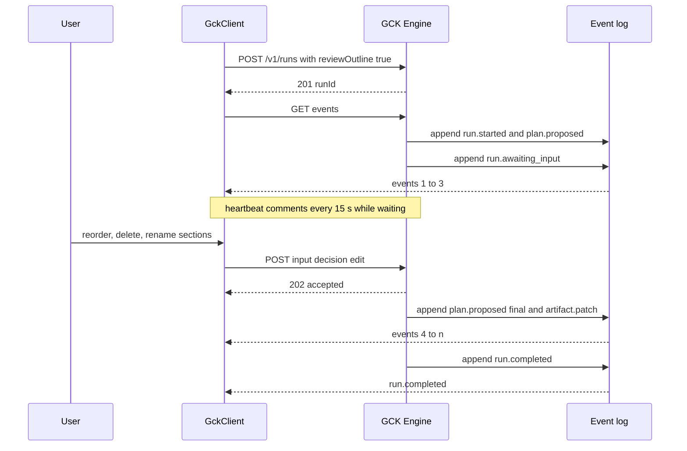
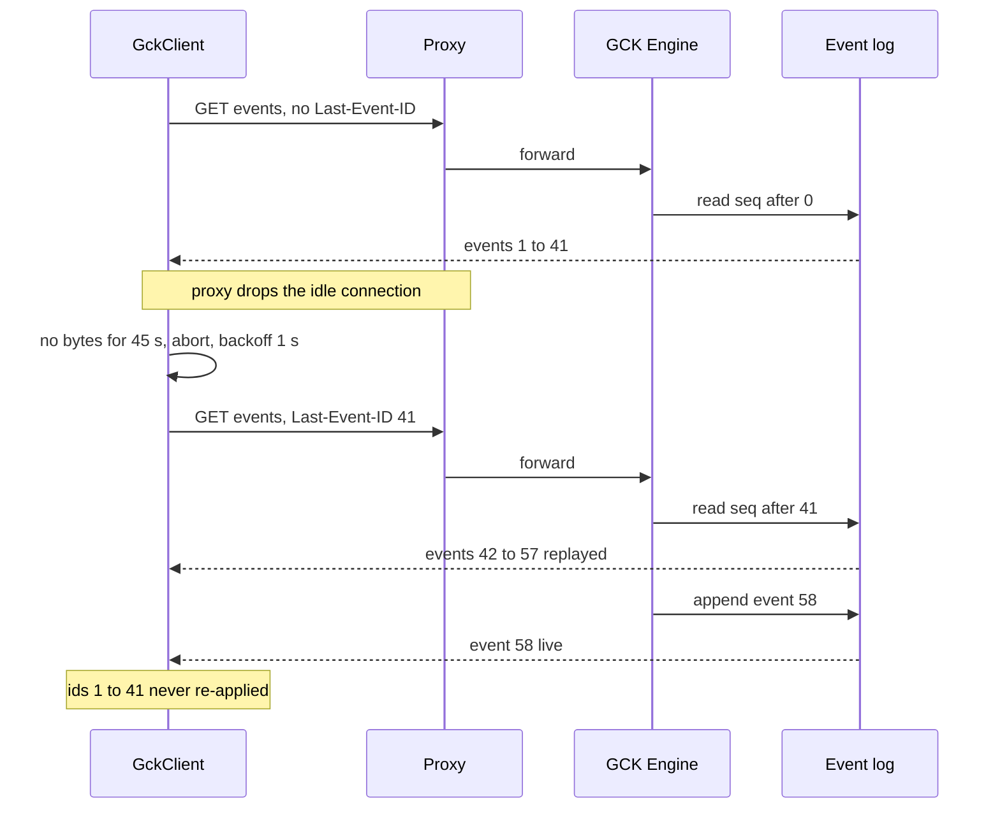
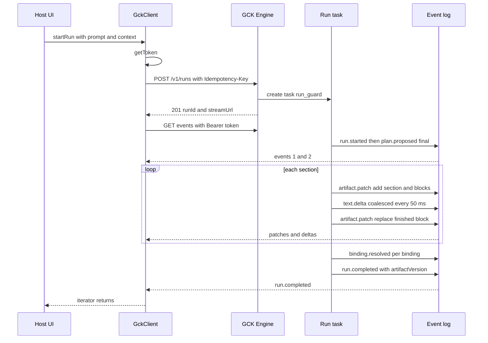

# Run protocol and client

<div class="chapter-meta" markdown>
**Reads:** `servers/fastapi/utils/sse.py`, `servers/fastapi/models/sse_response.py`, `servers/fastapi/api/v1/ppt/endpoints/presentation.py`, `servers/fastapi/api/v1/auth/principal.py`, `servers/fastapi/api/main.py`, `servers/nextjs/app/(presentation-generator)/outline/hooks/useOutlineStreaming.ts`, `servers/nextjs/app/(presentation-generator)/services/api/chat.ts`, `servers/nextjs/app/(presentation-generator)/services/api/header.ts`  ·  **Builds on:** [Artifact Spec and targets](62-artifact-spec-and-targets.md)  ·  **Time:** ~45 min
</div>

This chapter specifies the wire contract between the browser and the GCK Engine and builds both ends of it: the run lifecycle and endpoints, every stream event with a JSON example, ordering and idempotency, block-level JSON Patch plus `text.delta`, outline review, the error model, resume with `Last-Event-ID` from a server-side event log, heartbeats, auth and CORS. You get the full TypeScript for `@gck/protocol` events and the `@gck/client` transport, an AG-UI mapping, and a FastAPI sketch of the event log that generalizes Presenton's SSE helpers.

Files under `gck/` are **new code** for Part IX; files under `servers/` are Presenton at snapshot `571461f`.

## Step 1: What the protocol must fix in Presenton's streams

[Streaming (SSE)](../presenton/10-streaming.md) covers Presenton's streams; four of their properties block reuse.

1. **The stream is the generation.** A dropped outline or Standard stream restarts all LLM calls (the hooks reset their buffers before retrying, `servers/nextjs/app/(presentation-generator)/outline/hooks/useOutlineStreaming.ts:82-100`); a Smart stream re-runs the generator, which replays checkpointed slides and continues (`servers/fastapi/api/v1/ppt/endpoints/presentation.py:1941-1993`).
2. **Frames carry no id.** `SSEResponse.to_string()` writes only `event:` and `data:` lines (`servers/fastapi/models/sse_response.py:10-11`), so the browser has nothing to send back as `Last-Event-ID`.
3. **The browser uses `EventSource`**, which can only `GET` without custom headers (`useOutlineStreaming.ts:105-109`). Auth therefore rides on the session cookie, which `resolve_request_principal` checks before any `Bearer` API key (`servers/fastapi/api/v1/auth/principal.py:22-57`).
4. **Errors are a string plus optional metadata.** Smart streams add `source`, `status_code`, `error_type`, `retryable`, `completed_slides` and `total_slides` (`presentation.py:2246-2267`); outline and Standard streams send only `detail`.

A component mounted inside Superset, a Tiptap page or a third-party site needs the opposite on every point: generation that survives the connection, numbered events, header-based auth with no cookie, and machine-readable errors.

## Step 2: The run lifecycle and endpoints

A **run** is one request to turn a prompt plus host context into an Artifact (the IR from [Artifact Spec and targets](62-artifact-spec-and-targets.md)). The engine executes the run as a background task; HTTP connections only observe it.

Paths below are relative to the engine base URL `{engine}`, the `engineUrl` given to `GckClient`. It never contains `/v1` (the client appends `/v1/runs...` itself): a standalone engine is `https://gck.example.com`, an engine behind a same-origin ingress is for example `/gck-engine`, and an engine mounted inside Presenton is `/api/gck` ([Extracting the engine from Presenton](66-extracting-from-presenton.md)). The URLs in `RunCreated` are absolute paths that include that mount prefix; the client does not rely on them.

| Method and path | Request | Success response | Idempotency |
|---|---|---|---|
| `POST /v1/runs` | `RunRequest` JSON, headers `Authorization`, optional `Idempotency-Key` | `201 {runId, streamUrl, inputUrl, cancelUrl, createdAt}`; with `Accept: text/event-stream` instead `200` and the event stream, run id in header `GCK-Run-Id` | same key within 24 h returns the same run (`200`) |
| `GET /v1/runs/{runId}/events` | headers `Authorization`, optional `Last-Event-ID` | `200 text/event-stream` | safe to repeat |
| `GET /v1/runs/{runId}` | none | `200 RunSummary` (state, `lastEventId`, `artifactVersion`, pending input, error) | safe |
| `GET /v1/runs/{runId}/artifact` | none | `200 {version, lastEventId, artifact}` | safe |
| `POST /v1/runs/{runId}/input` | `{inputId, kind, decision, outline?}` | `202 {accepted: true}` | same `inputId` and same body returns `202` again; a different body returns `409 input_already_resolved` |
| `POST /v1/runs/{runId}/cancel` | `{reason?}` | `202 {state}` | always `202`; a terminal run reports its final state |

The request body is the one fixed in the blueprint:

```json title="POST /v1/runs (request body)"
{
  "intent": "generate",
  "prompt": "Create a QBR page for EMEA from the Sales dashboard",
  "target": { "id": "tiptap-doc", "manifestVersion": "1.0.0", "manifest": {} },
  "context": { "host": "superset", "surface": "dashboard", "dashboardId": 37, "selection": null,
               "document": null, "locale": "en", "theme": {} },
  "data": { "provider": "superset", "allowedChartIds": [412, 413] },
  "options": { "reviewOutline": true, "maxSections": 8, "tone": "professional" }
}
```

The other two intents use the same body and differ in what `context` carries. A `transform` sends the content to rewrite in `context.selection`, as Artifact blocks (the target's `fromHost` output for the user's selection), and is applied with `replace` by default:

```json title="POST /v1/runs (transform request)"
{
  "intent": "transform",
  "prompt": "Turn the selected text into one chart block. Use only charts from the data catalog.",
  "target": { "id": "tiptap-doc", "manifestVersion": "1.0.0", "manifest": {} },
  "context": { "host": "tiptap", "surface": "document", "locale": "en",
               "selection": [
                 { "id": "blk_u4k9x2m7qa", "type": "paragraph",
                   "text": [{ "text": "Pipeline grew fastest in Germany and France this quarter." }] }],
               "document": { "outline": ["## Pipeline by region"], "before": "", "after": "" } },
  "data": { "provider": "superset", "allowedChartIds": [412, 413] },
  "options": { "reviewOutline": false }
}
```

An `edit` sends the artifact it changes in `context.document`: the artifact applied earlier, re-read from the host with `fromHost` so it includes the user's own edits since, with its `id`, `bindings` and `provenance` kept. It is applied with `patch` by default:

```json title="POST /v1/runs (edit request)"
{
  "intent": "edit",
  "prompt": "Make the pipeline section shorter and add a revenue KPI",
  "target": { "id": "tiptap-doc", "manifestVersion": "1.0.0", "manifest": {} },
  "context": { "host": "tiptap", "surface": "document", "locale": "en",
               "document": {
                 "id": "art_01JC8Q4M6X2N7YB5K3P9R2T8VW", "version": "gck.artifact/1", "title": "EMEA QBR", "target": "tiptap-doc",
                 "sections": [
                   { "id": "sec_q7x2m400", "kind": "section", "title": "EMEA at a glance", "blocks": [] },
                   { "id": "sec_q7x2m401", "kind": "section", "title": "Pipeline by region", "blocks": [
                     { "id": "blk_q7x2m40100", "type": "paragraph", "text": [{ "text": "Pipeline reached a record level across EMEA, led by Germany, France and the Nordics." }] },
                     { "id": "blk_q7x2m40101", "type": "chart", "bindingId": "b_c413", "chartType": "bar" }] }],
                 "bindings": {
                   "b_c412": { "kind": "metric", "source": { "type": "superset_chart", "chart_id": 412 }, "mapping": {} },
                   "b_c413": { "kind": "chart", "source": { "type": "superset_chart", "chart_id": 413 }, "mapping": {} } },
                 "provenance": { "runId": "run_01JC8Q4M6X2N7Y", "createdAt": "2026-11-03T10:15:03Z", "prompt": "Create a QBR page for EMEA" } } },
  "data": { "provider": "superset", "allowedChartIds": [412, 413] },
  "options": { "reviewOutline": false }
}
```

| Intent | `context.selection` | `context.document` | Version line starts at | Default apply mode |
|---|---|---|---|---|
| `generate` | optional host hint (a convention per host) | optional compact digest | empty, the first patch is a root replace to version 1 | the host's choice (`insert_at_cursor`, `append`, `replace`) |
| `transform` | required: `Block[]` to rewrite | optional compact digest | empty, as for `generate` | `replace` (the selection) |
| `edit` | optional: blocks to focus on | required: the base `Artifact` | the base, as version 0 (Step 5) | `patch` |

Engine run states are `queued`, `planning`, `awaiting_input`, `generating`, `resolving_data`, `completed`, `failed`, `cancelled` and `expired`; the browser machine in [React SDK and UI kit](64-react-sdk-and-ui-kit.md) adds `composing`, `submitting`, `ready`, `applying` and `applied`.

The two-step form (`201`, then `GET`) gives the browser a run id before the stream connects, so a reload or a cancel button can address the run; the one-shot form is for server-to-server callers and tests.

## Step 3: The event envelope and every event type

Each SSE frame carries one event: `id:` is the sequence number, `event:` repeats the type for `curl` and devtools, and `data:` is one line of compact JSON:

```text title="One frame on the wire"
id: 7
event: artifact.patch
data: {"v":1,"id":7,"runId":"run_01JC8Q4M6X2N7Y","ts":"2026-11-03T10:15:09.402Z","type":"artifact.patch","data":{"baseVersion":3,"version":4,"ops":[{"op":"add","path":"/sections/1/blocks/-","value":{"id":"blk_q7x2m40100","type":"paragraph","text":[]}}]}}

```

Envelope fields: `v` (protocol major, `1`), `id` (gapless from 1), `runId`, `ts` (ISO 8601), `type`, `data`, and an optional `progress` `{phase, message?, completed?, total?}` that replaces Presenton's free-text `status` frames. The client trusts the JSON `type`, not the `event:` line.

| `type` | `data` | When |
|---|---|---|
| `run.started` | `{runId, target: {id, manifestVersion}}` | first event of every run |
| `plan.proposed` | `{outline: OutlineItem[], planVersion, final}` | after planning; again with `final: true` after review |
| `run.awaiting_input` | `{kind: "outline_review", inputId, expiresAt}` | only when `options.reviewOutline` |
| `artifact.patch` | `{baseVersion, version, ops: JsonPatchOp[]}` | primary content channel |
| `text.delta` | `{blockId, path, delta, format, baseVersion}` | optional, inside one block |
| `binding.resolved` | `{bindingId, snapshot, snapshotAt, status}` | per data binding |
| `run.warning` | `{code, message, blockId?}` | non-fatal problems |
| `run.completed` | `{artifactVersion, usage}` | terminal, success |
| `run.failed` | `{code, message, retryable, retryAfterMs?, details?, completedSections?, totalSections?}` | terminal, failure or cancel |

Examples of each payload (envelope fields other than `type` omitted):

```json title="Event payloads"
{"type":"run.started","data":{"runId":"run_01JC8Q4M6X2N7Y","target":{"id":"tiptap-doc","manifestVersion":"1.0.0"}}}

{"type":"plan.proposed","data":{"planVersion":1,"final":false,"outline":[
  {"sectionId":"sec_q7x2m400","title":"EMEA at a glance","summary":"Headline revenue and growth","layoutHint":null,"bindings":["b_c412"]},
  {"sectionId":"sec_q7x2m401","title":"Pipeline by region","summary":"Bar chart, top 5 countries","layoutHint":null,"bindings":["b_c413"]}]}}

{"type":"run.awaiting_input","data":{"kind":"outline_review","inputId":"in_4c1","expiresAt":"2026-11-03T10:45:05Z"}}

{"type":"artifact.patch","data":{"baseVersion":0,"version":1,"ops":[{"op":"replace","path":"","value":{"id":"art_01JC8Q4M6X2N7YB5K3P9R2T8VW",
  "version":"gck.artifact/1","title":"EMEA QBR","target":"tiptap-doc","sections":[],"bindings":{},"provenance":{"runId":"run_01JC8Q4M6X2N7Y","createdAt":"2026-11-03T10:15:03Z","prompt":"Create..."}}}]}}

{"type":"text.delta","data":{"blockId":"blk_q7x2m40100","path":"/text/0/text","delta":"Revenue grew in every ","format":"text","baseVersion":4}}

{"type":"binding.resolved","data":{"bindingId":"b_c412","status":"ok","snapshotAt":"2026-11-03T10:15:11Z",
  "snapshot":{"value":1840000,"previous":1610000}}}

{"type":"run.warning","data":{"code":"binding_dropped","message":"Chart 413 is not visible to you and was left out.","blockId":"blk_q7x2m40101"}}

{"type":"run.completed","data":{"artifactVersion":17,"usage":{"inputTokens":5120,"outputTokens":2210,"durationMs":14890,"model":"gpt-4.1"}}}

{"type":"run.failed","data":{"code":"rate_limited","message":"The model provider is rate limiting requests.","retryable":true,"retryAfterMs":20000,"completedSections":2,"totalSections":6}}
```

`completedSections` and `totalSections` are the generalization of Smart mode's `completed_slides` and `total_slides` error metadata (`presentation.py:2258-2267`).

## Step 4: Ordering and idempotency

Three counters keep the client consistent, each with one job.

| Counter | Scope | Rule on the client |
|---|---|---|
| Event `id` | per run, gapless from 1 | Drop any event with `id <= lastEventId` (a replay duplicate). If `id > lastEventId + 1`, a frame was lost: abort and reconnect with `Last-Event-ID: lastEventId`. |
| Artifact `version` | per run, increments by exactly 1 per `artifact.patch` | Apply only when `baseVersion === store.version`. If `version <= store.version`, skip (already applied). Otherwise call `GET /v1/runs/{id}/artifact` and replace the store. |
| `planVersion` | per run | The newest `plan.proposed` wins; `final: true` locks the outline. |

`text.delta`, `binding.resolved` and `run.warning` never change the artifact version. A `text.delta` whose `baseVersion` is older than its block's last replace is discarded. Binding runtime state (`snapshot`, `snapshotAt`, `status`) lives in an overlay beside the artifact, because the browser's data provider (`@gck/data-superset`) may also resolve bindings and must not fork the engine's version line.

On the request side, `POST /v1/runs` honors an `Idempotency-Key` header (the client generates a UUID per user submission), so a retried `POST` after a network timeout cannot start two paid runs. `POST /input` is keyed by the engine-issued `inputId`. `POST /cancel` is idempotent by definition.

!!! warning "Gotcha"
    Presenton's Standard slide chunks concatenate without commas into invalid JSON, so the client parses each chunk alone (`servers/nextjs/app/(presentation-generator)/presentation/hooks/usePresentationStreaming.ts:454-510`). In GCK every `artifact.patch` is complete JSON; the only partial JSON is a `format: "json"` `text.delta` for one block.

## Step 5: JSON Patch at block granularity, plus `text.delta`

`artifact.patch` uses RFC 6902 JSON Patch (https://www.rfc-editor.org/rfc/rfc6902) over JSON Pointers (RFC 6901, https://www.rfc-editor.org/rfc/rfc6901). The engine follows four rules that keep patches cheap to apply and easy to render:

1. **The first patch is a root replace** (`"path": ""`, the whole document in RFC 6901) that installs the skeleton at version 1, except in an `edit` run, which starts from the base (below). The same op doubles as the resync snapshot after log compaction (Step 9).
2. **Blocks are the unit of change.** Ops target `/sections/-`, `/sections/{i}/blocks/-`, `/sections/{i}/blocks/{j}`, `/bindings/{id}` or top-level fields such as `/title`, never anything deeper than a block. Renderers key by block `id`, not by index.
3. **Only `add`, `replace` and `remove` are emitted.** `move` and `copy` complicate index bookkeeping in a streaming renderer; `test` is reserved for client-side edit patches.
4. **A patch is atomic.** RFC 6902 requires that a patch with a failing op is not applied at all; the client applier in [React SDK and UI kit](64-react-sdk-and-ui-kit.md) copies on write and commits only after the last op.

A typical section arrives as three patches:

```json title="Three artifact.patch payloads for one section"
{"baseVersion":3,"version":4,"ops":[{"op":"add","path":"/sections/-","value":{"id":"sec_q7x2m401","kind":"section","title":"Pipeline by region","blocks":[]}}]}
{"baseVersion":4,"version":5,"ops":[{"op":"add","path":"/sections/1/blocks/-","value":{"id":"blk_q7x2m40100","type":"paragraph","text":[]}}]}
{"baseVersion":5,"version":6,"ops":[{"op":"replace","path":"/sections/1/blocks/0","value":{"id":"blk_q7x2m40100","type":"paragraph",
  "text":[{"text":"Pipeline reached "},{"text":"","token":{"bindingId":"b_c413","field":"total:","format":",.2s"}},{"text":" across EMEA."}]}}]}
```

An `edit` run has no skeleton to install: the stream starts from the base artifact in `context.document`, which is version 0 on both sides. The engine sends no root replace; its first `artifact.patch` has `baseVersion: 0` and changes the base in place, block by block, and `run.completed` carries the final version. Untouched blocks are never re-sent, changed blocks are replaced under their existing id, removed blocks are removed and new blocks get new ids, so the client can diff the final artifact against the base by block id (the run controller exposes that diff as `run.diff`). For the edit request above:

```json title="The edit run's stream (payloads only)"
{"type":"artifact.patch","data":{"baseVersion":0,"version":1,"ops":[{"op":"replace","path":"/sections/1/blocks/0","value":{"id":"blk_q7x2m40100","type":"paragraph",
  "text":[{"text":"Pipeline hit a record, led by Germany and France."}]}}]}}
{"type":"artifact.patch","data":{"baseVersion":1,"version":2,"ops":[{"op":"add","path":"/sections/0/blocks/-","value":{"id":"blk_q7x2m40102","type":"metric","bindingId":"b_c412","label":"Revenue","compare":"previous_period"}}]}}
{"type":"binding.resolved","data":{"bindingId":"b_c412","status":"ok","snapshotAt":"2026-11-03T10:31:40Z","snapshot":{"value":1840000,"previous":1610000}}}
{"type":"run.completed","data":{"artifactVersion":2,"usage":{"inputTokens":3410,"outputTokens":420,"durationMs":5210,"model":"gpt-4.1"}}}
```

A client therefore resets its store to the base at version 0 before it reads the stream (`createRunController` and `runToCompletion` both do). `GET /v1/runs/{runId}/artifact` on an edit run returns the base with the patches applied, and after log compaction the resync snapshot is a root replace at `baseVersion: 0` like in any other run, which replaces the store but keeps every block id.

Between version 5 and 6, `text.delta` events let the paragraph type itself out. Two formats exist:

| `format` | `path` | `delta` | Client behavior |
|---|---|---|---|
| `text` | pointer inside the block, for example `/text/0/text` | plain string to append | append to a draft copy of the block |
| `json` | `""` | raw JSON text of the whole block, in pieces | append to a buffer, run `jsonrepair`, parse, show as a provisional block |

The `json` format streams lists, tables and callouts. It is the technique Presenton's outline hook applies to the whole outline (`useOutlineStreaming.ts:133-139`), narrowed to one block so a failed repair only affects that block. The block's final `replace` always wins and clears the draft.

!!! warning "Gotcha"
    Pointers use array indexes, so they are only safe while the engine is the sole writer. The client store is read-only from `submitting` until `ready`; user edits during a run are limited to the outline review form, which is sent through `POST /input`, not patched locally. Allowing local edits mid-stream would shift indexes under the engine's next op.

## Step 6: Human-in-the-loop outline review

When `options.reviewOutline` is true, the engine pauses after planning for the user to confirm the outline: the checkpoint Presenton implements as a whole page ([User journey](../presenton/21-user-journey.md)), here a pause inside one run.

1. The engine emits `plan.proposed` (`final: false`) then `run.awaiting_input` with an `inputId` and an `expiresAt` (default 30 minutes).
2. The stream stays open and sends heartbeats. The client may disconnect; the run stays parked.
3. The client posts the decision:

```json title="POST /v1/runs/{runId}/input"
{
  "inputId": "in_4c1",
  "kind": "outline_review",
  "decision": "edit",
  "outline": [
    { "sectionId": "sec_q7x2m401", "title": "Pipeline by region", "summary": "Top 5 countries only", "layoutHint": null, "bindings": ["b_c413"] },
    { "sectionId": null, "title": "Risks", "summary": "Three risks with owners", "layoutHint": null, "bindings": [] }
  ]
}
```

`decision` is `approve` (no `outline`), `edit` (full replacement list: reorder, delete, rename and add are all expressed by the list) or `cancel`. New sections have `sectionId: null`; the engine assigns ids.

4. The engine validates: at most `limits.maxSections` from the manifest, titles of at most 200 characters, and `bindings` a subset of what the planner offered (no chart ids outside `allowedChartIds`). Failures return `422` and leave the run waiting.
5. On success the engine emits `plan.proposed` with `planVersion: 2, final: true` (normalized, all ids assigned), then `artifact.patch` events.
6. If `expiresAt` passes, the run ends with `run.failed {code: "input_expired", retryable: false}`.



## Step 7: The error model

Every error, whether returned as an HTTP response body or as `run.failed`, has the same shape:

```json title="Error body"
{ "error": { "code": "rate_limited", "message": "The model provider is rate limiting requests.",
             "retryable": true, "retryAfterMs": 20000, "details": { "provider": "openai" } } }
```

| `code` | HTTP | `retryable` | Meaning and client action |
|---|---|---|---|
| `invalid_request` | 400 / 422 | false | Validation failed; show `message`. |
| `unauthorized` | 401 | false | No or bad token. |
| `token_expired` | 401 | true | Refresh the token once, retry. |
| `forbidden` | 403 | false | Not allowed for this target, host or run. |
| `not_found` | 404 | false | Unknown run, or someone else's. |
| `conflict` / `input_already_resolved` | 409 | false | Stale input or duplicate decision. |
| `rate_limited` | 429 | true | Wait `retryAfterMs` (also sent as `Retry-After`). |
| `quota_exceeded` | 429 | false | Tenant budget spent. |
| `context_too_large` | 413 / stream | false | Ask the user to narrow context. |
| `model_output_invalid` | stream | true | The model failed schema validation after the engine's own retries. |
| `model_unavailable` | 502 / 503 / stream | true | Provider down or timed out. |
| `data_forbidden` | stream | false | A required binding is not visible to the user (row-level security). |
| `data_unavailable` | stream | true | The data provider failed. |
| `input_expired` | stream | false | Outline review timed out. |
| `cancelled` | stream | false | Cancel endpoint or engine shutdown. |
| `internal` | 500 / stream | true | Anything else. |

For unclassified exceptions, `retryable` follows Presenton's Smart rule: true for 408, 429 and 500 or more (`presentation.py:2257-2264`). A retryable `run.failed` means "a new run with the same request may succeed"; the run itself is terminal. Transport problems (dropped connection, heartbeat timeout, proxy `502` on `GET /events`) never produce `run.failed`; the client reconnects (Step 9).

!!! warning "Gotcha"
    Presenton's outline hook retries on a server `error` frame (`useOutlineStreaming.ts:210-229`), which re-runs the whole LLM pipeline up to three times without asking. GCK separates the two concerns: the client reconnects transparently, but it never restarts a failed run on its own. Restarting is a user action ("Try again") because it costs tokens.

## Step 8: Why fetch-based SSE, not `EventSource`

The WHATWG HTML standard defines `EventSource` with one option, `withCredentials`; there is no way to set the method or request headers (https://html.spec.whatwg.org/multipage/server-sent-events.html). That is why Presenton's stream routes are `GET`s keyed by an id in the path (`useOutlineStreaming.ts:105-109`, `usePresentationStreaming.ts:300`). For GCK the limits are blocking:

| Need | `EventSource` | `fetch` + `ReadableStream` |
|---|---|---|
| `Authorization: Bearer` header | not possible; cookie only | yes |
| `POST` with a JSON body (one-shot mode) | no | yes |
| Read the JSON body of a `401` or `429` | no; any non-200 fails the connection and only fires `error` | yes |
| Control reconnect timing and give up | browser-controlled; the spec reconnects after network errors | fully client-controlled |
| `Last-Event-ID` on reconnect | automatic, but only for its own reconnects | the client sets it explicitly on every reconnect it makes; after a page reload the run is found again by its id |
| Cancel with `AbortSignal` | `close()` only | yes |
| Detect a silent dead connection | no | heartbeat watchdog |

Presenton already has a fetch-based reader for chat: it `POST`s with an `AbortSignal` (`servers/nextjs/app/(presentation-generator)/services/api/chat.ts:104-116`), reads `response.body` with a `TextDecoder` and splits frames on `"\n\n"` (`chat.ts:294-308`; quoted in [Story 4](../delivery/45-story4-native-charts-ux.md)). `@gck/client` keeps that structure and fixes three things for a general transport: it splits lines on CR, LF and CRLF as the SSE grammar requires (the chat reader looks for `"\n\n"` before it strips `\r` inside `processSseFrame`, `chat.ts:136`, so a CRLF-framed stream would never split), it honors `id:` and `retry:` fields (ignored by the chat reader, `chat.ts:141-149`), and it treats comment lines as heartbeats.

!!! warning "Gotcha"
    Presenton's `getHeader()` sends `Access-Control-Allow-Origin`, `Access-Control-Allow-Methods` and `Access-Control-Allow-Headers` as request headers (`servers/nextjs/app/(presentation-generator)/services/api/header.ts:1-9`). Those are response headers; on a request they do nothing except force a CORS preflight and require the server to allow them. It works today only because FastAPI allows every header (`servers/fastapi/api/main.py:94-100`). Do not copy `getHeader()` into the kit.

## Step 9: Resume, the event log, backpressure and heartbeats

### 9.1 Resume with `Last-Event-ID`

The SSE standard says that a non-empty last event id is sent in a `Last-Event-ID` header on reconnection, and that an `id` containing U+0000 is ignored. GCK uses the same header for its own reconnects, set by the client:

1. The client remembers `lastEventId`, the highest event id it has processed (not just received).
2. On reconnect it sends `GET /v1/runs/{id}/events` with `Last-Event-ID: 41`.
3. The engine reads events with `seq > 41` from the event log, sends them, then tails new events live.
4. If the log was compacted past 41, the engine first sends a synthetic root-`replace` `artifact.patch` with `baseVersion: 0`, which the client treats as "reset the store" (`isSnapshotPatch`, Step 11).

A page reload can resume too: with a `resumeKey`, `@gck/react` keeps the active run's `{runId}` in `sessionStorage` and, after the reload, replays that run's log from the first event into a fresh store ([React SDK and UI kit](64-react-sdk-and-ui-kit.md)).

This generalizes what Presenton does for Smart mode. There, slides are checkpointed to the database before they are emitted:

```python title="servers/fastapi/api/v1/ppt/endpoints/presentation.py (excerpt)"
            # Checkpoint before emitting. If the model later runs out of tokens
            # or the SSE client reconnects, generation resumes after this slide
            # instead of throwing away the accepted prefix.
            async with async_session_maker() as checkpoint_session:
```

(`presentation.py:2075-2078`.) On reconnect, `stream_smart_presentation` replays every saved slide as a `slide_html` frame and resumes from the next slide (`presentation.py:1941-1993`). GCK keeps the rule (persist before you emit) and changes two things: it persists events, not domain rows, so any target can replay; and generation is a background task, so a reconnect only replays and tails. In Presenton the generation task is cancelled when the stream generator exits early (`presentation.py:2189-2192`); in GCK only `POST /cancel` cancels.

### 9.2 Backpressure

The log is the buffer. The run task appends and notifies; each subscriber reads the log at its own pace, by sequence number, in pages of 200. A slow browser costs a cursor and a database read, never a growing in-memory queue. At the source, the engine coalesces `text.delta` per block into at most one event per 50 ms, and marks those rows ephemeral so they are pruned once the block's final `replace` is committed. On the client, the store notifies React at most once per animation frame, so a burst of replayed events renders once.

### 9.3 Heartbeats

No Presenton SSE endpoint sends keepalives; the bundled nginx relies on 30-minute read timeouts (`nginx.conf:45-69`). That fails behind a load balancer with a 60-second idle timeout, which is where an embedded component lives. The WHATWG standard suggests a comment line about every 15 seconds. The engine writes `: hb` every 15 seconds of silence, and the client aborts and reconnects after 45 seconds without any bytes (three missed heartbeats). The engine also sends `Cache-Control: no-cache, no-transform` and `X-Accel-Buffering: no` so nginx-style proxies do not buffer the stream.



## Step 10: Authentication, tokens and CORS

The kit never holds a long-lived secret. The host passes a **token provider** callback:

```ts
type TokenProvider = (opts: { forceRefresh: boolean }) => Promise<string | null>;
```

- The client calls it before **every** request, including every reconnect, so a token that expired during a long review pause is replaced transparently. Hosts cache the token until shortly before expiry.
- Tokens are short-lived (5 minutes) and audience-scoped to the engine, minted by the host's own backend ([Host integrations](65-host-integrations.md)).
- On `401 token_expired` the client calls the provider once with `forceRefresh: true` and retries once.
- Requests use `credentials: "omit"`: no cookie, so no third-party-cookie blocking and no CSRF surface.

When the engine is cross-origin, every GCK request is preflighted (an `Authorization` header and `Last-Event-ID` are not CORS-safelisted). The engine's CORS policy should be:

| Header | Value |
|---|---|
| `Access-Control-Allow-Origin` | the exact host origin from an allowlist, never `*` for authenticated routes |
| `Access-Control-Allow-Methods` | `GET, POST, OPTIONS` |
| `Access-Control-Allow-Headers` | `Authorization, Content-Type, Accept, Last-Event-ID, Idempotency-Key, GCK-Protocol` |
| `Access-Control-Expose-Headers` | `GCK-Run-Id, Retry-After` |
| `Access-Control-Max-Age` | `600` (fewer preflights on reconnect storms) |
| `Access-Control-Allow-Credentials` | omitted (no cookies) |

Presenton's policy is a single origin from `NEXT_PUBLIC_URL`, or `*` as a development fallback, with credentials allowed (`servers/fastapi/api/main.py:88-100`). The engine needs a per-tenant origin list, because one engine serves several hosts.

!!! warning "Gotcha"
    Without `Access-Control-Expose-Headers`, `response.headers.get("Retry-After")` returns `null` in the browser on a cross-origin `429`, and the client silently falls back to its own backoff. That is why `retryAfterMs` is also inside the JSON error body.

## Step 11: `@gck/protocol` event types

The protocol package is types plus JSON Schemas with zero runtime dependencies. This file covers runs and events; `Artifact`, `DataBinding` and `TargetId` come from `src/artifact.ts` and `TargetManifest` from `src/target.ts`, both specified in [Artifact Spec and targets](62-artifact-spec-and-targets.md). The package index re-exports all three files (`export * from "./artifact"`, `"./target"`, `"./run"`), so `run.ts` does not re-export `Artifact` itself. `HostContext` in `target.ts` is an alias of `RunContext` below: one JSON object, the run request's `context`, under two names.

```ts title="gck/packages/protocol/src/run.ts (new)"
import type { Artifact, DataBinding, TargetId } from "./artifact";
import type { TargetManifest } from "./target";

export const PROTOCOL_VERSION = 1 as const;

export type JsonPointer = string;
export type JsonPatchOp =
  | { op: "add"; path: JsonPointer; value: unknown }
  | { op: "remove"; path: JsonPointer }
  | { op: "replace"; path: JsonPointer; value: unknown }
  | { op: "move"; from: JsonPointer; path: JsonPointer }
  | { op: "copy"; from: JsonPointer; path: JsonPointer }
  | { op: "test"; path: JsonPointer; value: unknown };

export type RunIntent = "generate" | "transform" | "edit";

export interface RunContext {
  host: string;                       // "superset" | "tiptap" | "presenton" | "web" | "element"
  surface?: string;                   // conventions: dashboard, dashboard_markdown, sqllab, alert, document, presentation, page
  locale?: string;
  theme?: Record<string, unknown>;
  selection?: unknown;                // generate: host-defined hint; transform: Block[] from the target's fromHost
  document?: unknown;                 // generate, transform: compact digest; edit: the base Artifact (version 0)
  [key: string]: unknown;             // host-specific ids such as dashboardId
}

export interface RunRequest {
  intent: RunIntent;
  prompt: string;
  target: { id: TargetId; manifestVersion: string; manifest?: TargetManifest };
  context: RunContext;
  data?: { provider: string; allowedChartIds?: number[] };
  options?: { reviewOutline?: boolean; maxSections?: number; tone?: string };
}

export interface RunCreated {
  runId: string; streamUrl: string; inputUrl: string; cancelUrl: string; createdAt: string;
}

export type EngineRunState =
  | "queued" | "planning" | "awaiting_input" | "generating"
  | "resolving_data" | "completed" | "failed" | "cancelled" | "expired";

export interface RunSummary {
  runId: string;
  state: EngineRunState;
  lastEventId: number;
  artifactVersion: number;
  pendingInput?: { kind: "outline_review"; inputId: string; expiresAt: string };
  error?: GckErrorBody;
}

export interface OutlineItem {
  sectionId: string | null;           // null only in client edits (new section)
  title: string;
  summary: string;
  layoutHint?: string | null;
  bindings: string[];
}

export type OutlineDecision =
  | { inputId: string; kind: "outline_review"; decision: "approve" }
  | { inputId: string; kind: "outline_review"; decision: "edit"; outline: OutlineItem[] }
  | { inputId: string; kind: "outline_review"; decision: "cancel" };

export type GckErrorCode =
  | "invalid_request" | "unauthorized" | "token_expired" | "forbidden" | "not_found"
  | "conflict" | "input_already_resolved" | "rate_limited" | "quota_exceeded"
  | "context_too_large" | "model_output_invalid" | "model_unavailable"
  | "data_forbidden" | "data_unavailable" | "input_expired" | "cancelled" | "internal";

export interface GckErrorBody {
  code: GckErrorCode;
  message: string;
  retryable: boolean;
  retryAfterMs?: number;
  details?: Record<string, unknown>;
  completedSections?: number;
  totalSections?: number;
}

export interface Usage {
  inputTokens: number; outputTokens: number; durationMs: number; model?: string;
}

export interface Progress {
  phase: "planning" | "generating" | "resolving_data";
  message?: string; completed?: number; total?: number;
}

export type GckEventBody =
  | { type: "run.started"; data: { runId: string; target: { id: TargetId; manifestVersion: string } } }
  | { type: "plan.proposed"; data: { outline: OutlineItem[]; planVersion: number; final: boolean } }
  | { type: "run.awaiting_input"; data: { kind: "outline_review"; inputId: string; expiresAt: string } }
  | { type: "artifact.patch"; data: { baseVersion: number; version: number; ops: JsonPatchOp[] } }
  | { type: "text.delta"; data: { blockId: string; path: JsonPointer; delta: string;
                                  format: "text" | "json"; baseVersion: number } }
  | { type: "binding.resolved"; data: { bindingId: string; snapshot: unknown;
                                        snapshotAt: string; status: NonNullable<DataBinding["status"]> } }
  | { type: "run.warning"; data: { code: string; message: string; blockId?: string } }
  | { type: "run.completed"; data: { artifactVersion: number; usage: Usage } }
  | { type: "run.failed"; data: GckErrorBody };

export type GckEvent = GckEventBody & {
  v: typeof PROTOCOL_VERSION;
  id: number;
  runId: string;
  ts: string;
  progress?: Progress;
};

export type GckEventType = GckEvent["type"];
export type EventOf<T extends GckEventType> = Extract<GckEvent, { type: T }>;

export const TERMINAL_EVENTS: ReadonlySet<GckEventType> = new Set(["run.completed", "run.failed"]);

export function isGckEvent(value: unknown): value is GckEvent {
  if (!value || typeof value !== "object") return false;
  const v = value as Record<string, unknown>;
  return v.v === PROTOCOL_VERSION && typeof v.id === "number" &&
    typeof v.type === "string" && typeof v.runId === "string" && "data" in v;
}

/** A root replace at baseVersion 0 is a full snapshot (initial or after compaction). */
export function isSnapshotPatch(e: GckEvent): boolean {
  return e.type === "artifact.patch" && e.data.baseVersion === 0 &&
    e.data.ops.length === 1 && e.data.ops[0].op === "replace" && e.data.ops[0].path === "";
}
```

`isGckEvent` is a structural guard only; full validation uses JSON Schemas shared with the engine's Pydantic models ([Frontend engineering and quality](67-frontend-engineering.md)).

!!! warning "Gotcha"
    An unknown `type` from a newer engine must be ignored, not treated as an error: every `switch` over events ends in a default branch that drops it. Breaking changes bump `v`; the engine rejects a client whose `GCK-Protocol` header is too old with `invalid_request` and `details.minProtocol`.

## Step 12: `@gck/client`

### 12.1 The SSE line parser

```ts title="gck/packages/client/src/sse.ts (new)"
export interface SseMessage {
  event: string;
  data: string;
  id?: string;      // last event id buffer at dispatch time
  retry?: number;   // reconnection time requested by the server, ms
}

export interface SseParser {
  push(chunk: string): void;
}

/** Incremental WHATWG event-stream parser; lines end in CRLF, LF or CR. */
export function createSseParser(
  onMessage: (m: SseMessage) => void,
  onComment?: (text: string) => void,
): SseParser {
  let buffer = "";
  let data: string[] = [];
  let eventName = "";
  let lastId: string | undefined;
  let retry: number | undefined;

  const dispatch = () => {
    if (data.length === 0) { eventName = ""; return; }
    onMessage({ event: eventName || "message", data: data.join("\n"), id: lastId, retry });
    data = [];
    eventName = "";
    retry = undefined;
  };

  const processLine = (line: string) => {
    if (line === "") return dispatch();
    if (line.startsWith(":")) return onComment?.(line.slice(1).trim());
    const colon = line.indexOf(":");
    const field = colon === -1 ? line : line.slice(0, colon);
    let value = colon === -1 ? "" : line.slice(colon + 1);
    if (value.startsWith(" ")) value = value.slice(1);
    switch (field) {
      case "data": data.push(value); break;
      case "event": eventName = value; break;
      case "id": if (!value.includes("\u0000")) lastId = value; break;
      case "retry": if (/^\d+$/.test(value)) retry = Number(value); break;
      default: break; // unknown fields are ignored by the grammar
    }
  };

  return {
    push(chunk: string) {
      buffer += chunk;
      let start = 0;
      for (let i = 0; i < buffer.length; i++) {
        const ch = buffer[i];
        if (ch !== "\n" && ch !== "\r") continue;
        if (ch === "\r" && i === buffer.length - 1) break; // CR may pair with an LF in the next chunk
        processLine(buffer.slice(start, i));
        if (ch === "\r" && buffer[i + 1] === "\n") i++;
        start = i + 1;
      }
      buffer = buffer.slice(start);
    },
  };
}
```

### 12.2 Errors, retry policy and helpers

```ts title="gck/packages/client/src/errors.ts (new)"
import type { GckErrorBody, GckErrorCode } from "@gck/protocol";

export class GckError extends Error {
  readonly code: GckErrorCode;
  readonly retryable: boolean;
  readonly status?: number;
  readonly retryAfterMs?: number;
  readonly details?: Record<string, unknown>;

  constructor(body: GckErrorBody, status?: number) {
    super(body.message);
    this.name = "GckError";
    this.code = body.code;
    this.retryable = body.retryable;
    this.status = status;
    this.retryAfterMs = body.retryAfterMs;
    this.details = body.details;
  }

  static async fromResponse(res: Response): Promise<GckError> {
    let body: GckErrorBody | undefined;
    try {
      const json = await res.json();
      body = json?.error;
    } catch { /* non-JSON body, for example an HTML 502 page from a proxy */ }
    const header = Number(res.headers.get("Retry-After"));
    const retryAfterMs = body?.retryAfterMs ?? (Number.isFinite(header) && header > 0 ? header * 1000 : undefined);
    return new GckError({
      code: body?.code ?? statusToCode(res.status),
      message: body?.message ?? `Engine request failed with HTTP ${res.status}`,
      retryable: body?.retryable ?? (res.status === 408 || res.status === 429 || res.status >= 500),
      retryAfterMs,
      details: body?.details,
    }, res.status);
  }
}

const STATUS_CODES: Record<number, GckErrorCode> = { 401: "unauthorized", 403: "forbidden", 404: "not_found",
  409: "conflict", 413: "context_too_large", 429: "rate_limited", 502: "model_unavailable", 503: "model_unavailable" };
const statusToCode = (s: number): GckErrorCode => STATUS_CODES[s] ?? (s < 500 ? "invalid_request" : "internal");

export interface RetryPolicy {
  maxAttempts: number;   // consecutive failures
  baseDelayMs: number;
  maxDelayMs: number;
  jitter: number;        // 0.2 means plus or minus 20 %
}

export const DEFAULT_RETRY: RetryPolicy = { maxAttempts: 6, baseDelayMs: 1000, maxDelayMs: 15000, jitter: 0.2 };

export function backoffDelay(attempt: number, p: RetryPolicy, hintMs?: number): number {
  const exp = Math.min(p.maxDelayMs, p.baseDelayMs * 2 ** Math.max(0, attempt - 1));
  const base = Math.max(exp, hintMs ?? 0);
  const spread = base * p.jitter;
  return Math.round(base - spread + Math.random() * 2 * spread);
}

export function sleep(ms: number, signal?: AbortSignal): Promise<void> {
  return new Promise((resolve, reject) => {
    if (signal?.aborted) return reject(signal.reason);
    const t = setTimeout(() => { signal?.removeEventListener("abort", onAbort); resolve(); }, ms);
    const onAbort = () => { clearTimeout(t); reject(signal!.reason); };
    signal?.addEventListener("abort", onAbort, { once: true });
  });
}

export function isAbortError(err: unknown): boolean {
  return err instanceof DOMException && err.name === "AbortError";
}
```

### 12.3 `GckClient`

```ts title="gck/packages/client/src/client.ts (new)"
import {
  PROTOCOL_VERSION, TERMINAL_EVENTS, isGckEvent,
  type Artifact, type GckEvent, type OutlineDecision, type RunCreated,
  type RunRequest, type RunSummary,
} from "@gck/protocol";
import { createSseParser, type SseMessage } from "./sse";
import { DEFAULT_RETRY, GckError, backoffDelay, isAbortError, sleep, type RetryPolicy } from "./errors";

export type TokenProvider = (opts: { forceRefresh: boolean }) => Promise<string | null>;

export interface GckClientOptions {
  engineUrl: string;                     // base without /v1, e.g. "https://gck.example.com" or "/api/gck"
  getToken: TokenProvider;
  fetch?: typeof fetch;                  // injectable for tests
  retry?: Partial<RetryPolicy>;
  heartbeatTimeoutMs?: number;           // default 45 000
  onTransport?: (e: TransportEvent) => void;  // telemetry hook, no prompt text
}

export type TransportEvent =
  | { kind: "connect"; runId: string; attempt: number; lastEventId: number }
  | { kind: "disconnect"; runId: string; reason: string }
  | { kind: "gap"; runId: string; expected: number; got: number };

export interface StreamOptions {
  lastEventId?: number;
  signal?: AbortSignal;
}

export class GckClient {
  private readonly base: string;
  private readonly policy: RetryPolicy;
  private readonly fetchImpl: typeof fetch;

  constructor(private readonly opts: GckClientOptions) {
    this.base = opts.engineUrl.replace(/\/+$/, "");
    this.policy = { ...DEFAULT_RETRY, ...opts.retry };
    this.fetchImpl = opts.fetch ?? globalThis.fetch.bind(globalThis);
  }

  /** Start a run. Safe to retry: the idempotency key makes the POST deduplicated. */
  async startRun(req: RunRequest, init: { signal?: AbortSignal; idempotencyKey?: string } = {}): Promise<RunCreated> {
    const key = init.idempotencyKey ?? crypto.randomUUID();
    return this.json<RunCreated>("POST", "/v1/runs", req, { signal: init.signal, idempotent: true,
      headers: { "Idempotency-Key": key } });
  }

  getRun(runId: string, signal?: AbortSignal): Promise<RunSummary> {
    return this.json("GET", `/v1/runs/${encodeURIComponent(runId)}`, undefined, { signal, idempotent: true });
  }

  getArtifact(runId: string, signal?: AbortSignal): Promise<{ version: number; lastEventId: number; artifact: Artifact }> {
    return this.json("GET", `/v1/runs/${encodeURIComponent(runId)}/artifact`, undefined, { signal, idempotent: true });
  }

  sendInput(runId: string, input: OutlineDecision, signal?: AbortSignal): Promise<{ accepted: true }> {
    return this.json("POST", `/v1/runs/${encodeURIComponent(runId)}/input`, input, { signal, idempotent: true });
  }

  cancel(runId: string, reason = "user"): Promise<{ state: string }> {
    // No signal on purpose: a cancel must survive the abort of the stream it ends.
    return this.json("POST", `/v1/runs/${encodeURIComponent(runId)}/cancel`, { reason }, { idempotent: true });
  }

  /** Reconnects with Last-Event-ID, drops duplicates, detects gaps; abort ends without throwing. */
  async *stream(runId: string, opts: StreamOptions = {}): AsyncGenerator<GckEvent, void, undefined> {
    let lastEventId = opts.lastEventId ?? 0;
    let failures = 0;
    let serverRetryMs: number | undefined;
    const outer = opts.signal;

    while (!outer?.aborted) {
      const attempt = new AbortController();
      const onOuterAbort = () => attempt.abort(outer!.reason);
      outer?.addEventListener("abort", onOuterAbort, { once: true });
      let watchdog: ReturnType<typeof setTimeout> | undefined;
      const resetWatchdog = () => {
        clearTimeout(watchdog);
        watchdog = setTimeout(() => attempt.abort(new DOMException("heartbeat timeout", "AbortError")),
          this.opts.heartbeatTimeoutMs ?? 45_000);
      };

      try {
        this.opts.onTransport?.({ kind: "connect", runId, attempt: failures + 1, lastEventId });
        const res = await this.send("GET", `/v1/runs/${encodeURIComponent(runId)}/events`, undefined, {
          signal: attempt.signal,
          headers: {
            Accept: "text/event-stream",
            ...(lastEventId > 0 ? { "Last-Event-ID": String(lastEventId) } : {}),
          },
        });
        if (!res.ok) throw await GckError.fromResponse(res);
        if (!res.headers.get("Content-Type")?.startsWith("text/event-stream") || !res.body) {
          throw new GckError({ code: "internal", message: "Engine did not return an event stream", retryable: true });
        }

        resetWatchdog();
        const reader = res.body.pipeThrough(new TextDecoderStream()).getReader();
        const pending: SseMessage[] = [];
        const parser = createSseParser((m) => pending.push(m), () => resetWatchdog());

        while (true) {
          const { done, value } = await reader.read();
          if (done) break;
          resetWatchdog();
          parser.push(value);

          while (pending.length) {
            const msg = pending.shift()!;
            if (msg.retry !== undefined) serverRetryMs = msg.retry;
            let parsed: unknown;
            try { parsed = JSON.parse(msg.data); } catch { continue; }
            if (!isGckEvent(parsed)) continue;
            if (parsed.id <= lastEventId) continue;                      // replay duplicate
            if (parsed.id !== lastEventId + 1) {                         // lost frame
              this.opts.onTransport?.({ kind: "gap", runId, expected: lastEventId + 1, got: parsed.id });
              throw new GckError({ code: "internal", message: "event gap", retryable: true });
            }
            yield parsed;                                                // consumer has processed it
            lastEventId = parsed.id;
            failures = 0;
            if (TERMINAL_EVENTS.has(parsed.type)) return;
          }
        }
        throw new GckError({ code: "internal", message: "stream ended before a terminal event", retryable: true });
      } catch (err) {
        if (outer?.aborted) return;
        const gck = err instanceof GckError ? err : undefined;
        if (gck && !gck.retryable) throw gck;                            // 401, 403, 404: give up
        failures += 1;
        this.opts.onTransport?.({ kind: "disconnect", runId,
          reason: isAbortError(err) ? "heartbeat timeout" : String((err as Error)?.message ?? err) });
        if (failures >= this.policy.maxAttempts) {
          throw gck ?? new GckError({ code: "internal", message: "Lost connection to the engine", retryable: true });
        }
        try {
          await sleep(backoffDelay(failures, this.policy, gck?.retryAfterMs ?? serverRetryMs), outer);
        } catch { return; }                                              // aborted while waiting
      } finally {
        clearTimeout(watchdog);
        outer?.removeEventListener("abort", onOuterAbort);
        attempt.abort();                                                 // releases the reader and socket
      }
    }
  }

  // --- internals -------------------------------------------------------------

  private async json<T>(method: string, path: string, body: unknown,
    init: { signal?: AbortSignal; idempotent?: boolean; headers?: Record<string, string> }): Promise<T> {
    for (let attempt = 1; ; attempt++) {
      try {
        const res = await this.send(method, path, body, init);
        if (res.ok) return (await res.json()) as T;
        throw await GckError.fromResponse(res);
      } catch (err) {
        if (isAbortError(err) || init.signal?.aborted) throw err;
        const gck = err instanceof GckError ? err : undefined;
        const transient = gck ? gck.retryable : err instanceof TypeError;  // TypeError: network failure
        if (!transient || !init.idempotent || attempt >= this.policy.maxAttempts) throw err;
        await sleep(backoffDelay(attempt, this.policy, gck?.retryAfterMs), init.signal);
      }
    }
  }

  /** One HTTP request with auth. Refreshes the token once on 401 token_expired. */
  private async send(method: string, path: string, body: unknown,
    init: { signal?: AbortSignal; headers?: Record<string, string> }): Promise<Response> {
    for (const forceRefresh of [false, true]) {
      const token = await this.opts.getToken({ forceRefresh });
      const res = await this.fetchImpl(`${this.base}${path}`, {
        method,
        signal: init.signal,
        credentials: "omit",
        cache: "no-store",
        headers: {
          Accept: "application/json",
          "GCK-Protocol": String(PROTOCOL_VERSION),
          ...(body !== undefined ? { "Content-Type": "application/json" } : {}),
          ...(token ? { Authorization: `Bearer ${token}` } : {}),
          ...init.headers,
        },
        body: body !== undefined ? JSON.stringify(body) : undefined,
      });
      if (res.status !== 401 || forceRefresh) return res;
      const err = await GckError.fromResponse(res.clone());
      if (err.code !== "token_expired") return res;
    }
    throw new Error("unreachable");
  }
}
```

Two design notes. The generator suspends at `yield` until the consumer asks for the next value, so `lastEventId` moves past an event only after the consumer has processed it; if a reducer throws, the event is replayed after reconnect instead of skipped. And `failures` resets after every successful event, so only consecutive failures count toward `maxAttempts`. `TextDecoderStream` does the job of `decoder.decode(value, { stream: true })` in Presenton's chat reader (`chat.ts:299`).

!!! warning "Gotcha"
    `fetch` rejects with a `TypeError` for network failures and CORS rejections alike, so a misconfigured engine CORS policy looks like a flaky network and burns every retry. When `onTransport` shows only `connect`/`disconnect` pairs and no event was ever received, show "Cannot reach the AI engine (check CORS and network)" instead of retrying silently.

## Step 13: Engine side, the event log in FastAPI

This sketch shows how the engine ([Extracting the engine from Presenton](66-extracting-from-presenton.md)) persists and serves events with Presenton's building blocks: SQLModel and `async_session_maker`, `StreamingResponse`, the error boundary of `safe_sse_stream` (`servers/fastapi/utils/sse.py:10-38`), the `SSEResponse.to_string()` frame format plus an `id:` line, and `smart_error_metadata`'s retryable rule.

```python title="gck_engine/runs/event_log.py (new)"
import asyncio
import json
from datetime import datetime

from sqlalchemy import JSON, Column, func, select
from sqlmodel import Field, SQLModel

from services.database import async_session_maker          # Presenton's session factory
from utils.datetime_utils import get_current_utc_datetime

TERMINAL = {"run.completed", "run.failed"}
HEARTBEAT_SECONDS = 15
PAGE_SIZE = 200


class RunEventRow(SQLModel, table=True):
    __tablename__ = "gck_run_events"
    run_id: str = Field(primary_key=True)
    seq: int = Field(primary_key=True)                       # gapless per run
    type: str
    data: dict = Field(sa_column=Column(JSON, nullable=False))
    progress: dict | None = Field(default=None, sa_column=Column(JSON, nullable=True))
    ephemeral: bool = False                                  # text.delta rows, pruned later
    created_at: datetime = Field(default_factory=get_current_utc_datetime)


def to_sse(row: RunEventRow) -> str:
    body = {"v": 1, "id": row.seq, "runId": row.run_id, "ts": row.created_at.isoformat(),
            "type": row.type, "data": row.data}
    if row.progress:
        body["progress"] = row.progress
    # One line of compact JSON, like SSEResponse.to_string(), plus an id line.
    return f"id: {row.seq}\nevent: {row.type}\ndata: {json.dumps(body, separators=(',', ':'))}\n\n"


class EventLog:
    """Single-process notifier over a durable table. See the multi-worker gotcha."""

    def __init__(self) -> None:
        self._locks: dict[str, asyncio.Lock] = {}
        self._conds: dict[str, asyncio.Condition] = {}
        self._last: dict[str, int] = {}

    def _cond(self, run_id: str) -> asyncio.Condition:
        return self._conds.setdefault(run_id, asyncio.Condition())

    async def append(self, run_id: str, type_: str, data: dict, *,
                     progress: dict | None = None, ephemeral: bool = False) -> int:
        async with self._locks.setdefault(run_id, asyncio.Lock()):
            async with async_session_maker() as session:
                last = await session.scalar(
                    select(func.max(RunEventRow.seq)).where(RunEventRow.run_id == run_id))
                seq = (last or 0) + 1
                session.add(RunEventRow(run_id=run_id, seq=seq, type=type_, data=data,
                                        progress=progress, ephemeral=ephemeral))
                await session.commit()                       # persist before anyone can see it
            self._last[run_id] = seq
        cond = self._cond(run_id)
        async with cond:
            cond.notify_all()
        return seq

    async def read_after(self, run_id: str, after: int) -> list[RunEventRow]:
        async with async_session_maker() as session:
            rows = await session.scalars(
                select(RunEventRow)
                .where(RunEventRow.run_id == run_id, RunEventRow.seq > after)
                .order_by(RunEventRow.seq)
                .limit(PAGE_SIZE))
            return list(rows)

    async def wait_for_more(self, run_id: str, after: int, timeout: float) -> bool:
        cond = self._cond(run_id)
        try:
            async with cond:
                await asyncio.wait_for(
                    cond.wait_for(lambda: self._last.get(run_id, 0) > after), timeout)
            return True
        except asyncio.TimeoutError:
            return False


async def stream_run_events(log: EventLog, run_id: str, after: int, is_disconnected):
    yield "retry: 1000\n\n"                                  # reconnect hint for the client
    cursor = after
    while True:
        rows = await log.read_after(run_id, cursor)
        for row in rows:
            yield to_sse(row)
            cursor = row.seq
            if row.type in TERMINAL:
                return
        if rows:
            continue                                         # drain the backlog page by page
        if await is_disconnected():
            return
        if not await log.wait_for_more(run_id, cursor, HEARTBEAT_SECONDS):
            yield ": hb\n\n"
```

The router ties it together. `POST /v1/runs` (omitted) validates the body, resolves the `Idempotency-Key` and starts `run_guard` as a task stored in `RUN_TASKS`, so `POST /cancel` can reach it; the stream endpoint never starts or stops generation.

```python title="gck_engine/runs/router.py (new, excerpt)"
from fastapi import APIRouter, Header, HTTPException, Request
from fastapi.responses import StreamingResponse

RUNS_ROUTER = APIRouter(prefix="/v1/runs")
EVENT_LOG = EventLog()
RUN_TASKS: dict[str, asyncio.Task] = {}


def classify(exc: Exception) -> dict:
    # Same retryable rule as Presenton's smart_error_metadata (presentation.py:2257-2264).
    status = exc.status_code if isinstance(exc, HTTPException) else 500
    code = getattr(exc, "gck_code", None) or ("rate_limited" if status == 429 else "internal")
    return {"code": code, "message": str(getattr(exc, "detail", "") or "Generation failed"),
            "retryable": status in {408, 429} or status >= 500}


async def run_guard(run_id: str, body) -> None:
    """The generalization of safe_sse_stream: failures become a logged terminal event."""
    try:
        await execute_run(run_id, body, EVENT_LOG)           # planning, review, patches, bindings
    except asyncio.CancelledError:
        await EVENT_LOG.append(run_id, "run.failed",
                               {"code": "cancelled", "message": "Run cancelled", "retryable": False})
        raise
    except Exception as exc:
        await EVENT_LOG.append(run_id, "run.failed", classify(exc))
    finally:
        RUN_TASKS.pop(run_id, None)


@RUNS_ROUTER.get("/{run_id}/events")
async def run_events(run_id: str, request: Request,
                     last_event_id: str | None = Header(default=None)):
    await load_run_for_principal_or_404(run_id, request.state.auth_principal)
    after = int(last_event_id) if last_event_id and last_event_id.isdigit() else 0

    async def guarded():
        try:
            async for frame in stream_run_events(EVENT_LOG, run_id, after, request.is_disconnected):
                yield frame
        except asyncio.CancelledError:
            return
        except Exception:
            logger.exception("event stream failed; client will reconnect")
            return                                           # do NOT emit run.failed here

    return StreamingResponse(guarded(), media_type="text/event-stream",
                             headers={"Cache-Control": "no-cache, no-transform",
                                      "X-Accel-Buffering": "no"})


@RUNS_ROUTER.post("/{run_id}/cancel", status_code=202)
async def cancel_run(run_id: str, request: Request):
    await load_run_for_principal_or_404(run_id, request.state.auth_principal)
    task = RUN_TASKS.get(run_id)
    if task and not task.done():
        task.cancel()
    return {"state": "cancelling" if task else await current_state(run_id)}
```

FastAPI's `Header` maps `last_event_id` to the `last-event-id` header. The compaction branch (Step 9.1) belongs at the top of `stream_run_events`: if `after` is below the run's compacted floor, yield one synthetic root-replace frame built from `GET /artifact` data, with the sequence number of the last compacted event.

!!! warning "Gotcha"
    `safe_sse_stream` converts any late exception into an `error` frame (`servers/fastapi/utils/sse.py:24-38`). That is right when the stream is the generation, and wrong here: a database blip while reading the log would tell the client the run failed while the run task is still producing. In GCK the stream wrapper only logs and closes; `run.failed` comes exclusively from `run_guard`, which owns the run.

!!! warning "Gotcha"
    `asyncio.Condition` and `RUN_TASKS` live in one process. With several workers, a subscriber on worker B only sees appends from worker A at the next 15-second poll, and `POST /cancel` on B cannot reach a task on A. In production, use Postgres `LISTEN/NOTIFY` or Redis pub/sub keyed by run id, and make cancel a row flag the run task checks between LLM calls; `stream_generate_events` already polls a stop condition every 0.1 s (`servers/fastapi/utils/llm_utils.py:458-518`, interval `CLIENT_DISCONNECT_POLL_SECONDS` at `:27`) and is the natural place for it.

## Step 14: A normal run end to end



## Step 15: Mapping to AG-UI

AG-UI (https://docs.ag-ui.com/concepts/events) is an open event protocol between agent backends and UIs. Its `type` values are names such as `RUN_STARTED` and `STATE_DELTA` (https://docs.ag-ui.com/sdk/js/core/events), and its state deltas are RFC 6902 JSON Patch, so GCK maps closely:

| GCK event | AG-UI event | Mapping notes |
|---|---|---|
| `run.started` | `RUN_STARTED` | `threadId` = host session or run id, `runId` = `runId`. |
| `progress.phase` change | `STEP_STARTED` / `STEP_FINISHED` | `stepName` = `planning`, `generating`, `resolving_data`. |
| `plan.proposed` | `STATE_DELTA` on `/plan` | Or `CUSTOM` `{name: "gck.plan.proposed"}` for clients that do not keep plan state. |
| `run.awaiting_input` | `RUN_FINISHED` with `outcome: {type: "interrupt", interrupts: [...]}` | Interrupt draft (https://docs.ag-ui.com/concepts/interrupts): interrupt `id`, `reason`, optional `responseSchema`, `expiresAt`. The answer arrives as `RunAgentInput.resume` (`interruptId`, `status`, `payload`); the adapter turns it into `POST /input`. |
| first `artifact.patch` (root replace) | `STATE_SNAPSHOT` | `snapshot` = `{artifact}`. |
| `artifact.patch` | `STATE_DELTA` | `delta` = ops with paths prefixed by `/artifact`. Version fields go in `metadata`. |
| `text.delta` | `CUSTOM` `{name: "gck.text.delta"}` | Not `TEXT_MESSAGE_CONTENT`: generic AG-UI chat clients would print the page as a chat reply. |
| `binding.resolved` | `STATE_DELTA` on `/bindingState/{id}` | |
| `run.warning` | `CUSTOM` `{name: "gck.warning"}` | |
| `run.completed` | `RUN_FINISHED` | `result` = `{artifactVersion, usage}`. |
| `run.failed` | `RUN_ERROR` | `message`, `code`; `retryable` has no AG-UI field and goes in `metadata`. |
| heartbeat comment | none | Transport concern. |

**Recommendation: keep GCK's own protocol and ship an AG-UI adapter, not a dependency.** GCK needs artifact versions with `baseVersion` checks, a `retryable` flag, ephemeral in-block deltas and a binding overlay, none of which AG-UI models directly; interrupts are still a draft in AG-UI, while outline review is GCK's core interaction; and `@gck/protocol` has a zero-dependency rule. The adapter, `toAgUi(event, threadId)` in `gck/packages/protocol/src/ag-ui.ts` (new), is a pure generator that implements the table row by row with structural types (no `@ag-ui/core` import) and drops unknown event types, so AG-UI clients such as a chat sidebar can observe GCK runs.

!!! warning "Gotcha"
    The `outcome` field on `RUN_FINISHED` comes from AG-UI's interrupt draft; the JS SDK's `RunFinishedEvent` documents only `threadId`, `runId`, `result` and `usage`. An AG-UI client that does not implement the draft will treat `run.awaiting_input` as "the run finished" and never show the review form. Check the AG-UI client version you ship against before relying on interrupts, and keep the native GCK client as the path for outline review.

## What you now know

- A run is a background task with six endpoints; streams only observe it, so a dropped connection never restarts generation and only `POST /cancel` stops it.
- Events have a gapless per-run `id` and patches carry `baseVersion`/`version`; the client drops duplicates, reconnects on gaps and resyncs from `GET /artifact` on mismatch.
- Content arrives as RFC 6902 patches at block granularity starting with a root replace, with optional `text.delta` (plain text or `jsonrepair`-able JSON) inside one block.
- Outline review is a pause inside the run (`plan.proposed`, `run.awaiting_input`, `POST /input`, `plan.proposed` with `final: true`), with server-side validation and expiry.
- `@gck/client` replaces `EventSource` with a fetch-based reader that sends `Authorization` and `Last-Event-ID`, parses the full SSE grammar, watches heartbeats, backs off with jitter and refreshes short-lived tokens through a callback.
- The engine persists events before emitting them, generalizing Smart mode's checkpoint-before-emit, and GCK's protocol maps onto AG-UI through an adapter rather than a dependency.

## Next

Continue with [React SDK and UI kit](64-react-sdk-and-ui-kit.md) to build the headless state machine, the artifact store that applies these patches, and the React components that render a run.
