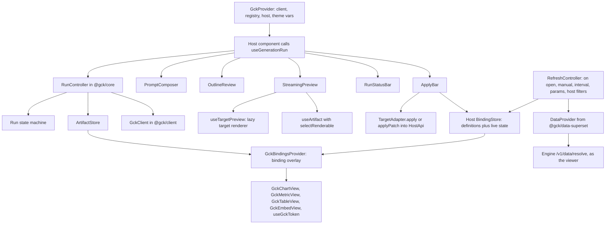
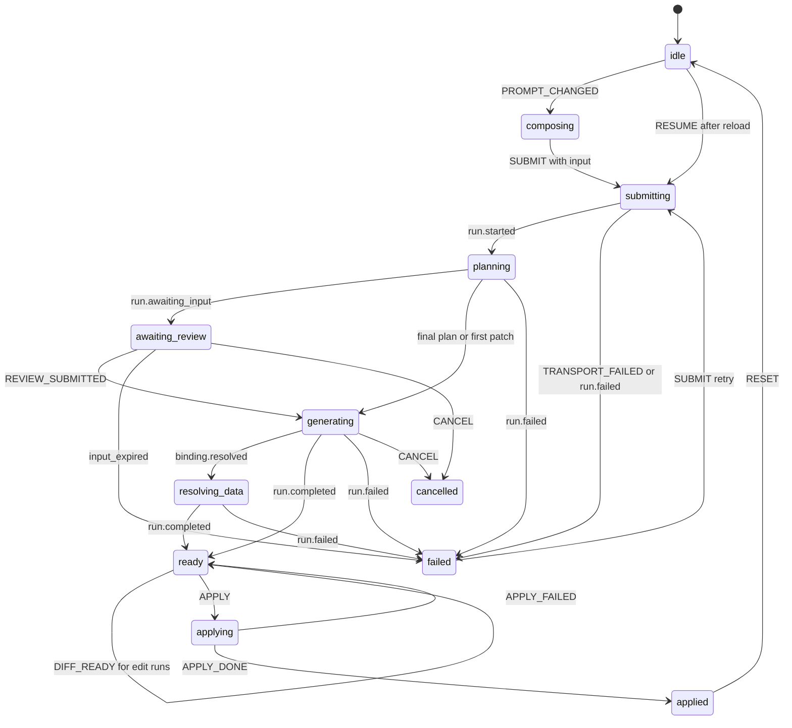
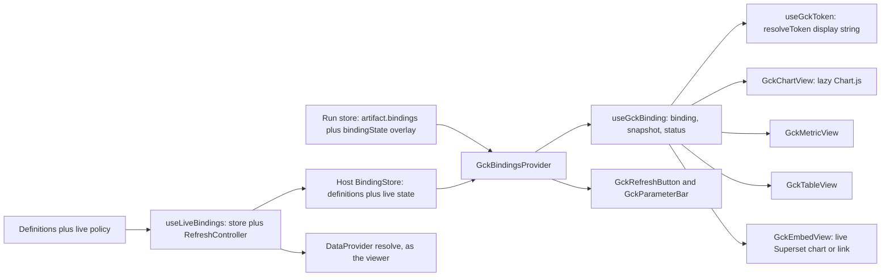

# React SDK and UI kit

<div class="chapter-meta" markdown>
**Reads:** `servers/nextjs/app/(presentation-generator)/outline/components/OutlineContent.tsx`, `servers/nextjs/app/(presentation-generator)/outline/components/OutlineItem.tsx`, `servers/nextjs/app/(presentation-generator)/components/useStableOutlineIds.ts`, `servers/nextjs/app/(presentation-generator)/presentation/hooks/PresentationUndoRedo.ts`, `servers/nextjs/app/(presentation-generator)/presentation/hooks/useAutoSave.tsx`, `servers/nextjs/store/slices/undoRedoSlice.ts`, `servers/nextjs/store/store.ts`  ·  **Builds on:** [Run protocol and client](63-run-protocol-and-client.md)  ·  **Time:** ~65 min
</div>

This chapter builds the browser half of the kit on `@gck/client`: the headless `@gck/core` (state machine, artifact store with structural-sharing JSON Patch, plugin registry, a run controller that submits `generate`, `transform` and `edit` intents and diffs edit results, and the headless `runToCompletion` helper), `@gck/react` (`GckProvider`, four run hooks, and the data views `GckChartView`, `GckMetricView`, `GckTableView` with `GckBindingsProvider`, `useGckBinding` and `useGckToken`) and the styled `@gck/react/ui` (`PromptComposer`, `OutlineReview`, `StreamingPreview`, `RunStatusBar`, `ApplyBar`). It also covers reuse from Presenton's outline page, Redux hosts, and the Next.js App Router.

Generated content never freezes numbers. Every data block and token keeps a binding **definition** (a Superset chart, dataset or metric source), and the kit re-resolves it **as the viewing user** after generation: on open, on demand, on an interval, when a parameter changes and when the host's filters change. This chapter builds that browser side (protocol 1.1): the `DataProvider` interface, the framework-free `BindingStore` and `RefreshController` in `@gck/core`, the live variant of `GckBindingsProvider` with `useLiveBindings`, `useGckRefresh`, `GckRefreshButton` and `GckParameterBar`, and `GckEmbedView`, the live fallback for Superset charts the kit cannot redraw. The end-to-end data path (engine resolve endpoint, Superset refresh API, identity and caching) is in [Live Superset data](69-live-superset-data.md).

Files under `gck/` are **new code** for Part IX; files under `servers/` are Presenton at snapshot `571461f`.

## Step 1: The layers and the component tree

`@gck/core` has no React or DOM imports, so one controller drives React, the `<gck-generate>` web component and plain scripts.



Two stores on purpose: **machine state** (a few dozen changes per run) and the **artifact store** (every patch and delta), so `RunStatusBar` never re-renders per token. A third store takes over after apply: the host's **binding store**, which outlives the run and is kept fresh by a refresh controller (Step 4.1), so applied charts and tokens keep updating when the run store is reset.

## Step 2: The run state machine

The states are the blueprint's, with `failed` carrying `error.retryable`. `SUBMIT` carries the whole submission (prompt, intent, selection, base artifact, preferred apply mode), so one machine serves all three intents; an `edit` run additionally gets a block diff (`DIFF_READY`) once it is `ready`.



| From | Accepted events | To |
|---|---|---|
| any | `CONTEXT_LOADED`, `CHIP_TOGGLED` | same |
| `idle`, `composing` | `PROMPT_CHANGED`, `SUBMIT` (with `input`), `RESUME` | `composing`/`idle`, `submitting` |
| `submitting` | `RUN_CREATED`, `run.started` | `planning` |
| `planning` | `run.awaiting_input`; final plan or first patch | `awaiting_review`; `generating` |
| `awaiting_review` | `REVIEW_SUBMITTED` | `generating` |
| `generating` | `binding.resolved`; `run.completed` | `resolving_data`; `ready` |
| `resolving_data` | `run.completed` | `ready` |
| all active states | `run.failed`, `TRANSPORT_FAILED`; `CANCEL` | `failed` (or `cancelled`); `cancelled` |
| `ready` | `APPLY`; `SUBMIT`; `RESET`; `DIFF_READY` | `applying`; `submitting`; `idle`; `ready` (sets `diff`) |
| `applying` | `APPLY_DONE`; `APPLY_FAILED` | `applied`; `ready` |
| `applied`, `cancelled`, `failed` | `SUBMIT`; `RESET` | `submitting`; `idle` |

The machine is a pure reducer plus an XState-style table of accepted events; unaccepted events are ignored, not thrown, because late events after a cancel are normal.

```ts title="gck/packages/core/src/machine.ts (new)"
import type {
  ApplyMode, ApplyResult, Artifact, Block, GckErrorBody, GckEvent, OutlineItem, RunIntent, Usage,
} from "@gck/protocol";
import type { BlockDiff } from "./diff";

export type RunStatus =
  | "idle" | "composing" | "submitting" | "planning" | "awaiting_review" | "generating"
  | "resolving_data" | "ready" | "applying" | "applied" | "cancelled" | "failed";

export interface ContextChip { id: string; label: string; providerId: string; removable: boolean; keys: string[] }

/** What one submission asks for. `selection` is the target's fromHost output; `baseArtifact` the re-read applied artifact. */
export interface SubmitInput {
  prompt: string;
  intent?: RunIntent;
  selection?: Artifact | Block[];
  baseArtifact?: Artifact;
  apply?: ApplyMode;
}
/** After SUBMIT: intent and apply mode are always filled in. */
export type ResolvedInput = SubmitInput & { intent: RunIntent };

export const DEFAULT_APPLY: Record<RunIntent, ApplyMode | undefined> = {
  generate: undefined,          // ApplyBar falls back to the manifest's first mode
  transform: "replace",
  edit: "patch",
};
export const resolveInput = (i: SubmitInput): ResolvedInput => {
  const intent = i.intent ?? "generate";
  return { ...i, intent, apply: i.apply ?? DEFAULT_APPLY[intent] };
};

export interface RunState {
  status: RunStatus;
  prompt: string;
  runId: string | null;
  lastEventId: number;
  outline: OutlineItem[] | null;
  review: { inputId: string; expiresAt: string } | null;
  progress: { message?: string; completed?: number; total?: number } | null;
  warnings: Array<{ code: string; message: string; blockId?: string }>;
  error: GckErrorBody | null;
  usage: Usage | null;
  applied: ApplyResult | null;
  chips: ContextChip[];
  excludedChipIds: string[];
  input: ResolvedInput | null;          // the submission of the current run; null after RESUME
  diff: BlockDiff | null;               // edit runs only, set once the run is ready
}

export type MachineEvent =
  | { type: "PROMPT_CHANGED"; prompt: string }
  | { type: "CONTEXT_LOADED"; chips: ContextChip[] }
  | { type: "CHIP_TOGGLED"; chipId: string }
  | { type: "SUBMIT"; input: SubmitInput }
  | { type: "DIFF_READY"; diff: BlockDiff }
  | { type: "RESUME"; runId: string }
  | { type: "RUN_CREATED"; runId: string }
  | { type: "STREAM"; event: GckEvent }
  | { type: "REVIEW_SUBMITTED" }
  | { type: "CANCEL" }
  | { type: "TRANSPORT_FAILED"; error: GckErrorBody }
  | { type: "APPLY" }
  | { type: "APPLY_DONE"; result: ApplyResult }
  | { type: "APPLY_FAILED"; error: GckErrorBody }
  | { type: "RESET" };

type T = MachineEvent["type"];
const DONE: readonly T[] = ["PROMPT_CHANGED", "SUBMIT", "RESET"];
const LIVE: readonly T[] = ["STREAM", "CANCEL", "TRANSPORT_FAILED"];

export const TRANSITIONS: Record<RunStatus | "*", readonly T[]> = {
  "*": ["CONTEXT_LOADED", "CHIP_TOGGLED"],
  idle: ["PROMPT_CHANGED", "SUBMIT", "RESUME"],
  composing: ["PROMPT_CHANGED", "SUBMIT", "RESUME", "RESET"],
  submitting: ["RUN_CREATED", ...LIVE],
  planning: LIVE,
  awaiting_review: [...LIVE, "REVIEW_SUBMITTED"],
  generating: LIVE,
  resolving_data: LIVE,
  ready: [...DONE, "APPLY", "DIFF_READY"],
  applying: ["APPLY_DONE", "APPLY_FAILED"],
  applied: DONE,
  cancelled: DONE,
  failed: DONE,
};

const ACTIVE: readonly RunStatus[] = ["submitting", "planning", "awaiting_review", "generating", "resolving_data"];
export const isActive = (s: RunStatus) => ACTIVE.includes(s);
export const canSend = (s: RunState, type: T) =>
  TRANSITIONS["*"].includes(type) || TRANSITIONS[s.status].includes(type);

export const initialRunState = (prompt = ""): RunState => ({
  status: prompt ? "composing" : "idle", prompt, runId: null, lastEventId: 0, outline: null,
  review: null, progress: null, warnings: [], error: null, usage: null, applied: null,
  chips: [], excludedChipIds: [], input: null, diff: null,
});

export function transition(s: RunState, e: MachineEvent): RunState {
  if (!canSend(s, e.type)) return s;
  switch (e.type) {
    case "CONTEXT_LOADED": return { ...s, chips: e.chips };
    case "CHIP_TOGGLED": {
      const off = s.excludedChipIds.includes(e.chipId);
      return { ...s, excludedChipIds: off ? s.excludedChipIds.filter((x) => x !== e.chipId) : [...s.excludedChipIds, e.chipId] };
    }
    case "PROMPT_CHANGED":
      return s.status === "idle" || s.status === "composing"
        ? { ...s, prompt: e.prompt, status: e.prompt.trim() ? "composing" : "idle" }
        : { ...s, prompt: e.prompt };                       // keep the finished run visible
    case "SUBMIT":
      if (!e.input.prompt.trim()) return s;
      return { ...initialRunState(e.input.prompt), status: "submitting", input: resolveInput(e.input),
               chips: s.chips, excludedChipIds: s.excludedChipIds };
    case "RESUME": return { ...initialRunState(s.prompt), status: "submitting", runId: e.runId, chips: s.chips };
    case "RUN_CREATED": return { ...s, runId: e.runId };
    case "DIFF_READY": return { ...s, diff: e.diff };
    case "REVIEW_SUBMITTED": return { ...s, status: "generating", review: null };
    case "CANCEL": return { ...s, status: "cancelled", review: null };
    case "TRANSPORT_FAILED": return { ...s, status: "failed", error: e.error };
    case "APPLY": return { ...s, status: "applying", error: null };
    case "APPLY_DONE": return { ...s, status: "applied", applied: e.result };
    case "APPLY_FAILED": return { ...s, status: "ready", error: e.error };
    case "RESET": return { ...initialRunState(), chips: s.chips };
    case "STREAM": return onStream(s, e.event);
  }
}

function onStream(s: RunState, ev: GckEvent): RunState {
  if (ev.id <= s.lastEventId) return s;
  const b: RunState = { ...s, lastEventId: ev.id, progress: ev.progress ?? s.progress };
  const early = s.status === "submitting" || s.status === "planning" || s.status === "awaiting_review";
  switch (ev.type) {
    case "run.started": return { ...b, status: "planning" };
    case "plan.proposed":
      return { ...b, outline: ev.data.outline, status: ev.data.final && early ? "generating" : b.status };
    case "run.awaiting_input":
      return { ...b, status: "awaiting_review", review: { inputId: ev.data.inputId, expiresAt: ev.data.expiresAt } };
    case "artifact.patch":
    case "text.delta": return early ? { ...b, status: "generating", review: null } : b;
    case "binding.resolved": return s.status === "generating" ? { ...b, status: "resolving_data" } : b;
    case "run.warning": return { ...b, warnings: [...s.warnings, ev.data] };
    case "run.completed": return { ...b, status: "ready", usage: ev.data.usage, review: null };
    case "run.failed":
      return { ...b, status: ev.data.code === "cancelled" ? "cancelled" : "failed", error: ev.data, review: null };
    default: return b;                                      // unknown future event types
  }
}
```

!!! warning "Gotcha"
    `onStream` drops events with `id <= lastEventId` although the client already deduplicates. A reload replays the log from 0 into a fresh machine while a remount resumes from the machine's `lastEventId`; deduplicating in the reducer keeps both paths correct without coordinating counters.

`SUBMIT` stores the resolved input in `state.input`, with the intent defaulted to `generate` and the apply mode defaulted per intent (`DEFAULT_APPLY`). That one field serves three readers: the controller builds the run request from it, `ApplyBar` preselects `input.apply`, and `RunStatusBar`'s Retry resubmits it unchanged, so a retried transform rewrites the same selection even if the user has since clicked elsewhere. `RESUME` leaves `input` null, because only the run id survives a reload.

## Step 3: The artifact store

The store holds the Artifact, its version, `text.delta` drafts, the binding overlay and a block index. `getSnapshot()` returns an immutable object whose identity changes only on change, and `subscribe()` notifies at most once per animation frame, which is what `useSyncExternalStore` needs.

### 3.1 JSON Patch with structural sharing

The applier copies on write along each op's path, so untouched sections and blocks keep their identity: memoized blocks skip re-rendering, changed blocks are detectable with `===`, and a failing op leaves the original untouched (RFC 6902 atomicity).

```ts title="gck/packages/core/src/json-patch.ts (new)"
import type { JsonPatchOp } from "@gck/protocol";

export class PatchError extends Error {}
const isObj = (v: unknown): v is Record<string, unknown> => typeof v === "object" && v !== null && !Array.isArray(v);
const INDEX = /^(0|[1-9]\d*)$/;

export function parsePointer(p: string): string[] {
  if (p === "") return [];
  if (!p.startsWith("/")) throw new PatchError(`Invalid JSON Pointer: ${p}`);
  return p.slice(1).split("/").map((t) => t.replace(/~1/g, "/").replace(/~0/g, "~"));
}

function get(doc: unknown, tokens: string[]): unknown {
  let node = doc;
  for (const t of tokens) {
    if (Array.isArray(node) && INDEX.test(t) && +t < node.length) node = node[+t];
    else if (isObj(node) && Object.prototype.hasOwnProperty.call(node, t)) node = node[t];
    else throw new PatchError(`Path not found: /${tokens.join("/")}`);
  }
  return node;
}

/** Copy-on-write along `tokens`; siblings keep their identity. */
function edit(doc: unknown, tokens: string[], leaf: (container: any, key: string) => void): unknown {
  const [key, ...rest] = tokens;
  const copy: any = Array.isArray(doc) ? doc.slice() : isObj(doc) ? { ...doc } : null;
  if (copy === null) throw new PatchError(`Not a container at "${key}"`);
  if (rest.length === 0) leaf(copy, key);
  else copy[key] = edit(get(doc, [key]), rest, leaf);
  return copy;
}

function add(doc: unknown, tokens: string[], value: unknown): unknown {
  if (tokens.length === 0) return value;
  return edit(doc, tokens, (c, k) => {
    if (!Array.isArray(c)) { c[k] = value; return; }
    const i = k === "-" ? c.length : INDEX.test(k) ? +k : NaN;
    if (!(i >= 0 && i <= c.length)) throw new PatchError(`Bad array index ${k}`);
    c.splice(i, 0, value);
  });
}

function remove(doc: unknown, tokens: string[]): unknown {
  if (tokens.length === 0) throw new PatchError("Cannot remove the root");
  get(doc, tokens);                                          // must exist
  return edit(doc, tokens, (c, k) => { if (Array.isArray(c)) c.splice(+k, 1); else delete c[k]; });
}

function replace(doc: unknown, tokens: string[], value: unknown): unknown {
  if (tokens.length === 0) return value;
  get(doc, tokens);
  return edit(doc, tokens, (c, k) => { c[k] = value; });
}

/** Never mutates `doc`; throws PatchError and leaves `doc` intact if any op fails. */
export function applyJsonPatch(doc: unknown, ops: readonly JsonPatchOp[]): unknown {
  let out = doc;
  for (const op of ops) {
    const path = parsePointer(op.path);
    switch (op.op) {
      case "add": out = add(out, path, op.value); break;
      case "remove": out = remove(out, path); break;
      case "replace": out = replace(out, path, op.value); break;
      case "move": case "copy": throw new PatchError(`${op.op} is not emitted by the engine`);
      case "test":
        if (JSON.stringify(get(out, path)) !== JSON.stringify(op.value)) throw new PatchError(`test failed at ${op.path}`);
        break;
    }
  }
  return out;
}

/** Append `delta` to the string at `tokens`, creating missing containers (text.delta, format "text"). */
export function appendTextAt<V>(node: V, tokens: string[], delta: string): V {
  if (tokens.length === 0) return ((typeof node === "string" ? node : "") + delta) as V;
  const [key, ...rest] = tokens;
  const copy: any = Array.isArray(node) ? node.slice() : isObj(node) ? { ...node } : INDEX.test(key) ? [] : {};
  const empty = rest.length === 0 ? "" : INDEX.test(rest[0]) ? [] : {};
  copy[key] = appendTextAt(copy[key] ?? empty, rest, delta);
  return copy;
}
```

`move` and `copy` are rejected because the engine never emits them; a rejected patch becomes a `conflict` and a resync. `test` compares with `JSON.stringify`, which depends on key order: fine for the kit's own edit patches, not for arbitrary input.

### 3.2 The store

```ts title="gck/packages/core/src/artifact-store.ts (new)"
import { jsonrepair } from "jsonrepair";
import type { Artifact, Block, DataBinding, EventOf } from "@gck/protocol";
import { appendTextAt, applyJsonPatch, parsePointer } from "./json-patch";

export type BindingState = Pick<DataBinding, "snapshot" | "snapshotAt" | "status" | "error">;   // 1.1: + error
export interface BlockRef { section: number; block: number; since: number }
export interface ArtifactSnapshot {
  readonly artifact: Artifact | null;
  readonly version: number;
  readonly drafts: Readonly<Record<string, Block>>;
  readonly bindingState: Readonly<Record<string, BindingState>>;
  readonly index: Readonly<Record<string, BlockRef>>;
}
export type PatchResult = "applied" | "skipped" | "conflict";

export interface ArtifactStore {
  getSnapshot(): ArtifactSnapshot;
  subscribe(listener: () => void): () => void;
  applyPatch(p: EventOf<"artifact.patch">["data"]): PatchResult;
  applyTextDelta(d: EventOf<"text.delta">["data"]): void;
  resolveBinding(b: EventOf<"binding.resolved">["data"]): void;
  /** keepBindings: a resync keeps resolved data instead of dropping every chart to a skeleton. */
  reset(artifact?: Artifact | null, version?: number, opts?: { keepBindings?: boolean }): void;
  flush(): void;
}

const EMPTY: ArtifactSnapshot = Object.freeze({ artifact: null, version: 0, drafts: {}, bindingState: {}, index: {} });
const raf = (fn: () => void) => (typeof requestAnimationFrame === "function" ? requestAnimationFrame(fn) : setTimeout(fn, 16));

function buildIndex(a: Artifact, prev: ArtifactSnapshot, version: number): Record<string, BlockRef> {
  const out: Record<string, BlockRef> = {};
  a.sections.forEach((sec, si) => sec.blocks.forEach((b, bi) => {
    const old = prev.index[b.id];
    const same = old && prev.artifact?.sections[old.section]?.blocks[old.block] === b;
    out[b.id] = { section: si, block: bi, since: same ? old.since : version };
  }));
  return out;
}

export function createArtifactStore(schedule: (fn: () => void) => unknown = raf): ArtifactStore {
  let snap = EMPTY;
  let pending = false;
  const listeners = new Set<() => void>();
  const jsonBuffers = new Map<string, string>();
  const emit = () => { pending = false; for (const l of [...listeners]) l(); };
  const commit = (next: ArtifactSnapshot) => { snap = next; if (!pending) { pending = true; schedule(emit); } };

  const store: ArtifactStore = {
    getSnapshot: () => snap,
    subscribe(l) { listeners.add(l); return () => { listeners.delete(l); }; },
    applyPatch({ baseVersion, version, ops }) {
      const snapshot = baseVersion === 0 && ops.length === 1 && ops[0].op === "replace" && ops[0].path === "";
      if (!snapshot && version <= snap.version) return "skipped";
      if (!snapshot && baseVersion !== snap.version) return "conflict";
      let artifact: Artifact;
      try { artifact = applyJsonPatch(snapshot ? null : snap.artifact, ops) as Artifact; }
      catch { return "conflict"; }
      const index = buildIndex(artifact, snap, version);
      const drafts: Record<string, Block> = {};
      for (const [id, d] of Object.entries(snap.drafts)) {
        if (index[id] && index[id].since < version) drafts[id] = d;   // block unchanged: keep draft
        else jsonBuffers.delete(id);                                   // replaced or removed: final wins
      }
      commit({ ...snap, artifact, version, index, drafts });
      return "applied";
    },
    applyTextDelta({ blockId, path, delta, format, baseVersion }) {
      const ref = snap.index[blockId];
      if (!ref || !snap.artifact || baseVersion < ref.since) return;   // unknown or stale
      let draft: Block;
      if (format === "json") {
        const buf = (jsonBuffers.get(blockId) ?? "") + delta;
        jsonBuffers.set(blockId, buf);
        try { draft = JSON.parse(jsonrepair(buf)); } catch { return; }  // wait for more text
        if (!draft || draft.id !== blockId) return;
      } else {
        const current = snap.drafts[blockId] ?? snap.artifact.sections[ref.section].blocks[ref.block];
        draft = appendTextAt(current, parsePointer(path), delta);
      }
      commit({ ...snap, drafts: { ...snap.drafts, [blockId]: draft } });
    },
    resolveBinding({ bindingId, snapshot, snapshotAt, status, error }) {
      const prev = snap.bindingState[bindingId];
      // stale and error keep the last snapshot (the view badges it); forbidden drops it
      const kept = status === "forbidden" ? undefined : snapshot ?? prev?.snapshot;
      commit({ ...snap, bindingState: { ...snap.bindingState,
        [bindingId]: { snapshot: kept, snapshotAt: snapshot ? snapshotAt : prev?.snapshotAt, status, error } } });
    },
    reset(artifact = null, version = 0, opts = {}) {
      jsonBuffers.clear();
      const bindingState = opts.keepBindings ? snap.bindingState : {};
      commit({ ...EMPTY, artifact, version, bindingState, index: artifact ? buildIndex(artifact, EMPTY, version) : {} });
    },
    flush: () => { if (pending) emit(); },
  };
  return store;
}

// --- selectors ---------------------------------------------------------------
const renderCache = new WeakMap<ArtifactSnapshot, Artifact | null>();

/** Artifact with drafts and binding overlay merged in; memoized per snapshot. */
export function selectRenderable(s: ArtifactSnapshot): Artifact | null {
  const hit = renderCache.get(s);
  if (hit !== undefined) return hit;
  let a = s.artifact;
  if (a && (Object.keys(s.drafts).length || Object.keys(s.bindingState).length)) {
    a = {
      ...a,
      sections: a.sections.map((sec) => sec.blocks.some((b) => s.drafts[b.id])
        ? { ...sec, blocks: sec.blocks.map((b) => s.drafts[b.id] ?? b) } : sec),
      bindings: Object.fromEntries(Object.entries(a.bindings).map(([id, b]) =>
        [id, s.bindingState[id] ? { ...b, ...s.bindingState[id] } : b])),
    };
  }
  renderCache.set(s, a);
  return a;
}
export const selectSectionCount = (s: ArtifactSnapshot) => s.artifact?.sections.length ?? 0;
```

The `json` branch repeats Presenton's outline-buffer repair ( `servers/nextjs/app/(presentation-generator)/outline/hooks/useOutlineStreaming.ts:133-139`), scoped to one block; `jsonrepair` is already a Presenton frontend dependency (`servers/nextjs/package.json:50`). Any framework can use the store directly: `store.subscribe(() => render(selectSectionCount(store.getSnapshot())))`.

Two protocol 1.1 changes reach the store. `binding.resolved` carries an optional `error` (`{ code, message, retryable }`), plus `changed` and `reason` that the store ignores, so the overlay keeps the error code the views need for their message and Retry button (Step 14.3). And `reset(..., { keepBindings: true })` is what a resync after a patch conflict uses (Step 5): the artifact is replaced, but resolved data stays, so a conflict mid-run no longer drops every chart back to a skeleton. `resolveBinding` keeps the previous snapshot under `stale` and `error` (the views badge it) and drops it under `forbidden`, so a viewer who lost access never keeps seeing the last numbers.

!!! warning "Gotcha"
    Notifications use `requestAnimationFrame`, which browsers pause in background tabs: patches still apply, but subscribers hear about them when the tab is visible again. Tests must call `store.flush()` or pass `(fn) => fn()` as `schedule`.

## Step 4: The plugin registry

Targets, context providers and data providers register at runtime, so a Superset extension can add providers after the kit loads.

```ts title="gck/packages/core/src/registry.ts (new)"
import type {
  Artifact, ApplyMode, ApplyResult, DataEventBody, HostContext, HostDataScope, ResolveRequest,
  TargetId, TargetManifest,
} from "@gck/protocol";
import type { BlockDiff } from "./diff";
import type { ContextChip } from "./machine";

export type { ApplyMode, ApplyResult, HostContext } from "@gck/protocol";   // shared types have one home

export interface HostApi {
  readonly id: string;                       // "superset" | "tiptap" | "presenton" | "web" | ...
  capability<T>(name: string): T | undefined;
  emit?(event: string, detail: unknown): void;
}

/** Build a HostApi from a plain capability map. */
export function createHost(id: string, capabilities: Record<string, unknown>,
                           emit?: (event: string, detail: unknown) => void): HostApi {
  return { id, capability: <T>(name: string) => capabilities[name] as T | undefined, emit };
}

/** Core keeps `Preview` generic so it never names React, not even as a type; @gck/react narrows it to a component. */
export interface TargetAdapter<Native = unknown, Preview = unknown> {
  manifest: TargetManifest;
  fromHost?(ctx: HostContext): Partial<Artifact>;
  toNative(artifact: Artifact): Native;      // pure, deterministic, no I/O
  /** mode "patch" only: change just the diff's blocks in the host (one undo step). Absent: apply() handles "patch". */
  applyPatch?(native: Native, diff: BlockDiff, artifact: Artifact, host: HostApi): Promise<ApplyResult>;
  preview?: Preview;                         // eager (small targets such as text)
  loadPreview?: () => Promise<Preview>;      // lazy, from the target's /react subpath (slides: renderer and Chart.js)
  apply(native: Native, host: HostApi, mode: ApplyMode): Promise<ApplyResult>;
}

export interface ContextProvider {
  id: string;
  collect(signal: AbortSignal): Promise<{ context: Partial<HostContext>; chips: Omit<ContextChip, "providerId">[] }>;
}
/** One catalog row as the browser sees it; the engine keeps the full CatalogEntry (source, mapping, format). */
export interface CatalogEntryView {
  key: string; kind: "chart" | "metric" | "table" | "embed"; title: string;
  chartId?: number; datasetId?: number;
  refreshable: boolean; reason: string | null;              // e.g. "not_refreshable:deck.gl"
  chartType: string | null; compatibleKinds: string[];
}
export interface DataCatalog {
  allowedChartIds: number[];                                 // kept for RunRequest.data compatibility
  allowedDatasetIds?: number[];
  entries: CatalogEntryView[];
  viewerKey: string;                                         // whose RLS view resolved results belong to
}

/** Protocol 1.1: a data provider lists what the viewer may use AND resolves bindings after generation. */
export interface DataProvider {
  id: string;                                                // "superset"
  catalog(scope: HostDataScope | null, signal: AbortSignal): Promise<DataCatalog>;
  resolve(req: ResolveRequest, signal: AbortSignal): AsyncIterable<DataEventBody>;
  watchScope?(onChange: (scope: HostDataScope) => void): () => void;   // host filter changes
}

export function createRegistry() {
  const targets = new Map<string, TargetAdapter<any, any>>();
  const contexts = new Map<string, ContextProvider>();
  const data = new Map<string, DataProvider>();
  const listeners = new Set<() => void>();
  let version = 0;
  const changed = () => { version++; listeners.forEach((l) => l()); };
  const add = <V>(map: Map<string, V>, id: string, value: V) => {
    map.set(id, value); changed();
    return () => { if (map.get(id) === value) { map.delete(id); changed(); } };
  };
  return {
    registerTarget: (t: TargetAdapter<any, any>) => add(targets, t.manifest.id, t),
    registerContextProvider: (p: ContextProvider) => add(contexts, p.id, p),
    registerDataProvider: (p: DataProvider) => add(data, p.id, p),
    getTarget: (id: TargetId) => targets.get(id),
    contextProviders: () => [...contexts.values()],
    dataProvider: (id: string) => data.get(id),
    subscribe: (l: () => void) => { listeners.add(l); return () => { listeners.delete(l); }; },
    getVersion: () => version,
  };
}
export type Registry = ReturnType<typeof createRegistry>;

/** A failing provider never blocks a run; excluded chips drop their context keys. */
export async function collectContext(registry: Registry, excluded: string[], signal: AbortSignal) {
  const settled = await Promise.allSettled(
    registry.contextProviders().map(async (p) => ({ p, r: await p.collect(signal) })));
  const context: Record<string, unknown> = {};
  const chips: ContextChip[] = [];
  for (const res of settled) {
    if (res.status !== "fulfilled") continue;
    Object.assign(context, res.value.r.context);
    chips.push(...res.value.r.chips.map((c) => ({ ...c, providerId: res.value.p.id })));
  }
  for (const chip of chips) if (excluded.includes(chip.id)) chip.keys.forEach((k) => delete context[k]);
  return { context: context as Partial<HostContext>, chips };
}
```

The shared types (`ApplyMode`, `ApplyResult`, `HostContext`, which is the run request's `RunContext` under a second name) live in `@gck/protocol` and are defined in [Artifact Spec and targets](62-artifact-spec-and-targets.md); core re-exports them. `applyPatch` receives the block diff of an edit run (Step 5.1) together with the full new artifact, so the target can place added blocks relative to their neighbors: `@gck/target-tiptap` finds the changed, removed and neighboring nodes through the `gckBlockId` attribute it stores on every top-level node and rewrites them in one transaction, `@gck/target-text` re-renders (patch is replace for text), and the slides and dashboard targets leave `"patch"` out of `manifest.applyModes` in v1. `HostApi` is typed at the call site: an adapter asks for a well-known capability such as `host.capability<Editor>("tiptap.editor")`, and `createHost` builds one from a plain map. Core keeps `Preview` generic and adds `loadPreview` for on-demand renderers; `@gck/react` narrows `Preview` to `ComponentType<PreviewProps>` (Step 7).

`DataProvider` is the protocol 1.1 shape (it replaces the catalog-only interface of 1.0). It has two jobs:

| Method | Called by | When | What it returns |
|---|---|---|---|
| `catalog(scope, signal)` | run controller (Step 5) | before `startRun` | the charts and datasets this viewer may bind, with `refreshable` and `reason` per chart and the `viewerKey`; `scope` is the host's captured filter state, so the engine samples data under the same filters the user is looking at |
| `resolve(req, signal)` | refresh controller (Step 4.1) | after generation: on open, Refresh, interval, parameter or filter change | a stream of `refresh.started`, `binding.loading`, `binding.resolved`, `refresh.completed` (or one `refresh.failed`) |
| `watchScope(cb)` (optional) | refresh controller | while mounted, when the policy has `on_filter_change` | host filter changes, for bindings whose `filter_context.mode` is `follow_host` |

The kit's Superset implementation is `createSupersetDataProvider` in `@gck/data-superset` (new). Its default transport is the engine: `resolve` posts the binding **definitions** to `POST {engine}/v1/data/resolve` with the engine token, and the engine exchanges that token server side for a short-lived data token and calls the Superset refresh API as the same user, so Superset's RBAC and row-level security apply to every refresh. The browser never holds a data token and never calls `/api/v1/chart/data` directly. A second transport, `{ presenton: { fetch, presentationId } }`, drives Part VIII's deck-scoped refresh routes for the Presenton host. The request and event types, limits and caching are specified in [Live Superset data](69-live-superset-data.md).

```ts title="gck/packages/data-superset/src/index.ts (new, signature)"
export function createSupersetDataProvider(o: {
  client: GckClient;                                         // engine transport (default)
  transport?: "engine" | { presenton: { fetch: typeof fetch; presentationId: string } };
  scopeSource?: () => HostDataScope | null;                  // dashboard or Embedded SDK filter capture
  watch?: (cb: (s: HostDataScope) => void) => () => void;    // feeds DataProvider.watchScope
}): DataProvider;
```

A host outside Superset that wants `follow_host` on an embedded dashboard passes `watch` built on the Embedded SDK: `embedDashboard` returns `getDataMask()` and `observeDataMask(cb)`, and the host sets `dashboardUiConfig.emitDataMasks` so the iframe pushes changes (`superset-embedded-sdk/src/index.ts:44`, `:164-165`, `:239`, `:594-614`, Superset master `cabd8d4`).

### 4.1 Live data in core: binding store and refresh controller

A run store dies with its run. Applied content needs a store that the host owns, that holds binding **definitions** (what to query) separately from **runtime state** (the latest snapshot, its time, status and error), and a controller that decides when to re-resolve. Both are framework-free, so the web components and plain scripts use them exactly as React does.

```ts title="gck/packages/core/src/binding-store.ts (new)"
import type { BindingDefinition, BindingError, DataBinding, DataEventBody } from "@gck/protocol";
import type { BindingState } from "./artifact-store";

/** changed: the last refresh differs from the data the narrative was written against (generatedAgainst). */
export type LiveBindingState = BindingState & { error?: BindingError; loading?: boolean; changed?: boolean };
export interface BindingStoreSnapshot {
  readonly definitions: Readonly<Record<string, BindingDefinition>>;
  readonly state: Readonly<Record<string, LiveBindingState>>;
  readonly viewerKey: string | null;                         // from refresh.started
}
export interface BindingStore {
  getSnapshot(): BindingStoreSnapshot;
  subscribe(l: () => void): () => void;
  apply(e: DataEventBody): void;                             // also accepts a run's binding.resolved
  setDefinitions(defs: Record<string, BindingDefinition>): void;
  merged(id: string): DataBinding | undefined;               // definition + state: what adapters and views read
}

export function createBindingStore(defs: Record<string, BindingDefinition> = {},
                                   seed: Record<string, BindingState> = {}): BindingStore {
  let snap: BindingStoreSnapshot = { definitions: defs, state: seed, viewerKey: null };
  let queued = false;
  const listeners = new Set<() => void>();
  const cache = new Map<string, { d?: BindingDefinition; s?: LiveBindingState; m?: DataBinding }>();
  const commit = (next: BindingStoreSnapshot) => {
    snap = next;
    if (!queued) { queued = true; queueMicrotask(() => { queued = false; listeners.forEach((l) => l()); }); }
  };
  const put = (id: string, s: LiveBindingState) => commit({ ...snap, state: { ...snap.state, [id]: s } });
  return {
    getSnapshot: () => snap,
    subscribe(l) { listeners.add(l); return () => { listeners.delete(l); }; },
    setDefinitions(definitions) { commit({ ...snap, definitions }); },
    apply(e) {
      if (e.type === "refresh.started") commit({ ...snap, viewerKey: e.data.viewerKey });
      else if (e.type === "binding.loading") put(e.data.bindingId, { ...snap.state[e.data.bindingId], loading: true });
      else if (e.type === "binding.resolved") {
        const { bindingId, status, snapshot, snapshotAt, error, changed } = e.data;
        const prev = snap.state[bindingId];
        put(bindingId, {
          status, error, loading: false, changed: changed ?? prev?.changed,
          snapshot: status === "forbidden" ? undefined : snapshot ?? prev?.snapshot,   // stale/error keep the last data
          snapshotAt: snapshot ? snapshotAt : prev?.snapshotAt,
        });
      }
    },
    merged(id) {
      const d = snap.definitions[id], s = snap.state[id], hit = cache.get(id);
      if (hit && hit.d === d && hit.s === s) return hit.m;     // identity stable until this binding changes
      const m = d ? ((s ? { ...d, ...s } : d) as DataBinding) : undefined;
      cache.set(id, { d, s, m });
      return m;
    },
  };
}
```

The store batches notifications per microtask, not per animation frame like the artifact store, because refresh results should land even in a background tab (the controller decides whether to fetch there at all). It keeps the `changed` flag of `binding.resolved` (the run's artifact store ignores it): when a refresh returns data that differs from the snapshot the narrative was generated against (`generatedAgainst`), a host can show `data.narrativeOutdated` ("Text was written against data as of {date}. Regenerate?") and start an `edit` run, as described in [Live Superset data](69-live-superset-data.md). `merged` caches per binding by the identities of its definition and state, which gives `useGckBinding` the same one-chart-per-update behavior as the run store.

The refresh controller is a port of Story 4's run-scoped refresh reducer ([Story 4, native charts and refresh UX](../delivery/45-story4-native-charts-ux.md)), widened from "on open and before export" to the protocol 1.1 policy:

```ts title="RefreshPolicy (from @gck/protocol, protocol 1.1)"
export type RefreshMode = "on_open" | "manual" | "interval" | "on_filter_change" | "on_schedule";
export type RefreshPolicy = {
  modes: RefreshMode[];
  intervalSec?: number;              // required with "interval"; >= 60 (validator I13_REFRESH_POLICY)
  schedule?: { cron: string; timezone: string };   // "on_schedule": headless executors only, ignored here
  staleAfterSec?: number;            // default 3600
  onVisible?: boolean;               // default true: on tab return, refresh what is older than staleAfterSec
  beforeExport?: boolean;            // default true for targets that export files
  cache?: "prefer" | "bypass";       // default "prefer"; a manual refresh always forces
};
```

The effective policy of a binding is `binding.refresh` over `artifact.refresh` over the target's default over the host's provider prop. Target defaults: `tiptap-doc` and kit-rendered `text` use `on_open`, `manual` and `on_filter_change`; `slides` in Presenton uses `on_open` and `manual` plus refresh before export; `interval` is always opt-in.

```ts title="gck/packages/core/src/refresh-controller.ts (new)"
import type { ArtifactParameter, GckErrorBody, HostDataScope, ParamValue, RefreshMode, RefreshPolicy,
  RefreshTrigger } from "@gck/protocol";
import type { BindingStore } from "./binding-store";
import type { DataProvider } from "./registry";

export const MIN_INTERVAL_SEC = 60;
const PARAM_DEBOUNCE_MS = 400, STALE_TICK_MS = 60_000, MAX_INTERVAL_FAILURES = 3;
const RETRY_DELAYS_MS = [1_000, 2_000, 4_000];
type Clock = { now(): number; every(ms: number, fn: () => void): () => void };
const realClock: Clock = { now: Date.now, every: (ms, fn) => { const h = setInterval(fn, ms); return () => clearInterval(h); } };
const hidden = () => typeof document !== "undefined" && document.visibilityState === "hidden";
const sleep = (ms: number, s: AbortSignal) => new Promise<void>((r) => { const h = setTimeout(r, ms); s.addEventListener("abort", () => { clearTimeout(h); r(); }); });

export type RefreshSummary = { ok: number; stale: number; errors: number; forbidden: number };
export interface RefreshControllerState {
  status: "idle" | "refreshing"; lastRefreshedAt: string | null; summary: RefreshSummary | null;
  needsReauth: boolean; params: Readonly<Record<string, ParamValue>>; tick: number;   // tick: staleness clock
}
export type RefreshController = ReturnType<typeof createRefreshController>;

export function createRefreshController(o: {
  provider: DataProvider; store: BindingStore; policy: RefreshPolicy;
  parameters?: Record<string, ArtifactParameter>; params?: Record<string, ParamValue>;
  scope?: HostDataScope | null; clock?: Clock;
  onReauth?: () => Promise<void>;                            // data_token_expired: getToken({ forceRefresh: true })
}) {
  const clock = o.clock ?? realClock;
  const policy: RefreshPolicy = { staleAfterSec: 3600, onVisible: true, cache: "prefer", ...o.policy };
  const has = (m: RefreshMode) => policy.modes.includes(m);
  let scope = o.scope ?? null, failures = 0, paramTimer: ReturnType<typeof setTimeout> | undefined;
  let state: RefreshControllerState = { status: "idle", lastRefreshedAt: null, summary: null,
    needsReauth: false, params: { ...o.params }, tick: 0 };
  const listeners = new Set<() => void>(), disposers: (() => void)[] = [];
  const owner = new Map<string, AbortController>();           // binding id -> the request whose results count
  const pendingParamIds = new Set<string>();
  const set = (p: Partial<RefreshControllerState>) => { state = { ...state, ...p }; listeners.forEach((l) => l()); };
  const defs = () => o.store.getSnapshot().definitions;
  const all = () => Object.keys(defs());

  /** Newest request wins per binding; a request that no longer owns any binding is aborted. */
  const release = (ids: string[]) => {
    const prev = new Set(ids.map((id) => owner.get(id)).filter(Boolean) as AbortController[]);
    ids.forEach((id) => owner.delete(id));
    for (const ac of prev) if (![...owner.values()].includes(ac)) ac.abort();
  };

  async function run(ids: string[], trigger: RefreshTrigger, force = false, attempt = 0, reauthed = false): Promise<boolean> {
    const d = defs(), target = ids.filter((id) => d[id]);
    if (!target.length) return true;
    release(target);
    const ac = new AbortController();
    target.forEach((id) => owner.set(id, ac));
    set({ status: "refreshing" });
    try {
      const events = o.provider.resolve({
        bindings: Object.fromEntries(target.map((id) => [id, d[id]])), parameters: o.parameters,
        params: state.params, scope: scope ?? undefined, trigger, force: trigger === "manual" && force,
      }, ac.signal);
      for await (const ev of events) {
        if (ev.type === "refresh.failed") throw ev.data;
        if ((ev.type === "binding.loading" || ev.type === "binding.resolved") && owner.get(ev.data.bindingId) !== ac) continue;
        o.store.apply(ev);
        if (ev.type === "refresh.completed") {
          const { ok, stale, errors, forbidden } = ev.data;
          set({ summary: { ok, stale, errors, forbidden }, lastRefreshedAt: new Date(clock.now()).toISOString() });
        }
      }
      return true;
    } catch (err) {
      if (ac.signal.aborted) return true;                     // superseded or stopped: not a failure
      const e = err as GckErrorBody & { retryAfterMs?: number };
      if (e.code === "data_token_expired" && o.onReauth && !reauthed) {
        set({ needsReauth: true });
        await o.onReauth().finally(() => set({ needsReauth: false }));
        return run(target, trigger, force, attempt, true);
      }
      if (e.retryable && attempt < RETRY_DELAYS_MS.length) {
        await sleep(e.retryAfterMs ?? RETRY_DELAYS_MS[attempt], ac.signal);
        return ac.signal.aborted || run(target, trigger, force, attempt + 1, reauthed);
      }
      return false;                                          // bindings keep their last state and badges
    } finally {
      target.forEach((id) => { if (owner.get(id) === ac) owner.delete(id); });
      if (!owner.size) set({ status: "idle" });
    }
  }

  const olderThan = (sec: number) => all().filter((id) => {
    const at = o.store.getSnapshot().state[id]?.snapshotAt;
    return !at || clock.now() - Date.parse(at) > sec * 1000;
  });
  const followers = () => all().filter((id) => (defs()[id].source as { filter_context?: { mode: string } })
    .filter_context?.mode === "follow_host");

  const controller = {
    getState: () => state,
    subscribe(l: () => void) { listeners.add(l); return () => { listeners.delete(l); }; },
    start() {
      if (has("on_open")) void run(all(), "on_open");
      if (has("interval")) {
        const sec = Math.max(policy.intervalSec ?? MIN_INTERVAL_SEC, MIN_INTERVAL_SEC);
        const ms = Math.round(sec * 1000 * (0.9 + Math.random() * 0.2));        // +-10 % jitter across viewers
        disposers.push(clock.every(ms, () => {
          if (hidden() || failures >= MAX_INTERVAL_FAILURES) return;            // paused, or stopped until manual
          void run(all(), "interval").then((ok) => { failures = ok ? 0 : failures + 1; });
        }));
      }
      disposers.push(clock.every(STALE_TICK_MS, () => { if (!hidden()) set({ tick: state.tick + 1 }); }));
      if (has("on_filter_change") && o.provider.watchScope) disposers.push(o.provider.watchScope((s) => controller.setScope(s)));
      if (policy.onVisible && typeof document !== "undefined") {
        const onVis = () => { if (!hidden()) void run(olderThan(policy.staleAfterSec!), "on_visible"); };
        document.addEventListener("visibilitychange", onVis);
        disposers.push(() => document.removeEventListener("visibilitychange", onVis));
      }
    },
    stop() {
      disposers.splice(0).forEach((dispose) => dispose());
      clearTimeout(paramTimer); pendingParamIds.clear();
      release([...owner.keys()]);                              // aborts every in-flight request
      set({ status: "idle" });
    },
    /** Refresh data: forces past the cache (the engine throttles force to once per binding per 30 s). */
    refresh(ids?: string[], opts: { force?: boolean; trigger?: RefreshTrigger } = {}) {
      failures = 0;                                            // a manual refresh re-arms a stopped interval
      return run(ids ?? all(), opts.trigger ?? "manual", opts.force ?? true).then(() => undefined);
    },
    /** Re-resolves only the bindings whose params reference a changed parameter, after 400 ms of quiet. */
    setParams(values: Record<string, ParamValue>) {
      const changed = Object.keys(values).filter((k) => JSON.stringify(values[k]) !== JSON.stringify(state.params[k]));
      if (!changed.length) return;
      set({ params: { ...state.params, ...values } });
      const ids = all().filter((id) => defs()[id].params?.some((p) => changed.includes(p.param)));
      release(ids);                                            // results for the old values are dropped now
      ids.forEach((id) => pendingParamIds.add(id));
      clearTimeout(paramTimer);
      paramTimer = setTimeout(() => {
        const next = [...pendingParamIds]; pendingParamIds.clear();
        void run(next, "on_filter_change");
      }, PARAM_DEBOUNCE_MS);
    },
    /** Live host filters: re-resolves follow_host bindings only. */
    setScope(next: HostDataScope | null) {
      scope = next;
      if (has("on_filter_change")) void run(followers(), "on_filter_change");
    },
  };
  return controller;
}
```

What each trigger does, and what it never does:

| Trigger | Bindings it re-resolves | Cache | Cancellation |
|---|---|---|---|
| `on_open` (`start()`) | all | `force: false`: Superset's data cache and the engine's 60 s result cache may answer | `stop()` aborts it |
| `manual` (`refresh()`, `GckRefreshButton`, Retry) | all, or the ids given | `force: true`, throttled by the engine to once per binding per viewer per 30 s | a newer request for the same binding takes ownership |
| `interval` | all | `force: false` | skipped while the tab is hidden; after 3 consecutive failed refreshes the interval stops until a manual refresh |
| `on_visible` | only bindings older than `staleAfterSec` | `force: false` | as above |
| parameter change (`setParams`, sent as `on_filter_change`) | only bindings whose `params` reference a changed parameter | `force: false` | results for the old value are dropped at once; the request goes out after 400 ms of quiet |
| host filter change (`setScope`) | only `follow_host` bindings | `force: false` | newest wins per binding |

Request-level failures retry three times with 1, 2 and 4 second backoff, only for retryable codes (`rate_limited` waits the server's `retryAfterMs` instead). `data_token_expired` calls `onReauth` once (the host's `getToken({ forceRefresh: true })`) and retries; `needsReauth` is visible in the state meanwhile. Binding-level failures never throw: each binding ends `ok`, `stale`, `error` or `forbidden` with a code, and the views render that (Step 14.3).

!!! warning "Gotcha: one request, many owners"
    A single `resolve` request carries many bindings, so cancelling "the request for binding X" must not cancel the others. The controller tracks ownership per binding: a newer request (a parameter change, a manual refresh) takes over the binding, events for it from the older request are ignored, and the older request is aborted only when it owns nothing any more. Aborting on every parameter keystroke would otherwise also discard the on-open results of every unrelated chart.

!!! warning "Gotcha: intervals cost real queries"
    The interval is client-triggered, so every open tab of every viewer queries on its own schedule. The floor is 60 s (validator `I13_REFRESH_POLICY`), the jitter spreads viewers apart, and `force: false` lets Superset's data cache serve repeats. Superset's cache is `NullCache` unless the deployment configures `DATA_CACHE_CONFIG` (`superset/config.py:1532`), and its key includes the viewer's RLS clauses (`get_rls_cache_key`, `superset/security/manager.py:6304`), so two viewers never share cached rows. Plan capacity per open viewer, not per document.

Four headless helpers in `live.ts` (new) complete the core surface:

| Function | Purpose |
|---|---|
| `resolveArtifact(provider, artifact, { params, scope, signal })` | resolves every binding once and returns the artifact with runtime state merged; used by headless renders and tests |
| `stripRuntime(artifact)` | drops `snapshot`, `snapshotAt`, `status` and `error` from every binding: what hosts persist, so a saved document never carries the author's numbers |
| `withBindingState(artifact, state)` | merges a binding store's state into an artifact; what `TargetAdapter.toNative` and `apply` receive, since adapters never fetch |
| `dataAsOf(artifact, usedIds?)` | `{ oldest, anyStale, anyMissing }` over the used bindings; the source of every "Data as of" stamp on outputs that cannot stay live (exported Markdown, email, PPTX) |

## Step 5: The run controller

The controller wires machine, store, registry and client, and owns every side effect. `submit` takes the whole submission, and the intent decides what reaches the run request (`RunIntent` comes from `@gck/protocol`):

| Intent | Required input | Copied into the `RunRequest` | Store starts from | Default apply mode |
|---|---|---|---|---|
| `generate` | `prompt` | `intent`, `prompt`, collected context; `selection` and `baseArtifact` are ignored | empty, version 0 | none (`ApplyBar` takes the manifest's first mode) |
| `transform` | `prompt`, `selection` (the target's `fromHost` output for the user's selection) | plus `context.selection` as a flat `Block[]` | empty, version 0 | `replace` |
| `edit` | `prompt`, `baseArtifact` (the artifact applied earlier, re-read with `fromHost`) | plus `context.document` = `baseArtifact` (and `context.selection` when given) | `baseArtifact` as version 0 | `patch` |

For `edit` the engine streams `artifact.patch` ops against the base (the first patch has `baseVersion: 0`), and `run.completed` carries the final `artifactVersion`. The controller keeps the base in `state.input`, and when the run is `ready` it computes a block-level diff (Step 5.1) and exposes it as `state.diff` (and `run.diff` in React) for review UI.

```ts title="gck/packages/core/src/controller.ts (new)"
import { GckError, type GckClient } from "@gck/client";
import type {
  ApplyResult, Block, GckErrorBody, GckEvent, HostDataScope, OutlineItem, RunRequest, TargetId,
} from "@gck/protocol";
import { createArtifactStore, selectRenderable } from "./artifact-store";
import type { BindingStore } from "./binding-store";
import { diffArtifacts } from "./diff";
import { stripRuntime } from "./live";
import {
  initialRunState, isActive, transition, type MachineEvent, type RunState, type SubmitInput,
} from "./machine";
import { collectContext, type ApplyMode, type HostApi, type Registry } from "./registry";

export interface TelemetryEvent { name: string; targetId: string; runId?: string | null; status?: string; code?: string }
export interface RunPersistence {
  load(): { runId: string } | null;
  save(v: { runId: string } | null): void;
}
export interface RunControllerOptions {
  client: GckClient; registry: Registry; targetId: TargetId;
  initialPrompt?: string;
  baseContext?: Partial<RunRequest["context"]>;
  options?: RunRequest["options"];
  dataProviderId?: string;
  scope?: () => HostDataScope | null;         // 1.1: host filter state captured at submit (dashboard dataMask)
  bindingStore?: BindingStore;                // 1.1: the host's live store; seeded on apply (handoff)
  telemetry?: (e: TelemetryEvent) => void;   // no prompt text, no content: ids, status and codes only
  persist?: RunPersistence;
}
export type RunController = ReturnType<typeof createRunController>;

const toError = (err: unknown): GckErrorBody => err instanceof GckError
  ? { code: err.code, message: err.message, retryable: err.retryable }
  : { code: "internal", message: String((err as Error)?.message ?? err), retryable: true };
const invalid = (message: string) => new GckError({ code: "invalid_request", message, retryable: false });

/** A selection travels as Artifact blocks; fromHost may return a partial Artifact. */
const toBlocks = (sel: SubmitInput["selection"]): Block[] | undefined =>
  sel === undefined ? undefined : Array.isArray(sel) ? sel : (sel.sections ?? []).flatMap((s) => s.blocks);

export function createRunController(o: RunControllerOptions) {
  let state: RunState = initialRunState(o.initialPrompt);
  let ac: AbortController | null = null;
  const listeners = new Set<() => void>();
  const artifact = createArtifactStore();

  const send = (e: MachineEvent) => {
    const prev = state;
    state = transition(state, e);
    if (state === prev) return;
    if (state.status !== prev.status) {
      o.telemetry?.({ name: "gck.status", targetId: o.targetId, runId: state.runId, status: state.status, code: state.error?.code });
      o.persist?.save(state.runId && isActive(state.status) ? { runId: state.runId } : null);
    }
    listeners.forEach((l) => l());
  };

  async function resync(runId: string, signal: AbortSignal) {
    const s = await o.client.getArtifact(runId, signal);            // 1.1: { version, lastEventId, artifact, bindingState }
    artifact.reset(s.artifact, s.version, { keepBindings: true });  // never drop resolved data on a resync
    for (const [bindingId, b] of Object.entries(s.bindingState ?? {})) {
      if (b.status) artifact.resolveBinding({ bindingId, ...b, status: b.status });
    }
  }

  async function route(ev: GckEvent, runId: string, signal: AbortSignal) {
    if (ev.type === "artifact.patch" && artifact.applyPatch(ev.data) === "conflict") {
      await resync(runId, signal);                                  // then continue the stream
    }
    if (ev.type === "text.delta") artifact.applyTextDelta(ev.data);
    if (ev.type === "binding.resolved") artifact.resolveBinding(ev.data);
    if (ev.type === "run.completed" && artifact.getSnapshot().version !== ev.data.artifactVersion) {
      await resync(runId, signal);                                  // the store must end on the final version
    }
    send({ type: "STREAM", event: ev });
    const base = state.input?.intent === "edit" ? state.input.baseArtifact : undefined;
    const final = artifact.getSnapshot().artifact;
    if (ev.type === "run.completed" && base && final) send({ type: "DIFF_READY", diff: diffArtifacts(base, final) });
  }

  async function pump(runId: string, lastEventId: number, ctrl: AbortController) {
    ac?.abort();
    ac = ctrl;
    try {
      for await (const ev of o.client.stream(runId, { lastEventId, signal: ctrl.signal })) await route(ev, runId, ctrl.signal);
    } catch (err) {
      if (!ctrl.signal.aborted) send({ type: "TRANSPORT_FAILED", error: toError(err) });
    }
  }

  return {
    artifact,
    getState: () => state,
    subscribe(l: () => void) { listeners.add(l); return () => { listeners.delete(l); }; },
    setPrompt: (prompt: string) => send({ type: "PROMPT_CHANGED", prompt }),
    toggleChip: (chipId: string) => send({ type: "CHIP_TOGGLED", chipId }),

    async loadContext() {
      const { chips } = await collectContext(o.registry, [], new AbortController().signal);
      send({ type: "CONTEXT_LOADED", chips });
    },

    async submit(input: SubmitInput) {
      send({ type: "SUBMIT", input });
      const req = state.input;                                      // resolved: intent and apply filled in
      if (state.status !== "submitting" || !req) return;
      const ctrl = new AbortController();
      ac?.abort();
      ac = ctrl;
      artifact.reset(req.intent === "edit" ? req.baseArtifact ?? null : null, 0);   // edit: base is version 0
      try {
        const target = o.registry.getTarget(o.targetId);
        if (!target) throw invalid(`Target "${o.targetId}" is not registered`);
        if (req.intent === "transform" && !req.selection) throw invalid("A transform run needs a selection");
        if (req.intent === "edit" && !req.baseArtifact) throw invalid("An edit run needs a baseArtifact");
        const { context } = await collectContext(o.registry, state.excludedChipIds, ctrl.signal);
        const dp = o.dataProviderId ? o.registry.dataProvider(o.dataProviderId) : undefined;
        const scope = o.scope?.() ?? null;                          // what the user is filtering right now
        const catalog = dp ? await dp.catalog(scope, ctrl.signal) : undefined;
        const selection = req.intent === "generate" ? undefined : toBlocks(req.selection);
        const { runId } = await o.client.startRun({
          intent: req.intent,
          prompt: req.prompt,
          target: { id: target.manifest.id, manifestVersion: target.manifest.version, manifest: target.manifest },
          context: {
            host: "web", ...o.baseContext, ...context,
            ...(selection ? { selection } : {}),
            ...(req.intent === "edit" ? { document: req.baseArtifact } : {}),
          },
          data: dp && catalog ? {
            provider: dp.id, allowedChartIds: catalog.allowedChartIds,
            allowedDatasetIds: catalog.allowedDatasetIds, ...(scope ? { scope } : {}),
          } : undefined,
          options: o.options,
        }, { signal: ctrl.signal });
        send({ type: "RUN_CREATED", runId });
        o.persist?.save({ runId });
        await pump(runId, 0, ctrl);
      } catch (err) {
        if (!ctrl.signal.aborted) send({ type: "TRANSPORT_FAILED", error: toError(err) });
      }
    },

    /** null approves. Throws (for example 422) so the form can show the error. */
    async submitReview(outline: OutlineItem[] | null) {
      const { runId, review } = state;
      if (!runId || !review) return;
      const base = { inputId: review.inputId, kind: "outline_review" as const };
      await o.client.sendInput(runId, outline ? { ...base, decision: "edit", outline } : { ...base, decision: "approve" });
      send({ type: "REVIEW_SUBMITTED" });
    },

    cancel() {
      const { runId } = state;
      ac?.abort();
      send({ type: "CANCEL" });
      if (runId) void o.client.cancel(runId).catch(() => undefined);   // best effort
    },

    async apply(mode: ApplyMode, host: HostApi) {
      const target = o.registry.getTarget(o.targetId);
      const doc = selectRenderable(artifact.getSnapshot());
      if (!target || !doc) return;
      send({ type: "APPLY" });
      let result: ApplyResult | undefined;
      try {
        const native = target.toNative(doc);
        const { diff } = state;
        if (mode === "patch" && !target.manifest.applyModes.includes("patch")) {
          result = await target.apply(native, host, "replace");     // v1 slides and dashboards
          result = { ...result, warnings: [...result.warnings, "patch_unsupported: applied as replace"] };
        } else if (mode === "patch" && target.applyPatch && diff) {
          result = await target.applyPatch(native, diff, doc, host);
        } else {
          result = await target.apply(native, host, mode);
        }
        if (result.ok) send({ type: "APPLY_DONE", result });
        else send({ type: "APPLY_FAILED",
          error: { code: "conflict", message: result.warnings.join("; ") || "Apply failed", retryable: false } });
      } catch (err) { send({ type: "APPLY_FAILED", error: toError(err) }); }
      // 1.1 handoff: applied content keeps its data and the host's refresh controller takes over
      const { bindingState } = artifact.getSnapshot();
      if (result?.ok && o.bindingStore) {
        o.bindingStore.setDefinitions(stripRuntime(doc).bindings);
        for (const [bindingId, b] of Object.entries(bindingState)) {
          if (b.status) o.bindingStore.apply({ type: "binding.resolved", data: { bindingId, ...b, status: b.status } });
        }
      }
      host.emit?.("gck.applied", { result, artifact: stripRuntime(doc), bindingState });   // after either outcome
    },

    reset() { ac?.abort(); artifact.reset(); send({ type: "RESET" }); },

    /** On mount: re-attach to a live run or resume a saved one. */
    attach() {
      if (state.runId && isActive(state.status)) { void pump(state.runId, state.lastEventId, new AbortController()); return; }
      const saved = state.status === "idle" ? o.persist?.load() : null;
      if (saved) { send({ type: "RESUME", runId: saved.runId }); void pump(saved.runId, 0, new AbortController()); }
    },
    /** On unmount: stop reading; the run continues. */
    detach() { ac?.abort(); },
  };
}
```

`apply` treats `ok: false` as a failure (the adapter's warnings become the message, and the bar returns to `ready`), and calls `host.emit?.("gck.applied", { result, artifact })` after every attempt, so a host can refresh its own view or log the outcome without wrapping the adapter. `submit` takes the prompt in its input instead of reading the composer's text, so a menu command or a bubble action can start a run without touching the composer; the composer passes `run.prompt` (Step 8.1). The input is read once, at call time, as Presenton's outline submit reads `store.getState()` (`servers/nextjs/app/(presentation-generator)/outline/hooks/usePresentationGeneration.ts:87-90`). Invalid input (a `transform` without `selection`, an `edit` without `baseArtifact`) still moves the machine to `submitting` and then to `failed` with a non-retryable `invalid_request`, so the error shows in `RunStatusBar` like any other.

A requested `"patch"` that the target's manifest does not list is applied as `"replace"`, and the controller appends the warning `patch_unsupported: applied as replace` to the result, so a headless caller that hard-codes `apply("patch")` still works against slides and dashboards. When the target lists `"patch"` but has no `applyPatch`, or the run has no diff (a resumed edit run), `apply(native, host, "patch")` is called and the adapter decides.

Three protocol 1.1 changes make generated data live past the run:

- **Scope at submit.** `o.scope()` returns the host's `HostDataScope` (on a Superset dashboard: the native filters' `dataMask` plus a permalink key, captured by the host integration in [Host integrations](65-host-integrations.md)). It goes to `catalog(scope)` and into `RunRequest.data.scope`, so the engine stamps every binding with `filter_context: { mode: "captured", ... }` and later refreshes query the same filter selection the narrative was written against.
- **Resync keeps data.** `GET /v1/runs/{id}/artifact` returns `bindingState` beside the artifact, and the resync re-applies it after `reset(..., { keepBindings: true })`.
- **Handoff at apply.** After a successful apply the controller writes the definitions (`stripRuntime`) and the run's resolved state into the host's `BindingStore`, and `gck.applied` carries `{ result, artifact, bindingState }` with a definitions-only artifact. A host's `RefreshController` over that store then owns refresh, so `run.reset()` or the next `submit` no longer blanks applied charts.

!!! warning "Gotcha"
    `detach()` must not cancel the run. StrictMode mounts, unmounts and remounts every component in development, so cancel-on-unmount would cancel (and bill) every dev run. Unmount only aborts the HTTP read; the next `attach()` resumes from `lastEventId`.

### 5.1 Block diffs for edit runs

The diff is block-level and keyed by block id, because ids are the anchor the targets use to find content in the host (Tiptap's `gckBlockId`, Superset's `CHART-gck-<blockId>`).

```ts title="gck/packages/core/src/diff.ts (new)"
import type { Artifact, ArtifactDiff, Block } from "@gck/protocol";

/** ArtifactDiff ({ added, removed, changed } block ids) is defined in @gck/protocol, next to the adapter types. */
export type BlockDiff = ArtifactDiff;
// added:   block ids in the new artifact only, in document order
// removed: block ids in the base only, in base order
// changed: ids in both whose content differs

const blocksById = (a: Artifact) => {
  const m = new Map<string, Block>();
  for (const sec of a.sections ?? []) for (const b of sec.blocks) m.set(b.id, b);
  return m;
};

export function diffArtifacts(base: Artifact, next: Artifact): BlockDiff {
  const before = blocksById(base);
  const after = blocksById(next);
  const diff: BlockDiff = { added: [], removed: [], changed: [] };
  for (const [id, b] of after) {
    const old = before.get(id);
    if (!old) diff.added.push(id);
    else if (old !== b && JSON.stringify(old) !== JSON.stringify(b)) diff.changed.push(id);
  }
  for (const id of before.keys()) if (!after.has(id)) diff.removed.push(id);
  return diff;
}

export const isEmptyDiff = (d: BlockDiff) => !d.added.length && !d.removed.length && !d.changed.length;
```

Because the store starts from the base and the JSON Patch applier copies on write, a block the edit did not touch is the same object in `base` and `next`, and `old !== b` skips the serialization. A block the engine replaced with identical content falls through to the `JSON.stringify` comparison, which depends on key order; the engine writes blocks in schema order, so equal blocks serialize equally. Moves are not reported in v1: a block that only moved keeps its id and content and is neither added nor changed, and `applyPatch` places blocks by their position in the new artifact anyway.

!!! warning "Gotcha"
    `state.diff` exists only when the controller still holds the base. `RESUME` after a reload restores the run id, not the base, so a resumed edit run reaches `ready` with `diff: null`. Review UI must handle `null` (show the whole result), and `apply("patch")` falls back to the adapter's own `"patch"` handling.

### 5.2 Headless runs: `runToCompletion`

Server code, tests and non-interactive hosts (an alert narrator, a scheduled report) need "start a run and wait for the artifact" without a machine or React. `runToCompletion` drives the same artifact store with synchronous notifications.

```ts title="gck/packages/core/src/run-to-completion.ts (new)"
import { GckError, type GckClient } from "@gck/client";
import type { Artifact, GckEvent, RunRequest } from "@gck/protocol";
import { createArtifactStore, selectRenderable } from "./artifact-store";
import { dataAsOf } from "./live";

export type RunEvent = GckEvent;

const isArtifact = (v: unknown): v is Artifact =>
  typeof v === "object" && v !== null && Array.isArray((v as Artifact).sections);

export async function runToCompletion(
  client: GckClient,
  req: RunRequest,
  opts: { signal?: AbortSignal; onEvent?: (e: RunEvent) => void } = {},
): Promise<{ artifact: Artifact; events: number; dataAsOf: ReturnType<typeof dataAsOf> }> {
  const store = createArtifactStore((fn) => fn());            // no requestAnimationFrame
  if (req.intent === "edit" && isArtifact(req.context.document)) store.reset(req.context.document, 0);
  const { runId } = await client.startRun(req, { signal: opts.signal });
  const resync = async () => {
    const s = await client.getArtifact(runId, opts.signal);
    store.reset(s.artifact, s.version);
  };
  let events = 0;
  let finalVersion: number | null = null;
  let abandon = false;                                         // true: cancel the run on the way out
  try {
    for await (const ev of client.stream(runId, { signal: opts.signal })) {
      events++;
      opts.onEvent?.(ev);
      if (ev.type === "artifact.patch" && store.applyPatch(ev.data) === "conflict") await resync();
      else if (ev.type === "text.delta") store.applyTextDelta(ev.data);
      else if (ev.type === "binding.resolved") store.resolveBinding(ev.data);
      else if (ev.type === "run.failed") throw new GckError(ev.data);
      else if (ev.type === "run.awaiting_input") {
        abandon = true;
        throw new GckError({ code: "invalid_request", retryable: false,
          message: "runToCompletion cannot answer an outline review; set options.reviewOutline to false" });
      }
      else if (ev.type === "run.completed") { finalVersion = ev.data.artifactVersion; break; }
    }
  } catch (err) {
    if (abandon || opts.signal?.aborted) void client.cancel(runId).catch(() => undefined);   // best effort
    throw err;
  }
  if (finalVersion === null) throw new GckError({ code: "internal", message: "Stream ended without run.completed", retryable: true });
  if (store.getSnapshot().version !== finalVersion) await resync();
  const artifact = selectRenderable(store.getSnapshot());
  if (!artifact) throw new GckError({ code: "internal", message: "Run completed without an artifact", retryable: true });
  return { artifact, events, dataAsOf: dataAsOf(artifact) };
}
```

The returned artifact is `selectRenderable` of the final snapshot, so resolved bindings are merged in and a caller can pass it straight to a target's `toNative`. `dataAsOf` (1.1) gives the oldest `snapshotAt` and whether any used binding is stale or missing; a headless caller that writes a static output (a Markdown report, an email) must stamp it with that time, because nothing will refresh the file. A scheduled report that wants current numbers per send re-resolves the stored definitions (`resolveArtifact`, Step 4.1) as the schedule's executor instead of regenerating with the model. `events` counts every event read, which tests use to assert that a replay did not duplicate work. `RunEvent` is an alias of the protocol's `GckEvent`, exported for headless callers.

!!! warning "Gotcha"
    Unlike `detach()`, aborting `runToCompletion` cancels the run (best effort): a headless caller that gives up has no UI that could re-attach later, so the run would only burn tokens. The same applies to a run that stops for outline review, which a headless caller cannot answer; send `options: { reviewOutline: false }`.

## Step 6: `GckProvider`

```tsx title="gck/packages/react/src/provider.tsx (new)"
"use client";
import { createContext, useEffect, useMemo, useRef, useState, type CSSProperties, type ReactNode } from "react";
import { GckClient, type TokenProvider } from "@gck/client";
import {
  createRegistry, type ContextProvider, type DataProvider, type HostApi,
  type Registry, type TargetAdapter, type TelemetryEvent,
} from "@gck/core";
import { defaultMessages, type MessageKey, type Messages } from "./messages";

export type GckTheme = Record<"accent" | "bg" | "fg" | "border" | "danger" | "radius" | "font", string>;

export interface GckConfig {
  engineUrl: string;
  getToken: TokenProvider;
  host: HostApi;
  targets: TargetAdapter<any, any>[];          // keep the array stable (module scope or useMemo)
  contextProviders?: ContextProvider[];
  dataProviders?: DataProvider[];
  theme?: Partial<GckTheme>;
  locale?: string;
  messages?: Partial<Messages>;
  telemetry?: (e: TelemetryEvent) => void;
  client?: GckClient;                           // mock for tests
}

export interface GckContextValue {
  client: GckClient;
  registry: Registry;
  host: HostApi;
  reauth: () => Promise<void>;                  // 1.1: data_token_expired -> getToken({ forceRefresh: true })
  locale: string;
  t: (key: MessageKey, vars?: Record<string, string | number>) => string;
  telemetry?: (e: TelemetryEvent) => void;
}

export const GckContext = createContext<GckContextValue | null>(null);

const toVars = (theme: Partial<GckTheme> = {}): CSSProperties =>
  Object.fromEntries(Object.entries(theme).map(([k, v]) => [`--gck-${k}`, v])) as CSSProperties;

export function GckProvider({ children, ...config }: GckConfig & { children: ReactNode }) {
  const tokenRef = useRef(config.getToken);
  useEffect(() => { tokenRef.current = config.getToken; });
  const [client] = useState(() => config.client ??
    new GckClient({ engineUrl: config.engineUrl, getToken: (opts) => tokenRef.current(opts) }));
  const [registry] = useState(createRegistry);

  useEffect(() => {
    const off = [
      ...config.targets.map((t) => registry.registerTarget(t)),
      ...(config.contextProviders ?? []).map((p) => registry.registerContextProvider(p)),
      ...(config.dataProviders ?? []).map((p) => registry.registerDataProvider(p)),
    ];
    return () => off.forEach((dispose) => dispose());
  }, [registry, config.targets, config.contextProviders, config.dataProviders]);

  const value = useMemo<GckContextValue>(() => {
    const messages: Messages = { ...defaultMessages, ...config.messages };
    return {
      client, registry, host: config.host, locale: config.locale ?? "en", telemetry: config.telemetry,
      reauth: async () => { await tokenRef.current({ forceRefresh: true }); },
      t: (key, vars) => messages[key].replace(/\{(\w+)\}/g, (_, n: string) => String(vars?.[n] ?? "")),
    };
  }, [client, registry, config.host, config.locale, config.messages, config.telemetry]);

  return (
    <GckContext.Provider value={value}>
      <div className="gck-root" lang={config.locale} style={{ display: "contents", ...toVars(config.theme) }}>
        {children}
      </div>
    </GckContext.Provider>
  );
}
```

`messages.ts` (not shown) maps each kit string key (`MessageKey`) to English, for example `"preview.progress": "{n} sections generated"` and `"apply.done": "Applied."`; ICU replaces the `{name}` interpolation in [Frontend engineering and quality](67-frontend-engineering.md). The `display: contents` wrapper scopes the `--gck-*` variables without adding a layout box.

## Step 7: The hooks

```tsx title="gck/packages/react/src/hooks.ts (new)"
"use client";
import { lazy, useContext, useEffect, useRef, useState, useSyncExternalStore, type ComponentType } from "react";
import {
  createRunController, type ApplyMode, type ArtifactSnapshot, type ArtifactStore,
  type RunController, type RunControllerOptions, type RunPersistence, type SubmitInput, type TargetAdapter,
} from "@gck/core";
import type { Artifact, OutlineItem, TargetId } from "@gck/protocol";
import { GckContext, type GckContextValue } from "./provider";

export function useGckContext(): GckContextValue {
  const value = useContext(GckContext);
  if (!value) throw new Error("useGckContext must be used inside <GckProvider>");
  return value;
}

declare function sessionPersist(key: string): RunPersistence;  // JSON in sessionStorage, every call in try/catch

export interface UseGenerationRunOptions
  extends Pick<RunControllerOptions, "options" | "baseContext" | "dataProviderId"> {
  target: TargetId;
  prompt?: string;
  defaultPrompt?: string;
  onPromptChange?: (prompt: string) => void;
  resumeKey?: string;              // resume after reload
  controller?: RunController;
}

export function useGenerationRun(opts: UseGenerationRunOptions) {
  const gck = useGckContext();
  const [own] = useState(() => opts.controller ?? createRunController({
    client: gck.client, registry: gck.registry, targetId: opts.target, initialPrompt: opts.prompt ?? opts.defaultPrompt,
    options: opts.options, baseContext: opts.baseContext, dataProviderId: opts.dataProviderId, telemetry: gck.telemetry,
    persist: opts.resumeKey ? sessionPersist(`gck:${opts.target}:${opts.resumeKey}`) : undefined,
  }));
  const controller = opts.controller ?? own;
  const state = useSyncExternalStore(controller.subscribe, controller.getState, controller.getState);
  const controlled = opts.prompt !== undefined;

  useEffect(() => {
    controller.attach();
    void controller.loadContext();
    return () => controller.detach();
  }, [controller]);

  useEffect(() => {                                       // controlled prompt flows into the machine
    if (controlled && opts.prompt !== controller.getState().prompt) controller.setPrompt(opts.prompt!);
  }, [controlled, opts.prompt, controller]);

  return {
    state,
    controller,
    store: controller.artifact,
    prompt: controlled ? opts.prompt! : state.prompt,
    setPrompt: (p: string) => { if (!controlled) controller.setPrompt(p); opts.onPromptChange?.(p); },
    /** Same input as RunController.submit: { prompt, intent?, selection?, baseArtifact?, apply? }. */
    submit: (input: SubmitInput) => controller.submit(input),
    diff: state.diff,                                     // edit runs: { added, removed, changed } once ready
    submitReview: (outline: OutlineItem[] | null) => controller.submitReview(outline),
    cancel: controller.cancel,
    apply: (mode: ApplyMode) => controller.apply(mode, gck.host),
    reset: controller.reset,
    toggleChip: controller.toggleChip,
  };
}
export type GenerationRun = ReturnType<typeof useGenerationRun>;

export function useArtifact<V = ArtifactSnapshot>(
  store: ArtifactStore,
  selector: (s: ArtifactSnapshot) => V = (s) => s as unknown as V,
  equals: (a: V, b: V) => boolean = Object.is,
): V {
  const cache = useRef<{ snap?: ArtifactSnapshot; sel?: typeof selector; value?: V }>({});
  const read = () => {
    const snap = store.getSnapshot();
    const c = cache.current;
    if (c.snap === snap && c.sel === selector) return c.value as V;
    const next = selector(snap);
    if (c.snap && c.sel === selector && equals(c.value as V, next)) { c.snap = snap; return c.value as V; }
    cache.current = { snap, sel: selector, value: next };
    return next;
  };
  return useSyncExternalStore(store.subscribe, read, read);
}

export type PreviewProps = { artifact: Artifact; streaming: boolean };
type PreviewTarget = TargetAdapter<unknown, ComponentType<PreviewProps>>;
const lazyPreviews = new WeakMap<PreviewTarget, ComponentType<PreviewProps>>();

export function useTargetPreview(targetId: TargetId) {
  const { registry } = useGckContext();
  useSyncExternalStore(registry.subscribe, registry.getVersion, registry.getVersion);  // late registration
  const target = registry.getTarget(targetId) as PreviewTarget | undefined;
  if (!target) return { Preview: null, manifest: null };
  if (target.preview) return { Preview: target.preview, manifest: target.manifest };
  if (!target.loadPreview) return { Preview: null, manifest: target.manifest };
  let Preview = lazyPreviews.get(target);
  if (!Preview) {
    Preview = lazy(() => target.loadPreview!().then((C) => ({ default: C })));
    lazyPreviews.set(target, Preview);
  }
  return { Preview, manifest: target.manifest };
}
```

`useArtifact` caches by snapshot and selector, because `useSyncExternalStore` loops if `getSnapshot` returns a fresh value per call; keep selectors stable.

The Tiptap target's React node views ([Artifact Spec and targets](62-artifact-spec-and-targets.md)) render data blocks and tokens through the data views of `@gck/react` (`GckBindingsProvider`, `useGckBinding`, `useGckToken`, `GckChartView`, `GckMetricView`, `GckTableView`). They are a separate concern from the run hooks and get their own step, Step 14.

!!! warning "Gotcha"
    `useGenerationRun` creates its controller once, so a later `target` change is ignored. When the user switches target, remount with `key={targetId}`; a run's manifest, store and outline belong to one target.

## Step 8: The UI kit

Each component takes the `run` from `useGenerationRun` and reads strings via `t()`.

### 8.1 `PromptComposer`

```tsx title="gck/packages/react/src/ui/PromptComposer.tsx (new)"
"use client";
import { useId, type ButtonHTMLAttributes, type ComponentType, type KeyboardEvent } from "react";
import { isActive, type ContextChip, type SubmitInput } from "@gck/core";
import type { RunIntent, TargetId } from "@gck/protocol";
import type { MessageKey } from "../messages";
import { useGckContext, type GenerationRun } from "../hooks";

type ChipProps = { chip: ContextChip; excluded: boolean; onToggle(): void };
export interface PromptComposerProps {
  run: GenerationRun;
  /** Default "generate". "transform" and "edit" need getInput to supply selection or baseArtifact. */
  intent?: RunIntent;
  /** Read at submit time, so the selection is the one the user has when pressing the button. */
  getInput?: () => Omit<SubmitInput, "prompt" | "intent">;
  suggestions?: string[];
  targets?: { id: TargetId; label: string }[];
  targetId?: TargetId;
  onTargetChange?: (id: TargetId) => void;
  placeholder?: string;
  className?: string;
  slots?: { SubmitButton?: ComponentType<ButtonHTMLAttributes<HTMLButtonElement>>; Chip?: ComponentType<ChipProps> };
}

const DefaultChip = ({ chip, excluded, onToggle }: ChipProps) => (
  <button type="button" className="gck-chip" aria-pressed={!excluded} disabled={!chip.removable} onClick={onToggle}>
    {chip.label}
  </button>
);

const SUBMIT_LABEL: Record<RunIntent, MessageKey> = {
  generate: "composer.submit",      // "Generate"
  transform: "composer.rewrite",    // "Rewrite selection"
  edit: "composer.edit",            // "Edit page"
};

export function PromptComposer({
  run, intent = "generate", getInput, suggestions = [], targets, targetId, onTargetChange, placeholder, className, slots = {},
}: PromptComposerProps) {
  const { t } = useGckContext();
  const id = useId();
  const busy = isActive(run.state.status);
  const Submit = slots.SubmitButton ?? "button";
  const Chip = slots.Chip ?? DefaultChip;
  const go = () => {
    if (!busy && run.prompt.trim()) void run.submit({ ...getInput?.(), prompt: run.prompt, intent });
  };

  const onKeyDown = (e: KeyboardEvent<HTMLTextAreaElement>) => {
    if (e.key === "Enter" && (e.metaKey || e.ctrlKey)) { e.preventDefault(); go(); }
    else if (e.key === "Escape" && busy) { e.preventDefault(); run.cancel(); }
  };

  return (
    <form className={["gck-composer", className].filter(Boolean).join(" ")} aria-busy={busy}
      onSubmit={(e) => { e.preventDefault(); go(); }}>
      <label htmlFor={`${id}-prompt`} className="gck-sr-only">{t("composer.label")}</label>
      <textarea id={`${id}-prompt`} className="gck-composer__input" rows={3} value={run.prompt}
        placeholder={placeholder ?? t("composer.placeholder")} readOnly={busy} aria-describedby={`${id}-hint`}
        onChange={(e) => run.setPrompt(e.target.value)} onKeyDown={onKeyDown} />
      <p id={`${id}-hint`} className="gck-composer__hint">{t("composer.hint")}</p>

      {run.state.chips.length > 0 && (
        <ul className="gck-composer__chips" aria-label={t("composer.context")}>
          {run.state.chips.map((chip) => (
            <li key={chip.id}>
              <Chip chip={chip} excluded={run.state.excludedChipIds.includes(chip.id)} onToggle={() => run.toggleChip(chip.id)} />
            </li>
          ))}
        </ul>
      )}

      {!run.prompt && suggestions.length > 0 && (
        <div className="gck-composer__suggestions" role="group" aria-label={t("composer.suggestions")}>
          {suggestions.map((s) => (
            <button key={s} type="button" className="gck-chip" onClick={() => run.setPrompt(s)}>{s}</button>
          ))}
        </div>
      )}

      <div className="gck-composer__actions">
        {targets && targets.length > 1 && (
          <select aria-label={t("composer.target")} value={targetId} disabled={busy}
            onChange={(e) => onTargetChange?.(e.target.value as TargetId)}>
            {targets.map((x) => <option key={x.id} value={x.id}>{x.label}</option>)}
          </select>
        )}
        <Submit type="submit" className="gck-button gck-button--primary" disabled={busy || !run.prompt.trim()}>
          {t(SUBMIT_LABEL[intent])}
        </Submit>
      </div>
    </form>
  );
}
```

The textarea is `readOnly`, not `disabled`, while busy: disabled elements get no key events, so Escape could not cancel. The `intent` prop only changes what the button says and what `submit` sends; the label keys `composer.rewrite` ("Rewrite selection") and `composer.edit` ("Edit page") join `composer.submit` in `messages.ts`. `getInput` is called inside `go`, not during render, because a Tiptap selection read during render is the selection of the last render, not of the click. Spreading it first means it cannot override `prompt` or `intent`.

### 8.2 `OutlineReview`

From Presenton's outline page the kit keeps a hidden `role="status"` line while streaming (`servers/nextjs/app/(presentation-generator)/outline/components/OutlineContent.tsx:84-89`), skeleton cards before content (`OutlineContent.tsx:91-111`), reordering disabled while streaming (`servers/nextjs/app/(presentation-generator)/outline/components/OutlineItem.tsx:59`), commit-on-blur editing (`OutlineItem.tsx:90-95`), and dnd-kit's keyboard sensor (`OutlineContent.tsx:53-62`). What changes:

| Presenton | Problem for a reusable kit | GCK |
|---|---|---|
| Keys hash the item content (`servers/nextjs/app/(presentation-generator)/components/useStableOutlineIds.ts:3-30`) | An edit changes the key and remounts the item | Engine `sectionId`s, random keys for new sections |
| `marked.parse` output in `dangerouslySetInnerHTML` (`OutlineItem.tsx:142-162`, `:192-233`) | Unsanitized model output as HTML | Plain-text inputs, no HTML |
| Tab inserts a tab character (`OutlineItem.tsx:102-118`) | Keyboard trap | Tab moves focus; Alt+Arrow reorders |
| No delete control (`deleteSlideOutline` exists, `servers/nextjs/store/slices/presentationGeneration.ts:157`, but is never dispatched) | Sections cannot be dropped | Delete, keeping at least one |
| Fixed 50 items, 100 words (`servers/nextjs/utils/presentationLimits.ts:1-2`) | Wrong for other targets | Manifest `limits.maxSections` |

The headless hook holds the draft; the styled component renders it or hands it to a render prop.

```tsx title="gck/packages/react/src/ui/OutlineReview.tsx (new)"
"use client";
import { useEffect, useId, useRef, useState, type ReactNode } from "react";
import type { OutlineItem } from "@gck/protocol";
import type { TargetId } from "@gck/protocol";
import { useGckContext, useTargetPreview, type GenerationRun } from "../hooks";

export type DraftSection = OutlineItem & { key: string };

export function useOutlineReview(run: GenerationRun, maxSections: number) {
  const outline = run.state.outline;
  const [items, setItems] = useState<DraftSection[]>([]);
  const [dirty, setDirty] = useState(false);
  const [error, setError] = useState<string | null>(null);
  const [busy, setBusy] = useState(false);

  useEffect(() => {                                    // adopt proposals until the user edits
    if (outline && !dirty) setItems(outline.map((o, i) => ({ ...o, key: o.sectionId ?? `new-${i}` })));
  }, [outline, dirty]);

  const update = (fn: (xs: DraftSection[]) => DraftSection[]) => { setDirty(true); setItems(fn); };
  return {
    items, error, busy, canAdd: items.length < maxSections,
    edit: (key: string, patch: Partial<Pick<OutlineItem, "title" | "summary">>) =>
      update((xs) => xs.map((x) => (x.key === key ? { ...x, ...patch } : x))),
    move: (key: string, delta: -1 | 1) => update((xs) => {
      const i = xs.findIndex((x) => x.key === key), j = i + delta;
      if (i < 0 || j < 0 || j >= xs.length) return xs;
      const next = xs.slice();
      [next[i], next[j]] = [next[j], next[i]];
      return next;
    }),
    remove: (key: string) => update((xs) => (xs.length > 1 ? xs.filter((x) => x.key !== key) : xs)),
    add: () => update((xs) => xs.length >= maxSections ? xs : [...xs,
      { key: `new-${crypto.randomUUID()}`, sectionId: null, title: "", summary: "", layoutHint: null, bindings: [] }]),
    async submit() {
      if (items.some((x) => !x.title.trim())) { setError("empty-title"); return; }
      setBusy(true); setError(null);
      try { await run.submitReview(dirty ? items.map(({ key: _key, ...rest }) => rest) : null); }
      catch (e) { setError((e as Error).message); }
      finally { setBusy(false); }
    },
  };
}
export type OutlineReviewApi = ReturnType<typeof useOutlineReview>;

export function OutlineReview({ run, targetId, children }: {
  run: GenerationRun; targetId: TargetId; children?: (api: OutlineReviewApi) => ReactNode;
}) {
  const { t } = useGckContext();
  const { manifest } = useTargetPreview(targetId);
  const api = useOutlineReview(run, manifest?.limits.maxSections ?? 20);
  const headingId = useId();
  const headingRef = useRef<HTMLHeadingElement>(null);
  const focusAfterMove = useRef<string | null>(null);
  const [announcement, setAnnouncement] = useState("");
  const waiting = run.state.status === "awaiting_review";

  useEffect(() => { if (waiting) headingRef.current?.focus(); }, [waiting]);
  useEffect(() => {                                  // moving a DOM node drops focus; put it back
    if (focusAfterMove.current) document.getElementById(focusAfterMove.current)?.focus();
    focusAfterMove.current = null;
  }, [api.items]);

  if (!waiting) return null;
  if (children) return <>{children(api)}</>;          // headless: host renders its own list

  const move = (key: string, delta: -1 | 1, index: number) => {
    focusAfterMove.current = `gck-${key}-title`;
    api.move(key, delta);
    setAnnouncement(t("review.moved", { n: index + 1 + delta }));
  };

  return (
    <section className="gck-review" aria-labelledby={headingId}>
      <h2 id={headingId} ref={headingRef} tabIndex={-1}>{t("review.title")}</h2>
      <div className="gck-sr-only" role="status" aria-live="polite">{announcement}</div>
      <ol className="gck-review__list">
        {api.items.map((item, i) => (
          <li key={item.key} className="gck-review__item">
            <input id={`gck-${item.key}-title`} value={item.title} maxLength={200}
              aria-label={t("review.sectionTitle", { n: i + 1 })}
              onChange={(e) => api.edit(item.key, { title: e.target.value })}
              onKeyDown={(e) => {
                if (e.altKey && (e.key === "ArrowUp" || e.key === "ArrowDown")) {
                  e.preventDefault();
                  move(item.key, e.key === "ArrowUp" ? -1 : 1, i);
                }
              }} />
            <textarea rows={2} value={item.summary} aria-label={t("review.sectionSummary", { n: i + 1 })}
              onChange={(e) => api.edit(item.key, { summary: e.target.value })} />
            <div className="gck-review__tools">
              <button type="button" disabled={i === 0} onClick={() => move(item.key, -1, i)}>{t("review.up")}</button>
              <button type="button" disabled={i === api.items.length - 1} onClick={() => move(item.key, 1, i)}>{t("review.down")}</button>
              <button type="button" disabled={api.items.length === 1} onClick={() => api.remove(item.key)}>{t("review.delete")}</button>
            </div>
          </li>
        ))}
      </ol>
      <button type="button" onClick={api.add} disabled={!api.canAdd}>{t("review.add")}</button>
      {api.error && <p role="alert">{api.error === "empty-title" ? t("review.emptyTitle") : api.error}</p>}
      <div className="gck-review__actions">
        <button type="button" className="gck-button gck-button--primary" disabled={api.busy} onClick={() => void api.submit()}>
          {t("review.continue")}
        </button>
        <button type="button" onClick={run.cancel}>{t("review.cancel")}</button>
      </div>
    </section>
  );
}
```

!!! warning "Gotcha"
    Reordering keyed items makes React move DOM nodes, and browsers drop focus from a moved node. Without `focusAfterMove`, Alt+ArrowUp works once and focus lands on `<body>`. Render-prop hosts must restore focus the same way.

### 8.3 `StreamingPreview`

```tsx title="gck/packages/react/src/ui/StreamingPreview.tsx (new)"
"use client";
import { Component, Suspense, type ReactNode } from "react";
import { isActive, selectRenderable } from "@gck/core";
import type { TargetId } from "@gck/protocol";
import { useArtifact, useGckContext, useTargetPreview, type GenerationRun } from "../hooks";

class PreviewBoundary extends Component<{ fallback: ReactNode; children: ReactNode }, { failed: boolean }> {
  state = { failed: false };
  static getDerivedStateFromError() { return { failed: true }; }
  render() { return this.state.failed ? this.props.fallback : this.props.children; }
}

const Skeleton = ({ rows }: { rows: number }) => (
  <div className="gck-skeleton" aria-hidden="true">
    {Array.from({ length: Math.max(rows, 1) }, (_, i) => <div key={i} className="gck-skeleton__row" />)}
  </div>
);

export function StreamingPreview({ run, targetId }: { run: GenerationRun; targetId: TargetId }) {
  const { t } = useGckContext();
  const { Preview } = useTargetPreview(targetId);
  const artifact = useArtifact(run.store, selectRenderable);
  const { status, outline } = run.state;
  const streaming = status === "generating" || status === "resolving_data";
  const count = artifact?.sections.length ?? 0;
  const expected = outline?.length ?? 3;
  // Changes once per section, not per token, so screen readers are not flooded.
  const message = streaming ? t("preview.progress", { n: count }) : status === "ready" ? t("preview.done", { n: count }) : "";

  return (
    <div className="gck-preview" aria-busy={streaming}>
      <div className="gck-sr-only" role="status" aria-live="polite">{message}</div>
      {!artifact || count === 0 ? (isActive(status) ? <Skeleton rows={expected} /> : null) : (
        <PreviewBoundary fallback={<p role="alert">{t("preview.error")}</p>}>
          <Suspense fallback={<Skeleton rows={expected} />}>
            {Preview && <Preview artifact={artifact} streaming={streaming} />}
          </Suspense>
          {streaming && count < expected && <Skeleton rows={expected - count} />}
        </PreviewBoundary>
      )}
    </div>
  );
}
```

The error boundary stops a renderer that throws on a half-streamed block from breaking the host page; `streaming` lets previews defer costly work such as Chart.js animation.

### 8.4 `RunStatusBar`

```tsx title="gck/packages/react/src/ui/RunStatusBar.tsx (new)"
"use client";
import { isActive } from "@gck/core";
import { useGckContext, type GenerationRun } from "../hooks";

export function RunStatusBar({ run }: { run: GenerationRun }) {
  const { t } = useGckContext();
  const { status, progress, warnings, error, input } = run.state;
  if (status === "idle" || status === "composing") return null;
  const pct = progress?.total ? Math.round(((progress.completed ?? 0) / progress.total) * 100) : undefined;

  return (
    <div className="gck-status" data-status={status}>
      <span role="status">{t(`status.${status}`)}{progress?.message ? `: ${progress.message}` : ""}</span>
      {isActive(status) && <progress max={100} value={pct} aria-label={t("status.progress")} />}
      {warnings.length > 0 && <span className="gck-status__warn">{t("status.warnings", { n: warnings.length })}</span>}
      {status === "failed" && error && <span role="alert">{error.message}</span>}
      {isActive(status) && <button type="button" onClick={run.cancel}>{t("status.cancel")}</button>}
      {status === "failed" && error?.retryable && input && (
        <button type="button" onClick={() => void run.submit(input)}>{t("status.retry")}</button>
      )}
    </div>
  );
}
```

`value={undefined}` gives an indeterminate bar during planning; Retry (a new run with the same `state.input`, so the same intent, selection and base) appears only when `retryable` is true and the failed run was submitted in this page load.

### 8.5 `ApplyBar`

```tsx title="gck/packages/react/src/ui/ApplyBar.tsx (new)"
"use client";
import { useId, useState } from "react";
import type { ApplyMode } from "@gck/core";
import type { TargetId } from "@gck/protocol";
import type { MessageKey } from "../messages";
import { useGckContext, useTargetPreview, type GenerationRun } from "../hooks";

const LABEL: Record<ApplyMode, MessageKey> = {
  replace: "apply.replace", insert_at_cursor: "apply.insert", append: "apply.append", patch: "apply.patch",
};

export function ApplyBar({ run, targetId, modes }: { run: GenerationRun; targetId: TargetId; modes?: ApplyMode[] }) {
  const { t } = useGckContext();
  const name = useId();
  const { manifest } = useTargetPreview(targetId);
  const allowed = (manifest?.applyModes ?? []).filter((m) => !modes || modes.includes(m));
  const [picked, setPicked] = useState<ApplyMode>();
  const { status, applied, error, input } = run.state;
  const preferred = input?.apply;                       // transform: "replace", edit: "patch"
  const mode = [picked, preferred, preferred === "patch" ? "replace" : undefined, allowed[0]]
    .find((m): m is ApplyMode => !!m && allowed.includes(m));

  if (status === "applied" && applied) {
    return (
      <div className="gck-apply" role="status">
        <span>{t("apply.done")}</span>
        {applied.warnings.length > 0 && (
          <ul className="gck-apply__warnings">{applied.warnings.map((w) => <li key={w}>{w}</li>)}</ul>
        )}
        {applied.undo && <button type="button" onClick={() => void applied.undo!()}>{t("apply.revert")}</button>}
        <button type="button" onClick={run.reset}>{t("apply.new")}</button>
      </div>
    );
  }
  if (status !== "ready" && status !== "applying") return null;

  return (
    <div className="gck-apply">
      <fieldset disabled={status === "applying"}>
        <legend className="gck-sr-only">{t("apply.mode")}</legend>
        {allowed.map((m) => (
          <label key={m}>
            <input type="radio" name={name} value={m} checked={mode === m} onChange={() => setPicked(m)} />
            {t(LABEL[m])}
          </label>
        ))}
      </fieldset>
      <button type="button" className="gck-button gck-button--primary" disabled={!mode || status === "applying"}
        onClick={() => mode && void run.apply(mode)}>
        {status === "applying" ? t("apply.applying") : t("apply.apply")}
      </button>
      {error && <span role="alert">{error.message}</span>}
      <p className="gck-apply__note">{t("apply.undoNote")}</p>
    </div>
  );
}
```

The preselected mode is the user's pick, else the run's `input.apply`, else `"replace"` when a preferred `"patch"` is not offered (v1 slides and dashboards), else the manifest's first mode. For an edit run the host can show `run.diff` next to the bar (for example "3 blocks changed, 1 added") before the user applies.

The undo note is a contract every target keeps: one application is one undo step (a Tiptap transaction group, one Redux history entry, or the previous `position_json` behind `ApplyResult.undo` for dashboards; an absent `undo` means the host's own undo covers it), implemented per host in [Host integrations](65-host-integrations.md).

## Step 9: Headless versus styled, and theming

| Layer | Import | Use when |
|---|---|---|
| Controller | `@gck/core` | non-React hosts, web component, tests |
| Hooks | `@gck/react` | host has its own design system |
| Data views | `@gck/react` (`GckBindingsProvider`, `useGckBinding`, `useLiveBindings`, `Gck*View`) | live data blocks inside host documents (Step 14) |
| Data controls | `@gck/react/ui` (`GckRefreshButton`, `GckParameterBar`) | Refresh data and viewer parameters (Step 14.4) |
| Render props, slots | `OutlineReview` `children`, `PromptComposer` `slots` | kit behavior, host widgets |
| Styled kit | `@gck/react/ui` plus `gck.css` | fastest integration |

The styled kit reads only `--gck-*` custom properties, so a host maps its tokens once:

```css title="gck/packages/react/src/ui/gck.css (new, excerpt)"
.gck-root { --gck-accent: #1f6feb; --gck-bg: #fff; --gck-fg: #1c1c1c; --gck-border: #e5e7eb;
  --gck-danger: #b42318; --gck-radius: 8px; --gck-font: inherit; --gck-space: 8px; }
.gck-button--primary { background: var(--gck-accent); color: var(--gck-bg); border-radius: var(--gck-radius); }
.gck-chip[aria-pressed="false"] { opacity: 0.55; text-decoration: line-through; }
.gck-skeleton__row { height: 1.25em; margin: var(--gck-space) 0; background: var(--gck-border); animation: gck-pulse 1.2s infinite; }
@media (prefers-reduced-motion: reduce) { .gck-skeleton__row { animation: none; } }
.gck-chart { position: relative; height: 240px; }            /* Chart.js responsive mode sizes to this box */
.gck-data[data-status="forbidden"], .gck-data[data-status="error"] { color: var(--gck-fg); border: 1px dashed var(--gck-border); }
```

`GckProvider`'s `theme` prop writes the same variables inline (for example Superset's antd `token.colorPrimary` as `accent`).

## Step 10: Controlled and uncontrolled usage

Three levels, chosen per concern:

- **Prompt:** `defaultPrompt` (uncontrolled), or `prompt` plus `onPromptChange` when the host stores drafts.
- **Outline review:** the `children` render prop hands `items`, `edit`, `move`, `remove`, `add` and `submit` to host markup.
- **The whole run:** create the controller with `createRunController` and pass it as `controller`, so the host owns its lifetime, can start runs from a menu command and can `subscribe()` outside React.
- **The intent:** pass `intent` and `getInput` to `PromptComposer`, or call `run.submit({ prompt, intent, ... })` from host UI such as a bubble menu.

A Tiptap host wires the two non-generate intents like this. The selection and the base come from the target's `fromHost` direction (`fromProseMirror`); the base keeps the applied artifact's id, bindings and provenance and takes its sections from the editor, so it includes the user's edits since the last apply:

```tsx title="app/editor/AiActions.tsx (new, host code, excerpt)"
import type { Editor } from "@tiptap/core";
import type { Artifact } from "@gck/protocol";
import { fromProseMirror, type PMNode } from "@gck/target-tiptap";
import { PromptComposer } from "@gck/react/ui";
import type { GenerationRun } from "@gck/react";

/** lastApplied: the artifact from the most recent gck.applied event. */
export function AiActions({ run, editor, lastApplied }: { run: GenerationRun; editor: Editor; lastApplied: Artifact | null }) {
  const rewrite = () => {
    const { from, to } = editor.state.selection;
    const selection = fromProseMirror(editor.state.doc.cut(from, to).toJSON() as PMNode) as Artifact;
    void run.submit({ prompt: "Make this shorter and plainer", intent: "transform", selection });
  };
  const editInput = () => {
    editor.commands.stampGckBlockIds();          // typed or pasted blocks get ids that patch can find
    return { baseArtifact: { ...lastApplied!, ...fromProseMirror(editor.getJSON() as PMNode) } as Artifact };
  };
  return (
    <>
      <button type="button" disabled={editor.state.selection.empty} onClick={rewrite}>Shorten selection</button>
      {lastApplied && <PromptComposer run={run} intent="edit" getInput={editInput} />}
    </>
  );
}
```

By default the `rewrite` run applies with `"replace"` (over the selection) and the composer's edit run with `"patch"`. `SUBMIT` records the submitted prompt in the machine, so after `rewrite` an uncontrolled composer shows "Make this shorter and plainer"; a host that wants to keep the user's draft uses the controlled `prompt` and `onPromptChange` instead.


## Step 11: Integrating with a Redux host, and with none

Presenton is the Redux case: four slices, no middleware (`servers/nextjs/store/store.ts:7-14`), mounted in `Providers` (`servers/nextjs/app/providers.tsx:7-12`). Every change to `presentationData` dispatches `addToHistory` unless autosave is paused (`servers/nextjs/app/(presentation-generator)/presentation/hooks/useAutoSave.tsx:142-166`), and it is paused while `isStreaming`, `isLoading` or `isLayoutLoading` is set (`useAutoSave.tsx:42-43`). History keeps 30 reference-compared snapshots (`servers/nextjs/store/slices/undoRedoSlice.ts:19-26`, `:46-58`), and Ctrl+Z restores a snapshot with one `setPresentationData` (`servers/nextjs/app/(presentation-generator)/presentation/hooks/PresentationUndoRedo.ts:18-32`, `:34-46`, `:62-72`).

Rule: stream into the GCK store and touch Redux once, at apply time. The slides target's `apply` posts the Template v2 slide content to the new `POST /api/v1/ppt/presentation/{id}/slides/from-content` endpoint through the `presenton.api` capability ([Artifact Spec and targets](62-artifact-spec-and-targets.md)); the server creates and indexes the rows in one commit. The host then reloads the deck once when the controller emits `gck.applied`.

```ts title="servers/nextjs/app/(presentation-generator)/gck/presentonHost.ts (new)"
import { store } from "@/store/store";
import { setPresentationData } from "@/store/slices/presentationGeneration";
import { getApiUrl, normalizeBackendAssetUrls } from "@/utils/api";
import { DashboardApi } from "@/app/(presentation-generator)/services/api/dashboard";
import { createHost, type ApplyResult, type HostApi } from "@gck/core";

export function createPresentonHost(presentationId: string, afterIndex: number): HostApi {
  const api = {
    fetch: ((path, init) => fetch(getApiUrl(String(path)), { ...init, credentials: "include" })) as typeof fetch,
    presentationId, afterIndex,
  };
  return createHost("presenton", { "presenton.api": api }, (event, detail) => {
    if (event !== "gck.applied" || !(detail as { result?: ApplyResult }).result?.ok) return;
    void DashboardApi.getPresentation(presentationId, { cache: "no-store" }).then((fresh) => {
      const deck = store.getState().presentationGeneration.presentationData;
      if (!deck) return;
      const { slides } = normalizeBackendAssetUrls(fresh);
      /** One dispatch: the autosave effect records exactly one history entry and saves once. */
      store.dispatch(setPresentationData({ ...deck, slides, n_slides: slides.length }));
    });
  });
}
```

The reload uses `DashboardApi.getPresentation` (`servers/nextjs/app/(presentation-generator)/services/api/dashboard.ts:70-89`) and keeps the deck's theme and fonts from Redux. It deliberately does not call `fetchUserSlides` from `usePresentationData`, which clears the undo history by default (`servers/nextjs/app/(presentation-generator)/presentation/hooks/usePresentationData.ts:61-64`).

!!! warning "Gotcha"
    Do not mirror GCK patches into Redux while streaming: each would add a history entry (30 patches evict the user's whole undo history) and save half-written slides. Do not reuse `setStreaming(true)` to pause autosave either; it also disables editing and drives Presenton's own stream UI. And because the reload replaces `slides` with the server's copy, apply only after autosave has flushed (it saves on a 1000 ms debounce, `useAutoSave.tsx:23`), or the user's last local edits are overwritten.

A host **without** state management needs nothing extra: the controller is the state container, used through `useGenerationRun` or subscribed to directly as in Step 10. `@gck/element` does the latter and emits a `gck-apply` DOM event.

## Step 12: Next.js App Router and SSR

- **Client boundaries.** Every hook-using module in `@gck/react` starts with `"use client"`. Bundlers drop module directives when merging files, so the build re-adds the banner per entry ([Frontend engineering and quality](67-frontend-engineering.md)). Presenton marks its outline page the same way (`servers/nextjs/app/(presentation-generator)/outline/components/OutlinePage.tsx:1`).
- **No functions across the boundary.** `getToken`, `telemetry` and adapters cannot be props from a Server Component, so wrap `GckProvider` in your own client component (as the hello world does).
- **Lazy renderers.** `loadPreview: () => import("./react/preview").then((m) => m.SlidesPreview)` (the target's `/react` subpath; its main entry stays React-free) defers the slides renderer and Chart.js; use `next/dynamic` with `ssr: false` for modules that touch `window` on import.
- **Hydration.** The server snapshot is the initial `idle` state, and `sessionStorage` is read only in `attach()` (an effect), so resume never runs during SSR or hydration.

## Step 13: Hello world

A complete integration in about 40 lines (host code):

```tsx title="app/ai/GenerateText.tsx (new, host code)"
"use client";
import { createHost } from "@gck/core";
import type { ApplyResult, Artifact } from "@gck/protocol";
import { GckProvider, useGenerationRun } from "@gck/react";
import { ApplyBar, PromptComposer, RunStatusBar, StreamingPreview } from "@gck/react/ui";
import { textTarget, toMarkdown } from "@gck/target-text";
import "@gck/react/ui/gck.css";

const targets = [textTarget];
// gck.applied fires after every apply (Step 5); this demo host copies the Markdown to the clipboard.
const host = createHost("demo", {}, (event, detail) => {
  const { result, artifact } = detail as { result?: ApplyResult; artifact: Artifact };
  if (event === "gck.applied" && result?.ok) void navigator.clipboard.writeText(toMarkdown(artifact));
});
async function getToken() {   // cache it in production
  const res = await fetch("/api/gck-token", { method: "POST" });
  return res.ok ? (await res.json()).token : null;
}

function Generator() {
  const run = useGenerationRun({ target: "text", options: { reviewOutline: false }, resumeKey: "demo" });
  return (
    <>
      <PromptComposer run={run} suggestions={["Summarize Q3 revenue for the board"]} />
      <RunStatusBar run={run} />
      <StreamingPreview run={run} targetId="text" />
      <ApplyBar run={run} targetId="text" />
    </>
  );
}

export default function GenerateText() {
  return (
    <GckProvider engineUrl="https://gck.example.com" getToken={getToken} host={host} targets={targets} theme={{ accent: "#7A5AF8" }}>
      <Generator />
    </GckProvider>
  );
}
```

## Step 14: Data views

Data blocks (`chart`, `metric`, `table`) and inline tokens hold a `bindingId`, never numbers. Something has to turn the binding's snapshot into pixels wherever the block lands: the Tiptap node views of [Artifact Spec and targets](62-artifact-spec-and-targets.md) (`GckChart`, `GckMetric`, `GckDataTable`, `GckToken`), a host's own preview, or a read-only page. `@gck/react` ships that layer as one provider, a few hooks and four views, and they render only from snapshots, so a `binding.resolved` event redraws every chart and token without touching the host document. Since protocol 1.1 the provider can also **fetch**: given binding definitions and `live`, it creates a binding store and a refresh controller (Step 4.1), resolves every binding as the viewer on mount, and keeps them fresh by the refresh policy, so a page opened next week shows next week's numbers.



### 14.1 The state vocabulary

The views reuse Story 4's UI statuses ([Story 4, native charts and refresh UX](../delivery/45-story4-native-charts-ux.md)): the server's `ok`, `stale`, `error`, `forbidden` plus the browser-only `idle` and `loading`, with `stale` also recomputed from the snapshot's age (default one hour, Story 4's `DEFAULT_STALE_AFTER_MS`).

| `DataBinding` as seen by the view | `status` | Has snapshot | View renders |
|---|---|---|---|
| unknown id, or no `status` and no snapshot | `idle` | no | skeleton |
| `pending` with no request in flight (a saved definition not resolved yet) | `idle` | no | skeleton |
| `pending` during a run, or `loading: true` in a binding store | `loading` | no | skeleton |
| as above | `loading` | yes | data plus "Refreshing" badge |
| any, under `sharedSnapshotPolicy: "redact"`, snapshot `meta.resolved_by` is not the current viewer | `idle` | hidden | skeleton until the viewer's own refresh lands |
| `ok` (or no `status`) and `snapshotAt` younger than `staleAfterMs` | `ok` | yes | data |
| `stale`, or `ok` older than `staleAfterMs` | `stale` | yes | data plus "Data as of 3 hours ago" badge |
| `stale` (a transient failure, `reason` set) | `stale` | no | "Data could not be loaded" panel with Retry |
| `error` | `error` | yes | data plus "Couldn't refresh" badge |
| `error` | `error` | no | "Data could not be loaded" panel |
| `forbidden` | `forbidden` | any | "You don't have access to this data" panel, never the snapshot |

`error` bindings also carry `error.code`. The view picks its message from the code (`chart_not_found` shows `data.chartNotFound`, `unsupported_viz` and `source_unsupported` show `data.unsupportedViz` with an "Open in Superset" link, `mapping_changed` shows `data.mappingChanged`, `no_data_identity` shows `data.noIdentity`) and offers Retry (`refresh([id], { force: true })`) only when `error.retryable` is true or the binding is `stale` (the engine reports transient failures as `stale` with the code in `reason`), never for `forbidden`. The full code table is in [Live Superset data](69-live-superset-data.md).

### 14.2 `GckBindingsProvider`, `useLiveBindings`, `useGckBinding`, `useGckToken`

The provider holds a **binding source**, in one of three forms:

| Props | Source | Who fetches | Use it for |
|---|---|---|---|
| `store={run.store}` | a run's artifact store: the run artifact's bindings merged with the `binding.resolved` overlay | the run | previewing a run |
| `bindingStore={store}` (optional `controller`) | a host-owned `BindingStore` (Step 4.1), for example the one the run controller seeded at `gck.applied` | the host's own `RefreshController` | hosts that already drive refresh, such as Presenton through Part VIII's deck routes |
| `bindings={map}` and `live` | definitions from the host (a saved document's node attributes) | the provider: it calls `useLiveBindings`, resolves on mount and follows the policy | every saved page, deck or preview opened after generation |

`bindings` without `live` keeps the 1.0 behavior (a static map, nothing fetched), which is only right for fixtures and tests. Views read one binding each and re-render only when that binding changes.

```tsx title="gck/packages/react/src/bindings.tsx (new)"
"use client";
import {
  createContext, useContext, useEffect, useMemo, useRef, useState, useSyncExternalStore, type ReactNode,
} from "react";
import {
  createBindingStore, createRefreshController, resolveToken, type ArtifactStore, type BindingState,
  type BindingStore, type LiveBindingState, type RefreshController,
} from "@gck/core";
import type {
  ArtifactParameter, BindingDefinition, DataBinding, HostDataScope, ParamValue, RefreshPolicy, TextSegment,
} from "@gck/protocol";
import { GckContext } from "./provider";

/** Story 4's UI vocabulary: the server's statuses plus the browser-only idle and loading. */
export type GckBindingStatus = "idle" | "loading" | "ok" | "stale" | "error" | "forbidden";
export const DEFAULT_STALE_AFTER_MS = 3_600_000;             // Story 4 default
/** tiptap-doc and kit-rendered text default; interval is opt-in (>= 60 s). */
export const DEFAULT_LIVE_POLICY: RefreshPolicy = { modes: ["on_open", "manual", "on_filter_change"] };

interface BindingSource {
  subscribe(listener: () => void): () => void;
  read(bindingId: string): { base: DataBinding | BindingDefinition | undefined; live: LiveBindingState | undefined };
  staleAfterMs: number;
  redact: boolean;                                            // sharedSnapshotPolicy "redact"
  viewerKey(): string | null;
  controller: RefreshController | null;
  parameters: Record<string, ArtifactParameter>;
  onParamsChange?: (values: Record<string, ParamValue>) => void;
}
const noSubscribe = () => () => {};
const NONE = { base: undefined, live: undefined };
const BindingsContext = createContext<BindingSource | null>(null);

type Common = { children: ReactNode; staleAfterMs?: number; sharedSnapshotPolicy?: "redact" | "show" };
type LiveOptions = {
  bindings: Record<string, DataBinding | BindingDefinition>;  // pass a stable object; a new object = new definitions
  live?: boolean | Partial<RefreshPolicy>;
  providerId?: string;                                        // registered DataProvider, default "superset"
  parameters?: Record<string, ArtifactParameter>;
  params?: Record<string, ParamValue>;                        // viewer values (URL ?gck_p_region=EMEA, host state)
  scope?: HostDataScope | null;                               // live host filters for follow_host bindings
  onParamsChange?: (values: Record<string, ParamValue>) => void;   // host persists viewer values, never in the artifact
};
export type GckBindingsProviderProps = Common & (
  | { store: ArtifactStore }
  | { bindingStore: BindingStore; controller?: RefreshController }
  | LiveOptions
);

/** Splits saved bindings into definitions and a seed (offline fallback); the seed is redacted per viewer below. */
function split(map: Record<string, DataBinding | BindingDefinition>) {
  const defs: Record<string, BindingDefinition> = {}, seed: Record<string, BindingState> = {};
  for (const [id, b] of Object.entries(map)) {
    const { snapshot, snapshotAt, status, error, ...def } = b as DataBinding;
    defs[id] = def;
    if (snapshot) seed[id] = { snapshot, snapshotAt, status: status ?? "stale", error };
  }
  return { defs, seed };
}

export function useLiveBindings(o: Omit<LiveOptions, "live" | "onParamsChange"> & { policy?: Partial<RefreshPolicy>; enabled?: boolean }) {
  const gck = useContext(GckContext);
  const { defs, seed } = useMemo(() => split(o.bindings), [o.bindings]);
  const [store] = useState(() => createBindingStore(defs, seed));
  useEffect(() => { store.setDefinitions(defs); }, [store, defs]);
  const provider = gck?.registry.dataProvider(o.providerId ?? "superset");
  const policyKey = JSON.stringify(o.policy ?? null);
  const controller = useMemo(() => provider && o.enabled !== false
    ? createRefreshController({ provider, store, policy: { ...DEFAULT_LIVE_POLICY, ...o.policy },
        parameters: o.parameters, params: o.params, scope: o.scope, onReauth: gck?.reauth })
    : null,
  // eslint-disable-next-line react-hooks/exhaustive-deps -- params and scope are pushed below, not re-created
  [provider, store, policyKey, o.parameters, o.enabled]);
  useEffect(() => { controller?.start(); return () => controller?.stop(); }, [controller]);   // stop = cancel in flight
  useEffect(() => { if (o.params) controller?.setParams(o.params); }, [controller, o.params]);
  useEffect(() => { if (o.scope !== undefined) controller?.setScope(o.scope); }, [controller, o.scope]);
  const state = useSyncExternalStore(controller?.subscribe ?? noSubscribe,
    () => controller?.getState() ?? null, () => null);
  return { store, controller, state };
}

function storeSource(store: BindingStore, controller: RefreshController | null, c: Common,
                     parameters: Record<string, ArtifactParameter> = {}, onParamsChange?: LiveOptions["onParamsChange"]): BindingSource {
  return {
    subscribe: (l) => { const a = store.subscribe(l), b = controller?.subscribe(l); return () => { a(); b?.(); }; },
    read: (id) => ({ base: store.getSnapshot().definitions[id], live: store.getSnapshot().state[id] }),
    staleAfterMs: c.staleAfterMs ?? DEFAULT_STALE_AFTER_MS, redact: c.sharedSnapshotPolicy !== "show",
    viewerKey: () => store.getSnapshot().viewerKey, controller, parameters, onParamsChange,
  };
}

function LiveProvider(p: Common & LiveOptions) {
  const { store, controller } = useLiveBindings({ ...p,
    enabled: !!p.live, policy: typeof p.live === "object" ? p.live : undefined });
  const source = useMemo(() => storeSource(store, controller, p, p.parameters, p.onParamsChange),
    [store, controller, p.staleAfterMs, p.sharedSnapshotPolicy, p.parameters, p.onParamsChange]);
  return <BindingsContext.Provider value={source}>{p.children}</BindingsContext.Provider>;
}

export function GckBindingsProvider(p: GckBindingsProviderProps) {
  const runStore = "store" in p ? p.store : null;
  const hostStore = "bindingStore" in p ? p.bindingStore : null;
  const hostController = "bindingStore" in p ? p.controller ?? null : null;
  const source = useMemo<BindingSource | null>(() => {
    if (runStore) return {
      subscribe: runStore.subscribe, staleAfterMs: p.staleAfterMs ?? DEFAULT_STALE_AFTER_MS,
      redact: false, viewerKey: () => null, controller: null, parameters: {},   // a run resolves as its own user
      read: (id) => { const s = runStore.getSnapshot(); return { base: s.artifact?.bindings[id], live: s.bindingState[id] }; },
    };
    return hostStore ? storeSource(hostStore, hostController, p) : null;
  }, [runStore, hostStore, hostController, p.staleAfterMs, p.sharedSnapshotPolicy]);
  if (!source) return <LiveProvider {...(p as Common & LiveOptions)} />;   // switching forms remounts the subtree
  return <BindingsContext.Provider value={source}>{p.children}</BindingsContext.Provider>;
}

function uiStatus(b: DataBinding | undefined, loading: boolean, staleAfterMs: number): GckBindingStatus {
  if (!b) return "idle";
  if (loading) return "loading";                              // a request for this binding is in flight
  switch (b.status) {
    case "forbidden": case "error": case "stale": return b.status;
    case "pending": return b.snapshot ? "stale" : "idle";     // nothing in flight: never a fake spinner
    default:                                                  // "ok" or absent
      if (!b.snapshot) return "idle";
      return b.snapshotAt && Date.now() - Date.parse(b.snapshotAt) > staleAfterMs ? "stale" : "ok";
  }
}

export interface GckBindingView {
  binding: DataBinding | undefined;                           // definition merged with the latest resolution
  snapshot: unknown;                                          // ChartSnapshot | MetricSnapshot | TableSnapshot | null
  status: GckBindingStatus;
}

export function useGckBinding(bindingId: string): GckBindingView {
  const source = useContext(BindingsContext);
  const cache = useRef<{ source?: BindingSource | null; base?: unknown; live?: unknown; key?: string | null; tick?: number; view?: GckBindingView }>({});
  const read = (): GckBindingView => {
    const { base, live } = source ? source.read(bindingId) : NONE;
    const key = source?.viewerKey() ?? null, tick = source?.controller?.getState().tick ?? 0;
    const c = cache.current;
    if (c.view && c.source === source && c.base === base && c.live === live && c.key === key && c.tick === tick) return c.view;
    let binding = (base && live ? { ...base, ...live } : base) as DataBinding | undefined;
    const by = (binding?.snapshot as { meta?: { resolved_by?: string } } | undefined)?.meta?.resolved_by;
    if (binding?.snapshot && source?.redact && by && by !== key) {
      // Someone else's rows: hide until ours land (a skeleton until this viewer's first refresh starts).
      binding = { ...binding, snapshot: undefined, snapshotAt: undefined, ...(key ? {} : { status: "pending" as const }) };
    }
    const status = uiStatus(binding, !!live?.loading, source?.staleAfterMs ?? DEFAULT_STALE_AFTER_MS);
    const view = { binding, snapshot: binding?.snapshot ?? null, status };
    cache.current = { source, base, live, key, tick, view };
    return view;
  };
  return useSyncExternalStore(source?.subscribe ?? noSubscribe, read, read);
}

/** Refresh actions for buttons, menus and keyboard shortcuts; null outside a live provider. */
export function useGckRefresh() {
  const source = useContext(BindingsContext);
  const c = source?.controller ?? null;
  const state = useSyncExternalStore(c?.subscribe ?? noSubscribe, () => c?.getState() ?? null, () => null);
  return c && state ? { refresh: (ids?: string[]) => c.refresh(ids, { force: true }), state } : null;
}

/** For GckParameterBar: the artifact's parameters, current values and a setter. */
export function useGckParameters() {
  const source = useContext(BindingsContext);
  const c = source?.controller ?? null;
  const state = useSyncExternalStore(c?.subscribe ?? noSubscribe, () => c?.getState() ?? null, () => null);
  if (!source || !c || !state) return null;
  return {
    parameters: source.parameters, values: state.params,
    set(id: string, v: ParamValue) { const next = { ...state.params, [id]: v }; c.setParams(next); source.onParamsChange?.(next); },
  };
}

type TokenRef = NonNullable<TextSegment["token"]>;

/** The formatted display of one token. The positional form is what 62's GckToken node view calls. */
export function useGckToken(token: TokenRef): string;
export function useGckToken(bindingId: string, field: string, format?: string | null): string;
export function useGckToken(a: TokenRef | string, field = "", format?: string | null): string {
  const t = typeof a === "string" ? { bindingId: a, field, format: format ?? undefined } : a;
  const { binding } = useGckBinding(t.bindingId);
  return useMemo(() => resolveToken(binding, t.field, t.format ?? undefined).display, [binding, t.field, t.format]);
}
```

`useGckBinding` caches by the identities of the two inputs, the binding definition in the artifact and its overlay entry. The store's copy-on-write patches keep both identities when an unrelated block or binding changes, so a deck with forty charts re-renders one chart per `binding.resolved`, not forty. The cache is also what keeps `useSyncExternalStore` from looping: `read` must return the same object until something changed. The token hook takes either a segment's `token` object (`{ bindingId, field, format }`) or the three values positionally, which is how the `GckToken` node view calls it.

The live form is what makes a saved page show current numbers. Over the provider's lifetime, `useLiveBindings` drives the refresh controller of Step 4.1 like this:

| Provider event | Controller call | Effect |
|---|---|---|
| mount (or `live` turned on) | `createRefreshController(...)` then `start()` | `on_open` resolves every binding as the viewer; the interval (if the policy has `interval`, at least 60 s, jittered), the 60 s staleness tick, the visibility listener and the host scope watcher are armed |
| `live` policy object changes (compared by value) | `stop()` on the old controller, a new one, `start()` | in-flight requests of the old controller are aborted, so no late result from the old policy lands |
| `params` prop changes (a new object) | `setParams(values)` | only bindings whose `params` reference a changed parameter re-resolve, 400 ms after the last change; results for the old values are dropped at once |
| `scope` prop changes | `setScope(scope)` | only `follow_host` bindings re-resolve, and only when the policy has `on_filter_change` |
| `bindings` prop changes (a new object) | `store.setDefinitions(defs)` | views re-read the new definitions; the controller resolves them on the next trigger (call `refresh()` to resolve now) |
| unmount, or `live` turned off | `stop()` | every in-flight request is aborted, timers and listeners are removed |

```tsx title="Live policy examples (host code)"
// Default policy for documents: on open, Refresh data, parameter and host filter changes.
<GckBindingsProvider bindings={docBindings} live>...</GckBindingsProvider>

// A wall display: also every five minutes (the validator rejects intervalSec below 60).
<GckBindingsProvider bindings={docBindings} live={{ modes: ["on_open", "manual", "interval"], intervalSec: 300 }}>...</GckBindingsProvider>
```

!!! warning "Gotcha"
    A provider that points at `run.store` follows the run: `run.reset()` or the next `submit` clears the store, and every chart already applied into the document would drop to `idle`. Use the run store only while the result is previewed. For applied content, either pass the run controller a host `bindingStore` (Step 5), which it seeds at `gck.applied`, and render with `bindingStore={store}`, or keep the definitions-only `artifact.bindings` from the `gck.applied` event in host state and render with `bindings={...} live`, which resolves them again as the viewer. Never persist the run's snapshots into the document: a saved page carries definitions only (`stripRuntime`), so the next viewer's numbers come from their own refresh.

### 14.3 The three data views

`GckChartView`, `GckMetricView` and `GckTableView` draw a snapshot; the fourth view, `GckEmbedView` (Step 14.5), shows a live Superset chart the kit cannot redraw. All of them read `binding.error.code` for the message, offer Retry only for retryable codes, and surface `snapshot.meta` notes (rows cut at the row limit, missing values drawn as 0, a query rebuilt from the chart's form data).

```tsx title="gck/packages/react/src/data-views.tsx (new)"
"use client";
import { useContext, useEffect, useMemo, useRef, useState, type ReactNode } from "react";
import type { Chart as ChartJs, ChartConfiguration } from "chart.js";
import { resolveToken } from "@gck/core";
import type { ChartKind, ChartSnapshot, DataBinding, SnapshotMeta, TableSnapshot } from "@gck/protocol";
import { useGckBinding, useGckRefresh, type GckBindingStatus } from "./bindings";
import { defaultMessages, type MessageKey } from "./messages";
import { GckContext } from "./provider";

/** Views also render outside GckProvider, for example a saved document opened without a run. */
export function useT() {
  const gck = useContext(GckContext);
  const t = gck?.t ?? ((key: MessageKey, vars?: Record<string, string | number>) =>
    defaultMessages[key].replace(/\{(\w+)\}/g, (_, n: string) => String(vars?.[n] ?? "")));
  return { t, locale: gck?.locale };
}

function dataAge(snapshotAt: string | undefined, locale?: string): string {
  if (!snapshotAt) return "";
  const rtf = new Intl.RelativeTimeFormat(locale, { numeric: "auto" });
  const minutes = Math.round((Date.parse(snapshotAt) - Date.now()) / 60_000);
  if (Math.abs(minutes) < 60) return rtf.format(minutes, "minute");
  const hours = Math.round(minutes / 60);
  return Math.abs(hours) < 48 ? rtf.format(hours, "hour") : rtf.format(Math.round(hours / 24), "day");
}

/** Under a stale/error badge the view keeps showing the last snapshot, so resolve it as if it were ok. */
const asShown = (b: DataBinding | undefined) => (b?.snapshot ? { ...b, status: "ok" as const } : b);

/** Numbers use the binding's own format through resolveToken (d3-format), never Intl.NumberFormat. */
const formatValue = (b: DataBinding, v: number) =>
  resolveToken({ ...b, kind: "metric", status: "ok", snapshot: { value: v } }, "value").display;

/** error.code to message (the code table in 69); an unknown code falls back to the generic text. */
const ERROR_MESSAGE: Record<string, MessageKey> = {
  chart_not_found: "data.chartNotFound", datasource_not_found: "data.chartNotFound",
  unsupported_viz: "data.unsupportedViz", unsupported_viz_type: "data.unsupportedViz",
  multi_query: "data.unsupportedViz", source_unsupported: "data.unsupportedViz",
  mapping_invalid: "data.mappingChanged", mapping_changed: "data.mappingChanged",
  no_data_identity: "data.noIdentity",
};
const OPEN_IN_SUPERSET = new Set(["unsupported_viz", "unsupported_viz_type", "multi_query", "source_unsupported"]);

/** New host capability "superset.origin": "" when the kit runs inside Superset, else Superset's base URL. */
export function useSupersetOrigin(): string {
  return useContext(GckContext)?.host.capability<string>("superset.origin") ?? "";
}
/** The saved chart in Explore; standalone=1 drops the Explore chrome (URL_PARAMS in superset-frontend/src/constants.ts). */
export const exploreUrl = (origin: string, chartId: number, standalone = false) =>
  `${origin}/explore/?slice_id=${chartId}${standalone ? "&standalone=1" : ""}`;
export const chartIdOf = (b: DataBinding | undefined) =>
  b?.source.type === "superset_chart" ? b.source.chart_id : undefined;

/** Retry (retryable codes only, never forbidden) and "Open in Superset" (viz the kit cannot redraw). */
function DataActions({ id, binding }: { id: string; binding: DataBinding | undefined }) {
  const { t } = useT();
  const refresh = useGckRefresh();
  const origin = useSupersetOrigin();
  const err = binding?.error, chartId = chartIdOf(binding);
  return (
    <>
      {(err?.retryable || binding?.status === "stale") && refresh && binding?.status !== "forbidden" && (
        <button type="button" className="gck-data__retry" onClick={() => void refresh.refresh([id])}>{t("data.retry")}</button>
      )}
      {err && OPEN_IN_SUPERSET.has(err.code) && chartId !== undefined && (
        <a className="gck-data__link" href={exploreUrl(origin, chartId)} target="_blank" rel="noopener noreferrer">
          {t("data.openInSuperset")}
        </a>
      )}
    </>
  );
}

function DataFrame({ id, kind, status, binding, selected, children }: {
  id: string; kind: DataBinding["kind"]; status: GckBindingStatus; binding: DataBinding | undefined;
  selected?: boolean; children: () => ReactNode;                // called only when there is data to show
}) {
  const { t, locale } = useT();
  const cls = ["gck-data", `gck-data--${kind}`, selected && "gck-data--selected"].filter(Boolean).join(" ");
  const codeMessage = binding?.error ? ERROR_MESSAGE[binding.error.code] : undefined;
  if (status === "forbidden") return <div className={cls} data-status={status} role="note">{t("data.forbidden")}</div>;
  if (!binding?.snapshot) {
    if (status === "error" || status === "stale") return (      // stale without data: a transient failure

      <div className={cls} data-status={status} role="note">
        {t(codeMessage ?? "data.unavailable")} <DataActions id={id} binding={binding} />
      </div>
    );
    return (
      <div className={cls} data-status={status} aria-busy="true">
        <span className="gck-sr-only">{t("data.loading")}</span>
        <div className="gck-skeleton__row" aria-hidden="true" />
      </div>
    );
  }
  const badge = status === "loading" ? t("data.refreshing")
    : status === "stale" ? t("data.stale", { age: dataAge(binding.snapshotAt, locale) })
    : status === "error" ? t(codeMessage ?? "data.error") : null;
  const meta = (binding.snapshot as { meta?: SnapshotMeta }).meta;
  const notes = [
    meta?.truncated && t("data.truncated"),
    meta?.nulls_coerced && t("data.gapsFilled", { n: meta.nulls_coerced }),
    meta?.query_context_source === "rebuilt_from_form_data" && t("data.rebuiltFromFormData"),
  ].filter((n): n is string => !!n);
  return (
    <figure className={cls} data-status={status}>
      {children()}
      {(badge || notes.length > 0) && (
        <figcaption className="gck-data__badge" title={binding.snapshotAt}>
          {badge}
          {notes.map((n) => <span key={n} className="gck-data__note">{n}</span>)}
          {(status === "error" || status === "stale") && <DataActions id={id} binding={binding} />}
        </figcaption>
      )}
    </figure>
  );
}

// --- charts --------------------------------------------------------------------
type ChartCtor = typeof import("chart.js/auto").default;
let chartJs: Promise<ChartCtor> | null = null;
/** loadPreview-style: Chart.js arrives with the first chart on screen, not with the editor bundle. */
const loadChartJs = () => (chartJs ??= import("chart.js/auto").then((m) => m.default));

type ChartJsType = "bar" | "line" | "pie" | "doughnut" | "polarArea" | "radar";
/** Every Presenton ChartType (servers/fastapi/templates/v2/models/elements.py:76-87) has a Chart.js equivalent. */
const CHART_TYPE: Record<ChartKind, ChartJsType> = {
  bar: "bar", horizontal_bar: "bar", stacked_bar: "bar", horizontal_stacked_bar: "bar",
  line: "line", area: "line", pie: "pie", donut: "doughnut", polar_area: "polarArea",
  scatter: "line", radar: "radar",
};
/** A kind from a newer protocol, or a hand-edited document: undefined, and the view draws the data table. */
const chartJsType = (kind: string): ChartJsType | undefined => (CHART_TYPE as Record<string, ChartJsType>)[kind];

function toChartConfig(kind: ChartKind, s: ChartSnapshot, fmt: (v: number) => string): ChartConfiguration {
  const type = chartJsType(kind)!;
  const circular = type === "pie" || type === "doughnut" || type === "polarArea";
  const stacked = kind === "stacked_bar" || kind === "horizontal_stacked_bar";
  const horizontal = kind === "horizontal_bar" || kind === "horizontal_stacked_bar";
  const value = { stacked, ticks: { callback: (v: number | string) => (typeof v === "number" ? fmt(v) : v) } };
  return {
    type,
    data: {
      labels: s.categories,
      datasets: s.series.map((x) => ({
        label: x.name, data: x.values, fill: kind === "area",
        ...(kind === "scatter" ? { showLine: false, pointRadius: 4 } : {}),
      })),
    },
    options: {
      animation: false,                                        // snapshots replace each other; no tweening
      responsive: true,
      maintainAspectRatio: false,
      indexAxis: horizontal ? "y" : "x",
      plugins: {
        legend: { display: circular || s.series.length > 1 },
        tooltip: { callbacks: { label: (c: { dataset: { label?: string }; raw: unknown }) => `${c.dataset.label ?? ""}: ${fmt(Number(c.raw))}` } },
      },
      scales: circular || type === "radar" ? {}
        : horizontal ? { x: value, y: { stacked } } : { x: { stacked }, y: value },
    },
  } as ChartConfiguration;
}

function ChartCanvas({ kind, snapshot, binding, label }: {
  kind: ChartKind; snapshot: ChartSnapshot; binding: DataBinding; label: string;
}) {
  const { t } = useT();
  const canvas = useRef<HTMLCanvasElement>(null);
  const chart = useRef<{ instance: ChartJs; type: string } | null>(null);
  const [failed, setFailed] = useState(false);
  const fmt = (v: number) => formatValue(binding, v);

  useEffect(() => {
    let live = true;
    loadChartJs().then((Chart) => {
      if (!live || !canvas.current) return;
      const config = toChartConfig(kind, snapshot, (v) => formatValue(binding, v));
      const current = chart.current;
      if (current && current.type === config.type) {         // same chart type: update in place
        current.instance.data = config.data;
        current.instance.options = config.options ?? {};
        current.instance.update("none");
      } else {
        current?.instance.destroy();
        chart.current = { instance: new Chart(canvas.current, config), type: config.type };
      }
    }, () => { chartJs = null; if (live) setFailed(true); });   // allow a later retry of the import
    return () => { live = false; };
  }, [kind, snapshot, binding]);

  useEffect(() => () => { chart.current?.instance.destroy(); chart.current = null; }, []);

  if (failed) return <><p role="alert">{t("data.chartError")}</p><SeriesTable snapshot={snapshot} fmt={fmt} label={label} /></>;
  return (
    <div className="gck-chart">
      <canvas ref={canvas} aria-hidden="true" />
      <SeriesTable snapshot={snapshot} fmt={fmt} label={label} className="gck-sr-only" />
    </div>
  );
}

/** The chart's numbers as a table: hidden twin of the canvas, and the visible fallback. */
function SeriesTable({ snapshot, fmt, label, className = "gck-table" }: {
  snapshot: ChartSnapshot; fmt: (v: number) => string; label: string; className?: string;
}) {
  return (
    <table className={className}>
      <caption>{label}</caption>
      <thead><tr><td />{snapshot.series.map((s) => <th key={s.name} scope="col">{s.name}</th>)}</tr></thead>
      <tbody>
        {snapshot.categories.map((c, i) => (
          <tr key={i}>
            <th scope="row">{c}</th>
            {snapshot.series.map((s) => <td key={s.name}>{s.values[i] == null ? "" : fmt(s.values[i])}</td>)}
          </tr>
        ))}
      </tbody>
    </table>
  );
}

export interface GckChartViewProps { bindingId: string; chartType: ChartKind; title?: string | null; selected?: boolean }

export function GckChartView({ bindingId, chartType, title, selected }: GckChartViewProps) {
  const { binding, snapshot, status } = useGckBinding(bindingId);
  const shown = useMemo(() => asShown(binding), [binding]);
  const data = snapshot as ChartSnapshot | null;
  const label = title || data?.series.map((s) => s.name).join(", ") || bindingId;
  return (
    <DataFrame id={bindingId} kind="chart" status={status} binding={binding} selected={selected}>
      {() => (
        <>
          {title && <div className="gck-data__title">{title}</div>}
          {chartJsType(chartType)
            ? <ChartCanvas kind={chartType} snapshot={data!} binding={shown!} label={label} />
            : <SeriesTable snapshot={data!} fmt={(v) => formatValue(shown!, v)} label={label} />}
        </>
      )}
    </DataFrame>
  );
}

// --- metrics and tables ----------------------------------------------------------
export interface GckMetricViewProps { bindingId: string; label: string; compare?: "previous_period" | null; selected?: boolean }

export function GckMetricView({ bindingId, label, compare, selected }: GckMetricViewProps) {
  const { t } = useT();
  const { binding, status } = useGckBinding(bindingId);
  const shown = useMemo(() => asShown(binding), [binding]);
  return (
    <DataFrame id={bindingId} kind="metric" status={status} binding={binding} selected={selected}>
      {() => {
        const delta = compare === "previous_period" ? resolveToken(shown, "delta_pct") : null;
        const trend = typeof delta?.value === "number" ? (delta.value > 0 ? "up" : delta.value < 0 ? "down" : "flat") : undefined;
        return (
          <>
            <div className="gck-metric__label">{label}</div>
            <div className="gck-metric__value">{resolveToken(shown, "value").display}</div>
            {delta && delta.value !== null && (
              <div className="gck-metric__delta" data-trend={trend}>{delta.display} {t("data.vsPrevious")}</div>
            )}
          </>
        );
      }}
    </DataFrame>
  );
}

export const DEFAULT_MAX_ROWS = 100;
export interface GckTableViewProps { bindingId: string; columns?: string[] | null; maxRows?: number | null; selected?: boolean }

export function GckTableView({ bindingId, columns, maxRows, selected }: GckTableViewProps) {
  const { t } = useT();
  const { binding, snapshot, status } = useGckBinding(bindingId);
  const shown = useMemo(() => asShown(binding), [binding]);
  return (
    <DataFrame id={bindingId} kind="table" status={status} binding={binding} selected={selected}>
      {() => {
        const s = snapshot as TableSnapshot;
        const cols = columns?.length ? columns.filter((c) => s.columns.includes(c)) : s.columns;
        const rows = s.rows.slice(0, maxRows ?? DEFAULT_MAX_ROWS);
        return (
          <div className="gck-table">
            <table>
              <thead><tr>{cols.map((c) => <th key={c} scope="col">{c}</th>)}</tr></thead>
              <tbody>
                {rows.map((row, r) => (
                  <tr key={r}>
                    {cols.map((c) => {
                      const cell = row[s.columns.indexOf(c)];
                      return (
                        <td key={c} data-numeric={typeof cell === "number" || undefined}>
                          {typeof cell === "number" ? resolveToken(shown, `cell:${r}:${c}`).display : String(cell ?? "")}
                        </td>
                      );
                    })}
                  </tr>
                ))}
              </tbody>
            </table>
            {s.rows.length > rows.length && (
              <p className="gck-table__more">{t("data.rows", { shown: rows.length, total: s.rows.length })}</p>
            )}
          </div>
        );
      }}
    </DataFrame>
  );
}
```

How the pieces fit:

- **One frame, one vocabulary.** `DataFrame` owns the state rendering of 14.1 for all three views; each view only supplies the "has data" body as a function, so the body never runs (and never casts a missing snapshot) in the skeleton, error or forbidden branches.
- **Errors by code.** The message comes from `binding.error.code` through `ERROR_MESSAGE`; Retry calls `refresh([id])`, which forces past the cache for that binding only, and appears only when `error.retryable` is true and a live controller exists (a run preview has none). "Open in Superset" appears for codes that mean "the kit cannot redraw this chart" and links to the saved chart in Explore, where Superset checks the viewer's access again.
- **Honest notes.** `snapshot.meta` turns into small captions: `truncated` (the query reached its row cap, so totals drawn from the rows are partial), `nulls_coerced` (Presenton's `ChartSeries.values` is a list of floats, so missing values were drawn as 0) and `query_context_source: "rebuilt_from_form_data"` (the chart was never saved with a query context; on Superset master the refresh API rebuilt one from its form data).
- **Lazy Chart.js.** `loadChartJs` is the same pattern as a target's `loadPreview`: a module-level promise around a dynamic `import("chart.js/auto")`, shared by every chart on the page, so an editor without charts never downloads Chart.js and a page with forty charts imports it once. `chart.js/auto` registers every controller, scale and plugin the mapping uses (including the filler for `area` and the radial scale for `polarArea`), and its default palette colors the series. A failed import resets the promise so the next chart retries, and the failed chart shows its numbers as a table meanwhile.
- **Chart kinds.** The eleven `ChartKind`s (Presenton's `ChartType`, `servers/fastapi/templates/v2/models/elements.py:74-85`) map onto six Chart.js types: `horizontal_bar` is a bar chart with `indexAxis: "y"`, `stacked_bar` stacks both axes, `horizontal_stacked_bar` does both, `area` is a filled line, `donut` is `doughnut`, `polar_area` is `polarArea`, and `scatter` is a line chart without the line, because a `ChartSnapshot` has category labels, not numeric x values. A kind the view does not know (a document written by a newer protocol) renders `SeriesTable`, the same numbers as a visible table, instead of throwing.
- **Updates.** A new snapshot of the same chart type updates the existing instance with `update("none")` (no animation); a type change destroys and recreates it. Chart.js's responsive mode needs a dedicated, relatively positioned container, so `gck.css` gives `.gck-chart` `position: relative` and a fixed height.
- **Accessibility.** The canvas is `aria-hidden` and a visually hidden table carries the same numbers, formatted the same way; the badge is a `figcaption`, and loading uses `aria-busy` with a hidden text, not a live region, because a document with many charts would otherwise announce every resolution.

!!! warning "Gotcha: views and tokens disagree on purpose"
    Under `error` with an old snapshot, a view keeps drawing the last data under a "Couldn't refresh" badge (`asShown`), while `useGckToken` returns `n/a`, because `resolveToken` refuses `error` bindings. That is deliberate: a chart carries its badge, but a number inside a sentence has nowhere to show that it is old. Under `forbidden` both blank out, even when the snapshot is one the author was allowed to see.

!!! warning "Gotcha: staleness needs a clock"
    `stale` is computed from `snapshotAt`, so a page left open must re-evaluate it without new data. Under a live provider the refresh controller's 60 s tick (paused while the tab is hidden) is part of `useGckBinding`'s cache key, so a chart turns `stale` within a minute of crossing `staleAfterMs` and the `onVisible` refresh then replaces it. A provider with a static `bindings` map and no `live` has no controller and no tick: it shows `ok` until the host passes a new map, which is one more reason to use static maps only for fixtures.

### 14.4 Refresh and parameter controls

Two small styled controls (new, `@gck/react/ui`) sit next to the document, inside the same provider. Both return `null` outside a live provider, so a run preview or a fixture renders without them.

```tsx title="gck/packages/react/src/ui/data-controls.tsx (new)"
"use client";
import { useEffect, useId, useState } from "react";
import type { ArtifactParameter, ParamValue, TimeGrain } from "@gck/protocol";
import { useGckParameters, useGckRefresh } from "../bindings";
import { useT } from "../data-views";

/** "Refresh data": every binding of the provider, force: true (the engine throttles force per binding per 30 s). */
export function GckRefreshButton({ className }: { className?: string }) {
  const { t } = useT();
  const r = useGckRefresh();
  if (!r) return null;
  const busy = r.state.status === "refreshing";
  return (
    <button type="button" className={["gck-button", "gck-refresh", className].filter(Boolean).join(" ")}
      aria-busy={busy} disabled={busy} onClick={() => void r.refresh()}>
      {busy ? t("data.refreshing") : t("data.refreshNow")}
    </button>
  );
}

/** Superset's own presets (DateFilterControl COMMON_RANGE_OPTIONS and CALENDAR_RANGE_OPTIONS, plus "No filter"). */
const TIME_RANGES = ["Last day", "Last week", "Last month", "Last quarter", "Last year",
  "previous calendar week", "previous calendar month", "previous calendar quarter", "previous calendar year", "No filter"];
const GRAINS: TimeGrain[] = ["PT1M", "PT1H", "P1D", "P1W", "P1M", "P3M", "P1Y"];

/** Host-supplied loader for options { from: { dataset_id, column } }, run as the viewer (RLS applies). */
export type LoadParameterOptions = (p: ArtifactParameter, signal: AbortSignal) => Promise<(string | number)[]>;

function staticOptions(p: ArtifactParameter): (string | number)[] | null {
  if (p.type === "time_range") return TIME_RANGES;
  if (p.type === "time_grain") return GRAINS;
  return p.options && "values" in p.options ? p.options.values : null;
}

function ParamControl({ p, value, onChange, load }: {
  p: ArtifactParameter; value: ParamValue | undefined; onChange: (v: ParamValue) => void; load?: LoadParameterOptions;
}) {
  const id = useId();
  const [loaded, setLoaded] = useState<(string | number)[] | null>(null);
  const fixed = staticOptions(p);
  useEffect(() => {
    if (fixed || !load || !p.options || !("from" in p.options)) return;
    const ac = new AbortController();
    load(p, ac.signal).then((v) => setLoaded(v.slice(0, p.options && "from" in p.options ? p.options.from.limit ?? 200 : 200)),
      () => { if (!ac.signal.aborted) setLoaded([]); });
    return () => ac.abort();                                   // unmount or a new parameter: drop the old request
  }, [p, load, fixed]);
  const options = fixed ?? loaded ?? [];
  const current = value === undefined ? p.default : value;
  const selected = (Array.isArray(current) ? current : current == null ? [] : [current]).map(String);
  const all = [...new Set([...selected, ...options.map(String)])];   // a custom default stays selectable
  const multi = p.type === "multi_select";
  return (
    <span className="gck-param">
      <label htmlFor={id} className="gck-param__label">{p.label}</label>
      <select id={id} multiple={multi} aria-busy={!fixed && loaded === null}
        value={multi ? selected : selected[0] ?? ""}
        onChange={(e) => {
          const picked = [...e.target.selectedOptions].map((o) => options.find((x) => String(x) === o.value) ?? o.value);
          onChange(multi ? picked : picked[0] ?? null);          // numbers stay numbers
        }}>
        {all.map((v) => <option key={v} value={v}>{v}</option>)}
      </select>
    </span>
  );
}

/** One control per artifact parameter; parameters that follow a native filter (hostFilterId) are the host's. */
export function GckParameterBar({ className, loadOptions }: { className?: string; loadOptions?: LoadParameterOptions }) {
  const { t } = useT();
  const p = useGckParameters();
  const shown = p ? Object.values(p.parameters).filter((x) => !x.hostFilterId) : [];
  if (!p || !shown.length) return null;
  return (
    <div role="group" aria-label={t("data.parameters")} className={["gck-params", className].filter(Boolean).join(" ")}>
      {shown.map((x) => (
        <ParamControl key={x.id} p={x} value={p.values[x.id]} onChange={(v) => p.set(x.id, v)} load={loadOptions} />
      ))}
    </div>
  );
}
```

What happens when the viewer picks a value:

1. `ParamControl` calls `useGckParameters().set(id, value)`, which calls `controller.setParams(...)` and the host's `onParamsChange` (the host writes `?gck_p_region=EMEA` into the URL or its own view state; the value never enters the artifact, so it never changes what other viewers see).
2. The controller marks only the bindings whose `params` list that parameter, drops any in-flight results for them at once, and after 400 ms without another change sends one `POST {engine}/v1/data/resolve` with `trigger: "on_filter_change"` and the new values.
3. The engine applies the value as layer L2 of the scope (it replaces a lower-layer filter on the same column instead of adding a second one, which Superset would AND into an empty result) and returns `binding.resolved` for those bindings only. Charts and tokens that do not depend on the parameter never move.

Options `from` a dataset column must be loaded as the viewer, so a viewer only picks values row-level security lets them see. The kit does not call Superset itself (outside Superset the browser has no Superset session), so the host supplies `loadOptions`. Inside Superset it is one same-origin GET on the column-values route (`superset/datasource/api.py:225-227`, response `{ result: [...] }`):

```ts title="Superset host: loadOptions (new, host code)"
const loadColumnValues: LoadParameterOptions = async (p, signal) => {
  if (!p.options || !("from" in p.options)) return [];
  const { dataset_id, column } = p.options.from;
  const res = await fetch(`/api/v1/datasource/table/${dataset_id}/column/${encodeURIComponent(column)}/values/`,
    { credentials: "same-origin", signal });
  return res.ok ? ((await res.json()).result as (string | number)[]) : [];
};
```

The time-range presets are the values Superset's own date filter offers (`superset-frontend/src/explore/components/controls/DateFilterControl/utils/constants.ts:47-63`) and its parser accepts (`superset/utils/date_parser.py:521-526`); the grains are a subset of the ISO 8601 ids in `TimeGranularity` (`superset-frontend/packages/superset-ui-core/src/time-format/types.ts:29-47`). A host with its own design system skips the styled bar and builds controls on `useGckParameters()` directly.

!!! warning "Gotcha: a parameter that follows a native filter has no control here"
    A parameter with `hostFilterId` takes its value from the host's `HostDataScope.dataMask`, so the dashboard's native filter bar is its control. Rendering a second control for it would let the two disagree; the bar skips it, and the host passes the live scope through the provider's `scope` prop instead.

### 14.5 `GckEmbedView`: the live fallback for charts the kit cannot redraw

Story 8's catalog marks many Superset viz types as not refreshable into a snapshot (Sankey, treemap, box plot, gauge, maps, deck.gl, mixed time series and more; the full table is in [Live Superset data](69-live-superset-data.md)). The engine keeps them as bindings of kind `embed` with `mapping: {}`, and the artifact places them as an `embed` block (`{ type: "embed", bindingId, title? }`, [Artifact Spec and targets](62-artifact-spec-and-targets.md)). The kit never draws them and never shows a picture of them: it shows Superset's own chart, live.

```tsx title="gck/packages/react/src/embed-view.tsx (new)"
"use client";
import { useContext } from "react";
import { useGckBinding, useGckRefresh } from "./bindings";
import { chartIdOf, exploreUrl, useSupersetOrigin, useT } from "./data-views";
import { GckContext } from "./provider";

export interface GckEmbedViewProps { bindingId: string; title?: string | null; height?: number; selected?: boolean }

export function GckEmbedView({ bindingId, title, height = 360, selected }: GckEmbedViewProps) {
  const { t } = useT();
  const gck = useContext(GckContext);
  const { binding, status } = useGckBinding(bindingId);
  const refresh = useGckRefresh();
  const origin = useSupersetOrigin();
  /** New host capability "superset.framable": same site as Superset (session cookie sent) and allowed by its frame policy. */
  const framable = origin === "" || gck?.host.capability<boolean>("superset.framable") === true;
  const chartId = chartIdOf(binding);
  const cls = ["gck-data", "gck-data--embed", selected && "gck-data--selected"].filter(Boolean).join(" ");
  if (status === "forbidden") return <div className={cls} data-status={status} role="note">{t("data.forbidden")}</div>;
  if (chartId === undefined) return <div className={cls} data-status="error" role="note">{t("data.unsupportedViz")}</div>;
  const link = (
    <a className="gck-data__link" href={exploreUrl(origin, chartId)} target="_blank" rel="noopener noreferrer">
      {t("data.openInSuperset")}
    </a>
  );
  if (!framable) return <div className={cls} data-status="link" role="note">{title && <strong>{title}</strong>} {link}</div>;
  return (
    <figure className={cls} data-status="live">
      <iframe
        key={refresh?.state.lastRefreshedAt ?? "initial"}       // Refresh data and interval reload the chart too
        src={exploreUrl(origin, chartId, true)} title={title ?? t("data.embedTitle")}
        loading="lazy" style={{ width: "100%", height, border: 0 }} />
      <figcaption className="gck-data__badge">{link}</figcaption>
    </figure>
  );
}
```

Why it is live and correct:

- **Same session, same user.** The iframe loads `/explore/?slice_id=<id>&standalone=1` (the `slice_id` and `standalone` URL parameters, `superset-frontend/src/constants.ts:26-27`, `:62-63`). `/explore/` is served by `ExploreView.root` behind `@has_access` (`superset/views/explore.py:33-48`), so Superset renders the saved chart with the viewer's own session, permissions and row-level security, and queries it on every load. This is the same standalone mode Superset's "Embed code" button produces (`superset-frontend/src/explore/components/EmbedCodeContent.tsx:82`, an Explore permalink plus `?standalone=1`), which is gated by the `EMBEDDABLE_CHARTS` feature flag (default `True`, `superset/config.py:987`).
- **Refresh follows the policy.** The chart refreshes itself when the iframe loads. Keying the iframe by the controller's `lastRefreshedAt` reloads it whenever the rest of the page refreshes (on open, Refresh data, interval), so an embedded chart is never older than the charts around it. Each reload re-runs the Superset page, which costs more than a snapshot refresh; the interval floor of 60 s applies here too.
- **Honest fallback.** Without a same-site Superset session (a page on another site, a logged-out viewer, a frame policy that refuses the host), the view is a link card with no data, and Superset decides access when the viewer follows it. The engine's binding status still applies: a viewer who may not see the chart gets the `forbidden` panel, not a frame.

The kit uses the plain Explore page, not the Embedded SDK, on purpose. The SDK embeds dashboards only (`embedDashboard`, `superset-embedded-sdk/src/index.ts:191`), its guest tokens grant only `dashboard` resources (`superset/security/guest_token.py:141-143`) under a guest role rather than the viewing user, and `EMBEDDED_SUPERSET` defaults to `False` (`superset/config.py:991`).

!!! warning "Gotcha: the frame policy is a deployment setting"
    Superset sends its security headers through Flask-Talisman, configured by `TALISMAN_CONFIG` (`superset/config.py:3116`), whose shipped content security policy has no `frame-ancestors` entry for other origins. A host on another origin (a Tiptap app on its own domain) must get its origin allowed by the Superset deployment before it sets the `superset.framable` capability; otherwise browsers refuse the frame and the viewer sees an empty box. Inside Superset itself (`superset.origin` is `""`) the frame is same-origin and needs nothing.

### 14.6 Mounting and messages

Mounting the views for a Tiptap host, during a run and after it:

```tsx title="app/editor/Editor.tsx (new, host code, excerpt)"
import type { Node as PMNode } from "@tiptap/pm/model";
import { EditorContent } from "@tiptap/react";
import type { BindingDefinition, ParamValue } from "@gck/protocol";
import { GckBindingsProvider } from "@gck/react";
import { GckParameterBar, GckRefreshButton } from "@gck/react/ui";

/** Definitions live in the data nodes' binding attribute (protocol 1.1); no values are stored in the document. */
export function collectBindings(doc: PMNode): Record<string, BindingDefinition> {
  const out: Record<string, BindingDefinition> = {};
  doc.descendants((n) => { if (n.attrs.bindingId && n.attrs.binding) out[n.attrs.bindingId] = n.attrs.binding; });
  return out;
}
const readParams = (q: URLSearchParams): Record<string, ParamValue> =>
  Object.fromEntries([...q].filter(([k]) => k.startsWith("gck_p_")).map(([k, v]) => [k.slice(4), v]));

// While a run is previewed: the run's store.
<GckBindingsProvider store={run.store}><EditorContent editor={editor} /></GckBindingsProvider>

// A saved or just-applied page: definitions from the nodes, resolved as the viewer and kept fresh.
<GckBindingsProvider bindings={bindings} live parameters={page.parameters}
    params={params} scope={hostScope} onParamsChange={writeParamsToUrl}>
  <GckParameterBar loadOptions={loadColumnValues} />
  <GckRefreshButton />
  <EditorContent editor={editor} />
</GckBindingsProvider>
```

`bindings` is `useMemo(() => collectBindings(editor.state.doc), [docVersion])`, recomputed when data nodes are added or removed, and `params` is `readParams(new URLSearchParams(location.search))` (so `?gck_p_region=EMEA` becomes `{ p_region: "EMEA" }`). React node views render through portals inside `EditorContent`, and React context passes through portals, so a provider around `EditorContent` reaches every `GckChart`, `GckMetric`, `GckDataTable`, `GckToken` and embed node view.

The views and controls add these keys to `messages.ts`:

| Key | English default |
|---|---|
| `data.loading` | Loading data |
| `data.refreshing` | Refreshing |
| `data.refreshNow` | Refresh data |
| `data.stale` | Data as of {age} |
| `data.asOf` | Data as of {time} |
| `data.error` | Couldn't refresh |
| `data.retry` | Retry |
| `data.unavailable` | Data could not be loaded |
| `data.forbidden` | You don't have access to this data |
| `data.chartNotFound` | This chart no longer exists in Superset |
| `data.unsupportedViz` | This chart type can't be shown here |
| `data.openInSuperset` | Open in Superset |
| `data.mappingChanged` | The chart's columns changed since this was written |
| `data.noIdentity` | Sign in to Superset to see live data |
| `data.truncated` | Showing the first rows only |
| `data.gapsFilled` | {n} missing values shown as 0 |
| `data.rebuiltFromFormData` | Query rebuilt from the chart's settings |
| `data.narrativeOutdated` | Text was written against data as of {date}. Regenerate? |
| `data.parameters` | Data parameters |
| `data.embedTitle` | Live Superset chart |
| `data.vsPrevious` | vs previous period |
| `data.rows` | Showing {shown} of {total} rows |
| `data.chartError` | The chart could not be drawn |

`data.asOf` is for stamps a host writes next to frozen outputs (an exported page, a printed view), and `data.narrativeOutdated` for the host banner described in Step 4.1; the views themselves use the others.

## What you now know

- `@gck/core` is framework-free: a pure reducer with an accepted-events table, an artifact store (copy-on-write JSON Patch, `jsonrepair` drafts, binding overlay, frame-batched notifications), a runtime registry, a controller that owns all side effects, and `runToCompletion` for headless callers.
- `submit({ prompt, intent, selection, baseArtifact, apply })` serves all three intents: `transform` sends the selection as blocks and applies with `replace`, `edit` streams patches against the base and ends with a block diff (`run.diff`) that `applyPatch` applies in one undo step.
- `@gck/react` adds `GckProvider` and four run hooks; unmount detaches without cancelling, so StrictMode and reloads resume.
- The data views render charts (lazy Chart.js, all eleven Presenton chart kinds, a table for anything unknown), metrics, tables and tokens from snapshots only, with Story 4's `idle`, `loading`, `ok`, `stale`, `error` and `forbidden` states, messages by error code and Retry only for retryable codes; `GckEmbedView` shows charts the kit cannot redraw as the live Superset chart (same-site Explore frame) or a link, never an image.
- Applied content stays live (protocol 1.1): the run controller hands definitions and resolved state to a host `BindingStore`, and `GckBindingsProvider` with `live` (or `useLiveBindings`) runs a `RefreshController` over a `DataProvider` that resolves as the viewer on open, on Refresh data, on an opt-in interval of at least 60 s, on tab return, on parameter changes from `GckParameterBar` (dependents only, debounced, superseded requests cancelled) and on host filter changes. The full data path is in [Live Superset data](69-live-superset-data.md).
- The UI kit keeps Presenton's outline ideas (live status, skeletons, keyboard reordering) and fixes content-hash keys, unsanitized HTML, the Tab trap and fixed limits.
- A Redux host touches Redux once at apply time (in Presenton, one undo entry and one save); under the App Router, wrap the provider in a client component, lazy-load renderers and resume only in effects.

## Next

Continue with [Host integrations](65-host-integrations.md) to mount the kit in Superset, Tiptap, Presenton and plain web pages, and implement each target's `apply`.
