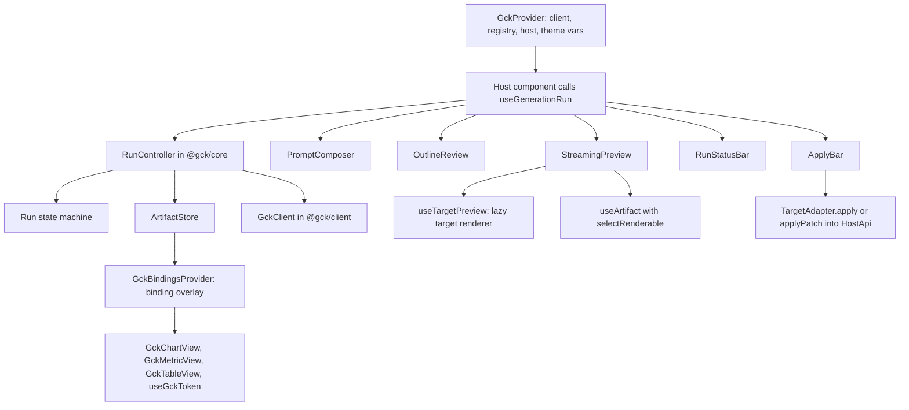
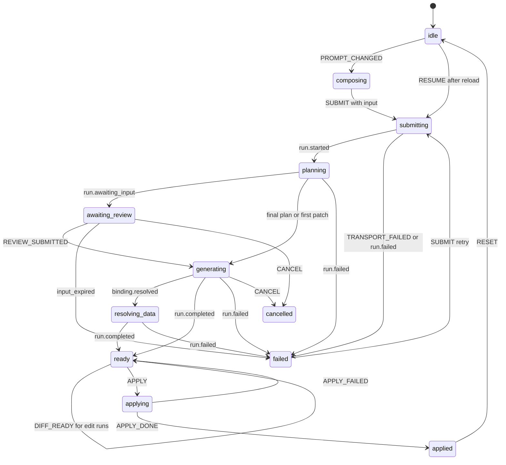
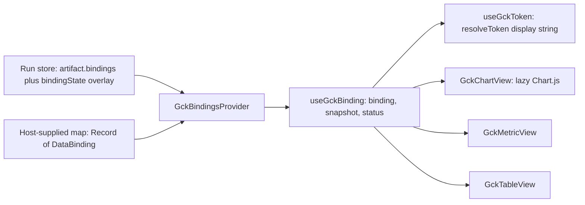

# React SDK and UI kit

<div class="chapter-meta" markdown>
**Reads:** `servers/nextjs/app/(presentation-generator)/outline/components/OutlineContent.tsx`, `servers/nextjs/app/(presentation-generator)/outline/components/OutlineItem.tsx`, `servers/nextjs/app/(presentation-generator)/components/useStableOutlineIds.ts`, `servers/nextjs/app/(presentation-generator)/presentation/hooks/PresentationUndoRedo.ts`, `servers/nextjs/app/(presentation-generator)/presentation/hooks/useAutoSave.tsx`, `servers/nextjs/store/slices/undoRedoSlice.ts`, `servers/nextjs/store/store.ts`  ·  **Builds on:** [Run protocol and client](63-run-protocol-and-client.md)  ·  **Time:** ~65 min
</div>

This chapter builds the browser half of the kit on `@gck/client`: the headless `@gck/core` (state machine, artifact store with structural-sharing JSON Patch, plugin registry, a run controller that submits `generate`, `transform` and `edit` intents and diffs edit results, and the headless `runToCompletion` helper), `@gck/react` (`GckProvider`, four run hooks, and the data views `GckChartView`, `GckMetricView`, `GckTableView` with `GckBindingsProvider`, `useGckBinding` and `useGckToken`) and the styled `@gck/react/ui` (`PromptComposer`, `OutlineReview`, `StreamingPreview`, `RunStatusBar`, `ApplyBar`). It also covers reuse from Presenton's outline page, Redux hosts, and the Next.js App Router.

Files under `gck/` are **new code** for Part IX; files under `servers/` are Presenton at snapshot `571461f`.

## Step 1: The layers and the component tree

`@gck/core` has no React or DOM imports, so one controller drives React, the `<gck-generate>` web component and plain scripts.



Two stores on purpose: **machine state** (a few dozen changes per run) and the **artifact store** (every patch and delta), so `RunStatusBar` never re-renders per token.

## Step 2: The run state machine

The states are the blueprint's, with `failed` carrying `error.retryable`. `SUBMIT` carries the whole submission (prompt, intent, selection, base artifact, preferred apply mode), so one machine serves all three intents; an `edit` run additionally gets a block diff (`DIFF_READY`) once it is `ready`.



| From | Accepted events | To |
|---|---|---|
| any | `CONTEXT_LOADED`, `CHIP_TOGGLED` | same |
| `idle`, `composing` | `PROMPT_CHANGED`, `SUBMIT` (with `input`), `RESUME` | `composing`/`idle`, `submitting` |
| `submitting` | `RUN_CREATED`, `run.started` | `planning` |
| `planning` | `run.awaiting_input`; final plan or first patch | `awaiting_review`; `generating` |
| `awaiting_review` | `REVIEW_SUBMITTED` | `generating` |
| `generating` | `binding.resolved`; `run.completed` | `resolving_data`; `ready` |
| `resolving_data` | `run.completed` | `ready` |
| all active states | `run.failed`, `TRANSPORT_FAILED`; `CANCEL` | `failed` (or `cancelled`); `cancelled` |
| `ready` | `APPLY`; `SUBMIT`; `RESET`; `DIFF_READY` | `applying`; `submitting`; `idle`; `ready` (sets `diff`) |
| `applying` | `APPLY_DONE`; `APPLY_FAILED` | `applied`; `ready` |
| `applied`, `cancelled`, `failed` | `SUBMIT`; `RESET` | `submitting`; `idle` |

The machine is a pure reducer plus an XState-style table of accepted events; unaccepted events are ignored, not thrown, because late events after a cancel are normal.

```ts title="gck/packages/core/src/machine.ts (new)"
import type {
  ApplyMode, ApplyResult, Artifact, Block, GckErrorBody, GckEvent, OutlineItem, RunIntent, Usage,
} from "@gck/protocol";
import type { BlockDiff } from "./diff";

export type RunStatus =
  | "idle" | "composing" | "submitting" | "planning" | "awaiting_review" | "generating"
  | "resolving_data" | "ready" | "applying" | "applied" | "cancelled" | "failed";

export interface ContextChip { id: string; label: string; providerId: string; removable: boolean; keys: string[] }

/** What one submission asks for. `selection` is the target's fromHost output; `baseArtifact` the re-read applied artifact. */
export interface SubmitInput {
  prompt: string;
  intent?: RunIntent;
  selection?: Artifact | Block[];
  baseArtifact?: Artifact;
  apply?: ApplyMode;
}
/** After SUBMIT: intent and apply mode are always filled in. */
export type ResolvedInput = SubmitInput & { intent: RunIntent };

export const DEFAULT_APPLY: Record<RunIntent, ApplyMode | undefined> = {
  generate: undefined,          // ApplyBar falls back to the manifest's first mode
  transform: "replace",
  edit: "patch",
};
export const resolveInput = (i: SubmitInput): ResolvedInput => {
  const intent = i.intent ?? "generate";
  return { ...i, intent, apply: i.apply ?? DEFAULT_APPLY[intent] };
};

export interface RunState {
  status: RunStatus;
  prompt: string;
  runId: string | null;
  lastEventId: number;
  outline: OutlineItem[] | null;
  review: { inputId: string; expiresAt: string } | null;
  progress: { message?: string; completed?: number; total?: number } | null;
  warnings: Array<{ code: string; message: string; blockId?: string }>;
  error: GckErrorBody | null;
  usage: Usage | null;
  applied: ApplyResult | null;
  chips: ContextChip[];
  excludedChipIds: string[];
  input: ResolvedInput | null;          // the submission of the current run; null after RESUME
  diff: BlockDiff | null;               // edit runs only, set once the run is ready
}

export type MachineEvent =
  | { type: "PROMPT_CHANGED"; prompt: string }
  | { type: "CONTEXT_LOADED"; chips: ContextChip[] }
  | { type: "CHIP_TOGGLED"; chipId: string }
  | { type: "SUBMIT"; input: SubmitInput }
  | { type: "DIFF_READY"; diff: BlockDiff }
  | { type: "RESUME"; runId: string }
  | { type: "RUN_CREATED"; runId: string }
  | { type: "STREAM"; event: GckEvent }
  | { type: "REVIEW_SUBMITTED" }
  | { type: "CANCEL" }
  | { type: "TRANSPORT_FAILED"; error: GckErrorBody }
  | { type: "APPLY" }
  | { type: "APPLY_DONE"; result: ApplyResult }
  | { type: "APPLY_FAILED"; error: GckErrorBody }
  | { type: "RESET" };

type T = MachineEvent["type"];
const DONE: readonly T[] = ["PROMPT_CHANGED", "SUBMIT", "RESET"];
const LIVE: readonly T[] = ["STREAM", "CANCEL", "TRANSPORT_FAILED"];

export const TRANSITIONS: Record<RunStatus | "*", readonly T[]> = {
  "*": ["CONTEXT_LOADED", "CHIP_TOGGLED"],
  idle: ["PROMPT_CHANGED", "SUBMIT", "RESUME"],
  composing: ["PROMPT_CHANGED", "SUBMIT", "RESUME", "RESET"],
  submitting: ["RUN_CREATED", ...LIVE],
  planning: LIVE,
  awaiting_review: [...LIVE, "REVIEW_SUBMITTED"],
  generating: LIVE,
  resolving_data: LIVE,
  ready: [...DONE, "APPLY", "DIFF_READY"],
  applying: ["APPLY_DONE", "APPLY_FAILED"],
  applied: DONE,
  cancelled: DONE,
  failed: DONE,
};

const ACTIVE: readonly RunStatus[] = ["submitting", "planning", "awaiting_review", "generating", "resolving_data"];
export const isActive = (s: RunStatus) => ACTIVE.includes(s);
export const canSend = (s: RunState, type: T) =>
  TRANSITIONS["*"].includes(type) || TRANSITIONS[s.status].includes(type);

export const initialRunState = (prompt = ""): RunState => ({
  status: prompt ? "composing" : "idle", prompt, runId: null, lastEventId: 0, outline: null,
  review: null, progress: null, warnings: [], error: null, usage: null, applied: null,
  chips: [], excludedChipIds: [], input: null, diff: null,
});

export function transition(s: RunState, e: MachineEvent): RunState {
  if (!canSend(s, e.type)) return s;
  switch (e.type) {
    case "CONTEXT_LOADED": return { ...s, chips: e.chips };
    case "CHIP_TOGGLED": {
      const off = s.excludedChipIds.includes(e.chipId);
      return { ...s, excludedChipIds: off ? s.excludedChipIds.filter((x) => x !== e.chipId) : [...s.excludedChipIds, e.chipId] };
    }
    case "PROMPT_CHANGED":
      return s.status === "idle" || s.status === "composing"
        ? { ...s, prompt: e.prompt, status: e.prompt.trim() ? "composing" : "idle" }
        : { ...s, prompt: e.prompt };                       // keep the finished run visible
    case "SUBMIT":
      if (!e.input.prompt.trim()) return s;
      return { ...initialRunState(e.input.prompt), status: "submitting", input: resolveInput(e.input),
               chips: s.chips, excludedChipIds: s.excludedChipIds };
    case "RESUME": return { ...initialRunState(s.prompt), status: "submitting", runId: e.runId, chips: s.chips };
    case "RUN_CREATED": return { ...s, runId: e.runId };
    case "DIFF_READY": return { ...s, diff: e.diff };
    case "REVIEW_SUBMITTED": return { ...s, status: "generating", review: null };
    case "CANCEL": return { ...s, status: "cancelled", review: null };
    case "TRANSPORT_FAILED": return { ...s, status: "failed", error: e.error };
    case "APPLY": return { ...s, status: "applying", error: null };
    case "APPLY_DONE": return { ...s, status: "applied", applied: e.result };
    case "APPLY_FAILED": return { ...s, status: "ready", error: e.error };
    case "RESET": return { ...initialRunState(), chips: s.chips };
    case "STREAM": return onStream(s, e.event);
  }
}

function onStream(s: RunState, ev: GckEvent): RunState {
  if (ev.id <= s.lastEventId) return s;
  const b: RunState = { ...s, lastEventId: ev.id, progress: ev.progress ?? s.progress };
  const early = s.status === "submitting" || s.status === "planning" || s.status === "awaiting_review";
  switch (ev.type) {
    case "run.started": return { ...b, status: "planning" };
    case "plan.proposed":
      return { ...b, outline: ev.data.outline, status: ev.data.final && early ? "generating" : b.status };
    case "run.awaiting_input":
      return { ...b, status: "awaiting_review", review: { inputId: ev.data.inputId, expiresAt: ev.data.expiresAt } };
    case "artifact.patch":
    case "text.delta": return early ? { ...b, status: "generating", review: null } : b;
    case "binding.resolved": return s.status === "generating" ? { ...b, status: "resolving_data" } : b;
    case "run.warning": return { ...b, warnings: [...s.warnings, ev.data] };
    case "run.completed": return { ...b, status: "ready", usage: ev.data.usage, review: null };
    case "run.failed":
      return { ...b, status: ev.data.code === "cancelled" ? "cancelled" : "failed", error: ev.data, review: null };
    default: return b;                                      // unknown future event types
  }
}
```

!!! warning "Gotcha"
    `onStream` drops events with `id <= lastEventId` although the client already deduplicates. A reload replays the log from 0 into a fresh machine while a remount resumes from the machine's `lastEventId`; deduplicating in the reducer keeps both paths correct without coordinating counters.

`SUBMIT` stores the resolved input in `state.input`, with the intent defaulted to `generate` and the apply mode defaulted per intent (`DEFAULT_APPLY`). That one field serves three readers: the controller builds the run request from it, `ApplyBar` preselects `input.apply`, and `RunStatusBar`'s Retry resubmits it unchanged, so a retried transform rewrites the same selection even if the user has since clicked elsewhere. `RESUME` leaves `input` null, because only the run id survives a reload.

## Step 3: The artifact store

The store holds the Artifact, its version, `text.delta` drafts, the binding overlay and a block index. `getSnapshot()` returns an immutable object whose identity changes only on change, and `subscribe()` notifies at most once per animation frame, which is what `useSyncExternalStore` needs.

### 3.1 JSON Patch with structural sharing

The applier copies on write along each op's path, so untouched sections and blocks keep their identity: memoized blocks skip re-rendering, changed blocks are detectable with `===`, and a failing op leaves the original untouched (RFC 6902 atomicity).

```ts title="gck/packages/core/src/json-patch.ts (new)"
import type { JsonPatchOp } from "@gck/protocol";

export class PatchError extends Error {}
const isObj = (v: unknown): v is Record<string, unknown> => typeof v === "object" && v !== null && !Array.isArray(v);
const INDEX = /^(0|[1-9]\d*)$/;

export function parsePointer(p: string): string[] {
  if (p === "") return [];
  if (!p.startsWith("/")) throw new PatchError(`Invalid JSON Pointer: ${p}`);
  return p.slice(1).split("/").map((t) => t.replace(/~1/g, "/").replace(/~0/g, "~"));
}

function get(doc: unknown, tokens: string[]): unknown {
  let node = doc;
  for (const t of tokens) {
    if (Array.isArray(node) && INDEX.test(t) && +t < node.length) node = node[+t];
    else if (isObj(node) && Object.prototype.hasOwnProperty.call(node, t)) node = node[t];
    else throw new PatchError(`Path not found: /${tokens.join("/")}`);
  }
  return node;
}

/** Copy-on-write along `tokens`; siblings keep their identity. */
function edit(doc: unknown, tokens: string[], leaf: (container: any, key: string) => void): unknown {
  const [key, ...rest] = tokens;
  const copy: any = Array.isArray(doc) ? doc.slice() : isObj(doc) ? { ...doc } : null;
  if (copy === null) throw new PatchError(`Not a container at "${key}"`);
  if (rest.length === 0) leaf(copy, key);
  else copy[key] = edit(get(doc, [key]), rest, leaf);
  return copy;
}

function add(doc: unknown, tokens: string[], value: unknown): unknown {
  if (tokens.length === 0) return value;
  return edit(doc, tokens, (c, k) => {
    if (!Array.isArray(c)) { c[k] = value; return; }
    const i = k === "-" ? c.length : INDEX.test(k) ? +k : NaN;
    if (!(i >= 0 && i <= c.length)) throw new PatchError(`Bad array index ${k}`);
    c.splice(i, 0, value);
  });
}

function remove(doc: unknown, tokens: string[]): unknown {
  if (tokens.length === 0) throw new PatchError("Cannot remove the root");
  get(doc, tokens);                                          // must exist
  return edit(doc, tokens, (c, k) => { if (Array.isArray(c)) c.splice(+k, 1); else delete c[k]; });
}

function replace(doc: unknown, tokens: string[], value: unknown): unknown {
  if (tokens.length === 0) return value;
  get(doc, tokens);
  return edit(doc, tokens, (c, k) => { c[k] = value; });
}

/** Never mutates `doc`; throws PatchError and leaves `doc` intact if any op fails. */
export function applyJsonPatch(doc: unknown, ops: readonly JsonPatchOp[]): unknown {
  let out = doc;
  for (const op of ops) {
    const path = parsePointer(op.path);
    switch (op.op) {
      case "add": out = add(out, path, op.value); break;
      case "remove": out = remove(out, path); break;
      case "replace": out = replace(out, path, op.value); break;
      case "move": case "copy": throw new PatchError(`${op.op} is not emitted by the engine`);
      case "test":
        if (JSON.stringify(get(out, path)) !== JSON.stringify(op.value)) throw new PatchError(`test failed at ${op.path}`);
        break;
    }
  }
  return out;
}

/** Append `delta` to the string at `tokens`, creating missing containers (text.delta, format "text"). */
export function appendTextAt<V>(node: V, tokens: string[], delta: string): V {
  if (tokens.length === 0) return ((typeof node === "string" ? node : "") + delta) as V;
  const [key, ...rest] = tokens;
  const copy: any = Array.isArray(node) ? node.slice() : isObj(node) ? { ...node } : INDEX.test(key) ? [] : {};
  const empty = rest.length === 0 ? "" : INDEX.test(rest[0]) ? [] : {};
  copy[key] = appendTextAt(copy[key] ?? empty, rest, delta);
  return copy;
}
```

`move` and `copy` are rejected because the engine never emits them; a rejected patch becomes a `conflict` and a resync. `test` compares with `JSON.stringify`, which depends on key order: fine for the kit's own edit patches, not for arbitrary input.

### 3.2 The store

```ts title="gck/packages/core/src/artifact-store.ts (new)"
import { jsonrepair } from "jsonrepair";
import type { Artifact, Block, DataBinding, EventOf } from "@gck/protocol";
import { appendTextAt, applyJsonPatch, parsePointer } from "./json-patch";

export type BindingState = Pick<DataBinding, "snapshot" | "snapshotAt" | "status">;
export interface BlockRef { section: number; block: number; since: number }
export interface ArtifactSnapshot {
  readonly artifact: Artifact | null;
  readonly version: number;
  readonly drafts: Readonly<Record<string, Block>>;
  readonly bindingState: Readonly<Record<string, BindingState>>;
  readonly index: Readonly<Record<string, BlockRef>>;
}
export type PatchResult = "applied" | "skipped" | "conflict";

export interface ArtifactStore {
  getSnapshot(): ArtifactSnapshot;
  subscribe(listener: () => void): () => void;
  applyPatch(p: EventOf<"artifact.patch">["data"]): PatchResult;
  applyTextDelta(d: EventOf<"text.delta">["data"]): void;
  resolveBinding(b: EventOf<"binding.resolved">["data"]): void;
  reset(artifact?: Artifact | null, version?: number): void;
  flush(): void;
}

const EMPTY: ArtifactSnapshot = Object.freeze({ artifact: null, version: 0, drafts: {}, bindingState: {}, index: {} });
const raf = (fn: () => void) => (typeof requestAnimationFrame === "function" ? requestAnimationFrame(fn) : setTimeout(fn, 16));

function buildIndex(a: Artifact, prev: ArtifactSnapshot, version: number): Record<string, BlockRef> {
  const out: Record<string, BlockRef> = {};
  a.sections.forEach((sec, si) => sec.blocks.forEach((b, bi) => {
    const old = prev.index[b.id];
    const same = old && prev.artifact?.sections[old.section]?.blocks[old.block] === b;
    out[b.id] = { section: si, block: bi, since: same ? old.since : version };
  }));
  return out;
}

export function createArtifactStore(schedule: (fn: () => void) => unknown = raf): ArtifactStore {
  let snap = EMPTY;
  let pending = false;
  const listeners = new Set<() => void>();
  const jsonBuffers = new Map<string, string>();
  const emit = () => { pending = false; for (const l of [...listeners]) l(); };
  const commit = (next: ArtifactSnapshot) => { snap = next; if (!pending) { pending = true; schedule(emit); } };

  const store: ArtifactStore = {
    getSnapshot: () => snap,
    subscribe(l) { listeners.add(l); return () => { listeners.delete(l); }; },
    applyPatch({ baseVersion, version, ops }) {
      const snapshot = baseVersion === 0 && ops.length === 1 && ops[0].op === "replace" && ops[0].path === "";
      if (!snapshot && version <= snap.version) return "skipped";
      if (!snapshot && baseVersion !== snap.version) return "conflict";
      let artifact: Artifact;
      try { artifact = applyJsonPatch(snapshot ? null : snap.artifact, ops) as Artifact; }
      catch { return "conflict"; }
      const index = buildIndex(artifact, snap, version);
      const drafts: Record<string, Block> = {};
      for (const [id, d] of Object.entries(snap.drafts)) {
        if (index[id] && index[id].since < version) drafts[id] = d;   // block unchanged: keep draft
        else jsonBuffers.delete(id);                                   // replaced or removed: final wins
      }
      commit({ ...snap, artifact, version, index, drafts });
      return "applied";
    },
    applyTextDelta({ blockId, path, delta, format, baseVersion }) {
      const ref = snap.index[blockId];
      if (!ref || !snap.artifact || baseVersion < ref.since) return;   // unknown or stale
      let draft: Block;
      if (format === "json") {
        const buf = (jsonBuffers.get(blockId) ?? "") + delta;
        jsonBuffers.set(blockId, buf);
        try { draft = JSON.parse(jsonrepair(buf)); } catch { return; }  // wait for more text
        if (!draft || draft.id !== blockId) return;
      } else {
        const current = snap.drafts[blockId] ?? snap.artifact.sections[ref.section].blocks[ref.block];
        draft = appendTextAt(current, parsePointer(path), delta);
      }
      commit({ ...snap, drafts: { ...snap.drafts, [blockId]: draft } });
    },
    resolveBinding({ bindingId, snapshot, snapshotAt, status }) {
      commit({ ...snap, bindingState: { ...snap.bindingState, [bindingId]: { snapshot, snapshotAt, status } } });
    },
    reset(artifact = null, version = 0) {
      jsonBuffers.clear();
      commit({ ...EMPTY, artifact, version, index: artifact ? buildIndex(artifact, EMPTY, version) : {} });
    },
    flush: () => { if (pending) emit(); },
  };
  return store;
}

// --- selectors ---------------------------------------------------------------
const renderCache = new WeakMap<ArtifactSnapshot, Artifact | null>();

/** Artifact with drafts and binding overlay merged in; memoized per snapshot. */
export function selectRenderable(s: ArtifactSnapshot): Artifact | null {
  const hit = renderCache.get(s);
  if (hit !== undefined) return hit;
  let a = s.artifact;
  if (a && (Object.keys(s.drafts).length || Object.keys(s.bindingState).length)) {
    a = {
      ...a,
      sections: a.sections.map((sec) => sec.blocks.some((b) => s.drafts[b.id])
        ? { ...sec, blocks: sec.blocks.map((b) => s.drafts[b.id] ?? b) } : sec),
      bindings: Object.fromEntries(Object.entries(a.bindings).map(([id, b]) =>
        [id, s.bindingState[id] ? { ...b, ...s.bindingState[id] } : b])),
    };
  }
  renderCache.set(s, a);
  return a;
}
export const selectSectionCount = (s: ArtifactSnapshot) => s.artifact?.sections.length ?? 0;
```

The `json` branch repeats Presenton's outline-buffer repair ( `servers/nextjs/app/(presentation-generator)/outline/hooks/useOutlineStreaming.ts:133-139`), scoped to one block; `jsonrepair` is already a Presenton frontend dependency (`servers/nextjs/package.json:50`). Any framework can use the store directly: `store.subscribe(() => render(selectSectionCount(store.getSnapshot())))`.

!!! warning "Gotcha"
    Notifications use `requestAnimationFrame`, which browsers pause in background tabs: patches still apply, but subscribers hear about them when the tab is visible again. Tests must call `store.flush()` or pass `(fn) => fn()` as `schedule`.

## Step 4: The plugin registry

Targets, context providers and data providers register at runtime, so a Superset extension can add providers after the kit loads.

```ts title="gck/packages/core/src/registry.ts (new)"
import type {
  Artifact, ApplyMode, ApplyResult, HostContext, TargetId, TargetManifest,
} from "@gck/protocol";
import type { BlockDiff } from "./diff";
import type { ContextChip } from "./machine";

export type { ApplyMode, ApplyResult, HostContext } from "@gck/protocol";   // shared types have one home

export interface HostApi {
  readonly id: string;                       // "superset" | "tiptap" | "presenton" | "web" | ...
  capability<T>(name: string): T | undefined;
  emit?(event: string, detail: unknown): void;
}

/** Build a HostApi from a plain capability map. */
export function createHost(id: string, capabilities: Record<string, unknown>,
                           emit?: (event: string, detail: unknown) => void): HostApi {
  return { id, capability: <T>(name: string) => capabilities[name] as T | undefined, emit };
}

/** Core keeps `Preview` generic so it never names React, not even as a type; @gck/react narrows it to a component. */
export interface TargetAdapter<Native = unknown, Preview = unknown> {
  manifest: TargetManifest;
  fromHost?(ctx: HostContext): Partial<Artifact>;
  toNative(artifact: Artifact): Native;      // pure, deterministic, no I/O
  /** mode "patch" only: change just the diff's blocks in the host (one undo step). Absent: apply() handles "patch". */
  applyPatch?(native: Native, diff: BlockDiff, artifact: Artifact, host: HostApi): Promise<ApplyResult>;
  preview?: Preview;                         // eager (small targets such as text)
  loadPreview?: () => Promise<Preview>;      // lazy, from the target's /react subpath (slides: renderer and Chart.js)
  apply(native: Native, host: HostApi, mode: ApplyMode): Promise<ApplyResult>;
}

export interface ContextProvider {
  id: string;
  collect(signal: AbortSignal): Promise<{ context: Partial<HostContext>; chips: Omit<ContextChip, "providerId">[] }>;
}
export interface DataProvider {
  id: string;
  catalog(signal: AbortSignal): Promise<{ allowedChartIds: number[] }>;
}

export function createRegistry() {
  const targets = new Map<string, TargetAdapter<any, any>>();
  const contexts = new Map<string, ContextProvider>();
  const data = new Map<string, DataProvider>();
  const listeners = new Set<() => void>();
  let version = 0;
  const changed = () => { version++; listeners.forEach((l) => l()); };
  const add = <V>(map: Map<string, V>, id: string, value: V) => {
    map.set(id, value); changed();
    return () => { if (map.get(id) === value) { map.delete(id); changed(); } };
  };
  return {
    registerTarget: (t: TargetAdapter<any, any>) => add(targets, t.manifest.id, t),
    registerContextProvider: (p: ContextProvider) => add(contexts, p.id, p),
    registerDataProvider: (p: DataProvider) => add(data, p.id, p),
    getTarget: (id: TargetId) => targets.get(id),
    contextProviders: () => [...contexts.values()],
    dataProvider: (id: string) => data.get(id),
    subscribe: (l: () => void) => { listeners.add(l); return () => { listeners.delete(l); }; },
    getVersion: () => version,
  };
}
export type Registry = ReturnType<typeof createRegistry>;

/** A failing provider never blocks a run; excluded chips drop their context keys. */
export async function collectContext(registry: Registry, excluded: string[], signal: AbortSignal) {
  const settled = await Promise.allSettled(
    registry.contextProviders().map(async (p) => ({ p, r: await p.collect(signal) })));
  const context: Record<string, unknown> = {};
  const chips: ContextChip[] = [];
  for (const res of settled) {
    if (res.status !== "fulfilled") continue;
    Object.assign(context, res.value.r.context);
    chips.push(...res.value.r.chips.map((c) => ({ ...c, providerId: res.value.p.id })));
  }
  for (const chip of chips) if (excluded.includes(chip.id)) chip.keys.forEach((k) => delete context[k]);
  return { context: context as Partial<HostContext>, chips };
}
```

The shared types (`ApplyMode`, `ApplyResult`, `HostContext`, which is the run request's `RunContext` under a second name) live in `@gck/protocol` and are defined in [Artifact Spec and targets](62-artifact-spec-and-targets.md); core re-exports them. `applyPatch` receives the block diff of an edit run (Step 5.1) together with the full new artifact, so the target can place added blocks relative to their neighbors: `@gck/target-tiptap` finds the changed, removed and neighboring nodes through the `gckBlockId` attribute it stores on every top-level node and rewrites them in one transaction, `@gck/target-text` re-renders (patch is replace for text), and the slides and dashboard targets leave `"patch"` out of `manifest.applyModes` in v1. `HostApi` is typed at the call site: an adapter asks for a well-known capability such as `host.capability<Editor>("tiptap.editor")`, and `createHost` builds one from a plain map. Core keeps `Preview` generic and adds `loadPreview` for on-demand renderers; `@gck/react` narrows `Preview` to `ComponentType<PreviewProps>` (Step 7).

## Step 5: The run controller

The controller wires machine, store, registry and client, and owns every side effect. `submit` takes the whole submission, and the intent decides what reaches the run request (`RunIntent` comes from `@gck/protocol`):

| Intent | Required input | Copied into the `RunRequest` | Store starts from | Default apply mode |
|---|---|---|---|---|
| `generate` | `prompt` | `intent`, `prompt`, collected context; `selection` and `baseArtifact` are ignored | empty, version 0 | none (`ApplyBar` takes the manifest's first mode) |
| `transform` | `prompt`, `selection` (the target's `fromHost` output for the user's selection) | plus `context.selection` as a flat `Block[]` | empty, version 0 | `replace` |
| `edit` | `prompt`, `baseArtifact` (the artifact applied earlier, re-read with `fromHost`) | plus `context.document` = `baseArtifact` (and `context.selection` when given) | `baseArtifact` as version 0 | `patch` |

For `edit` the engine streams `artifact.patch` ops against the base (the first patch has `baseVersion: 0`), and `run.completed` carries the final `artifactVersion`. The controller keeps the base in `state.input`, and when the run is `ready` it computes a block-level diff (Step 5.1) and exposes it as `state.diff` (and `run.diff` in React) for review UI.

```ts title="gck/packages/core/src/controller.ts (new)"
import { GckError, type GckClient } from "@gck/client";
import type { ApplyResult, Block, GckErrorBody, GckEvent, OutlineItem, RunRequest, TargetId } from "@gck/protocol";
import { createArtifactStore, selectRenderable } from "./artifact-store";
import { diffArtifacts } from "./diff";
import {
  initialRunState, isActive, transition, type MachineEvent, type RunState, type SubmitInput,
} from "./machine";
import { collectContext, type ApplyMode, type HostApi, type Registry } from "./registry";

export interface TelemetryEvent { name: string; targetId: string; runId?: string | null; status?: string; code?: string }
export interface RunPersistence {
  load(): { runId: string } | null;
  save(v: { runId: string } | null): void;
}
export interface RunControllerOptions {
  client: GckClient; registry: Registry; targetId: TargetId;
  initialPrompt?: string;
  baseContext?: Partial<RunRequest["context"]>;
  options?: RunRequest["options"];
  dataProviderId?: string;
  telemetry?: (e: TelemetryEvent) => void;   // no prompt text, no content: ids, status and codes only
  persist?: RunPersistence;
}
export type RunController = ReturnType<typeof createRunController>;

const toError = (err: unknown): GckErrorBody => err instanceof GckError
  ? { code: err.code, message: err.message, retryable: err.retryable }
  : { code: "internal", message: String((err as Error)?.message ?? err), retryable: true };
const invalid = (message: string) => new GckError({ code: "invalid_request", message, retryable: false });

/** A selection travels as Artifact blocks; fromHost may return a partial Artifact. */
const toBlocks = (sel: SubmitInput["selection"]): Block[] | undefined =>
  sel === undefined ? undefined : Array.isArray(sel) ? sel : (sel.sections ?? []).flatMap((s) => s.blocks);

export function createRunController(o: RunControllerOptions) {
  let state: RunState = initialRunState(o.initialPrompt);
  let ac: AbortController | null = null;
  const listeners = new Set<() => void>();
  const artifact = createArtifactStore();

  const send = (e: MachineEvent) => {
    const prev = state;
    state = transition(state, e);
    if (state === prev) return;
    if (state.status !== prev.status) {
      o.telemetry?.({ name: "gck.status", targetId: o.targetId, runId: state.runId, status: state.status, code: state.error?.code });
      o.persist?.save(state.runId && isActive(state.status) ? { runId: state.runId } : null);
    }
    listeners.forEach((l) => l());
  };

  async function resync(runId: string, signal: AbortSignal) {
    const s = await o.client.getArtifact(runId, signal);
    artifact.reset(s.artifact, s.version);
  }

  async function route(ev: GckEvent, runId: string, signal: AbortSignal) {
    if (ev.type === "artifact.patch" && artifact.applyPatch(ev.data) === "conflict") {
      await resync(runId, signal);                                  // then continue the stream
    }
    if (ev.type === "text.delta") artifact.applyTextDelta(ev.data);
    if (ev.type === "binding.resolved") artifact.resolveBinding(ev.data);
    if (ev.type === "run.completed" && artifact.getSnapshot().version !== ev.data.artifactVersion) {
      await resync(runId, signal);                                  // the store must end on the final version
    }
    send({ type: "STREAM", event: ev });
    const base = state.input?.intent === "edit" ? state.input.baseArtifact : undefined;
    const final = artifact.getSnapshot().artifact;
    if (ev.type === "run.completed" && base && final) send({ type: "DIFF_READY", diff: diffArtifacts(base, final) });
  }

  async function pump(runId: string, lastEventId: number, ctrl: AbortController) {
    ac?.abort();
    ac = ctrl;
    try {
      for await (const ev of o.client.stream(runId, { lastEventId, signal: ctrl.signal })) await route(ev, runId, ctrl.signal);
    } catch (err) {
      if (!ctrl.signal.aborted) send({ type: "TRANSPORT_FAILED", error: toError(err) });
    }
  }

  return {
    artifact,
    getState: () => state,
    subscribe(l: () => void) { listeners.add(l); return () => { listeners.delete(l); }; },
    setPrompt: (prompt: string) => send({ type: "PROMPT_CHANGED", prompt }),
    toggleChip: (chipId: string) => send({ type: "CHIP_TOGGLED", chipId }),

    async loadContext() {
      const { chips } = await collectContext(o.registry, [], new AbortController().signal);
      send({ type: "CONTEXT_LOADED", chips });
    },

    async submit(input: SubmitInput) {
      send({ type: "SUBMIT", input });
      const req = state.input;                                      // resolved: intent and apply filled in
      if (state.status !== "submitting" || !req) return;
      const ctrl = new AbortController();
      ac?.abort();
      ac = ctrl;
      artifact.reset(req.intent === "edit" ? req.baseArtifact ?? null : null, 0);   // edit: base is version 0
      try {
        const target = o.registry.getTarget(o.targetId);
        if (!target) throw invalid(`Target "${o.targetId}" is not registered`);
        if (req.intent === "transform" && !req.selection) throw invalid("A transform run needs a selection");
        if (req.intent === "edit" && !req.baseArtifact) throw invalid("An edit run needs a baseArtifact");
        const { context } = await collectContext(o.registry, state.excludedChipIds, ctrl.signal);
        const dp = o.dataProviderId ? o.registry.dataProvider(o.dataProviderId) : undefined;
        const catalog = dp ? await dp.catalog(ctrl.signal) : undefined;
        const selection = req.intent === "generate" ? undefined : toBlocks(req.selection);
        const { runId } = await o.client.startRun({
          intent: req.intent,
          prompt: req.prompt,
          target: { id: target.manifest.id, manifestVersion: target.manifest.version, manifest: target.manifest },
          context: {
            host: "web", ...o.baseContext, ...context,
            ...(selection ? { selection } : {}),
            ...(req.intent === "edit" ? { document: req.baseArtifact } : {}),
          },
          data: dp && catalog ? { provider: dp.id, allowedChartIds: catalog.allowedChartIds } : undefined,
          options: o.options,
        }, { signal: ctrl.signal });
        send({ type: "RUN_CREATED", runId });
        o.persist?.save({ runId });
        await pump(runId, 0, ctrl);
      } catch (err) {
        if (!ctrl.signal.aborted) send({ type: "TRANSPORT_FAILED", error: toError(err) });
      }
    },

    /** null approves. Throws (for example 422) so the form can show the error. */
    async submitReview(outline: OutlineItem[] | null) {
      const { runId, review } = state;
      if (!runId || !review) return;
      const base = { inputId: review.inputId, kind: "outline_review" as const };
      await o.client.sendInput(runId, outline ? { ...base, decision: "edit", outline } : { ...base, decision: "approve" });
      send({ type: "REVIEW_SUBMITTED" });
    },

    cancel() {
      const { runId } = state;
      ac?.abort();
      send({ type: "CANCEL" });
      if (runId) void o.client.cancel(runId).catch(() => undefined);   // best effort
    },

    async apply(mode: ApplyMode, host: HostApi) {
      const target = o.registry.getTarget(o.targetId);
      const doc = selectRenderable(artifact.getSnapshot());
      if (!target || !doc) return;
      send({ type: "APPLY" });
      let result: ApplyResult | undefined;
      try {
        const native = target.toNative(doc);
        const { diff } = state;
        if (mode === "patch" && !target.manifest.applyModes.includes("patch")) {
          result = await target.apply(native, host, "replace");     // v1 slides and dashboards
          result = { ...result, warnings: [...result.warnings, "patch_unsupported: applied as replace"] };
        } else if (mode === "patch" && target.applyPatch && diff) {
          result = await target.applyPatch(native, diff, doc, host);
        } else {
          result = await target.apply(native, host, mode);
        }
        if (result.ok) send({ type: "APPLY_DONE", result });
        else send({ type: "APPLY_FAILED",
          error: { code: "conflict", message: result.warnings.join("; ") || "Apply failed", retryable: false } });
      } catch (err) { send({ type: "APPLY_FAILED", error: toError(err) }); }
      host.emit?.("gck.applied", { result, artifact: doc });       // after either outcome
    },

    reset() { ac?.abort(); artifact.reset(); send({ type: "RESET" }); },

    /** On mount: re-attach to a live run or resume a saved one. */
    attach() {
      if (state.runId && isActive(state.status)) { void pump(state.runId, state.lastEventId, new AbortController()); return; }
      const saved = state.status === "idle" ? o.persist?.load() : null;
      if (saved) { send({ type: "RESUME", runId: saved.runId }); void pump(saved.runId, 0, new AbortController()); }
    },
    /** On unmount: stop reading; the run continues. */
    detach() { ac?.abort(); },
  };
}
```

`apply` treats `ok: false` as a failure (the adapter's warnings become the message, and the bar returns to `ready`), and calls `host.emit?.("gck.applied", { result, artifact })` after every attempt, so a host can refresh its own view or log the outcome without wrapping the adapter. `submit` takes the prompt in its input instead of reading the composer's text, so a menu command or a bubble action can start a run without touching the composer; the composer passes `run.prompt` (Step 8.1). The input is read once, at call time, as Presenton's outline submit reads `store.getState()` (`servers/nextjs/app/(presentation-generator)/outline/hooks/usePresentationGeneration.ts:87-90`). Invalid input (a `transform` without `selection`, an `edit` without `baseArtifact`) still moves the machine to `submitting` and then to `failed` with a non-retryable `invalid_request`, so the error shows in `RunStatusBar` like any other.

A requested `"patch"` that the target's manifest does not list is applied as `"replace"`, and the controller appends the warning `patch_unsupported: applied as replace` to the result, so a headless caller that hard-codes `apply("patch")` still works against slides and dashboards. When the target lists `"patch"` but has no `applyPatch`, or the run has no diff (a resumed edit run), `apply(native, host, "patch")` is called and the adapter decides.

!!! warning "Gotcha"
    `detach()` must not cancel the run. StrictMode mounts, unmounts and remounts every component in development, so cancel-on-unmount would cancel (and bill) every dev run. Unmount only aborts the HTTP read; the next `attach()` resumes from `lastEventId`.

### 5.1 Block diffs for edit runs

The diff is block-level and keyed by block id, because ids are the anchor the targets use to find content in the host (Tiptap's `gckBlockId`, Superset's `CHART-gck-<blockId>`).

```ts title="gck/packages/core/src/diff.ts (new)"
import type { Artifact, ArtifactDiff, Block } from "@gck/protocol";

/** ArtifactDiff ({ added, removed, changed } block ids) is defined in @gck/protocol, next to the adapter types. */
export type BlockDiff = ArtifactDiff;
// added:   block ids in the new artifact only, in document order
// removed: block ids in the base only, in base order
// changed: ids in both whose content differs

const blocksById = (a: Artifact) => {
  const m = new Map<string, Block>();
  for (const sec of a.sections ?? []) for (const b of sec.blocks) m.set(b.id, b);
  return m;
};

export function diffArtifacts(base: Artifact, next: Artifact): BlockDiff {
  const before = blocksById(base);
  const after = blocksById(next);
  const diff: BlockDiff = { added: [], removed: [], changed: [] };
  for (const [id, b] of after) {
    const old = before.get(id);
    if (!old) diff.added.push(id);
    else if (old !== b && JSON.stringify(old) !== JSON.stringify(b)) diff.changed.push(id);
  }
  for (const id of before.keys()) if (!after.has(id)) diff.removed.push(id);
  return diff;
}

export const isEmptyDiff = (d: BlockDiff) => !d.added.length && !d.removed.length && !d.changed.length;
```

Because the store starts from the base and the JSON Patch applier copies on write, a block the edit did not touch is the same object in `base` and `next`, and `old !== b` skips the serialization. A block the engine replaced with identical content falls through to the `JSON.stringify` comparison, which depends on key order; the engine writes blocks in schema order, so equal blocks serialize equally. Moves are not reported in v1: a block that only moved keeps its id and content and is neither added nor changed, and `applyPatch` places blocks by their position in the new artifact anyway.

!!! warning "Gotcha"
    `state.diff` exists only when the controller still holds the base. `RESUME` after a reload restores the run id, not the base, so a resumed edit run reaches `ready` with `diff: null`. Review UI must handle `null` (show the whole result), and `apply("patch")` falls back to the adapter's own `"patch"` handling.

### 5.2 Headless runs: `runToCompletion`

Server code, tests and non-interactive hosts (an alert narrator, a scheduled report) need "start a run and wait for the artifact" without a machine or React. `runToCompletion` drives the same artifact store with synchronous notifications.

```ts title="gck/packages/core/src/run-to-completion.ts (new)"
import { GckError, type GckClient } from "@gck/client";
import type { Artifact, GckEvent, RunRequest } from "@gck/protocol";
import { createArtifactStore, selectRenderable } from "./artifact-store";

export type RunEvent = GckEvent;

const isArtifact = (v: unknown): v is Artifact =>
  typeof v === "object" && v !== null && Array.isArray((v as Artifact).sections);

export async function runToCompletion(
  client: GckClient,
  req: RunRequest,
  opts: { signal?: AbortSignal; onEvent?: (e: RunEvent) => void } = {},
): Promise<{ artifact: Artifact; events: number }> {
  const store = createArtifactStore((fn) => fn());            // no requestAnimationFrame
  if (req.intent === "edit" && isArtifact(req.context.document)) store.reset(req.context.document, 0);
  const { runId } = await client.startRun(req, { signal: opts.signal });
  const resync = async () => {
    const s = await client.getArtifact(runId, opts.signal);
    store.reset(s.artifact, s.version);
  };
  let events = 0;
  let finalVersion: number | null = null;
  let abandon = false;                                         // true: cancel the run on the way out
  try {
    for await (const ev of client.stream(runId, { signal: opts.signal })) {
      events++;
      opts.onEvent?.(ev);
      if (ev.type === "artifact.patch" && store.applyPatch(ev.data) === "conflict") await resync();
      else if (ev.type === "text.delta") store.applyTextDelta(ev.data);
      else if (ev.type === "binding.resolved") store.resolveBinding(ev.data);
      else if (ev.type === "run.failed") throw new GckError(ev.data);
      else if (ev.type === "run.awaiting_input") {
        abandon = true;
        throw new GckError({ code: "invalid_request", retryable: false,
          message: "runToCompletion cannot answer an outline review; set options.reviewOutline to false" });
      }
      else if (ev.type === "run.completed") { finalVersion = ev.data.artifactVersion; break; }
    }
  } catch (err) {
    if (abandon || opts.signal?.aborted) void client.cancel(runId).catch(() => undefined);   // best effort
    throw err;
  }
  if (finalVersion === null) throw new GckError({ code: "internal", message: "Stream ended without run.completed", retryable: true });
  if (store.getSnapshot().version !== finalVersion) await resync();
  const artifact = selectRenderable(store.getSnapshot());
  if (!artifact) throw new GckError({ code: "internal", message: "Run completed without an artifact", retryable: true });
  return { artifact, events };
}
```

The returned artifact is `selectRenderable` of the final snapshot, so resolved bindings are merged in and a caller can pass it straight to a target's `toNative`. `events` counts every event read, which tests use to assert that a replay did not duplicate work. `RunEvent` is an alias of the protocol's `GckEvent`, exported for headless callers.

!!! warning "Gotcha"
    Unlike `detach()`, aborting `runToCompletion` cancels the run (best effort): a headless caller that gives up has no UI that could re-attach later, so the run would only burn tokens. The same applies to a run that stops for outline review, which a headless caller cannot answer; send `options: { reviewOutline: false }`.

## Step 6: `GckProvider`

```tsx title="gck/packages/react/src/provider.tsx (new)"
"use client";
import { createContext, useEffect, useMemo, useRef, useState, type CSSProperties, type ReactNode } from "react";
import { GckClient, type TokenProvider } from "@gck/client";
import {
  createRegistry, type ContextProvider, type DataProvider, type HostApi,
  type Registry, type TargetAdapter, type TelemetryEvent,
} from "@gck/core";
import { defaultMessages, type MessageKey, type Messages } from "./messages";

export type GckTheme = Record<"accent" | "bg" | "fg" | "border" | "danger" | "radius" | "font", string>;

export interface GckConfig {
  engineUrl: string;
  getToken: TokenProvider;
  host: HostApi;
  targets: TargetAdapter<any, any>[];          // keep the array stable (module scope or useMemo)
  contextProviders?: ContextProvider[];
  dataProviders?: DataProvider[];
  theme?: Partial<GckTheme>;
  locale?: string;
  messages?: Partial<Messages>;
  telemetry?: (e: TelemetryEvent) => void;
  client?: GckClient;                           // mock for tests
}

export interface GckContextValue {
  client: GckClient;
  registry: Registry;
  host: HostApi;
  locale: string;
  t: (key: MessageKey, vars?: Record<string, string | number>) => string;
  telemetry?: (e: TelemetryEvent) => void;
}

export const GckContext = createContext<GckContextValue | null>(null);

const toVars = (theme: Partial<GckTheme> = {}): CSSProperties =>
  Object.fromEntries(Object.entries(theme).map(([k, v]) => [`--gck-${k}`, v])) as CSSProperties;

export function GckProvider({ children, ...config }: GckConfig & { children: ReactNode }) {
  const tokenRef = useRef(config.getToken);
  useEffect(() => { tokenRef.current = config.getToken; });
  const [client] = useState(() => config.client ??
    new GckClient({ engineUrl: config.engineUrl, getToken: (opts) => tokenRef.current(opts) }));
  const [registry] = useState(createRegistry);

  useEffect(() => {
    const off = [
      ...config.targets.map((t) => registry.registerTarget(t)),
      ...(config.contextProviders ?? []).map((p) => registry.registerContextProvider(p)),
      ...(config.dataProviders ?? []).map((p) => registry.registerDataProvider(p)),
    ];
    return () => off.forEach((dispose) => dispose());
  }, [registry, config.targets, config.contextProviders, config.dataProviders]);

  const value = useMemo<GckContextValue>(() => {
    const messages: Messages = { ...defaultMessages, ...config.messages };
    return {
      client, registry, host: config.host, locale: config.locale ?? "en", telemetry: config.telemetry,
      t: (key, vars) => messages[key].replace(/\{(\w+)\}/g, (_, n: string) => String(vars?.[n] ?? "")),
    };
  }, [client, registry, config.host, config.locale, config.messages, config.telemetry]);

  return (
    <GckContext.Provider value={value}>
      <div className="gck-root" lang={config.locale} style={{ display: "contents", ...toVars(config.theme) }}>
        {children}
      </div>
    </GckContext.Provider>
  );
}
```

`messages.ts` (not shown) maps each kit string key (`MessageKey`) to English, for example `"preview.progress": "{n} sections generated"` and `"apply.done": "Applied."`; ICU replaces the `{name}` interpolation in [Frontend engineering and quality](67-frontend-engineering.md). The `display: contents` wrapper scopes the `--gck-*` variables without adding a layout box.

## Step 7: The hooks

```tsx title="gck/packages/react/src/hooks.ts (new)"
"use client";
import { lazy, useContext, useEffect, useRef, useState, useSyncExternalStore, type ComponentType } from "react";
import {
  createRunController, type ApplyMode, type ArtifactSnapshot, type ArtifactStore,
  type RunController, type RunControllerOptions, type RunPersistence, type SubmitInput, type TargetAdapter,
} from "@gck/core";
import type { Artifact, OutlineItem, TargetId } from "@gck/protocol";
import { GckContext, type GckContextValue } from "./provider";

export function useGckContext(): GckContextValue {
  const value = useContext(GckContext);
  if (!value) throw new Error("useGckContext must be used inside <GckProvider>");
  return value;
}

declare function sessionPersist(key: string): RunPersistence;  // JSON in sessionStorage, every call in try/catch

export interface UseGenerationRunOptions
  extends Pick<RunControllerOptions, "options" | "baseContext" | "dataProviderId"> {
  target: TargetId;
  prompt?: string;
  defaultPrompt?: string;
  onPromptChange?: (prompt: string) => void;
  resumeKey?: string;              // resume after reload
  controller?: RunController;
}

export function useGenerationRun(opts: UseGenerationRunOptions) {
  const gck = useGckContext();
  const [own] = useState(() => opts.controller ?? createRunController({
    client: gck.client, registry: gck.registry, targetId: opts.target, initialPrompt: opts.prompt ?? opts.defaultPrompt,
    options: opts.options, baseContext: opts.baseContext, dataProviderId: opts.dataProviderId, telemetry: gck.telemetry,
    persist: opts.resumeKey ? sessionPersist(`gck:${opts.target}:${opts.resumeKey}`) : undefined,
  }));
  const controller = opts.controller ?? own;
  const state = useSyncExternalStore(controller.subscribe, controller.getState, controller.getState);
  const controlled = opts.prompt !== undefined;

  useEffect(() => {
    controller.attach();
    void controller.loadContext();
    return () => controller.detach();
  }, [controller]);

  useEffect(() => {                                       // controlled prompt flows into the machine
    if (controlled && opts.prompt !== controller.getState().prompt) controller.setPrompt(opts.prompt!);
  }, [controlled, opts.prompt, controller]);

  return {
    state,
    controller,
    store: controller.artifact,
    prompt: controlled ? opts.prompt! : state.prompt,
    setPrompt: (p: string) => { if (!controlled) controller.setPrompt(p); opts.onPromptChange?.(p); },
    /** Same input as RunController.submit: { prompt, intent?, selection?, baseArtifact?, apply? }. */
    submit: (input: SubmitInput) => controller.submit(input),
    diff: state.diff,                                     // edit runs: { added, removed, changed } once ready
    submitReview: (outline: OutlineItem[] | null) => controller.submitReview(outline),
    cancel: controller.cancel,
    apply: (mode: ApplyMode) => controller.apply(mode, gck.host),
    reset: controller.reset,
    toggleChip: controller.toggleChip,
  };
}
export type GenerationRun = ReturnType<typeof useGenerationRun>;

export function useArtifact<V = ArtifactSnapshot>(
  store: ArtifactStore,
  selector: (s: ArtifactSnapshot) => V = (s) => s as unknown as V,
  equals: (a: V, b: V) => boolean = Object.is,
): V {
  const cache = useRef<{ snap?: ArtifactSnapshot; sel?: typeof selector; value?: V }>({});
  const read = () => {
    const snap = store.getSnapshot();
    const c = cache.current;
    if (c.snap === snap && c.sel === selector) return c.value as V;
    const next = selector(snap);
    if (c.snap && c.sel === selector && equals(c.value as V, next)) { c.snap = snap; return c.value as V; }
    cache.current = { snap, sel: selector, value: next };
    return next;
  };
  return useSyncExternalStore(store.subscribe, read, read);
}

export type PreviewProps = { artifact: Artifact; streaming: boolean };
type PreviewTarget = TargetAdapter<unknown, ComponentType<PreviewProps>>;
const lazyPreviews = new WeakMap<PreviewTarget, ComponentType<PreviewProps>>();

export function useTargetPreview(targetId: TargetId) {
  const { registry } = useGckContext();
  useSyncExternalStore(registry.subscribe, registry.getVersion, registry.getVersion);  // late registration
  const target = registry.getTarget(targetId) as PreviewTarget | undefined;
  if (!target) return { Preview: null, manifest: null };
  if (target.preview) return { Preview: target.preview, manifest: target.manifest };
  if (!target.loadPreview) return { Preview: null, manifest: target.manifest };
  let Preview = lazyPreviews.get(target);
  if (!Preview) {
    Preview = lazy(() => target.loadPreview!().then((C) => ({ default: C })));
    lazyPreviews.set(target, Preview);
  }
  return { Preview, manifest: target.manifest };
}
```

`useArtifact` caches by snapshot and selector, because `useSyncExternalStore` loops if `getSnapshot` returns a fresh value per call; keep selectors stable.

The Tiptap target's React node views ([Artifact Spec and targets](62-artifact-spec-and-targets.md)) render data blocks and tokens through the data views of `@gck/react` (`GckBindingsProvider`, `useGckBinding`, `useGckToken`, `GckChartView`, `GckMetricView`, `GckTableView`). They are a separate concern from the run hooks and get their own step, Step 14.

!!! warning "Gotcha"
    `useGenerationRun` creates its controller once, so a later `target` change is ignored. When the user switches target, remount with `key={targetId}`; a run's manifest, store and outline belong to one target.

## Step 8: The UI kit

Each component takes the `run` from `useGenerationRun` and reads strings via `t()`.

### 8.1 `PromptComposer`

```tsx title="gck/packages/react/src/ui/PromptComposer.tsx (new)"
"use client";
import { useId, type ButtonHTMLAttributes, type ComponentType, type KeyboardEvent } from "react";
import { isActive, type ContextChip, type SubmitInput } from "@gck/core";
import type { RunIntent, TargetId } from "@gck/protocol";
import type { MessageKey } from "../messages";
import { useGckContext, type GenerationRun } from "../hooks";

type ChipProps = { chip: ContextChip; excluded: boolean; onToggle(): void };
export interface PromptComposerProps {
  run: GenerationRun;
  /** Default "generate". "transform" and "edit" need getInput to supply selection or baseArtifact. */
  intent?: RunIntent;
  /** Read at submit time, so the selection is the one the user has when pressing the button. */
  getInput?: () => Omit<SubmitInput, "prompt" | "intent">;
  suggestions?: string[];
  targets?: { id: TargetId; label: string }[];
  targetId?: TargetId;
  onTargetChange?: (id: TargetId) => void;
  placeholder?: string;
  className?: string;
  slots?: { SubmitButton?: ComponentType<ButtonHTMLAttributes<HTMLButtonElement>>; Chip?: ComponentType<ChipProps> };
}

const DefaultChip = ({ chip, excluded, onToggle }: ChipProps) => (
  <button type="button" className="gck-chip" aria-pressed={!excluded} disabled={!chip.removable} onClick={onToggle}>
    {chip.label}
  </button>
);

const SUBMIT_LABEL: Record<RunIntent, MessageKey> = {
  generate: "composer.submit",      // "Generate"
  transform: "composer.rewrite",    // "Rewrite selection"
  edit: "composer.edit",            // "Edit page"
};

export function PromptComposer({
  run, intent = "generate", getInput, suggestions = [], targets, targetId, onTargetChange, placeholder, className, slots = {},
}: PromptComposerProps) {
  const { t } = useGckContext();
  const id = useId();
  const busy = isActive(run.state.status);
  const Submit = slots.SubmitButton ?? "button";
  const Chip = slots.Chip ?? DefaultChip;
  const go = () => {
    if (!busy && run.prompt.trim()) void run.submit({ ...getInput?.(), prompt: run.prompt, intent });
  };

  const onKeyDown = (e: KeyboardEvent<HTMLTextAreaElement>) => {
    if (e.key === "Enter" && (e.metaKey || e.ctrlKey)) { e.preventDefault(); go(); }
    else if (e.key === "Escape" && busy) { e.preventDefault(); run.cancel(); }
  };

  return (
    <form className={["gck-composer", className].filter(Boolean).join(" ")} aria-busy={busy}
      onSubmit={(e) => { e.preventDefault(); go(); }}>
      <label htmlFor={`${id}-prompt`} className="gck-sr-only">{t("composer.label")}</label>
      <textarea id={`${id}-prompt`} className="gck-composer__input" rows={3} value={run.prompt}
        placeholder={placeholder ?? t("composer.placeholder")} readOnly={busy} aria-describedby={`${id}-hint`}
        onChange={(e) => run.setPrompt(e.target.value)} onKeyDown={onKeyDown} />
      <p id={`${id}-hint`} className="gck-composer__hint">{t("composer.hint")}</p>

      {run.state.chips.length > 0 && (
        <ul className="gck-composer__chips" aria-label={t("composer.context")}>
          {run.state.chips.map((chip) => (
            <li key={chip.id}>
              <Chip chip={chip} excluded={run.state.excludedChipIds.includes(chip.id)} onToggle={() => run.toggleChip(chip.id)} />
            </li>
          ))}
        </ul>
      )}

      {!run.prompt && suggestions.length > 0 && (
        <div className="gck-composer__suggestions" role="group" aria-label={t("composer.suggestions")}>
          {suggestions.map((s) => (
            <button key={s} type="button" className="gck-chip" onClick={() => run.setPrompt(s)}>{s}</button>
          ))}
        </div>
      )}

      <div className="gck-composer__actions">
        {targets && targets.length > 1 && (
          <select aria-label={t("composer.target")} value={targetId} disabled={busy}
            onChange={(e) => onTargetChange?.(e.target.value as TargetId)}>
            {targets.map((x) => <option key={x.id} value={x.id}>{x.label}</option>)}
          </select>
        )}
        <Submit type="submit" className="gck-button gck-button--primary" disabled={busy || !run.prompt.trim()}>
          {t(SUBMIT_LABEL[intent])}
        </Submit>
      </div>
    </form>
  );
}
```

The textarea is `readOnly`, not `disabled`, while busy: disabled elements get no key events, so Escape could not cancel. The `intent` prop only changes what the button says and what `submit` sends; the label keys `composer.rewrite` ("Rewrite selection") and `composer.edit` ("Edit page") join `composer.submit` in `messages.ts`. `getInput` is called inside `go`, not during render, because a Tiptap selection read during render is the selection of the last render, not of the click. Spreading it first means it cannot override `prompt` or `intent`.

### 8.2 `OutlineReview`

From Presenton's outline page the kit keeps a hidden `role="status"` line while streaming (`servers/nextjs/app/(presentation-generator)/outline/components/OutlineContent.tsx:84-89`), skeleton cards before content (`OutlineContent.tsx:91-111`), reordering disabled while streaming (`servers/nextjs/app/(presentation-generator)/outline/components/OutlineItem.tsx:59`), commit-on-blur editing (`OutlineItem.tsx:90-95`), and dnd-kit's keyboard sensor (`OutlineContent.tsx:53-62`). What changes:

| Presenton | Problem for a reusable kit | GCK |
|---|---|---|
| Keys hash the item content (`servers/nextjs/app/(presentation-generator)/components/useStableOutlineIds.ts:3-30`) | An edit changes the key and remounts the item | Engine `sectionId`s, random keys for new sections |
| `marked.parse` output in `dangerouslySetInnerHTML` (`OutlineItem.tsx:142-162`, `:192-233`) | Unsanitized model output as HTML | Plain-text inputs, no HTML |
| Tab inserts a tab character (`OutlineItem.tsx:102-118`) | Keyboard trap | Tab moves focus; Alt+Arrow reorders |
| No delete control (`deleteSlideOutline` exists, `servers/nextjs/store/slices/presentationGeneration.ts:157`, but is never dispatched) | Sections cannot be dropped | Delete, keeping at least one |
| Fixed 50 items, 100 words (`servers/nextjs/utils/presentationLimits.ts:1-2`) | Wrong for other targets | Manifest `limits.maxSections` |

The headless hook holds the draft; the styled component renders it or hands it to a render prop.

```tsx title="gck/packages/react/src/ui/OutlineReview.tsx (new)"
"use client";
import { useEffect, useId, useRef, useState, type ReactNode } from "react";
import type { OutlineItem } from "@gck/protocol";
import type { TargetId } from "@gck/protocol";
import { useGckContext, useTargetPreview, type GenerationRun } from "../hooks";

export type DraftSection = OutlineItem & { key: string };

export function useOutlineReview(run: GenerationRun, maxSections: number) {
  const outline = run.state.outline;
  const [items, setItems] = useState<DraftSection[]>([]);
  const [dirty, setDirty] = useState(false);
  const [error, setError] = useState<string | null>(null);
  const [busy, setBusy] = useState(false);

  useEffect(() => {                                    // adopt proposals until the user edits
    if (outline && !dirty) setItems(outline.map((o, i) => ({ ...o, key: o.sectionId ?? `new-${i}` })));
  }, [outline, dirty]);

  const update = (fn: (xs: DraftSection[]) => DraftSection[]) => { setDirty(true); setItems(fn); };
  return {
    items, error, busy, canAdd: items.length < maxSections,
    edit: (key: string, patch: Partial<Pick<OutlineItem, "title" | "summary">>) =>
      update((xs) => xs.map((x) => (x.key === key ? { ...x, ...patch } : x))),
    move: (key: string, delta: -1 | 1) => update((xs) => {
      const i = xs.findIndex((x) => x.key === key), j = i + delta;
      if (i < 0 || j < 0 || j >= xs.length) return xs;
      const next = xs.slice();
      [next[i], next[j]] = [next[j], next[i]];
      return next;
    }),
    remove: (key: string) => update((xs) => (xs.length > 1 ? xs.filter((x) => x.key !== key) : xs)),
    add: () => update((xs) => xs.length >= maxSections ? xs : [...xs,
      { key: `new-${crypto.randomUUID()}`, sectionId: null, title: "", summary: "", layoutHint: null, bindings: [] }]),
    async submit() {
      if (items.some((x) => !x.title.trim())) { setError("empty-title"); return; }
      setBusy(true); setError(null);
      try { await run.submitReview(dirty ? items.map(({ key: _key, ...rest }) => rest) : null); }
      catch (e) { setError((e as Error).message); }
      finally { setBusy(false); }
    },
  };
}
export type OutlineReviewApi = ReturnType<typeof useOutlineReview>;

export function OutlineReview({ run, targetId, children }: {
  run: GenerationRun; targetId: TargetId; children?: (api: OutlineReviewApi) => ReactNode;
}) {
  const { t } = useGckContext();
  const { manifest } = useTargetPreview(targetId);
  const api = useOutlineReview(run, manifest?.limits.maxSections ?? 20);
  const headingId = useId();
  const headingRef = useRef<HTMLHeadingElement>(null);
  const focusAfterMove = useRef<string | null>(null);
  const [announcement, setAnnouncement] = useState("");
  const waiting = run.state.status === "awaiting_review";

  useEffect(() => { if (waiting) headingRef.current?.focus(); }, [waiting]);
  useEffect(() => {                                  // moving a DOM node drops focus; put it back
    if (focusAfterMove.current) document.getElementById(focusAfterMove.current)?.focus();
    focusAfterMove.current = null;
  }, [api.items]);

  if (!waiting) return null;
  if (children) return <>{children(api)}</>;          // headless: host renders its own list

  const move = (key: string, delta: -1 | 1, index: number) => {
    focusAfterMove.current = `gck-${key}-title`;
    api.move(key, delta);
    setAnnouncement(t("review.moved", { n: index + 1 + delta }));
  };

  return (
    <section className="gck-review" aria-labelledby={headingId}>
      <h2 id={headingId} ref={headingRef} tabIndex={-1}>{t("review.title")}</h2>
      <div className="gck-sr-only" role="status" aria-live="polite">{announcement}</div>
      <ol className="gck-review__list">
        {api.items.map((item, i) => (
          <li key={item.key} className="gck-review__item">
            <input id={`gck-${item.key}-title`} value={item.title} maxLength={200}
              aria-label={t("review.sectionTitle", { n: i + 1 })}
              onChange={(e) => api.edit(item.key, { title: e.target.value })}
              onKeyDown={(e) => {
                if (e.altKey && (e.key === "ArrowUp" || e.key === "ArrowDown")) {
                  e.preventDefault();
                  move(item.key, e.key === "ArrowUp" ? -1 : 1, i);
                }
              }} />
            <textarea rows={2} value={item.summary} aria-label={t("review.sectionSummary", { n: i + 1 })}
              onChange={(e) => api.edit(item.key, { summary: e.target.value })} />
            <div className="gck-review__tools">
              <button type="button" disabled={i === 0} onClick={() => move(item.key, -1, i)}>{t("review.up")}</button>
              <button type="button" disabled={i === api.items.length - 1} onClick={() => move(item.key, 1, i)}>{t("review.down")}</button>
              <button type="button" disabled={api.items.length === 1} onClick={() => api.remove(item.key)}>{t("review.delete")}</button>
            </div>
          </li>
        ))}
      </ol>
      <button type="button" onClick={api.add} disabled={!api.canAdd}>{t("review.add")}</button>
      {api.error && <p role="alert">{api.error === "empty-title" ? t("review.emptyTitle") : api.error}</p>}
      <div className="gck-review__actions">
        <button type="button" className="gck-button gck-button--primary" disabled={api.busy} onClick={() => void api.submit()}>
          {t("review.continue")}
        </button>
        <button type="button" onClick={run.cancel}>{t("review.cancel")}</button>
      </div>
    </section>
  );
}
```

!!! warning "Gotcha"
    Reordering keyed items makes React move DOM nodes, and browsers drop focus from a moved node. Without `focusAfterMove`, Alt+ArrowUp works once and focus lands on `<body>`. Render-prop hosts must restore focus the same way.

### 8.3 `StreamingPreview`

```tsx title="gck/packages/react/src/ui/StreamingPreview.tsx (new)"
"use client";
import { Component, Suspense, type ReactNode } from "react";
import { isActive, selectRenderable } from "@gck/core";
import type { TargetId } from "@gck/protocol";
import { useArtifact, useGckContext, useTargetPreview, type GenerationRun } from "../hooks";

class PreviewBoundary extends Component<{ fallback: ReactNode; children: ReactNode }, { failed: boolean }> {
  state = { failed: false };
  static getDerivedStateFromError() { return { failed: true }; }
  render() { return this.state.failed ? this.props.fallback : this.props.children; }
}

const Skeleton = ({ rows }: { rows: number }) => (
  <div className="gck-skeleton" aria-hidden="true">
    {Array.from({ length: Math.max(rows, 1) }, (_, i) => <div key={i} className="gck-skeleton__row" />)}
  </div>
);

export function StreamingPreview({ run, targetId }: { run: GenerationRun; targetId: TargetId }) {
  const { t } = useGckContext();
  const { Preview } = useTargetPreview(targetId);
  const artifact = useArtifact(run.store, selectRenderable);
  const { status, outline } = run.state;
  const streaming = status === "generating" || status === "resolving_data";
  const count = artifact?.sections.length ?? 0;
  const expected = outline?.length ?? 3;
  // Changes once per section, not per token, so screen readers are not flooded.
  const message = streaming ? t("preview.progress", { n: count }) : status === "ready" ? t("preview.done", { n: count }) : "";

  return (
    <div className="gck-preview" aria-busy={streaming}>
      <div className="gck-sr-only" role="status" aria-live="polite">{message}</div>
      {!artifact || count === 0 ? (isActive(status) ? <Skeleton rows={expected} /> : null) : (
        <PreviewBoundary fallback={<p role="alert">{t("preview.error")}</p>}>
          <Suspense fallback={<Skeleton rows={expected} />}>
            {Preview && <Preview artifact={artifact} streaming={streaming} />}
          </Suspense>
          {streaming && count < expected && <Skeleton rows={expected - count} />}
        </PreviewBoundary>
      )}
    </div>
  );
}
```

The error boundary stops a renderer that throws on a half-streamed block from breaking the host page; `streaming` lets previews defer costly work such as Chart.js animation.

### 8.4 `RunStatusBar`

```tsx title="gck/packages/react/src/ui/RunStatusBar.tsx (new)"
"use client";
import { isActive } from "@gck/core";
import { useGckContext, type GenerationRun } from "../hooks";

export function RunStatusBar({ run }: { run: GenerationRun }) {
  const { t } = useGckContext();
  const { status, progress, warnings, error, input } = run.state;
  if (status === "idle" || status === "composing") return null;
  const pct = progress?.total ? Math.round(((progress.completed ?? 0) / progress.total) * 100) : undefined;

  return (
    <div className="gck-status" data-status={status}>
      <span role="status">{t(`status.${status}`)}{progress?.message ? `: ${progress.message}` : ""}</span>
      {isActive(status) && <progress max={100} value={pct} aria-label={t("status.progress")} />}
      {warnings.length > 0 && <span className="gck-status__warn">{t("status.warnings", { n: warnings.length })}</span>}
      {status === "failed" && error && <span role="alert">{error.message}</span>}
      {isActive(status) && <button type="button" onClick={run.cancel}>{t("status.cancel")}</button>}
      {status === "failed" && error?.retryable && input && (
        <button type="button" onClick={() => void run.submit(input)}>{t("status.retry")}</button>
      )}
    </div>
  );
}
```

`value={undefined}` gives an indeterminate bar during planning; Retry (a new run with the same `state.input`, so the same intent, selection and base) appears only when `retryable` is true and the failed run was submitted in this page load.

### 8.5 `ApplyBar`

```tsx title="gck/packages/react/src/ui/ApplyBar.tsx (new)"
"use client";
import { useId, useState } from "react";
import type { ApplyMode } from "@gck/core";
import type { TargetId } from "@gck/protocol";
import type { MessageKey } from "../messages";
import { useGckContext, useTargetPreview, type GenerationRun } from "../hooks";

const LABEL: Record<ApplyMode, MessageKey> = {
  replace: "apply.replace", insert_at_cursor: "apply.insert", append: "apply.append", patch: "apply.patch",
};

export function ApplyBar({ run, targetId, modes }: { run: GenerationRun; targetId: TargetId; modes?: ApplyMode[] }) {
  const { t } = useGckContext();
  const name = useId();
  const { manifest } = useTargetPreview(targetId);
  const allowed = (manifest?.applyModes ?? []).filter((m) => !modes || modes.includes(m));
  const [picked, setPicked] = useState<ApplyMode>();
  const { status, applied, error, input } = run.state;
  const preferred = input?.apply;                       // transform: "replace", edit: "patch"
  const mode = [picked, preferred, preferred === "patch" ? "replace" : undefined, allowed[0]]
    .find((m): m is ApplyMode => !!m && allowed.includes(m));

  if (status === "applied" && applied) {
    return (
      <div className="gck-apply" role="status">
        <span>{t("apply.done")}</span>
        {applied.warnings.length > 0 && (
          <ul className="gck-apply__warnings">{applied.warnings.map((w) => <li key={w}>{w}</li>)}</ul>
        )}
        {applied.undo && <button type="button" onClick={() => void applied.undo!()}>{t("apply.revert")}</button>}
        <button type="button" onClick={run.reset}>{t("apply.new")}</button>
      </div>
    );
  }
  if (status !== "ready" && status !== "applying") return null;

  return (
    <div className="gck-apply">
      <fieldset disabled={status === "applying"}>
        <legend className="gck-sr-only">{t("apply.mode")}</legend>
        {allowed.map((m) => (
          <label key={m}>
            <input type="radio" name={name} value={m} checked={mode === m} onChange={() => setPicked(m)} />
            {t(LABEL[m])}
          </label>
        ))}
      </fieldset>
      <button type="button" className="gck-button gck-button--primary" disabled={!mode || status === "applying"}
        onClick={() => mode && void run.apply(mode)}>
        {status === "applying" ? t("apply.applying") : t("apply.apply")}
      </button>
      {error && <span role="alert">{error.message}</span>}
      <p className="gck-apply__note">{t("apply.undoNote")}</p>
    </div>
  );
}
```

The preselected mode is the user's pick, else the run's `input.apply`, else `"replace"` when a preferred `"patch"` is not offered (v1 slides and dashboards), else the manifest's first mode. For an edit run the host can show `run.diff` next to the bar (for example "3 blocks changed, 1 added") before the user applies.

The undo note is a contract every target keeps: one application is one undo step (a Tiptap transaction group, one Redux history entry, or the previous `position_json` behind `ApplyResult.undo` for dashboards; an absent `undo` means the host's own undo covers it), implemented per host in [Host integrations](65-host-integrations.md).

## Step 9: Headless versus styled, and theming

| Layer | Import | Use when |
|---|---|---|
| Controller | `@gck/core` | non-React hosts, web component, tests |
| Hooks | `@gck/react` | host has its own design system |
| Data views | `@gck/react` (`GckBindingsProvider`, `useGckBinding`, `Gck*View`) | data blocks inside host documents (Step 14) |
| Render props, slots | `OutlineReview` `children`, `PromptComposer` `slots` | kit behavior, host widgets |
| Styled kit | `@gck/react/ui` plus `gck.css` | fastest integration |

The styled kit reads only `--gck-*` custom properties, so a host maps its tokens once:

```css title="gck/packages/react/src/ui/gck.css (new, excerpt)"
.gck-root { --gck-accent: #1f6feb; --gck-bg: #fff; --gck-fg: #1c1c1c; --gck-border: #e5e7eb;
  --gck-danger: #b42318; --gck-radius: 8px; --gck-font: inherit; --gck-space: 8px; }
.gck-button--primary { background: var(--gck-accent); color: var(--gck-bg); border-radius: var(--gck-radius); }
.gck-chip[aria-pressed="false"] { opacity: 0.55; text-decoration: line-through; }
.gck-skeleton__row { height: 1.25em; margin: var(--gck-space) 0; background: var(--gck-border); animation: gck-pulse 1.2s infinite; }
@media (prefers-reduced-motion: reduce) { .gck-skeleton__row { animation: none; } }
.gck-chart { position: relative; height: 240px; }            /* Chart.js responsive mode sizes to this box */
.gck-data[data-status="forbidden"], .gck-data[data-status="error"] { color: var(--gck-fg); border: 1px dashed var(--gck-border); }
```

`GckProvider`'s `theme` prop writes the same variables inline (for example Superset's antd `token.colorPrimary` as `accent`).

## Step 10: Controlled and uncontrolled usage

Three levels, chosen per concern:

- **Prompt:** `defaultPrompt` (uncontrolled), or `prompt` plus `onPromptChange` when the host stores drafts.
- **Outline review:** the `children` render prop hands `items`, `edit`, `move`, `remove`, `add` and `submit` to host markup.
- **The whole run:** create the controller with `createRunController` and pass it as `controller`, so the host owns its lifetime, can start runs from a menu command and can `subscribe()` outside React.
- **The intent:** pass `intent` and `getInput` to `PromptComposer`, or call `run.submit({ prompt, intent, ... })` from host UI such as a bubble menu.

A Tiptap host wires the two non-generate intents like this. The selection and the base come from the target's `fromHost` direction (`fromProseMirror`); the base keeps the applied artifact's id, bindings and provenance and takes its sections from the editor, so it includes the user's edits since the last apply:

```tsx title="app/editor/AiActions.tsx (new, host code, excerpt)"
import type { Editor } from "@tiptap/core";
import type { Artifact } from "@gck/protocol";
import { fromProseMirror, type PMNode } from "@gck/target-tiptap";
import { PromptComposer } from "@gck/react/ui";
import type { GenerationRun } from "@gck/react";

/** lastApplied: the artifact from the most recent gck.applied event. */
export function AiActions({ run, editor, lastApplied }: { run: GenerationRun; editor: Editor; lastApplied: Artifact | null }) {
  const rewrite = () => {
    const { from, to } = editor.state.selection;
    const selection = fromProseMirror(editor.state.doc.cut(from, to).toJSON() as PMNode) as Artifact;
    void run.submit({ prompt: "Make this shorter and plainer", intent: "transform", selection });
  };
  const editInput = () => {
    editor.commands.stampGckBlockIds();          // typed or pasted blocks get ids that patch can find
    return { baseArtifact: { ...lastApplied!, ...fromProseMirror(editor.getJSON() as PMNode) } as Artifact };
  };
  return (
    <>
      <button type="button" disabled={editor.state.selection.empty} onClick={rewrite}>Shorten selection</button>
      {lastApplied && <PromptComposer run={run} intent="edit" getInput={editInput} />}
    </>
  );
}
```

By default the `rewrite` run applies with `"replace"` (over the selection) and the composer's edit run with `"patch"`. `SUBMIT` records the submitted prompt in the machine, so after `rewrite` an uncontrolled composer shows "Make this shorter and plainer"; a host that wants to keep the user's draft uses the controlled `prompt` and `onPromptChange` instead.


## Step 11: Integrating with a Redux host, and with none

Presenton is the Redux case: four slices, no middleware (`servers/nextjs/store/store.ts:7-14`), mounted in `Providers` (`servers/nextjs/app/providers.tsx:7-12`). Every change to `presentationData` dispatches `addToHistory` unless autosave is paused (`servers/nextjs/app/(presentation-generator)/presentation/hooks/useAutoSave.tsx:142-166`), and it is paused while `isStreaming`, `isLoading` or `isLayoutLoading` is set (`useAutoSave.tsx:42-43`). History keeps 30 reference-compared snapshots (`servers/nextjs/store/slices/undoRedoSlice.ts:19-26`, `:46-58`), and Ctrl+Z restores a snapshot with one `setPresentationData` (`servers/nextjs/app/(presentation-generator)/presentation/hooks/PresentationUndoRedo.ts:18-32`, `:34-46`, `:62-72`).

Rule: stream into the GCK store and touch Redux once, at apply time. The slides target's `apply` posts the Template v2 slide content to the new `POST /api/v1/ppt/presentation/{id}/slides/from-content` endpoint through the `presenton.api` capability ([Artifact Spec and targets](62-artifact-spec-and-targets.md)); the server creates and indexes the rows in one commit. The host then reloads the deck once when the controller emits `gck.applied`.

```ts title="servers/nextjs/app/(presentation-generator)/gck/presentonHost.ts (new)"
import { store } from "@/store/store";
import { setPresentationData } from "@/store/slices/presentationGeneration";
import { getApiUrl, normalizeBackendAssetUrls } from "@/utils/api";
import { DashboardApi } from "@/app/(presentation-generator)/services/api/dashboard";
import { createHost, type ApplyResult, type HostApi } from "@gck/core";

export function createPresentonHost(presentationId: string, afterIndex: number): HostApi {
  const api = {
    fetch: ((path, init) => fetch(getApiUrl(String(path)), { ...init, credentials: "include" })) as typeof fetch,
    presentationId, afterIndex,
  };
  return createHost("presenton", { "presenton.api": api }, (event, detail) => {
    if (event !== "gck.applied" || !(detail as { result?: ApplyResult }).result?.ok) return;
    void DashboardApi.getPresentation(presentationId, { cache: "no-store" }).then((fresh) => {
      const deck = store.getState().presentationGeneration.presentationData;
      if (!deck) return;
      const { slides } = normalizeBackendAssetUrls(fresh);
      /** One dispatch: the autosave effect records exactly one history entry and saves once. */
      store.dispatch(setPresentationData({ ...deck, slides, n_slides: slides.length }));
    });
  });
}
```

The reload uses `DashboardApi.getPresentation` (`servers/nextjs/app/(presentation-generator)/services/api/dashboard.ts:70-89`) and keeps the deck's theme and fonts from Redux. It deliberately does not call `fetchUserSlides` from `usePresentationData`, which clears the undo history by default (`servers/nextjs/app/(presentation-generator)/presentation/hooks/usePresentationData.ts:61-64`).

!!! warning "Gotcha"
    Do not mirror GCK patches into Redux while streaming: each would add a history entry (30 patches evict the user's whole undo history) and save half-written slides. Do not reuse `setStreaming(true)` to pause autosave either; it also disables editing and drives Presenton's own stream UI. And because the reload replaces `slides` with the server's copy, apply only after autosave has flushed (it saves on a 1000 ms debounce, `useAutoSave.tsx:23`), or the user's last local edits are overwritten.

A host **without** state management needs nothing extra: the controller is the state container, used through `useGenerationRun` or subscribed to directly as in Step 10. `@gck/element` does the latter and emits a `gck-apply` DOM event.

## Step 12: Next.js App Router and SSR

- **Client boundaries.** Every hook-using module in `@gck/react` starts with `"use client"`. Bundlers drop module directives when merging files, so the build re-adds the banner per entry ([Frontend engineering and quality](67-frontend-engineering.md)). Presenton marks its outline page the same way (`servers/nextjs/app/(presentation-generator)/outline/components/OutlinePage.tsx:1`).
- **No functions across the boundary.** `getToken`, `telemetry` and adapters cannot be props from a Server Component, so wrap `GckProvider` in your own client component (as the hello world does).
- **Lazy renderers.** `loadPreview: () => import("./react/preview").then((m) => m.SlidesPreview)` (the target's `/react` subpath; its main entry stays React-free) defers the slides renderer and Chart.js; use `next/dynamic` with `ssr: false` for modules that touch `window` on import.
- **Hydration.** The server snapshot is the initial `idle` state, and `sessionStorage` is read only in `attach()` (an effect), so resume never runs during SSR or hydration.

## Step 13: Hello world

A complete integration in about 40 lines (host code):

```tsx title="app/ai/GenerateText.tsx (new, host code)"
"use client";
import { createHost } from "@gck/core";
import type { ApplyResult, Artifact } from "@gck/protocol";
import { GckProvider, useGenerationRun } from "@gck/react";
import { ApplyBar, PromptComposer, RunStatusBar, StreamingPreview } from "@gck/react/ui";
import { textTarget, toMarkdown } from "@gck/target-text";
import "@gck/react/ui/gck.css";

const targets = [textTarget];
// gck.applied fires after every apply (Step 5); this demo host copies the Markdown to the clipboard.
const host = createHost("demo", {}, (event, detail) => {
  const { result, artifact } = detail as { result?: ApplyResult; artifact: Artifact };
  if (event === "gck.applied" && result?.ok) void navigator.clipboard.writeText(toMarkdown(artifact));
});
async function getToken() {   // cache it in production
  const res = await fetch("/api/gck-token", { method: "POST" });
  return res.ok ? (await res.json()).token : null;
}

function Generator() {
  const run = useGenerationRun({ target: "text", options: { reviewOutline: false }, resumeKey: "demo" });
  return (
    <>
      <PromptComposer run={run} suggestions={["Summarize Q3 revenue for the board"]} />
      <RunStatusBar run={run} />
      <StreamingPreview run={run} targetId="text" />
      <ApplyBar run={run} targetId="text" />
    </>
  );
}

export default function GenerateText() {
  return (
    <GckProvider engineUrl="https://gck.example.com" getToken={getToken} host={host} targets={targets} theme={{ accent: "#7A5AF8" }}>
      <Generator />
    </GckProvider>
  );
}
```

## Step 14: Data views

Data blocks (`chart`, `metric`, `table`) and inline tokens hold a `bindingId`, never numbers. Something has to turn the binding's snapshot into pixels wherever the block lands: the Tiptap node views of [Artifact Spec and targets](62-artifact-spec-and-targets.md) (`GckChart`, `GckMetric`, `GckDataTable`, `GckToken`), a host's own preview, or a read-only page. `@gck/react` ships that layer as one provider, two hooks and three components, and they render only from snapshots, so a `binding.resolved` event redraws every chart and token without touching the host document.



### 14.1 The state vocabulary

The views reuse Story 4's UI statuses ([Story 4, native charts and refresh UX](../delivery/45-story4-native-charts-ux.md)): the server's `ok`, `stale`, `error`, `forbidden` plus the browser-only `idle` and `loading`, with `stale` also recomputed from the snapshot's age (default one hour, Story 4's `DEFAULT_STALE_AFTER_MS`).

| `DataBinding` as seen by the view | `status` | Has snapshot | View renders |
|---|---|---|---|
| unknown id, or no `status` and no snapshot | `idle` | no | skeleton |
| `pending` | `loading` | no | skeleton |
| `pending` | `loading` | yes | data plus "Refreshing" badge |
| `ok` (or no `status`) and `snapshotAt` younger than `staleAfterMs` | `ok` | yes | data |
| `stale`, or `ok` older than `staleAfterMs` | `stale` | yes | data plus "Data as of 3 hours ago" badge |
| `error` | `error` | yes | data plus "Couldn't refresh" badge |
| `error` | `error` | no | "Data could not be loaded" panel |
| `forbidden` | `forbidden` | any | "You don't have access to this data" panel, never the snapshot |

### 14.2 `GckBindingsProvider`, `useGckBinding`, `useGckToken`

The provider holds a **binding source**: either a run store (the bindings of the run's artifact merged with the `binding.resolved` overlay) or a plain map the host supplies, for example the bindings saved with a document. Views read one binding each and re-render only when that binding changes.

```tsx title="gck/packages/react/src/bindings.tsx (new)"
"use client";
import { createContext, useContext, useMemo, useRef, useSyncExternalStore, type ReactNode } from "react";
import { resolveToken, type ArtifactStore, type BindingState } from "@gck/core";
import type { DataBinding, TextSegment } from "@gck/protocol";

/** Story 4's UI vocabulary: the server's statuses plus the browser-only idle and loading. */
export type GckBindingStatus = "idle" | "loading" | "ok" | "stale" | "error" | "forbidden";
export const DEFAULT_STALE_AFTER_MS = 3_600_000;             // Story 4 default

interface BindingSource {
  subscribe(listener: () => void): () => void;
  read(bindingId: string): { base: DataBinding | undefined; live: BindingState | undefined };
  staleAfterMs: number;
}
const noSubscribe = () => () => {};
const NONE = { base: undefined, live: undefined };
const BindingsContext = createContext<BindingSource | null>(null);

export type GckBindingsProviderProps = { children: ReactNode; staleAfterMs?: number } & (
  | { store: ArtifactStore; bindings?: never }                // a run's store: live during and after the run
  | { bindings: Record<string, DataBinding>; store?: never }  // host-owned: pass a new object to update
);

export function GckBindingsProvider({ children, store, bindings, staleAfterMs = DEFAULT_STALE_AFTER_MS }: GckBindingsProviderProps) {
  const source = useMemo<BindingSource>(() => store
    ? {
        subscribe: store.subscribe, staleAfterMs,
        read: (id) => { const s = store.getSnapshot(); return { base: s.artifact?.bindings[id], live: s.bindingState[id] }; },
      }
    : { subscribe: noSubscribe, staleAfterMs, read: (id) => ({ base: bindings?.[id], live: undefined }) },
  [store, bindings, staleAfterMs]);
  return <BindingsContext.Provider value={source}>{children}</BindingsContext.Provider>;
}

function uiStatus(b: DataBinding | undefined, staleAfterMs: number): GckBindingStatus {
  if (!b) return "idle";
  switch (b.status) {
    case "forbidden": case "error": case "stale": return b.status;
    case "pending": return "loading";
    default:                                                  // "ok" or absent
      if (!b.snapshot) return "idle";
      return b.snapshotAt && Date.now() - Date.parse(b.snapshotAt) > staleAfterMs ? "stale" : "ok";
  }
}

export interface GckBindingView {
  binding: DataBinding | undefined;                           // definition merged with the latest resolution
  snapshot: unknown;                                          // ChartSnapshot | MetricSnapshot | TableSnapshot | null
  status: GckBindingStatus;
}

export function useGckBinding(bindingId: string): GckBindingView {
  const source = useContext(BindingsContext);
  const cache = useRef<{ source?: BindingSource | null; base?: DataBinding; live?: BindingState; view?: GckBindingView }>({});
  const read = (): GckBindingView => {
    const { base, live } = source ? source.read(bindingId) : NONE;
    const c = cache.current;
    if (c.view && c.source === source && c.base === base && c.live === live) return c.view;   // stable identity
    const binding = base && live ? { ...base, ...live } : base;
    const view = { binding, snapshot: binding?.snapshot ?? null, status: uiStatus(binding, source?.staleAfterMs ?? DEFAULT_STALE_AFTER_MS) };
    cache.current = { source, base, live, view };
    return view;
  };
  return useSyncExternalStore(source?.subscribe ?? noSubscribe, read, read);
}

type TokenRef = NonNullable<TextSegment["token"]>;

/** The formatted display of one token. The positional form is what 62's GckToken node view calls. */
export function useGckToken(token: TokenRef): string;
export function useGckToken(bindingId: string, field: string, format?: string | null): string;
export function useGckToken(a: TokenRef | string, field = "", format?: string | null): string {
  const t = typeof a === "string" ? { bindingId: a, field, format: format ?? undefined } : a;
  const { binding } = useGckBinding(t.bindingId);
  return useMemo(() => resolveToken(binding, t.field, t.format ?? undefined).display, [binding, t.field, t.format]);
}
```

`useGckBinding` caches by the identities of the two inputs, the binding definition in the artifact and its overlay entry. The store's copy-on-write patches keep both identities when an unrelated block or binding changes, so a deck with forty charts re-renders one chart per `binding.resolved`, not forty. The cache is also what keeps `useSyncExternalStore` from looping: `read` must return the same object until something changed. The token hook takes either a segment's `token` object (`{ bindingId, field, format }`) or the three values positionally, which is how the `GckToken` node view calls it.

!!! warning "Gotcha"
    A provider that points at `run.store` follows the run: `run.reset()` or the next `submit` clears the store, and every chart already applied into the document drops to `idle`. Use the run store while the result is previewed, then switch the provider to a host-owned map when the controller emits `gck.applied` (copy `artifact.bindings` from the event into host state and pass it as `bindings`). The data refresh flow ([Story 4, native charts and refresh UX](../delivery/45-story4-native-charts-ux.md)) then updates that map.

### 14.3 The three views

```tsx title="gck/packages/react/src/data-views.tsx (new)"
"use client";
import { useContext, useEffect, useMemo, useRef, useState, type ReactNode } from "react";
import type { Chart as ChartJs, ChartConfiguration } from "chart.js";
import { resolveToken } from "@gck/core";
import type { ChartKind, ChartSnapshot, DataBinding, TableSnapshot } from "@gck/protocol";
import { useGckBinding, type GckBindingStatus } from "./bindings";
import { defaultMessages, type MessageKey } from "./messages";
import { GckContext } from "./provider";

/** Views also render outside GckProvider, for example a saved document opened without a run. */
function useT() {
  const gck = useContext(GckContext);
  const t = gck?.t ?? ((key: MessageKey, vars?: Record<string, string | number>) =>
    defaultMessages[key].replace(/\{(\w+)\}/g, (_, n: string) => String(vars?.[n] ?? "")));
  return { t, locale: gck?.locale };
}

function dataAge(snapshotAt: string | undefined, locale?: string): string {
  if (!snapshotAt) return "";
  const rtf = new Intl.RelativeTimeFormat(locale, { numeric: "auto" });
  const minutes = Math.round((Date.parse(snapshotAt) - Date.now()) / 60_000);
  if (Math.abs(minutes) < 60) return rtf.format(minutes, "minute");
  const hours = Math.round(minutes / 60);
  return Math.abs(hours) < 48 ? rtf.format(hours, "hour") : rtf.format(Math.round(hours / 24), "day");
}

/** Under a stale/error badge the view keeps showing the last snapshot, so resolve it as if it were ok. */
const asShown = (b: DataBinding | undefined) => (b?.snapshot ? { ...b, status: "ok" as const } : b);

/** Numbers use the binding's own format through resolveToken (d3-format), never Intl.NumberFormat. */
const formatValue = (b: DataBinding, v: number) =>
  resolveToken({ ...b, kind: "metric", status: "ok", snapshot: { value: v } }, "value").display;

function DataFrame({ kind, status, binding, selected, children }: {
  kind: DataBinding["kind"]; status: GckBindingStatus; binding: DataBinding | undefined;
  selected?: boolean; children: () => ReactNode;                // called only when there is data to show
}) {
  const { t, locale } = useT();
  const cls = ["gck-data", `gck-data--${kind}`, selected && "gck-data--selected"].filter(Boolean).join(" ");
  if (status === "forbidden") return <div className={cls} data-status={status} role="note">{t("data.forbidden")}</div>;
  if (!binding?.snapshot) {
    if (status === "error") return <div className={cls} data-status={status} role="note">{t("data.unavailable")}</div>;
    return (
      <div className={cls} data-status={status} aria-busy="true">
        <span className="gck-sr-only">{t("data.loading")}</span>
        <div className="gck-skeleton__row" aria-hidden="true" />
      </div>
    );
  }
  const badge = status === "loading" ? t("data.refreshing")
    : status === "stale" ? t("data.stale", { age: dataAge(binding.snapshotAt, locale) })
    : status === "error" ? t("data.error") : null;
  return (
    <figure className={cls} data-status={status}>
      {children()}
      {badge && <figcaption className="gck-data__badge" title={binding.snapshotAt}>{badge}</figcaption>}
    </figure>
  );
}

// --- charts --------------------------------------------------------------------
type ChartCtor = typeof import("chart.js/auto").default;
let chartJs: Promise<ChartCtor> | null = null;
/** loadPreview-style: Chart.js arrives with the first chart on screen, not with the editor bundle. */
const loadChartJs = () => (chartJs ??= import("chart.js/auto").then((m) => m.default));

const CHART_TYPE: Record<ChartKind, "bar" | "line" | "pie" | "doughnut" | "radar"> = {
  bar: "bar", horizontal_bar: "bar", stacked_bar: "bar", line: "line", area: "line",
  pie: "pie", donut: "doughnut", scatter: "line", radar: "radar",
};

function toChartConfig(kind: ChartKind, s: ChartSnapshot, fmt: (v: number) => string): ChartConfiguration {
  const type = CHART_TYPE[kind];
  const circular = type === "pie" || type === "doughnut";
  const stacked = kind === "stacked_bar";
  const value = { stacked, ticks: { callback: (v: number | string) => (typeof v === "number" ? fmt(v) : v) } };
  return {
    type,
    data: {
      labels: s.categories,
      datasets: s.series.map((x) => ({
        label: x.name, data: x.values, fill: kind === "area",
        ...(kind === "scatter" ? { showLine: false, pointRadius: 4 } : {}),
      })),
    },
    options: {
      animation: false,                                        // snapshots replace each other; no tweening
      responsive: true,
      maintainAspectRatio: false,
      indexAxis: kind === "horizontal_bar" ? "y" : "x",
      plugins: {
        legend: { display: circular || s.series.length > 1 },
        tooltip: { callbacks: { label: (c: { dataset: { label?: string }; raw: unknown }) => `${c.dataset.label ?? ""}: ${fmt(Number(c.raw))}` } },
      },
      scales: circular || type === "radar" ? {}
        : kind === "horizontal_bar" ? { x: value, y: { stacked } } : { x: { stacked }, y: value },
    },
  } as ChartConfiguration;
}

function ChartCanvas({ kind, snapshot, binding, label }: {
  kind: ChartKind; snapshot: ChartSnapshot; binding: DataBinding; label: string;
}) {
  const { t } = useT();
  const canvas = useRef<HTMLCanvasElement>(null);
  const chart = useRef<{ instance: ChartJs; type: string } | null>(null);
  const [failed, setFailed] = useState(false);
  const fmt = (v: number) => formatValue(binding, v);

  useEffect(() => {
    let live = true;
    loadChartJs().then((Chart) => {
      if (!live || !canvas.current) return;
      const config = toChartConfig(kind, snapshot, (v) => formatValue(binding, v));
      const current = chart.current;
      if (current && current.type === config.type) {         // same chart type: update in place
        current.instance.data = config.data;
        current.instance.options = config.options ?? {};
        current.instance.update("none");
      } else {
        current?.instance.destroy();
        chart.current = { instance: new Chart(canvas.current, config), type: config.type };
      }
    }, () => { chartJs = null; if (live) setFailed(true); });   // allow a later retry of the import
    return () => { live = false; };
  }, [kind, snapshot, binding]);

  useEffect(() => () => { chart.current?.instance.destroy(); chart.current = null; }, []);

  if (failed) return <p role="alert">{t("data.chartError")}</p>;
  return (
    <div className="gck-chart">
      <canvas ref={canvas} aria-hidden="true" />
      <table className="gck-sr-only">
        <caption>{label}</caption>
        <thead><tr><td />{snapshot.series.map((s) => <th key={s.name} scope="col">{s.name}</th>)}</tr></thead>
        <tbody>
          {snapshot.categories.map((c, i) => (
            <tr key={i}>
              <th scope="row">{c}</th>
              {snapshot.series.map((s) => <td key={s.name}>{s.values[i] == null ? "" : fmt(s.values[i])}</td>)}
            </tr>
          ))}
        </tbody>
      </table>
    </div>
  );
}

export interface GckChartViewProps { bindingId: string; chartType: ChartKind; title?: string | null; selected?: boolean }

export function GckChartView({ bindingId, chartType, title, selected }: GckChartViewProps) {
  const { binding, snapshot, status } = useGckBinding(bindingId);
  const shown = useMemo(() => asShown(binding), [binding]);
  const data = snapshot as ChartSnapshot | null;
  const label = title || data?.series.map((s) => s.name).join(", ") || bindingId;
  return (
    <DataFrame kind="chart" status={status} binding={binding} selected={selected}>
      {() => (
        <>
          {title && <div className="gck-data__title">{title}</div>}
          <ChartCanvas kind={chartType} snapshot={data!} binding={shown!} label={label} />
        </>
      )}
    </DataFrame>
  );
}

// --- metrics and tables ----------------------------------------------------------
export interface GckMetricViewProps { bindingId: string; label: string; compare?: "previous_period" | null; selected?: boolean }

export function GckMetricView({ bindingId, label, compare, selected }: GckMetricViewProps) {
  const { t } = useT();
  const { binding, status } = useGckBinding(bindingId);
  const shown = useMemo(() => asShown(binding), [binding]);
  return (
    <DataFrame kind="metric" status={status} binding={binding} selected={selected}>
      {() => {
        const delta = compare === "previous_period" ? resolveToken(shown, "delta_pct") : null;
        const trend = typeof delta?.value === "number" ? (delta.value > 0 ? "up" : delta.value < 0 ? "down" : "flat") : undefined;
        return (
          <>
            <div className="gck-metric__label">{label}</div>
            <div className="gck-metric__value">{resolveToken(shown, "value").display}</div>
            {delta && delta.value !== null && (
              <div className="gck-metric__delta" data-trend={trend}>{delta.display} {t("data.vsPrevious")}</div>
            )}
          </>
        );
      }}
    </DataFrame>
  );
}

export const DEFAULT_MAX_ROWS = 100;
export interface GckTableViewProps { bindingId: string; columns?: string[] | null; maxRows?: number | null; selected?: boolean }

export function GckTableView({ bindingId, columns, maxRows, selected }: GckTableViewProps) {
  const { t } = useT();
  const { binding, snapshot, status } = useGckBinding(bindingId);
  const shown = useMemo(() => asShown(binding), [binding]);
  return (
    <DataFrame kind="table" status={status} binding={binding} selected={selected}>
      {() => {
        const s = snapshot as TableSnapshot;
        const cols = columns?.length ? columns.filter((c) => s.columns.includes(c)) : s.columns;
        const rows = s.rows.slice(0, maxRows ?? DEFAULT_MAX_ROWS);
        return (
          <div className="gck-table">
            <table>
              <thead><tr>{cols.map((c) => <th key={c} scope="col">{c}</th>)}</tr></thead>
              <tbody>
                {rows.map((row, r) => (
                  <tr key={r}>
                    {cols.map((c) => {
                      const cell = row[s.columns.indexOf(c)];
                      return (
                        <td key={c} data-numeric={typeof cell === "number" || undefined}>
                          {typeof cell === "number" ? resolveToken(shown, `cell:${r}:${c}`).display : String(cell ?? "")}
                        </td>
                      );
                    })}
                  </tr>
                ))}
              </tbody>
            </table>
            {s.rows.length > rows.length && (
              <p className="gck-table__more">{t("data.rows", { shown: rows.length, total: s.rows.length })}</p>
            )}
          </div>
        );
      }}
    </DataFrame>
  );
}
```

How the pieces fit:

- **One frame, one vocabulary.** `DataFrame` owns the state rendering of 14.1 for all three views; each view only supplies the "has data" body as a function, so the body never runs (and never casts a missing snapshot) in the skeleton, error or forbidden branches.
- **Lazy Chart.js.** `loadChartJs` is the same pattern as a target's `loadPreview`: a module-level promise around a dynamic `import("chart.js/auto")`, shared by every chart on the page, so an editor without charts never downloads Chart.js and a page with forty charts imports it once. `chart.js/auto` registers every controller, scale and plugin the mapping uses (including the filler for `area`), and its default palette colors the series. A failed import resets the promise so the next chart retries.
- **Chart kinds.** The nine `ChartKind`s map onto five Chart.js types: `horizontal_bar` is a bar chart with `indexAxis: "y"`, `stacked_bar` stacks both axes, `area` is a filled line, `donut` is `doughnut`, and `scatter` is a line chart without the line, because a `ChartSnapshot` has category labels, not numeric x values.
- **Updates.** A new snapshot of the same chart type updates the existing instance with `update("none")` (no animation); a type change destroys and recreates it. Chart.js's responsive mode needs a dedicated, relatively positioned container, so `gck.css` gives `.gck-chart` `position: relative` and a fixed height.
- **Accessibility.** The canvas is `aria-hidden` and a visually hidden table carries the same numbers, formatted the same way; the badge is a `figcaption`, and loading uses `aria-busy` with a hidden text, not a live region, because a document with many charts would otherwise announce every resolution.

Mounting them for a Tiptap host:

```tsx title="app/editor/Editor.tsx (new, host code, excerpt)"
import { EditorContent } from "@tiptap/react";
import { GckBindingsProvider } from "@gck/react";

// While a run is previewed or just applied: the run's live store.
<GckBindingsProvider store={run.store}><EditorContent editor={editor} /></GckBindingsProvider>

// After gck.applied, or for a saved document: the host's own map (artifact.bindings, kept fresh by data refresh).
<GckBindingsProvider bindings={docBindings}><EditorContent editor={editor} /></GckBindingsProvider>
```

React node views render through portals inside `EditorContent`, and React context passes through portals, so a provider around `EditorContent` reaches every `GckChart`, `GckMetric`, `GckDataTable` and `GckToken` node view.

The views add these keys to `messages.ts`:

| Key | English default |
|---|---|
| `data.loading` | Loading data |
| `data.refreshing` | Refreshing |
| `data.stale` | Data as of {age} |
| `data.error` | Couldn't refresh |
| `data.unavailable` | Data could not be loaded |
| `data.forbidden` | You don't have access to this data |
| `data.vsPrevious` | vs previous period |
| `data.rows` | Showing {shown} of {total} rows |
| `data.chartError` | The chart could not be drawn |

!!! warning "Gotcha: views and tokens disagree on purpose"
    Under `error` with an old snapshot, a view keeps drawing the last data under a "Couldn't refresh" badge (`asShown`), while `useGckToken` returns `n/a`, because `resolveToken` refuses `error` bindings. That is deliberate: a chart carries its badge, but a number inside a sentence has nowhere to show that it is old. Under `forbidden` both blank out, even when the snapshot is one the author was allowed to see.

!!! warning "Gotcha"
    `stale` is recomputed from `snapshotAt` only when the binding changes, not on a timer. A document left open for hours keeps showing `ok` until the next `binding.resolved` or the next map from the host; hosts that care pass a new `bindings` map on refresh, which Story 4's refresh-on-open does anyway.

## What you now know

- `@gck/core` is framework-free: a pure reducer with an accepted-events table, an artifact store (copy-on-write JSON Patch, `jsonrepair` drafts, binding overlay, frame-batched notifications), a runtime registry, a controller that owns all side effects, and `runToCompletion` for headless callers.
- `submit({ prompt, intent, selection, baseArtifact, apply })` serves all three intents: `transform` sends the selection as blocks and applies with `replace`, `edit` streams patches against the base and ends with a block diff (`run.diff`) that `applyPatch` applies in one undo step.
- `@gck/react` adds `GckProvider` and four run hooks; unmount detaches without cancelling, so StrictMode and reloads resume.
- The data views render charts (lazy Chart.js), metrics, tables and tokens from snapshots only, with Story 4's `idle`, `loading`, `ok`, `stale`, `error` and `forbidden` states, from a run store or a host-owned map.
- The UI kit keeps Presenton's outline ideas (live status, skeletons, keyboard reordering) and fixes content-hash keys, unsanitized HTML, the Tab trap and fixed limits.
- A Redux host touches Redux once at apply time (in Presenton, one undo entry and one save); under the App Router, wrap the provider in a client component, lazy-load renderers and resume only in effects.

## Next

Continue with [Host integrations](65-host-integrations.md) to mount the kit in Superset, Tiptap, Presenton and plain web pages, and implement each target's `apply`.
