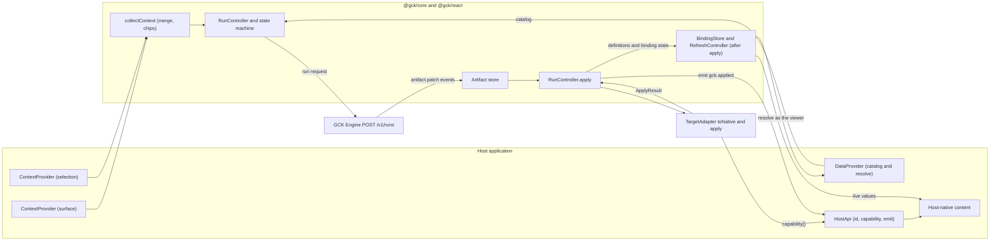
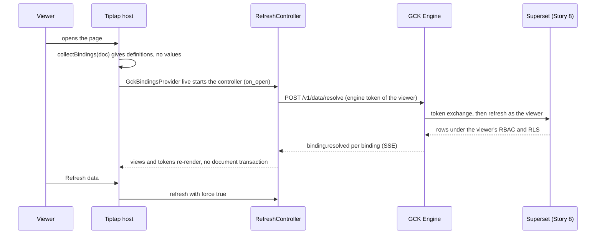
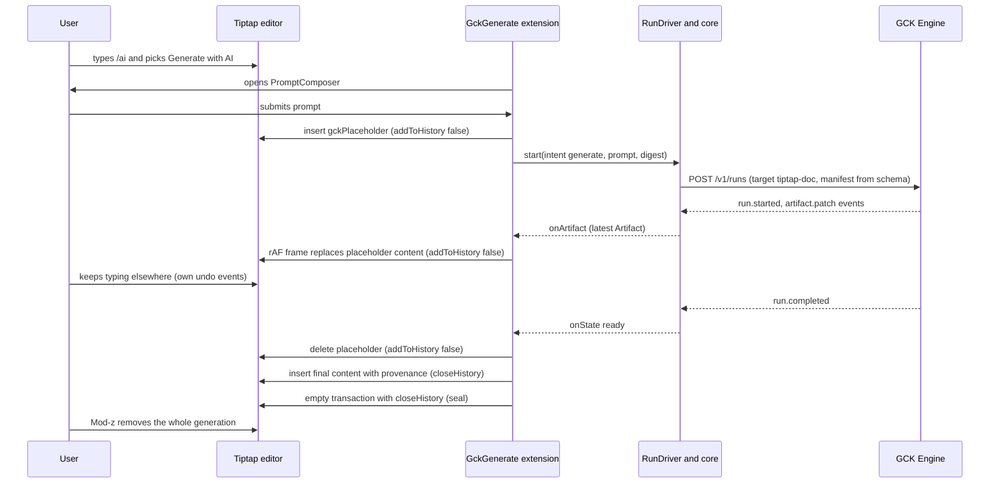
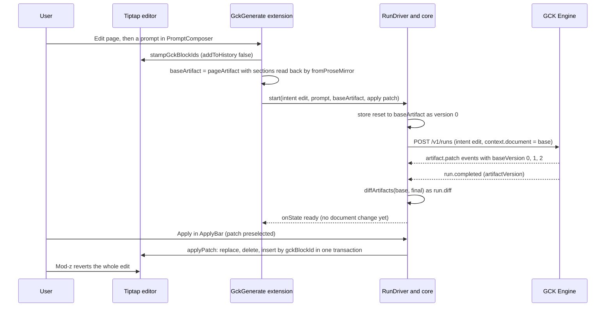
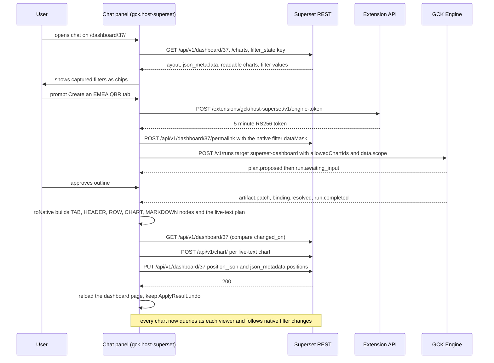

# Host integrations

<div class="chapter-meta" markdown>
**Reads:** `superset-frontend/packages/superset-core/src/sqlLab/index.ts`, `superset-frontend/packages/superset-ui-core/src/ui-overrides/types.ts`, `superset/dashboards/api.py`, `servers/nextjs/components/slide-editor/text/TiptapInlineTextEditor.tsx`, `servers/nextjs/app/(presentation-generator)/outline/hooks/useOutlineStreaming.ts`, `superset-frontend/plugins/plugin-chart-handlebars/src/Handlebars.tsx`  ·  **Builds on:** [React SDK and UI kit](64-react-sdk-and-ui-kit.md), [Live Superset data](69-live-superset-data.md), [Building the Superset extension](../superset/36-superset-extension.md)  ·  **Time:** ~65 min
</div>

This chapter mounts the Generative Content Kit into real hosts. You will see how a host fills in the host adapter contract from chapters 62 to 64 (`HostContext`, `ContextProvider`, `DataProvider`, `HostApi` and its well-known capabilities), then build five hosts on it: a Superset dashboard host that generates a new tab or a new dashboard from a prompt, a Superset text host for Markdown components, SQL Lab results and alert narratives, a Tiptap extension `GckGenerate` with a `/ai` slash command, bubble actions and streaming insertion that undoes in one step, Presenton (AI Slides) as the host of the slides target, and a framework-agnostic `<gck-generate>` web component with an iframe fallback. The chapter ends with a mount matrix and three end-to-end sequence diagrams.

Every host also keeps the generated content's data live after the run. No host stores frozen numbers or screenshots: a host persists binding **definitions** (which Superset chart, dataset or metric, with which filters), and the numbers are fetched again **as the viewing user** when the content is opened, when the user asks for a refresh, on an opt-in interval and when the host's filters change. Each step below says what triggers a refresh in that host and how the result is scoped to the viewer; where a host can only store static text (a dashboard Markdown component, an email, a PPTX file), the output carries a "Data as of" stamp and the kit offers a live alternative. The shared data path (the engine's resolve endpoint, the Superset refresh API, identity, caching and limits) is specified once in [Live Superset data](69-live-superset-data.md), and Step 7 summarizes the behavior per host.

All code under `gck/` and every snippet titled **(new)** is design code for the kit; nothing in it exists in the Presenton repository yet. Everything cited as `path:line` exists in the Presenton snapshot (`571461f`), and everything cited as `apache/superset: path:line` exists in `apache/superset` master at `cabd8d4` (2026-11-02). Superset availability uses the same tags as Part VII:

| Tag | Meaning |
|---|---|
| **[6.1]** | Present in the 6.1.0 release and on master |
| **[M]** | Master only (expected in 7.0, not verified) |
| **[M\*]** | Present in 6.1.0 but changed on master |

## Step 1: The host adapter contract

A host is anything that can (a) describe where the user is and what they selected, and (b) accept host-native content and say what happened. The kit splits those two jobs: **context providers** and one **data provider** produce the `context` and `data` parts of the run request ([Run protocol and client](63-run-protocol-and-client.md)), and the **host API** is what a target adapter's `apply()` uses to commit the result ([Artifact Spec and targets](62-artifact-spec-and-targets.md)). Every type in this step is defined in chapters 62 to 64; this step shows how a host fills them in and which conventions the hosts below share.



### 1.1 `HostContext` and the selection conventions

`HostContext` is not a second shape: it is an alias of the run request's `context` object, `RunContext`, so the two names can never drift. Only `host` is required; `surface`, `locale`, `theme`, `selection` and `document` are optional, and an index signature lets a host add its own top-level keys such as `dashboardId`.

```ts title="gck/packages/protocol/src/run.ts (excerpt, defined in Run protocol and client)"
export interface RunContext {
  host: string;                       // "superset" | "tiptap" | "presenton" | "web" | "element"
  surface?: string;                   // conventions: dashboard, dashboard_markdown, sqllab, alert, document, presentation, page
  locale?: string;
  theme?: Record<string, unknown>;
  selection?: unknown;                // host-defined; the kinds below are a convention, not a type
  document?: unknown;                 // compact digest of host content, never the full native payload
  [key: string]: unknown;             // host-specific ids such as dashboardId
}
```

```ts title="gck/packages/protocol/src/target.ts (excerpt, defined in Artifact Spec and targets)"
/** The run request's context object. One type, two names. */
export type HostContext = RunContext;
```

The values of `surface` and `selection` are conventions shared by the hosts in this chapter, not types, so a new host can add its own without a protocol release:

| `surface` | Host | Meaning |
|---|---|---|
| `dashboard` | Superset | a dashboard page, or a dashboard picked elsewhere |
| `dashboard_markdown` | Superset | one `MARKDOWN` component of a dashboard |
| `sqllab` | Superset | SQL Lab with a result set |
| `alert` | Superset (headless) | an Alerts and Reports narrative |
| `document` | Tiptap | a Tiptap document |
| `presentation` | Presenton | a Presenton deck |
| `page` | `<gck-generate>` | any page hosting the web component |

| `selection.kind` | Other fields | Produced by |
|---|---|---|
| `text` | `text`, `from`, `to` | a plain text selection in a host without a target `fromHost` (for example a `<textarea>` page) |
| `dashboard_component` | `componentId` | a picked Superset layout node |
| `chart` | `chartId` | a chart menu entry point |
| `slides` | `slideIds` | selected Presenton slides |

These kinds are what context providers send with a `generate` run, as a hint about where the user is. The two other intents carry content instead, and the run controller writes it itself from `submit`'s input ([React SDK and UI kit](64-react-sdk-and-ui-kit.md)): `submit({ intent: "transform", selection })` sends `context.selection` as a flat list of Artifact blocks (the target's `fromHost` output for the user's selection) and applies with `replace` by default, and `submit({ intent: "edit", baseArtifact })` sends `context.document` as the artifact applied earlier, re-read with `fromHost`, and applies with `patch` by default. The controller writes those keys after collecting context, so they win over anything a provider put there.

Host-specific facts that the apply step needs later (a dashboard's `changed_on`, for example) go under a top-level key named after the provider that wrote them, such as `context["superset.dashboard"]`, and travel to the engine with the rest of the context.

The outcome of an apply is 62's `ApplyResult`, defined in `@gck/protocol` and re-exported by `@gck/core`: `{ ok: boolean; mode; nativeRef?; warnings: string[]; undo?: () => Promise<void> }`. A partial success is `ok: true` with warnings. Each warning string starts with a lowercase snake_case code, the same style as `run.warning` codes (`"chart_not_allowed: ..."`). `undo` is present only when the kit itself can revert the change; when the host's own undo covers it (Tiptap history, Presenton's Redux history) or nothing can, it is absent.

### 1.2 Context providers, the data provider and context collection

Providers are small, independent and registered in the `@gck/core` registry, either through `GckProvider`'s `contextProviders` and `dataProviders` props or at runtime with `registry.registerContextProvider` ([React SDK and UI kit](64-react-sdk-and-ui-kit.md)). A Superset dashboard flow registers one context provider for the dashboard, a Markdown flow adds one for the picked component, and a Tiptap host registers one for the selection and the document outline.

```ts title="gck/packages/core/src/registry.ts (excerpt, defined in React SDK and UI kit)"
export interface ContextProvider {
  id: string;                                          // "superset.dashboard", "tiptap.selection", ...
  collect(signal: AbortSignal): Promise<{
    context: Partial<HostContext>;
    chips: Omit<ContextChip, "providerId">[];          // ContextChip: { id, label, providerId, removable, keys }
  }>;
}

/** Protocol 1.1 (Live Superset data): one interface for the run's catalog and for every later refresh. */
export interface DataProvider {
  id: string;                                          // "superset"
  catalog(scope: HostDataScope | null, signal: AbortSignal): Promise<DataCatalog>;   // allowedChartIds, entries, viewerKey
  resolve(req: ResolveRequest, signal: AbortSignal): AsyncIterable<DataEventBody>;   // refresh as the viewer
  watchScope?(onChange: (scope: HostDataScope) => void): () => void;                 // host filter changes
}

/** Failing providers are skipped; excluded chips delete their context keys; later registrations win on conflicts. */
export function collectContext(registry: Registry, excluded: string[], signal: AbortSignal):
  Promise<{ context: Partial<HostContext>; chips: ContextChip[] }>;
```

Five rules follow from that contract, and every host in this chapter relies on them:

1. **Register only the providers that apply.** A provider has no host or surface filter; the flow that mounts the kit decides which providers exist. The surface goes into `baseContext` on `useGenerationRun`, which the controller merges under the collected context (`{ host: "web", ...baseContext, ...context }`).
2. **Registration order resolves conflicts.** Contributions are merged with `Object.assign`, so a later provider overwrites an earlier one's keys. Each provider should therefore own its keys: the dashboard provider writes `dashboardId`, `document`, `filters` and `superset.dashboard`; the Markdown picker writes `selection`.
3. **Chips are the user's veto.** Every contribution lists chips (`{ id, label, removable, keys }`); `PromptComposer` shows them, and excluding a removable chip deletes the context keys it names before the request is sent. The dashboard host uses this to show the captured filter values before the user submits (Step 2.6).
4. **Data is separate from context.** The allowed charts come from exactly one `DataProvider`, picked by `dataProviderId`, and become the request's `data: { provider, allowedChartIds }` plus, in protocol 1.1, the host's captured filter state as `data.scope` (a `HostDataScope`). Context providers never write `data`.
5. **The same data provider keeps applied content live.** After `gck.applied` the run controller hands the applied artifact's binding definitions and their current state to a host-owned `BindingStore`, and a `RefreshController` built on the same provider's `resolve` takes over: it re-resolves on open, on Refresh, on an opt-in interval (60 s minimum), on tab return when the data is older than `staleAfterSec`, and on parameter or filter changes ([React SDK and UI kit](64-react-sdk-and-ui-kit.md)). Every resolve runs as the viewer: the browser sends definitions with its engine token, the engine exchanges that token for a short-lived data token of the same user and calls the Superset refresh API, so Superset's RBAC and row-level security decide what each viewer sees. The browser never holds a data token ([Live Superset data](69-live-superset-data.md)).

The Superset implementation of the interface is `createSupersetDataProvider` from `@gck/data-superset` (new). Hosts in this chapter create it once per flow, give it a `scopeSource` when they can capture filter state, and register it under the id `"superset"`.

The kit has no context size budget of its own. A request whose context is too large is answered by the engine with `413 context_too_large` (not retryable), which `RunStatusBar` shows as a failed run, so providers keep `document` compact: an outline, truncated Markdown, the text around the cursor.

!!! warning "Gotcha: context is untrusted input, in both directions"
    A dashboard Markdown component, a Tiptap paragraph or a page attribute can contain text written to steer a model ("ignore previous instructions"). Providers send it as data inside `document` or a provider-named key such as `superset.dashboard`, the engine places it in a delimited, clearly labeled part of the prompt, and nothing in the context is ever executed or used as a URL by the kit. In the other direction, `allowedChartIds` from the browser is a hint, not an authorization: the engine and `@gck/data-superset` re-check every chart under the user's own identity (the Part VIII Story 8 refresh path, [Story 8](../delivery/49-story8-analytics-mcp.md)).

### 1.3 `HostApi` and the well-known capabilities

```ts title="gck/packages/core/src/adapter.ts (excerpt, defined in Artifact Spec and targets)"
export interface HostApi {
  readonly id: string;                                       // "superset" | "tiptap" | "presenton" | "web" | ...
  capability<T>(name: string): T | undefined;
  emit?(event: string, detail: unknown): void;
}

/** Optional helper: build a HostApi from a plain capability map. */
export function createHost(id: string, capabilities: Record<string, unknown>,
                           emit?: (event: string, detail: unknown) => void): HostApi;
```

A target asks for what it needs by name and handles absence itself (62's adapters return `ok: false` when a capability is missing), so one adapter works in any host that offers the capability. The names used in this chapter:

| Capability | Type | Offered by |
|---|---|---|
| `superset.http` | `{ request(path, init: { method; body? }): Promise<any> }`; `body` is an object that the host serializes, and the host adds CSRF | Superset host |
| `superset.positionLimit` | `number`, the server's `SUPERSET_DASHBOARD_POSITION_DATA_LIMIT` (default 65535) | Superset host, optional |
| `superset.reloadIfShowing` | `(dashboardId: number) => void` | Superset host |
| `tiptap.editor` | `Editor` from `@tiptap/core` | Tiptap host |
| `presenton.api` | `{ fetch: typeof fetch; presentationId: string; afterIndex: number }` | Presenton host |
| `host.confirm` | `(req: { title; body; danger? }) => Promise<boolean>` | any host with a dialog |
| `host.notify` | `(n: { tone; message }) => void` | any host with toasts |
| `host.startContext` | `() => HostContext \| null`, the context sent when the run was submitted | hosts whose apply checks for concurrent changes |

Hosts learn the outcome through `emit`: after every apply the controller calls `host.emit?.("gck.applied", { result, artifact })`. That is where a host shows a link, records telemetry or refreshes its own view.

### 1.4 The apply step

The run controller's `apply(mode, host)` is the one function between a finished run and a host; `GenerationRun.apply(mode)` calls it with `GckProvider`'s `host`. It runs the target's deterministic serializer, hands the native value to the adapter's `apply`, records the result on the run, and tells the host.

```ts title="gck/packages/core/src/controller.ts (excerpt: apply, as specified in React SDK and UI kit)"
async apply(mode: ApplyMode, host: HostApi) {
  const target = o.registry.getTarget(o.targetId);          // looked up at apply time
  const doc = selectRenderable(artifact.getSnapshot());
  if (!target || !doc) return;
  send({ type: "APPLY" });                                  // ready -> applying
  let result: ApplyResult | undefined;
  try {
    const native = target.toNative(doc);                   // toNative is pure; apply is the only I/O
    const { diff } = state;                                 // edit runs: added, removed, changed block ids
    if (mode === "patch" && !target.manifest.applyModes.includes("patch")) {
      result = await target.apply(native, host, "replace");             // v1 slides and dashboards
      result = { ...result, warnings: [...result.warnings, "patch_unsupported: applied as replace"] };
    } else if (mode === "patch" && target.applyPatch && diff) {
      result = await target.applyPatch(native, diff, doc, host);        // Tiptap: one transaction by gckBlockId
    } else {
      result = await target.apply(native, host, mode);
    }
    if (result.ok) send({ type: "APPLY_DONE", result });              // applying -> applied
    else send({ type: "APPLY_FAILED", error: { code: "conflict",
      message: result.warnings.join("; ") || "Apply failed", retryable: false } });   // applying -> ready
  } catch (err) {
    send({ type: "APPLY_FAILED", error: toError(err) });            // applying -> ready
  }
  host.emit?.("gck.applied", { result, artifact: doc });
},
```

A refused apply (`ok: false`) or a thrown error returns the run to `ready`, not `failed`: the artifact is still good, only the host refused it (permissions, a conflict, a closed editor), so the user can retry or choose another mode without paying for another generation. Two consequences for host code: a target reports expected refusals as `ok: false` with a coded warning (`"conflict: ..."`, `"no_markdown_selected: ..."`) instead of throwing, and the modes a user can pick come from the target's `manifest.applyModes`, narrowed by `ApplyBar`'s `modes` prop. The `patch` mode of an edit run goes to the adapter's `applyPatch` with the run's block diff; the Tiptap target (Step 4) and the text target implement it, and the dashboard and slides targets do not list it in v1, so a `"patch"` request reaches them as `replace` with a `patch_unsupported` warning.

In protocol 1.1 the `doc` above is `withBindingState(doc, state)`: the artifact's binding definitions merged with the run store's latest `binding.resolved` state, so a value that resolved after the last `artifact.patch` still reaches the host, and adapters never fetch on their own. Right after a successful apply the controller seeds the host's `BindingStore` with `stripRuntime` definitions plus that state, which is the handoff rule 5 in Step 1.2 describes; from then on the host's `RefreshController`, not the run, keeps the content current ([Live Superset data](69-live-superset-data.md)).

## Step 2: The Superset dashboard host (`@gck/host-superset`)

### 2.1 Where the kit can mount in Superset

This is the most version-sensitive part of the chapter. The new extension framework renders contributions only in SQL Lab, plus a global chat slot on master. The dashboard and Explore keys belong to the legacy UI-override registry, which only a custom Superset frontend build can fill ([Superset landscape](../superset/31-superset-landscape.md)).

| Mount point | Mechanism | What it receives | Availability | GCK use |
|---|---|---|---|---|
| `sqllab.panels` | `views.registerView` (`apache/superset: superset-frontend/packages/superset-core/src/views/index.ts:73-77`) | no props (`resolveView`, `apache/superset: superset-frontend/src/core/views/index.ts:87-97`) | [M\*] (6.1 takes a provider function) | Generate panel: dashboards (with a picker) and SQL narratives |
| `sqllab.results`, `sqllab.editor` | `menus.registerMenuItem` (`.../menus/index.ts:83`) | command runs with no arguments | [6.1] | "Write narrative", "Open Generate" |
| chat slot | `chat.registerChat(chat, trigger, panel)` (`.../chat/index.ts:76-80`) | no props | [M] | The dashboard entry point on master |
| `dashboard.nav.right` | `getExtensionsRegistry().set(...)`, consumed at `apache/superset: superset-frontend/src/dashboard/components/Header/index.tsx:618,780` | `ComponentType` with no props | [6.1], custom build only | "Generate" button in the dashboard header |
| `dashboard.slice.header.menu` | same registry, consumed at `apache/superset: superset-frontend/src/dashboard/components/SliceHeaderControls/index.tsx:538-555` | `({sliceId, sliceName, dashboardId}) => MenuItem[]` (`apache/superset: superset-frontend/packages/superset-ui-core/src/ui-overrides/types.ts:171-173,274-276`) | [M], custom build only | "Explain this chart", "Add a narrative" |
| `explore.chart.header` | same registry, consumed at `apache/superset: superset-frontend/src/explore/components/ExploreChartPanel/index.tsx:216` | `ExploreChartHeaderProps` with `chartId`, `queriesResponse`, form data (`.../ui-overrides/types.ts:236-247`) | [6.1], custom build only | not used in v1 |

!!! warning "Gotcha: Superset extension areas differ by version, and dashboard areas are not extension areas"
    Three different things change between 6.1.0 and master. (1) `views.registerView` took a provider function on 6.1 and takes a component on master; an arrow that returns an element works on both. (2) `chat` and `navigation` exist only on master, so the dashboard entry point on 6.1 is the SQL Lab panel's dashboard picker. (3) `dashboard.slice.header.menu` is absent from the 6.1.0 override types. And on both lines, a view registered at an unknown location such as `dashboard.header` is stored and never rendered, with no error. `@gck/host-superset` therefore feature-detects at runtime and builds two bundles, exactly like the DBD extension in [Building the Superset extension](../superset/36-superset-extension.md).

### 2.2 Packaging

`@gck/host-superset` is an npm library; a deployment wraps it in a one-file `.supx` extension (publisher `gck`, name `host-superset`, so the extension id is `gck.host-superset` and its REST base is `/extensions/gck/host-superset`). The kit is bundled into the extension's remote: `react`, `react-dom`, `antd` and `@apache-superset/core` are shared singletons with `import: false` (the CLI template), and everything else, including `@gck/*`, ships inside the remote's own chunks. Superset master pins `react` and `react-dom` at `^18.3.0` (`apache/superset: superset-frontend/package.json:196,202`), so `@gck/react`'s peer range must include 18.3.

!!! warning "Gotcha: `react-dom/client` is a different shared module"
    Module Federation shares by request string. The template shares `react-dom`, so `import { createPortal } from "react-dom"` resolves to the host's copy, but `import { createRoot } from "react-dom/client"` is not listed and gets bundled from the extension's `node_modules`, giving a second React DOM that cannot render components from the first. Inside Superset the kit never calls `createRoot`; it renders only inside views and panels the host mounts, and uses `createPortal` for modals.

### 2.3 Registering commands, menus, the panel, the chat and the modal

```tsx title="gck/packages/host-superset/src/register.tsx (new)"
import React from "react";
import * as core from "@apache-superset/core";
import { commands, menus, sqlLab, views } from "@apache-superset/core";
import { GckSupersetRoot } from "./ui/GckSupersetRoot";
import { GenerateModalHost, requestGenerate } from "./ui/modal";
import { SqlLabNarrativePanel, rememberResult } from "./sqllab/SqlLabNarrativePanel";
import { GckChatTrigger, GckChatPanel } from "./chat/GckChat";

export const HAS_CHAT = typeof (core as any).chat?.registerChat === "function";          // [M]
export const HAS_NAVIGATION = typeof (core as any).navigation?.getPage === "function";  // [M]

export type RegisterOptions = { extensionId: string; engineUrl: string; chatSlot: boolean };

export function registerGck(opts: RegisterOptions): { dispose(): void } {
  const ID = opts.extensionId;                       // "gck.host-superset"
  const panelId = `${ID}.panel`;
  const disposables: Array<{ dispose(): void }> = [];

  // One panel in SQL Lab's south pane hosts every Superset flow plus the modal host.
  disposables.push(
    views.registerView(
      { id: panelId, name: "Generate", description: "Generate dashboards and narratives" },
      "sqllab.panels",
      // [M*] valid for the 6.1 provider-function form and the master component form
      () => (
        <GckSupersetRoot engineUrl={opts.engineUrl}>
          <SqlLabNarrativePanel />
          <GenerateModalHost />
        </GckSupersetRoot>
      ),
    ),
  );

  const openPanelThen = async (req: Parameters<typeof requestGenerate>[0]) => {
    // Commands run with no arguments, and the panel may not be the active south-pane tab.
    // Assumption (not verified): the panel id equals the registered view id.
    await sqlLab.setActivePanel(panelId).catch(() => undefined);
    requestGenerate(req);
  };

  disposables.push(
    commands.registerCommand(
      { id: `${ID}.narrateResults`, title: "Write narrative from results", icon: "FileTextOutlined" },
      () => openPanelThen({ flow: "sqllab_narrative" }),
    ),
    commands.registerCommand(
      { id: `${ID}.generateDashboard`, title: "Generate dashboard from prompt", icon: "ThunderboltOutlined" },
      () => openPanelThen({ flow: "dashboard", destination: "new_dashboard" }),
    ),
    menus.registerMenuItem({ view: panelId, command: `${ID}.narrateResults` }, "sqllab.results", "primary"),
    menus.registerMenuItem({ view: panelId, command: `${ID}.generateDashboard` }, "sqllab.editor", "secondary"),
  );

  // [M] The chat slot is the only extension UI visible on dashboard pages.
  if (HAS_CHAT && opts.chatSlot) {
    disposables.push(
      (core as any).chat.registerChat(
        { id: `${ID}.chat`, name: "Generate", description: "Generate dashboards, tabs and text" },
        GckChatTrigger,
        () => (
          <GckSupersetRoot engineUrl={opts.engineUrl}>
            <GckChatPanel />
            <GenerateModalHost />
          </GckSupersetRoot>
        ),
      ),
    );
  }

  // Remember the last successful result for the narrative flow (payload: apache/superset:
  // superset-frontend/packages/superset-core/src/sqlLab/index.ts:190-232).
  disposables.push(sqlLab.onDidQuerySuccess((e) => rememberResult(e)));

  return { dispose: () => disposables.forEach((d) => d.dispose()) };
}
```

```tsx title="extension/frontend/src/index.tsx (new, the whole .supx frontend)"
import { registerGck } from "@gck/host-superset";

registerGck({ extensionId: "gck.host-superset", engineUrl: "/gck-engine", chatSlot: true });
```

The modal host is a tiny event bus plus a portal. It lives inside a component the host already mounted (the panel or the chat panel), so it uses the host's React and antd.

```tsx title="gck/packages/host-superset/src/ui/modal.tsx (new)"
import React, { useEffect, useState } from "react";
import { createPortal } from "react-dom";
import { Modal } from "antd";                       // shared singleton, import: false
import { DashboardGenerateFlow } from "../dashboard/DashboardGenerateFlow";

export type GenerateRequest =
  | { flow: "dashboard"; destination: "new_tab" | "new_dashboard"; dashboardId?: number }
  | { flow: "markdown"; dashboardId: number; componentId?: string; chartId?: number; chartName?: string }
  | { flow: "sqllab_narrative" };

const listeners = new Set<(r: GenerateRequest) => void>();
let pending: GenerateRequest | null = null;

export function requestGenerate(req: GenerateRequest): void {
  if (listeners.size === 0) { pending = req; return; }        // panel not mounted yet
  listeners.forEach((l) => l(req));
}

export function GenerateModalHost() {
  const [req, setReq] = useState<GenerateRequest | null>(() => {
    const p = pending; pending = null; return p;
  });
  useEffect(() => {
    listeners.add(setReq);
    return () => { listeners.delete(setReq); };
  }, []);
  if (!req || req.flow === "sqllab_narrative") return null;   // the narrative renders in the panel
  return createPortal(
    <Modal open title="Generate" footer={null} width={880} destroyOnHidden onCancel={() => setReq(null)}>
      <DashboardGenerateFlow request={req} onDone={() => setReq(null)} />
    </Modal>,
    document.body,
  );
}
```

`destroyOnHidden` is the antd 6 prop name (master pins `antd` `^6.6.7`, `apache/superset: superset-frontend/package.json:159`); a 6.1 build against antd 5 uses `destroyOnClose`. The bundle variant decides.

### 2.4 Custom-build overrides (optional)

Deployments that already build their own Superset frontend can put the same flow on the dashboard itself. The hook is `setupCodeOverrides()`, an empty function called by the SPA entry (`apache/superset: superset-frontend/src/setup/setupCodeOverrides.ts:34-36`, called at `apache/superset: superset-frontend/src/views/App.tsx:59`). Here `@superset-ui/core` is the host's own module, so the registry is reachable.

```tsx title="superset-frontend/src/setup/setupCodeOverrides.ts (new, custom build only)"
import React from "react";
import { getExtensionsRegistry } from "@superset-ui/core";
import { useSelector } from "react-redux";
import { openGckForDashboard } from "@gck/host-superset/overrides";

function GenerateButton() {
  // dashboard.nav.right receives no props; the dashboard id lives in redux.
  const dashboardId = useSelector((s: { dashboardInfo?: { id?: number } }) => s.dashboardInfo?.id);
  if (!dashboardId) return null;
  return (
    <button type="button" className="gck-nav-button"
      onClick={() => openGckForDashboard({ flow: "dashboard", destination: "new_tab", dashboardId })}>
      Generate
    </button>
  );
}

export default function setupCodeOverrides() {
  const registry = getExtensionsRegistry();
  registry.set("dashboard.nav.right", GenerateButton);                        // [6.1]
  registry.set("dashboard.slice.header.menu", ({ sliceId, sliceName, dashboardId }) => [   // [M]
    {
      key: "gck-narrate-chart",
      label: "Write a narrative for this chart",
      onClick: () => openGckForDashboard({ flow: "markdown", dashboardId, chartId: sliceId, chartName: sliceName }),
    },
  ]);
}
```

`openGckForDashboard` mounts the same `DashboardGenerateFlow` in a portal. In a custom build there is only one React, so `@gck/host-superset/overrides` may use `createRoot` there. The `dashboardInfo` slice and the `MenuItem` shape should be checked against the frontend version being built; Superset unshifts the returned items into the chart menu and isolates a throwing extension with `try`/`catch` (`apache/superset: superset-frontend/src/dashboard/components/SliceHeaderControls/index.tsx:541-555`).

### 2.5 The Superset `HostApi`: requests, CSRF and the app root

`SupersetClient` is not shared with remotes, so every call is a same-origin `fetch` with the session cookie and `X-CSRFToken` from `authentication.getCSRFToken()` (`apache/superset: superset-frontend/packages/superset-core/src/authentication/index.ts:43`).

```ts title="gck/packages/host-superset/src/host/request.ts (new)"
import { authentication } from "@apache-superset/core";

export class SupersetHttpError extends Error {
  constructor(public status: number, public body: string) { super(`superset_${status}`); }
}

/** App root derived from our own remote entry URL (/api/v1/extensions/<publisher>/<name>/...). */
export const APP_ROOT: string = (() => {
  const src = Array.from(document.scripts).map((s) => s.src)
    .find((s) => s.includes("/api/v1/extensions/gck/host-superset/")) ?? "";
  if (!src) return "";
  const path = new URL(src).pathname;
  const i = path.indexOf("/api/v1/extensions/");
  return i > 0 ? path.slice(0, i) : "";              // "" at the root, "/analytics" under a subdirectory
})();

export type SupersetRequest = <T>(path: string, init?: RequestInit) => Promise<T>;

export const supersetRequest: SupersetRequest = async (path, init = {}) => {
  const method = (init.method ?? "GET").toUpperCase();
  const headers = new Headers(init.headers);
  headers.set("Accept", "application/json");
  if (init.body != null && !headers.has("Content-Type")) headers.set("Content-Type", "application/json");
  if (method !== "GET" && method !== "HEAD") {
    const token = await authentication.getCSRFToken();
    if (token) headers.set("X-CSRFToken", token);
  }
  const res = await fetch(`${APP_ROOT}${path}`, { ...init, method, headers, credentials: "same-origin" });
  if (!res.ok) throw new SupersetHttpError(res.status, await res.text().catch(() => ""));
  return (res.status === 204 ? undefined : await res.json()) as never;
};
```

The host side is a capability map for `createHost("superset", ...)`. `superset.http` wraps `supersetRequest` in the shape 62's dashboard adapter expects (`body` is an object; the host serializes it and adds CSRF), and the other entries are the well-known names from Step 1.3. A target package never imports `@gck/host-superset`; it only asks for these names.

```ts title="gck/packages/host-superset/src/host/supersetHost.ts (new)"
import type { HostContext } from "@gck/core";
import { supersetRequest } from "./request";

/** The superset.http capability. */
export const supersetHttp = {
  request: (path: string, init: { method: string; body?: unknown }) =>
    supersetRequest(path, { method: init.method,
                            body: init.body === undefined ? undefined : JSON.stringify(init.body) }),
};

/** The open dashboard page keeps its own redux copy of the layout; reload to show the change. */
export function reloadIfShowing(dashboardId: number): void {
  const ref = window.location.pathname.match(/\/(?:superset\/)?dashboard\/([^/]+)\/?$/)?.[1];
  if (ref === String(dashboardId)) window.location.reload();
}

export type SupersetUi = {
  confirm(req: { title: string; body: string; danger?: boolean }): Promise<boolean>;
  notify(n: { tone: "info" | "success" | "warning" | "error"; message: string }): void;
};

/** Capabilities for createHost("superset", ...); each flow passes its own startContext. */
export function supersetCapabilities(ui: SupersetUi,
                                     startContext: () => HostContext | null): Record<string, unknown> {
  return {
    "superset.http": supersetHttp,
    "superset.reloadIfShowing": reloadIfShowing,
    "host.startContext": startContext,
    "host.confirm": ui.confirm,
    "host.notify": ui.notify,
  };
}
```

`GckConfig` requires a `host` and the `targets`, and both belong to a flow (the dashboard flow's target depends on the picked destination), so the Superset glue has two parts. `GckSupersetRoot`, mounted once per contributed view, only remembers the engine URL. `SupersetGck` wraps each flow in a `GckProvider`: the same-origin engine URL, a `TokenProvider` backed by the extension API (Step 2.9), Superset's locale, and the kit's theme keys (`accent`, `fg`, `bg`, `radius`, `font`, written as `--gck-*` custom properties) mapped from the host theme. `theme.useTheme()` returns the Superset theme object (`apache/superset: superset-frontend/packages/superset-core/src/theme/index.tsx:50`), a subset of antd tokens plus Superset-specific ones; `borderRadius`, `colorPrimary`, `colorBgContainer`, `colorText` and `fontFamily` are in the allowed antd key list (`apache/superset: superset-frontend/packages/superset-core/src/theme/types.ts:278,306,328,363,400,508-511`).

```tsx title="gck/packages/host-superset/src/ui/GckSupersetRoot.tsx (new)"
import React, { createContext, useContext, useMemo, type ReactNode } from "react";
import { theme } from "@apache-superset/core";
import { GckClient } from "@gck/client";
import { GckProvider, type GckConfig } from "@gck/react";
import { supersetRequest } from "../host/request";

let cached: { token: string; expiresAt: number } | null = null;

/** TokenProvider: cached until 30 s before expiry; forceRefresh after a token_expired answer. */
export async function getEngineToken({ forceRefresh }: { forceRefresh: boolean }): Promise<string | null> {
  if (!forceRefresh && cached && cached.expiresAt - 30 > Date.now() / 1000) return cached.token;
  const r = await supersetRequest<{ result: { token: string; expires_at: number } }>(
    "/extensions/gck/host-superset/v1/engine-token", { method: "POST", body: "{}" });
  cached = { token: r.result.token, expiresAt: r.result.expires_at };
  return cached.token;
}

const EngineUrl = createContext("/gck-engine");

export function GckSupersetRoot({ engineUrl, children }: { engineUrl: string; children: ReactNode }) {
  return <EngineUrl.Provider value={engineUrl}>{children}</EngineUrl.Provider>;
}

/** An engine client for data providers created outside GckProvider (Step 2.6). */
export function useEngineClient(): GckClient {
  const engineUrl = useContext(EngineUrl);
  return useMemo(() => new GckClient({ engineUrl, getToken: getEngineToken }), [engineUrl]);
}

type FlowConfig = Pick<GckConfig, "host" | "targets" | "contextProviders" | "dataProviders" | "messages">;

/** One GckProvider per flow. Pass stable arrays (useMemo): GckProvider re-registers on identity change. */
export function SupersetGck({ children, ...flow }: FlowConfig & { children: ReactNode }) {
  const engineUrl = useContext(EngineUrl);
  const t = theme.useTheme() as unknown as Record<string, string | number>;
  const gckTheme = useMemo(() => ({
    accent: String(t.colorPrimary), fg: String(t.colorText), bg: String(t.colorBgContainer),
    radius: `${t.borderRadius}px`, font: String(t.fontFamily),
  }), [t]);
  return (
    <GckProvider {...flow} engineUrl={engineUrl} getToken={getEngineToken}
                 locale={document.documentElement.lang || "en"} theme={gckTheme}>
      {children}
    </GckProvider>
  );
}
```

### 2.6 The dashboard context provider

Contributed views receive no props, and master's `navigation.getPage()` returns only the page kind by design (`apache/superset: superset-frontend/packages/superset-core/src/navigation/index.ts:21-26,65`). The provider therefore reads the dashboard reference from the URL (or from the picker on 6.1) and loads everything else over REST.

The provider has a second job in protocol 1.1: it captures the dashboard's **native filter state** so that every binding the run creates is resolved, now and on every later refresh, under the same filters the user was looking at. Superset keeps that state as a `DataMask` per filter id, `{ extraFormData?, filterState?, ownState? }` (`apache/superset: superset-frontend/packages/superset-ui-core/src/chart/types/Base.ts:72-76`). `filterState.value` is what the filter bar displays; `extraFormData` is what Superset itself merges into chart queries (`filters`, `time_range`, `time_grain_sqla`, `granularity_sqla` among others, `apache/superset: superset-frontend/packages/superset-ui-core/src/query/types/QueryFormData.ts:109-151`). The kit sends `extraFormData` untouched, so it never re-derives a query from a filter's type or its first target column. The capture becomes a `HostDataScope` (`{ host: "superset_dashboard", dashboardId, dataMask, permalinkKey, capturedAt }`), travels as `RunRequest.data.scope`, and the engine copies it into each binding's `source.filter_context` with `mode: "captured"`. How the analytics backend scopes each filter to each chart (master's `get_dashboard_filter_context` and `apply_dashboard_filter_context`, `apache/superset: superset/charts/data/dashboard_filter_context.py:272,365`, or a local resolver on 6.1) is in [Live Superset data](69-live-superset-data.md).

| Need | Endpoint | Evidence | Availability |
|---|---|---|---|
| Title, `position_json`, `json_metadata` (native filter config), `changed_on`, `url` | `GET /api/v1/dashboard/<id_or_slug>` | `apache/superset: superset/dashboards/api.py:738`; response fields `superset/dashboards/schemas.py:280-309` | [6.1] |
| Member charts with `form_data` | `GET /api/v1/dashboard/<id_or_slug>/charts` | `apache/superset: superset/dashboards/api.py:981`; `form_data` stripped for charts the caller cannot access (`:912-917`, master) | [6.1] ([M\*] stripping) |
| Datasets with columns, metrics, formats | `GET /api/v1/dashboard/<id_or_slug>/datasets` | `apache/superset: superset/dashboards/api.py:831` | [6.1] |
| Live native filter values | `GET /api/v1/dashboard/<pk>/filter_state/<key>` returns `{value}` (master adds `names`) | `apache/superset: superset/dashboards/filter_state/api.py:232,283-290` | [6.1] ([M\*] `names`) |
| Permalink state | `GET /api/v1/dashboard/permalink/<key>` returns `{dashboardId, state}` | `apache/superset: superset/dashboards/permalink/api.py:182,225` | [6.1] |
| Durable capture of the filter state | `POST /api/v1/dashboard/<pk>/permalink` with `{dataMask, activeTabs?, urlParams?}`, returns `201 {key, url}` | `apache/superset: superset/dashboards/permalink/api.py:48,171`; body schema `superset/dashboards/permalink/schemas.py:20-38` | [6.1] |
| Write permission on dashboards | `GET /api/v1/dashboard/_info?q=(keys:!(permissions))` | `INFO` is in `REST_MODEL_VIEW_CRUD_SET` (`apache/superset: superset/constants.py:119`) | [6.1] |

```ts title="gck/packages/host-superset/src/dashboard/dashboardContext.ts (new)"
import type { GckClient } from "@gck/client";
import type { ContextProvider, DataProvider, HostContext } from "@gck/core";
import type { ExtraFormData, HostDataScope } from "@gck/protocol";
import { createSupersetDataProvider } from "@gck/data-superset";
import { APP_ROOT, supersetRequest } from "../host/request";

export type DashboardRef = { idOrSlug: string | null; permalinkKey: string | null; nativeFiltersKey: string | null };

/** 6.1 serves /superset/dashboard/<id>/; master mounts core views at the root (/dashboard/<id>/). */
export function dashboardRefFromUrl(loc: Location = window.location): DashboardRef | null {
  const path = APP_ROOT && loc.pathname.startsWith(APP_ROOT) ? loc.pathname.slice(APP_ROOT.length) : loc.pathname;
  const permalink = path.match(/^\/(?:superset\/)?dashboard\/p\/([^/]+)\/?$/)?.[1] ?? null;
  const idOrSlug = permalink ? null : path.match(/^\/(?:superset\/)?dashboard\/([^/]+)\/?$/)?.[1] ?? null;
  if (!permalink && !idOrSlug) return null;
  return { idOrSlug, permalinkKey: permalink,
           nativeFiltersKey: new URLSearchParams(loc.search).get("native_filters_key") };
}

type DashboardResult = { id: number; dashboard_title: string; position_json: string | null;
                         json_metadata: string | null; changed_on: string; url: string };
type ChartResult = { id: number; slice_name: string; form_data?: { viz_type?: string; datasource?: string } };
/** Superset's DataMask per filter id (superset-ui-core chart/types/Base.ts:72-76). */
type DataMask = Record<string, { extraFormData?: ExtraFormData; filterState?: { value?: unknown } }>;

export type CollectedDashboard = { dashboardId: number; chartNames: Record<number, string> };

/**
 * One source per flow: the context provider, a live data provider over the same dashboard and
 * its filter capture, and startContext (the context the last collect returned, which submit() sent).
 */
export function supersetDashboardProvider(opts: { client: GckClient; pick?: () => number | null;
                                                  onCollected?: (d: CollectedDashboard) => void }) {
  let last: Partial<HostContext> | null = null;
  let capture: HostDataScope | null = null;          // what the run's bindings will be filtered by
  let rawMask: DataMask = {};                         // the native-filter masks as Superset stored them

  const context: ContextProvider = {
    id: "superset.dashboard",
    async collect(signal) {
      const picked = opts.pick?.() ?? null;
      const ref: DashboardRef | null = picked != null
        ? { idOrSlug: String(picked), permalinkKey: null, nativeFiltersKey: null }
        : dashboardRefFromUrl();
      if (!ref) return { context: {}, chips: [] };

      let idOrSlug = ref.idOrSlug;
      let dataMask: DataMask | null = null;
      if (ref.permalinkKey) {
        const p = await supersetRequest<{ dashboardId: string; state: { dataMask?: DataMask } }>(
          `/api/v1/dashboard/permalink/${encodeURIComponent(ref.permalinkKey)}`, { signal });
        idOrSlug = p.dashboardId;
        dataMask = p.state?.dataMask ?? null;
      }
      const base = `/api/v1/dashboard/${encodeURIComponent(idOrSlug!)}`;
      const [dash, charts] = await Promise.all([
        supersetRequest<{ result: DashboardResult }>(base, { signal }),
        supersetRequest<{ result: ChartResult[] }>(`${base}/charts`, { signal }),
      ]);
      const d = dash.result;
      if (ref.nativeFiltersKey) {
        try {
          const fs = await supersetRequest<{ value: string }>(
            `/api/v1/dashboard/${d.id}/filter_state/${encodeURIComponent(ref.nativeFiltersKey)}`, { signal });
          dataMask = JSON.parse(fs.value) as DataMask;
        } catch { /* expired cache entry: fall back to filter defaults, reported below */ }
      }
      const metadata = d.json_metadata ? JSON.parse(d.json_metadata) : {};
      const config = (metadata.native_filter_configuration ?? []).filter((f: any) => f.type === "NATIVE_FILTER");
      // Display only: the chips show what the filter bar shows. Queries use extraFormData, never these values.
      const filters = config.map((f: any) => ({
        id: f.id, name: f.name,
        value: dataMask?.[f.id]?.filterState?.value ?? f.defaultDataMask?.filterState?.value ?? null,
      }));
      // Native filters publish their own extraFormData. Masks keyed by chart id are cross filters,
      // which protocol 1.1 does not propagate (the engine warns cross_filter_not_applied).
      const nativeIds = new Set<string>(config.map((f: any) => f.id));
      rawMask = Object.fromEntries(Object.entries(dataMask ?? {}).filter(([id]) => nativeIds.has(id)));
      capture = {
        host: "superset_dashboard", dashboardId: d.id, capturedAt: new Date().toISOString(),
        dataMask: Object.fromEntries(Object.entries(rawMask)
          .filter(([, m]) => m.extraFormData).map(([id, m]) => [id, { extraFormData: m.extraFormData }])),
        ...(ref.permalinkKey ? { permalinkKey: ref.permalinkKey } : {}),
      };
      // No captured mask: the engine resolves with the filters' saved defaults (filter_context mode "defaults").
      // Charts whose form_data was withheld are not readable by this user (master behavior).
      const readable = charts.result.filter((c) => c.form_data);

      const contribution: Partial<HostContext> = {
        dashboardId: d.id,
        document: {
          title: d.dashboard_title,
          outline: layoutOutline(d.position_json),              // tabs, headers, chart order
          charts: readable.map((c) => ({ id: c.id, name: c.slice_name, viz: c.form_data?.viz_type })),
        },
        filters,
        "superset.dashboard": { changedOn: d.changed_on, url: d.url, filtersFromDefaults: !dataMask },
      };
      last = contribution;
      opts.onCollected?.({ dashboardId: d.id,
                           chartNames: Object.fromEntries(readable.map((c) => [c.id, c.slice_name])) });
      return {
        context: contribution,
        chips: [
          { id: "dashboard", label: d.dashboard_title, removable: false,
            keys: ["dashboardId", "document", "superset.dashboard"] },
          { id: "filters", removable: true, keys: ["filters"],
            label: filters.length ? filters.map((f: any) => `${f.name}: ${f.value ?? "all"}`).join(", ") : "No filters" },
        ],
      };
    },
  };

  // Protocol 1.1: the catalog and every later resolve go through the engine, as the viewer.
  const live = createSupersetDataProvider({ client: opts.client, scopeSource: () => capture });

  // submit() collects context before it asks the data provider, so `capture` is this run's dashboard state.
  const data: DataProvider = {
    ...live,
    id: "superset",
    async catalog(scope, signal) {
      const s = scope ?? capture;
      if (s?.dashboardId != null && !s.permalinkKey && Object.keys(rawMask).length) {
        // filter_state keys are a short-lived per-tab cache; a permalink makes the capture reproducible,
        // so a refresh next month still filters by what the user saw when they asked.
        const p = await supersetRequest<{ key: string }>(`/api/v1/dashboard/${s.dashboardId}/permalink`,
          { method: "POST", body: JSON.stringify({ dataMask: rawMask }), signal });
        s.permalinkKey = p.key;
      }
      return live.catalog(s, signal);           // engine: Story 8 catalog for this viewer and this dashboard
    },
    // follow_host after apply: the URL's native_filters_key is the only filter signal a .supx gets,
    // so poll it (and check on focus) and hand the new native masks to the RefreshController.
    watchScope(onChange) {
      let seen = dashboardRefFromUrl()?.nativeFiltersKey ?? null;
      const check = async () => {
        const key = dashboardRefFromUrl()?.nativeFiltersKey ?? null;
        const dashboardId = capture?.dashboardId;
        if (!key || key === seen || dashboardId == null) return;
        seen = key;
        const fs = await supersetRequest<{ value: string }>(
          `/api/v1/dashboard/${dashboardId}/filter_state/${encodeURIComponent(key)}`).catch(() => null);
        if (!fs) return;
        const mask = JSON.parse(fs.value) as DataMask;
        onChange({ host: "superset_dashboard", dashboardId, capturedAt: new Date().toISOString(),
          dataMask: Object.fromEntries(Object.entries(mask)
            .filter(([id, m]) => id.startsWith("NATIVE_FILTER-") && m.extraFormData)   // NATIVE_FILTER_PREFIX
            .map(([id, m]) => [id, { extraFormData: m.extraFormData }])) });
      };
      const timer = window.setInterval(check, 5_000);
      window.addEventListener("focus", check);
      return () => { window.clearInterval(timer); window.removeEventListener("focus", check); };
    },
  };

  return { context, data, scope: () => capture,
           startContext: (): HostContext | null => (last ? { host: "superset", ...last } : null) };
}

/** Depth-first outline of TABS, TAB, HEADER, CHART and MARKDOWN nodes (Markdown text truncated). */
export function layoutOutline(positionJson: string | null): unknown[] {
  if (!positionJson) return [];
  const layout = JSON.parse(positionJson) as Record<string, any>;
  const out: unknown[] = [];
  const walk = (id: string, depth: number) => {
    const n = layout[id];
    if (!n || typeof n !== "object") return;
    if (n.type === "TAB" || n.type === "HEADER") out.push({ depth, type: n.type, text: n.meta?.text ?? "" });
    if (n.type === "CHART") out.push({ depth, type: "CHART", chartId: n.meta?.chartId });
    if (n.type === "MARKDOWN") out.push({ depth, type: "MARKDOWN", id, text: String(n.meta?.code ?? "").slice(0, 300) });
    (n.children ?? []).forEach((c: string) => walk(c, depth + 1));
  };
  walk("ROOT_ID", 0);
  return out;
}
```

!!! warning "Gotcha: the URL is the only dashboard context a `.supx` gets"
    The dashboard page's redux state (active tab, unsaved filter changes, cross-filters) is invisible to an extension. `native_filters_key` is written to the URL after filter changes settle, so a user who changes a filter and immediately opens the chat can still send the previous key. The flow shows the captured filter values as chips before submitting, and `filtersFromDefaults: true` tells the engine (and the user) that live values were unavailable.

### 2.7 From the dashboard IR to `position_json`

`@gck/target-superset-dashboard` places existing, readable charts, and in protocol 1.1 it creates charts in exactly one case: to keep numbers in prose live (below, gated by `allowChartCreation`, default `true`). Its serializer is `toPositions(artifact, { tabs, chartNames })` from [Artifact Spec and targets](62-artifact-spec-and-targets.md) (Step 9.3): every `chart`, `metric` and `table` block becomes a `CHART` component pointing at its binding's `source.chart_id`, consecutive text blocks become one `MARKDOWN` component rendered with `toMarkdown` from `@gck/target-text`, section titles and headings become `HEADER` components, and blocks are packed into 12-column rows by 62's packing rules (Step 9.2). The vocabulary and defaults it follows come from Superset's own component factory: `CHART` and `MARKDOWN` default to `width: 4, height: 50`, `HEADER` uses `MEDIUM_HEADER` and `BACKGROUND_TRANSPARENT`, factory ids are `${type}-${nanoid()}`, and the grid has 12 columns (`apache/superset: superset-frontend/src/dashboard/util/newComponentFactory.ts`, `apache/superset: superset-frontend/src/dashboard/util/constants.ts:20-23,40,46,50,55`). Unlike the factory, `toPositions` derives ids from block ids (`CHART-gck-blk_...`, `ROW-gck-blk_...`), so the output is deterministic and golden-testable.

Two things the Superset host relies on are therefore not repeated in this chapter's code. The engine's `I10_ALLOWED_SOURCES` check guarantees that every binding points at a chart in the run's `allowedChartIds`, so the serializer does not filter charts again. And the dashboard manifest leaves out `image`, so the engine never generates an image block for a dashboard (Superset's CSP limits `img-src`, Step 2.9).

The factory, `createSupersetDashboardTarget({ tabs, chartNames, dashboardId?, allowChartCreation? })`, is shown in Step 2.8 with its apply. Its `toNative` adds the live-text plan and one Superset-specific warning on top of `toPositions`:

```ts title="gck/packages/target-superset-dashboard/src/index.ts (excerpt: toNative, protocol 1.1)"
toNative(a) {
  // Text blocks whose numbers can stay live become charts at apply time (live-text.ts below).
  const liveText = opts.allowChartCreation === false ? [] : planLiveText(a);
  const live = new Set(liveText.map((l) => l.blockId));
  // New toPositions option: each live-text block gets its own MARKDOWN-gck-<blockId> component, a stamped
  // fallback that apply swaps for a CHART once the chart exists; other text blocks still merge as before.
  const n = toPositions(a, { tabs: opts.tabs, chartNames: opts.chartNames, liveText: live });
  for (const s of a.sections) for (const b of s.blocks) {
    if (live.has(b.id)) continue;
    const texts = b.type === "list" ? b.items : "text" in b ? [b.text] : [];
    for (const seg of texts.flat()) {
      // MARKDOWN components are static text: the token is written with an "(as of ...)" suffix.
      if (seg.token) n.warnings.push(`stale_number_in_markdown: ${b.id} shows ${seg.token.bindingId} ` +
        `as of ${a.bindings[seg.token.bindingId]?.snapshotAt ?? "run time"}`);
    }
  }
  const interval = a.refresh?.modes.includes("interval") ? Math.max(60, a.refresh.intervalSec ?? 300) : 0;
  return { ...n, liveText, refreshFrequency: interval };
},
```

!!! warning "Gotcha: numbers in dashboard Markdown never refresh"
    Superset's Markdown component renders static text (`component.meta.code` through `SafeMarkdown`, `apache/superset: superset-frontend/src/dashboard/components/gridComponents/Markdown/Markdown.tsx:29,160,348`) and issues no query. A data token rendered into it is frozen at `snapshotAt`, while the chart next to it updates with every filter change. So the kit never leaves a bare number there: a sentence whose numbers can be expressed as one Superset query becomes a live-text chart (below), the dashboard manifest's `promptHints` ask for qualitative text everywhere else, and any token that still lands in Markdown is written with an "(as of ...)" suffix (`toMarkdown` with `dataAsOf: "inline"`) and produces the `stale_number_in_markdown` warning, which the apply bar shows with the result.

#### Live text: Handlebars and Big Number charts instead of Markdown numbers

Superset has two chart types that render text from a live query, and both re-query exactly like any other chart on the dashboard: on open, when a native filter in scope changes, on the dashboard's Refresh and on auto refresh. The adapter uses them as follows.

| Text block | Becomes | Why |
|---|---|---|
| one token that reads a saved `big_number_total`, `big_number` or `pop_kpi` chart | that existing chart, placed where the text was | nothing to create; the chart already formats with `y_axis_format` and `currency_format` |
| one token over a `superset_metric` source | a new `big_number_total` chart: `metric`, `adhoc_filters`, `subtitle` (the sentence), `y_axis_format` (`apache/superset: superset-frontend/plugins/plugin-chart-echarts/src/BigNumber/BigNumberTotal/controlPanel.ts:43-55`, `subtitle` at `.../BigNumber/sharedControls.ts:87-95`); `pop_kpi` with `time_compare: [offset]` when the source has a `compare` (`.../BigNumber/BigNumberPeriodOverPeriod/buildQuery.ts:37-49`) | keeps d3 and `SMART_NUMBER` formatting |
| several tokens, all `superset_metric` sources of one dataset under one scope | a new `handlebars` chart (`VizType.Handlebars`, `apache/superset: superset-frontend/packages/superset-ui-core/src/chart/types/VizType.ts:39`, registered at `apache/superset: superset-frontend/src/visualizations/presets/MainPreset.ts:199`) in aggregate mode, whose template is the sentence | one aggregate query returns every number of the sentence in row 0 |
| anything else (mixed datasets, different filters, chart-backed series values) | the stamped `MARKDOWN` fallback | one chart cannot answer it honestly |

The Handlebars chart's controls are `metrics`, `groupby`, `adhoc_filters` and `row_limit` under `query_mode` (`apache/superset: superset-frontend/plugins/plugin-chart-handlebars/src/plugin/controlPanel.tsx:51-59`), with the template in `handlebarsTemplate` and CSS in `styleTemplate` (`.../plugin/controls/handlebarTemplate.tsx:80`, `.../plugin/controls/style.tsx:80`). The viewer passes the query rows as `{ data }` (`apache/superset: superset-frontend/plugins/plugin-chart-handlebars/src/Handlebars.tsx:46`), so a token becomes a `formatNumber` helper call on `data.[0].[revenue]` (the template text is in the code below).

```ts title="gck/packages/target-superset-dashboard/src/live-text.ts (new)"
import type { Artifact, DataBinding } from "@gck/protocol";
import type { DashboardNative, LayoutNode } from "./to-native";

type MetricSource = Extract<DataBinding["source"], { type: "superset_metric" }>;
type SupersetHttp = { request(path: string, init: { method: string; body?: unknown }): Promise<any> };
/** Body of POST /api/v1/chart/ (ChartPostSchema): the form data travels as the `params` string. */
export type ChartPost = { slice_name: string; viz_type: string; datasource_id: number;
                          datasource_type: "table"; params: string };
export type LiveText = { blockId: string; existingChartId?: number; create?: ChartPost };

const LIVE_VIZ = /^(big_number_total|big_number|pop_kpi)$/;
const esc = (s: string) => s.replace(/[&<>"'{}]/g, (c) => `&#${c.charCodeAt(0)};`);   // literal text, never markup
const scopeKey = (m: MetricSource) => JSON.stringify([m.dataset_id, m.filters ?? [], m.time_range ?? null,
                                                      m.overrides ?? null, m.filter_context ?? null]);

/** Pure: decides which text blocks become live charts. apply does the I/O. */
export function planLiveText(a: Artifact): LiveText[] {
  const out: LiveText[] = [];
  for (const s of a.sections) for (const b of s.blocks) {
    if (b.type !== "paragraph" && b.type !== "callout") continue;
    const tokens = b.text.flatMap((seg) => (seg.token ? [seg.token] : []));
    if (tokens.length === 0) continue;
    const sources = tokens.map((t) => a.bindings[t.bindingId]?.source);
    const first = sources[0];
    if (tokens.length === 1 && first?.type === "superset_chart" && LIVE_VIZ.test(first.viz_type ?? "")) {
      out.push({ blockId: b.id, existingChartId: first.chart_id });
      continue;
    }
    if (!sources.every((x): x is MetricSource => x?.type === "superset_metric")) continue;
    if (new Set(sources.map(scopeKey)).size !== 1) continue;           // one query, one scope
    const m = sources[0];
    const base = { datasource: `${m.dataset_id}__table`, adhoc_filters: toAdhocFilters(m),
                   time_range: m.time_range ?? "No filter" };
    const sentence = b.text.map((seg) => seg.text ?? "").join("").trim();
    const formData = tokens.length === 1
      ? { ...base, viz_type: m.compare ? "pop_kpi" : "big_number_total", metric: m.metric, subtitle: sentence,
          y_axis_format: a.bindings[tokens[0].bindingId].format?.number ?? "SMART_NUMBER",
          ...(m.compare ? { time_compare: [m.compare.time_offset] } : {}) }
      : { ...base, viz_type: "handlebars", query_mode: "aggregate", groupby: [], row_limit: 1,
          metrics: [...new Set(sources.map((x) => x.metric))], styleTemplate: "",
          handlebarsTemplate: `<p>${b.text.map((seg) => (seg.token
            ? `{{formatNumber data.[0].[${(a.bindings[seg.token.bindingId].source as MetricSource).metric}]}}`
            : esc(seg.text ?? ""))).join("")}</p>` };
    out.push({ blockId: b.id, create: { slice_name: `${a.title}: ${sentence.slice(0, 60)}`,
      viz_type: formData.viz_type, datasource_id: m.dataset_id, datasource_type: "table",
      params: JSON.stringify(formData) } });
  }
  return out;
}

/** apply's I/O: one POST per new chart (can_write on Chart). A refusal keeps the stamped Markdown. */
export async function createLiveTextCharts(http: SupersetHttp, plan: LiveText[],
                                           warnings: string[]): Promise<Record<string, number>> {
  const ids: Record<string, number> = {};
  for (const p of plan) {
    if (p.existingChartId != null) { ids[p.blockId] = p.existingChartId; continue; }
    try {
      ids[p.blockId] = (await http.request("/api/v1/chart/", { method: "POST", body: p.create })).id;
    } catch {
      warnings.push(`live_text_as_markdown: ${p.blockId} stays Markdown with an "as of" stamp`);
    }
  }
  return ids;
}

/** Swaps each MARKDOWN-gck-<blockId> fallback for a CHART-gck-<blockId> in the same slot. */
export function swapLiveText(n: DashboardNative, ids: Record<string, number>): DashboardNative {
  const positions = structuredClone(n.positions);
  for (const [blockId, chartId] of Object.entries(ids)) {
    const md = positions[`MARKDOWN-gck-${blockId}`] as LayoutNode | undefined;
    if (!md) continue;
    const id = `CHART-gck-${blockId}`;
    delete positions[md.id];
    positions[id] = { type: "CHART", id, children: [], parents: md.parents,
      meta: { chartId, width: md.meta?.width ?? 4, height: Math.max(Number(md.meta?.height ?? 0), 20) } };
    for (const v of Object.values(positions))
      if (typeof v === "object" && v.children.includes(md.id)) v.children = v.children.map((c) => (c === md.id ? id : c));
  }
  return { ...n, positions, chartIds: [...new Set([...n.chartIds, ...Object.values(ids)])] };
}

declare function toAdhocFilters(m: MetricSource): unknown[];   // FilterClause -> SIMPLE adhoc filter, not shown
```

The new chart carries the binding's pinned scope as `adhoc_filters` and `time_range`, and the dashboard's native filters apply on top of it natively, so live text follows the filter bar exactly like the charts beside it (the dashboard equivalent of `filter_context` mode `follow_host`). No `query_context` is written: a dashboard builds the query from `params` in the browser. The chart is created without a `dashboards` list, because the apply's `json_metadata.positions` links it to the dashboard (Step 2.8).

!!! warning "Gotcha: Handlebars `formatNumber` is not d3"
    The helper is `number.toLocaleString(locale)` (`apache/superset: superset-frontend/plugins/plugin-chart-handlebars/src/components/Handlebars/HandlebarsViewer.tsx:121-130`), so `SMART_NUMBER`, currency and d3 specs from the binding's `format` are not available in a multi-number sentence. The adapter adds `format_approximated` when a token in such a sentence carried a format, and prefers a Big Number chart, which keeps `y_axis_format` and `currency_format`, whenever the sentence holds one number. Handlebars output goes through `SafeMarkdown` with `HTML_SANITIZATION = True` (`apache/superset: superset/config.py:1646`), and `esc` keeps the model's literal text from becoming markup or a Handlebars expression.

### 2.8 Applying: a new tab or a new dashboard

Two facts from the Superset source shape the apply code. First, chart membership (the `dashboard_slices` rows) is rebuilt from `json_metadata.positions`, not from `position_json` alone (`set_dash_metadata`, `apache/superset: superset/daos/dashboard.py:820-847`); the update command documents that "the frontend always sends them there" (`apache/superset: superset/commands/dashboard/update.py:120-131`). Second, there is no server-side conflict check on `PUT`: the last writer wins. 62's `applyDashboard(n, host, mode, target?)` handles the first fact: it always sends the layout inside `json_metadata.positions` (spreading every other metadata key), adds a generated artifact to an existing dashboard as one new tab with `addAsTab` (which keeps every existing id and wraps a flat grid into an "Overview" tab first), creates a new dashboard with `POST /api/v1/dashboard/` when no target is given, and returns an `undo` that PUTs the previous layout back. The Superset host adds what is specific to a live, multi-user dashboard: the `changed_on` comparison against the context captured at submit (`host.startContext`), a confirmation through `host.confirm`, a `filter_scope_review` warning, a page reload through `superset.reloadIfShowing`, and an explicit, confirmed delete as the undo of a new dashboard. They all live in the target factory and use only capability names, so the target package never imports `@gck/host-superset`.

```ts title="gck/packages/target-superset-dashboard/src/index.ts (new)"
import type { TargetAdapter } from "@gck/core";
import type { HostContext, TargetManifest } from "@gck/protocol";
import { applyDashboard } from "./apply";
import { createLiveTextCharts, planLiveText, swapLiveText, type LiveText } from "./live-text";
import { toPositions, type DashboardNative, type DashboardOptions } from "./to-native";

type SupersetHttp = { request(path: string, init: { method: string; body?: unknown }): Promise<any> };
type Confirm = (req: { title: string; body: string; danger?: boolean }) => Promise<boolean>;
type NativeFilter = { type: string; name: string; scope?: { rootPath?: string[]; excluded?: number[] } };
/** Protocol 1.1: the layout plus the live-text plan and the requested auto refresh (seconds, 0 = off). */
type LiveDashboardNative = DashboardNative & { liveText: LiveText[]; refreshFrequency: number };
const HINTS = ["auto", "kpi_strip", "chart_with_notes", "two_up", "full_width"];   // 62 Step 9.2

/** No dashboardId: create a new dashboard. With one: add the artifact to it as a tab (tabs must be false). */
export function createSupersetDashboardTarget(
  opts: DashboardOptions & { dashboardId?: number; allowChartCreation?: boolean },
): TargetAdapter<LiveDashboardNative> {
  const manifest: TargetManifest = {
    id: "superset-dashboard", version: "1.0.0",
    blocks: ["heading", "paragraph", "list", "callout", "quote", "chart", "metric", "table", "divider"],
    sectionKinds: ["section", "row"],
    limits: { maxSections: 8, maxBlocksPerSection: 12, maxCharsPerBlock: 1200 },
    layoutCatalog: HINTS.map((id) => ({ id, capacity: {} })),
    applyModes: ["append"],
    promptHints: "Place existing charts only. Keep numbers in charts; write qualitative text around them.",
  };

  return {
    manifest,
    toNative(a) { /* live-text plan, toPositions, stale_number_in_markdown warnings, Step 2.7 */ },
    async apply(n, host, mode) {
      const http = host.capability<SupersetHttp>("superset.http");
      const reload = host.capability<(dashboardId: number) => void>("superset.reloadIfShowing");
      const confirm = host.capability<Confirm>("host.confirm");
      const warnings = [...n.warnings];
      if (http && opts.dashboardId != null) {
        const current = (await http.request(`/api/v1/dashboard/${opts.dashboardId}`, { method: "GET" })).result;
        // PUT is last-writer-wins: compare with the changed_on sent when the run was submitted.
        const start = host.capability<() => HostContext | null>("host.startContext")?.();
        const startedAt = (start?.["superset.dashboard"] as { changedOn?: string } | undefined)?.changedOn;
        if (startedAt && current.changed_on !== startedAt) {
          const ok = await confirm?.({ title: "Dashboard changed",
            body: "Someone saved this dashboard while you were generating. Add the tab to the latest version?" });
          if (!ok) return { ok: false, mode, warnings: ["conflict: Dashboard changed during the run."] };
        }
        // A filter scoped to the whole dashboard (rootPath ROOT_ID) also covers the new tab; others need a look.
        const narrow = (JSON.parse(current.json_metadata || "{}").native_filter_configuration ?? [])
          .filter((f: NativeFilter) => f.type === "NATIVE_FILTER" && !(f.scope?.rootPath ?? []).includes("ROOT_ID"));
        if (narrow.length) warnings.push(`filter_scope_review: ${narrow.map((f: NativeFilter) => f.name).join(", ")}`);
        // An existing dashboard keeps its own auto refresh; only a new dashboard gets n.refreshFrequency.
        if (n.refreshFrequency) warnings.push("refresh_frequency_unchanged: the dashboard keeps its own auto refresh");
      }
      // Protocol 1.1: create the live-text charts, then put them where their stamped Markdown fallbacks were.
      const liveIds = http ? await createLiveTextCharts(http, n.liveText, warnings) : {};
      const created = n.liveText.filter((l) => l.create && liveIds[l.blockId] != null).map((l) => liveIds[l.blockId]);
      const result = await applyDashboard({ ...swapLiveText(n, liveIds), warnings }, host, mode,
                                           opts.dashboardId != null ? { dashboardId: opts.dashboardId } : undefined);
      const dashboardId = (result.nativeRef as { dashboardId?: number } | undefined)?.dashboardId;
      const dropCreated = () => Promise.all(created.map((id) =>
        http!.request(`/api/v1/chart/${id}`, { method: "DELETE" }).catch(() => undefined)));
      if (!result.ok || dashboardId == null) { await dropCreated(); return result; }
      reload?.(dashboardId);
      const undo = result.undo
        ? async () => { await result.undo!(); await dropCreated(); reload?.(dashboardId); }   // previous layout back
        : async () => {                                                          // new dashboard: delete, after asking
            if (await confirm?.({ title: "Delete generated dashboard?", body: n.title, danger: true })) {
              await http!.request(`/api/v1/dashboard/${dashboardId}`, { method: "DELETE" });   // soft delete on master
              await dropCreated();                                               // and its live-text charts
            }
          };
      return { ...result, undo };
    },
  };
}
```

On master, create runs `set_dash_metadata` whenever `json_metadata` is present, so the `POST` alone links the new dashboard's charts (`apache/superset: superset/commands/dashboard/create.py:63-71`); whether 6.1's create command does the same was not verified here, and a follow-up `PUT` of the same `json_metadata` is the safe fallback for a 6.1 bundle. The dashboard `DELETE` on master is a soft delete that sets `deleted_at` (`apache/superset: superset/dashboards/api.py:1494-1498`).

Three protocol 1.1 details live in this apply. Live-text charts are created first with `POST /api/v1/chart/` (`apache/superset: superset/charts/api.py:694-704`, body `ChartPostSchema`, `apache/superset: superset/charts/schemas.py:294`), which answers `201 {id, result, uuid}` (`superset/charts/api.py:752`); `json_metadata.positions` then links them to the dashboard like every other chart, and an undo or a refused apply deletes them again (`DELETE /api/v1/chart/<pk>`, `superset/charts/api.py:914`). A new dashboard gets `json_metadata.refresh_frequency` from `n.refreshFrequency` (62's `applyDashboard` writes `refresh_frequency: n.refreshFrequency ?? 0` instead of the constant `0`, a protocol 1.1 change), while an existing dashboard keeps its own setting, because changing it would change how often every chart on it queries. And the filter-scope check now looks at each native filter's `scope.rootPath`, the authoritative scope: master's dashboard client recomputes `chartsInScope` from `scope` and the live layout on every load (`calculateScopes`, `apache/superset: superset-frontend/src/dashboard/components/DashboardBuilder/DashboardContainer.tsx:210,240`), and master's `GET /api/v1/dashboard/<id>` returns the same derived lists (`derive_json_metadata`, `apache/superset: superset/dashboards/api.py:805-810`, rules in `superset/dashboards/filter_scope.py:17-35`), so a filter whose `rootPath` contains `ROOT_ID` reaches the generated tab without anyone saving the filter configuration.

The flow component wires the provider, the target, the host and the kit's UI components together. `GckProvider` (inside `SupersetGck`) owns the client and registry, so the run itself lives in an inner component; the props shown are the canonical ones from [React SDK and UI kit](64-react-sdk-and-ui-kit.md).

```tsx title="gck/packages/host-superset/src/dashboard/DashboardGenerateFlow.tsx (new)"
import React, { useMemo, useRef, useState } from "react";
import { createHost, isActive } from "@gck/core";
import { useGenerationRun } from "@gck/react";
import { PromptComposer, OutlineReview, StreamingPreview, RunStatusBar, ApplyBar } from "@gck/react/ui";
import { createSupersetDashboardTarget } from "@gck/target-superset-dashboard";
import { supersetDashboardProvider, type CollectedDashboard } from "./dashboardContext";
import { supersetCapabilities } from "../host/supersetHost";
import { SupersetGck } from "../ui/GckSupersetRoot";
import { DashboardPicker } from "./DashboardPicker";
import { useAntdConfirm } from "../ui/confirm";
import type { GenerateRequest } from "../ui/modal";

type Destination = "new_tab" | "new_dashboard";

export function DashboardGenerateFlow({ request, onDone }: { request: GenerateRequest; onDone(): void }) {
  const [picked, setPicked] = useState<number | null>(
    request.flow === "dashboard" ? request.dashboardId ?? null : null);
  const [destination, setDestination] = useState<Destination>(
    request.flow === "dashboard" ? request.destination : "new_tab");
  const [collected, setCollected] = useState<CollectedDashboard | null>(null);
  const pickedRef = useRef(picked);
  pickedRef.current = picked;
  const ui = useAntdConfirm();

  const source = useMemo(() => supersetDashboardProvider({ pick: () => pickedRef.current, onCollected: setCollected }), []);
  const host = useMemo(() => createHost("superset", supersetCapabilities(ui, source.startContext)), [ui, source]);
  const contextProviders = useMemo(() => [source.context], [source]);
  const dataProviders = useMemo(() => [source.data], [source]);
  // Same target id, new adapter when the destination changes; the controller looks it up at apply time.
  const targets = useMemo(() => [createSupersetDashboardTarget({
    tabs: false, chartNames: collected?.chartNames ?? {},
    ...(destination === "new_tab" && collected ? { dashboardId: collected.dashboardId } : {}),
  })], [destination, collected]);

  return (
    <SupersetGck host={host} targets={targets} contextProviders={contextProviders} dataProviders={dataProviders}>
      <div className="gck-dashboard-flow">
        <DashboardPicker value={picked} onChange={setPicked} hidden={picked == null && collected != null} />
        <DashboardRun destination={destination} onDestination={setDestination} onDone={onDone} />
      </div>
    </SupersetGck>
  );
}

function DashboardRun({ destination, onDestination, onDone }:
    { destination: Destination; onDestination(d: Destination): void; onDone(): void }) {
  const run = useGenerationRun({
    target: "superset-dashboard", dataProviderId: "superset",
    baseContext: { host: "superset", surface: "dashboard" },
    options: { reviewOutline: true, maxSections: 6, tone: "professional" },
  });
  const { status } = run.state;
  return (
    <>
      <PromptComposer run={run} placeholder="Create a QBR tab for EMEA from these charts" />
      <OutlineReview run={run} targetId="superset-dashboard" />
      <StreamingPreview run={run} targetId="superset-dashboard" />
      <RunStatusBar run={run} />
      <fieldset className="gck-destination" disabled={isActive(status) || status === "applying"}>
        <legend>Destination</legend>
        <label><input type="radio" checked={destination === "new_tab"}
                      onChange={() => onDestination("new_tab")} /> Add as a new tab</label>
        <label><input type="radio" checked={destination === "new_dashboard"}
                      onChange={() => onDestination("new_dashboard")} /> Create a new dashboard</label>
      </fieldset>
      <ApplyBar run={run} targetId="superset-dashboard" modes={["append"]} />
      {status === "applied" && <button type="button" onClick={onDone}>Close</button>}
    </>
  );
}
```

`createSupersetDashboardTarget` with a `dashboardId` adds the artifact to that dashboard as a tab; without one it creates a new dashboard. The flow re-creates the adapter when the destination changes, `GckProvider` re-registers it under the same id `superset-dashboard`, and the controller looks the target up in the registry at apply time, so the user can switch the destination while the run is `ready` (including after a refused apply, which returns to `ready`) without regenerating. After a successful apply the run is `applied`, which accepts only a new submit or a reset, so applying the same artifact elsewhere after an undo needs a new run. The modal stays open after a successful apply, because `ApplyBar`'s revert button calls `run.state.applied.undo`, and that closure exists only as long as the flow is mounted.

!!! warning "Gotcha: filter scope of a generated tab"
    Native filters store a denormalized `chartsInScope` list (shape in [Superset landscape](../superset/31-superset-landscape.md)), which master's own code calls a cache that goes stale when the layout changes (`apache/superset: superset/dashboards/filter_scope.py:17-35`). On master the dashboard ignores it and recomputes scope from `scope.rootPath` and `scope.excluded`, so a filter scoped to the whole dashboard filters the generated tab, including its live-text charts. A filter scoped to particular tabs does not, and the apply bar lists those filters in `filter_scope_review`. On 6.1 the client-side recomputation was not verified, so test the generated tab against the filter bar before relying on it.

!!! warning "Gotcha: an open editor overwrites the change"
    A user who has the same dashboard open in edit mode holds the old layout in redux and sends it back in full on save, silently removing the generated tab. `superset.reloadIfShowing` only fixes the current browser tab. Master's version history (`GET /api/v1/dashboard/<uuid>/versions/` and `POST .../versions/<version_uuid>/restore`, `apache/superset: superset/dashboards/api.py:3489,3676-3682`, behind `VERSION_HISTORY`, lifecycle "testing", `apache/superset: superset/config.py:816-820`) gives a server-side safety net; on 6.1 the `ApplyResult.undo` closure is the only one, and it lives only as long as the browser tab.

### 2.9 Permissions

| Action | Superset check | Evidence |
|---|---|---|
| Read the dashboard and its charts | dashboard access filter, chart access (form data withheld otherwise) | `apache/superset: superset/dashboards/api.py:912-917` |
| Create a dashboard | `can_write on Dashboard` (`post` maps to `write`) | `apache/superset: superset/dashboards/api.py:471-491` |
| Add a tab or edit Markdown | `can_write on Dashboard` plus editorship (master `raise_for_editorship`; 6.1 checks ownership, line not verified) | `apache/superset: superset/commands/dashboard/update.py:170` |
| Read live filter state | `DashboardFilterStateRestApi` permissions | `apache/superset: superset/dashboards/filter_state/api.py:38` |
| Create live-text charts | `can_write on Chart` (`class_permission_name = "Chart"`, `post` maps to `write`); without it the text stays stamped Markdown with `live_text_as_markdown` | `apache/superset: superset/charts/api.py:265,704`; `superset/constants.py:154` |
| See any number after apply | the viewer's own chart and dataset access, row-level security on every query | Superset's chart data API, `apache/superset: superset/charts/data/api.py:271` |
| Start a GCK run | `can_generate on GenerativeContentKit` (extension API below) | new |

The UI checks `GET /api/v1/dashboard/_info?q=(keys:!(permissions))` before offering "Add as tab" or "New dashboard", and a 403 on `PUT` makes `superset.http` throw, which the controller turns into `APPLY_FAILED`: a normal refused apply that returns the run to `ready`. The engine token comes from the extension's own backend, so the GCK permission is enforced by Superset's RBAC:

```python title="extension/backend/src/gck/host_superset/api.py (new)"
from flask import g
from flask_appbuilder.api import expose, permission_name, protect, safe
from superset_core.rest_api.api import RestApi
from superset_core.rest_api.decorators import api


@api(id="gck_api", name="Generative Content Kit", resource_name="v1")
class GckHostApi(RestApi):
    class_permission_name = "GenerativeContentKit"
    method_permission_name = {"engine_token": "generate"}
    csrf_exempt = False            # RestApi inherits FAB's csrf_exempt = True otherwise

    @expose("/engine-token", methods=("POST",))
    @protect()
    @safe
    @permission_name("generate")
    def engine_token(self):
        # Same RS256 keys and JWKS as Part VIII Story 8; a distinct audience and a 5 minute TTL.
        from ai_slides_superset.tokens import _sign
        token, exp = _sign({"aud": "gck-engine", "sub": str(g.user.id), "username": g.user.username,
                            "scope": "gck:run"}, ttl=300)
        return self.response(200, result={"token": token, "expires_at": exp})
```

The route is `/extensions/gck/host-superset/v1/engine-token` (extension routes live under `/extensions/<publisher>/<name>`, see [Building the Superset extension](../superset/36-superset-extension.md)). The browser's token provider caches the token until 30 seconds before `expires_at`, and the engine verifies it against the Story 8 JWKS. The same token drives every later refresh: when the kit panel or a kit view re-resolves bindings, the browser calls `POST {engine}/v1/data/resolve` with this engine token, and the engine exchanges it at `POST /api/v1/ai_slides/token-exchange` for a 15 minute data token of the same user before it calls the Story 8 refresh API, so the browser never holds a data token and every number is fetched under the viewer's RBAC and row-level security ([Live Superset data](69-live-superset-data.md)).

!!! warning "Gotcha: content security policy for the kit inside Superset"
    Superset's default policy is `script-src 'self' 'strict-dynamic'` with a per-request nonce, `connect-src` limited to `'self'` plus map tile hosts, and `img-src` limited to `'self'`, `blob:`, `data:` and a few named hosts (`apache/superset: superset/config.py:3116-3161`). Three consequences: (1) the kit must be bundled into the extension remote, never loaded from a CDN tag; the remote itself loads because the loader inserts it with `document.createElement('script')` from trusted code (`apache/superset: superset-frontend/src/extensions/ExtensionsLoader.ts:158-162`), which `'strict-dynamic'` permits. (2) The kit's fetch-based SSE stream to the engine is blocked unless the engine is same-origin; route it through the ingress at `/gck-engine/` (the `engineUrl` above; the client appends `/v1/runs`) instead of adding an origin to `connect-src`. (3) Generated image URLs must be served from `'self'` or converted to `blob:` by the kit. Debug mode uses `TALISMAN_DEV_CONFIG`, so test with production CSP before release.

### 2.10 6.1 fallbacks

| Master feature used | 6.1 fallback |
|---|---|
| Chat slot on dashboard pages | SQL Lab panel with a dashboard picker; custom builds add `dashboard.nav.right` |
| `navigation.getPage()` to know the page | URL parsing only; the picker supplies the id outside dashboard pages |
| `views.registerView(view, location, Component)` | arrow returning an element (works on both) |
| `@apache-superset/core` via the share scope | `externals` build (separate bundle) |
| `form_data` withheld for unreadable charts | engine-side re-check is the only guard; treat `allowedChartIds` as a hint |
| Version history restore | client-side `ApplyResult.undo` only |
| `dashboard.slice.header.menu` | not available; use the panel's "Markdown for a chart" flow |
| `get_dashboard_filter_context` for captured filters (`apache/superset: superset/charts/data/dashboard_filter_context.py:272`) | Story 8's local resolver over `native_filter_configuration` and the captured masks ([Live Superset data](69-live-superset-data.md)) |
| Derived filter scopes in `GET /api/v1/dashboard/<id>` | read `scope.rootPath` directly (as Step 2.8 does); client recomputation not verified on 6.1 |

### 2.11 Keeping a generated tab live, and whose data it shows

A generated tab holds no numbers at all: it holds `CHART` components (saved charts, plus the live-text charts of Step 2.7) and qualitative Markdown. Everything numeric is drawn by Superset's own frontend, so the dashboard host needs no refresh code; what it must get right is which events re-query and under whose identity.

| Trigger | What happens | Evidence |
|---|---|---|
| The dashboard is opened | every visible chart queries the chart data API with the viewer's session | `apache/superset: superset/charts/data/api.py:271` |
| A native filter changes | each chart reads the dashboard's `dataMask` and rebuilds its form data with `getFormDataWithExtraFilters`, then re-queries; charts outside the filter's scope do not move | `apache/superset: superset-frontend/src/dashboard/components/gridComponents/Chart/Chart.tsx:461,481-491` |
| The user clicks the dashboard's Refresh | every chart re-queries with `force: true`, bypassing the cache | `forceRefresh`, `apache/superset: superset-frontend/src/dashboard/components/Header/useHeaderAutoRefresh.ts:343-357`, wired at `.../Header/index.tsx:660` |
| Auto refresh | `json_metadata.refresh_frequency` (seconds, `apache/superset: superset/dashboards/schemas.py:215`) is read on load (`apache/superset: superset-frontend/src/dashboard/actions/hydrate.ts:411`) and re-queries on that period; the kit writes it only for new dashboards and never below 60 | `apache/superset: superset/config.py:2045-2058` |

Viewer scope follows from the same fact. Each query runs as the person looking at the dashboard, so dataset access and row-level security apply per viewer, and Superset's data cache key includes the viewer's RLS clauses (`get_rls_cache_key`, `apache/superset: superset/security/manager.py:6304`), so two viewers never share cached rows. The author's numbers are never stored in the tab: the snapshot the run resolved exists only in the run's event log and the chat preview.

Two scopes meet on a generated tab, and the host keeps them apart on purpose. The **charts** follow the filter bar live, because that is how Superset dashboards work. The **artifact** (what the chat preview, a Tiptap copy or an exported narrative show) keeps the filters captured at submit: each binding's `filter_context` carries the masks and the permalink key from Step 2.6 with `mode: "captured"`, so a refresh next month still reads the selection the text was written about. A kit view that should follow the filter bar instead uses `mode: "follow_host"` and a `scope` that changes with it. A `.supx` cannot observe the dashboard's redux state, so inside Superset the data provider's `watchScope` (Step 2.6) checks the URL's `native_filters_key` every 5 seconds and on window focus, reads the new masks from the filter state API and hands them to `RefreshController.setScope`; a page that embeds the dashboard with the Embedded SDK can observe the masks directly:

```ts title="gck/packages/host-superset/src/embedded/embeddedScope.ts (new)"
import type { HostDataScope } from "@gck/protocol";

/** The two Embedded SDK calls used here (superset-embedded-sdk/src/index.ts:105-110,164-165). */
type EmbeddedDashboard = {
  getDataMask(): Promise<Record<string, any>>;
  observeDataMask(cb: (mask: Record<string, any> & { nativeFiltersChanged: boolean }) => void): void;
};

/** follow_host for a dashboard embedded with dashboardUiConfig.emitDataMasks: true. */
export function embeddedScope(dashboard: EmbeddedDashboard, dashboardId: number) {
  const toScope = (mask: Record<string, any>): HostDataScope => ({
    host: "superset_embedded_dashboard", dashboardId, capturedAt: new Date().toISOString(),
    // Native filter masks only: the change flags are booleans and cross filters are not propagated in 1.1.
    dataMask: Object.fromEntries(Object.entries(mask)
      .filter(([id, m]) => id.startsWith("NATIVE_FILTER-") && m && typeof m === "object" && m.extraFormData)
      .map(([id, m]) => [id, { extraFormData: m.extraFormData }])),
  });
  return {
    current: async () => toScope(await dashboard.getDataMask()),
    watch(onChange: (s: HostDataScope) => void): () => void {
      let active = true;
      dashboard.observeDataMask((m) => { if (active && m.nativeFiltersChanged) onChange(toScope(m)); });
      return () => { active = false; };                // the SDK has no unsubscribe; ignore later calls
    },
  };
}
```

`embeddedScope(...).watch` is what `createSupersetDataProvider({ client, scopeSource, watch })` takes, and the kit's `RefreshController.setScope` then re-resolves only the `follow_host` bindings. The SDK emits masks only when the embed sets `emitDataMasks` (`apache/superset: superset-embedded-sdk/src/index.ts:44,239`). The embedded dashboard itself is a guest-token view under a guest role, not the viewing user, so it is a share surface, not an identity: kit views beside it still resolve as the signed-in viewer through the engine, or show `no_data_identity` when there is none ([Live Superset data](69-live-superset-data.md)).

!!! warning "Gotcha: auto refresh forces every chart by default"
    `DASHBOARD_AUTO_REFRESH_MODE = "force"` (`apache/superset: superset/config.py:2045`) makes every auto-refresh tick bypass the data cache for every chart on the dashboard, generated or not, and the offered intervals start at 10 seconds (`DASHBOARD_AUTO_REFRESH_INTERVALS`, `apache/superset: superset/config.py:2047-2058`). The kit writes `refresh_frequency` only when the artifact asked for `interval`, clamps it to at least 60 seconds, recommends 300 or more, and leaves `"fetch"` mode as a per-deployment choice.

## Step 3: The Superset text host (`@gck/target-text`)

### 3.1 The text target

`@gck/target-text` turns an Artifact into Markdown, plain text or an HTML snippet: `render(artifact, profile, options)` with the profiles `markdown`, `plain`, `html` and `email`, and `toMarkdown(artifact, options)` as the Markdown shortcut ([Artifact Spec and targets](62-artifact-spec-and-targets.md), Step 10). Its adapter, `textTarget`, has the native value `{ markdown: string }`. For the Superset text surfaces its manifest allows only text blocks, so the engine's response schema cannot even contain a chart.

```ts title="gck/packages/target-text/src/adapter.ts (new, excerpt)"
import type { TargetAdapter } from "@gck/core";
import { toMarkdown } from "./index";

export type TextNative = { markdown: string };

export const textTarget: TargetAdapter<TextNative> = {
  manifest: {
    id: "text", version: "1.0.0",
    blocks: ["heading", "paragraph", "list", "callout", "quote", "divider"],
    sectionKinds: ["section"],
    limits: { maxSections: 6, maxBlocksPerSection: 12, maxCharsPerBlock: 1200 },
    applyModes: ["replace", "append", "insert_at_cursor", "patch"],
    promptHints: "Plain business prose. Short paragraphs. Numbers only as data tokens. No HTML.",
  },
  toNative: (a) => ({ markdown: toMarkdown(a) }),
  // loadPreview: the text preview from "@gck/target-text/react"
  // apply: commits nothing itself; hosts act on gck.applied or wrap apply (Step 3.2)
  async apply(_native, _host, mode) { return { ok: true, mode, warnings: [] }; },
  // Text has no stable sub-structure to patch: re-render the final artifact and commit it as a replace.
  async applyPatch(_native, _diff, artifact, host) {
    const result = await this.apply({ markdown: toMarkdown(artifact) }, host, "replace");
    return { ...result, mode: "patch" };
  },
};
```

Tokens are resolved with `resolveToken` from `@gck/core`, the same d3-format rules every renderer uses, never with `Intl.NumberFormat` or by reading `snapshot[field]`; a binding without a snapshot, or with status `forbidden` or `error`, renders as `n/a` instead of a number. The target emits Markdown only, never raw HTML. Superset sanitizes Markdown HTML by default (`HTML_SANITIZATION = True`, `apache/superset: superset/config.py:1646`), but the kit does not rely on a host's sanitizer: links are kept only for `http`, `https` and `mailto` URLs (`safeHref`), and Markdown punctuation in plain segments is escaped before any markup is added.

Text is live only while the kit renders it. In the kit's own text preview and in the `<gck-data>` and `<gck-artifact>` elements (Step 6.4) the numbers come from a `RefreshController` and re-resolve as the viewer on open, on Refresh, on an opt-in interval and on parameter or filter changes. Once text leaves the kit as a string (Markdown copied out of SQL Lab, a dashboard Markdown component, an email) it is a **snapshot**, and the text target says so: protocol 1.1 adds `TextOptions.dataAsOf` (`"footer"` by default, `"inline"`, `"none"`), and with the default `toMarkdown` appends "Data as of <oldest snapshotAt> UTC", computed by `dataAsOf(artifact)` from `@gck/core` over the bindings the text actually uses, plus "Some values could not be refreshed" when one of them is `stale`. `"inline"` writes "(as of ...)" after each token instead, which is what the dashboard target uses for any number left in Markdown (Step 2.7). Every text host below picks one of these two outcomes explicitly: live through the kit, or stamped.

### 3.2 Writing into a dashboard Markdown component

The Markdown flow registers the dashboard context provider and, after it, a second provider that contributes `selection: { kind: "dashboard_component", componentId }` from a picker over the `MARKDOWN` nodes of `layoutOutline`; its `baseContext` sets `surface: "dashboard_markdown"`. It registers `textTarget` with a Superset `apply`: the manifest and serializer stay the text target's, only the commit changes. `ApplyBar` gets `modes={["replace", "append"]}`: `replace` overwrites `meta.code`, `append` adds below the existing text. An edit run on a component the kit wrote earlier ("make this shorter", `submit({ intent: "edit", baseArtifact })`, where the base is the artifact the flow kept from that apply's `gck.applied` event, since Markdown is not read back into blocks) needs no extra apply code. With these `modes`, `ApplyBar` preselects `replace`, because `patch` is not offered; a host that calls `run.apply("patch")` directly reaches the spread `textTarget.applyPatch`, which calls `this.apply(..., "replace")`, the wrapper below, so both paths overwrite `meta.code`.

A Markdown component cannot run a query (Step 2.7), so this flow is where live data is hardest, and the flow is built so that it never writes a bare number. Its manifest's `promptHints` ask for qualitative text, so most narratives contain no tokens at all. When the result does contain tokens, `toNative` renders them with `dataAsOf: "inline"` ("revenue of 1.2M (as of 2026-11-03 09:00 UTC)"), the apply result carries a `stale_number_in_markdown` warning, and the apply bar offers a second action, "Insert as live text", which runs the dashboard target's `planLiveText` and `createLiveTextCharts` (Step 2.7) for those blocks and places the resulting Handlebars or Big Number chart in a new row directly below the component, keeping the Markdown qualitative. That chart re-queries as each viewer and follows the dashboard's native filters; the Markdown never changes after the apply, which is why it must not carry the numbers.

```ts title="gck/packages/host-superset/src/markdown/markdownTarget.ts (new)"
import type { ApplyMode, ApplyResult, HostApi, HostContext, TargetAdapter } from "@gck/core";
import { textTarget, toMarkdown, type TextNative } from "@gck/target-text";

type SupersetHttp = { request(path: string, init: { method: string; body?: unknown }): Promise<any> };
type MarkdownSelection = { kind: "dashboard_component"; componentId: string };

export const markdownTarget: TargetAdapter<TextNative> = {
  ...textTarget,
  // Protocol 1.1: a number in static Markdown is stamped where it stands, "(as of ...)".
  toNative: (a) => ({ markdown: toMarkdown(a, { dataAsOf: "inline" }) }),
  apply: (native, host, mode) => applyMarkdown(native.markdown, host, mode),
};

export async function applyMarkdown(markdown: string, host: HostApi, mode: ApplyMode): Promise<ApplyResult> {
  const ctx = host.capability<() => HostContext | null>("host.startContext")?.();
  const http = host.capability<SupersetHttp>("superset.http");
  const reload = host.capability<(dashboardId: number) => void>("superset.reloadIfShowing");
  const sel = ctx?.selection as MarkdownSelection | null | undefined;
  const dashboardId = ctx?.dashboardId as number | undefined;
  if (!http || dashboardId == null || sel?.kind !== "dashboard_component")
    return { ok: false, mode, warnings: ["no_markdown_selected: pick a Markdown component first."] };
  const before = (await http.request(`/api/v1/dashboard/${dashboardId}`, { method: "GET" })).result;
  const layout = JSON.parse(before.position_json);
  const node = layout[sel.componentId];
  if (node?.type !== "MARKDOWN") return { ok: false, mode, warnings: [`component_not_markdown: ${sel.componentId}`] };
  const previous = String(node.meta?.code ?? "");
  node.meta = { ...node.meta, code: mode === "append" && previous ? `${previous}\n\n${markdown}` : markdown };
  const metadata = before.json_metadata ? JSON.parse(before.json_metadata) : {};
  const put = (l: unknown) => http.request(`/api/v1/dashboard/${dashboardId}`, { method: "PUT",
    body: { position_json: JSON.stringify(l), json_metadata: JSON.stringify({ ...metadata, positions: l }) } });
  await put(layout);
  reload?.(dashboardId);
  return {
    ok: true, mode, warnings: [], nativeRef: { dashboardId, componentId: sel.componentId, url: before.url },
    undo: async () => { node.meta.code = previous; await put(layout); reload?.(dashboardId); },
  };
}
```

### 3.3 An SQL Lab panel that narrates the current result set

SQL Lab is the one place where the extension framework hands the kit real data: `onDidQuerySuccess` delivers `QueryResultContext` with `executedSql`, `remoteId` (the backend `Query` id) and `result: {columns, data}` (`apache/superset: superset-frontend/packages/superset-core/src/sqlLab/index.ts:190-232,401`). Each column carries `name`, `column_name`, `type`, `type_generic` and `is_dttm` (`apache/superset: superset-frontend/packages/superset-core/src/common/index.ts:31-56`); `type_generic` is `0` for numeric columns (`GenericDataType`, `.../common/index.ts:128-134`).

No binding source in protocol 1.1 reads a SQL Lab result (`superset_chart`, `superset_dataset` and `superset_metric` all read saved Superset objects), and a run request carries no bindings of its own. Until protocol 1.2 the panel therefore sends a small aggregate summary of the result (row count, per-column min, max and sum for numeric columns, top values for low-cardinality text) as `context.document`, through a context provider. Because the model may write numbers only as data tokens that reference a binding (the validator's `I5_NUMBERS_IN_TOKENS`), the narrative is qualitative until a binding source for query results exists.

That source is `superset_sql`, planned for protocol 1.2 behind `GCK_SQL_SOURCES_ENABLED` (off by default) and specified in [Live Superset data](69-live-superset-data.md). It never trusts the browser's rows: the binding carries `{ type: "superset_sql", database_id, sql, catalog, schema }` built from the result event's `executedSql` and the tab's `databaseId`, `catalog` and `schema` (`apache/superset: superset-frontend/packages/superset-core/src/sqlLab/index.ts:58-87,209`), or `{ type: "superset_sql", saved_query_id }` for a saved query, and the model refers to it only by binding key, never writing SQL. Every resolve re-executes that SQL inside Superset as the viewer: the data token needs scope `ai_slides:sql`, which the token exchange grants only to users holding `can_execute_sql_query` on `SQLLab` (`SqlLabRestApi.class_permission_name = "SQLLab"`, `apache/superset: superset/sqllab/api.py:87`), and a statement that mutates data is rejected (`sql_mutation_rejected`). So a narrative saved from SQL Lab with 1.2 refreshes like any other binding, and a viewer without SQL Lab access sees `forbidden`, not the author's numbers. Until then the panel's output is qualitative text plus the copy action below.

```tsx title="gck/packages/host-superset/src/sqllab/SqlLabNarrativePanel.tsx (new)"
import React, { useEffect, useMemo, useState } from "react";
import { sqlLab } from "@apache-superset/core";
import { createHost, type ApplyResult, type ContextProvider } from "@gck/core";
import type { Artifact } from "@gck/protocol";
import { useGenerationRun } from "@gck/react";
import { PromptComposer, StreamingPreview, RunStatusBar, ApplyBar } from "@gck/react/ui";
import { textTarget, toMarkdown } from "@gck/target-text";
import { SupersetGck } from "../ui/GckSupersetRoot";

type Result = { remoteId: number; executedSql: string; columns: Array<{ column_name: string; type_generic: number }>;
                data: Record<string, unknown>[] };
let last: Result | null = null;
const subscribers = new Set<() => void>();

export function rememberResult(e: { remoteId: number; executedSql: string; result: { columns: any[]; data: any[] } }) {
  last = { remoteId: e.remoteId, executedSql: e.executedSql, columns: e.result.columns, data: e.result.data };
  subscribers.forEach((s) => s());
}

function summarize(r: Result) {
  const stats: Record<string, unknown> = { row_count: r.data.length };
  for (const c of r.columns) {
    const values = r.data.map((row) => row[c.column_name]);
    if (c.type_generic === 0) {
      const nums = values.filter((v): v is number => typeof v === "number");
      stats[`${c.column_name}.min`] = Math.min(...nums);
      stats[`${c.column_name}.max`] = Math.max(...nums);
      stats[`${c.column_name}.sum`] = nums.reduce((a, b) => a + b, 0);
    } else {
      const counts = new Map<string, number>();
      values.slice(0, 5000).forEach((v) => counts.set(String(v), (counts.get(String(v)) ?? 0) + 1));
      if (counts.size <= 20) stats[`${c.column_name}.top`] = [...counts.entries()].sort((a, b) => b[1] - a[1]).slice(0, 5);
    }
  }
  return stats;
}

/** Reads the last result at submit time; the summary goes to the engine as context.document. */
const resultProvider: ContextProvider = {
  id: "superset.sqllab",
  async collect() {
    if (!last) return { context: {}, chips: [] };
    const tab = sqlLab.getCurrentTab();
    return {
      context: { document: { database_id: tab?.databaseId, schema: tab?.schema,
                             columns: last.columns.map((c) => c.column_name), summary: summarize(last) } },
      chips: [{ id: "result", label: `Last result: ${last.data.length} rows`, removable: false, keys: ["document"] }],
    };
  },
};

const targets = [textTarget];
const contextProviders = [resultProvider];
// Copy only: the narrative never leaves the user's session (see the gotcha below).
const host = createHost("superset", {}, (event, detail) => {
  const { result, artifact } = detail as { result: ApplyResult | null; artifact: Artifact };
  if (event === "gck.applied" && result?.ok) void navigator.clipboard.writeText(toMarkdown(artifact));
});

export function SqlLabNarrativePanel() {
  const [result, setResult] = useState<Result | null>(last);
  useEffect(() => { const s = () => setResult(last); subscribers.add(s); return () => { subscribers.delete(s); }; }, []);
  const messages = useMemo(() => ({ "apply.apply": "Copy Markdown" }), []);

  if (!result) return <p className="gck-empty">Run a query, then ask for a narrative of its result.</p>;
  return (
    <SupersetGck host={host} targets={targets} contextProviders={contextProviders} messages={messages}>
      <NarrativeRun />
    </SupersetGck>
  );
}

function NarrativeRun() {
  const run = useGenerationRun({
    target: "text", baseContext: { host: "superset", surface: "sqllab" },
    options: { reviewOutline: false, maxSections: 2, tone: "professional" },
  });
  return (
    <div className="gck-sqllab-panel">
      <PromptComposer run={run} placeholder="Summarize what changed and why it matters" />
      <StreamingPreview run={run} targetId="text" />
      <RunStatusBar run={run} />
      <ApplyBar run={run} targetId="text" modes={["replace"]} />
    </div>
  );
}
```

!!! warning "Gotcha: the browser has the rows, the engine must not trust them"
    `result.data` is whatever the SQL Lab grid holds (possibly a limited sample), and anything the browser sends can be edited by the user. The summary is fine for narrating the user's own query to the user. It is not fine for anything that leaves their session (a dashboard Markdown, an email), which must re-execute through Superset under the user's identity. The panel therefore offers "Copy" only; "Save to dashboard" appears only for chart-backed bindings, which the dashboard target turns into live charts (Step 2.7), and, from protocol 1.2, for `superset_sql` bindings that Superset re-executes as each viewer.

### 3.4 Alert and report narratives (headless)

Alerts and Reports deliver text through notification plugins, and its Webhook recipient is the only "data changed" signal Superset has (see [Superset landscape](../superset/31-superset-landscape.md)). A narrative for an alert has no browser and no user at the keyboard, so it is the one host where the kit runs headless: `@gck/client`, `@gck/core` and `@gck/target-text` are DOM-free and run in a small Node worker next to the engine.

```ts title="gck/apps/alert-narrator/src/handler.ts (new, sketch)"
import { GckClient } from "@gck/client";
import { runToCompletion } from "@gck/core";
import { textTarget, toMarkdown } from "@gck/target-text";

/** Called by the engine's webhook route after it authenticated the hook token and loaded the trigger. */
export async function narrateAlert(trigger: { chartId: number; executorToken: () => Promise<string>;
                                              alertName: string; valueRow: unknown }): Promise<string> {
  // executorToken: an engine token minted server side for the user get_executor picks, never a service account.
  const client = new GckClient({ engineUrl: process.env.GCK_ENGINE_URL!, getToken: () => trigger.executorToken() });
  const { manifest } = textTarget;
  const { artifact } = await runToCompletion(client, {
    intent: "generate",
    prompt: `Write a three sentence alert brief for "${trigger.alertName}".`,
    target: { id: "text", manifestVersion: manifest.version, manifest },
    context: { host: "superset", surface: "alert", document: { valueRow: trigger.valueRow }, locale: "en" },
    data: { provider: "superset", allowedChartIds: [trigger.chartId] },
    options: { reviewOutline: false, maxSections: 1 },          // a headless run cannot answer an outline review
  }, { signal: AbortSignal.timeout(120_000) });
  return toMarkdown(artifact);                  // default footer: "Data as of <oldest snapshotAt> UTC"
}
```

`GckClient` is the transport from [Run protocol and client](63-run-protocol-and-client.md); `engineUrl` never contains `/v1`, the client appends `/v1/runs`. `runToCompletion` from `@gck/core` ([React SDK and UI kit](64-react-sdk-and-ui-kit.md)) starts the run, reads the stream (which reconnects with `Last-Event-ID` on its own) into an artifact store, throws a `GckError` on `run.failed`, and resolves with `{ artifact, events }`, where `artifact` already has the resolved bindings merged in, so `toMarkdown` renders real numbers. Unlike a browser run, aborting it cancels the run on the engine, so the timeout above does not leave a run burning tokens.

A headless narrative has no viewer, so its identity is the schedule's **executor**, chosen by Superset's own report rules: `ALERT_REPORTS_EXECUTORS` (default `[ExecutorType.EDITOR]` on master, `apache/superset: superset/config.py:2838`), per-schedule "Run As" behind `ALERT_REPORT_DYNAMIC_EXECUTOR` (`apache/superset: superset/config.py:741`, default `False`), resolved by `get_executor` (`apache/superset: superset/tasks/utils.py:58`). The Superset-side scheduler mints the engine token for that user with the same signer as the engine-token endpoint (Step 2.9), and the engine exchanges it for a data token like any other, so the alert's numbers are exactly what the executor may see.

An email is read after it is sent, so its numbers are a snapshot by nature: `toMarkdown` stamps them (Step 3.1). What keeps a recurring narrative current is re-rendering it **per send**, which needs no model call: the stored artifact's binding definitions are re-resolved as the executor and re-rendered by the engine's text target. Validation enforces the split: on the `alert` and `report` surfaces a data token is allowed only when the schedule re-renders per send; otherwise the engine rejects it (`I5_NUMBERS_IN_TOKENS`, variant `tokens_not_live`) and the narrative must be qualitative.

```ts title="gck/apps/alert-narrator/src/rerender.ts (new, sketch)"
import { stripRuntime } from "@gck/core";
import type { Artifact, RenderResponse } from "@gck/protocol";

/** Each scheduled send: fresh numbers, same words. POST {engine}/v1/render resolves as the token's user. */
export async function renderForSend(stored: Artifact, executorToken: () => Promise<string>): Promise<string> {
  const res = await fetch(`${process.env.GCK_ENGINE_URL}/v1/render`, {
    method: "POST",
    headers: { Authorization: `Bearer ${await executorToken()}`, "Content-Type": "application/json" },
    body: JSON.stringify({ artifact: stripRuntime(stored), target: "text", profile: "email" }),
    signal: AbortSignal.timeout(60_000),
  });
  if (!res.ok) throw new Error(`render_failed: ${res.status}`);
  const { output } = (await res.json()) as RenderResponse;   // { output, dataAsOf: { oldest, anyStale, anyMissing }, warnings }
  return output;                                 // footer "Data as of ..." already appended by the engine
}
```

Regenerating the words (a new `runToCompletion`) stays a separate, explicit choice; a schedule that only needs current numbers calls `renderForSend`.

## Step 4: The Tiptap host (`@gck/target-tiptap`)

Tiptap is the host where frontend detail matters most: the kit writes directly into a live document that the user is typing in, possibly with collaborators. The design goals are: stream visibly, never fight the user's cursor, undo the whole generation with one keystroke, and keep the shared document clean during collaboration.

### 4.1 Negotiate the manifest from the editor schema

Every Tiptap host has its own schema. Presenton's slide text editor, for example, disables headings, lists, blockquotes, code blocks, horizontal rules and links in `StarterKit` and adds its own `runStyle` mark and `latexRun` node (`servers/nextjs/components/slide-editor/text/TiptapInlineTextEditor.tsx:49-50,86-87,266-280`). A generator that emits a heading into that editor produces a schema error. So the manifest is computed from the editor's schema when the adapter is created, `createTiptapTarget(editor)`, not hard-coded. Its serializer (`toProseMirror`), reverse import (`fromProseMirror`), one-transaction apply (`applyToEditor`) and in-place patch (`patchEditor`) are in [Artifact Spec and targets](62-artifact-spec-and-targets.md) (Step 8); the factory ties them to one editor. The parts a host relies on:

```ts title="gck/packages/target-tiptap/src/index.ts (excerpt, defined in Artifact Spec and targets)"
export function tiptapOptions(editor: Editor): TiptapOptions;   // includeTitle false, image node, highest heading level

export function createTiptapTarget(editor: Editor): TargetAdapter<PMNode> {
  const has = (...names: string[]) => names.every((n) => !!editor.schema.nodes[n]);
  const blockIds = editor.extensionManager.extensions.some((e) => e.name === "gckBlockIds");
  const o = tiptapOptions(editor);
  // ...
  return {
    manifest: {
      id: "tiptap-doc", version: "1.0.0",
      blocks: support.filter(([, ok]) => ok).map(([b]) => b),       // only node types the schema has
      // ...
      applyModes: ["replace", "insert_at_cursor", "append", ...(blockIds ? (["patch"] as const) : [])],
      // ...
    },
    fromHost() {
      if (blockIds) editor.commands.stampGckBlockIds();          // every top-level node gets an id first
      const { from, to, empty } = editor.state.selection;
      const doc = empty ? editor.state.doc : editor.state.doc.cut(from, to);
      return fromProseMirror(doc.toJSON() as PMNode);
    },
    toNative: (a) => toProseMirror(a, o),
    apply: (doc, host, mode) => applyToEditor(doc, host, mode),
    applyPatch: (doc, diff, artifact, host) => patchEditor(doc, diff, artifact, host),
  };
}
```

`"patch"` is offered only when the editor registers `GckBlockIds` (part of `gckNodes`), the extension that stores each top-level node's block id in a `gckBlockId` global attribute; without it there is nothing to find blocks by, and an edit run applies with `replace`.

!!! warning "Gotcha: Tiptap schema differences between hosts"
    Node and mark names are a per-host contract: StarterKit calls them `bulletList`, `listItem`, `horizontalRule`, other setups use `bullet_list` or custom names, and attributes differ (heading `level` ranges, image `src` rules). Three rules keep the kit safe: (1) compute the manifest from `editor.schema` as above, so the engine never asks for a missing block; (2) convert IR to ProseMirror JSON with `toProseMirror` and let ProseMirror check it (`schema.nodeFromJSON(...)` plus `Node.check()`) before dispatching, as `applyToEditor` does; (3) keep kit data in the kit's own node types, and limit what the kit adds to host nodes to the one `gckBlockId` global attribute, which `GckBlockIds` declares only on the node types the target emits, with a `null` default, `keepOnSplit: false` and a `data-gck-block-id` HTML attribute (62, Steps 8.1 and 8.2). Every editor that opens the document, including read-only viewers and server-side `generateHTML`, must register it, or the ids are dropped on load and the next edit can only `replace`. One more limit: `toProseMirror` writes every section title as a level 2 `heading`, so for a schema without `heading` the prompt hints ask for untitled sections.

### 4.2 The kit's nodes and marks

Three pieces are needed in the document: a transient placeholder that holds streamed content, the data nodes and a provenance mark. The data nodes are 62's `gckChart`, `gckMetric`, `gckDataTable` and `gckToken` (`gckNodes`, whose React node views live in the `@gck/target-tiptap/react` subpath); this chapter adds two kit-internal types, which need no React.

```ts title="gck/packages/target-tiptap/src/transient.ts (new)"
import { Mark, Node, mergeAttributes } from "@tiptap/core";

/** Transient container for streamed content. Never persisted, never parsed from HTML. */
export const GckPlaceholder = Node.create({
  name: "gckPlaceholder",
  group: "block",
  content: "block*",
  isolating: true,
  selectable: false,
  draggable: false,
  addAttributes() {
    return { runId: { default: null, rendered: false } };
  },
  parseHTML() {
    return [];                                    // a pasted placeholder must not come back to life
  },
  renderHTML({ HTMLAttributes }) {
    return ["div", mergeAttributes(HTMLAttributes, {
      "data-gck-placeholder": "", class: "gck-placeholder", "aria-busy": "true", "aria-live": "polite",
    }), 0];
  },
});

/** Which run produced this text. Not inclusive: typing at its edge does not extend it. */
export const GckProvenance = Mark.create({
  name: "gckProvenance",
  inclusive: false,
  addAttributes() {
    return {
      runId: { default: null, parseHTML: (el) => el.getAttribute("data-gck-run"),
               renderHTML: (a) => ({ "data-gck-run": a.runId }) },
      model: { default: null, parseHTML: (el) => el.getAttribute("data-gck-model"),
               renderHTML: (a) => (a.model ? { "data-gck-model": a.model } : {}) },
      createdAt: { default: null, parseHTML: (el) => el.getAttribute("data-gck-at"),
                   renderHTML: (a) => ({ "data-gck-at": a.createdAt }) },
    };
  },
  parseHTML() {
    return [{ tag: "span[data-gck-run]" }];
  },
  renderHTML({ HTMLAttributes }) {
    return ["span", mergeAttributes(HTMLAttributes, { class: "gck-generated" }), 0];
  },
});
```

The provenance mark is how an editor can later show "AI-generated" highlights, filter generated text out of training exports, or let a reviewer jump to every passage from one run. Marks only cover text. The data nodes are atoms without text, so they carry no run id; they keep the artifact's block id in `gckId`, and like every top-level node the target writes they also get `gckBlockId` from `GckBlockIds`, which is the id an edit run patches by. Provenance and block ids answer different questions (which run wrote this text, which artifact block is this node), so the kit keeps both.

### 4.3 The `GckGenerate` extension

The extension is framework-agnostic: it imports nothing from React and talks to the kit through a small `RunDriver` interface that the React layer provides (Step 4.5). It owns the slash command, the run bookkeeping, the streaming transactions, the commit and cancel logic, and the history behavior.

```ts title="gck/packages/target-tiptap/src/GckGenerate.ts (new)"
import { Extension, type Editor } from "@tiptap/core";
import { Plugin, PluginKey, type EditorState, type Transaction } from "@tiptap/pm/state";
import { Fragment, type Node as PMNode, type Schema } from "@tiptap/pm/model";
import { closeHistory } from "@tiptap/pm/history";
import Suggestion, { type SuggestionOptions } from "@tiptap/suggestion";
import type { RunStatus } from "@gck/core";
import type { ApplyMode, Artifact, Block, GckErrorBody, RunIntent } from "@gck/protocol";
import { fromProseMirror } from "./from-host";
import { tiptapOptions } from "./index";
import { toProseMirror, type PMNode as PMJson } from "./to-native";

export const GCK_META = "gckGenerate";
export const gckRunKey = new PluginKey<RunTable>("gckRuns");
export const gckSlashKey = new PluginKey("gckSlash");

/** What the extension hands the driver; the driver turns it into RunController.submit's input. */
export interface RunRequestDraft {
  intent: RunIntent;
  prompt: string;
  apply: ApplyMode;                    // transform: "replace", edit: "patch"
  selection?: Block[];                 // transform: the selected blocks, read back like the target's fromHost
  baseArtifact?: Artifact;             // edit: the page artifact with its sections re-read from the editor
  document: unknown;                   // generate and transform: outline and text around the cursor
}
export interface RunSink {
  onArtifact(artifact: Artifact): void;
  /** Called once, with a terminal status: "ready", "cancelled" or "failed". */
  onState(status: RunStatus, error?: GckErrorBody | null): void;
}
export interface RunHandle { cancel(): void }
export interface RunDriver { start(req: RunRequestDraft, sink: RunSink): RunHandle }

type ActiveRun = {
  key: string;                         // local id, known before the engine's runId
  mode: ApplyMode;                     // "patch" runs stream into the run store only, never into the document
  anchor: number;                      // position of the placeholder, mapped through every transaction
  range: { from: number; to: number } | null;   // replace mode: the original selection, mapped
  handle: RunHandle | null;
  latest: Artifact | null;
  frame: number | null;
};
type RunTable = Record<string, { anchor: number; range: { from: number; to: number } | null }>;

export interface GckGenerateOptions {
  slashChar: string;                                    // "/"
  slashItems: Array<{ id: string; title: string; prompt?: string }>;
  renderSlash?: SuggestionOptions["render"];            // React layer supplies the menu
  onOpenComposer: (req: { key: string; editor: Editor; mode: ApplyMode }) => void;
  collaborative: boolean;                               // see Step 4.6
}

declare module "@tiptap/core" {
  interface Commands<ReturnType> {
    gckGenerate: {
      gckOpenComposer: (mode?: ApplyMode) => ReturnType;
      gckStartRun: (req: { prompt: string; mode?: ApplyMode; intent?: RunIntent }) => ReturnType;
      gckTransformSelection: (instruction: "rewrite" | "summarize" | "chart") => ReturnType;
      gckEditPage: (prompt: string) => ReturnType;
      gckCancelRun: (opts?: { keepPartial?: boolean }) => ReturnType;
    };
  }
  interface Storage {
    gckGenerate: {
      driver: RunDriver | null; runs: Map<string, ActiveRun>; collaborative: boolean;
      pageArtifact: Artifact | null;   // id, bindings and provenance of what was applied; the base of edit runs
    };
  }
}

const TRANSFORM_PROMPTS = {
  rewrite: "Rewrite the selected text. Keep its meaning and facts. Improve clarity.",
  summarize: "Summarize the selected text in at most three sentences.",
  chart: "Turn the selected text into one chart block. Use only charts from the data catalog.",
} as const;

export const GckGenerate = Extension.create<GckGenerateOptions>({
  name: "gckGenerate",

  addOptions() {
    return { slashChar: "/", slashItems: [{ id: "ai", title: "Generate with AI" }],
             onOpenComposer: () => undefined, collaborative: false };
  },

  addStorage() {
    return { driver: null, runs: new Map<string, ActiveRun>(), collaborative: this.options.collaborative,
             pageArtifact: null };
  },

  addCommands() {
    return {
      gckOpenComposer: (mode = "insert_at_cursor") => ({ editor }) => {
        this.options.onOpenComposer({ key: crypto.randomUUID(), editor, mode });
        return true;
      },

      gckStartRun: ({ prompt, mode, intent = "generate" }) => ({ editor }) => {
        const storage = editor.storage.gckGenerate;
        if (!storage.driver || storage.runs.size > 0) return false;          // one run per editor
        if (intent === "transform" && editor.state.selection.empty) return false;
        if (intent === "edit" && !storage.pageArtifact) return false;        // nothing applied yet: generate first
        const apply: ApplyMode = mode ?? (intent === "transform" ? "replace" : intent === "edit" ? "patch" : "insert_at_cursor");
        // Read the host content first: readBack stamps block ids (outside history), which moves no position.
        const draft: RunRequestDraft = { intent, prompt, apply, document: null };
        if (intent === "transform") draft.selection = (readBack(editor, false).sections ?? []).flatMap((s) => s.blocks);
        if (intent === "edit") draft.baseArtifact = { ...storage.pageArtifact!, sections: readBack(editor, true).sections ?? [] };
        const { state } = editor;
        const sel = state.selection;
        draft.document = intent === "edit" ? null : documentDigest(state);  // edit: the controller sends the base
        const key = crypto.randomUUID();
        const run: ActiveRun = { key, mode: apply, anchor: apply === "replace" ? sel.to : sel.from,
                                 range: apply === "replace" ? { from: sel.from, to: sel.to } : null,
                                 handle: null, latest: null, frame: null };
        storage.runs.set(key, run);
        if (apply !== "patch" && !this.options.collaborative) insertPlaceholder(editor, run);

        // The manifest is the registered target's (createTiptapTarget(editor)), so the driver does not send one.
        run.handle = storage.driver.start(draft, {
          onArtifact: (artifact) => { run.latest = artifact; if (apply !== "patch") scheduleFrame(editor, run); },
          onState: (status, error) => {
            if (storage.runs.get(key) !== run) return;          // already committed or discarded locally
            if (status === "ready" && apply === "patch") finish(editor, run);   // ApplyBar applies the diff
            else if (status === "ready") commit(editor, run);
            else discard(editor, run, error?.code ?? status);
          },
        });
        return true;
      },

      gckTransformSelection: (instruction) => ({ commands, state }) => {
        if (state.selection.empty) return false;
        return commands.gckStartRun({ prompt: TRANSFORM_PROMPTS[instruction], intent: "transform" });   // applies "replace"
      },

      gckEditPage: (prompt) => ({ commands }) => commands.gckStartRun({ prompt, intent: "edit" }),       // applies "patch"

      gckCancelRun: ({ keepPartial = false } = {}) => ({ editor }) => {
        const run = [...editor.storage.gckGenerate.runs.values()][0];
        if (!run) return false;
        // Finish locally first, so the sink ignores the "cancelled" status the cancel produces.
        if (keepPartial && run.latest) commit(editor, run);
        else discard(editor, run, "cancelled_by_user");
        run.handle?.cancel();
        return true;
      },
    };
  },

  addKeyboardShortcuts() {
    return {
      Escape: () => this.editor.storage.gckGenerate.runs.size > 0 && this.editor.commands.gckCancelRun(),
      "Mod-j": () => this.editor.commands.gckOpenComposer(),
    };
  },

  addProseMirrorPlugins() {
    const editor = this.editor;
    const options = this.options;
    return [
      Suggestion({
        editor,
        pluginKey: gckSlashKey,                         // must differ from any host slash menu
        char: options.slashChar,
        startOfLine: false,
        items: ({ query }) => options.slashItems.filter((i) => i.id.startsWith(query.toLowerCase())),
        command: ({ editor: ed, range, props }) => {
          ed.chain().focus().deleteRange(range).run();
          if (props.prompt) ed.commands.gckStartRun({ prompt: props.prompt });
          else ed.commands.gckOpenComposer();
        },
        render: options.renderSlash,
      }),
      new Plugin<RunTable>({
        key: gckRunKey,
        state: {
          init: () => ({}),
          apply: (tr) => {
            // Keep anchors and ranges valid while the user keeps typing elsewhere.
            const out: RunTable = {};
            for (const run of editor.storage.gckGenerate.runs.values()) {
              run.anchor = tr.mapping.map(run.anchor, -1);
              if (run.range) run.range = { from: tr.mapping.map(run.range.from, 1), to: tr.mapping.map(run.range.to, -1) };
              out[run.key] = { anchor: run.anchor, range: run.range };
            }
            return out;
          },
        },
        // The placeholder belongs to the kit: refuse user edits inside it.
        filterTransaction: (tr, state) => {
          if (!tr.docChanged || tr.getMeta(GCK_META) || tr.getMeta("y-sync$")) return true;
          const ranges = placeholderRanges(state);
          if (ranges.length === 0) return true;
          let touches = false;
          tr.steps.forEach((step) => step.getMap().forEach((from, to) => {
            if (ranges.some((r) => from < r.to && to > r.from)) touches = true;
          }));
          return !touches;
        },
      }),
    ];
  },
});

// ---------- transactions ----------

function insertPlaceholder(editor: Editor, run: ActiveRun): void {
  const { state, view } = editor;
  const type = state.schema.nodes.gckPlaceholder;
  const $pos = state.doc.resolve(run.anchor);
  // Insert after the current top-level block so the placeholder never splits a paragraph.
  const at = $pos.depth > 0 ? $pos.after(1) : run.anchor;
  const tr = state.tr.insert(at, type.create({ runId: run.key }));
  tr.setMeta("addToHistory", false).setMeta(GCK_META, { kind: "placeholder", key: run.key });
  run.anchor = at;
  view.dispatch(tr);
}

function scheduleFrame(editor: Editor, run: ActiveRun): void {
  if (run.frame != null || editor.isDestroyed) return;
  run.frame = requestAnimationFrame(() => {
    run.frame = null;
    if (!run.latest || editor.isDestroyed) return;
    if (editor.storage.gckGenerate.runs.get(run.key) !== run) return;
    if (editor.storage.gckGenerate.collaborative) {
      editor.view.dispatch(editor.state.tr.setMeta(GCK_META, { kind: "preview", key: run.key }));   // redraw widget
      return;
    }
    const found = findPlaceholder(editor.state, run.key);
    const content = fragmentFor(editor, run.latest);
    if (!found || !content) return;                  // a frame that fails the schema check is skipped
    const tr = editor.state.tr.replaceWith(found.pos + 1, found.pos + found.node.nodeSize - 1, content);
    tr.setMeta("addToHistory", false).setMeta(GCK_META, { kind: "stream", key: run.key });
    editor.view.dispatch(tr);
  });
}

function commit(editor: Editor, run: ActiveRun): void {
  if (!run.latest || editor.isDestroyed) return finish(editor, run);
  const content = fragmentFor(editor, run.latest);
  if (!content) return discard(editor, run, "schema_check_failed");
  let { state } = editor;
  // 1. Remove the placeholder outside history: the document is back to its pre-run shape.
  const found = findPlaceholder(state, run.key);
  if (found) {
    const tr = state.tr.delete(found.pos, found.pos + found.node.nodeSize);
    tr.setMeta("addToHistory", false).setMeta(GCK_META, { kind: "unwrap", key: run.key });
    run.anchor = tr.mapping.map(found.pos);
    editor.view.dispatch(tr);
    state = editor.state;
  }
  rememberPage(editor, run.latest);                  // before the commit, so its transaction re-renders the chrome
  // 2. One history event with the final content, provenance attached.
  const fragment = withProvenance(content, run.latest, state.schema);
  const tr = state.tr;
  if (run.mode === "replace" && run.range && run.range.from < run.range.to) {
    tr.replaceWith(run.range.from, run.range.to, fragment);
  } else {
    tr.insert(Math.min(run.anchor, state.doc.content.size), fragment);
  }
  closeHistory(tr);                                   // start a fresh undo event for the generation
  tr.setMeta(GCK_META, { kind: "commit", key: run.key }).scrollIntoView();
  editor.view.dispatch(tr);
  // 3. Close it again so the user's next keystroke does not join the generated event.
  editor.view.dispatch(closeHistory(editor.state.tr).setMeta(GCK_META, { kind: "seal", key: run.key }));
  finish(editor, run);
}

/** Keep the page artifact for later edit runs; bindings accumulate, so charts from earlier runs stay resolvable. */
export function rememberPage(editor: Editor, applied: Artifact): void {
  const prev = editor.storage.gckGenerate.pageArtifact;
  editor.storage.gckGenerate.pageArtifact = { ...applied, bindings: { ...prev?.bindings, ...applied.bindings } };
}

function discard(editor: Editor, run: ActiveRun, reason: string): void {
  const found = editor.isDestroyed ? null : findPlaceholder(editor.state, run.key);
  if (found) {
    const tr = editor.state.tr.delete(found.pos, found.pos + found.node.nodeSize);
    tr.setMeta("addToHistory", false).setMeta(GCK_META, { kind: "discard", key: run.key, reason });
    editor.view.dispatch(tr);
  }
  finish(editor, run);
}

function finish(editor: Editor, run: ActiveRun): void {
  if (run.frame != null) cancelAnimationFrame(run.frame);
  editor.storage.gckGenerate.runs.delete(run.key);
}

// ---------- helpers ----------

/** The target's serializer, then ProseMirror's own check; null when the (partial) artifact does not fit. */
function fragmentFor(editor: Editor, artifact: Artifact): Fragment | null {
  try {
    const doc = editor.schema.nodeFromJSON(toProseMirror(artifact, tiptapOptions(editor)));
    doc.check();
    return doc.content;
  } catch {
    return null;
  }
}

function findPlaceholder(state: EditorState, key: string): { node: PMNode; pos: number } | null {
  let hit: { node: PMNode; pos: number } | null = null;
  state.doc.descendants((node, pos) => {
    if (hit) return false;
    if (node.type.name === "gckPlaceholder" && node.attrs.runId === key) { hit = { node, pos }; return false; }
    return node.isBlock;                              // do not descend into inline content
  });
  return hit;
}

function placeholderRanges(state: EditorState): Array<{ from: number; to: number }> {
  const out: Array<{ from: number; to: number }> = [];
  state.doc.descendants((node, pos) => {
    if (node.type.name === "gckPlaceholder") { out.push({ from: pos, to: pos + node.nodeSize }); return false; }
    return node.isBlock;
  });
  return out;
}

function withProvenance(fragment: Fragment, artifact: Artifact, schema: Schema): Fragment {
  const markType = schema.marks.gckProvenance;
  const attrs = { runId: artifact.provenance.runId, model: artifact.provenance.model ?? null,
                  createdAt: artifact.provenance.createdAt };
  const visit = (node: PMNode): PMNode => {
    if (node.isText) return markType ? node.mark(markType.create(attrs).addToSet(node.marks)) : node;
    const children: PMNode[] = [];
    node.forEach((c) => children.push(visit(c)));
    return node.type.create(node.attrs, Fragment.fromArray(children), node.marks);
  };
  const out: PMNode[] = [];
  fragment.forEach((n) => out.push(visit(n)));
  return Fragment.fromArray(out);
}

/** The target's fromHost direction (Artifact Spec and targets, Step 8.5): stamp ids, then read blocks back. */
function readBack(editor: Editor, whole: boolean): Partial<Artifact> {
  if (editor.extensionManager.extensions.some((e) => e.name === "gckBlockIds")) editor.commands.stampGckBlockIds();
  const { from, to, empty } = editor.state.selection;
  const doc = whole || empty ? editor.state.doc : editor.state.doc.cut(from, to);
  return fromProseMirror(doc.toJSON() as PMJson);
}

/** Outline plus the text around the cursor, bounded, for the run's context.document. */
function documentDigest(state: EditorState): unknown {
  const outline: string[] = [];
  state.doc.descendants((node) => {
    if (node.type.name === "heading" && outline.length < 40) outline.push(`${"#".repeat(node.attrs.level)} ${node.textContent.slice(0, 120)}`);
    return node.isBlock;
  });
  const { from } = state.selection;
  const before = state.doc.textBetween(Math.max(0, from - 1500), from, "\n");
  const after = state.doc.textBetween(from, Math.min(state.doc.content.size, from + 500), "\n");
  return { outline, before, after };
}
```

`fragmentFor` reuses the Tiptap target's deterministic serializer, `toProseMirror` ([Artifact Spec and targets](62-artifact-spec-and-targets.md)), with the same options `createTiptapTarget` uses, then lets ProseMirror validate the result with `schema.nodeFromJSON` and `Node.check()`. A streamed frame that fails the check (a block type the schema lacks, a structure that is still half built) is skipped and the previous frame stays on screen; a final artifact that fails it is discarded with the reason `schema_check_failed` rather than inserted half-valid. Generated text carries the `gckProvenance` mark, and every top-level node carries its block id in `gckBlockId`, which `toProseMirror` writes and `GckBlockIds` declares.

The three intents take three paths through the same command:

| Intent | Started by | Sent to `submit` | Streams into | Applied by |
|---|---|---|---|---|
| `generate` | `/ai`, the composer | `prompt`, `document` digest through the context provider | the placeholder | `commit`, one undo step |
| `transform` | bubble actions (`gckTransformSelection`) | `selection`: the selected blocks, read back with the target's `fromHost` logic (`readBack`) | the placeholder, after the selection | `commit` with `replace` over the mapped selection, one undo step |
| `edit` | "Edit page" (`gckEditPage`) | `baseArtifact`: `pageArtifact` with its sections re-read from the whole document; `apply: "patch"` | the run store only, the document is untouched while streaming | `ApplyBar`, through `RunController.apply("patch")`, which calls the target's `applyPatch` (`patchEditor`), one undo step |

An edit run does not stream into the document, because its patches describe the whole page: the extension finishes its own bookkeeping at `ready` and leaves the result with the run, where the host shows the block diff (`run.diff`) and an `ApplyBar` with `patch` preselected (Step 4.5). The user can keep typing meanwhile; `patchEditor` finds blocks by id, not by position, and refuses with `patch_anchor_missing` if the user deleted a block the edit changed.

!!! warning "Gotcha: an edit run needs the page's bindings"
    `fromProseMirror` reads blocks back, not bindings: a chart node holds only its `bindingId`. The base of an edit run therefore takes `id`, `bindings` and `provenance` from `pageArtifact`, which `commit` and every successful apply update (bindings accumulate across runs). A document opened in a new session starts with `pageArtifact: null`, so "Edit page" stays disabled until the host restores it: store the last applied artifact next to the document and assign it to `editor.storage.gckGenerate.pageArtifact` after loading, or run one `generate` first. Without the bindings, every chart, metric and table block of the base points at a binding the artifact does not define, which is validation issue `I3_BINDING_REF`. In protocol 1.1 the bindings themselves survive in the document (each data node carries its definition, Step 4.5), so a restored `pageArtifact` only needs `id` and `provenance`; its `bindings` are rebuilt with `collectBindings(editor.state.doc)` and never contain stored values.

### 4.4 Why this undoes in one step

Tiptap 3's `UndoRedo` extension (formerly `History`, now in `@tiptap/extensions`, https://tiptap.dev/docs/editor/extensions/functionality/undo-redo) wraps ProseMirror's history plugin. That plugin groups adjacent changes made within `newGroupDelay` (default 500 ms) and skips any transaction whose `addToHistory` meta is `false`; `closeHistory(tr)` "will prevent further steps from being appended to an existing history event" (https://github.com/ProseMirror/prosemirror-history, `src/history.ts`). A run streams for many seconds, so without intervention it would leave dozens of undo events, some interleaved with the user's own typing.

| Transaction | `addToHistory` | Effect on undo |
|---|---|---|
| Insert placeholder | `false` | invisible to undo |
| Every streamed frame (replace placeholder content) | `false` | invisible to undo; history still maps its positions |
| Unwrap: delete placeholder | `false` | document back to the pre-run shape |
| Commit: insert (or replace selection with) final content, `closeHistory` | default (`true`) | exactly one new event |
| Seal: empty transaction with `closeHistory` | n/a | the next keystroke starts a new event |

Undo after a commit removes the generated content (or restores the selected text in `replace` mode, which is how a `transform` applies), and redo puts it back. An edit run never touches these rows: its id stamping is a single `addToHistory: false` transaction, and its `patch` apply is one ordinary transaction built by `patchEditor`, so it is exactly one undo event as well. The user's own edits made elsewhere during streaming stay separate events, because the history plugin maps unrecorded steps instead of grouping them.

!!! warning "Gotcha: `setContent` and full-document replacement break the scheme"
    Some hosts sync external state by calling `editor.commands.setContent(...)`; Presenton does this with `emitUpdate: false` (`servers/nextjs/components/slide-editor/text/TiptapInlineTextEditor.tsx:503`). A full replacement during a run deletes the placeholder, and `findPlaceholder` then returns `null`: the stream stops rendering and `commit` falls back to inserting at the mapped anchor. Hosts that do this must pause their sync while `editor.storage.gckGenerate.runs.size > 0`.

### 4.5 React integration

The React layer, in the `@gck/target-tiptap/react` subpath, supplies the `GckProvider` for the editor, the driver, the slash menu, the composer popover, the bubble menu and 62's node views. Tiptap 3 moved `BubbleMenu` to `@tiptap/react/menus` and replaced tippy.js with Floating UI (https://tiptap.dev/docs/guides/upgrade-tiptap-v2). `GckConfig` requires a `host` and the `targets`, and here both need the editor (`createHost("tiptap", { "tiptap.editor": editor })` and `createTiptapTarget(editor)`), so the component creates the editor first and renders the provider around the editor chrome.

```tsx title="gck/packages/target-tiptap/src/react/GckTiptapEditor.tsx (new)"
import React, { useEffect, useMemo, useRef, useState, type MutableRefObject } from "react";
import { EditorContent, ReactRenderer, useEditor, useEditorState, type Editor } from "@tiptap/react";
import { BubbleMenu } from "@tiptap/react/menus";
import StarterKit from "@tiptap/starter-kit";
import { computePosition, flip, offset, shift } from "@floating-ui/dom";
import type { SuggestionOptions, SuggestionProps } from "@tiptap/suggestion";
import type { TokenProvider } from "@gck/client";
import { createHost, isActive, type ApplyResult, type DataProvider, type SubmitInput } from "@gck/core";
import type { Artifact } from "@gck/protocol";
import { GckBindingsProvider, GckProvider, useGckContext, useGenerationRun } from "@gck/react";
import { ApplyBar, GckParameterBar, GckRefreshButton, PromptComposer, RunStatusBar } from "@gck/react/ui";
import { createTiptapTarget } from "../index";
import { collectBindings } from "../live";                // protocol 1.1: definitions from the data nodes
import { GckGenerate, rememberPage, type RunRequestDraft } from "../GckGenerate";
import { GckPlaceholder, GckProvenance } from "../transient";
import { gckNodes } from "./nodes";                       // 62: gckChart, gckMetric, gckDataTable, gckToken
import { SlashMenu, type SlashMenuHandle } from "./SlashMenu";
import { createRunDriver, tiptapContextProvider } from "./driver";

function placeAt(el: HTMLElement, rect: (() => DOMRect | null) | null | undefined) {
  const virtual = { getBoundingClientRect: () => rect?.() ?? new DOMRect() };
  void computePosition(virtual, el, { placement: "bottom-start", middleware: [offset(6), flip(), shift({ padding: 8 })] })
    .then(({ x, y }) => Object.assign(el.style, { position: "absolute", left: `${x}px`, top: `${y}px`, zIndex: "50" }));
}

const renderSlash: SuggestionOptions["render"] = () => {
  let r: ReactRenderer<SlashMenuHandle, SuggestionProps> | null = null;
  return {
    onStart: (props) => {
      r = new ReactRenderer(SlashMenu, { props, editor: props.editor });
      document.body.appendChild(r.element);
      placeAt(r.element as HTMLElement, props.clientRect);
    },
    onUpdate: (props) => { r?.updateProps(props); placeAt(r!.element as HTMLElement, props.clientRect); },
    onKeyDown: ({ event }) => (event.key === "Escape" ? (r?.destroy(), true) : r?.ref?.onKeyDown(event) ?? false),
    onExit: () => { r?.element.remove(); r?.destroy(); r = null; },
  };
};

type Composer = { key: string; intent: "generate" | "edit" };
type Props = { engineUrl: string; getToken: TokenProvider; dataProviders?: DataProvider[];
               initialContent: unknown; onChange?: (json: unknown) => void };

export function GckTiptapEditor({ engineUrl, getToken, dataProviders, initialContent, onChange }: Props) {
  const pending = useRef<RunRequestDraft | null>(null);
  const [composer, setComposer] = useState<Composer | null>(null);

  const editor = useEditor({
    immediatelyRender: false,                    // SSR-safe, as Presenton's editor does
    extensions: [
      StarterKit,                                // includes UndoRedo in Tiptap 3
      GckPlaceholder,
      ...gckNodes,
      GckProvenance,
      GckGenerate.configure({
        slashItems: [
          { id: "ai", title: "Generate with AI" },
          { id: "ai-summary", title: "Summarize this page", prompt: "Summarize this page in one paragraph." },
        ],
        renderSlash,
        onOpenComposer: ({ key, mode }) => setComposer({ key, intent: mode === "patch" ? "edit" : "generate" }),
        collaborative: false,
      }),
    ],
    content: initialContent as never,
    onUpdate: ({ editor: e }) => onChange?.(stripTransient(e.getJSON())),
  });

  // After a successful patch apply, the applied artifact becomes the base of the next edit run.
  const host = useMemo(() => (editor ? createHost("tiptap", { "tiptap.editor": editor }, (event, detail) => {
    const d = detail as { result?: ApplyResult; artifact: Artifact };
    if (event === "gck.applied" && d.result?.ok) rememberPage(editor, d.artifact);
  }) : null), [editor]);
  const targets = useMemo(() => (editor ? [createTiptapTarget(editor)] : []), [editor]);
  const contextProviders = useMemo(() => [tiptapContextProvider(pending)], []);
  if (!editor || !host) return null;

  return (
    <GckProvider engineUrl={engineUrl} getToken={getToken} host={host} targets={targets}
                 contextProviders={contextProviders} dataProviders={dataProviders}>
      <EditorChrome editor={editor} pending={pending} composer={composer} closeComposer={() => setComposer(null)}
                    dataProviderId={dataProviders?.[0]?.id} />
    </GckProvider>
  );
}

function EditorChrome({ editor, pending, composer, closeComposer, dataProviderId }: {
  editor: Editor; pending: MutableRefObject<RunRequestDraft | null>; composer: Composer | null;
  closeComposer(): void; dataProviderId?: string;
}) {
  const { registry } = useGckContext();
  const run = useGenerationRun({ target: "tiptap-doc", dataProviderId,
                                 baseContext: { host: "tiptap", surface: "document" },
                                 options: { reviewOutline: false } });
  useEffect(() => {
    editor.storage.gckGenerate.driver = createRunDriver(run.controller, pending);
    return () => { editor.storage.gckGenerate.driver = null; };
  }, [editor, run.controller, pending]);
  const running = useEditorState({ editor, selector: (s) => (s.editor?.storage.gckGenerate.runs.size ?? 0) > 0 });

  const [hasCharts, setHasCharts] = useState(false);
  useEffect(() => {
    const ac = new AbortController();
    const dp = dataProviderId ? registry.dataProvider(dataProviderId) : undefined;
    dp?.catalog(null, ac.signal).then((c) => setHasCharts(c.allowedChartIds.length > 0)).catch(() => undefined);
    return () => ac.abort();
  }, [registry, dataProviderId]);

  // PromptComposer submits with run.submit(input); route that through the extension, which reads the
  // selection or the base from the editor and inserts the placeholder before the run starts.
  const composerRun = composer && { ...run, submit: async (input: SubmitInput) => {
    closeComposer();
    if (composer.intent === "edit") editor.commands.gckEditPage(input.prompt);
    else editor.commands.gckStartRun({ prompt: input.prompt });
  } };
  const page = useEditorState({ editor, selector: (s) => s.editor?.storage.gckGenerate.pageArtifact ?? null });
  const { status, input, diff } = run.state;
  const reviewEdit = input?.intent === "edit" && (status === "ready" || status === "applying");
  // Protocol 1.1: the saved document is the source of definitions. A string key keeps the object stable
  // until a data node is added, removed or changed, so typing text does not restart the refresh controller.
  const defsKey = useEditorState({ editor,
    selector: (s) => (s.editor ? JSON.stringify(collectBindings(s.editor.state.doc)) : "{}") });
  const pageBindings = useMemo(() => JSON.parse(defsKey ?? "{}"), [defsKey]);
  // Data nodes read the run store while a run streams or awaits review; otherwise the page's own bindings,
  // resolved as the viewer on open and kept fresh by the live provider (on_open, manual, on_filter_change).
  const live = !(isActive(status) || reviewEdit) && Object.keys(pageBindings).length > 0;
  const bindings = live
    ? { bindings: pageBindings, live: true, providerId: dataProviderId, parameters: page?.parameters }
    : { store: run.store };

  return (
    <div className="gck-tiptap">
      <GckBindingsProvider {...bindings}>
      <div role="toolbar" aria-label="Page actions" className="gck-tiptap__toolbar">
        <button type="button" disabled={!page || running}
          onClick={() => editor.commands.gckOpenComposer("patch")}>Edit page</button>
        {live && <GckRefreshButton />}{/* "Refresh data": force, as the viewer */}
        {live && <GckParameterBar />}{/* only when the page's artifact declares parameters */}
      </div>
      <EditorContent editor={editor} />
      <BubbleMenu editor={editor}
        shouldShow={({ state }) => !state.selection.empty && !editor.storage.gckGenerate.runs.size}>
        <div role="toolbar" aria-label="AI actions" className="gck-bubble">
          <button type="button" onClick={() => editor.commands.gckTransformSelection("rewrite")}>Rewrite</button>
          <button type="button" onClick={() => editor.commands.gckTransformSelection("summarize")}>Summarize</button>
          <button type="button" disabled={!hasCharts}
            onClick={() => editor.commands.gckTransformSelection("chart")}>Turn into chart</button>
        </div>
      </BubbleMenu>
      {composerRun && (
        <div className="gck-tiptap__composer"
          onKeyDown={(e) => { if (e.key === "Escape") { closeComposer(); editor.commands.focus(); } }}>
          <PromptComposer run={composerRun} intent={composer.intent} />
        </div>
      )}
      {reviewEdit && (
        <div className="gck-tiptap__review" role="region" aria-label="Review edit">
          {diff && <p>{diff.changed.length} changed, {diff.added.length} added, {diff.removed.length} removed</p>}
          <ApplyBar run={run} targetId="tiptap-doc" modes={["patch", "replace"]} />
        </div>
      )}
      {running && (
        <div className="gck-tiptap__status">
          <RunStatusBar run={run} />
          <button type="button" onClick={() => editor.commands.gckCancelRun({ keepPartial: true })}>
            Keep what is there
          </button>
        </div>
      )}
      </GckBindingsProvider>
    </div>
  );
}

/** Never persist placeholders: unwrap them out of the saved JSON. */
export function stripTransient(json: any): any {
  if (!json || typeof json !== "object") return json;
  if (Array.isArray(json.content)) {
    json = { ...json, content: json.content.flatMap((c: any) =>
      c?.type === "gckPlaceholder" ? [] : [stripTransient(c)]) };
  }
  return json;
}
```

The driver is the only file that touches the core run API, so a change there stays local:

```ts title="gck/packages/target-tiptap/src/react/driver.ts (new)"
import type { MutableRefObject } from "react";
import { selectRenderable, type ContextProvider, type RunController } from "@gck/core";
import type { RunDriver, RunRequestDraft } from "../GckGenerate";

/** Hands the pending request's document digest to collectContext at submit time. */
export function tiptapContextProvider(pending: MutableRefObject<RunRequestDraft | null>): ContextProvider {
  return {
    id: "tiptap.document",
    async collect() {
      const req = pending.current;
      // selection and baseArtifact travel in submit's input; the controller writes them into the context itself.
      if (!req?.document) return { context: {}, chips: [] };
      return {
        context: { document: req.document },
        chips: [{ id: "page", label: "Page outline", removable: true, keys: ["document"] }],
      };
    },
  };
}

/** Adapts the @gck/core run controller (React SDK and UI kit) to the extension's RunDriver. */
export function createRunDriver(controller: RunController,
                                pending: MutableRefObject<RunRequestDraft | null>): RunDriver {
  return {
    start(req, sink) {
      pending.current = req;
      void controller.submit({                       // its synchronous part moves the machine to "submitting"
        prompt: req.prompt, intent: req.intent, apply: req.apply,
        selection: req.selection,                    // transform: sent as context.selection (Artifact blocks)
        baseArtifact: req.baseArtifact,              // edit: sent as context.document; the stream starts from it
      });
      const offArtifact = controller.artifact.subscribe(() => {
        const artifact = selectRenderable(controller.artifact.getSnapshot());
        if (artifact) sink.onArtifact(artifact);
      });
      const offState = controller.subscribe(() => {
        const { status, error } = controller.getState();
        if (status !== "ready" && status !== "cancelled" && status !== "failed") return;
        offArtifact(); offState(); pending.current = null;
        sink.onState(status, error);
      });
      return { cancel: () => controller.cancel() };
    },
  };
}
```

Two details of the core API shape the driver. `submit(input)` takes the whole submission (prompt, intent, selection, base artifact, apply mode), so the bubble actions run as real `transform` runs (`submit({ intent: "transform", selection })`, applied with `replace`) and "Edit page" as a real `edit` run (`submit({ intent: "edit", baseArtifact, apply: "patch" })`); the engine streams the edit's `artifact.patch` ops against the base, which the run store holds as version 0. And the driver subscribes only after `submit` has synchronously moved the machine to `submitting` (the first `await` comes after that), so a `ready` left over from the previous run is not mistaken for the end of this one. Keeping the partial result on cancel ("Keep what is there") is handled entirely inside the extension, which already holds the latest artifact; it applies to `generate` and `transform` runs, since an edit run has nothing in the document to keep.

The review strip appears only for edit runs. It reads `run.diff` (block ids added, removed and changed, computed by the controller once the run is `ready`) for its summary, and its `ApplyBar` offers `patch`, preselected because `submit` recorded `apply: "patch"`, and `replace` as the fallback for edits that reorder blocks or whose anchors are gone. `patch` calls `patchEditor` through the target's `applyPatch`, one transaction and one undo step; on success the host's `emit` hands the applied artifact to `rememberPage`, so the next "Edit page" starts from it. A run resumed after a reload has `diff: null`, so the strip shows no counts and `patch` falls back to the adapter's own handling.

The data nodes need no code here beyond the `GckBindingsProvider` around the editor chrome. 62's `GckChart`, `GckMetric`, `GckDataTable` and `GckToken` render through `GckChartView`, `GckMetricView`, `GckTableView` and `useGckToken` from `@gck/react`, which read the nearest provider rather than node attributes, so a `binding.resolved` event updates every chart and token in the document without a ProseMirror transaction, and nothing about data refresh enters the undo history or the saved document. The provider switches source on purpose: during a run (and while an edit waits for review) it is the run's store, which receives `binding.resolved`; afterwards it is the live variant over the page's own definitions, which keeps charts from earlier runs resolvable after the next run resets the store.

How a Tiptap page stays live in protocol 1.1:

| Question | Answer |
|---|---|
| What the document stores | each data node's `binding` attribute: the **definition** (source, mapping, format, params, refresh), about 300 bytes, never a snapshot; `gckToken.text` is saved as `""`, and `renderHTML` writes `<span data-gck-token data-binding="b_c412" data-field="last:Revenue">…</span>`, so `getJSON()`, `getHTML()` and copy-paste carry no numbers |
| When it refreshes | on open (the live provider resolves on mount), on "Refresh data" (`GckRefreshButton`, `force: true`), on tab return when older than `staleAfterSec` (3600 s), on a parameter change (only dependent bindings) and on a host filter change (`follow_host` bindings); an interval of 60 s or more is opt-in per artifact |
| Who fetches, as whom | the host's `RefreshController` calls `DataProvider.resolve`, the engine exchanges the viewer's engine token for a data token and calls the Story 8 refresh API; RBAC and row-level security apply per viewer |
| What another viewer sees first | under the default `sharedSnapshotPolicy: "redact"`, a skeleton until their own resolve lands, never the author's values |
| Without a Superset identity | an app on another origin with no shared session or IdP gets `no_data_identity` and the views say so; no numbers are shown |
| Export | HTML and email of a page go through `POST {engine}/v1/render` as the viewer and carry the "Data as of" footer |

`collectBindings` is the only new host-side helper. It is pure and runs on every document change, so it walks the document once and returns a stable, sorted map:

```ts title="gck/packages/target-tiptap/src/live.ts (new)"
import type { Node as PMNode } from "@tiptap/pm/model";
import type { BindingDefinition } from "@gck/protocol";

const DATA_NODES = new Set(["gckChart", "gckMetric", "gckDataTable", "gckToken", "gckEmbed"]);

/** Binding definitions of every data node in the document, keyed by binding id. Never values. */
export function collectBindings(doc: PMNode): Record<string, BindingDefinition> {
  const out: Record<string, BindingDefinition> = {};
  doc.descendants((node) => {
    if (!DATA_NODES.has(node.type.name)) return true;
    const { bindingId, binding } = node.attrs as { bindingId?: string; binding?: BindingDefinition | null };
    if (bindingId && binding && !out[bindingId]) out[bindingId] = binding;   // duplicates share one definition
    return false;                                                            // atoms have no children
  });
  return Object.fromEntries(Object.keys(out).sort().map((k) => [k, out[k]]));
}
```

Pasting a data node into a document that already defines the same binding id differently would make two nodes disagree; the node definitions' `transformPasted` re-keys the pasted binding in that case ([Live Superset data](69-live-superset-data.md)). A host that wants an offline first paint can seed the provider from its own storage, keyed by viewer; under `redact` a seed resolved by someone else still renders as a skeleton.

### 4.6 Collaborative editing (Yjs and Hocuspocus)

With `@tiptap/extension-collaboration`, the document lives in a Yjs `Y.Doc` that a provider (for example Hocuspocus) syncs to every peer. Three facts change the design:

1. The Collaboration extension brings its own undo, and `UndoRedo` must be disabled (`StarterKit.configure({ undoRedo: false })`, per the Tiptap 3 upgrade guide and https://tiptap.dev/docs/editor/extensions/functionality/collaboration). Yjs-based undo is scoped to the local client, so one peer cannot undo another's changes, and the y-prosemirror binding honors `tr.setMeta("addToHistory", false)` to keep programmatic changes out of undo (https://github.com/yjs/y-prosemirror). Tiptap 3 uses its fork `@tiptap/y-tiptap`; that the fork keeps the same behavior is expected but was not verified for this chapter.
2. Every streamed frame written into the shared document would be broadcast to every peer, persisted by the server, and replayed in its update log: dozens of throwaway updates per run.
3. Remote changes arrive as transactions from the sync plugin, which can rewrite large parts of the document, so a plain ProseMirror position is not a stable anchor across them.

So in collaborative mode (`collaborative: true`) the extension never writes the placeholder. It streams into a **local-only widget decoration**, anchors it with a Yjs relative position, and writes to the shared document exactly once, at commit.

```ts title="gck/packages/target-tiptap/src/collab.ts (new)"
import { Plugin } from "@tiptap/pm/state";
import { Decoration, DecorationSet } from "@tiptap/pm/view";
import type { Editor } from "@tiptap/core";

export interface Anchor {                 // implemented with the binding's relative-position helpers
  capture(editor: Editor, pos: number): unknown;
  resolve(editor: Editor, captured: unknown): number | null;
}

export function collaborativePreviewPlugin(editor: Editor, anchor: Anchor,
                                           renderPreview: (el: HTMLElement, runKey: string) => void) {
  const captured = new Map<string, unknown>();
  return new Plugin({
    view: () => ({
      update: () => {
        for (const run of editor.storage.gckGenerate.runs.values()) {
          if (!captured.has(run.key)) captured.set(run.key, anchor.capture(editor, run.anchor));
          const pos = anchor.resolve(editor, captured.get(run.key));
          if (pos != null) run.anchor = pos;          // commit() inserts here
        }
        for (const key of [...captured.keys()]) if (!editor.storage.gckGenerate.runs.has(key)) captured.delete(key);
      },
    }),
    props: {
      decorations(state) {
        const runs = [...editor.storage.gckGenerate.runs.values()];
        if (runs.length === 0) return DecorationSet.empty;
        return DecorationSet.create(state.doc, runs.map((run) =>
          Decoration.widget(Math.min(run.anchor, state.doc.content.size), () => {
            const el = document.createElement("div");
            el.className = "gck-preview";
            el.setAttribute("aria-live", "polite");
            renderPreview(el, run.key);               // a React portal renders a read-only view of run.latest here
            return el;
          }, { key: `gck-${run.key}`, side: 1, ignoreSelection: true })));
      },
    },
  });
}
```

During the run the extension also publishes awareness so peers see who is generating where: `provider.awareness?.setLocalStateField("gck", { runKey, status: "generating" })`, cleared in `finish`. Use the Suggestion `shouldShow` option with `isChangeOrigin(transaction)` so a remote peer typing `/` does not open your slash menu (example on https://tiptap.dev/docs/editor/api/utilities/suggestion).

Live data adds one rule to collaboration: **the shared document holds definitions only, and every peer refreshes as itself.** The `Y.Doc` replicates the data nodes' `binding` attributes, never a snapshot or a token's text, so nothing a peer resolved is broadcast, persisted by the collaboration server or replayed from its update log. Each peer's editor wraps its own `GckBindingsProvider` with `live`, so each peer runs its own `RefreshController` and calls the engine with its own engine token: two peers with different row-level security on the same dataset see different numbers in the same paragraph, and a peer without access sees `forbidden` where a collaborator sees values. Because refresh results update React views and never dispatch a ProseMirror transaction, a refresh on one peer produces no Yjs update at all. When a peer inserts a new chart (a commit of a run), the other peers' `collectBindings` picks up the new definition on the next document change and their providers resolve it as themselves. A Hocuspocus `onStoreDocument` hook that renders HTML server side must use the same `gckNodes`, and the HTML it stores contains placeholders, not values.

!!! warning "Gotcha: collaborative editing conflicts"
    While a run is generating, peers keep editing. Four conflicts are possible. (1) The anchor paragraph is deleted by a peer: the relative position resolves to the nearest surviving position, so the commit lands near where it was asked for; the apply bar says so. (2) In `replace` mode a peer changes the selected text: at commit the extension compares `textBetween(range)` with the text captured at start and, if they differ, asks whether to insert below instead of replacing a peer's edit. (3) Two users generate in the same document: each commit is one Yjs transaction, merged by the CRDT like any other insert, and each user's undo removes only their own generation. (4) An edit run's `stampGckBlockIds` writes ids into the shared document (outside undo, replicated like any attribute), and its patch arrives as one Yjs transaction at apply; a block a peer deleted in between fails the patch with `patch_anchor_missing`, and the apply bar offers `replace`. Never run the stream-into-document mode against a shared `Y.Doc`, and never let the server (Hocuspocus hooks) re-run or rewrite generated content; provenance attributes are plain document data and replicate with it.

## Step 5: Presenton (AI Slides) as a host of the slides target

Part VIII ships AI Slides with Presenton's own streaming code; Part IX lets that app consume the kit instead, once `@gck/target-slides` exists. Today the outline page opens an `EventSource` on `/api/v1/ppt/outlines/stream/{id}` and repairs partial JSON with `jsonrepair` on every chunk (`servers/nextjs/app/(presentation-generator)/outline/hooks/useOutlineStreaming.ts:107-109,133-137`), the "Generate" button posts the edited outline to `/api/v1/ppt/presentation/prepare` and navigates to the deck with `stream=true` (`servers/nextjs/app/(presentation-generator)/outline/hooks/usePresentationGeneration.ts:107-123`), and the deck page opens a second `EventSource` on `/api/v1/ppt/presentation/stream/{id}` (`servers/nextjs/app/(presentation-generator)/presentation/hooks/usePresentationStreaming.ts:300-302`).

| Presenton today | With the kit |
|---|---|
| `useOutlineStreaming` (`EventSource`, `jsonrepair`, three retries) | `useGenerationRun` with the fetch-based reader, `Last-Event-ID` resume, and `ArtifactStore.applyTextDelta` for partial JSON (`format: "json"`, repaired with `jsonrepair`) |
| `OutlineContent`, `OutlineItem` editing the Redux `outlines` | `OutlineReview` bound to `plan.proposed` and `run.awaiting_input` |
| `presentationPrepare` then `router.replace(...stream=true)` | `POST /v1/runs/{id}/input` with an `OutlineDecision`; the same run continues |
| `usePresentationStreaming` (`chunk`, `slide_html`, `slide_assets` events) | `artifact.patch` events into the artifact store; `@gck/target-slides` `toNative` maps each section to a layout and its content JSON |
| Template v2 HTML preview | `StreamingPreview` with the slides preview, which renders through `templateV2UiToHtmlFragment` (`servers/nextjs/lib/template-v2-json-to-html.ts:172`), the sibling of the full-page `templateV2UiToHtml` (`:156`) |
| `undoRedoSlice` snapshots | apply produces one history entry (below) |

`createSlidesTarget(templateId, catalog)` takes the template's layout catalog, the `LayoutSummary[]` built from the deck's layouts ([Artifact Spec and targets](62-artifact-spec-and-targets.md), Step 7.1). The outline page already has a `presentations` row (its id is in the URL that `useOutlineStreaming` streams for), so the run carries that id in its context and the engine's slides materializer fills it in ([Extracting the engine from Presenton](66-extracting-from-presenton.md)).

```tsx title="servers/nextjs/app/(presentation-generator)/outline/components/GckOutlinePage.tsx (new)"
"use client";
import { useMemo } from "react";
import { useRouter } from "next/navigation";
import { createHost } from "@gck/core";
import type { LayoutSummary } from "@gck/protocol";
import { GckProvider, useGenerationRun } from "@gck/react";
import { PromptComposer, OutlineReview, StreamingPreview, RunStatusBar } from "@gck/react/ui";
import { createSlidesTarget } from "@gck/target-slides";

export async function getGckToken(): Promise<string | null> {       // Presenton's token route (chapter 66)
  const res = await fetch("/api/v1/auth/gck-token", { credentials: "same-origin" });
  return res.ok ? ((await res.json()) as { token: string }).token : null;
}

type Props = { presentationId: string; templateId: string; catalog: LayoutSummary[] };

export function GckOutlinePage({ presentationId, templateId, catalog }: Props) {
  const targets = useMemo(() => [createSlidesTarget(templateId, catalog)], [templateId, catalog]);
  const host = useMemo(() => createHost("presenton", {}), []);    // nothing to apply on this page
  return (
    <GckProvider engineUrl="/api/gck" getToken={getGckToken} host={host} targets={targets}>
      <OutlineRun presentationId={presentationId} />
    </GckProvider>
  );
}

function OutlineRun({ presentationId }: { presentationId: string }) {
  const router = useRouter();
  const run = useGenerationRun({
    target: "slides",
    baseContext: { host: "presenton", surface: "presentation", presentationId },
    options: { reviewOutline: true, maxSections: 12 },
  });
  return (
    <main className="mx-auto max-w-4xl p-6">
      <PromptComposer run={run} />
      <OutlineReview run={run} targetId="slides" />
      <StreamingPreview run={run} targetId="slides" />
      <RunStatusBar run={run} />
      {run.state.status === "ready" && (
        <button type="button" className="btn-primary"
          onClick={() => router.replace(`/presentation?id=${presentationId}`)}>Open presentation</button>
      )}
    </main>
  );
}
```

For a new deck the engine (the generalized Presenton backend) has already persisted the slides, so "apply" is navigation and there is nothing to undo. Inserting generated slides into an open deck is a real apply. The slides target posts the slide content to the new `POST /api/v1/ppt/presentation/{id}/slides/from-content` endpoint through the `presenton.api` capability ([Artifact Spec and targets](62-artifact-spec-and-targets.md), Step 7.4), the server creates and indexes the rows in one commit, and the host from [React SDK and UI kit](64-react-sdk-and-ui-kit.md) (Step 11), `createPresentonHost(presentationId, afterIndex)`, reloads the deck with one `setPresentationData` when the controller emits `gck.applied`. Presenton's undo slice keeps immutable snapshots, skips a push whose `slides` array is the same reference as the present one, and caps history at 30 entries (`servers/nextjs/store/slices/undoRedoSlice.ts:23,32,53-58,73-75`), and autosave pushes a snapshot on every change (`servers/nextjs/app/(presentation-generator)/presentation/hooks/useAutoSave.tsx:163`). One dispatch is therefore one undo entry, whose predecessor is the deck as it was before the apply. The chat assistant handles its own server-side changes the same way, re-fetching after the change, and brackets the refresh with explicit "before" and "after" snapshots (`servers/nextjs/app/(presentation-generator)/presentation/components/PresentationPage.tsx:569-587`).

```tsx title="servers/nextjs/app/(presentation-generator)/presentation/components/GckInsertSlides.tsx (new)"
"use client";
import { useMemo } from "react";
import type { LayoutSummary } from "@gck/protocol";
import { GckProvider, useGenerationRun } from "@gck/react";
import { ApplyBar, PromptComposer, RunStatusBar, StreamingPreview } from "@gck/react/ui";
import { createSlidesTarget } from "@gck/target-slides";
import { createPresentonHost } from "@/app/(presentation-generator)/gck/presentonHost";
import { MAX_NUMBER_OF_SLIDES } from "@/utils/presentationLimits";
import { getGckToken } from "../../outline/components/GckOutlinePage";
import { useDeckRefreshApi } from "./data/DeckRefreshContext";            // Part VIII Story 4 (new)

type Props = { presentationId: string; templateId: string; catalog: LayoutSummary[];
               afterIndex: number; slideCount: number };

export function GckInsertSlides({ presentationId, templateId, catalog, afterIndex, slideCount }: Props) {
  const targets = useMemo(() => [createSlidesTarget(templateId, catalog)], [templateId, catalog]);
  const deckRefresh = useDeckRefreshApi();
  // presenton.api for the slides target; reloads the deck once on gck.applied, then (protocol 1.1)
  // re-runs Part VIII's refresh so the new slides' binding rows resolve as this viewer.
  const host = useMemo(() => createPresentonHost(presentationId, afterIndex,
    { onReloaded: () => void deckRefresh?.refresh() }), [presentationId, afterIndex, deckRefresh]);
  return (
    <GckProvider engineUrl="/api/gck" getToken={getGckToken} host={host} targets={targets}>
      <InsertRun presentationId={presentationId} room={MAX_NUMBER_OF_SLIDES - slideCount} />
    </GckProvider>
  );
}

function InsertRun({ presentationId, room }: { presentationId: string; room: number }) {
  const run = useGenerationRun({
    target: "slides",
    baseContext: { host: "presenton", surface: "presentation", presentationId },
    options: { reviewOutline: false, maxSections: Math.max(1, Math.min(5, room)) },
  });
  if (room <= 0) return <p>This deck already has the maximum number of slides.</p>;
  return (
    <>
      <PromptComposer run={run} placeholder="Add three slides on EMEA pipeline risks" />
      <StreamingPreview run={run} targetId="slides" />
      <RunStatusBar run={run} />
      <ApplyBar run={run} targetId="slides" modes={["append"]} />
    </>
  );
}
```

`afterIndex` comes from the deck editor's selected slide; with mode `append` the endpoint inserts after that index and shifts the indexes behind it. Presenton caps a deck at 50 slides with a client-side constant (`MAX_NUMBER_OF_SLIDES`, `servers/nextjs/utils/presentationLimits.ts:1`), and the endpoint sketch in chapter 62 does not check it, so the insert flow limits `maxSections` to the room left. The slide rows (with ids) exist on the server before the reload, so no `id: null` slide reaches the store, and later edits to the new slides are saved through `useAutoSave` like any other edit.

!!! warning "Gotcha: two streaming stacks during migration"
    Presenton's existing hooks stay in place until the kit-based pages pass the same end-to-end tests, and both read and write the same Redux slices (`setOutlines`, `setPresentationData`). Mount only one of them per route, behind a feature flag, or the old `EventSource` and the kit's reader will race to set `presentationData` and autosave will persist whichever landed last.

### 5.1 Keeping a GCK deck live

A deck is the one target whose content is stored with values in it: Template v2 slide content holds chart series, metric text and table cells, because Presenton's renderer and exporter read them from the slide. So "live" in a deck means Part VIII's model, unchanged: every bound element has a `slide_data_bindings` row holding its definition and the owner's latest snapshot, and Part VIII's refresh service rewrites the element from Superset as the viewer ([Story 1, dynamic data and refresh](../delivery/42-story1-dynamic-data.md)). Protocol 1.1 closes the gap that GCK-generated slides had no rows, so Part VIII's refresh never touched them.

| Moment | What happens | Who triggers it, as whom |
|---|---|---|
| Apply (new deck or `/slides/from-content`) | `SlideOut.bindings` (`binding_key`, `element_name`, `element_index`, `kind`, `source`, `mapping`, `format`) are persisted as `slide_data_bindings` rows **in the same commit** as the slides, then Story 1's inline resolve fills them | the engine's deck materializer or the endpoint, as the submitting user |
| After `gck.applied` | the host reloads the deck once, then calls Part VIII's `refresh()`, which re-reads `GET /api/v1/ppt/presentation/{id}/bindings` and opens `.../refresh/stream` | the code above, as the viewer |
| Every open, edit or present mode | Story 4's `useDeckRefresh` resolves every binding of the deck, first slide first | `PresentationPage`, as the viewer ([Story 4, native charts and refresh UX](../delivery/45-story4-native-charts-ux.md)) |
| "Refresh data" or Retry on one element | `refresh({ force: true })` or `retryBinding(id)` | the viewer |
| While presenting (opt-in) | an interval of 60 s or more, paused while the tab is hidden (`useDeckRefresh` gains `intervalMs` and `onVisible`) | the viewer |
| Export to PPTX or PDF | Part VIII Flow C: the owner's export refreshes first (fail open), slides whose refresh failed carry a "Data as of" footnote with a link to the live deck | the exporting user |

Values a viewer sees are always their own. Only the owner's results are written back into `slides.content` (Part VIII's owner-only persistence), and for everyone else the shared snapshot policy (`redact` by default) replaces bound values with placeholders until that viewer's refresh stream fills them, so an author's numbers never reach a viewer with narrower row-level security. A GCK slide is filled honestly at apply time as well: a binding that is still `pending` is written as an explicit empty chart that the inline resolve fills, `error` writes "Data unavailable", `forbidden` writes nothing, and template sample data never survives into a generated slide. Numbers belong in chart, metric and table slots: until Part VIII gains a `text_template` binding kind (phase 4), a token in a text slot raises `stale_number_in_slide` and is written with an "(as of ...)" stamp, because that text would not refresh.

`createPresentonHost` from [React SDK and UI kit](64-react-sdk-and-ui-kit.md) gains one option for this, `onReloaded`, called after the single `setPresentationData` dispatch, so the refresh never races the reload (a refresh patch applied before the reload would be overwritten by the server copy). When slides fully move onto the kit (phase 4), the deck registers `createSupersetDataProvider({ client, transport: { presenton: { fetch, presentationId } } })`, the kit's `RefreshController` drives the same deck-scoped `refresh/stream` route, and `useDeckRefresh` becomes a thin wrapper over it; persistence and export stay in Presenton's backend ([Live Superset data](69-live-superset-data.md)).

!!! warning "Gotcha: a downloaded PPTX is a snapshot"
    A file has no Superset session and no refresh hook, so a PPTX or PDF shows the values of the refresh that ran before export, with the "Data as of" footnote and the live deck link. Refreshing it later means opening the deck in AI Slides and exporting again; in-file refresh is out of scope, as in Part VIII.

## Step 6: The generic web component and the iframe fallback

### 6.1 The `<gck-generate>` contract

`@gck/element` wraps the React kit in a custom element for hosts that are not React: Angular, Vue, server-rendered pages, CMS templates.

| Kind | Name | Type | Meaning |
|---|---|---|---|
| attribute | `target` | a `TargetId` whose adapter the element bundle includes (`text` by default) | which target manifest to send; the element applies nothing itself |
| attribute | `engine-url` | URL or path, without `/v1` | the `engineUrl`, same origin recommended |
| attribute | `mode` | an apply mode | the only mode the apply bar offers, reported in `gck-apply` |
| attribute | `locale`, `theme` | BCP 47 tag, `light` / `dark` / `auto` | UI language, and a color scheme that stays private to the element |
| attribute | `review-outline` | boolean | pause at `plan.proposed` |
| property | `context` | `Partial<HostContext>` | host context, read at submit by an element-private context provider; objects cannot be attributes |
| property | `tokenProvider` | `TokenProvider` from `@gck/client`, `({ forceRefresh }) => Promise<string \| null>` | short-lived engine token, never stored by the element |
| property | `data` | the run request's `data`, `{ provider, allowedChartIds? }` | allowed charts, if any: narrows the engine's per-viewer catalog through an element-private `DataProvider`, which also refreshes the preview's data as the viewer |
| event | `gck-state` | `{ status }` | every `RunStatus` change |
| event | `gck-apply` | `{ target, mode, native, artifact }` | the user clicked Apply; the host commits `native` |
| event | `gck-error` | `GckErrorBody` (`{ code, message, retryable }`) | failures |
| method | `reportApplied(result)` | `ApplyResult` | the host tells the element what happened; this completes the apply |

All events are `CustomEvent`s with `bubbles: true` and `composed: true`, so they cross the shadow boundary.

```tsx title="gck/packages/element/src/GckGenerateElement.tsx (new)"
import React, { useEffect } from "react";
import { createRoot, type Root } from "react-dom/client";
import { GckClient, type TokenProvider } from "@gck/client";
import { createHost, selectRenderable, type ApplyResult, type ContextProvider,
         type DataProvider, type TargetAdapter } from "@gck/core";
import { createSupersetDataProvider } from "@gck/data-superset";
import type { ApplyMode, Artifact, GckErrorBody, RunRequest, TargetId } from "@gck/protocol";
import { GckProvider, useArtifact, useGenerationRun } from "@gck/react";
import { ApplyBar, OutlineReview, PromptComposer, RunStatusBar, StreamingPreview } from "@gck/react/ui";
import { KIT_CSS } from "./styles.generated";          // the kit stylesheet as a string, written at build time
import { targetsById } from "./targets";               // TargetId -> adapter, for the targets this bundle includes

const OBSERVED = ["target", "engine-url", "mode", "locale", "theme", "review-outline"] as const;
type RunData = NonNullable<RunRequest["data"]>;

export class GckGenerateElement extends HTMLElement {
  static observedAttributes = [...OBSERVED];
  #root: Root | null = null;
  #mount: HTMLDivElement | null = null;
  #context: Record<string, unknown> = {};
  #tokenProvider: TokenProvider | null = null;
  #data: RunData | null = null;
  #latest: Artifact | null = null;
  #settle: ((result: ApplyResult) => void) | null = null;     // completes the pending apply
  // Stable objects: GckProvider re-registers targets and providers when their identity changes.
  #host = createHost("element", {});
  #contextProviders: ContextProvider[] = [{ id: "element.context",
    collect: async () => ({ context: this.#context, chips: [] }) }];
  // Protocol 1.1: the catalog and every later refresh go through the engine as the viewer; `data` only narrows.
  #live: DataProvider | null = null;
  #provider = (): DataProvider => (this.#live ??= createSupersetDataProvider({ client: new GckClient({
    engineUrl: this.getAttribute("engine-url") ?? "/gck-engine", getToken: (o) => this.#tokenProvider!(o) }) }));
  #dataProviders: DataProvider[] = [{ id: "element.data",
    catalog: async (scope, signal) => {
      const c = await this.#provider().catalog(scope, signal);
      const allow = this.#data?.allowedChartIds;                     // a hint that narrows, never widens
      return allow ? { ...c, allowedChartIds: c.allowedChartIds.filter((id) => allow.includes(id)),
                       entries: c.entries.filter((e) => e.chartId == null || allow.includes(e.chartId)) } : c;
    },
    resolve: (req, signal) => this.#provider().resolve(req, signal) }];
  #targets = new Map<TargetId, TargetAdapter<any, any>[]>();

  get context() { return this.#context; }
  set context(v) { this.#context = v ?? {}; this.#render(); }
  get tokenProvider() { return this.#tokenProvider; }
  set tokenProvider(v) { this.#tokenProvider = v; this.#render(); }
  get data() { return this.#data; }
  set data(v) { this.#data = v; this.#render(); }

  connectedCallback() {
    // Frameworks may set properties before the element is defined: re-apply them through the setters.
    for (const p of ["context", "tokenProvider", "data"] as const) {
      if (Object.prototype.hasOwnProperty.call(this, p)) {
        const v = (this as any)[p]; delete (this as any)[p]; (this as any)[p] = v;
      }
    }
    if (!this.shadowRoot) {
      const shadow = this.attachShadow({ mode: "open" });
      if ("adoptedStyleSheets" in Document.prototype && "replaceSync" in CSSStyleSheet.prototype) {
        const sheet = new CSSStyleSheet();
        sheet.replaceSync(KIT_CSS);
        shadow.adoptedStyleSheets = [sheet];
      } else {
        const style = document.createElement("style");
        style.textContent = KIT_CSS;
        shadow.append(style);
      }
      this.#mount = document.createElement("div");
      this.#mount.className = "gck-root";
      shadow.append(this.#mount);
    }
    this.#root ??= createRoot(this.#mount!);
    this.#render();
  }

  disconnectedCallback() {
    // Defer: a move within the document disconnects and reconnects synchronously.
    queueMicrotask(() => { if (!this.isConnected) { this.#root?.unmount(); this.#root = null; } });
  }

  attributeChangedCallback() { this.#render(); }

  /** Completes the apply that the element started with gck-apply. */
  reportApplied(result: ApplyResult) { this.#settle?.(result); this.#settle = null; }

  #emit(type: string, detail: unknown) {
    this.dispatchEvent(new CustomEvent(type, { detail, bubbles: true, composed: true }));
  }

  /** The element applies nothing itself: apply hands `native` to the page and waits for reportApplied. */
  #wrapped(id: TargetId, target: TargetAdapter<any, any>): TargetAdapter<any, any>[] {
    let list = this.#targets.get(id);
    if (!list) {
      list = [{ ...target, apply: (native, _host, mode) => new Promise<ApplyResult>((resolve) => {
        this.#settle?.({ ok: false, mode, warnings: ["superseded: a newer apply started"] });
        this.#settle = resolve;
        this.#emit("gck-apply", { target: id, mode, native, artifact: this.#latest });
      }) }];
      this.#targets.set(id, list);
    }
    return list;
  }

  #render() {
    if (!this.#root || !this.#tokenProvider) return;     // nothing works without a token provider
    const id = (this.getAttribute("target") ?? "text") as TargetId;
    const target = targetsById[id];
    if (!target) {
      this.#emit("gck-error", { code: "invalid_request", message: `Unknown target "${id}"`, retryable: false });
      return;
    }
    this.#mount!.dataset.theme = this.getAttribute("theme") ?? "auto";   // element-private color scheme
    const mode = (this.getAttribute("mode") ?? "replace") as ApplyMode;
    const reviewOutline = this.hasAttribute("review-outline");
    const hasData = this.#data != null;
    this.#root.render(
      <GckProvider
        engineUrl={this.getAttribute("engine-url") ?? "/gck-engine"}
        getToken={this.#tokenProvider}
        host={this.#host}
        targets={this.#wrapped(id, target)}
        contextProviders={this.#contextProviders}
        dataProviders={hasData ? this.#dataProviders : undefined}
        locale={this.getAttribute("locale") ?? navigator.language}
      >
        <ElementRun key={`${id}:${reviewOutline}:${hasData}`} targetId={id} mode={mode}
          reviewOutline={reviewOutline} dataProviderId={hasData ? "element.data" : undefined}
          onStatus={(status) => this.#emit("gck-state", { status })}
          onError={(e) => this.#emit("gck-error", e)}
          onArtifact={(a) => { this.#latest = a; }} />
      </GckProvider>,
    );
  }
}

/** The five kit components, composed; useGenerationRun reads its options once, hence the key above. */
function ElementRun({ targetId, mode, reviewOutline, dataProviderId, onStatus, onError, onArtifact }: {
  targetId: TargetId; mode: ApplyMode; reviewOutline: boolean; dataProviderId?: string;
  onStatus(status: string): void; onError(e: GckErrorBody): void; onArtifact(a: Artifact | null): void;
}) {
  const run = useGenerationRun({ target: targetId, dataProviderId,
                                 baseContext: { host: "element", surface: "page" }, options: { reviewOutline } });
  const artifact = useArtifact(run.store, selectRenderable);
  const { status, error } = run.state;
  useEffect(() => onStatus(status), [status]);
  useEffect(() => { if (status === "failed" && error) onError(error); }, [status, error]);
  useEffect(() => onArtifact(artifact), [artifact]);
  return (
    <>
      <PromptComposer run={run} />
      <OutlineReview run={run} targetId={targetId} />
      <StreamingPreview run={run} targetId={targetId} />
      <RunStatusBar run={run} />
      <ApplyBar run={run} targetId={targetId} modes={[mode]} />
    </>
  );
}

// No side effects here: registration lives in src/define.ts, published as "@gck/element/define".
```

The lifecycle follows the custom elements contract: no attribute reads in the constructor, `observedAttributes` lists every reactive attribute, and the element name contains a hyphen (https://developer.mozilla.org/en-US/docs/Web/API/Web_components/Using_custom_elements). React 17 and later attach their event listeners to the root container, so React events work inside the shadow root. The kit's `--gck-*` custom properties inherit through the shadow boundary, which is how a host themes the element from outside: `gck-generate { --gck-accent: #1f6feb; }`.

The element composes the kit's five components itself; `@gck/react/ui` has no packaged "whole flow" component, and `GckProvider` receives only its documented props. Two things stay private to `@gck/element`: the color scheme (the `theme` attribute becomes a `data-theme` attribute on the mount, which the element's stylesheet maps to `--gck-*` values) and the shadow-root mount. Apply is a hand-off: the wrapped target's `apply` dispatches `gck-apply` with the native value and resolves when the page calls `reportApplied(result)`, so the page's `ApplyResult` decides between `applied` and a refused apply (`ok: false`, back to `ready`) exactly as in Step 1.4. A page that never calls `reportApplied` leaves the apply bar in `applying`.

!!! warning "Gotcha: what does not cross the shadow boundary"
    Host page styles do not reach inside (good), but neither do host fonts declared with `@font-face` inside the shadow root, which browsers do not reliably apply there: declare fonts in the host document and reference them by family name. The kit's five components render inline and open no portals, but any popover or menu a page adds (through `PromptComposer`'s `slots`, for example) must portal into the element's mount inside the shadow root, not `document.body`, or it renders unstyled outside the shadow root. And `CSSStyleSheet.replaceSync` is a script-driven stylesheet; whether a strict `style-src` policy restricts it differs by browser and was not verified here, so the `<style>` fallback exists, and pages with a strict CSP should test both.

### 6.2 Using it from Angular, Vue and plain HTML

=== "Angular"

    ```ts title="generate-panel.component.ts (new)"
    import { Component, CUSTOM_ELEMENTS_SCHEMA } from "@angular/core";
    import "@gck/element/define";

    @Component({
      selector: "app-generate-panel",
      standalone: true,
      schemas: [CUSTOM_ELEMENTS_SCHEMA],
      template: `
        <gck-generate target="text" mode="insert_at_cursor" engine-url="/gck-engine"
          [context]="ctx" [tokenProvider]="getToken"
          (gck-apply)="onApply($event)"></gck-generate>`,
    })
    export class GeneratePanelComponent {
      ctx = { surface: "page", document: { title: "Release notes" } };
      getToken = () => fetch("/api/gck-token", { method: "POST" }).then((r) => r.json()).then((j) => j.token);
      onApply(e: Event) {
        const { native } = (e as CustomEvent).detail;
        this.editorService.insertMarkdown(native.markdown);
        (e.target as any).reportApplied({ ok: true, mode: "insert_at_cursor", warnings: [] });   // host's own undo
      }
      constructor(private editorService: { insertMarkdown(md: string): void }) {}
    }
    ```

=== "Vue 3"

    ```vue title="GeneratePanel.vue (new)"
    <script setup lang="ts">
    // vite.config.ts: vue({ template: { compilerOptions: { isCustomElement: (t) => t.startsWith("gck-") } } })
    import "@gck/element/define";
    const emit = defineEmits<{ insert: [markdown: string] }>();
    const ctx = { surface: "page", document: { title: "Release notes" } };
    const getToken = () => fetch("/api/gck-token", { method: "POST" }).then((r) => r.json()).then((j) => j.token);
    function onApply(e: CustomEvent) {
      emit("insert", e.detail.native.markdown);
      (e.target as any).reportApplied({ ok: true, mode: e.detail.mode, warnings: [] });   // completes the apply
    }
    </script>

    <template>
      <gck-generate target="text" engine-url="/gck-engine"
        :context.prop="ctx" :tokenProvider.prop="getToken" @gck-apply="onApply" />
    </template>
    ```

=== "Plain HTML"

    ```html title="page.html (new)"
    <script type="module" src="/assets/gck-element.js"></script>
    <gck-generate id="gen" target="text" mode="append" engine-url="/gck-engine" review-outline></gck-generate>
    <script type="module">
      const el = document.getElementById("gen");
      el.tokenProvider = () => fetch("/api/gck-token", { method: "POST" }).then((r) => r.json()).then((j) => j.token);
      el.context = { surface: "page", document: { title: document.title } };
      el.addEventListener("gck-apply", (e) => {
        document.querySelector("#notes").value += "\n\n" + e.detail.native.markdown;
        el.reportApplied({ ok: true, mode: "append", warnings: [] });
      });
    </script>
    ```

Angular binds `[context]` and `[tokenProvider]` as properties by default; Vue needs the `.prop` modifier to avoid stringifying objects into attributes.

### 6.3 The iframe fallback

Some hosts cannot load third-party scripts at all (locked-down CMSs, strict CSP without a nonce, sandboxed admin consoles). For them the deployment serves an embed page next to the engine, `/gck/embed?target=text` (a host-specific page, not part of the run protocol), that contains `<gck-generate>` and speaks a small postMessage protocol, the same pattern and origin rules as Part VIII's Presenton frame ([Story 5](../delivery/46-story5-menu-and-iframe.md)).

| Message | Direction | Payload |
|---|---|---|
| `gck:ready` | frame to host | `{ v: 1 }` |
| `gck:init` | host to frame | `{ v: 1, context, data, mode }` |
| `gck:token-request` | frame to host | `{ v: 1, request_id }` |
| `gck:token` | host to frame | `{ v: 1, request_id, token }` |
| `gck:resize` | frame to host | `{ v: 1, height }` |
| `gck:apply` | frame to host | `{ v: 1, target, mode, native }` (no artifact: keep it small) |
| `gck:applied` | host to frame | `{ v: 1, result }` |

```js title="host page snippet for the iframe fallback (new)"
(function () {
  "use strict";
  var ENGINE = "https://analytics.example.com";       // embed origin; never "*"
  var frame = document.getElementById("gck-frame");   // <iframe src=".../gck/embed?target=text" title="Generate">
  function send(msg) { msg.v = 1; frame.contentWindow.postMessage(msg, ENGINE); }
  window.addEventListener("message", function (e) {
    if (e.origin !== ENGINE || e.source !== frame.contentWindow) return;
    var m = e.data;
    if (!m || m.v !== 1 || typeof m.type !== "string") return;
    if (m.type === "gck:ready") send({ type: "gck:init", context: { surface: "page", document: { title: document.title } }, mode: "append" });
    if (m.type === "gck:token-request") {
      fetch("/api/gck-token", { method: "POST", credentials: "same-origin" })
        .then(function (r) { return r.json(); })
        .then(function (j) { send({ type: "gck:token", request_id: m.request_id, token: j.token }); });
    }
    if (m.type === "gck:resize" && typeof m.height === "number") frame.style.height = Math.min(m.height, 2000) + "px";
    if (m.type === "gck:apply" && m.native && typeof m.native.markdown === "string") {
      document.getElementById("notes").value += "\n\n" + m.native.markdown;   // treat as text, never as HTML
      send({ type: "gck:applied", result: { ok: true, mode: m.mode, warnings: [] } });
    }
  });
})();
```

The embed page sends `Content-Security-Policy: frame-ancestors` with the allowed host origins (configured per deployment, never `*`), checks `event.origin` and `event.source === window.parent` on every message, and keeps the token only in memory. Only `text` and `slides` previews make sense in a frame; Tiptap and Superset hosts always use the in-page integrations. Data in the frame is live on the same terms as in the element: the frame's kit resolves through the engine with the token the host page hands over in `gck:token`, so it is the host page's user who must have a Superset identity; whatever the host commits from `gck:apply` is a stamped snapshot (Step 3.1).

### 6.4 Live data elements: `<gck-data>` and `<gck-artifact>`

`<gck-generate>` produces content; a page that only **shows** generated content needs the numbers to stay current after generation, without React and without re-running the model. Two more elements in `@gck/element` (new, phase 4) cover that. Both resolve through the same engine route as every other host, as the user whose `tokenProvider` they hold, and both store definitions only.

| Element | Kind | Name | Meaning |
|---|---|---|---|
| `<gck-artifact>` | property | `artifact` | the saved artifact (`stripRuntime` form: definitions, no values), rendered with the text target's `html` profile |
| | property | `tokenProvider` | as on `<gck-generate>` |
| | property | `params` | the viewer's parameter values; changing one re-resolves only the dependent bindings |
| | attribute | `engine-url` | as on `<gck-generate>` |
| | attribute | `refresh-interval` | seconds, at least 60, opt-in; paused while the page is hidden |
| | attribute | `follow-scope` | present: `follow_host` bindings take their scope from the `scope` property |
| | method | `refresh()` | "Refresh data": re-resolves every binding with `force: true` |
| | event | `gck-data-state` | `{ status, lastRefreshedAt, summary: { ok, stale, errors, forbidden } }` after each refresh |
| `<gck-data>` | attribute | `binding`, `field`, `format` | one token, for example `binding="b_c412" field="last:Revenue"`; resolved from the nearest ancestor `<gck-artifact>` |
| | property | `definition` | a standalone `BindingDefinition` when there is no ancestor artifact |

```html title="page.html (new)"
<script type="module" src="/assets/gck-element.js"></script>
<gck-artifact id="brief" engine-url="/gck-engine" refresh-interval="300">
  <p>Revenue last quarter: <gck-data binding="b_m12_rev" field="value"></gck-data></p>
</gck-artifact>
<button id="refresh">Refresh data</button>
<script type="module">
  const el = document.getElementById("brief");
  el.tokenProvider = () => fetch("/api/gck-token", { method: "POST" }).then((r) => r.json()).then((j) => j.token);
  el.artifact = await fetch("/briefs/q3.json").then((r) => r.json());   // definitions only
  document.getElementById("refresh").addEventListener("click", () => el.refresh());
  el.addEventListener("gck-data-state", (e) => console.debug("data as of", e.detail.lastRefreshedAt));
</script>
```

Internally `<gck-artifact>` is `createBindingStore` plus `createRefreshController` from `@gck/core` over the element-private `DataProvider` shown in Step 6.1, with the policy `on_open`, `manual` and `on_filter_change` plus the opt-in interval; each `<gck-data>` subscribes to one binding and renders `resolveToken(...).display`, a skeleton while `pending` under the `redact` policy, and `n/a` for `error` or `forbidden`. Nothing is written into the page's HTML except those rendered strings, so saving the page's DOM is a snapshot like any exported text.

## Step 7: Mount matrix and flows

| Host | Mount point | Context | Target | Apply mode | Undo behavior |
|---|---|---|---|---|---|
| Superset dashboard (master) | chat panel; custom builds: `dashboard.nav.right` | URL dashboard ref, `GET /api/v1/dashboard/<id>`, `/charts`, filter state or permalink | `superset-dashboard` | `append` (new tab with `dashboardId`, new dashboard without) | `ApplyResult.undo` (PUT previous layout, or confirmed delete); version history restore on master |
| Superset dashboard (6.1) | `sqllab.panels` with dashboard picker; custom builds: `dashboard.nav.right` | picked dashboard id plus the same REST calls | `superset-dashboard` | same | `ApplyResult.undo` only |
| Superset Markdown component | panel or chat, component picker; master custom builds: `dashboard.slice.header.menu` | dashboard context plus `selection.componentId` | `text` (with a Superset `apply`) | `replace`, `append` | `ApplyResult.undo` restores `meta.code` |
| Superset SQL Lab | `sqllab.panels`, `sqllab.results` menu | `onDidQuerySuccess` result summary as `context.document`, tab database and schema | `text` | copy on `gck.applied` (no host write) | none needed |
| Alerts and Reports | headless worker behind the engine webhook | alert value row, the schedule executor's identity (`get_executor`) | `text` | delivered by the engine | none |
| Tiptap page (any app) | `GckGenerate`: `/ai`, `Mod-j`, bubble menu (`transform`), "Edit page" (`edit`) | outline digest and cursor text; selected blocks for `transform`; the page artifact for `edit` | `tiptap-doc` | `insert_at_cursor`, `append`; `replace` for `transform`; `patch` for `edit` | one ProseMirror history event (or one local Yjs undo item) |
| Presenton / AI Slides | outline page and deck editor | presentation id, selected slide index | `slides` | new deck (navigate), `append` after a slide via `/slides/from-content` | one Redux history entry from the reload |
| Any web page | `<gck-generate>` | attributes plus `context` property | any target in the bundle | reported in `gck-apply`; host commits and calls `reportApplied` | host decides |
| Script-free host | iframe `/gck/embed` | `gck:init` message | `text`, `slides` | `gck:apply` message | host decides |

The same hosts, by how their data stays current after the run (the full contract is in [Live Superset data](69-live-superset-data.md)):

| Host | Refresh triggers | Who fetches, as whom | What is persisted | Data freshness and stamps |
|---|---|---|---|---|
| Superset dashboard tab | open, native filter change, dashboard Refresh (`force`), `refresh_frequency` on new dashboards (60 s minimum) | Superset's own frontend, as each viewer | `CHART` components (saved charts, live-text Handlebars and Big Number charts), qualitative Markdown | live; a token left in Markdown is stamped "(as of ...)" with `stale_number_in_markdown` |
| Superset Markdown component | none (static text) | nobody after apply | Markdown text | stamped inline; "Insert as live text" adds a live chart below |
| Superset SQL Lab | none in 1.1 (qualitative text); 1.2 `superset_sql` re-executes as the viewer | Story 8, as the viewer (1.2) | copied Markdown | qualitative until 1.2 |
| Alerts and Reports | each scheduled send re-renders through `/v1/render` | the engine, as the schedule's executor | the artifact's definitions | snapshot per send, "Data as of" footer |
| Tiptap page | open, Refresh data, tab return after `staleAfterSec`, parameter change, host filter change; interval opt-in | host `RefreshController`, engine, Story 8, as the viewer | node `binding` definitions, empty token text | live; offline seed shown only to the viewer who resolved it; HTML and email export stamped |
| Presenton / AI Slides | open (edit and present), Refresh data, Retry, before export; interval opt-in while presenting | Part VIII refresh service, as the viewer | `slide_data_bindings` rows; owner's snapshot in the slide | live; PPTX and PDF carry "Data as of" and a live deck link |
| `<gck-generate>` preview, `<gck-artifact>`, `<gck-data>` | open, `refresh()`, `refresh-interval`, `params`, `scope` | element-private provider, engine, as the token's user | definitions | live while rendered; anything the page commits is a stamped snapshot |
| Script-free host | the frame's preview as above | the frame's kit, as the host page's user | whatever the host commits | stamped snapshot |

Opening a saved Tiptap page, the flow every kit-rendered host shares:



One Tiptap flow, from slash command to a single undo step:



The "Edit page" flow, from the toolbar to a patch in one undo step:



One Superset dashboard flow, from the chat panel to a new tab:



## What you now know

- Every host fills in the same small contract from chapters 62 to 64: `ContextProvider`s produce the run's `context` (merged in registration order, shown as chips the user can exclude, treated as untrusted), one `DataProvider` produces `data`, and `HostApi` offers well-known capabilities (`superset.http`, `tiptap.editor`, `presenton.api`, `host.startContext`, `host.confirm`) plus the `gck.applied` event; the controller's `apply` returns a refused apply to `ready`, so a host refusal never costs a regeneration.
- In Superset a `.supx` can mount only in SQL Lab and, on master, in the chat slot; dashboard buttons need the legacy override registry in a custom build. The dashboard host reads context from the URL plus REST, writes layouts with `json_metadata.positions` so chart membership updates, checks `changed_on` because `PUT` is last-writer-wins, and runs the engine same-origin because Superset's CSP blocks other origins in `connect-src`.
- The text target emits escaped Markdown only, live while the kit renders it and stamped "Data as of" once it leaves the kit; dashboard Markdown cannot query, so numbers there become Handlebars or Big Number charts or are stamped inline, SQL Lab narratives stay qualitative until protocol 1.2's `superset_sql` source, and alert narratives run headless as the schedule's executor and re-render per send.
- No host stores frozen numbers presented as current: hosts persist binding definitions, and data is fetched again as the viewer on open, on Refresh, on an opt-in interval of at least 60 seconds and on filter or parameter changes. A dashboard tab is live through Superset's own charts (native filter propagation, Refresh, `refresh_frequency`), a Tiptap page and the web elements through the kit's `RefreshController` and the engine's resolve endpoint, and a deck through Part VIII's binding rows and refresh stream, which GCK slides now get at apply time.
- `GckGenerate` streams into a transient placeholder with `addToHistory: false`, then unwraps it and commits the final content in one `closeHistory` event plus a sealing transaction, so one undo removes the generation; in collaborative mode it streams into a local widget decoration anchored by a Yjs relative position and writes to the shared document once. Bubble actions run as `submit({ intent: "transform", selection })` and replace the selection; "Edit page" runs as `submit({ intent: "edit", baseArtifact, apply: "patch" })`, and `ApplyBar` patches the changed blocks in place by `gckBlockId`, also in one undo step.
- AI Slides becomes a host of the slides target by replacing its two `EventSource` hooks with a kit run, and inserts slides through the `/slides/from-content` endpoint followed by one Redux reload (one undo entry); any other page gets `<gck-generate>` (shadow DOM, property and event contract) or, without scripts, the iframe embed with an origin-checked postMessage protocol.

## Next

With every host mounted on the same contract, [Extracting the engine from Presenton](66-extracting-from-presenton.md) shows how to carve the GCK Engine and the reusable frontend pieces out of the Presenton codebase.
