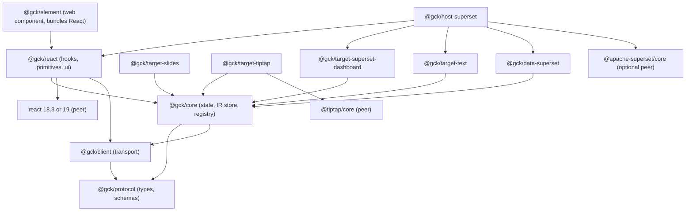
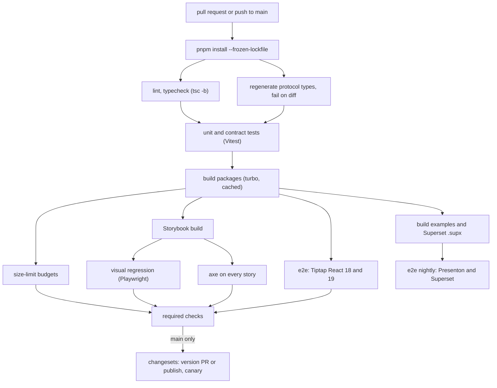

# Frontend engineering and quality

<div class="chapter-meta" markdown>
**Reads:** `servers/nextjs/package.json`, `servers/nextjs/eslint.config.mjs`, `servers/nextjs/cypress.config.ts`, `servers/nextjs/cypress/security/dependencies.cy.ts`, `servers/nextjs/app/(presentation-generator)/components/SmartHtmlSlide.tsx`, `servers/nextjs/app/(presentation-generator)/components/useSmartChartInjection.ts`, `servers/nextjs/lib/chart-browser.ts`, `servers/nextjs/utils/mixpanel.ts`, `apache/superset: superset-frontend/webpack.config.js`, `apache/superset: superset-frontend/src/extensions/ExtensionsLoader.ts`, `apache/superset: superset-frontend/packages/superset-core/src/theme/*`, `apache/superset: superset/config.py`  ·  **Builds on:** [Architecture](61-architecture.md), [React SDK and UI kit](64-react-sdk-and-ui-kit.md), [Host integrations](65-host-integrations.md)  ·  **Time:** ~50 min
</div>

The previous chapters defined what the Generative Content Kit (GCK) does: the Artifact Spec, the run protocol, the React SDK, the host integrations and the extraction plan. This chapter is about how the kit is built, shipped and kept correct. You will lay out the `gck/` monorepo file by file, write the `package.json` exports maps, build configs and bundle budgets, package the kit three ways (npm packages, a Module Federation remote inside a Superset extension, and a web component), and then work through theming, i18n, accessibility, performance, security, testing, release engineering and telemetry, each with concrete config and code. Where Presenton or Superset already does something relevant, the chapter cites the source so you can see which constraints are real and which are design choices.

!!! info "What is source and what is new"
    Every code block whose title ends in "(new)" is design code for the GCK and does not exist in either repository. Blocks with a `path` title and no "(new)" are verbatim excerpts. Presenton paths are relative to the Presenton repository root at `571461f`. Superset paths are prefixed `apache/superset:` and refer to master at `cabd8d4`.

## Step 1: The monorepo layout

The blueprint fixes the shape: one repository `gck/`, pnpm workspaces, Turborepo, the eleven `@gck/*` packages listed in [Architecture](61-architecture.md). The tree below adds the folders every package needs to be built, tested and documented.

### 1.1 The directory tree

```text title="gck/ (new)"
gck/
├── package.json                  # private root: scripts, devDependencies, packageManager
├── pnpm-workspace.yaml
├── turbo.json
├── tsconfig.base.json            # shared compilerOptions
├── tsconfig.json                 # solution file: references only
├── .size-limit.json              # bundle budgets (Step 3)
├── .changeset/                   # changesets config and pending changesets (Step 12)
├── .github/workflows/
│   ├── ci.yml                    # Step 11
│   └── release.yml               # Step 12
├── tooling/
│   ├── eslint-config/            # @gck/eslint-config (private)
│   ├── tsconfig/                 # @gck/tsconfig (private): base, dom, node presets
│   └── testing/                  # @gck/testing (private): MSW replay handlers, fast-check arbitraries
├── packages/
│   ├── protocol/                 # @gck/protocol: types + JSON Schemas, zero runtime deps
│   │   ├── schemas/              # *.schema.json exported from the engine (Step 10.2)
│   │   ├── fixtures/             # valid/ and invalid/ Artifacts (Artifact Spec chapter)
│   │   └── src/
│   ├── client/                   # @gck/client: fetch SSE reader, retries, token provider
│   ├── core/                     # @gck/core: run machine, IR store, JSON Patch, registry
│   │   └── src/workers/          # patch-and-repair worker (Step 8.4)
│   ├── react/                    # @gck/react: hooks, GckProvider, headless primitives
│   │   └── src/ui/               # @gck/react/ui styled kit + gck.css
│   ├── element/                  # @gck/element: <gck-generate> web component
│   ├── target-slides/            # @gck/target-slides: Template v2 JSON; /react, /renderer, /charts subpaths
│   ├── target-tiptap/            # @gck/target-tiptap: ProseMirror JSON + GckGenerate; /react node views
│   ├── target-superset-dashboard/
│   ├── target-text/
│   ├── host-superset/            # @gck/host-superset: extension glue, theme bridge
│   └── data-superset/            # @gck/data-superset: chart catalog + refresh
├── apps/
│   ├── storybook/                # one Storybook for all UI packages (Step 10.4)
│   ├── docs/                     # docs site (Step 12.5)
│   └── superset-extension/       # the .supx frontend: webpack + Module Federation (Step 4.2)
├── examples/                     # private, built in CI, never published
│   ├── react-vite-tiptap/
│   ├── nextjs-app-router/
│   ├── plain-html-element/
│   └── presenton-ai-slides/
├── fixtures/
│   ├── event-logs/               # recorded runs as JSONL (Step 10.3)
│   └── artifacts/                # golden Artifacts per target
├── e2e/                          # Playwright: projects per host (Step 10.5)
└── engine/                       # optional: GCK Engine (Python, uv) if co-located
```

`engine/` is optional. If the GCK Engine lives in a separate repository (for example as a fork of Presenton's FastAPI server, see [Extracting the engine from Presenton](66-extracting-from-presenton.md)), the schema export in Step 10.2 runs there and opens a pull request against `packages/protocol/schemas/`.

### 1.2 Workspace files

```yaml title="gck/pnpm-workspace.yaml (new)"
packages:
  - "packages/*"
  - "tooling/*"
  - "apps/*"
  - "examples/*"
  - "e2e"
```

```json title="gck/package.json (new)"
{
  "name": "gck-monorepo",
  "private": true,
  "type": "module",
  "packageManager": "pnpm@10.12.1",
  "engines": { "node": ">=20.19" },
  "scripts": {
    "build": "turbo run build",
    "dev": "turbo run dev --parallel",
    "lint": "turbo run lint",
    "typecheck": "tsc -b",
    "test": "turbo run test",
    "size": "size-limit",
    "e2e": "pnpm --filter @gck/e2e test",
    "changeset": "changeset",
    "release": "turbo run build --filter=./packages/* && changeset publish"
  },
  "devDependencies": {
    "@changesets/cli": "^2.29.0",
    "@size-limit/preset-small-lib": "^11.2.0",
    "size-limit": "^11.2.0",
    "turbo": "^2.5.0",
    "typescript": "^5.8.0"
  }
}
```

```json title="gck/turbo.json (new)"
{
  "$schema": "https://turbo.build/schema.json",
  "tasks": {
    "build": { "dependsOn": ["^build"], "outputs": ["dist/**"] },
    "dev": { "cache": false, "persistent": true },
    "lint": { "dependsOn": ["^build"] },
    "test": { "dependsOn": ["^build"], "outputs": ["coverage/**"] },
    "storybook:build": { "dependsOn": ["^build"], "outputs": ["storybook-static/**"] }
  }
}
```

Type checking runs once for the whole graph with `tsc -b` (Step 1.4), not per package through Turborepo, because project references already give incremental, ordered checking and a second layer of caching only adds confusion about which cache is stale.

### 1.3 Package manifests and exports maps

Every published package is ESM-only, declares `"type": "module"`, ships `dist/` plus its own README, and resolves through an `exports` map with `types` listed first. Four manifests show the patterns.

`@gck/protocol` has no runtime dependencies. Its JSON Schemas (`schemas/artifact-1.schema.json` and the run schemas of Step 10.2) and the Artifact fixture corpus (`fixtures/valid/`, `fixtures/invalid/`, see [Artifact Spec and targets](62-artifact-spec-and-targets.md)) are files, exposed through subpaths so that runtime code never imports them by accident:

```json title="packages/protocol/package.json (new)"
{
  "name": "@gck/protocol",
  "version": "1.0.0",
  "type": "module",
  "sideEffects": false,
  "files": ["dist", "schemas", "fixtures"],
  "exports": {
    ".": { "types": "./dist/index.d.ts", "import": "./dist/index.js" },
    "./schemas/*.json": "./schemas/*.json",
    "./fixtures/*": "./fixtures/*",
    "./package.json": "./package.json"
  }
}
```

`@gck/react` has two entry points and ships CSS. It depends on `@gck/core`, `@gck/client` and `@gck/protocol` (the provider constructs the `GckClient`); `intl-messageformat` is the ICU formatter proposed in Step 6.1. React is a peer that accepts both majors, because Superset master is on React 18.3 (`apache/superset: superset-frontend/package.json:196`) while Presenton is on React 19.2.6 (`servers/nextjs/package.json:59`):

```json title="packages/react/package.json (new)"
{
  "name": "@gck/react",
  "version": "1.0.0",
  "type": "module",
  "sideEffects": ["**/*.css"],
  "files": ["dist"],
  "exports": {
    ".": { "types": "./dist/index.d.ts", "import": "./dist/index.js" },
    "./ui": { "types": "./dist/ui/index.d.ts", "import": "./dist/ui/index.js" },
    "./ui/gck.css": "./dist/ui/gck.css",
    "./package.json": "./package.json"
  },
  "dependencies": {
    "@gck/client": "workspace:^",
    "@gck/core": "workspace:^",
    "@gck/protocol": "workspace:^",
    "intl-messageformat": "^10.7.0"
  },
  "peerDependencies": {
    "react": "^18.3.0 || ^19.0.0",
    "react-dom": "^18.3.0 || ^19.0.0"
  }
}
```

`@gck/target-tiptap` supports Tiptap 2 and 3 through an internal compatibility module (`src/compat/`), so `@tiptap/core` is a peer with two ranges. Like every target, its main entry is React-free and DOM-free (`createTiptapTarget`, `toProseMirror`, `fromProseMirror`, `applyToEditor`, the `GckGenerate` extension); the React node views (`gckNodes`, `GckChart`, `GckMetric`, `GckDataTable`, `GckToken`) live in a `/react` subpath. The React peers are therefore optional, because the main entry also works with a vanilla Tiptap editor:

```json title="packages/target-tiptap/package.json (excerpt, new)"
{
  "name": "@gck/target-tiptap",
  "sideEffects": false,
  "exports": {
    ".": { "types": "./dist/index.d.ts", "import": "./dist/index.js" },
    "./react": { "types": "./dist/react/index.d.ts", "import": "./dist/react/index.js" }
  },
  "dependencies": { "@gck/core": "workspace:^", "@gck/protocol": "workspace:^" },
  "peerDependencies": {
    "@gck/react": "workspace:^",
    "@tiptap/core": "^2.10.0 || ^3.0.0",
    "@tiptap/pm": "^2.10.0 || ^3.0.0",
    "@tiptap/react": "^2.10.0 || ^3.0.0",
    "react": "^18.3.0 || ^19.0.0"
  },
  "peerDependenciesMeta": {
    "@gck/react": { "optional": true },
    "@tiptap/react": { "optional": true },
    "react": { "optional": true }
  }
}
```

`@gck/host-superset` treats `@apache-superset/core` as an optional peer. The package exports two kinds of code: extension glue that only makes sense inside Superset (commands, views, context providers), and pure functions such as `supersetThemeToGck()` (Step 5) that an app embedding Superset dashboards through the Embedded SDK can call with its own antd tokens, without `@apache-superset/core` installed:

```json title="packages/host-superset/package.json (excerpt, new)"
{
  "name": "@gck/host-superset",
  "sideEffects": false,
  "exports": {
    ".": { "types": "./dist/index.d.ts", "import": "./dist/index.js" },
    "./theme": { "types": "./dist/theme.d.ts", "import": "./dist/theme.js" }
  },
  "dependencies": {
    "@gck/react": "workspace:^",
    "@gck/target-superset-dashboard": "workspace:^",
    "@gck/target-text": "workspace:^",
    "@gck/data-superset": "workspace:^"
  },
  "peerDependencies": {
    "@apache-superset/core": ">=0.1.0 <1.0.0",
    "antd": "^6.0.0",
    "react": "^18.3.0 || ^19.0.0"
  },
  "peerDependenciesMeta": {
    "@apache-superset/core": { "optional": true },
    "antd": { "optional": true }
  }
}
```

!!! warning "Gotcha: `sideEffects: false` deletes your CSS"
    A bundler that trusts `"sideEffects": false` drops any import that binds no names, which is exactly what `import "@gck/react/ui/gck.css"` is. Packages that ship CSS must list it (`"sideEffects": ["**/*.css"]`). The same applies to `@gck/element`: `customElements.define(...)` is a side effect, so it lives in a separate `define` entry that is listed in `sideEffects`, while the class itself stays tree-shakable.

!!! warning "Gotcha: ESM-only meets Jest"
    Superset's frontend tests run on Jest. An ESM-only package inside `node_modules` is not transformed by default, so a host that unit-tests code importing `@gck/*` must add the scope to `transformIgnorePatterns` (or mock the kit). Document this in each package README rather than shipping a CommonJS build that doubles the test matrix.

### 1.4 TypeScript project references

```json title="gck/tsconfig.base.json (new)"
{
  "compilerOptions": {
    "target": "ES2020",
    "module": "ESNext",
    "moduleResolution": "Bundler",
    "strict": true,
    "exactOptionalPropertyTypes": true,
    "noUncheckedIndexedAccess": true,
    "isolatedModules": true,
    "verbatimModuleSyntax": true,
    "composite": true,
    "declaration": true,
    "declarationMap": true,
    "emitDeclarationOnly": true,
    "skipLibCheck": true
  }
}
```

```json title="packages/core/tsconfig.json (new)"
{
  "extends": "../../tsconfig.base.json",
  "compilerOptions": {
    "lib": ["ES2022", "WebWorker"],
    "rootDir": "src",
    "outDir": "dist/types-check"
  },
  "include": ["src"],
  "references": [{ "path": "../protocol" }, { "path": "../client" }]
}
```

The `lib` setting is the cheapest architecture test you will ever write: `@gck/core` is framework-agnostic and "no DOM" per the blueprint, so its tsconfig omits `"DOM"`. Any accidental `document.querySelector` in core fails type checking. `WebWorker` is included because the patch worker (Step 8.4) lives there. UI packages extend a `dom` preset from `tooling/tsconfig` that adds `"DOM"`, `"DOM.Iterable"` and `"jsx": "react-jsx"`. The root `tsconfig.json` lists every package in `references` and has `"files": []`.

### 1.5 Building with tsup (and Vite library mode for the element)

Libraries are built with tsup: ESM output, declaration files, and no bundling of dependencies or peers (tsup externalizes both by default, so no `external` list is needed).

```ts title="packages/react/tsup.config.ts (new)"
import { defineConfig } from "tsup";

export default defineConfig({
  entry: { index: "src/index.ts", "ui/index": "src/ui/index.ts" },
  format: ["esm"],
  dts: true,
  sourcemap: true,
  clean: true,
  treeshake: true,
  splitting: true,          // shared chunks between index and ui, and lazy import() chunks
  target: "es2020",
  platform: "browser",
  banner: { js: '"use client";' },
  loader: { ".css": "copy" },
  onSuccess: "cp src/ui/gck.css dist/ui/gck.css",
});
```

The `"use client"` banner matters for Next.js App Router hosts such as Presenton: without it, importing a hook-using component from a server component fails at build time. `@gck/core`, `@gck/client` and `@gck/protocol` use the same config without the banner and with `platform: "neutral"`.

!!! warning "Gotcha: tsup is in maintenance"
    The tsup README now states that the project "is not actively maintained anymore" and points to tsdown, which has a "Migrate from tsup" guide (https://github.com/egoist/tsup, https://tsdown.dev/guide/). The options used above (`entry`, `format`, `dts`, `platform`, `sourcemap`, `clean`) are the basic set; check each against the migration guide before switching rather than assuming a one-to-one mapping.

`@gck/element` is different: it must bundle React because its hosts (Angular, Vue, plain pages) do not provide one. Vite library mode suits that (https://vite.dev/guide/build.html#library-mode): with multiple entries the default formats are `es` and `cjs`, so restrict to `es`.

```ts title="packages/element/vite.config.ts (new)"
import { defineConfig } from "vite";
import react from "@vitejs/plugin-react";

export default defineConfig({
  plugins: [react()],
  define: { "process.env.NODE_ENV": JSON.stringify("production") },
  build: {
    lib: {
      entry: { index: "src/index.ts", define: "src/define.ts" },
      formats: ["es"],
    },
    sourcemap: true,
    target: "es2020",
  },
});
```

### 1.6 CSS strategy

The kit must look native in Superset (antd 6, Emotion), in Tiptap apps (often Tailwind or shadcn), in Presenton (Tailwind 3 plus a browser Tailwind 4 runtime for Smart slides, see [Next.js architecture](../presenton/20-nextjs-architecture.md)) and on plain pages. No single CSS-in-JS library is shared by all of them, so the kit uses none:

1. **Headless first.** `@gck/react` primitives render no styles at all; hosts that want full control style them with their own system.
2. **One plain stylesheet for `@gck/react/ui`, `gck.css`.** All selectors are prefixed `.gck-` and wrapped in `@layer gck { ... }`, so any unlayered host rule wins without `!important`.
3. **Every visual value is a `--gck-*` custom property** (Step 5), set on the kit's root element (the `.gck-root` wrapper that `GckProvider` renders). Host theming is a mapping function into `GckProvider`'s `theme` prop, not an override war.
4. **Logical properties only** (`margin-inline-start`, `padding-block`), so RTL works without a second stylesheet (Step 6).
5. **No runtime style injection by default.** Hosts import `@gck/react/ui/gck.css` through their bundler. For hosts that cannot (a Superset extension built with the stock template has no CSS loader, Step 4.2), a proposed helper `injectGckStyles({ nonce })` in `@gck/react/ui` appends one `<style>` element with an optional nonce.
6. **Inside the web component**, the stylesheet is adopted into the shadow root. CSS custom properties inherit through the shadow boundary, so `--gck-*` tokens set on the host page still apply.

## Step 2: The package dependency graph



Three rules keep the graph honest, enforced by an ESLint `no-restricted-imports` block per package in `tooling/eslint-config`:

| Rule | Enforced by | Why |
|---|---|---|
| `protocol`, `client`, `core` never import React or the DOM | tsconfig `lib` (Step 1.4) plus a lint rule banning `react*` imports | the core must run in a worker, in Node tests and under any framework |
| Targets depend on `core`, never on `react`, in their main entry; previews and node views live in a `/react` subpath reached through `loadPreview` | lint rule | a server-side or worker consumer of `toNative()` must not pull React |
| Only `host-*` packages import host SDKs (`@apache-superset/core`) | lint rule | keeps every other package host-agnostic |

Presenton's lint config turns off sixteen rules, including `@typescript-eslint/no-explicit-any` and `react-hooks/rules-of-hooks` (`servers/nextjs/eslint.config.mjs:10-27`). Code extracted into the kit ([Extracting the engine from Presenton](66-extracting-from-presenton.md)) lands in packages with those rules on; fix violations during the move instead of copying the overrides.

## Step 3: Bundle budgets and lazy loading

### 3.1 The budgets

The blueprint sets two numbers; the rest are proposals that follow from them and are labeled as such.

| Bundle | Budget (gzip) | Source | Notes |
|---|---|---|---|
| `@gck/core` incl. its `@gck/client` and `@gck/protocol` runtime | < 15 kB | blueprint | includes `jsonrepair` (the store's `format: "json"` drafts) and `d3-format` (`resolveToken`); if the budget is exceeded, `jsonrepair` is the first candidate for a dynamic `import()` on the first JSON `text.delta` |
| `@gck/react` + `@gck/react/ui`, excluding renderers | < 40 kB | blueprint | React and react-dom excluded (peers) |
| `@gck/data-superset` | < 6 kB | proposal | a thin `DataProvider` over `@gck/client`; the binding store and refresh controller it feeds count against the `@gck/core` budget ([Live Superset data](69-live-superset-data.md)) |
| `@gck/target-text` | < 5 kB | proposal | pure serializers |
| `@gck/target-tiptap` (eager part) | < 12 kB | proposal | Tiptap excluded (peer) |
| `@gck/target-slides` (eager part: manifest + adapter) | < 8 kB | proposal | renderer and Chart.js are lazy |
| `@gck/target-slides` lazy preview chunk | < 120 kB | proposal | see measurement below |
| `@gck/element` full bundle | < 110 kB | proposal | includes React, react-dom, core, ui |
| Superset extension initial chunk (`remoteEntry` + `./index`) | < 60 kB | proposal | React, antd and `@apache-superset/core` come from the host |

The slides preview budget comes from what Presenton ships today: Chart.js 4.5.1 as a 208,522-byte UMD file (70,529 bytes gzipped at level 9), the datalabels plugin (5,275 bytes gzipped), both under `servers/nextjs/public/vendor/`, and the Template v2 renderer `servers/nextjs/lib/template-v2-json-to-html.ts` (4,145 lines, 191,674 bytes of unminified TypeScript). The UMD build registers every chart controller; importing only the controllers that `ChartKind` needs from the ESM build is the main lever. Measure the minified renderer chunk once it is extracted.

### 3.2 Enforcing them with size-limit

size-limit measures Brotli by default; `"gzip": true` switches to gzip so the numbers match the budgets. The `import` field measures the tree-shaken cost of what a consumer actually imports, and `ignore` keeps peers out of the total (https://github.com/ai/size-limit).

```json title="gck/.size-limit.json (new)"
[
  { "name": "core", "path": "packages/core/dist/index.js",
    "import": "{ createRunController, createArtifactStore, createRegistry, createBindingStore, createRefreshController }",
    "gzip": true, "limit": "15 kB" },
  { "name": "data-superset", "path": "packages/data-superset/dist/index.js",
    "import": "{ createSupersetDataProvider }", "gzip": true, "limit": "6 kB", "ignore": ["@gck/client", "@gck/core"] },
  { "name": "react kit", "path": ["packages/react/dist/index.js", "packages/react/dist/ui/index.js"],
    "import": "*", "gzip": true, "limit": "40 kB",
    "ignore": ["react", "react-dom", "react/jsx-runtime"] },
  { "name": "target-tiptap", "path": "packages/target-tiptap/dist/index.js",
    "import": "{ createTiptapTarget, GckGenerate }", "gzip": true, "limit": "12 kB",
    "ignore": ["@tiptap/core", "@tiptap/pm"] },
  { "name": "target-slides eager", "path": "packages/target-slides/dist/index.js",
    "import": "{ createSlidesTarget }", "gzip": true, "limit": "8 kB" },
  { "name": "target-slides preview (lazy)", "path": ["packages/target-slides/dist/react/*.js", "packages/target-slides/dist/charts/*.js"],
    "gzip": true, "limit": "120 kB", "ignore": ["react", "react-dom"] },
  { "name": "element", "path": "packages/element/dist/index.js",
    "gzip": true, "limit": "110 kB" }
]
```

In CI (Step 11) `pnpm size` fails the job when any limit is exceeded, and the `andresz1/size-limit-action@v1` step posts the diff against `main` on the pull request. A budget is raised only in the same pull request that explains why, reviewed like an API change.

### 3.3 Lazy renderers

A target adapter keeps its manifest and serializer eager (the engine needs the manifest on every run, see [Artifact Spec and targets](62-artifact-spec-and-targets.md)) and its preview lazy, behind `TargetAdapter.loadPreview`. The slides target loads its renderer and Chart.js only the first time a slides preview mounts:

```ts title="packages/target-slides/src/index.ts (excerpt, new)"
import type { TargetAdapter } from "@gck/core";
import type { LayoutSummary } from "@gck/protocol";
import type { SlidesNative } from "./types";
// No static import from ./react/*: it would pull the renderer and Chart.js into the main entry.

export function createSlidesTarget(templateId: string, catalog: LayoutSummary[]): TargetAdapter<SlidesNative> {
  return {
    manifest: buildManifest(catalog),                     // eager: sent with every run
    toNative: (a) => toSlides(templateId, catalog, a),    // deterministic serializer: small, eager, no DOM
    // Preview: Template v2 renderer + Chart.js, fetched on first mount only.
    loadPreview: () => import("./react/preview").then((m) => m.SlidesPreview),
    apply: applySlides,
  };
}
```

`buildManifest`, `toSlides` and `applySlides` stand for the manifest, `toNative` and `apply` code shown in [Artifact Spec and targets](62-artifact-spec-and-targets.md). Chart.js itself is reached through the `@gck/target-slides/charts` subpath. [Extracting the engine from Presenton](66-extracting-from-presenton.md) first moves `lib/chart-browser.ts` there as is, with the script URLs turned into options; for hosts that do not serve Presenton's `/vendor/` files (Superset, any bundled host), the subpath's loader becomes a module-scoped ESM import:

```ts title="packages/target-slides/src/charts/chart-runtime.ts (new)"
import type { Chart as ChartType } from "chart.js";

let runtime: Promise<typeof ChartType> | undefined;

export function loadChartRuntime(): Promise<typeof ChartType> {
  runtime ??= Promise.all([import("chart.js"), import("chartjs-plugin-datalabels")])
    .then(([chartjs, datalabels]) => {
      const { Chart, BarController, LineController, PieController, DoughnutController,
        ScatterController, RadarController, BarElement, LineElement, PointElement, ArcElement,
        CategoryScale, LinearScale, RadialLinearScale, Legend, Tooltip, Filler } = chartjs;
      Chart.register(BarController, LineController, PieController, DoughnutController,
        ScatterController, RadarController, BarElement, LineElement, PointElement, ArcElement,
        CategoryScale, LinearScale, RadialLinearScale, Legend, Tooltip, Filler, datalabels.default);
      return Chart;
    })
    .catch((error) => { runtime = undefined; throw error; });
  return runtime;
}
```

`useTargetPreview` wraps `loadPreview` in `React.lazy` (cached per adapter), and `StreamingPreview` renders it inside a `Suspense` boundary whose fallback is the same skeleton the streaming state already shows ([React SDK and UI kit](64-react-sdk-and-ui-kit.md)), so the lazy load never causes a layout jump.

!!! warning "Gotcha: Presenton's chart runtime is a global script"
    Presenton loads Chart.js by appending `<script src="/vendor/chart-4.5.1.umd.min.js">` and caches the promise on `window.__PRESENTON_CHART_BROWSER_RUNTIME__` (`servers/nextjs/lib/chart-browser.ts:1-3`, `:58-96`, `:98-136`). That works only where `/vendor/` is served from the same origin and nothing else defines `window.Chart`. Inside a Superset extension the path does not exist, and a host that already uses Chart.js would share (or clobber) the global. Outside Presenton, the kit therefore uses the module-scoped ESM loader above, which webpack or Vite turns into a hashed chunk next to the rest of the bundle.

## Step 4: Packaging for each host

### 4.1 npm packages for React apps

React hosts (Presenton, any Vite or Next.js app with Tiptap) install the packages they need and get one copy of React, Tiptap and the kit, deduplicated by their package manager:

```bash
pnpm add @gck/react @gck/target-tiptap @tiptap/core @tiptap/pm @tiptap/react
```

```tsx title="examples/react-vite-tiptap/src/GckRoot.tsx (excerpt, new)"
import "@gck/react/ui/gck.css";
import { useMemo, type ReactNode } from "react";
import type { Editor } from "@tiptap/core";
import { createHost } from "@gck/core";
import { GckProvider } from "@gck/react";
import { createTiptapTarget } from "@gck/target-tiptap";

export function GckRoot({ editor, children }: { editor: Editor; children: ReactNode }) {
  const targets = useMemo(() => [createTiptapTarget(editor)], [editor]);   // stable array
  const host = useMemo(() => createHost("tiptap", { "tiptap.editor": editor }), [editor]);
  return (
    <GckProvider
      engineUrl="/gck-engine"                // same-origin proxy to the GCK Engine
      getToken={getEngineToken}              // Step 9.4
      host={host}
      targets={targets}
      locale={navigator.language}
      telemetry={sendToOurPipeline}          // Step 13
    >
      {children}
    </GckProvider>
  );
}
```

### 4.2 A Module Federation remote inside a Superset extension

Superset loads extension frontends as webpack Module Federation remotes. The host declares four shared singletons, all `eager`:

```js title="apache/superset: superset-frontend/webpack.config.js:187-211"
  new ModuleFederationPlugin({
    name: 'superset',
    filename: 'remoteEntry.js',
    shared: {
      react: {
        singleton: true,
        eager: true,
        requiredVersion: packageConfig.dependencies.react,
      },
      'react-dom': {
        singleton: true,
        eager: true,
        requiredVersion: packageConfig.dependencies['react-dom'],
      },
      antd: {
        singleton: true,
        requiredVersion: packageConfig.dependencies.antd,
        eager: true,
      },
      '@apache-superset/core': {
        singleton: true,
        eager: true,
      },
    },
  }),
```

The extension template generated by the Superset extensions CLI mirrors this on the remote side with `import: false`, which means the remote ships no fallback copy and always uses the host's:

```js title="apache/superset: superset-extensions-cli/src/superset_extensions_cli/templates/frontend/webpack.config.js.j2:44-64"
        shared: {
          react: {
            singleton: true,
            requiredVersion: packageConfig.peerDependencies.react,
            import: false,
          },
          "react-dom": {
            singleton: true,
            requiredVersion: packageConfig.peerDependencies["react-dom"],
            import: false,
          },
          antd: {
            singleton: true,
            requiredVersion: packageConfig.peerDependencies["antd"],
            import: false,
          },
          "@apache-superset/core": {
            singleton: true,
            import: false,
          },
        },
```

At load time `ExtensionsLoader` builds a custom share scope in which `@apache-superset/core` resolves to `window.superset` with `extensions.getContext` pre-bound to that extension (`apache/superset: superset-frontend/src/extensions/ExtensionsLoader.ts:204-220`, `:234-244`), and `window.superset` itself is the host's real `@apache-superset/core` namespaces plus the host implementations (`apache/superset: superset-frontend/src/extensions/ExtensionsStartup.tsx:56-68`). Everything the kit needs from Superset therefore arrives through one import of the package root.

`apps/superset-extension` is the `.supx` frontend. It bundles every `@gck/*` package it uses (they are not in Superset's share scope, so they cannot be shared) and takes React, react-dom, antd and `@apache-superset/core` from the host:

```js title="apps/superset-extension/webpack.config.js (excerpt, new)"
const path = require("path");
const { ModuleFederationPlugin } = require("webpack").container;
const packageConfig = require("./package");
const extensionConfig = require("../extension.json");

module.exports = (env, argv) => ({
  // ...
  output: {
    clean: true,
    chunkFilename: "[name].[contenthash].js",
    path: path.resolve(__dirname, "dist"),
    // Lazy chunks (slides preview, Chart.js, patch worker) resolve against this path.
    publicPath: `/api/v1/extensions/${extensionConfig.publisher}/${extensionConfig.name}/`,
  },
  module: {
    rules: [
      { test: /\.tsx?$/, use: "ts-loader", exclude: /node_modules/ },
      { test: /\.css$/, use: ["style-loader", "css-loader"] },   // not in the stock template
    ],
  },
  plugins: [
    new ModuleFederationPlugin({
      name: "gck_superset",
      filename: "remoteEntry.[contenthash].js",
      exposes: { "./index": "./src/index.tsx" },
      shared: {
        react: { singleton: true, requiredVersion: packageConfig.peerDependencies.react, import: false },
        "react-dom": { singleton: true, requiredVersion: packageConfig.peerDependencies["react-dom"], import: false },
        antd: { singleton: true, requiredVersion: packageConfig.peerDependencies.antd, import: false },
        "@apache-superset/core": { singleton: true, import: false },
        // Deliberately NOT shared: @gck/*, chart.js, @emotion/*. See the gotchas below.
      },
    }),
  ],
});
```

```json title="apps/superset-extension/package.json (excerpt, new)"
{
  "private": true,
  "peerDependencies": {
    "@apache-superset/core": "*",
    "antd": "^6.0.0",
    "react": "^18.3.0",
    "react-dom": "^18.3.0"
  }
}
```

!!! warning "Gotcha: the stock template references a peer it does not declare"
    The template's webpack config reads `packageConfig.peerDependencies["antd"]` (`webpack.config.js.j2:55-59`), but the generated `package.json.j2` declares only `@apache-superset/core`, `react` and `react-dom` as peers (`package.json.j2:16-20`), so `requiredVersion` for antd is `undefined`. Add `antd` to `peerDependencies` explicitly, as above, so webpack can warn about a mismatch with the host's antd (`"antd": "^6.6.7"` in `apache/superset: superset-frontend/package.json:159`).

!!! warning "Gotcha: only the package root is shared"
    webpack's Module Federation docs state that to share anything below a package's root you must "append `/` to the package name" in `shared` (https://webpack.js.org/plugins/module-federation-plugin/). Superset shares `'@apache-superset/core'` without the slash, so a runtime import of a subpath such as `@apache-superset/core/theme` is not resolved from the host scope and would be bundled from the extension's devDependency instead. Inside the extension, import runtime values from the root only (`import { theme } from "@apache-superset/core"`); subpath imports are safe only for `import type`, which TypeScript erases.

!!! warning "Gotcha: never bundle a second React, and never import Emotion directly"
    `import: false` means a mismatch is not papered over: if `@gck/react` resolves its own `react` (for example through a pnpm link to the monorepo during development), hooks throw "Invalid hook call". Build the extension from published or packed tarballs, and add a CI check that greps the production bundle for React's internals marker. Emotion is not in the share scope either. `@apache-superset/core`'s `useTheme()` reads Emotion's context through the host's own Emotion instance (`apache/superset: superset-frontend/packages/superset-core/src/theme/index.tsx:50-59`); an extension that imports `@emotion/react` itself gets a separate context and finds no theme. The kit reads the theme only through `theme.useTheme()` from the shared root (Step 5).

The host runs React 18.3, so everything that ends up in the remote must work on React 18: no `use()` hook, no React 19 `ref`-as-prop. The React peer range in Step 1.3 is a promise the test matrix must keep (Step 10.5). Extensions are behind the `ENABLE_EXTENSIONS` feature flag, which defaults to `False` (`apache/superset: superset/config.py:788`), and are only loaded once a user id is known (`ExtensionsStartup.tsx:50-51`, `:70-72`).

### 4.3 The web component bundle

`@gck/element` defines `<gck-generate>` for hosts without React. Its attribute, property and event contract, and the full `GckGenerateElement` class, are in [Host integrations](65-host-integrations.md) (Step 6.1); this section only covers what matters for packaging it:

- **Shadow root.** The element renders the React kit into a `gck-root` mount inside an open shadow root, so host CSS cannot break it and its CSS cannot leak out. Inside, it renders `GckProvider` with only its documented props and composes the five `@gck/react/ui` components itself; there is no packaged "whole flow" component and no `portalContainer` prop.
- **Stylesheet.** The kit stylesheet (`@gck/react/ui/gck.css`) is written into the bundle as a string at build time (`KIT_CSS` from `src/styles.generated.ts`) and adopted on the shadow root with `CSSStyleSheet.replaceSync`, with a `<style>` element as the fallback.
- **Properties, not attributes.** `context`, `tokenProvider` (a `TokenProvider` from `@gck/client`) and `data` are objects or functions, so they are properties only. The connected callback re-applies values a framework set before the element was defined.
- **Apply hand-off.** The element applies nothing itself: it dispatches `gck-apply` with the native value and waits for the page to call `reportApplied(result)`.
- **No side effects in the class module.** `src/index.ts` only exports `GckGenerateElement`; registration lives in a separate `define` entry, which is the one listed in `sideEffects` (Step 1.3) and the one pages import as `@gck/element/define`:

```ts title="packages/element/src/define.ts (new)"
import { GckGenerateElement } from "./GckGenerateElement";
if (!customElements.get("gck-generate")) customElements.define("gck-generate", GckGenerateElement);
```

The element emits `gck-apply` (`{ target, mode, native, artifact }`, the host commits `native`), `gck-state` and `gck-error`; `composed: true` lets them cross the shadow boundary. Never load `@gck/element` inside Superset or another React host: it carries its own React, which doubles the bundle and splits context. React hosts use the npm packages; Superset uses the remote in Step 4.2.

### 4.4 The iframe fallback

Hosts that cannot run third-party script at all mount the same standalone app in an iframe, the pattern Part VIII uses for AI Slides ([Story 5, analytics menu and iframe](../delivery/46-story5-menu-and-iframe.md)). Context is posted in and apply results are posted out, with typed, origin-checked messages (Step 9.4). It is a fallback, not the default.

### 4.5 The compatibility matrix

| Package line | Protocol | React | Host versions | Tiptap | Notes |
|---|---|---|---|---|---|
| `@gck/protocol` 1.x | `gck.artifact/1`, run API v1 | none | any | none | independent semver (Step 12) |
| `@gck/core`, `@gck/client` 1.x | 1.0 to 1.latest | none | any | none | sends `GCK-Protocol: 1` on every request |
| `@gck/react` 1.x | 1.x | 18.3, 19.x | any React host | none | tested on both majors |
| `@gck/target-tiptap` 1.x | 1.x | 18.3, 19.x (optional) | any | 2.10+, 3.x | Presenton uses Tiptap 3.30.5 (`servers/nextjs/package.json:40-44`) |
| `@gck/host-superset` 1.x | 1.x | 18.3 (host) | Superset 6.1 and master | none | extension menus differ by version, see [Host integrations](65-host-integrations.md) |
| `@gck/element` 1.x | 1.x | bundled 19.x | any page | none | not for React hosts |
| `@gck/target-slides` 1.x | 1.x | 18.3, 19.x | Presenton 0.9.x Template v2 | none | renderer extracted from `lib/template-v2-json-to-html.ts` |

The matrix lives in the docs site and is generated from the e2e job's actual matrix, so it cannot drift from what CI tests.

## Step 5: Theming with `--gck-*` tokens

### 5.1 The token set

All styled components read these properties and nothing else. Defaults live in `gck.css` under `.gck-root` ([React SDK and UI kit](64-react-sdk-and-ui-kit.md)); hosts override them through `GckProvider`'s `theme` prop (`Partial<GckTheme>`, keys `accent`, `bg`, `fg`, `border`, `danger`, `radius`, `font`), which the provider writes as `--gck-<key>` on its `.gck-root` wrapper.

| Token | Default (light, `gck.css`) | `GckTheme` key | From Superset theme token | From a Tiptap host (shadcn variables) |
|---|---|---|---|---|
| `--gck-accent` | `#1f6feb` | `accent` | `colorPrimary` | `hsl(var(--primary))` |
| `--gck-bg` | `#fff` | `bg` | `colorBgContainer` | `hsl(var(--background))` |
| `--gck-fg` | `#1c1c1c` | `fg` | `colorText` | `hsl(var(--foreground))` |
| `--gck-border` | `#e5e7eb` | `border` | `colorBorder` | `hsl(var(--border))` |
| `--gck-danger` | `#b42318` | `danger` | `colorError` | `hsl(var(--destructive))` |
| `--gck-radius` | `8px` | `radius` | `borderRadius` (number, add `px`) | `var(--radius)` |
| `--gck-font` | `inherit` | `font` | `fontFamily` | computed `font-family` of the editor element |
| `--gck-space` | `8px` | none (stylesheet only) | `sizeUnit` times 2 (number, add `px`) | `8px` |

The eight properties above are the 1.0 contract. The rest of this chapter (focus ring, target size, reduced motion) also relies on the following additions, proposed for a 1.x minor (new tokens are a minor change, Step 12.2); each extends `GckTheme` with the same key minus the `--gck-` prefix when it ships:

| Proposed token | From Superset theme token | From a Tiptap host |
|---|---|---|
| `--gck-fg-muted` | `colorTextSecondary` | `hsl(var(--muted-foreground))` |
| `--gck-accent-hover` / `--gck-on-accent` | `colorPrimaryHover` / `colorTextLightSolid` | computed / `hsl(var(--primary-foreground))` |
| `--gck-focus-ring` | `controlOutline` | `hsl(var(--ring))` |
| `--gck-warning` / `-success` / `-info` | `colorWarning` / `colorSuccess` / `colorInfo` | defaults |
| `--gck-font-mono` | `fontFamilyCode` | default |
| `--gck-font-size` / `--gck-line-height` | `fontSize` (number) / `lineHeight` (unitless) | computed `font-size` / `line-height` |
| `--gck-control-height` | `controlHeight` (number) | `2.25rem` |
| `--gck-shadow-popover` | `boxShadowSecondary` | default |
| `--gck-motion-duration` | `motionDurationMid` | default |
| `--gck-z-overlay` | `zIndexPopupBase` | host z-index scale |

Every Superset name in both tables is in Superset's allowlist of antd tokens that make up `SupersetTheme` (`apache/superset: superset-frontend/packages/superset-core/src/theme/types.ts:277-500`, type at `:511`), so the mapping uses the public theme contract rather than antd internals.

### 5.2 The Superset theme bridge

```tsx title="packages/host-superset/src/theme.ts (new)"
import type { SupersetTheme } from "@apache-superset/core/theme"; // type-only: erased at build
import type { GckTheme } from "@gck/react";

const px = (v: number | string | undefined) => (typeof v === "number" ? `${v}px` : v);

/** Pure: usable with any antd-derived token object, inside or outside Superset. */
export function supersetThemeToGck(t: SupersetTheme): Partial<GckTheme> {
  const mapped: Record<keyof GckTheme, string | undefined> = {
    accent: t.colorPrimary,
    bg: t.colorBgContainer,
    fg: t.colorText,
    border: t.colorBorder,
    danger: t.colorError,
    radius: px(t.borderRadius),
    font: t.fontFamily,
  };
  // Drop missing values so the gck.css defaults apply (exactOptionalPropertyTypes forbids undefined).
  return Object.fromEntries(Object.entries(mapped).filter(([, v]) => v)) as Partial<GckTheme>;
}
```

```tsx title="packages/host-superset/src/useSupersetGckTheme.ts (new)"
import { useMemo } from "react";
import { theme } from "@apache-superset/core";       // runtime import from the shared root
import type { GckTheme } from "@gck/react";
import { supersetThemeToGck } from "./theme";

/** Feed the result to GckProvider's `theme` prop (GckSupersetRoot does). */
export function useSupersetGckTheme(): Partial<GckTheme> {
  const t = theme.useTheme();                          // host Emotion context, Step 4.2
  return useMemo(() => supersetThemeToGck(t), [t]);
}
```

`GckProvider` writes the `theme` values as inline custom properties on its `<div className="gck-root" style={{ display: "contents", ...vars }}>` wrapper ([React SDK and UI kit](64-react-sdk-and-ui-kit.md)). React applies the `style` prop through the CSSOM, which a CSP `style-src` without `'unsafe-inline'` does not block, so token values work under strict policies too.

### 5.3 Dark mode and density

- **Dark mode in Superset.** Superset's dark theme already has dark values for `colorBgContainer`, `colorText` and the rest, so the bridge needs no separate dark table. Because it re-derives the `theme` object whenever the Emotion theme object changes, a user switching Superset between light, dark and system mode (`ThemeMode`, `types.ts:56-60`) re-themes the kit without a reload. `isThemeDark(theme)` is `tinycolor(theme.colorBgContainer).isDark()` (`apache/superset: superset-frontend/packages/superset-core/src/theme/utils/themeUtils.ts:55-57`), exported from the theme namespace; a host can use it to set `color-scheme` on its own container so native scrollbars and form controls match.
- **Dark mode elsewhere.** The `gck.css` defaults are light. A host with its own dark mode passes dark values through `theme`; class-based hosts (Presenton's Tailwind config uses `darkMode: ["class"]`, `servers/nextjs/tailwind.config.ts:4`) derive them from their own state. A default dark set under `@media (prefers-color-scheme: dark)` for hosts that pass nothing is a proposed stylesheet addition; `GckConfig` has no `colorScheme` prop.
- **Density.** antd's compact algorithm (`ThemeAlgorithm.COMPACT`, `types.ts:43-47`) produces smaller sizes. `--gck-space` is not a `GckTheme` key, so a host maps density with an unlayered stylesheet rule on `.gck-root` (for example `sizeUnit` times 2 in px), which wins over the layered `gck.css` default and tightens every padding defined as a multiple of `--gck-space`; the proposed `--gck-control-height` would follow `controlHeight` the same way.

!!! warning "Gotcha: antd numbers and shadcn triplets are not CSS values"
    antd tokens such as `fontSize`, `borderRadius`, `controlHeight` and `sizeUnit` are numbers, and `lineHeight` is a unitless ratio; writing `--gck-radius: 6` produces an invalid length that silently falls back. shadcn-style hosts, including Presenton's own stylesheet, store colors as bare HSL components (`--background: 0 0% 100%;`, `servers/nextjs/app/globals.css:40`), which must be wrapped as `hsl(var(--background))`. The mapping functions own these conversions so components never do.

For Tiptap hosts without design tokens, a proposed helper `themeFromElement(editor.view.dom)` in `@gck/target-tiptap/react` (it reads the DOM, so it cannot live in the React-free main entry) reads `getComputedStyle()` of the editor element (font family, text and background colors) once on mount and returns a `Partial<GckTheme>`, so generated content previews in the same typography as the document it will be inserted into.

## Step 6: Internationalization

### 6.1 ICU messages

In 1.0, every kit string has a typed key (`MessageKey`), `defaultMessages` in `src/messages.ts` holds the English text, and `GckContextValue.t(key, vars)` substitutes `{name}` placeholders ([React SDK and UI kit](64-react-sdk-and-ui-kit.md)). That is enough for English and breaks on plurals. The proposal for 1.x keeps the keys and the `t` signature and swaps the formatter: messages become ICU MessageFormat strings in per-locale JSON catalogs inside `@gck/react`, formatted with `intl-messageformat`. ICU gives plurals, selects and number formatting that work across languages, which Presenton's UI does not need today (its chrome is English-only) and Superset handles with gettext through Jed.

```json title="packages/react/src/i18n/en.json (excerpt, new, proposal)"
{
  "composer.placeholder": "Describe what to create",
  "status.planning": "Planning the outline",
  "status.generating": "Writing {completed, number} of {total, plural, one {# section} other {# sections}}",
  "status.resolving_data": "Fetching data for {total, plural, one {# chart} other {# charts}}",
  "status.ready": "Draft ready. Review it, then apply.",
  "preview.progress": "{n, plural, one {# section} other {# sections}} generated",
  "apply.done": "Applied.",
  "apply.undoNote": "Undo with {undoKey}."
}
```

The variables are the ones the components already pass: `completed` and `total` come from the event's `progress`, `n` from the section count.

```ts title="packages/react/src/i18n/format.ts (new, proposal)"
import IntlMessageFormat from "intl-messageformat";
import type { MessageKey } from "../messages";

const cache = new Map<string, IntlMessageFormat>();

export function format(locale: string, catalog: Partial<Record<MessageKey, string>>, id: MessageKey,
                       values?: Record<string, unknown>): string {
  const key = `${locale}\u0000${id}`;
  let msg = cache.get(key);
  if (!msg) {
    msg = new IntlMessageFormat(catalog[id] ?? id, locale);
    cache.set(key, msg);
  }
  return String(msg.format(values));
}
```

Catalogs for locales other than English are loaded with dynamic `import()` so that only the active locale ships. Hosts can override any message key through `GckProvider messages={...}` (a `Partial<Messages>`, already in 1.0), which is how a host aligns wording with its own product.

### 6.2 Host locale

| Host | Where the locale comes from | Normalization |
|---|---|---|
| Superset | the language pack the page bootstraps into `window.__SUPERSET_LANGUAGE_PACK__` and that `@apache-superset/core`'s translator reads (`apache/superset: superset-frontend/packages/superset-core/src/translation/TranslatorSingleton.ts:39-59`); its `locale_data.superset[""].lang` is a Superset `Locale` (`translation/types/index.ts:26-72`) | Superset uses underscores (`pt_BR`, `zh_TW`, `sr_Latn`); convert to BCP 47 (`pt-BR`, `zh-TW`, `sr-Latn`) before calling `Intl` |
| Tiptap app | `GckProvider locale` from the app's i18n library | already BCP 47 in most apps |
| Presenton | the presentation's `language` field for content; the UI stays English | content language and UI locale are separate |
| Web component | `locale` attribute, else `document.documentElement.lang` | as given |

The window global is an implementation detail, not a documented extension API, so `@gck/host-superset` reads it only as a fallback, and one Superset e2e project (Step 10.5) runs in French to catch a change.

### 6.3 RTL and content language

Two directions coexist: the UI direction (from the UI locale) and the artifact direction (from `Artifact.language`, which the engine sets from the prompt or `context.locale`). An Arabic user can generate an English report, and the reverse. The kit sets `dir` and `lang` separately on the chrome and on the preview root:

```ts title="packages/react/src/i18n/direction.ts (new)"
const RTL_LANGUAGES = new Set(["ar", "fa", "he", "ur", "ps", "dv", "ku", "yi", "sd", "ug"]);

export function toBcp47(tag: string): string {
  return tag.replace(/_/g, "-");
}

export function directionOf(tag: string | undefined): "ltr" | "rtl" {
  if (!tag) return "ltr";
  const base = toBcp47(tag).split("-")[0]!.toLowerCase();
  return RTL_LANGUAGES.has(base) ? "rtl" : "ltr";
}
```

Superset's own catalog list includes two RTL locales, `ar` and `fa` (`translation/types/index.ts:27`, `:33`), so RTL is a real requirement, not a hypothetical. Because the stylesheet uses logical properties only (Step 1.6), flipping `dir` is all the layout needs. Streaming text in a mixed-direction paragraph is wrapped in `<bdi>` per data token so that a number or an English product name inside Arabic prose does not reorder its neighbors.

## Step 7: Accessibility

### 7.1 A WCAG 2.2 AA checklist for streaming UIs

| Criterion | What it means for the kit | How it is met |
|---|---|---|
| 4.1.3 Status Messages | state changes are announced without moving focus | one `role="status"` live region per kit instance, `aria-live="polite"` (7.2) |
| 2.2.2 Pause, Stop, Hide | streaming content auto-updates for more than five seconds next to other content | Cancel stops the run; "Pause preview" freezes rendering while patches keep buffering |
| 1.3.1 Info and Relationships | the preview is not a pile of `div`s | targets render semantic headings, lists and tables; charts get a text alternative from their binding title and data summary |
| 2.1.1 Keyboard, 2.1.2 No Keyboard Trap | every action is reachable and leavable | keyboard map (7.4); Escape always returns focus to the invoker |
| 2.4.3 Focus Order, 2.4.7 Focus Visible | focus moves predictably | focus is moved only on user-initiated transitions (7.3); a 2 px outline in `--gck-accent` (the proposed `--gck-focus-ring` once it ships) |
| 2.4.11 Focus Not Obscured (Minimum) | the floating ApplyBar must not cover the focused element | ApplyBar reserves its height with `scroll-padding-block-end` on the preview scroller |
| 2.5.7 Dragging Movements | outline reordering cannot require a drag | every outline row has Move up and Move down buttons in addition to drag |
| 2.5.8 Target Size (Minimum) | buttons are at least 24 by 24 CSS pixels | enforced by a `min-block-size` and `min-inline-size` of 24 px on every control in `gck.css`, which no density override can shrink |
| 1.4.3 Contrast (Minimum), 1.4.11 Non-text Contrast | host-mapped tokens can fail contrast | the Storybook a11y run checks every theme preset (Step 10.8); the bridge does not invent colors |
| 2.3.3 Animation from Interactions (AAA, adopted) and reduced motion | typing effects and shimmer are motion | all animation is disabled under `prefers-reduced-motion: reduce` (7.5) |
| 3.3.1 Error Identification | failures are explained in text | `run.failed` and apply errors render a message plus a Retry button when `retryable` |

Presenton already has the right instinct in places: the outline page renders a visually hidden `role="status"` `aria-live="polite"` region with the stream's status message (`servers/nextjs/app/(presentation-generator)/outline/components/OutlineContent.tsx:84-89`), and spinners use `motion-reduce:animate-none` (`servers/nextjs/app/(presentation-generator)/components/SlidePreviewLoader.tsx:15`). The kit makes these rules systematic.

### 7.2 Announcing a stream without flooding the screen reader

A live region that receives every `text.delta` makes a screen reader read fragments forever. The kit announces state transitions immediately and progress at most every five seconds:

```ts title="packages/react/src/a11y/useRunAnnouncer.ts (new)"
import { useEffect, useRef, useState } from "react";
import type { RunState } from "@gck/core";
import type { GckContextValue } from "../provider";

const PROGRESS_INTERVAL_MS = 5000;

export function useRunAnnouncer(state: RunState, t: GckContextValue["t"]) {
  const [message, setMessage] = useState("");
  const lastStatus = useRef(state.status);
  const lastProgressAt = useRef(0);

  useEffect(() => {
    const vars = { completed: state.progress?.completed ?? 0, total: state.progress?.total ?? 0 };
    if (state.status !== lastStatus.current) {      // transitions: always announce
      lastStatus.current = state.status;
      lastProgressAt.current = performance.now();
      setMessage(t(`status.${state.status}`, vars));
      return;
    }
    if (state.status === "generating" && performance.now() - lastProgressAt.current > PROGRESS_INTERVAL_MS) {
      lastProgressAt.current = performance.now();
      setMessage(t("status.generating", vars));
    }
  }, [state.status, state.progress, t]);

  return message;   // rendered into <div role="status" aria-live="polite" className="gck-sr-only">
}
```

Components call it with `run.state` from `useGenerationRun` and `t` from `useGckContext()`.

The preview container carries `aria-busy="true"` while the run is in `generating` or `resolving_data`, so assistive technology does not read half-built content as final. Failures use a separate `role="alert"` region, the only assertive announcement the kit makes.

### 7.3 Focus after apply

Focus moves only when the user caused the transition. After **Apply**, focus goes to the applied content in the host, and the ApplyBar announces `apply.done` with the target's undo hint (`apply.undoNote`, for example "Undo with Ctrl+Z"):

| Target | Focus after apply |
|---|---|
| `tiptap-doc` | `editor.chain().focus().setTextSelection(insertedRange.to).scrollIntoView().run()`: caret at the end of the inserted range, inside the same undo group |
| `slides` | the first new slide's thumbnail in the side panel |
| `superset-dashboard` | the new tab's title (or the dashboard title for a new dashboard) after navigation |
| `text` | the Markdown component that received the text |

When a run finishes generating while the user is typing elsewhere (for example in the outline review), focus stays where it is; the status region announces readiness instead.

### 7.4 Keyboard map

| Key | Context | Action |
|---|---|---|
| `/ai` then Enter | Tiptap editor | open the composer at the cursor (`GckGenerate` slash command) |
| Mod+Enter | composer | submit |
| Escape | composer, review, preview | cancel the run if running, else close; focus returns to the invoker |
| Alt+ArrowUp / Alt+ArrowDown | outline row | move the section up or down |
| Enter | outline review | approve the outline |
| Mod+Shift+Enter | preview | apply with the default mode |
| Mod+Z | host, after apply | undo the whole application (one undo step, see [React SDK and UI kit](64-react-sdk-and-ui-kit.md)) |

Shortcuts are registered on the kit's root element, not on `window`, so they never collide with host shortcuts.

### 7.5 Reduced motion

```css title="packages/react/src/ui/gck.css (excerpt, new)"
@layer gck {
  .gck-streaming-caret { animation: gck-blink 1s steps(1) infinite; }
  .gck-block[data-gck-new] { animation: gck-fade-in var(--gck-motion-duration, 0.2s) ease-out; }

  @media (prefers-reduced-motion: reduce) {
    .gck-streaming-caret, .gck-block[data-gck-new], .gck-skeleton__row { animation: none; }
    .gck-root { --gck-motion-duration: 0s; }   /* proposed token, Step 5.1 */
  }
}
```

The JavaScript side honors the same preference: `scrollIntoView({ behavior: "auto" })` instead of `"smooth"` when `matchMedia("(prefers-reduced-motion: reduce)")` matches, and the preview does not auto-scroll to follow the stream unless the user has scrolled to the bottom.

## Step 8: Performance

### 8.1 Throttle rendering to one frame

The engine can emit dozens of `artifact.patch` and `text.delta` events per second. Re-rendering after each one is wasted work, because the screen can only show one frame per refresh. Presenton debounces outline Markdown rendering with a 60 ms timer (`servers/nextjs/app/(presentation-generator)/outline/components/OutlineItem.tsx:120-140`); the kit generalizes that into the artifact store of `@gck/core` ([React SDK and UI kit](64-react-sdk-and-ui-kit.md)). `createArtifactStore(schedule?)` applies every patch to its snapshot immediately and batches only the notification: the first change in a frame calls `schedule(emit)`, later changes in the same frame do nothing, and the default `schedule` is `requestAnimationFrame` behind a `typeof` guard, with a 16 ms `setTimeout` where it does not exist (Node tests, old workers). One frame, one notification, one React render.

`requestAnimationFrame` does not fire in background tabs, so subscribers hear about patches only when the tab becomes visible again. `@gck/core` cannot check `document.hidden` (it never touches the DOM), so a visibility-aware scheduler belongs in `@gck/react`. Passing it needs a `schedule` option on `RunControllerOptions`, which the 1.0 controller does not have (it calls `createArtifactStore()` with the default); this is proposed for 1.x:

```ts title="packages/react/src/schedule.ts (new, proposal)"
/** Frame-aligned while visible, timer-driven while hidden (rAF pauses in background tabs). */
export function visibilityAwareSchedule(fn: () => void): void {
  if (typeof document !== "undefined" && !document.hidden && typeof requestAnimationFrame === "function") {
    requestAnimationFrame(fn);
  } else {
    setTimeout(fn, 100);
  }
}
```

!!! warning "Gotcha: data is current, subscribers are not"
    `store.getSnapshot()` always reflects every event received so far, so the controller's `apply()` never sees an artifact missing its last patches. What lags by up to a frame is React: a value captured in a render can be one frame old. Code that acts on what the user sees (custom apply buttons, tests asserting on rendered output) calls `store.flush()` first, which delivers the pending notification synchronously; tests can also pass `(fn) => fn()` as `schedule`.

### 8.2 Re-render only what changed

The IR store applies JSON Patch with structural sharing: unchanged sections and blocks keep their object identity. React components subscribe per block through `useArtifact` (which wraps `useSyncExternalStore`) with a selector that returns one block, so a patch to block 37 re-renders block 37 only:

```ts title="packages/react/src/use-block.ts (new)"
import { useCallback } from "react";
import type { ArtifactSnapshot, ArtifactStore } from "@gck/core";
import type { Block } from "@gck/protocol";
import { useArtifact } from "./hooks";

export function useBlock(store: ArtifactStore, blockId: string): Block | undefined {
  const select = useCallback((s: ArtifactSnapshot) => {          // stable selector, as useArtifact requires
    const ref = s.index[blockId];
    return s.drafts[blockId] ?? (ref ? s.artifact?.sections[ref.section]?.blocks[ref.block] : undefined);
  }, [blockId]);
  return useArtifact(store, select);   // Object.is: an unchanged block keeps its identity, so no re-render
}
```

Presenton's presentation stream does the opposite: each chunk dispatches a whole new `presentationData` into Redux (`servers/nextjs/app/(presentation-generator)/presentation/hooks/usePresentationStreaming.ts:482-502`), and every subscriber of that slice re-renders. That is acceptable for 50 slides with block-level content; it does not scale to a 200-page Tiptap document.

### 8.3 Virtualize long artifacts

The preview list virtualizes once an artifact has more than 40 sections. Two levels are used:

1. `content-visibility: auto` with `contain-intrinsic-size` on each section, which costs nothing and skips layout and paint for off-screen sections.
2. A windowed list (for example TanStack Virtual) for the `StreamingPreview` and the slides thumbnail strip when the count is large enough that DOM node count itself is the problem. Measured heights are cached per section id so a streaming section that grows does not make the scroll position jump.

The slides preview renders a Template v2 slide to HTML only when its thumbnail intersects the viewport (`IntersectionObserver`), and Chart.js canvases are created only for visible slides and destroyed when they leave, the same cleanup Presenton does on re-render with `Chart.getChart(canvas)?.destroy()` (`servers/nextjs/app/(presentation-generator)/components/TemplateV2HtmlSlidePreview.tsx:309-317`).

### 8.4 A worker for patch and repair

Presenton repairs partial JSON by appending each chunk to a string and running `jsonrepair` plus `JSON.parse` over the whole accumulated text on every chunk:

```ts title="servers/nextjs/app/(presentation-generator)/outline/hooks/useOutlineStreaming.ts:133-137"
          case "chunk":
            accumulatedChunks += data.chunk;
            try {
              const repairedJson = jsonrepair(accumulatedChunks);
              const partialData = JSON.parse(repairedJson);
```

The same pattern is in the presentation stream (`usePresentationStreaming.ts:455`, `:482-483`). The work per chunk grows with the document, so total work grows with the square of its length, all on the main thread. The kit keeps block-level `artifact.patch` as the primary channel (small, already valid JSON) and confines repair to `text.delta` events with `format: "json"`, where `ArtifactStore.applyTextDelta` runs `jsonrepair` over one block's buffer only. When the artifact is large, the same store runs in a worker:

```ts title="packages/core/src/workers/patch.worker.ts (new)"
/// <reference lib="webworker" />
import { createArtifactStore, selectRenderable } from "../artifact-store";
import type { WorkerRequest, WorkerResponse } from "./messages";

const store = createArtifactStore((fn) => fn());          // no frames in a worker: notify synchronously

self.onmessage = (event: MessageEvent<WorkerRequest>) => {
  const req = event.data;
  let patch: WorkerResponse["patch"];
  if (req.kind === "reset") store.reset(req.artifact, req.version);
  if (req.kind === "event") {
    const e = req.event;                                   // a GckEvent from the stream
    if (e.type === "artifact.patch") patch = store.applyPatch(e.data);   // "conflict": controller resyncs
    if (e.type === "text.delta") store.applyTextDelta(e.data);          // format "json": this block only
    if (e.type === "binding.resolved") store.resolveBinding(e.data);
  }
  const res: WorkerResponse = { kind: "snapshot", seq: req.seq, patch,
                                artifact: selectRenderable(store.getSnapshot()) };
  (self as unknown as DedicatedWorkerGlobalScope).postMessage(res);
};
```

```ts title="packages/core/src/workers/create.ts (new)"
export function createPatchWorker(): Worker | null {
  try {
    // Bundlers (webpack 5, Vite) emit this as a separate same-origin chunk.
    return new Worker(new URL("./patch.worker.js", import.meta.url), { type: "module" });
  } catch {
    return null;   // CSP worker-src, or an old bundler: fall back to the main thread
  }
}
```

The worker is used when the proposed `patchWorker` flag (Step 13.3) is `"auto"` (the default) and the artifact exceeds 200 blocks or 256 kB serialized; below that the structured-clone cost of posting snapshots exceeds the savings. In production the worker posts only changed sections, not the whole artifact; the excerpt posts snapshots for clarity. A `"conflict"` result is posted back so the controller can resync with `getArtifact`, exactly as it does on the main thread ([React SDK and UI kit](64-react-sdk-and-ui-kit.md)).

!!! warning "Gotcha: workers and CSP"
    Superset's production policy allows workers from `'self'` and `blob:` (`apache/superset: superset/config.py:3130`), so a same-origin chunk served from the extension's `publicPath` loads. A host whose policy has no `worker-src` falls back to `script-src` (and then `default-src`) for workers; if neither allows the chunk's origin, the constructor throws or the worker fails to load, and the kit must keep working on the main thread. That is why `createPatchWorker()` returns `null` instead of throwing, and why the worker also listens for its own `error` event and the store falls back on the first failure.

## Step 9: Security

### 9.1 Threat model for the frontend

The model output is untrusted, the host page is trusted, and the kit sits between them. The rules mirror the server-side design in [Security, RLS, auth](../superset/38-security.md): never trust model text, never give the browser a secret it does not need, and fail closed.

| # | Threat | Vector | Mitigation in the kit | Test |
|---|---|---|---|---|
| F1 | XSS via model output | model emits ``, `javascript:` links, or HTML inside a paragraph | the IR has no HTML block; `RichText` is text plus marks; `href` allowlist (`https:`, `http:`, `mailto:`, host-relative); any HTML the kit renders goes through `SafeHtml` (DOMPurify) | fuzzing with hostile strings (10.7), Storybook play tests, axe |
| F2 | Prompt injection rendering into the host | injected instructions in data labels or documents come back as content | content is content: adapters serialize only IR fields into host-native nodes; no adapter creates host commands, links to host admin routes, or embeds; the preview shows exactly what apply will write | golden-file tests with an injection corpus |
| F3 | Script execution from generated slides | an LLM-generated `<script>` executed in the page | the slides target uses Template v2 JSON only; charts are data in `data-chart-config`, hydrated by `JSON.parse`; no code from model output is ever executed | lint rule bans `new Function`, `eval`, `script.textContent =` |
| F4 | CSP violations break the host or force weaker policies | inline scripts, `eval`, remote script URLs | no inline scripts, no `eval`, no `new Function` (including in dependencies), all chunks same-origin with the bundle, styles via stylesheet or nonce | e2e runs under Superset's production Talisman policy |
| F5 | Token theft | long-lived engine keys in browser storage or logs | `getToken` callback (`TokenProvider`) returning short-lived tokens, kept in memory only, never logged | unit tests on the client, bundle scan for key patterns |
| F6 | Cross-origin message spoofing | another frame posts `gck:apply` to the host | iframe mode checks `event.origin` and `event.source`, uses an explicit `targetOrigin`, validates message schema | unit tests with forged messages |
| F7 | Data leakage through telemetry | prompts, document text, chart values in events | typed telemetry with no free text; host-owned sink; off unless the host passes `telemetry` to `GckProvider` | type tests, payload snapshot tests |
| F8 | Over-broad host writes | apply writes outside the selection or to another dashboard | `ApplyMode` is checked against the manifest; host APIs are called with ids from context, never from model output | adapter unit tests |
| F9 | Supply chain | compromised dependency in a package that runs inside Superset with the user's session | lockfile, minimal dependencies, provenance-signed npm publishes, Dependabot, CodeQL | CI (Step 11) |

### 9.2 Sanitization: what Presenton does and what the kit keeps

Presenton already depends on DOMPurify (`"dompurify": "^3.4.17"`, `servers/nextjs/package.json:49`) and uses it for Smart-mode HTML slides with an explicit profile:

```ts title="servers/nextjs/app/(presentation-generator)/components/SmartHtmlSlide.tsx:25-40"
const SANITIZE_CONFIG: DOMPurifyConfig = {
  USE_PROFILES: { html: true, svg: true, svgFilters: true },
  FORBID_TAGS: [
    "base",
    "embed",
    "form",
    "iframe",
    "link",
    "meta",
    "object",
    "script",
    "style",
  ],
  FORBID_ATTR: ["autofocus", "contenteditable", "srcdoc"],
  ALLOW_DATA_ATTR: true,
};
```

It is applied at `SmartHtmlSlide.tsx:118` and the result is rendered with `dangerouslySetInnerHTML` at `:197`. The Cypress spec `servers/nextjs/cypress/security/dependencies.cy.ts:3-22` checks that DOMPurify with the same `USE_PROFILES` setting (not the full `SANITIZE_CONFIG`) keeps headings, SVG and `img src` while removing `<script>`, `onload`, `onerror` and the `href` of a `javascript:` link. Reading the rest of the Next.js source shows three things the kit must not copy:

1. **Model-written scripts run in the page.** `SmartHtmlSlide` passes the original, unsanitized `html` to `useSmartChartInjection` (`SmartHtmlSlide.tsx:122-123`), which parses it, takes the text of every `<script>`, wraps it in a scoped function and appends it to `document.body` as an inline script (`servers/nextjs/app/(presentation-generator)/components/useSmartChartInjection.ts:41-100`). Sanitizing the markup does not help when the script text is executed separately. This is the Smart-mode design (LLM-generated chart code), and it is incompatible with both the kit's threat model and any CSP without `'unsafe-inline'`. The kit does not support Smart-mode HTML as a target.
2. **Markdown is rendered without sanitization.** The outline cards render `marked.parse(...)` output with `dangerouslySetInnerHTML` (`servers/nextjs/app/(presentation-generator)/outline/components/OutlineItem.tsx:129`, `:146`, `:155-158`, `:196`, `:201`, `:232`), as do `servers/nextjs/app/(presentation-generator)/documents-preview/components/MarkdownRenderer.tsx:17`, `:31` and `servers/nextjs/app/(presentation-generator)/components/MarkdownInlineText.tsx:27`, `:51`. `marked` does not sanitize. Outline text is LLM output, so the outline review UI that the kit reuses ([Extracting the engine from Presenton](66-extracting-from-presenton.md)) must route Markdown through `SafeHtml`.
3. **Template v2 HTML relies on escaping alone.** `templateV2UiToHtmlFragment()` escapes every text and attribute with `escapeHtml`/`escapeAttribute` (`servers/nextjs/lib/template-v2-json-to-html.ts:4105-4116`) and stores chart configs as escaped JSON in `data-chart-config` (`:1080-1086`), which the preview hydrates with `JSON.parse` (`TemplateV2HtmlSlidePreview.tsx:295-319`). That design is sound and is what the slides target reuses, but the result is inserted with `dangerouslySetInnerHTML` without a sanitizer (`TemplateV2HtmlSlidePreview.tsx:251-254`, `:468`). One missed escape in a 4,145-line renderer becomes XSS. The kit adds DOMPurify after the renderer as defense in depth.

The kit funnels every HTML insertion through one component:

```tsx title="packages/react/src/security/SafeHtml.tsx (new)"
import DOMPurify, { type Config } from "dompurify";
import { memo, useMemo } from "react";

export const GCK_SANITIZE: Config = {
  USE_PROFILES: { html: true, svg: true, svgFilters: true },
  FORBID_TAGS: ["base", "embed", "form", "iframe", "link", "meta", "object", "script", "style", "template"],
  FORBID_ATTR: ["autofocus", "contenteditable", "srcdoc", "formaction", "style"],
  ALLOW_DATA_ATTR: true,               // data-chart-config, data-gck-block-id
  ALLOWED_URI_REGEXP: /^(?:https?:|mailto:|\/(?!\/)|#)/i,
};

export const SafeHtml = memo(function SafeHtml(
  { html, as: Tag = "div", ...rest }: { html: string; as?: "div" | "span" } & Record<string, unknown>,
) {
  const clean = useMemo(() => DOMPurify.sanitize(html, GCK_SANITIZE) as string, [html]);
  // eslint-disable-next-line gck/no-raw-html -- the only allowed call site
  return <Tag {...rest} dangerouslySetInnerHTML={{ __html: clean }} />;
});
```

The slides target's sanitizer variant allows the `style` attribute, because Template v2 positions every element with inline styles; text and URLs inside those styles are still escaped by the renderer. A custom ESLint rule `gck/no-raw-html` flags `dangerouslySetInnerHTML`, `innerHTML =`, `outerHTML =`, `insertAdjacentHTML` and `document.write` everywhere except `SafeHtml.tsx`.

!!! warning "Gotcha: sanitize at render, not at receipt"
    Do not sanitize model output when it arrives and then trust the stored string. Patches keep modifying the same blocks, adapters concatenate fragments, and a value that was harmless alone can complete a tag when joined with the next delta. Sanitize the final HTML string immediately before it touches the DOM, every time.

Host-side sanitization is a second layer, not a replacement. Superset sanitizes Markdown component HTML by default (`HTML_SANITIZATION = True`, `apache/superset: superset/config.py:1646`), and ProseMirror only accepts nodes and marks in the editor's schema. The `text` target still emits Markdown with HTML disabled, and the `tiptap-doc` target emits ProseMirror JSON that never contains an `html` node.

### 9.3 CSP compatibility

Superset's production Content Security Policy is the strictest host on the list:

| Directive | Superset value | Consequence for the kit |
|---|---|---|
| `script-src` | `'self' 'strict-dynamic'` plus a per-request nonce (`apache/superset: superset/config.py:3156-3158`) | no inline scripts, no `eval`; dynamically loaded chunks are allowed because a trusted script loads them |
| `connect-src` | `'self'` plus map tile hosts (`:3131-3145`) | the engine must be reachable same-origin (a proxy route under Superset) or the operator must add its origin |
| `worker-src` | `'self' blob:` (`:3130`) | same-origin worker chunks load (Step 8.4) |
| `style-src` | `'self' 'unsafe-inline'` plus theme font domains (`:3147-3151`) | a runtime `<style>` works in Superset, but not on stricter hosts |
| `object-src` | `'none'` | no plugins, ever |

The kit's rules follow: no `eval` or `new Function` in the kit or its runtime dependencies (this excludes runtime JSON Schema compilers such as Ajv in the browser; validation in the browser uses Ajv's standalone, precompiled validators or none at all, and full validation happens in tests and in the engine); no inline event handlers; every chunk, worker and font is served from the bundle's own origin; and the proposed `injectGckStyles({ nonce })` (Step 1.6) accepts a nonce for hosts that require one.

!!! warning "Gotcha: Superset's development policy hides `eval`"
    `TALISMAN_DEV_CONFIG` allows `'unsafe-inline'` and `'unsafe-eval'` in `script-src` (`apache/superset: superset/config.py:3203`), with the comment that React needs `eval` in dev mode. Code (or a dependency) that uses `eval` works in a Superset dev instance and fails in production. Run the Superset e2e project (Step 10.5) against the production Talisman config, and fail the test on any `securitypolicyviolation` event.

### 9.4 Tokens and postMessage

The browser never holds a provider API key. Every engine request carries a short-lived engine token as `Authorization: Bearer` with `credentials: "omit"`, so no cookie reaches the engine ([Run protocol and client](63-run-protocol-and-client.md)). The host's own backend mints the token under its own session: in Superset the extension endpoint `POST /extensions/gck/host-superset/v1/engine-token` is called with the session cookie and `X-CSRFToken` from `authentication.getCSRFToken()` ([Host integrations](65-host-integrations.md), [Security, RLS, auth](../superset/38-security.md)). The kit's contract is the `TokenProvider` type from `@gck/client`, `(opts: { forceRefresh: boolean }) => Promise<string | null>`, passed as `GckProvider getToken`. Caching is the host's job; a small wrapper does it:

```ts title="examples/react-vite-tiptap/src/engine-token.ts (new, host code)"
import type { TokenProvider } from "@gck/client";

/** Memory-only cache, one mint in flight, refresh 30 s before expiry. */
export function cachedTokenProvider(mint: () => Promise<{ token: string; expiresAt: number }>): TokenProvider {
  let current: { token: string; expiresAt: number } | undefined;   // epoch ms; never persisted
  let inflight: Promise<string> | undefined;
  return async ({ forceRefresh }) => {
    if (!forceRefresh && current && current.expiresAt - Date.now() > 30_000) return current.token;
    inflight ??= mint()
      .then((t) => { current = t; return t.token; })
      .finally(() => { inflight = undefined; });
    return inflight;
  };
}
```

`GckClient` calls `getToken({ forceRefresh: false })` before every request, including each SSE reconnect with `Last-Event-ID`, and on `401 token_expired` calls it once with `forceRefresh: true` and retries once; a `null` token sends no `Authorization` header. Tokens are never written to `localStorage`, `sessionStorage`, URLs or telemetry.

For the iframe fallback:

```ts title="packages/element/src/frame-bridge.ts (new)"
export function connectFrame(iframe: HTMLIFrameElement, engineOrigin: string,
                             onMessage: (msg: GckFrameMessage) => void) {
  const expected = new URL(engineOrigin).origin;          // normalize once, never "*"
  const listener = (event: MessageEvent) => {
    if (event.origin !== expected) return;                // wrong sender origin
    if (event.source !== iframe.contentWindow) return;    // right origin, wrong frame
    const msg = parseGckFrameMessage(event.data);         // schema + version check
    if (msg) onMessage(msg);
  };
  window.addEventListener("message", listener);
  return {
    send: (msg: GckFrameMessage) => iframe.contentWindow?.postMessage(msg, expected),
    disconnect: () => window.removeEventListener("message", listener),
  };
}
```

### 9.5 Privacy of telemetry

Presenton's telemetry is a useful counterexample. Its Mixpanel setup defaults to enabled when the status endpoint fails (`servers/nextjs/utils/mixpanel.ts:224-226`) and initializes session recording for every session with text masking turned off:

```ts title="servers/nextjs/utils/mixpanel.ts:246-255"
  mixpanel.init(MIXPANEL_TOKEN as string, {
    track_pageview: false,
    autocapture: false,
    api_host: 'https://api-eu.mixpanel.com',
    record_sessions_percent: 100,
    record_mask_text_selector: '',
    record_block_selector: '',
    record_collect_fonts: true,
    record_canvas: true,
  });
```

It does have good habits worth keeping: error messages are collapsed to one line and capped at 240 characters, and sizes are bucketed instead of exact (`servers/nextjs/utils/analytics.ts:1-35`). The kit's policy: the kit itself sends nothing anywhere; it calls the host's `telemetry` callback with typed events (Step 13) that contain ids, timings, counts and enum values only; no prompt text, no artifact text, no data values, no user names; and an absent callback means no telemetry, so failure is closed by construction. Session replay of the kit's UI is the host's decision, and the kit marks its preview root with `data-gck-sensitive` so hosts can block it in their replay tool.

## Step 10: Testing strategy

Presenton's frontend tests today are `node --test` files, ESLint, a production build and Cypress component specs (nine `*.cy.ts(x)` files, three of them under `servers/nextjs/cypress/security/`) (`.github/workflows/test-all.yml:98-111`, `servers/nextjs/cypress.config.ts:3-11`); there is no browser end-to-end test against a running app ([CI, tests, security](../presenton/28-ci-tests-security.md)). The kit needs more because it runs in hosts it does not control.

| Layer | Tool | Scope | Runs |
|---|---|---|---|
| Unit | Vitest | protocol helpers, client, run machine, JSON Patch, adapters, i18n | every PR |
| Contract | Vitest + Ajv | fixtures and recorded logs against engine-exported JSON Schemas | every PR, and in the engine repo |
| Component | Storybook + MSW | every component in every state, themes, locales | every PR (build + play tests) |
| Visual | Playwright screenshots of Storybook | pixel diffs per story | every PR |
| Accessibility | axe (Storybook and Playwright) | WCAG 2.2 AA rules | every PR |
| Fuzz | fast-check | adapters and patch apply with hostile and truncated input | every PR (short), nightly (long) |
| End-to-end | Playwright | real hosts: Tiptap demo, Presenton, Superset | every PR (Tiptap), nightly and pre-release (all) |

### 10.1 Unit tests

```ts title="packages/core/test/machine.test.ts (new)"
import { describe, expect, it } from "vitest";
import type { Artifact, GckEvent } from "@gck/protocol";
import { initialRunState, transition, type RunState } from "../src/machine";
import qbr from "../../../fixtures/artifacts/tiptap-doc/qbr-emea.json" with { type: "json" };

const RUN = "run_0f3c9a1b2d4e5f60718293a4b5c6d7e8";
const ev = (id: number, body: object) => ({ v: 1, id, runId: RUN, ts: "2026-11-03T09:00:00Z", ...body }) as GckEvent;
const stream = (s: RunState, e: GckEvent) => transition(s, { type: "STREAM", event: e });

describe("run machine", () => {
  it("pauses for outline review and resumes on approval", () => {
    let s = transition(initialRunState("QBR for EMEA"), { type: "SUBMIT" });
    s = transition(s, { type: "RUN_CREATED", runId: RUN });
    s = stream(s, ev(1, { type: "run.started", data: { runId: RUN, target: { id: "tiptap-doc", manifestVersion: "1.0.0" } } }));
    s = stream(s, ev(2, { type: "plan.proposed", data: { planVersion: 1, final: false,
      outline: [{ sectionId: "sec_emea01", title: "EMEA", summary: "", layoutHint: null, bindings: [] }] } }));
    s = stream(s, ev(3, { type: "run.awaiting_input", data: { kind: "outline_review", inputId: "in_01", expiresAt: "2026-11-03T10:00:00Z" } }));
    expect(s.status).toBe("awaiting_review");
    s = transition(s, { type: "REVIEW_SUBMITTED" });
    s = stream(s, ev(4, { type: "artifact.patch",
      data: { baseVersion: 0, version: 1, ops: [{ op: "replace", path: "", value: qbr as Artifact }] } }));
    expect(s.status).toBe("generating");
  });

  it("ignores unknown event types (forward compatibility)", () => {
    const s = transition(initialRunState("QBR for EMEA"), { type: "SUBMIT" });
    expect(() => stream(s, ev(1, { type: "run.something_new", data: {} }))).not.toThrow();
  });
});
```

The machine is a pure reducer ([React SDK and UI kit](64-react-sdk-and-ui-kit.md)), so the test needs no client, no timers and no mocks; events use the real envelope and the id patterns of the Artifact Spec.

### 10.2 Contract tests shared with the engine

The engine's Pydantic models are the source of truth, as in Presenton, which already derives LLM response schemas with `model_json_schema()` (for example `servers/fastapi/utils/llm_calls/generate_presentation_outlines.py:363`). An export script writes the schemas into `@gck/protocol`, under the file names and `$id` the Artifact Spec fixes (`artifact-1.schema.json`, [Artifact Spec and targets](62-artifact-spec-and-targets.md)):

```python title="engine/scripts/export_schemas.py (new)"
import json
import pathlib

from gck_engine.protocol import GckEvent, OutlineDecision, RunRequest  # GckEvent: proposed addition
from gck_engine.spec.artifact import Artifact

OUT = pathlib.Path(__file__).resolve().parents[2] / "packages" / "protocol" / "schemas"
MODELS = {"artifact-1": Artifact, "run-request-1": RunRequest,
          "outline-decision-1": OutlineDecision, "gck-event-1": GckEvent}

for name, model in MODELS.items():
    schema = model.model_json_schema(mode="serialization")
    schema["$id"] = f"https://gck.dev/schemas/{name}.schema.json"
    path = OUT / f"{name}.schema.json"
    path.write_text(json.dumps(schema, indent=2, sort_keys=True) + "\n", encoding="utf-8")
```

`gck_engine.protocol` holds `RunRequest` and `OutlineDecision` today ([Extracting the engine from Presenton](66-extracting-from-presenton.md)); `GckEvent` is a Pydantic discriminated union mirroring the TypeScript `GckEvent` of [Run protocol and client](63-run-protocol-and-client.md), proposed here so that events get the full schema validation that `isGckEvent` (a structural guard only) does not give. The TypeScript types in `@gck/protocol` stay hand-written (`src/artifact.ts`, `src/target.ts`, `src/run.ts`); a type test generates declarations from the schema files with `json-schema-to-typescript` into `src/generated/` (never exported) and asserts that both sides are mutually assignable, and CI fails when regenerating produces a diff, so a field renamed in Python breaks the frontend build in the same pull request. Pydantic v2 emits JSON Schema draft 2020-12, so the tests use Ajv's 2020 build. The contract test lives in `@gck/core`, because it replays patches through the real store and `@gck/protocol` must not depend on `@gck/core`:

```ts title="packages/core/test/contract.test.ts (new)"
import Ajv2020 from "ajv/dist/2020";
import addFormats from "ajv-formats";
import { readdirSync, readFileSync } from "node:fs";
import { describe, expect, it } from "vitest";
import gckEvent from "@gck/protocol/schemas/gck-event-1.schema.json" with { type: "json" };
import artifact from "@gck/protocol/schemas/artifact-1.schema.json" with { type: "json" };
import { createArtifactStore } from "../src/artifact-store";

const ajv = addFormats(new Ajv2020({ allErrors: true, strict: false }));
const validateEvent = ajv.compile(gckEvent);
const validateArtifact = ajv.compile(artifact);
const LOGS = new URL("../../../fixtures/event-logs/", import.meta.url);

describe.each(readdirSync(LOGS).filter((f) => f.endsWith(".jsonl")))("%s", (file) => {
  const lines = readFileSync(new URL(file, LOGS), "utf8").trim().split("\n").map((l) => JSON.parse(l));
  it("every event matches the engine schema", () => {
    for (const { t, ...event } of lines) expect(validateEvent(event), JSON.stringify(validateEvent.errors)).toBe(true);
  });
  it("replaying patches yields a valid Artifact", () => {
    const store = createArtifactStore((fn) => fn());
    for (const e of lines) if (e.type === "artifact.patch") expect(store.applyPatch(e.data)).not.toBe("conflict");
    expect(validateArtifact(store.getSnapshot().artifact), JSON.stringify(validateArtifact.errors)).toBe(true);
  });
});
```

The engine repository runs the mirror image: it loads the same `fixtures/event-logs/` (published as a tarball artifact of `@gck/protocol`) and validates them with Pydantic, so neither side can drift alone.

### 10.3 A mock engine with MSW replaying recorded event logs

Recorded runs are the kit's most valuable test data: real event timing, real patch sizes, real failure shapes. The engine already keeps a run event log for `Last-Event-ID` resume; an export command writes a run as JSONL, one `GckEvent` envelope per line (`v`, `id`, `runId`, `ts`, `type`, `data`, optional `progress`) plus `t` in ms since start, after scrubbing prompt and data values. MSW then replays the log through the real `@gck/client`, because the client uses `fetch` and MSW can return a `ReadableStream` body (https://mswjs.io/docs/http/mocking-responses/streaming). The handlers live in the private `@gck/testing` package, so `msw` never becomes a dependency of a published package:

```ts title="tooling/testing/src/replay.ts (new)"
import { delay, http, HttpResponse } from "msw";
import type { GckEvent } from "@gck/protocol";

/** One line of a recorded log: the event envelope plus `t`, ms since the run started. */
export type RecordedEvent = GckEvent & { t: number };

export function replayRun(runId: string, events: RecordedEvent[], { speed = 1 } = {}) {
  const encoder = new TextEncoder();
  const base = `/v1/runs/${runId}`;
  return [
    http.post("*/v1/runs", () => HttpResponse.json({ runId, streamUrl: `${base}/events`,
      inputUrl: `${base}/input`, cancelUrl: `${base}/cancel`, createdAt: new Date().toISOString() }, { status: 201 })),
    http.post("*/v1/runs/:id/input", () => HttpResponse.json({ accepted: true }, { status: 202 })),
    http.post("*/v1/runs/:id/cancel", () => HttpResponse.json({ state: "cancelled" }, { status: 202 })),
    http.get("*/v1/runs/:id/events", ({ request }) => {
      const after = Number(request.headers.get("Last-Event-ID") ?? 0);   // resume support
      const pending = events.filter((e) => e.id > after);
      const stream = new ReadableStream({
        async start(controller) {
          let previous = pending[0]?.t ?? 0;
          for (const { t, ...event } of pending) {
            await delay(Math.max(0, (t - previous) / speed));
            previous = t;
            controller.enqueue(encoder.encode(
              `id: ${event.id}\nevent: ${event.type}\ndata: ${JSON.stringify(event)}\n\n`));
          }
          controller.close();
        },
      });
      return new HttpResponse(stream, { headers: { "Content-Type": "text/event-stream",
        "Cache-Control": "no-cache, no-transform" } });
    }),
  ];
}
```

The same handlers serve Vitest (through `msw/node`), Storybook (through the browser worker) and local development of host integrations without an engine or an LLM key. Variants inject faults: cut the stream after event N (tests reconnect), duplicate an event id (tests idempotence), return `401 token_expired` once (tests the token provider's `forceRefresh` path), and emit `run.failed {retryable: true}` (tests Retry). Refresh streams get the same treatment: a `replayRefresh` handler answers `POST */v1/data/resolve` from recorded refresh logs (`refresh.started`, `binding.loading`, `binding.resolved`, `refresh.completed`), with one fixture per binding status (`ok`, `stale` with `reason: "timeout"`, `error` with `mapping_changed`, `forbidden`), a `snapshot` whose `meta.resolved_by` belongs to another viewer (tests the redact skeleton), `refresh.failed` with `rate_limited` and `data_token_expired` (tests backoff and re-authentication), and a `changed: true` update (tests the narrative-outdated prompt). The data views (`GckChartView`, `GckMetricView`, `GckTableView`, `GckEmbedView`) get one story per status from those fixtures, and the contract tests of [Live Superset data](69-live-superset-data.md) (Step 16) run in the same suite.

### 10.4 Storybook stories for every state

Every styled component has one story per run state (`idle`, `composing`, `submitting`, `planning`, `awaiting_review`, `generating`, `resolving_data`, `ready`, `applying`, `applied`, `cancelled`, `failed` retryable and not), plus cross-cutting variants: dark, compact, RTL (`ar`), long artifact (300 sections), forbidden binding, and slow network. Streaming stories use the replay handlers:

```tsx title="packages/react/src/ui/StreamingPreview.stories.tsx (excerpt, new)"
import type { Meta, StoryObj } from "@storybook/react-vite";
import { replayRun } from "@gck/testing";
import qbr from "../../../../fixtures/event-logs/tiptap-qbr-emea.json";   // { runId, events } built from the JSONL
import { StreamingPreview } from "./StreamingPreview";
import { withGckRun } from "../../.storybook/decorators";   // GckProvider + useGenerationRun; supplies `run`

const meta = {
  component: StreamingPreview,
  args: { targetId: "tiptap-doc" },
  decorators: [withGckRun({ target: "tiptap-doc" })],
} satisfies Meta<typeof StreamingPreview>;
export default meta;
type Story = StoryObj<typeof meta>;

export const Generating: Story = {
  parameters: { msw: replayRun(qbr.runId, qbr.events, { speed: 1 }) },
};
export const GeneratingRtl: Story = {
  ...Generating,
  globals: { locale: "ar" },
};
export const AwaitingReview: Story = {
  parameters: { msw: replayRun(qbr.runId, qbr.events.filter((e) => e.id <= 3)) },
};
```

The MSW integration uses msw-storybook-addon; its README documents `mswLoader()` with handlers passed in `parameters.msw` for CSF 3 (https://github.com/mswjs/msw-storybook-addon). The addon's API has changed across versions, so pin it and follow the README for the version you install.

### 10.5 End-to-end tests per host

```ts title="e2e/playwright.config.ts (excerpt, new)"
import { defineConfig, devices } from "@playwright/test";

export default defineConfig({
  testDir: "./tests",
  retries: process.env.CI ? 1 : 0,
  use: { trace: "retain-on-failure" },
  projects: [
    { name: "tiptap-react18", testMatch: /tiptap\/.*\.spec\.ts/,
      use: { ...devices["Desktop Chrome"], baseURL: "http://127.0.0.1:5173" } },
    { name: "tiptap-react19", testMatch: /tiptap\/.*\.spec\.ts/,
      use: { ...devices["Desktop Chrome"], baseURL: "http://127.0.0.1:5174" } },
    { name: "presenton", testMatch: /presenton\/.*\.spec\.ts/,
      use: { ...devices["Desktop Chrome"], baseURL: "http://127.0.0.1:3000" } },
    { name: "superset", testMatch: /superset\/.*\.spec\.ts/,
      use: { ...devices["Desktop Chrome"], baseURL: "http://127.0.0.1:8088", locale: "en-US" } },
    { name: "superset-fr", testMatch: /superset\/.*\.spec\.ts/,
      use: { ...devices["Desktop Firefox"], baseURL: "http://127.0.0.1:8088", locale: "fr-FR" } },
  ],
});
```

- **Tiptap demo** (`examples/react-vite-tiptap`, built twice with React 18.3 and 19): slash command, streaming insertion, one-step undo, apply at cursor and replace selection.
- **Presenton**: the AI Slides flow from Part VIII with the slides target, against Presenton's Docker image.
- **Superset dev instance**: Superset from its own `docker-compose-light.yml` with `FEATURE_FLAGS = {"ENABLE_EXTENSIONS": True}`, the production Talisman config, the `.supx` built from `apps/superset-extension`, and a fixture dashboard. Tests open the dashboard menu, generate a `text` artifact into a Markdown component and a `superset-dashboard` artifact into a new tab, and revert. Each test listens for `securitypolicyviolation` and fails on any.

The engine in e2e is a real GCK Engine with a scripted LLM provider that replays recorded model outputs, the same idea as Presenton's regression test that feeds fixed chunks through a patched stream ([CI, tests, security](../presenton/28-ci-tests-security.md)). No e2e test calls a real model.

### 10.6 Visual regression

A Playwright job loads every Storybook story (from `storybook-static/index.json`), waits for the replay to reach its last event (stories expose `data-gck-settled="true"`), and calls `expect(page).toHaveScreenshot()` in light, dark and RTL. Streaming stories are captured at fixed event ids, never at wall-clock times, so diffs are deterministic. Baselines are generated in the same Linux container CI uses, because font rendering differs across operating systems.

### 10.7 Fuzzing adapters with LLM-shaped output

Adapters must survive anything a model can produce, including output that passed schema validation but is semantically odd. Property tests generate artifacts from the schema and mutate them:

```ts title="packages/target-tiptap/test/fuzz.test.ts (new)"
import fc from "fast-check";
import { getSchema } from "@tiptap/core";
import StarterKit from "@tiptap/starter-kit";
import { it, expect } from "vitest";
import { arbArtifact, hostileText } from "@gck/testing/arbitraries";
import { toProseMirror, type TiptapOptions } from "../src";
import { gckNodes } from "../src/react";            // the node definitions live in the /react subpath

const schema = getSchema([StarterKit, ...gckNodes]);
const options: TiptapOptions = { includeTitle: true, hasImageNode: false, maxHeading: 3 };

it("toProseMirror always yields a document the editor schema accepts", () => {
  fc.assert(fc.property(arbArtifact({ target: "tiptap-doc", text: hostileText }), (artifact) => {
    const json = toProseMirror(artifact, options);
    expect(() => schema.nodeFromJSON(json).check()).not.toThrow();
    const serialized = JSON.stringify(json);
    expect(serialized).not.toMatch(/"type":"html"|javascript:/i);
    expect(toProseMirror(artifact, options)).toEqual(json);          // deterministic
  }), { numRuns: process.env.NIGHTLY ? 20_000 : 500 });
});
```

`hostileText` mixes `<script>`, ``, `javascript:` URLs, double-brace token syntax, bidi override characters (U+202E), zero-width joiners, lone surrogates, 100,000-character strings and every ASCII control character. Patch fuzzing applies random prefixes of recorded patch streams, reorders adjacent ops, and duplicates ops, asserting that the store either applies them or rejects them with a typed error, never corrupts state.

### 10.8 Accessibility tests

The Storybook test runner runs axe on every story, and Playwright runs axe on each host page after apply:

```ts title="e2e/tests/tiptap/a11y.spec.ts (new)"
import AxeBuilder from "@axe-core/playwright";
import { expect, test } from "@playwright/test";

test("composer, review and preview have no WCAG 2.2 AA violations", async ({ page }) => {
  await page.goto("/");
  await page.keyboard.type("/ai");
  await page.keyboard.press("Enter");
  for (const step of ["composer", "review", "preview"]) {
    await page.locator(`[data-gck-step="${step}"]`).waitFor();
    const results = await new AxeBuilder({ page })
      .include(".gck-root")
      .withTags(["wcag2a", "wcag2aa", "wcag21a", "wcag21aa", "wcag22aa"])
      .analyze();
    expect(results.violations, step).toEqual([]);
    await page.keyboard.press("Mod+Enter");
  }
});
```

axe cannot judge live-region verbosity or focus after apply; those get explicit e2e assertions on `:focus` and a manual VoiceOver and NVDA pass before each minor release.

## Step 11: The CI pipeline



```yaml title=".github/workflows/ci.yml (excerpt, new)"
name: ci
on:
  pull_request:
  push:
    branches: [main]
permissions:
  contents: read
concurrency:
  group: ci-${{ github.ref }}
  cancel-in-progress: true
jobs:
  verify:
    runs-on: ubuntu-latest
    steps:
      - uses: actions/checkout@v4
        with: { fetch-depth: 0, persist-credentials: false }
      - uses: pnpm/action-setup@v4
      - uses: actions/setup-node@v4
        with: { node-version: "22", cache: pnpm }
      - run: pnpm install --frozen-lockfile
      - run: pnpm --filter @gck/protocol generate && git diff --exit-code packages/protocol/src/generated
      - run: pnpm lint && pnpm typecheck
      - run: pnpm turbo run test build --filter="...[origin/main]"
      - run: pnpm size
      - run: pnpm turbo run storybook:build && pnpm --filter @gck/storybook test:visual && pnpm --filter @gck/storybook test:a11y
      - run: pnpm --filter @gck/e2e exec playwright test --project=tiptap-react18 --project=tiptap-react19
```

Like Presenton's workflows, the default token is read-only (`permissions: contents: read`, for example `.github/workflows/test-all.yml:10-11`), and, as Presenton's CodeQL workflow does (`.github/workflows/codeql.yml:34`), the checkout does not persist credentials ([CI, tests, security](../presenton/28-ci-tests-security.md)). Only the release workflow gets `id-token: write` (for npm provenance) and the npm publish token.

## Step 12: Release engineering

### 12.1 Changesets

Every pull request that changes a published package adds a changeset (`pnpm changeset`) naming the packages and the bump. On `main`, the changesets action opens or updates a "Version packages" pull request; merging it publishes.

```json title="gck/.changeset/config.json (new)"
{
  "$schema": "https://unpkg.com/@changesets/config@3.1.1/schema.json",
  "changelog": ["@changesets/changelog-github", { "repo": "OWNER/gck" }],
  "commit": false,
  "fixed": [["@gck/client", "@gck/core", "@gck/react", "@gck/element"]],
  "linked": [],
  "access": "public",
  "baseBranch": "main",
  "updateInternalDependencies": "patch"
}
```

`fixed` keeps the runtime packages a host installs together on one version number, so "which `@gck/core` goes with `@gck/react` 1.4?" has one answer. Targets, hosts and `@gck/protocol` version independently.

### 12.2 Semver policy

| Package | Major (breaking) | Minor | Patch |
|---|---|---|---|
| `@gck/protocol` | removing or renaming a field, event type or enum value; changing a field's meaning; `gck.artifact/1` to `/2` | new optional fields, new event types, new block types, new enum values that old clients may ignore | doc and schema description fixes |
| `@gck/client`, `@gck/core` | public API removal, state machine semantics change | new options, hooks, events | bug fixes |
| `@gck/react`, `@gck/element` | prop removal, DOM structure changes that styled hosts rely on (class names, `data-gck-*` attributes), token renames | new props, components, tokens, messages | visual fixes within the token contract |
| targets | `toNative` output change that alters existing host content on re-apply | new block support, new apply modes | fixes that make output match the documented mapping |
| `@gck/host-superset` | dropping a Superset version from the matrix | supporting a new Superset version or contribution point | fixes |

Two rules make protocol minors safe. Clients must ignore unknown event types and unknown fields (the test in Step 10.1). And the engine must accept every client within the current major, which the client advertises with the `GCK-Protocol` request header (`PROTOCOL_VERSION`, `1`); a breaking change bumps `v`, and the engine rejects a client whose header is too old with `invalid_request` and `details.minProtocol` ([Run protocol and client](63-run-protocol-and-client.md)).

### 12.3 Deprecation policy

1. Deprecate in a minor: `@deprecated` JSDoc with the replacement, a changeset entry, and a one-time `console.warn` in development builds only.
2. Keep it for at least one further minor and at least six months.
3. Remove it in the next major, listed in a migration guide on the docs site.
4. Protocol majors: the engine serves the current and the previous protocol major for at least twelve months after a new major ships, because embedded hosts (a Superset extension pinned in a customer deployment) upgrade slowly.

### 12.4 Canary releases

Every merge to `main` also publishes a snapshot under a dist-tag, so hosts can test unreleased changes without affecting `latest`. Changesets documents the two commands: `changeset version --snapshot <name>` produces versions such as `0.0.0-<name>-<timestamp>`, and `changeset publish --tag <name>` publishes without moving `latest` (https://github.com/changesets/changesets/blob/main/docs/snapshot-releases.md):

```yaml title=".github/workflows/release.yml (canary step, new)"
      - run: pnpm changeset version --snapshot canary
      - run: pnpm turbo run build --filter="./packages/*"
      - run: pnpm changeset publish --tag canary --no-git-tag
        env:
          NODE_AUTH_TOKEN: ${{ secrets.NPM_TOKEN }}
          NPM_CONFIG_PROVENANCE: "true"
```

Longer pre-releases (a `2.0.0-next.N` series) use changesets pre mode (`changeset pre enter next`). The Superset extension is released as a `.supx` attached to a GitHub release with a pinned set of `@gck/*` versions recorded in its manifest.

### 12.5 Docs site and example apps

- **Docs site** (`apps/docs`): host guides plus generated references (compatibility matrix, tokens from `gck.css`, message keys from `defaultMessages`, TypeDoc API, protocol from the JSON Schemas).
- **Storybook**, published per release, whose replay stories are live demos that need no engine.
- **Examples** (`examples/*`), private packages built in CI on every PR, so a change that breaks a real consumer setup (Next.js App Router, Vite, a plain page with the element) fails before release.

## Step 13: Observability, errors and feature flags

### 13.1 Client telemetry hooks

The kit's telemetry contract is the `TelemetryEvent` of `@gck/core`, `{ name, targetId, runId?, status?, code? }`, passed through `GckProvider telemetry` to every controller. In 1.0 the controller emits one event name, `gck.status`, on every status transition, with the new `RunStatus` and, on failure, the protocol error `code` ([React SDK and UI kit](64-react-sdk-and-ui-kit.md)). There is deliberately no text and no timing in the event; the host's sink adds both clocks and context:

```ts title="examples/presenton-ai-slides/src/telemetry.ts (new, host code)"
import type { TelemetryEvent } from "@gck/core";

/** Timestamps status transitions on receipt; the kit never measures or sends anything itself. */
export function createTelemetrySink(send: (metric: Record<string, string | number>) => void) {
  const submittedAt = new Map<string, number>();                 // targetId -> performance.now()
  return (e: TelemetryEvent) => {
    const now = performance.now();
    if (e.status === "submitting") submittedAt.set(e.targetId, now);
    performance.mark(`gck:${e.targetId}:${e.status ?? e.name}`);  // visible in devtools
    send({ name: e.name, target: e.targetId, run: e.runId ?? "", status: e.status ?? "",
           code: e.code ?? "", ms: Math.round(now - (submittedAt.get(e.targetId) ?? now)) });
  };
}
```

From those transitions a host dashboard derives time to first content (`ms` at the first `generating`, p50 and p95), completion (`ready`), cancel (`cancelled`) and failure rates by `code`, outline review rate (`awaiting_review`), and apply success (`applied`) versus apply failure (`applying` followed by `ready` with a `code`). Revert rate within five minutes (a strong bad-output signal), resume count (a network or proxy signal) and long render frames are not visible in status transitions; they are proposed as further event names on the same `TelemetryEvent` shape (`gck.apply_reverted`, `gck.resumed`, `gck.long_frame`) for a 1.x minor.

!!! warning "Gotcha: `runId` is the join key, not the user"
    Telemetry events carry `runId` so the host can join them with the engine's server-side run log, which already knows the user under the host's own access rules. The kit never adds a user id, email or tenant id. If a host needs per-user analysis, it joins on its side, under its own privacy policy.

### 13.2 Error reporting

The kit has one error vocabulary, the protocol's `GckErrorCode` ([Run protocol and client](63-run-protocol-and-client.md)): transport failures throw `GckError` from `@gck/client` (`code`, `retryable`, `status`, `retryAfterMs`, `details`), and run and apply failures land in `run.state.error` as a `GckErrorBody` (an apply that returns `ok: false` becomes `code: "conflict"`, a thrown apply error goes through the same conversion). Every styled component is wrapped in an error boundary that renders a compact failure state with Retry (`StreamingPreview`'s preview boundary is the example in [React SDK and UI kit](64-react-sdk-and-ui-kit.md)). A host reports errors from the state it already has:

```ts title="examples/presenton-ai-slides/src/report-errors.ts (new, host code)"
import type { GckErrorBody } from "@gck/protocol";

/** Codes, flags and the run id only: the message can echo model output. */
export function reportRunError(error: GckErrorBody, runId: string | null,
                               report: (name: string, tags: Record<string, string>) => void) {
  report(`gck.${error.code}`, { runId: runId ?? "none", retryable: String(error.retryable) });
}
```

`run.failed.message` from the engine is rendered as text (never HTML) and is not forwarded to the host's error tracker unless the host opts in, because an engine message can echo model output. Render exceptions caught by a boundary are kit bugs rather than protocol errors; an `onError` prop for them is a proposal, not part of `GckConfig` 1.0. Hosts forward reports to whatever they already use (Sentry, Superset's own logging, a console in development).

### 13.3 Feature flags

```tsx title="examples/presenton-ai-slides/src/GckRoot.tsx (excerpt, new)"
// Engine-side switches are run options (RunRequest.options), set per run:
const run = useGenerationRun({
  target: "slides",
  options: { reviewOutline: true, maxSections: 12 },   // pause at run.awaiting_input
});

// Kit-local switches: a proposed `flags` prop, not part of GckConfig 1.0.
<GckProvider {...config} flags={{
  patchWorker: "auto",          // Step 8.4 thresholds; true and false force it
  virtualizePreview: "auto",    // Step 8.3 thresholds
  dataTokensInline: true,       // render binding tokens as live values in the preview
}} />
```

Flags are plain values owned by the host and driven by its own flag system. Defaults are conservative. Anything that changes what the engine sends travels in `RunRequest.options`, whose 1.0 fields are `reviewOutline`, `maxSections` and `tone`; a new switch there, such as asking the engine for `text.delta` token streaming, is a new optional field and therefore a protocol minor (Step 12.2). Every flag gets a removal date in [Roadmap and tracker](68-roadmap.md).

## What you now know

- The kit is a pnpm and Turborepo monorepo of ESM-only packages with `types`-first exports maps, `sideEffects` declared per package (CSS and `customElements.define` are side effects), React 18.3 or 19 as a peer, Tiptap 2 or 3 behind a compat module, and `@apache-superset/core` as an optional peer of `@gck/host-superset`; tsconfig `lib` without `DOM` keeps `@gck/core` headless.
- Budgets (core under 15 kB, React kit under 40 kB gzipped) are enforced by size-limit in CI, and the slides renderer plus Chart.js (about 70 kB gzipped as Presenton vendors it today) load only when a slides preview mounts, through a module-scoped ESM loader instead of Presenton's global script.
- Inside Superset the kit is a Module Federation remote that takes React, react-dom, antd and `@apache-superset/core` from the host with `import: false`, imports only the package root, reads the theme through `theme.useTheme()`, and maps antd tokens into `GckProvider`'s `theme` prop (the `--gck-*` custom properties), so dark mode follows the host theme and density is one `--gck-space` override; non-React hosts use the `<gck-generate>` element, which bundles its own React inside a shadow root.
- Streaming UIs need throttled polite announcements, focus moves only on user actions, a drag alternative and reduced motion; performance comes from frame-aligned notification batching in the artifact store, per-block subscriptions through `useArtifact`, virtualization and a CSP-safe worker for repair instead of Presenton's whole-string `jsonrepair` per chunk.
- Model output is untrusted end to end: one `SafeHtml` component with DOMPurify, no model-authored script ever executed (unlike Presenton's Smart-mode chart injection), no `eval` under Superset's strict Talisman policy, short-lived tokens from a provider callback, origin-checked `postMessage`, and telemetry that the host owns and that never contains text.
- Quality is layered: Vitest units, contract tests against JSON Schemas exported from the engine's Pydantic models, MSW replaying recorded event logs in tests and Storybook, visual and axe checks per story, fuzzed adapters, Playwright per host, and changesets with an explicit semver and deprecation policy and canary releases.

## Next

With the engineering plan in place, [Roadmap and tracker](68-roadmap.md) sequences the packages, hosts and quality gates from this chapter into milestones.
