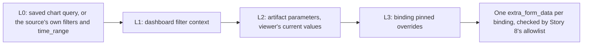
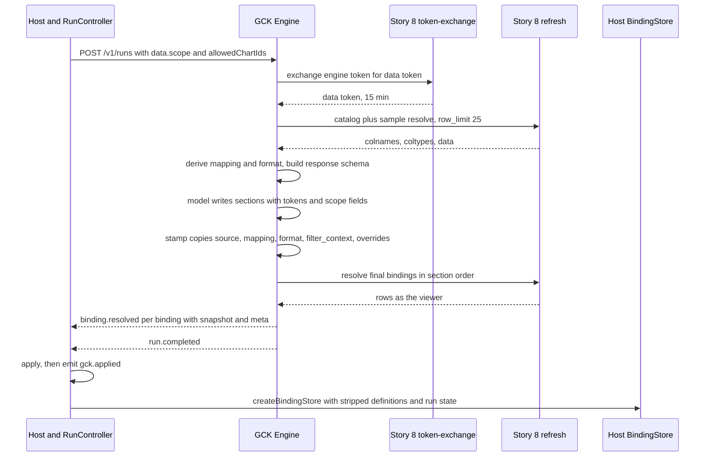
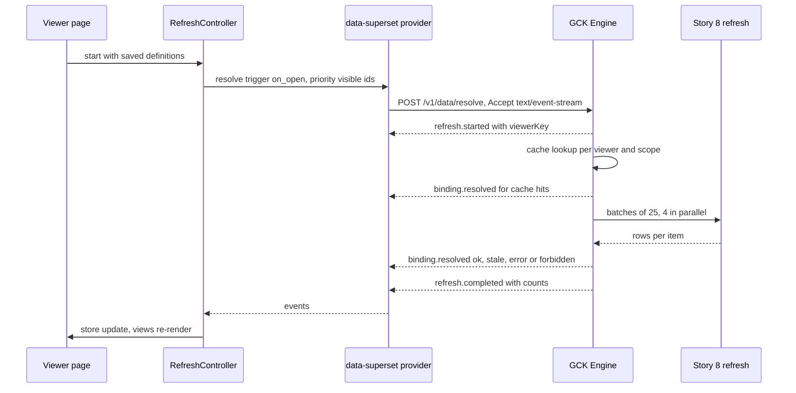
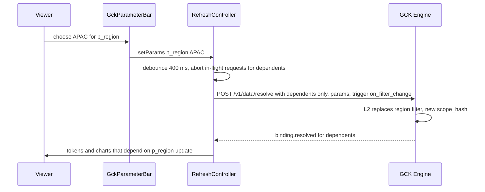
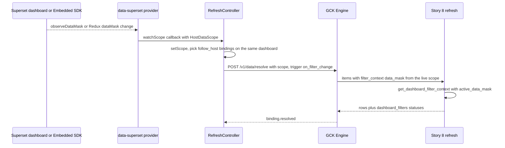
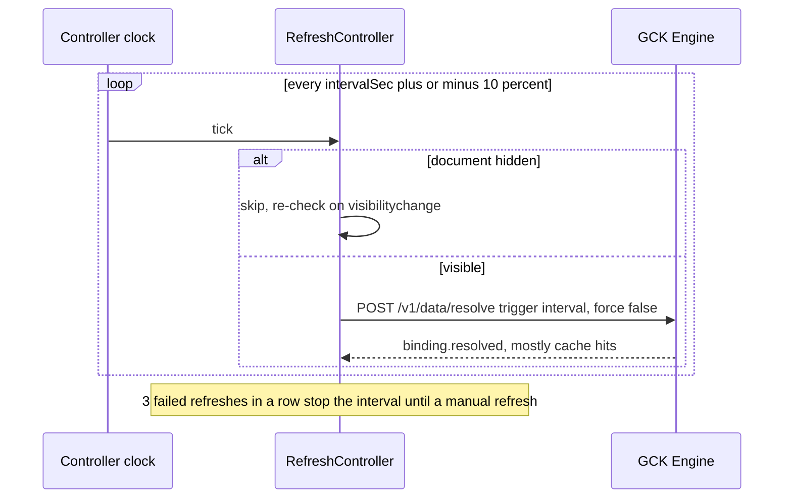
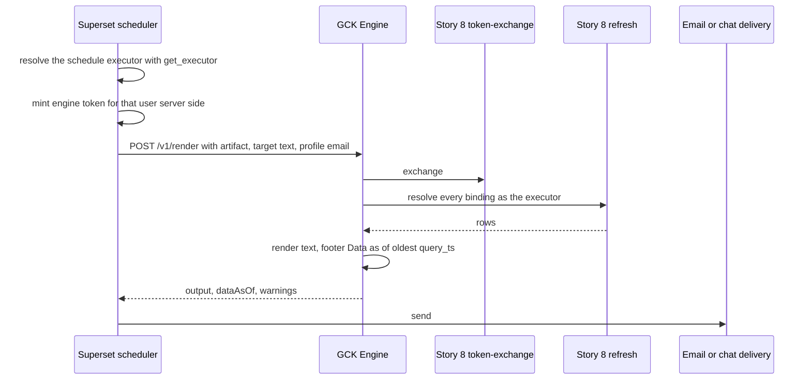

# Live Superset data

<div class="chapter-meta" markdown>
**Reads:** `apache/superset: superset/charts/data/api.py`, `apache/superset: superset/charts/data/dashboard_filter_context.py`, `apache/superset: superset/charts/schemas.py`, `apache/superset: superset/commands/chart/data/get_data_command.py`, `apache/superset: superset/common/query_context_processor.py`, `apache/superset: superset/security/manager.py`, `apache/superset: superset/config.py`, `servers/fastapi/templates/v2/models/elements.py`  ·  **Builds on:** [Artifact Spec and targets](62-artifact-spec-and-targets.md), [React SDK and UI kit](64-react-sdk-and-ui-kit.md), [Story 8, analytics refresh APIs and MCP](../delivery/49-story8-analytics-mcp.md), [Story 1, dynamic data and refresh](../delivery/42-story1-dynamic-data.md)  ·  **Time:** ~60 min
</div>

This chapter makes every number the Generative Content Kit (GCK) puts on a slide, a Tiptap page, a Superset dashboard or a text block a live value: fetched from Superset as the person viewing it, refreshed after generation on open, on demand, on an interval and when a filter or parameter changes, and never a frozen number or a screenshot presented as current. You will build the whole path: the binding sources that cover saved charts, datasets, saved metrics and (behind a flag) SQL; the four-layer scope merge for dashboard filters and viewer parameters; the Superset-side extension of Part VIII's Story 8 refresh API; the engine's `/v1/data/resolve` endpoint; the browser's `DataProvider` and `@gck/data-superset`; and the per-target behavior, security model, caches and tests that keep it honest. The chapter ends with the short list of outputs that must stay snapshots, and why.

Code under `gck/`, `gck_engine/`, `gck_data/` and `ai_slides_superset/` is **new** (marked "(new)" in block titles). Superset paths prefixed `apache/superset:` cite the master clone at `cabd8d4` (2 November 2026); where the 6.1.0 release differs, the text says so, relying on the 6.1.0 checks already made in [Story 8](../delivery/49-story8-analytics-mcp.md). Presenton paths are the snapshot `571461f`. Everything here ships as **protocol 1.1**: additive to `gck.artifact/1`, a minor bump of `@gck/protocol`, engine first.

## Step 1: The requirement, and where data used to freeze

The requirement is short: every GCK target shows live Superset data, fetched as the viewing user, refreshed after generation, with honest fallbacks where a host cannot be live. Before protocol 1.1, the kit met it only during a run. An audit of chapters 61 to 68 found these places where numbers froze:

| Where data froze | Why | Fixed in |
|---|---|---|
| Slides apply baked snapshot values and created no `slide_data_bindings` rows | Part VIII's refresh-on-open only knows rows | Step 12.1 |
| Tiptap stored the author's value in `gckToken.text` | `getHTML()` serialized the number | Step 12.2 |
| Dashboard Markdown carried numbers | the Markdown component cannot query | Step 12.3 |
| No refresh API outside a run | Story 8 needs a server-held data token | Steps 7 to 9 |
| `stamp()` wrote `mapping: {}` | Part VIII mappers raise `MappingError` on it | Step 2.3 |
| Host filter context was lost after generation | no field to keep it | Step 4 |
| Only saved charts could be sources | no dataset or metric source | Step 3 |

The fix rests on one rule: **an applied artifact stores binding definitions, never values presented as current.** Values live in a runtime overlay that is refilled as the viewer.

## Step 2: Definitions versus runtime state

### 2.1 The split

A `DataBinding` in protocol 1.1 is a **definition** plus **runtime state**:

| Part | Fields | Who writes it | Persisted by hosts? |
|---|---|---|---|
| Definition | `kind`, `source`, `mapping`, `format`, `params`, `refresh`, `generatedAgainst` | the engine at stamp time, editors later | yes |
| Runtime state | `snapshot`, `snapshotAt`, `status`, `error` | every resolve, as the current viewer | no (optional offline seed, redacted for others, Step 14) |

`BindingDefinition = Omit<DataBinding, "snapshot" | "snapshotAt" | "status" | "error">` is the type hosts save. `stripRuntime(artifact)` produces it; `withBindingState(artifact, state)` merges the overlay back before an adapter's `toNative` or `apply` reads it. Adapters never fetch.

### 2.2 The artifact gains three optional fields

```ts title="gck/packages/protocol/src/data.ts (new, protocol 1.1, excerpt)"
export type Artifact = {
  // ...all gck.artifact/1 fields unchanged...
  parameters?: Record<string, ArtifactParameter>;   // viewer-changeable inputs (Step 4.4)
  refresh?: RefreshPolicy;                          // default policy for every binding (Step 5)
  dataContext?: HostDataScope;                      // host filter state captured at generation (Step 4.2)
};

export type DataBinding = {
  kind: "chart" | "metric" | "table" | "embed";    // "embed": live Superset chart, never a snapshot
  source: BindingSource;                           // discriminated union on `type` (Step 3)
  mapping: BindingMapping | Record<string, never>; // {} only for kind "embed"
  format?: BindingFormat;
  params?: ParamBinding[];
  refresh?: Partial<RefreshPolicy>;
  generatedAgainst?: { snapshot_hash: string; snapshotAt: string };
  // runtime state: never authored, stripped before persistence
  snapshot?: ChartSnapshot | MetricSnapshot | TableSnapshot;
  snapshotAt?: string;
  status?: "pending" | "ok" | "stale" | "error" | "forbidden";
  error?: { code: BindingErrorCode; message: string; retryable: boolean };
};
```

### 2.3 Mapping is derived, never written by the model

The engine derives `mapping` and `format` once per catalog entry, from a sample resolve (25 rows, `force: false`) through the same Story 8 call that later refreshes it. It reads the post-processed `colnames` and `coltypes` and uses the chart's form data only to pick roles (which column is the x axis, which are metrics). The rules per visualization are in [Artifact Spec and targets](62-artifact-spec-and-targets.md); the two that matter for liveness are:

- a timeseries chart with a `groupby` gets `series: ["*"]`, meaning "every numeric column except `x`", because the set of series (one per region, say) is itself data and can change between refreshes;
- a `pop_kpi` metric maps `previous_column` to `"<metric>__<offset>"`, because Superset names time-offset columns by joining the metric and the offset with `TIME_COMPARISON = "__"` (`apache/superset: superset/utils/core.py:148`, used at `apache/superset: superset/models/helpers.py:3348`).

### 2.4 One snapshot shape for Part VIII and GCK

Snapshots keep Part VIII's snake_case so one JSON blob serves the `slide_data_bindings.snapshot` column and the GCK overlay. Each carries `meta`:

```ts title="gck/packages/protocol/src/data.ts (new, excerpt)"
export type SnapshotMeta = {
  rowcount: number;
  truncated: boolean;               // rowcount reached the effective row cap
  nulls_coerced?: number;           // Presenton ChartSeries.values is list[float]
  is_cached: boolean;
  force_throttled?: boolean;       // a manual force was downgraded (30 s per binding per viewer)
  query_ts: string;                 // queried_dttm or cached_dttm (UTC): the "data as of" stamp
  query_context_source?: "saved_query_context" | "rebuilt_from_form_data" | "built_from_source";
  resolved_by: string;              // viewer key (Step 14.3): whose RLS view this is
  scope_hash: string;               // sha256 of the effective extra_form_data + params
  time_range?: { from?: string; to?: string; label?: string };
  applied_filters?: { column: string }[];
  rejected_filters?: { column: string; reason: string }[];
  dashboard_filters?: { id: string; name: string; status: string; column?: string }[];
  schema: { x?: string; series?: string[]; columns?: string[] };   // drift detection
};
export type ChartSnapshot = { categories: string[]; series: { name: string; key?: string; values: number[] }[]; meta?: SnapshotMeta };
export type MetricSnapshot = { value: number | null; previous?: number | null; previous_label?: string; meta?: SnapshotMeta };
export type TableSnapshot = { columns: string[]; labels?: string[]; coltypes?: ("number" | "string" | "temporal" | "boolean")[];
                              rows: (string | number | boolean | null)[][]; meta?: SnapshotMeta };
```

Every `meta` field has a Superset origin. `applied_filters` and `rejected_filters` are what `_filter_status` returns per query (`apache/superset: superset/common/query_actions.py:81-103`); `from_dttm` and `to_dttm`, the resolved time range, are in the same payload as `queried_dttm` and `is_cached` (`apache/superset: superset/common/query_context_processor.py:423-444`). `coltypes` are Superset's `GenericDataType` values 0 to 3 (numeric, string, temporal, boolean; `apache/superset: superset/utils/core.py:251-259`).

!!! warning "Gotcha: `ChartSeries.values` cannot hold nulls"
    Presenton's chart model declares `values: list[float]` (`servers/fastapi/templates/v2/models/elements.py:176-178`), so a missing month becomes `0` and is counted in `meta.nulls_coerced`. Views show "n gaps filled with 0" (`data.gapsFilled`) whenever the count is non-zero. Do not hide that hint: a zero is a claim about the data.

## Step 3: Binding sources, one example each

`DataBinding.source` is a discriminated union on `type`. All four types resolve **inside Superset** under the viewer's identity, so RBAC and row-level security (RLS) apply unchanged.

| `source.type` | Version | What it reads | Typical use |
|---|---|---|---|
| `superset_chart` | v1 | a saved chart's query | the chart the user is looking at, or one from the catalog |
| `superset_dataset` | 1.1 | a query the engine builds from a dataset's columns and metrics | "revenue by month for EMEA" when no chart exists |
| `superset_metric` | 1.1 (table), 1.2 (semantic view) | one saved metric, optionally with a period comparison | KPIs in prose and metric slots |
| `superset_sql` | 1.2, off by default | a saved query or the user's SQL Lab text | narratives over an ad hoc result |

### 3.1 A saved chart

```json title="superset_chart, no scope"
{ "kind": "chart",
  "source": { "type": "superset_chart", "chart_id": 412, "viz_type": "echarts_timeseries_bar",
              "datasource": "12__table", "row_limit": 50 },
  "mapping": { "x": "order_date", "series": ["revenue"], "series_labels": { "revenue": "Revenue" }, "sort": "x_asc" },
  "format": { "number": "SMART_NUMBER", "date": "%b %Y" } }
```

### 3.2 A saved chart with the dashboard's filters and a pinned override

Generated on dashboard 37 while the "Region" native filter was set to EMEA; the prompt asked for "last quarter", so the model filled the constrained `scope` field and the engine stamped it as an override:

```json title="superset_chart with filter_context and overrides"
{ "kind": "chart",
  "source": { "type": "superset_chart", "chart_id": 413, "dashboard_id": 37,
    "filter_context": { "dashboard_id": 37, "mode": "captured", "permalink_key": "pK3x9Qa",
      "data_mask": { "NATIVE_FILTER-r1": { "extraFormData": {
        "filters": [ { "col": "region", "op": "IN", "val": ["EMEA"] } ] } } } },
    "overrides": { "time_range": "Last quarter" } },
  "mapping": { "x": "order_date", "series": ["*"], "sort": "x_asc" } }
```

### 3.3 A dataset query, pivoted

No saved chart exists; the engine builds one query from dataset 12. With `pivot: true`, each `region` value becomes a series:

```json title="superset_dataset"
{ "kind": "chart",
  "source": { "type": "superset_dataset", "dataset_id": 12,
    "metrics": [ "revenue", { "expressionType": "SIMPLE", "column": { "column_name": "order_id" },
                              "aggregate": "COUNT_DISTINCT", "label": "orders" } ],
    "columns": ["region"], "x_axis": { "column": "order_date", "time_grain": "P1M" },
    "time_range": "Last year", "pivot": true, "row_limit": 120 },
  "mapping": { "x": "order_date", "series": ["*"], "sort": "x_asc" } }
```

`SimpleAdhocMetric` allows only `SIMPLE` expressions with six aggregates; there is no SQL expression field at all.

### 3.4 A saved metric with a year-over-year comparison

```json title="superset_metric"
{ "kind": "metric",
  "source": { "type": "superset_metric", "dataset_id": 12, "metric": "revenue",
              "time_column": "order_date", "time_range": "Last quarter",
              "compare": { "time_offset": "1 year ago" } },
  "mapping": { "metric": "revenue", "previous_column": "revenue__1 year ago" },
  "format": { "number": "$,.3s" } }
```

A token `{ bindingId: "b_m12_revenue", field: "delta_pct" }` in a sentence now reads the live change; the `period` field renders "Last quarter" (or the resolved dates) instead of a frozen "Q3 2026".

### 3.5 A semantic view metric (protocol 1.2, master only)

`datasource_type: "semantic_view"` targets Superset's semantic layer. It needs `SEMANTIC_LAYERS` (default `False`, `apache/superset: superset/config.py:776`) and the headless `POST /api/v1/datasource/<type>/<id>/query` route (`apache/superset: superset/datasource/api.py:790`), which is not in 6.1.0. A 1.1 reader that meets it reports `source_unsupported`.

### 3.6 SQL (protocol 1.2, flagged)

```json title="superset_sql"
{ "kind": "table", "source": { "type": "superset_sql", "saved_query_id": 88, "row_limit": 200 },
  "mapping": { "columns": ["account", "arr"], "max_rows": 10 } }
```

The model never writes `sql`. A `superset_sql` source comes only from a saved query the user selected or the text of their current SQL Lab tab. It accepts no parameters or overrides (validator `I15_OVERRIDES`): the only injection point would be Jinja, and `ENABLE_TEMPLATE_PROCESSING` defaults to `False` (`apache/superset: superset/config.py:995`).

### 3.7 An embed (live, but not redrawn by the kit)

```json title="embed for a chart the kit cannot redraw"
{ "kind": "embed", "source": { "type": "superset_chart", "chart_id": 977, "viz_type": "sankey_v2" }, "mapping": {} }
```

Step 13 explains what each target does with it.

## Step 4: Scope: four layers, dashboard filters and parameters

### 4.1 The layers

For each binding the resolver computes one effective scope, lowest layer first:



Merge rule for L1 to L3: a higher layer **replaces** lower-layer filters on the same column and replaces `time_range` and `time_grain_sqla`. Superset ANDs extra filters, so appending `region IN [APAC]` to a pinned `region IN [EMEA]` would return nothing; replacement is the only useful semantics. Validator `I12_PARAMS` rejects a binding that both pins and parameterizes one column. For `superset_chart`, the merged extras meet L0 exactly as a dashboard native filter would: filters are appended with `isExtra: True` and the time range is overridden (`apache/superset: superset/charts/data/dashboard_filter_context.py:379-408`).

### 4.2 Capturing dashboard filters at generation

The Superset dashboard host reads `dataMask` and `nativeFilters` from the dashboard Redux state (both on the root state type, `superset-frontend/src/dashboard/types.ts:275-277`) and produces a `HostDataScope`. At submit it also creates a dashboard permalink (`POST /api/v1/dashboard/<pk>/permalink`, `apache/superset: superset/dashboards/permalink/api.py:48`), so the selection is durable and reproducible. The engine stores the scope as `Artifact.dataContext` and gives every binding created in that context `filter_context: { dashboard_id, mode: "captured", data_mask, permalink_key }`.

The host sends the native filters' own `extraFormData`, never a re-derivation from the filter type: Superset already publishes `filters`, `time_range`, `time_grain_sqla` and `granularity_sqla` in the mask, the same keys that `EXTRA_FORM_DATA_APPEND_KEYS` and `EXTRA_FORM_DATA_OVERRIDE_REGULAR_MAPPINGS` declare (`apache/superset: superset/constants.py:209-224`).

| `filter_context.mode` | Values used at resolve time |
|---|---|
| `captured` (default) | the `data_mask` stored on the binding; the narrative and every refresh use the same selection |
| `follow_host` | the viewer's live mask when the viewing host is the same dashboard and the policy includes `on_filter_change`; else `captured` |
| `defaults` | the dashboard's saved defaults (`active_data_mask` omitted) |
| `none` | no dashboard filters |

### 4.3 Which filters apply to which binding

On master, Superset already answers this: `get_dashboard_filter_context(dashboard_id, chart_id, active_data_mask=...)` (`apache/superset: superset/charts/data/dashboard_filter_context.py:272`) loads the native filter configuration, keeps the filters in scope for the chart, and resolves each value. Its rules, read from the source:

- In scope means one of the chart's layout parents is in the filter's `scope.rootPath` and the chart is not in `scope.excluded`. The persisted `chartsInScope` is deliberately ignored because it is a frontend cache that can be stale (`apache/superset: superset/charts/data/dashboard_filter_context.py:78-100`).
- An entry in the active mask wins; an **empty** active value means "cleared" and does not fall back to the default (`apache/superset: superset/charts/data/dashboard_filter_context.py:205-227`).
- Without an active entry, a filter applies only when it has a static default; `defaultToFirstItem` filters are reported as `not_applied_uses_default_to_first_item_prequery` (`apache/superset: superset/charts/data/dashboard_filter_context.py:173-202`).
- It raises `ValueError` when the chart is not on the dashboard, and handles native filters only.

On 6.1.0 the module does not exist (Story 8). The extension below ports the same three rules into a local resolver, and uses it for dataset and metric sources on both versions, where "in scope" means a filter `targets[].datasetId` equals the source's `dataset_id`.

!!! warning "Gotcha: cross filters are not propagated"
    Cross-filter entries in the mask are keyed by chart id, not native filter id, and neither master's module nor the local resolver maps them. A captured mask that contains any raises warning `cross_filter_not_applied`. Users see the native filter selection, not the cross filter, until a later version maps `chart_configuration` scopes.

### 4.4 Artifact parameters

```ts title="gck/packages/protocol/src/data.ts (new, excerpt)"
export type ArtifactParameter = {
  id: string;                        // ^p_[a-z0-9_]{1,32}$
  label: string;
  type: "time_range" | "time_grain" | "select" | "multi_select";
  default: string | number | (string | number)[] | null;
  column?: string;
  options?: { values: (string | number)[] } | { from: { dataset_id: number; column: string; limit?: number } };
  hostFilterId?: string;             // follow a Superset native filter
};
export type ParamBinding = { param: string; as: "time_range" | "time_grain" | "filter"; column?: string; op?: "IN" | "==" };
```

Options `from` a dataset column are loaded as the viewer through Superset's column-values route (`GET /api/v1/datasource/<type>/<id>/column/<column>/values/`, `apache/superset: superset/datasource/api.py:225-227`), so a viewer only sees values RLS allows. The viewer's choice lives in view state (host state or `?gck_p_region=EMEA`), never in the artifact. Changing it re-resolves exactly the bindings whose `params` reference it.

## Step 5: Refresh policy

```ts title="gck/packages/protocol/src/data.ts (new, excerpt)"
export type RefreshMode = "on_open" | "manual" | "interval" | "on_filter_change" | "on_schedule";
export type RefreshPolicy = {
  modes: RefreshMode[];
  intervalSec?: number;              // required with "interval"; >= 60 (validator I13_REFRESH_POLICY)
  schedule?: { cron: string; timezone: string };   // "on_schedule": headless surfaces only
  staleAfterSec?: number;            // default 3600
  onVisible?: boolean;               // default true: refresh on tab return when older than staleAfterSec
  beforeExport?: boolean;            // default true for targets that export files
  cache?: "prefer" | "bypass";       // default "prefer" (force: false); manual always forces
};
```

Effective policy for a binding is `binding.refresh` over `artifact.refresh` over the target default over the host's provider prop.

| Target | Default modes | Interval | Who triggers |
|---|---|---|---|
| `slides` in Presenton | `on_open`, `manual`, before export | opt-in, at least 60 s while presenting | Story 4 `useDeckRefresh`, later the kit controller with the Presenton transport |
| `tiptap-doc` | `on_open`, `manual`, `on_filter_change` | opt-in | host `RefreshController` |
| `superset-dashboard` | Superset's own: open, native filter change, dashboard refresh | `json_metadata.refresh_frequency`, opt-in, at least 60 s | Superset frontend |
| `text` rendered by the kit | `on_open`, `manual`, `on_filter_change` | opt-in | `RefreshController` |
| `text` exported (Markdown, HTML, email) | snapshot, or `on_schedule` per send | n/a | scheduler, as the schedule's executor |

## Step 6: Resolution flows

Six flows cover every way a number gets onto a screen. All of them end in the same Superset call; only the trigger, the identity source and the receiver differ.

### 6.1 At generation time



Resolution starts once the outline is final and emits in section order, so `resolving_data` can overlap `generating`. A data error never fails the run: the binding ends `error`, `stale` or `forbidden`, and `run.failed data_forbidden` is reserved for a target that requires data where every binding is forbidden.

### 6.2 Refresh on open



### 6.3 The viewer changes a parameter



### 6.4 A dashboard filter changes

Two cases. Inside a generated **dashboard target**, nothing in the kit runs: data blocks are native Superset charts and re-query on their own. For a **kit view next to a dashboard** (an embedded dashboard with a Tiptap page, or a kit panel inside Superset) with `follow_host` bindings:



The Embedded SDK publishes the mask through `getDataMask()` and `observeDataMask(cb)` when `dashboardUiConfig.emitDataMasks` is set (`superset-embedded-sdk/src/index.ts:44, 164-165, 239, 594-614`).

### 6.5 Interval refresh



### 6.6 Headless scheduled refresh



No model call happens here: the stored definitions are re-resolved and re-rendered. The executor follows Superset's report rules: `ALERT_REPORTS_EXECUTORS` (default `[ExecutorType.EDITOR]` on master, `apache/superset: superset/config.py:2838`), per-schedule "Run As" behind `ALERT_REPORT_DYNAMIC_EXECUTOR` (`apache/superset: superset/config.py:741`), and lookup through `get_executor` (`apache/superset: superset/tasks/utils.py:58`). Never a shared service account.

## Step 7: The Superset side: extending the Story 8 refresh API

Story 8's `POST /api/v1/ai_slides/refresh` already runs a saved chart's query inside a Flask blueprint, under `override_user(token_user)`, through `ChartDataCommand.validate()` (RBAC) and `.run()` (RLS in the generated SQL). Protocol 1.1 keeps that endpoint and its legacy flat items, and adds **source-typed items**.

### 7.1 The request

```json title="POST /api/v1/ai_slides/refresh (protocol 1.1 items)"
{ "items": [
  { "key": "b_c412", "chart_id": 412, "overrides": { "time_range": "Last quarter" }, "row_limit": 50 },
  { "key": "b_c413", "source": { "type": "superset_chart", "chart_id": 413, "dashboard_id": 37,
      "filter_context": { "dashboard_id": 37, "mode": "captured",
        "data_mask": { "NATIVE_FILTER-r1": { "extraFormData": { "filters": [ { "col": "region", "op": "IN", "val": ["EMEA"] } ] } } } } },
    "param_scope": { "time_range": "Last month" }, "row_limit": 50 },
  { "key": "b_d12_rev", "source": { "type": "superset_dataset", "dataset_id": 12, "metrics": ["revenue"],
      "x_axis": { "column": "order_date", "time_grain": "P1M" }, "time_range": "Last year", "row_limit": 24 } },
  { "key": "b_m12_rev", "source": { "type": "superset_metric", "dataset_id": 12, "metric": "revenue",
      "time_column": "order_date", "time_range": "Last quarter", "compare": { "time_offset": "1 year ago" } } }
] }
```

`param_scope` is the L2 layer: the engine converts the viewer's parameter values into an `extra_form_data` fragment before calling, because only the engine knows the viewer's current values. Every filter in it still passes Story 8's column and operator allowlist.

### 7.2 Merging layers and resolving dashboard scope

```python title="ai_slides_superset/scope.py (new)"
from __future__ import annotations

import hashlib
from typing import Any

from ai_slides_superset.refresh import ALLOWED_OPS, ItemError

TIME_KEYS = ("time_range", "time_grain_sqla", "granularity_sqla")
GRAINS = {"PT1M", "PT1H", "P1D", "P1W", "P1M", "P3M", "P1Y"}


def merge_layers(*layers: dict[str, Any] | None) -> dict[str, Any]:
    """Lowest layer first. A higher layer replaces filters on the same column and the time keys."""
    merged: dict[str, Any] = {}
    by_col: dict[str, dict[str, Any]] = {}
    for layer in layers:
        for flt in (layer or {}).get("filters") or []:
            by_col[flt["col"]] = flt
        for key in TIME_KEYS:
            if (layer or {}).get(key):
                merged[key] = layer[key]
    if by_col:
        merged["filters"] = list(by_col.values())
    return merged


def check_scope(efd: dict[str, Any], filterable: set[str]) -> dict[str, Any]:
    """Story 8 allowlist for every layer: a filter column is a SQL surface."""
    for flt in efd.get("filters", []):
        if not isinstance(flt.get("col"), str) or flt["col"] not in filterable:
            raise ItemError("error", "invalid_override", f"Unknown filter column {flt.get('col')!r}.")
        if str(flt.get("op", "")).upper() not in ALLOWED_OPS:
            raise ItemError("error", "invalid_override", f"Operator {flt.get('op')!r} not allowed.")
    if len(str(efd.get("time_range", ""))) > 100:
        raise ItemError("error", "invalid_override", "time_range is too long.")
    if efd.get("time_grain_sqla") and efd["time_grain_sqla"] not in GRAINS:
        raise ItemError("error", "invalid_override", "Unknown time grain.")
    return efd


def scope_hash(efd: dict[str, Any], row_limit: int) -> str:
    from superset.utils import json

    canonical = json.dumps({"efd": efd, "row_limit": row_limit}, sort_keys=True)
    return hashlib.sha256(canonical.encode()).hexdigest()


def _active_mask(ctx: dict[str, Any]) -> dict[str, Any] | None:
    # "defaults" omits the mask so saved defaults apply; follow_host arrives already
    # rewritten by the engine with the viewer's live mask.
    return None if ctx.get("mode") == "defaults" else (ctx.get("data_mask") or {})


def dashboard_scope(source: dict[str, Any]) -> tuple[dict[str, Any], list[dict[str, Any]]]:
    ctx = source.get("filter_context")
    if not ctx or ctx.get("mode") == "none":
        return {}, []
    chart_id = source.get("chart_id")
    if chart_id is not None:
        try:  # master only
            from superset.charts.data.dashboard_filter_context import get_dashboard_filter_context
        except ImportError:
            return local_scope(ctx["dashboard_id"], _active_mask(ctx), chart_id=chart_id)
        try:
            fc = get_dashboard_filter_context(ctx["dashboard_id"], chart_id, active_data_mask=_active_mask(ctx))
        except ValueError as ex:  # dashboard gone, or chart no longer on it
            raise ItemError("error", "invalid_override", str(ex)[:300]) from ex
        return fc.extra_form_data, fc.to_dict()["filters"]
    return local_scope(ctx["dashboard_id"], _active_mask(ctx), dataset_id=source.get("dataset_id"))
```

The local resolver is the 6.1.0 path for charts and the only path for dataset and metric sources. It mirrors master's three rules from Step 4.3:

```python title="ai_slides_superset/scope.py (new, continued)"
def _in_scope(flt: dict[str, Any], chart_id: int, position: dict[str, Any]) -> bool:
    scope = flt.get("scope") or {}
    root_path = scope.get("rootPath") or []
    if chart_id in (scope.get("excluded") or []):
        return False
    for item in position.values():
        if isinstance(item, dict) and item.get("type") == "CHART" \
                and (item.get("meta") or {}).get("chartId") == chart_id:
            return any(p in root_path for p in item.get("parents") or [])
    return "ROOT_ID" in root_path       # not in the layout: master treats it as a root-level chart


def _value(flt: dict[str, Any], mask: dict[str, Any] | None) -> tuple[dict[str, Any] | None, str]:
    if mask is not None and flt.get("id") in mask:            # active entry wins, empty = cleared
        efd = (mask[flt["id"]] or {}).get("extraFormData") or {}
        return (efd, "applied") if efd else (None, "not_applied")
    if (flt.get("controlValues") or {}).get("defaultToFirstItem"):
        return None, "not_applied_uses_default_to_first_item_prequery"
    default = flt.get("defaultDataMask") or {}
    if (default.get("filterState") or {}).get("value") is not None and default.get("extraFormData"):
        return default["extraFormData"], "applied"
    return None, "not_applied"


def local_scope(dashboard_id: int, mask: dict[str, Any] | None, *,
                chart_id: int | None = None, dataset_id: int | None = None):
    from superset.daos.dashboard import DashboardDAO
    from superset.utils import json

    dashboard = DashboardDAO.find_by_id(dashboard_id)       # base filter: the viewer must see it
    if dashboard is None:
        raise ItemError("forbidden", "forbidden", "You cannot access this dashboard.")
    meta = json.loads(dashboard.json_metadata or "{}")
    position = json.loads(dashboard.position_json or "{}")
    parts, info = [], []
    for flt in meta.get("native_filter_configuration", []):
        if flt.get("type") == "DIVIDER":
            continue
        targets = flt.get("targets") or []
        if chart_id is not None and not _in_scope(flt, chart_id, position):
            continue
        if dataset_id is not None and not any(t.get("datasetId") == dataset_id for t in targets):
            continue
        efd, status = _value(flt, mask)
        column = ((targets[0] if targets else {}).get("column") or {}).get("name")
        info.append({"id": flt.get("id", ""), "name": flt.get("name", ""), "status": status,
                     **({"column": column} if column else {})})
        if efd:
            parts.append(efd)
    # Native filters combine like master's _merge_extra_form_data: filters append, time keys override.
    # (merge_layers, which replaces per column, is only for the L1 to L3 layers.)
    merged: dict[str, Any] = {}
    for efd in parts:
        merged["filters"] = merged.get("filters", []) + list(efd.get("filters") or [])
        merged.update({k: efd[k] for k in TIME_KEYS if efd.get(k)})
    if not merged.get("filters"):
        merged.pop("filters", None)
    return merged, info
```

`CHART` is the layout type string master compares against (`CHART_TYPE`, defined at `apache/superset: superset/charts/data/dashboard_filter_context.py:40` and matched in `_find_chart_layout_item`, lines 107-120). A chart missing from the layout counts as root level, as in master's `_is_filter_in_scope_for_chart` (same file, line 104), and native filters are combined the way master's `_merge_extra_form_data` combines them (lines 123-170): their `filters` append and their time keys override.

!!! warning "Gotcha: dashboard scope is only as fresh as `position_json`"
    A binding captured on tab "Sales" keeps working when someone moves the chart to another tab, but the filter scope is recomputed from the **current** layout on every refresh. If the chart left the scope of the Region filter, `meta.dashboard_filters` no longer lists it and the numbers change. That is correct (it is what the dashboard shows), and the `scope_hash` change makes the view show "Text was written against data as of ..." (Step 14.4).

### 7.3 Building queries for dataset and metric sources

```python title="ai_slides_superset/sources.py (new)"
from __future__ import annotations

import re
from typing import Any

from ai_slides_superset.refresh import ItemError
from ai_slides_superset.scope import GRAINS

AGGREGATES = {"SUM", "AVG", "MIN", "MAX", "COUNT", "COUNT_DISTINCT"}
LABEL = re.compile(r"^[a-z][a-z0-9_]{0,40}$")


def load_dataset(dataset_id: int) -> Any:
    from superset.daos.dataset import DatasetDAO
    from superset.extensions import security_manager

    dataset = DatasetDAO.find_by_id(dataset_id, skip_base_filter=True)
    if dataset is None:
        raise ItemError("not_found", "datasource_not_found", "The dataset no longer exists.")
    if not security_manager.can_access_datasource(dataset):
        raise ItemError("forbidden", "datasource_forbidden", "You cannot access this data.")
    return dataset


def _metric(spec: Any, saved: set[str], columns: dict[str, Any]) -> Any:
    if isinstance(spec, str):
        if spec not in saved:
            raise ItemError("error", "invalid_query", f"Unknown metric {spec!r}.")
        return spec
    col = (spec.get("column") or {}).get("column_name")
    if spec.get("expressionType") != "SIMPLE" or col not in columns \
            or spec.get("aggregate") not in AGGREGATES or not LABEL.match(spec.get("label", "")):
        raise ItemError("error", "invalid_query", "Only SIMPLE metrics over known columns are allowed.")
    return {"expressionType": "SIMPLE", "column": {"column_name": col},
            "aggregate": spec["aggregate"], "label": spec["label"]}


def build_source_body(src: dict[str, Any], efd: dict[str, Any], row_limit: int) -> dict[str, Any]:
    dataset = load_dataset(src["dataset_id"])
    columns = {c.column_name: c for c in dataset.columns}
    saved = {m.metric_name for m in dataset.metrics}
    is_metric = src["type"] == "superset_metric"
    metrics = [_metric(src["metric"] if is_metric else m, saved, columns)
               for m in ([src["metric"]] if is_metric else src["metrics"])]

    query_columns: list[Any] = []
    time_col = src.get("time_column") if is_metric else (src.get("x_axis") or {}).get("column")
    grain = src.get("time_grain") if is_metric else (src.get("x_axis") or {}).get("time_grain")
    grain = efd.get("time_grain_sqla") or grain
    if time_col and time_col not in columns:
        raise ItemError("error", "invalid_query", f"Unknown time column {time_col!r}.")
    if time_col and grain:
        if grain not in GRAINS:
            raise ItemError("error", "invalid_query", "Unknown time grain.")
        query_columns.append({"timeGrain": grain, "columnType": "BASE_AXIS", "sqlExpression": time_col,
                              "label": time_col, "expressionType": "SQL", "isColumnReference": True})
    for name in src.get("columns", []):
        if name not in columns or not columns[name].groupby:
            raise ItemError("error", "invalid_query", f"{name!r} cannot be grouped by.")
        query_columns.append(name)

    # L0 is the source's own filters and time_range; efd (L1 to L3) replaces per column.
    from ai_slides_superset.scope import merge_layers
    scope = merge_layers({"filters": src.get("filters", []), "time_range": src.get("time_range")}, efd)
    filters = [dict(f) for f in scope.get("filters", [])]
    temporal = time_col or dataset.main_dttm_col
    if scope.get("time_range") and temporal:
        filters.append({"col": temporal, "op": "TEMPORAL_RANGE", "val": scope["time_range"]})

    query: dict[str, Any] = {
        "metrics": metrics, "columns": query_columns, "filters": filters,
        "extras": {"time_grain_sqla": grain} if grain else {},
        "orderby": [[o["by"], o["ascending"]] for o in src.get("orderby", [])],
        "row_limit": row_limit, "post_processing": [],
    }
    if is_metric and src.get("compare"):
        query["time_offsets"] = [src["compare"]["time_offset"]]
    if src.get("pivot") and time_col and src.get("columns"):
        labels = [m if isinstance(m, str) else m["label"] for m in metrics]
        query["post_processing"] = [
            {"operation": "pivot", "options": {"index": [time_col], "columns": src["columns"],
             "aggregates": {m: {"operator": "mean"} for m in labels}, "drop_missing_columns": False}},
            {"operation": "flatten"},
        ]
    return {"datasource": {"id": dataset.id, "type": "table"}, "queries": [query],
            "form_data": {}, "result_type": "full", "result_format": "json"}
```

Every Superset name in this builder is taken from what the frontend sends, so the server sees a familiar query:

- The x axis is the adhoc column `normalizeTimeColumn` produces (`superset-frontend/packages/superset-ui-core/src/query/normalizeTimeColumn.ts:64-71`), including `isColumnReference: true`.
- The pivot step copies `pivotOperator` (`superset-frontend/packages/superset-ui-chart-controls/src/operators/pivotOperator.ts:29-55`): dummy `mean` aggregates per metric label, `index` = the x axis. `pivot()` requires `index` and `aggregates` (`apache/superset: superset/utils/pandas_postprocessing/pivot.py:235-247`; the schema is `ChartDataPivotOptionsSchema`, `apache/superset: superset/charts/schemas.py:972`).
- `time_offsets` is the field `pop_kpi` sends (`superset-frontend/plugins/plugin-chart-echarts/src/BigNumber/BigNumberPeriodOverPeriod/buildQuery.ts:66-79`; schema field at `apache/superset: superset/charts/schemas.py:1630`).
- `TEMPORAL_RANGE` is a `FilterOperator` member (`apache/superset: superset/utils/core.py:329-361`).
- `metric_name`, `d3format` and `currency` on metrics, and `groupby`, `filterable` and `is_dttm` on columns, are `SqlMetric` and `TableColumn` columns (`apache/superset: superset/connectors/sqla/models.py:1734-1750` for `SqlMetric`, `1353-1378` for `TableColumn`).

!!! warning "Gotcha: `sqlExpression` on the x axis is a SQL surface too"
    The BASE_AXIS column carries the column name in `sqlExpression`. The builder accepts only names that exist in `dataset.columns`; it must never pass a client string through unchecked, or a binding edit becomes arbitrary SQL that runs with the viewer's warehouse access.

### 7.4 Dispatch, execution and the result

```python title="ai_slides_superset/refresh_v11.py (new)"
from __future__ import annotations

from typing import Any

from flask import current_app

from ai_slides_superset.refresh import ItemError, RefreshItem, _load_chart, build_body, execute, refresh_one
from ai_slides_superset.scope import check_scope, dashboard_scope, merge_layers, scope_hash
from ai_slides_superset.sources import build_source_body, load_dataset


def _filterable(datasource: Any) -> set[str]:
    return {c.column_name for c in getattr(datasource, "columns", []) if c.filterable}


def refresh_source(entry: dict[str, Any]) -> dict[str, Any]:
    src, key = entry["source"], entry["key"]
    cap_max = current_app.config.get("AI_SLIDES_MAX_ROW_LIMIT", 500)
    row_limit = min(int(entry.get("row_limit") or src.get("row_limit") or 50), cap_max)
    stype = src.get("type")
    if stype == "superset_sql":
        from ai_slides_superset.sql_source import refresh_sql   # 1.2, flagged
        return refresh_sql(entry)
    if stype not in ("superset_chart", "superset_dataset", "superset_metric"):
        return {"key": key, "status": "error", "source_type": stype,
                "error": {"code": "source_unsupported", "message": f"{stype} is not supported."}}

    def run() -> dict[str, Any]:
        l1, dash_info = dashboard_scope(src)
        l3 = {"filters": (src.get("overrides") or {}).get("extra_filters", []),
              **{k: v for k, v in (src.get("overrides") or {}).items() if k != "extra_filters"}}
        efd = merge_layers(l1, entry.get("param_scope"), l3)
        if stype == "superset_chart":
            chart = _load_chart(RefreshItem(key, src["chart_id"]))
            check_scope(efd, _filterable(chart.datasource))
            item = RefreshItem(key, src["chart_id"], src.get("dashboard_id"), {}, row_limit, entry.get("force", False))
            body, origin, _ = build_body(chart, item)           # Story 8: saved or rebuilt query context
            if efd:
                _apply(body, efd)
        else:
            check_scope(efd, _filterable(load_dataset(src["dataset_id"])))
            body, origin = build_source_body(src, efd, row_limit), "built_from_source"
            body["force"] = bool(entry.get("force", False))
        payload = execute(body)                                  # validate() = RBAC, run() = RLS
        return {"payload": payload, "origin": origin, "efd": efd, "dash": dash_info}

    result = refresh_one(RefreshItem(key, 0), runner=run)   # Story 8 error mapping, reused
    result.update(source_type=stype, scope_hash=scope_hash(result.pop("_efd", {}), row_limit))
    return result


def _apply(body: dict[str, Any], efd: dict[str, Any]) -> None:
    try:
        from superset.charts.data.dashboard_filter_context import apply_dashboard_filter_context
    except ImportError:  # 6.1.0
        from ai_slides_superset.refresh import _apply_efd_61 as apply_dashboard_filter_context
    apply_dashboard_filter_context(body, dict(efd))   # mutates both arguments
```

`refresh_one` gains one optional parameter, `runner`, so both item shapes share Story 8's exception-to-status table (`forbidden`, `not_found`, `invalid_query`, `query_failed`, `cache_load_failed`); when `runner` is given it calls it instead of the legacy load-build-execute lines and copies `payload["queries"][0]` into the result exactly as before. Three fields are added from the same query payload: `from_dttm`, `to_dttm` (the resolved range) and `dashboard_filters`, plus `query_context_source` (`origin`) and a private `_efd` the wrapper hashes and removes. The route dispatches per item:

```python title="ai_slides_superset/api.py (new, refresh route updated)"
@blueprint.route("/refresh", methods=["POST"])
@require_data_token("ai_slides:refresh")
def refresh() -> Response:
    from ai_slides_superset.refresh import parse_items, refresh_one
    from ai_slides_superset.refresh_v11 import refresh_source

    body = request.get_json(silent=True) or {}
    raw = body.get("items") if isinstance(body, dict) else None
    try:
        typed = [e for e in (raw or []) if isinstance(e, dict) and "source" in e]
        legacy = parse_items({"items": [e for e in raw or [] if e not in typed]}) if len(typed) < len(raw or []) else []
        if len(raw or []) > current_app.config.get("AI_SLIDES_MAX_ITEMS", 25):
            raise ValueError("too many items")
    except ValueError as ex:
        return json_error(400, "invalid_request", str(ex))
    by_key = {r["key"]: r for r in [refresh_one(i) for i in legacy] + [refresh_source(e) for e in typed]}
    results = [by_key[e["key"]] for e in raw]                     # request order
    audit("ai_slides.refresh", keys=[e["key"] for e in raw], statuses=[r["status"] for r in results],
          source_types=sorted({r.get("source_type", "superset_chart") for r in results}))
    return json_response({"results": results})
```

What runs per source type, all inside the blueprint as the token user:

| `source.type` | Query built how | RBAC | RLS |
|---|---|---|---|
| `superset_chart` | Story 8 `build_body`: saved `query_context`, else master's `build_query_context_from_form_data`, else `no_query_context`; L1 to L3 merged with `apply_dashboard_filter_context` (master) or `_apply_efd_61` | `can_access_chart`, then `raise_for_access` in `validate()` | `get_sqla_row_level_filters` while building SQL |
| `superset_dataset`, `superset_metric` (table) | `build_source_body`, loaded through `ChartDataQueryContextSchema` with a `QueryContextFactory` (`apache/superset: superset/charts/schemas.py:1677`) | `can_access_datasource`, then `validate()` | same |
| `superset_metric` (semantic view, 1.2) | the headless datasource query logic (`apache/superset: superset/datasource/api.py:790`) | route permissions | the semantic layer's own |
| `superset_sql` (1.2) | `Database.execute(sql, QueryOptions(limit=...))` (`apache/superset: superset/models/core.py:1704`) after `SQLScript(...).has_mutation()` is false (`apache/superset: superset/sql/parse.py:3415`) and `raise_for_access(database=..., sql=..., catalog=..., schema=..., force_dataset_match=True)`, as MCP `execute_sql` does (`apache/superset: superset/mcp_service/sql_lab/tool/execute_sql.py:189-196`) | user needs `can_execute_sql_query on SQLLab` (`apache/superset: superset/sqllab/api.py:87, 554`) and token scope `ai_slides:sql` | RLS applied by the SQL executor |

!!! warning "Gotcha: `apply_dashboard_filter_context` mutates its second argument"
    Master's function pops `filters` out of `extra_form_data` (`apache/superset: superset/charts/data/dashboard_filter_context.py:379`) to avoid duplicate values for the `filter_values()` Jinja macro. Pass a copy (`dict(efd)`), or the `scope_hash` you compute afterwards hashes a scope without filters, and two different regions share one cache entry.

### 7.5 Token exchange for the engine

The browser never holds a data token (Part VIII ADR-AIS-001). The engine holds the viewer's **engine token** (audience `gck-engine`, minted by the host, [Host integrations](65-host-integrations.md)) and exchanges it server side, in the shape of RFC 8693:

```python title="ai_slides_superset/api.py (new, part 4: token exchange)"
TOKEN_EXCHANGE = "urn:ietf:params:oauth:grant-type:token-exchange"


@blueprint.route("/token-exchange", methods=["POST"])
def token_exchange() -> Response:
    import jwt
    from superset.extensions import security_manager
    from superset.utils.core import override_user

    from ai_slides_superset.tokens import mint_data_token, verify_client_assertion, verify_engine_token

    form = request.form
    if form.get("grant_type") != TOKEN_EXCHANGE:
        return json_error(400, "unsupported_grant_type", "Token exchange only.")
    if not verify_client_assertion(form.get("client_assertion"), form.get("client_assertion_type")):
        return json_error(401, "invalid_client", "Engine client authentication failed.")   # private_key_jwt
    try:
        claims = verify_engine_token(form.get("subject_token", ""))   # aud gck-engine, Story 8 JWKS or trusted IdP
    except jwt.InvalidTokenError:
        return json_error(401, "invalid_token", "Subject token rejected.")
    user = _load_user(claims)
    if user is None or not user.is_active:
        return json_error(401, "unknown_user", "Not an active Superset user.")
    requested = set(form.get("scope", "ai_slides:refresh").split())
    with override_user(user, force=True):
        if not security_manager.can_access("can_access", "AISlides"):
            return json_error(403, "ai_slides_not_permitted", "Live data is not enabled for this user.")
        granted = {"ai_slides:refresh"}
        if "ai_slides:sql" in requested and current_app.config.get("GCK_SQL_SOURCES_ENABLED", False) \
                and security_manager.can_access("can_execute_sql_query", "SQLLab"):
            granted.add("ai_slides:sql")
    token, exp = mint_data_token(user, _org_id_for(user), scopes=sorted(granted))
    audit("ai_slides.token_exchange", scopes=sorted(granted))
    return json_response({"access_token": token, "token_type": "Bearer",
                          "expires_in": exp - int(time.time()), "scope": " ".join(sorted(granted))})
```

`mint_data_token` gains a `scopes` parameter (Story 8 hard-codes `DATA_SCOPES`). The engine caches the data token per `(sub, scope)` until 30 seconds before expiry, and never logs it or puts it in an event.

## Step 8: One mapper for both stores: `gck_data`

Mapping rows to snapshots runs **server side, once**, in a shared Python package `gck_data`: Story 1's `mappers.py` moved out of Presenton BE and extended, imported by the engine and by Presenton BE. Story 8 keeps returning raw rows. Three changes to Story 1's mappers make it serve both:

```python title="gck_data/mappers.py (new, changes against Story 1's mappers.py)"
def map_metric(result: dict, mapping: dict, fmt: dict) -> Mapped:
    names, _ = _columns(result)
    metric = mapping.get("metric")
    if metric not in names:
        raise MappingError(f"metric {metric!r} missing from result")
    rows = list(result.get("data") or [])
    if mapping.get("x") in names:
        rows.sort(key=lambda r: _sort_key(r.get(mapping["x"])))
    current = _num(rows[-1].get(metric)) if rows else None
    previous, previous_label = None, None
    if (col := mapping.get("previous_column")) and rows:          # pop_kpi, superset_metric.compare
        previous, previous_label = _num(rows[-1].get(col)), col.split("__", 1)[-1]
    elif mapping.get("compare") == "previous_period" and len(rows) >= 2:   # big_number trendline
        previous = _num(rows[-2].get(metric))
        previous_label = _label(rows[-2].get(mapping.get("x")), TEMPORAL, fmt) if mapping.get("x") else None
    return Mapped(value={"value": current, "previous": previous, "previous_label": previous_label},
                  meta={"rowcount": result.get("rowcount")})


def expand_series(names: list[str], types: dict[str, int], mapping: dict) -> list[str]:
    """series ["*"]: every numeric result column except x, in result order (pivoted groupby)."""
    if mapping.get("series") != ["*"]:
        return list(mapping.get("series") or [])
    return [c for c in names if c != mapping.get("x") and types.get(c) == 0]
```

`map_table` returns raw cells plus `labels` and `coltypes`, and Part VIII's `write_value` formats them at write time. A missing **named** series is no longer replaced by the first series: the binding fails with `mapping_changed`. A contract test (Step 16) proves the two consumers display the same values.

## Step 9: The engine: `/v1/data/catalog` and `/v1/data/resolve`

| Method and path | Request | Success |
|---|---|---|
| `GET {engine}/v1/data/catalog?dashboardId=&q=&datasetIds=&cursor=` | engine token | `200 DataCatalog`: Story 8 catalog plus dataset metadata plus `viewerKey` |
| `POST {engine}/v1/data/resolve` | `ResolveRequest`; `Accept: text/event-stream` or `application/json` | SSE refresh events, or `200 { refreshId, results, summary }` |
| `POST {engine}/v1/render` | `{ artifact, target: "text", profile, params?, scope? }` | `200 { output, dataAsOf, warnings }` |

SSE framing, heartbeats, headers and CORS are those of [Run protocol and client](63-run-protocol-and-client.md); the envelope carries `refreshId` instead of `runId`, and there is no resume (a refresh is cheap to restart).

```python title="gck_engine/data/router.py (new)"
import asyncio, hashlib, json, time, uuid
from fastapi import APIRouter, Request
from fastapi.responses import JSONResponse, StreamingResponse

from gck_data.mappers import MappingError, map_result
from gck_engine.data.analytics import AnalyticsClient, exchange_token   # wraps Story 1's AnalyticsRefreshClient
from gck_engine.data.limits import RateLimiter, ResultCache, ForceThrottle   # ResultCache: Story 1's TTLCache
from gck_engine.spec.data import ResolveRequest, to_param_scope, viewer_key

DATA_ROUTER = APIRouter(prefix="/v1/data")
CACHE, LIMITER, FORCE = ResultCache(ttl=60), RateLimiter(per_min=60, per_10min_bindings=600), ForceThrottle(30)
BATCH, CONCURRENCY, CALL_TIMEOUT = 25, 4, 30.0
FORBIDDEN = {"forbidden", "chart_forbidden", "datasource_forbidden"}
RETRYABLE = {"query_failed", "cache_load_failed", "invalid_query", "analytics_error", "missing_result",
             "internal_error", "timeout", "analytics_unavailable"}


def _item(key: str, d, req: ResolveRequest, force: bool) -> dict:
    src = d.source.model_dump(by_alias=True, exclude_none=True)
    if req.scope and src.get("filter_context", {}).get("mode") == "follow_host" \
            and req.scope.dashboardId == src["filter_context"]["dashboard_id"]:
        src["filter_context"]["data_mask"] = req.scope.dataMask or {}    # live viewer mask
    return {"key": key, "source": src, "param_scope": to_param_scope(d.params, req.parameters, req.params),
            "row_limit": src.get("row_limit", 50), "force": force}


def _update(key: str, d, raw: dict, vk: str, throttled: bool = False) -> dict:
    status, err = raw.get("status"), raw.get("error")
    if status == "ok":
        try:
            mapped = map_result(d.kind, raw, d.mapping, d.format or {})
        except MappingError as ex:
            return {"bindingId": key, "status": "error",
                    "error": {"code": "mapping_changed", "message": str(ex), "retryable": False}}
        meta = {**mapped.meta, "is_cached": raw["is_cached"], "query_ts": raw["query_ts"], "resolved_by": vk,
                "scope_hash": raw["scope_hash"], "query_context_source": raw.get("query_context_source"),
                "time_range": {"from": raw.get("from_dttm"), "to": raw.get("to_dttm")},
                "applied_filters": raw.get("applied_filters", []), "rejected_filters": raw.get("rejected_filters", []),
                "dashboard_filters": raw.get("dashboard_filters", []), "force_throttled": throttled}
        snap = {**mapped.value, "meta": meta}
        h = hashlib.sha256(json.dumps(mapped.value, sort_keys=True).encode()).hexdigest()   # excludes meta
        changed = bool(d.generatedAgainst) and d.generatedAgainst.snapshot_hash != h
        return {"bindingId": key, "status": "ok", "snapshot": snap, "snapshotAt": raw["query_ts"], "changed": changed}
    code = (err or {}).get("code", "internal_error")
    if code in RETRYABLE:      # transient: the client keeps the snapshot it holds (Story 1's binding_stale rule)
        return {"bindingId": key, "status": "stale", "reason": code}
    return {"bindingId": key, "status": "forbidden" if code in FORBIDDEN else "error",
            "error": {"code": code, "message": (err or {}).get("message", ""), "retryable": False}}


async def resolve_events(req: ResolveRequest, principal):
    vk = viewer_key(principal.superset_user_id)
    LIMITER.check(vk, len(req.bindings))                      # 429 rate_limited with retryAfterMs
    token = await exchange_token(principal.engine_token)      # cached per (sub, scope)
    rid = f"ref_{uuid.uuid4().hex}"
    order = [k for k in req.priority or [] if k in req.bindings] + [k for k in req.bindings if k not in (req.priority or [])]
    yield "refresh.started", {"refreshId": rid, "total": len(order), "viewerKey": vk, "trigger": req.trigger}
    started, todo, throttled = time.monotonic(), [], set()
    for key in order:
        d = req.bindings[key]
        force = bool(req.force and req.trigger == "manual" and FORCE.allow(vk, key))
        if req.force and req.trigger == "manual" and not force:
            throttled.add(key)                                # downgraded to force: false
        item = _item(key, d, req, force)
        cache_key = (vk, hashlib.sha256(json.dumps(item["source"] | {"p": item["param_scope"]}, sort_keys=True).encode()).hexdigest())
        if not force and (hit := CACHE.get(cache_key)):
            yield "binding.resolved", _update(key, d, hit, vk, key in throttled)
        else:
            todo.append((key, d, item, cache_key))
    client = AnalyticsClient(token, timeout=CALL_TIMEOUT)
    sem = asyncio.Semaphore(CONCURRENCY)

    async def batch(chunk):
        async with sem:
            return chunk, await client.refresh([c[2] for c in chunk])   # Story 8, request order kept

    for done in asyncio.as_completed([batch(todo[i:i + BATCH]) for i in range(0, len(todo), BATCH)]):
        chunk, results = await done
        for (key, d, _item_, ck), raw in zip(chunk, results):
            if raw.get("status") == "ok":
                CACHE.put(ck, raw)
            yield "binding.resolved", _update(key, d, raw, vk, key in throttled)
    yield "refresh.completed", {"durationMs": int((time.monotonic() - started) * 1000)}   # counts added by the stream
```

`AnalyticsClient` is a thin wrapper over Story 1's `AnalyticsRefreshClient` ([Extracting the engine from Presenton](66-extracting-from-presenton.md), Step 3.4): its `refresh` binds the data token and turns a timeout or a 5xx into per-item `timeout` / `analytics_unavailable` results, so one slow batch never fails the others; the stream wrapper counts statuses for `refresh.completed`, turns a whole-request failure (token exchange 401, rate limit) into `refresh.failed`, and emits `binding.loading` for each key of a batch before the call. The JSON variant drains the same generator into `{ refreshId, results, summary }`.

!!! warning "Gotcha: the engine cache key must include the viewer"
    Superset's own data cache is RLS-safe because `get_rls_cache_key` adds the user's RLS clauses to the key (`apache/superset: superset/security/manager.py:6304-6313`). The engine's 60-second cache sits in front of Superset and knows nothing about RLS, so its key starts with the viewer key. Dropping it would serve one user's rows to another for up to a minute.

### 9.1 Binding error codes: the honest fallbacks

A data problem never fails a run or a refresh; it ends one binding in a status with a code. The engine reports a transient failure (the retryable codes below) as `stale` with the code in `reason` and no snapshot, the same rule as Part VIII's `binding_stale`; the browser's `BindingStore` keeps the snapshot it already holds, so the old value stays visible with its "as of" time and a Retry action instead of disappearing. A viewer who holds no snapshot sees the unavailable panel with Retry. Every other code arrives as `error` or `forbidden` with `retryable: false`.

| `error.code` | Status | Retryable | What the viewer sees |
|---|---|---|---|
| `forbidden`, `chart_forbidden`, `datasource_forbidden` | forbidden | no | nothing (no value, no stored snapshot), `data.forbidden` |
| `chart_not_found`, `datasource_not_found` | error | no | `data.chartNotFound` |
| `unsupported_viz`, `unsupported_viz_type`, `multi_query`, `source_unsupported` | error | no | `data.unsupportedViz` plus "Open in Superset" |
| `no_query_context` | error | no | "Open and save this chart in Superset once" |
| `mapping_invalid`, `mapping_changed` | error | no | `data.mappingChanged` |
| `invalid_override`, `param_invalid` | error | no | "This filter is not valid for the data" |
| `sql_not_permitted`, `sql_mutation_rejected` | forbidden, error | no | `data.forbidden`, or the generic error |
| `query_failed`, `cache_load_failed`, `invalid_query`, `analytics_error`, `missing_result`, `internal_error` | stale (code in `reason`) | yes | the kept snapshot with a stale badge and Retry, or `data.error` plus Retry when the viewer holds none |
| `timeout`, `analytics_unavailable` | stale (code in `reason`) | yes, with backoff | as above |
| `rate_limited` | unchanged | yes, after `retryAfterMs` | "Too many refreshes, retrying shortly" |
| `data_token_expired` | unchanged | yes, after re-authentication | silent |
| `no_data_identity` | error | no | `data.noIdentity` |
| `element_missing` (slides) | error | no | binding listed as orphaned |

`run.failed` with `data_forbidden` is reserved for a target that requires data where every requested binding is forbidden; there is no run-level `data_unavailable`.

## Step 10: The browser: `DataProvider` and `@gck/data-superset`

### 10.1 Interfaces in `@gck/core`

```ts title="gck/packages/core/src/registry.ts (new in protocol 1.1, DataProvider replaces the catalog-only interface)"
export interface DataCatalog {
  allowedChartIds: number[];
  allowedDatasetIds?: number[];
  entries: CatalogEntryView[];   // { key, kind, title, chartId?, datasetId?, refreshable, reason, chartType, compatibleKinds }
  viewerKey: string;
}
export interface DataProvider {
  id: string;                                                    // "superset"
  catalog(scope: HostDataScope | null, signal: AbortSignal): Promise<DataCatalog>;
  resolve(req: ResolveRequest, signal: AbortSignal): AsyncIterable<DataEventBody>;
  watchScope?(onChange: (scope: HostDataScope) => void): () => void;
}
```

`BindingStore` (definitions plus overlay), `RefreshController` (triggers, debounce, interval, visibility) and their React bindings are built in [React SDK and UI kit](64-react-sdk-and-ui-kit.md). This chapter supplies what they call.

### 10.2 Two new `@gck/client` methods

`GckClient` owns every engine endpoint ([Run protocol and client](63-run-protocol-and-client.md)), so the data routes go there and reuse its private `send` (token, `credentials: "omit"`, one retry on `token_expired`) and `createSseParser`:

```ts title="gck/packages/client/src/client.ts (new methods, protocol 1.1)"
  dataCatalog(q: { dashboardId?: number; q?: string; datasetIds?: number[]; cursor?: string },
              signal?: AbortSignal): Promise<DataCatalog> {
    const qs = new URLSearchParams();
    if (q.dashboardId) qs.set("dashboardId", String(q.dashboardId));
    if (q.q) qs.set("q", q.q);
    if (q.datasetIds?.length) qs.set("datasetIds", q.datasetIds.join(","));
    if (q.cursor) qs.set("cursor", q.cursor);
    return this.json("GET", `/v1/data/catalog?${qs}`, undefined, { signal, idempotent: true });
  }

  /** One refresh. No resume: on a dropped stream the caller simply refreshes again. */
  async *resolveData(req: ResolveRequest, signal?: AbortSignal): AsyncGenerator<DataEventBody, void, undefined> {
    const res = await this.send("POST", "/v1/data/resolve", req, { signal, headers: { Accept: "text/event-stream" } });
    if (!res.ok) throw await GckError.fromResponse(res);
    const reader = res.body!.pipeThrough(new TextDecoderStream()).getReader();
    const pending: SseMessage[] = [];
    const parser = createSseParser((m) => pending.push(m));
    while (true) {
      const { done, value } = await reader.read();
      if (done) return;
      parser.push(value);
      while (pending.length) {
        const msg = pending.shift()!;
        let body: { type?: string; data?: unknown };
        try { body = JSON.parse(msg.data); } catch { continue; }
        if (typeof body.type === "string") yield body as DataEventBody;
        if (body.type === "refresh.completed" || body.type === "refresh.failed") return;
      }
    }
  }
```

### 10.3 `@gck/data-superset`

```ts title="gck/packages/data-superset/src/index.ts (new)"
import type { DataCatalog, DataProvider } from "@gck/core";
import type { DataEventBody, HostDataScope, ResolveRequest } from "@gck/protocol";
import type { GckClient } from "@gck/client";

type PresentonTransport = { presenton: { fetch: typeof fetch; presentationId: string } };

export function createSupersetDataProvider(o: {
  client: GckClient;
  transport?: "engine" | PresentonTransport;
  scopeSource?: () => HostDataScope | null;
  watch?: (cb: (s: HostDataScope) => void) => () => void;
}): DataProvider {
  const transport = o.transport ?? "engine";
  return {
    id: "superset",
    async catalog(scope, signal) {
      const s = scope ?? o.scopeSource?.() ?? null;
      return o.client.dataCatalog({ dashboardId: s?.dashboardId }, signal);
    },
    resolve(req, signal) {
      const withScope: ResolveRequest = { ...req, scope: req.scope ?? o.scopeSource?.() ?? undefined };
      return transport === "engine" ? o.client.resolveData(withScope, signal)
                                     : presentonResolve(transport.presenton, withScope, signal);
    },
    watchScope: o.watch,
  };
}

/** Part VIII deck routes: owner persistence and export stay in Presenton BE. */
async function* presentonResolve(p: PresentonTransport["presenton"], req: ResolveRequest,
                                 signal: AbortSignal): AsyncGenerator<DataEventBody> {
  const base = `/api/v1/ppt/presentation/${encodeURIComponent(p.presentationId)}`;
  const rows: { id: string; artifact_key?: string }[] =
    await (await p.fetch(`${base}/bindings`, { signal })).json();
  const keyOf = new Map(rows.map((r) => [r.id, r.artifact_key ?? r.id]));
  const res = await p.fetch(`${base}/refresh/stream?force=${req.force ? 1 : 0}`, { signal });
  for await (const e of readPresentonFrames(res.body!)) {      // event: response, JSON "type" inside
    const id = keyOf.get(e.binding_id) ?? e.binding_id;
    switch (e.type) {
      case "refresh_started":  yield { type: "refresh.started", data: { refreshId: "deck", total: e.total, viewerKey: e.viewer_key ?? "", trigger: req.trigger } }; break;
      case "binding_loading":  yield { type: "binding.loading", data: { bindingId: id } }; break;
      case "binding_data":     yield { type: "binding.resolved", data: { bindingId: id, status: "ok", snapshot: e.snapshot, snapshotAt: e.snapshot_at, changed: e.changed } }; break;
      case "binding_stale":    yield { type: "binding.resolved", data: { bindingId: id, status: "stale", snapshotAt: e.snapshot_at, reason: e.reason } }; break;
      case "binding_error":    yield { type: "binding.resolved", data: { bindingId: id,
                                 status: ["forbidden", "chart_forbidden", "datasource_forbidden"].includes(e.code) ? "forbidden" : "error",
                                 error: { code: e.code, message: e.message, retryable: false } } }; break;
      case "refresh_complete": yield { type: "refresh.completed", data: { ok: e.ok, stale: e.stale, errors: e.errors, forbidden: 0, durationMs: e.duration_ms } }; return;
    }
  }
}
```

The event mapping is Part VIII's (`refresh_started`, `binding_loading`, `binding_data`, `binding_error`, `binding_stale`, `refresh_complete`, carried in `event: response` frames, [Story 1](../delivery/42-story1-dynamic-data.md)). Two Story 1 changes feed it: `binding_data` gains `snapshot`, so the kit's store gets the normative shape rather than the element patch, and `refresh_started` gains `viewer_key`, computed by Presenton BE with the shared `GCK_VIEWER_KEY_SECRET` (Step 14.3). Without `viewer_key` the redact policy hides every deck snapshot, because none matches an empty viewer key (it fails closed, never open). `artifact_key` is a new nullable column on `slide_data_bindings` written by the slides apply path (Step 12.1); rows created by Part VIII's own planner have none and are keyed by row id. `readPresentonFrames` is a small wrapper over `createSseParser` that keeps only `event: response` frames. The package stays under 6 kB gzipped.

!!! warning "Gotcha: `force` is a cost, not a freshness switch"
    `force: true` bypasses Superset's data cache and re-runs the warehouse query. Only `manual` (the "Refresh data" button and Retry) sends it, the engine honors it once per binding per viewer per 30 seconds, and every other trigger uses `force: false`. With the default `DATA_CACHE_CONFIG` of `NullCache` (`apache/superset: superset/config.py:1532`) every request hits the warehouse anyway; configure a real cache before turning on intervals.

## Step 11: React wiring in one screen

```tsx title="host page (example)"
<GckBindingsProvider bindings={collectBindings(editor.state.doc)} live
    parameters={page.parameters} params={viewParams} scope={hostScope}>
  <GckParameterBar />
  <GckRefreshButton />
  <EditorContent editor={editor} />
</GckBindingsProvider>
```

The `live` variant creates a `BindingStore` and a `RefreshController` and starts them on mount. Node views call `useGckBinding(id)`; tokens call `useGckToken`. Views read `binding.error.code` and `snapshot.meta` and show Retry only for retryable codes, never for `forbidden`. Details are in [React SDK and UI kit](64-react-sdk-and-ui-kit.md).

## Step 12: Per-target live behavior

| Target | Live while viewed? | Who fetches, as whom | Persisted | Frozen outputs and their stamp |
|---|---|---|---|---|
| `slides` (Presenton) | yes | Presenton BE refresh service (Story 1) as the viewer, through `gck_data` | `slide_data_bindings` rows, owner's snapshot in the slide | PPTX and PDF: latest snapshot, "Data as of" footnote, link to the live deck |
| `tiptap-doc` | yes | host `RefreshController`, engine, as the viewer | definitions in node attrs, no values | HTML and email export via `/v1/render`, stamped |
| `superset-dashboard` | yes, natively | Superset frontend, as the viewer | charts and live-text charts | Markdown component: qualitative, or stamped |
| `text` | yes when rendered by the kit | controller, engine | definitions | Markdown, plain, HTML, email: footer "Data as of" |

### 12.1 Slides

`SlideOut` gains `bindings: SlideBindingOut[]` (`binding_key`, `element_name`, optional `element_index`, `kind`, `source`, `mapping`, `format`, `snapshot`, `status`). The proposed `POST /api/v1/ppt/presentation/{id}/slides/from-content` endpoint ([Artifact Spec and targets](62-artifact-spec-and-targets.md)) and the engine's deck materializer persist them as Part VIII rows **in the same commit** as the slides, then run Story 1's inline resolve. From then on a GCK slide is indistinguishable from a Part VIII slide: refresh on open (Story 4), refresh before export (Story 1 Flow C), owner-only persistence. At fill time a slot whose binding is `pending` is written as an explicit empty chart, `error` writes "Data unavailable", and `forbidden` writes nothing, never the author's snapshot and never template sample data. Until text bindings exist (`text_template`, phase 4), numbers stay in chart, metric and table slots; a token in a text slot (or the change in a metric grid's description) is written with an "(as of ...)" stamp and raises `stale_number_in_slide`.

### 12.2 Tiptap

`gckChart`, `gckMetric`, `gckDataTable` and `gckToken` carry a `binding` attribute holding the definition (about 300 bytes). `gckToken.text` is saved as `""` and `renderHTML` writes `<span data-gck-token data-binding="b_c412" data-field="last:Revenue">…</span>`, so `getHTML()` and stored JSON contain no numbers. In collaborative editing the Y.Doc holds definitions only and each peer refreshes as itself: a peer without access sees `forbidden`, never a collaborator's values.

### 12.3 Superset dashboard

Data blocks become native `CHART` components, live by construction. Numbers inside prose are the hard part, because the Markdown component renders `component.meta.code` through `SafeMarkdown` and never queries (`superset-frontend/src/dashboard/components/gridComponents/Markdown/Markdown.tsx:29, 348`). The adapter therefore turns live text into charts:

- A paragraph whose tokens are metric bindings over one dataset becomes a **Handlebars** chart (`VizType.Handlebars = "handlebars"`, `superset-frontend/packages/superset-ui-core/src/chart/types/VizType.ts:39`, registered in `superset-frontend/src/visualizations/presets/MainPreset.ts:199`). The template sees `{ data: rows }` (`superset-frontend/plugins/plugin-chart-handlebars/src/Handlebars.tsx:45-47`) and the adapter writes tokens as `{{formatNumber data.[0].[revenue]}}` (the segment-literal form, because metric labels can contain parentheses).
- A single KPI becomes a `big_number_total` chart, or `big_number` / `pop_kpi` when a comparison is requested.
- Interval refresh writes `json_metadata.refresh_frequency` (`apache/superset: superset/dashboards/schemas.py:215`, read by the frontend at `superset-frontend/src/dashboard/actions/hydrate.ts:411`).

!!! warning "Gotcha: Handlebars `formatNumber` is not d3"
    The helper is `number.toLocaleString(locale)` (`superset-frontend/plugins/plugin-chart-handlebars/src/components/Handlebars/HandlebarsViewer.tsx:121-130`), so `SMART_NUMBER`, currency and d3 specs are unavailable. The adapter emits locale grouping plus warning `format_approximated`, and prefers a Big Number chart (which has `y_axis_format` and `currency_format`) for a lone KPI.

!!! warning "Gotcha: dashboard auto refresh forces by default"
    `DASHBOARD_AUTO_REFRESH_MODE = "force"` (`apache/superset: superset/config.py:2045`) means every auto-refresh tick bypasses the cache for every chart on the dashboard. The intervals Superset offers start at 10 seconds (`DASHBOARD_AUTO_REFRESH_INTERVALS`, `apache/superset: superset/config.py:2047-2058`). The adapter writes nothing below 60 seconds and recommends 300 or more, or `"fetch"` mode per deployment.

### 12.4 Text

Kit-rendered text (`<gck-data binding="b_c412" field="last:Revenue">`, previews) is live through the same controller and accepts a `refresh-interval` attribute of at least 60. Exported text is a snapshot: `TextOptions.dataAsOf` (default `"footer"`) appends "Data as of <oldest snapshotAt> UTC", plus "Some values could not be refreshed" when any used binding is stale; `error` and `forbidden` tokens render `n/a`. Report and alert narratives may contain tokens only when the schedule re-renders per send (Step 6.6); otherwise the validator rejects them with `tokens_not_live`.

## Step 13: Viz coverage

Story 8's `viz_map` is the single source of truth. Ids are from `superset-frontend/packages/superset-ui-core/src/chart/types/VizType.ts:19-70`; Presenton chart types from `ChartType` (`servers/fastapi/templates/v2/models/elements.py:76-87`). `ChartKind` gains `horizontal_stacked_bar` and `polar_area` to match Presenton, and the React chart view renders the data table instead of throwing on an unknown kind.

| Superset viz | Binding kind | Kit view (Tiptap, text preview) | Slides | Dashboard |
|---|---|---|---|---|
| `echarts_timeseries_bar` | chart | bar, horizontal, stacked (from `orientation`, `stack`) | native Template v2 chart | native |
| `echarts_timeseries_line`, `_smooth`, `_step`, `echarts_timeseries` | chart | line | chart | native |
| `echarts_area` | chart | area | chart | native |
| `echarts_timeseries_scatter` | chart | scatter | chart | native |
| `pie` | chart | pie or donut | chart | native |
| `radar` | chart | radar | chart | native |
| `funnel`, `histogram_v2` | chart | horizontal bar, bar | chart | native |
| `big_number_total`, `big_number`, `pop_kpi` | metric | `GckMetricView` (compare for the last two) | metric slot | native |
| `table`, `ag-grid-table`, `pivot_table_v2` | table | `GckTableView` | table slot | native |
| `mixed_timeseries` | embed (`multi_query`) | live embed or link card | table of query A plus link; 1.2 splits it into two dataset bindings | native |
| `waterfall`, `box_plot`, `bubble_v2`, `gauge_chart`, `treemap_v2`, `sunburst_v2`, `heatmap_v2`, `sankey_v2`, `graph_chart`, `tree_chart`, `chord`, `word_cloud`, `cal_heatmap`, `horizon`, `para`, `partition`, `paired_ttest`, `time_table`, `time_pivot`, `compare`, `bullet`, `rose`, `handlebars`, `bubble`, and others | embed (`not_refreshable:<viz>`) | live embed or link card | data-table fallback of the chart's single query plus "Open live chart" link; else link only | native |
| `world_map`, `country_map`, `mapbox`, `point_cluster_map`, `cartodiagram`, `deck_*` | embed (`not_refreshable:map` or `deck.gl`) | live embed or link card | ranked table by the metric when one query exists, plus link | native |

The **live embed** (`GckEmbedView`, Tiptap node `gckEmbed`) is a same-site iframe to `/explore/?slice_id=<id>&standalone=1` (URL params `standalone` and `slice_id`, `superset-frontend/src/constants.ts:24-30, 62-63`). Superset's own "Embed code" dialog uses the same `standalone=1` mode, appended to a chart permalink it creates with `getChartPermalink` (`superset-frontend/src/explore/components/EmbedCodeContent.tsx:59-82`), and the menu entry is shown only when `EMBEDDABLE_CHARTS` is on (default `True`, `apache/superset: superset/config.py:987`; checked at `superset-frontend/src/explore/components/useExploreAdditionalActionsMenu/index.tsx:1099`). The kit uses `slice_id` rather than a permalink so the iframe always shows the chart as currently saved. It loads with the viewer's own Superset session, so it is live and RLS-correct. Cross-site, or without a session, it degrades to an "Open in Superset" link card with no data.

!!! warning "Gotcha: the Embedded SDK cannot embed a chart"
    The SDK embeds dashboards only, and guest tokens grant only the `dashboard` resource type (`apache/superset: superset/security/guest_token.py:141-143`) under a guest role, not the viewing user. `EMBEDDED_SUPERSET` also defaults to `False` (`apache/superset: superset/config.py:991`). Use it only for public share links of a generated page, never as the per-chart fallback.

## Step 14: Security

### 14.1 Always the viewer

Every resolve runs as the person who views (headless: the schedule's executor). The engine token identifies the viewer, the data token is minted per viewer by token exchange, and inside Superset the blueprint wraps each request in `override_user(user, force=True)` (`apache/superset: superset/utils/core.py:1633-1660`). From there Superset's own checks run: `can_access_chart` (`apache/superset: superset/security/manager.py:2797-2808`), `raise_for_access` in `ChartDataCommand.validate()` (`apache/superset: superset/commands/chart/data/get_data_command.py:107`), and `get_rls_filters` while the SQL is built (`apache/superset: superset/security/manager.py:6110`). The kit never decides who may see a row.

### 14.2 Identity bridges per host

| Host | Engine token from | Data identity |
|---|---|---|
| Superset extension | `POST /extensions/gck/host-superset/v1/engine-token` (session plus CSRF) | token exchange of the Superset-minted subject token |
| Presenton | `/api/v1/auth/gck-token` | Presenton BE already holds the user's data token (Part VIII handoff) |
| Tiptap app or page on another origin | the host's backend | same-site Superset session, or a shared IdP whose ID token Superset accepts as `subject_token`; otherwise `no_data_identity` and no numbers |

### 14.3 Shared artifacts never leak the author's data

- `meta.resolved_by` is `base64url(HMAC-SHA256(GCK_VIEWER_KEY_SECRET, superset_user_id))[:16]`, computed by the engine and by Presenton BE with one secret.
- `sharedSnapshotPolicy` defaults to `redact`: a stored snapshot is shown only when `resolved_by` equals the current `viewerKey`; anyone else sees a skeleton until their own refresh lands. `show` is allowed only when the host asserts that the document's audience equals the dataset's audience.
- Hosts persist `stripRuntime(artifact)`; the engine blanks token `text` in every artifact it sends.
- Only the owner's results are persisted into Presenton slides; the engine never persists refresh results.
- The run event log replaces `binding.resolved` payloads with `{snapshot_hash}` 24 hours after the run completes.

### 14.4 Narrative honesty

The model never writes numbers in prose (`I5_NUMBERS_IN_TOKENS`), and calendar labels next to tokens raise `I16_PERIOD_LABELS` (use the `period` token). The engine stamps `generatedAgainst = { snapshot_hash, snapshotAt }` per binding; when a later refresh returns `changed: true`, views show "Text was written against data as of {date}. Regenerate?", which starts an `edit` run that re-resolves every referenced binding.

!!! warning "Gotcha: `not_found` versus `forbidden`"
    Story 8 looks charts up with `skip_base_filter=True` so a viewer without access gets `forbidden` rather than `not_found`; the dataset loader in Step 7.3 does the same. The views need the distinction (a forbidden binding must render nothing, not "deleted"), and the price is that a caller learns an id exists. If policy forbids that, use the base-filtered lookup and accept `not_found` for both.

## Step 15: Performance and caching

| Limit | Value | Where |
|---|---|---|
| bindings per `/v1/data/resolve` | 100 (413 `context_too_large` above) | engine |
| items per Story 8 call | 25 (`AI_SLIDES_MAX_ITEMS`) | engine batches |
| concurrent Story 8 calls per request | 4 | engine |
| Story 8 call timeout | 30 s, then `stale` with `reason: "timeout"` (the client keeps its snapshot) | engine |
| engine result cache | 60 s, key `(viewer_key, sha256(source + scope + row_limit))`, in-flight dedup | engine |
| Superset data cache | `force: false` reads `DATA_CACHE_CONFIG`; key includes RLS clauses | Superset |
| `force: true` | `manual` only, once per binding per viewer per 30 s | engine |
| row caps | chart and dataset 500, SQL 1000; display 24 categories, 12 series, 50 table rows | Story 8, `gck_data` |
| per-viewer rate | 60 requests per minute, 600 binding resolutions per 10 min; 429 with `retryAfterMs` | engine |
| interval | at least 60 s, jitter of 10 percent, paused while hidden, stopped after 3 failures | controller |
| retries | 3 attempts, 1, 2 and 4 s backoff, retryable codes only | controller |

Order matters as much as volume: `priority` puts the bindings in the visible viewport (or the first slide) first, and the engine serves cache hits before it calls Superset, so the first paint is fast even for a 40-binding page.

!!! warning "Gotcha: the row cap applies before pivoting"
    A `superset_dataset` with `pivot: true` and 10 regions over 12 months returns 120 long-format rows before the pivot. A `row_limit` of 50 silently drops points. The engine sets `row_limit` from `x buckets x expected series` at catalog time, and `meta.truncated` makes the remaining cases visible (`data.truncated`).

## Step 16: Testing

### 16.1 Contract tests

- **Shared mapper parity.** A recorded Story 8 `refresh` response (chart, metric with `previous`, table with raw cells) goes through `gck_data.map_result`, then into Part VIII's `write_value` and GCK's `resolveToken`; the displayed strings must be identical.
- **Snapshot v1 to v2.** Fixture pairs run through every adapter: the output changes and no author value remains anywhere (`getHTML()`, Markdown, `position_json`, slide content).
- **Status fixtures per adapter** for `pending`, `stale`, `error` and `forbidden`: no template sample data, nothing under `forbidden`, stamps present on frozen outputs.
- **Drift.** A renamed series yields `mapping_changed`, never the first series.
- **Limits.** 101 bindings return 413; an interval under 60 s fails `I13_REFRESH_POLICY`; a second forced refresh within 30 s is downgraded and reports `meta.force_throttled: true`; the 61st request in a minute returns 429.
- **Token exchange.** Wrong client assertion, expired subject token, inactive user and missing `AISlides` permission each return the documented error, and the data token never appears in an engine event or log line.

### 16.2 RLS and identity tests (against a real Superset)

Set up two users, `emea_analyst` and `apac_analyst`, with an RLS rule `region = 'EMEA'` / `region = 'APAC'` on dataset 12, and one artifact generated by `emea_analyst` on dashboard 37.

1. Both open the artifact in every target. Each sees only their region; `apac_analyst` never sees an EMEA value, not even for one frame (assert the redact skeleton renders before their own `binding.resolved`).
2. A third user without access to dataset 12 gets `forbidden` from the refresh and an empty slot, never the stored snapshot.
3. With a real `DATA_CACHE_CONFIG`, the two analysts' requests for the same binding produce different Superset cache keys (RLS in `get_rls_cache_key`) and different engine cache keys (viewer key).
4. Filters: a binding generated with Region = EMEA resolves EMEA on refresh (`captured`), follows a changed native filter (`follow_host`), and reports `rejected_filters` for a filter column the dataset lacks. On 6.1.0, one test per refreshable viz type covers the local resolver.
5. Headless: a scheduled send resolves as the executor that `get_executor` returns, not as the artifact's author.

## Step 17: What stays a snapshot, and why

| Output | Why it cannot be live | What the kit does instead |
|---|---|---|
| Downloaded PPTX or PDF | a file has no Superset session and no refresh hook | refresh before export (owner), "Data as of" footnote per slide with failed refresh, link to the live deck, native chart XML with an embedded workbook per bound chart |
| Exported Markdown, plain text, HTML | static text by definition | footer "Data as of <oldest snapshotAt> UTC", `n/a` for failed tokens |
| Email and chat messages | delivered once, read later | re-rendered per scheduled send as the executor, stamped |
| Superset dashboard Markdown component | `SafeMarkdown` renders text, no query | numbers move into Handlebars or Big Number charts; remaining tokens get "(as of ...)" |
| Offline seed of a Tiptap page | no network | shown only to the viewer who resolved it (`redact`), with the stale badge |
| Run event log entries | an audit trail, not a view | payloads reduced to `snapshot_hash` after 24 hours |
| Charts the kit cannot redraw, cross-site | no session for the iframe | link card "Open in Superset", no numbers, never an image |

## What you now know

- A binding is a definition (source, mapping, format, params, refresh) that hosts persist, plus runtime state refilled as the viewer; no target stores numbers presented as current.
- Four source types (saved chart, dataset, saved metric, flagged SQL) all resolve inside Superset through one extended Story 8 endpoint, under `override_user`, through `ChartDataCommand`, so RBAC and RLS apply unchanged.
- Scope is four layers (saved query, dashboard filters, viewer parameters, pinned overrides) merged per column, with dashboard filters resolved by master's `get_dashboard_filter_context` or a local port of its rules on 6.1.0.
- The browser reaches data only through the engine's `/v1/data/resolve`, which exchanges the viewer's engine token for a data token server side, batches, caches per viewer and maps rows once with `gck_data`.
- Each target is live in its own way (Part VIII rows for slides, definitions in Tiptap attrs, native charts and Handlebars or Big Number charts on dashboards, a controller for kit text), and every static output is stamped and links to a live version.
- Tests prove parity between Part VIII and GCK displays, the absence of author values, per-viewer RLS and the limits.

## Next

Continue with [Run protocol and client](63-run-protocol-and-client.md), where the refresh events and the `binding.resolved` fields from this chapter sit next to the run events they share a reducer with.
