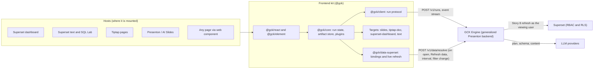

# Part IX · Generative Content Kit

**Reads:** `servers/nextjs/app/(presentation-generator)/outline/hooks/useOutlineStreaming.ts`, `servers/nextjs/components/slide-editor/text/TiptapInlineTextEditor.tsx`, `servers/fastapi/templates/v2/schema.py`  ·  **Builds on:** [Part VIII landing](../delivery/index.md), [Part VII landing](../superset/index.md)  ·  **Time:** ~15 min

Presenton turns a sentence into a slide deck. The goal of this part is bigger: the same "type what you want, get finished content" experience as one reusable component that any surface can host. Today that surface is Superset text; tomorrow a Superset dashboard; the day after, a page in a Tiptap editor. This part explains how to extract that capability from Presenton into a frontend-first kit, and how to plan the frontend work so each new host is an integration, not a rebuild.

## The problem statement

> The end objective is to create, the way Presenton creates a PPT slide from normal text, a common functionality that can be plugged into any host. Today it might be for Superset text, tomorrow for a Superset dashboard, the next day for pages with the Tiptap editor. We want to automatically create pages based on the user's natural language input. How can we extend Presenton into an AI component that is easy to integrate from a frontend perspective, and how should we plan it from a frontend perspective?

## The short answer

Presenton's value is not its slide screens. It is a pipeline:

1. Natural language plus context becomes a **plan** (Presenton's outline).
2. The plan becomes structured content that must fit a **schema** derived from what the output can hold (Presenton's Template v2 layouts).
3. The content **streams** to the browser and is shown progressively (Presenton's SSE streams).
4. A **renderer** turns structured content into the final format (Presenton's slide renderer and PPTX export).

Generalize each step and the kit falls out:

| Presenton today | Generative Content Kit |
| --- | --- |
| Slide outline | Target-neutral plan with sections |
| Template v2 layout schema (`servers/fastapi/templates/v2/schema.py`) | A **target manifest** that declares which blocks, layouts and limits an output supports; the engine builds the model's response schema from it |
| Slide JSON | One intermediate representation, the **Artifact Spec**, shared by every output |
| Presenton-specific SSE frames, read with `EventSource` (`servers/nextjs/app/(presentation-generator)/outline/hooks/useOutlineStreaming.ts:107`) | A versioned **run protocol**: JSON Patch events over fetch-based streaming, resumable, with a human-review step |
| Next.js pages wired to Redux | A **headless core** plus a thin **React kit** and a **web component** |
| One output: slides | Pluggable **targets**: slides, Tiptap documents, Superset dashboards, text |
| One app | Pluggable **hosts**: Superset extension, Tiptap extension, Presenton, any page |
| Chart values written by the model | **Data bindings** to Superset charts, datasets and saved metrics, resolved as the viewing user and refreshed after generation |

The recommendation in one sentence: **the language model never writes host-native formats; it writes the Artifact Spec, constrained by the target's manifest, and deterministic adapters convert it into slides, ProseMirror JSON, Superset `position_json` or Markdown.** Numbers never come from the model either: every number is a binding to Superset data, and every target shows it live. The host stores the binding definition, and the value is fetched again as the person viewing it, on open, on "Refresh data", on an interval and when a dashboard filter or a parameter changes. Outputs that can only hold static text (an exported Markdown file, an email, a downloaded PPTX) carry a "Data as of" stamp and a link to the live version, and no target ever shows a screenshot of a chart.

## The picture

## Where each part of the question is answered

| Part of the question | Answer in short | Where |
| --- | --- | --- |
| "Superset text" | The `text` target writes Markdown into a dashboard Markdown component, narrates an SQL Lab result, and runs headless for alert and report narratives | [Host integrations](65-host-integrations.md), Step 3; [Artifact Spec and targets](62-artifact-spec-and-targets.md), Step 10 |
| "a Superset dashboard" | The `superset-dashboard` target turns the Artifact into `position_json`, applied as a new tab or a new dashboard, with undo | [Host integrations](65-host-integrations.md), Step 2; [Artifact Spec and targets](62-artifact-spec-and-targets.md), Step 9 |
| "pages with the Tiptap editor" | The `tiptap-doc` target plus the `GckGenerate` extension: `/ai`, bubble actions, streaming insert, one undo step | [Host integrations](65-host-integrations.md), Step 4; [Artifact Spec and targets](62-artifact-spec-and-targets.md), Step 8 |
| "automatically create pages based on the user's natural language input" | Prompt and host context become a plan, an optional outline review, then a streamed Artifact constrained by the target manifest | [Run protocol and client](63-run-protocol-and-client.md); [Extracting the engine from Presenton](66-extracting-from-presenton.md), Step 3 |
| "extend Presenton into an AI component" | Generalize Presenton's FastAPI pipeline into the GCK Engine and carve the frontend pieces into `@gck/*` packages, keeping slides working | [Extracting the engine from Presenton](66-extracting-from-presenton.md) |
| "easy to integrate from a frontend perspective" | One provider, one hook and a few drop-in components for React hosts (about 40 lines of host code), a `<gck-generate>` web component for everyone else, an iframe as the last resort | [React SDK and UI kit](64-react-sdk-and-ui-kit.md), Step 13; [Host integrations](65-host-integrations.md), Step 6 |
| "the data should be dynamic, fetched live from Superset" (every target) | Hosts persist binding definitions, not numbers; the kit's refresh controller re-resolves them as the viewer through the engine and Story 8 on open, on demand, on an interval and on filter or parameter change; dashboards use native Superset charts; static outputs are stamped "Data as of" | [Live Superset data](69-live-superset-data.md); [Architecture](61-architecture.md), Step 4; [Host integrations](65-host-integrations.md); [Extracting the engine from Presenton](66-extracting-from-presenton.md), Step 3.4 |
| "how should we plan it from a frontend perspective" | Package layout, budgets, theming, accessibility, security and testing, then five phases that each add one host or target | [Frontend engineering and quality](67-frontend-engineering.md); [Roadmap and tracker](68-roadmap.md) |

## How this part relates to the others

- **Part VII** designed the data-bound document model for Superset. The Artifact Spec here is a smaller, frontend-friendly version of it, with the same rule: numbers come only from data bindings.
- **Part VIII** builds AI Slides by embedding Presenton in an iframe. That is the right first step for slides. Part IX does not change it. It defines what to extract once AI Slides works, so the next surfaces do not each need their own Presenton fork. AI Slides moves onto the kit last (phase P4 in the [Roadmap and tracker](68-roadmap.md)), once the kit is proven on the text, Tiptap and dashboard targets. GCK decks keep Part VIII's behavior for data: the slides target writes real `slide_data_bindings` rows, so a generated deck refreshes on open and refreshes before export exactly like a Part VIII deck.

## Reading order

1. [Architecture](61-architecture.md): layers, packages, the three main flows, and the key decisions.
2. [Artifact Spec and targets](62-artifact-spec-and-targets.md): the intermediate representation and the four target adapters.
3. [Live Superset data](69-live-superset-data.md): binding sources, scope and parameters, refresh policies, the resolve APIs and how every target stays live as the viewer.
4. [Run protocol and client](63-run-protocol-and-client.md): how the frontend talks to the engine.
5. [React SDK and UI kit](64-react-sdk-and-ui-kit.md): hooks, state machine and components.
6. [Host integrations](65-host-integrations.md): Superset dashboard, Superset text, Tiptap, Presenton, and the web component.
7. [Extracting the engine from Presenton](66-extracting-from-presenton.md): what to reuse, generalize or drop.
8. [Frontend engineering and quality](67-frontend-engineering.md): packaging, theming, accessibility, security, testing.
9. [Roadmap and tracker](68-roadmap.md): phases, work packages, effort and exit criteria.

## What you now know

- The problem: one AI generation capability, many hosts and output formats.
- The answer: an intermediate representation, target manifests, a run protocol and a headless frontend kit.
- How Presenton's pipeline maps onto the kit, step by step.
- That every target shows live Superset data fetched as the viewer, and which outputs must stay stamped snapshots.
- How Part IX builds on Parts VII and VIII without changing them.

## Next

Read the [Architecture](61-architecture.md) chapter.
