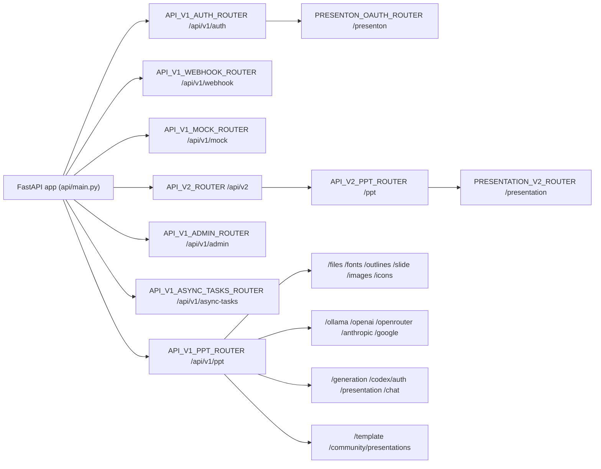
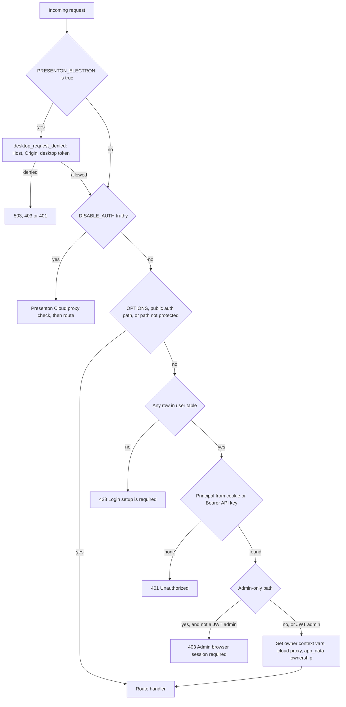
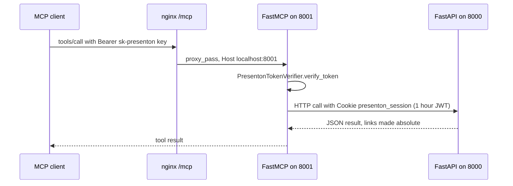
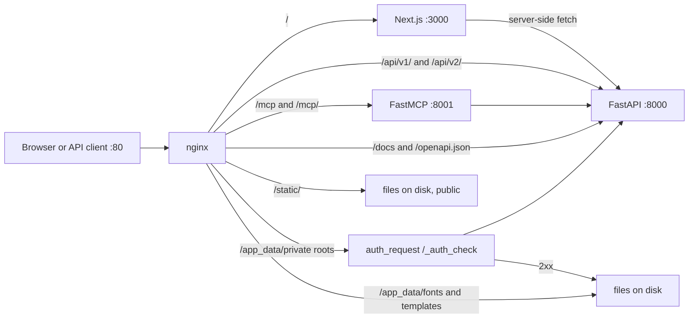

# Endpoint index

<div class="chapter-meta" markdown>
**Reads:** `servers/fastapi/api/main.py`, `servers/fastapi/api/middlewares.py`, `servers/fastapi/api/v1/**`, `servers/fastapi/api/v2/**`, `servers/fastapi/mcp_server.py`, `servers/nextjs/app/api/**/route.ts`, `servers/nextjs/proxy.ts`, `nginx.conf`  ·  **Builds on:** [REST API, async tasks, webhooks, MCP](presenton/15-api-async-mcp.md), [Auth and multi-user](presenton/25-auth-and-multiuser.md)  ·  **Time:** ~30 min (reference)
</div>

This appendix is a complete, mechanically built index of every HTTP surface in the Presenton snapshot: all 102 FastAPI application routes, the 11 Next.js API route files, the MCP tools, and every nginx `location` block. For each FastAPI route you get the method, the full path after all router prefixes, the handler function, the exact decorator line, the access class enforced by `SessionAuthMiddleware` and the handler, and a one-line purpose. The first steps explain how the index was produced and how to read the access column, so you can rebuild it after upstream changes.

## Step 1: How the full paths are assembled

FastAPI composes a route's public path from the prefix of every `APIRouter` it is nested in. Presenton nests routers at most three levels deep. `servers/fastapi/api/main.py:68` to `servers/fastapi/api/main.py:74` include seven top-level routers on the app:

```python title="servers/fastapi/api/main.py (excerpt)"
app = FastAPI(lifespan=app_lifespan)

# Routers
app.include_router(API_V1_PPT_ROUTER)
app.include_router(API_V1_WEBHOOK_ROUTER)
app.include_router(API_V1_MOCK_ROUTER)
app.include_router(API_V1_AUTH_ROUTER)
app.include_router(API_V1_ADMIN_ROUTER)
app.include_router(API_V1_ASYNC_TASKS_ROUTER)
app.include_router(API_V2_ROUTER)
```

`API_V1_PPT_ROUTER` (`servers/fastapi/api/v1/ppt/router.py:22`, prefix `/api/v1/ppt`) includes seventeen endpoint routers, `API_V1_AUTH_ROUTER` (`servers/fastapi/api/v1/auth/router.py:27`) includes the Presenton Cloud provider router at `servers/fastapi/api/v1/auth/router.py:28`, and `API_V2_ROUTER` (`servers/fastapi/api/v2/router.py:6`, prefix `/api/v2`) includes `API_V2_PPT_ROUTER` (prefix `/ppt`), which includes `PRESENTATION_V2_ROUTER` (prefix `/presentation`).



The complete prefix table, with the line that declares each router:

| Router variable | Declared at | Own prefix | Effective prefix |
| --- | --- | --- | --- |
| `API_V1_AUTH_ROUTER` | `servers/fastapi/api/v1/auth/router.py:27` | `/api/v1/auth` | `/api/v1/auth` |
| `PRESENTON_OAUTH_ROUTER` | `servers/fastapi/api/v1/auth/presenton_oauth.py:29` | `/presenton` | `/api/v1/auth/presenton` |
| `API_V1_ADMIN_ROUTER` | `servers/fastapi/api/v1/admin/router.py:41` | `/api/v1/admin` | `/api/v1/admin` |
| `API_V1_ASYNC_TASKS_ROUTER` | `servers/fastapi/api/v1/async_tasks/router.py:14` | `/api/v1/async-tasks` | `/api/v1/async-tasks` |
| `API_V1_WEBHOOK_ROUTER` | `servers/fastapi/api/v1/webhook/router.py:10` | `/api/v1/webhook` | `/api/v1/webhook` |
| `API_V1_MOCK_ROUTER` | `servers/fastapi/api/v1/mock/router.py:9` | `/api/v1/mock` | `/api/v1/mock` |
| `FILES_ROUTER` | `servers/fastapi/api/v1/ppt/endpoints/files.py:16` | `/files` | `/api/v1/ppt/files` |
| `FONTS_ROUTER` | `servers/fastapi/api/v1/ppt/endpoints/fonts.py:18` | `/fonts` | `/api/v1/ppt/fonts` |
| `OUTLINES_ROUTER` | `servers/fastapi/api/v1/ppt/endpoints/outlines.py:40` | `/outlines` | `/api/v1/ppt/outlines` |
| `SLIDE_ROUTER` | `servers/fastapi/api/v1/ppt/endpoints/slide.py:30` | `/slide` | `/api/v1/ppt/slide` |
| `IMAGES_ROUTER` | `servers/fastapi/api/v1/ppt/endpoints/images.py:31` | `/images` | `/api/v1/ppt/images` |
| `ICONS_ROUTER` | `servers/fastapi/api/v1/ppt/endpoints/icons.py:7` | `/icons` | `/api/v1/ppt/icons` |
| `OLLAMA_ROUTER` | `servers/fastapi/api/v1/ppt/endpoints/ollama.py:13` | `/ollama` | `/api/v1/ppt/ollama` |
| `OPENAI_ROUTER` | `servers/fastapi/api/v1/ppt/endpoints/openai.py:9` | `/openai` | `/api/v1/ppt/openai` |
| `OPENROUTER_ROUTER` | `servers/fastapi/api/v1/ppt/endpoints/openrouter.py:11` | `/openrouter` | `/api/v1/ppt/openrouter` |
| `ANTHROPIC_ROUTER` | `servers/fastapi/api/v1/ppt/endpoints/anthropic.py:9` | `/anthropic` | `/api/v1/ppt/anthropic` |
| `GOOGLE_ROUTER` | `servers/fastapi/api/v1/ppt/endpoints/google.py:6` | `/google` | `/api/v1/ppt/google` |
| `GENERATION_ROUTER` | `servers/fastapi/api/v1/ppt/endpoints/generation.py:7` | `/generation` | `/api/v1/ppt/generation` |
| `CODEX_AUTH_ROUTER` | `servers/fastapi/api/v1/ppt/endpoints/codex_auth.py:48` | `/codex/auth` | `/api/v1/ppt/codex/auth` |
| `PRESENTATION_ROUTER` | `servers/fastapi/api/v1/ppt/endpoints/presentation.py:136` | `/presentation` | `/api/v1/ppt/presentation` |
| `CHAT_ROUTER` | `servers/fastapi/api/v1/ppt/endpoints/chat.py:28` | `/chat` | `/api/v1/ppt/chat` |
| `TEMPLATE_ROUTER` | `servers/fastapi/api/v1/ppt/endpoints/template.py:96` | `/template` | `/api/v1/ppt/template` |
| `COMMUNITY_ROUTER` | `servers/fastapi/api/v1/ppt/endpoints/community.py:11` | `/community/presentations` | `/api/v1/ppt/community/presentations` |
| `API_V2_ROUTER` | `servers/fastapi/api/v2/router.py:6` | `/api/v2` | `/api/v2` |
| `API_V2_PPT_ROUTER` | `servers/fastapi/api/v2/ppt/router.py:6` | `/ppt` | `/api/v2/ppt` |
| `PRESENTATION_V2_ROUTER` | `servers/fastapi/api/v2/ppt/endpoints/presentation.py:35` | `/presentation` | `/api/v2/ppt/presentation` |

## Step 2: How the index was built and checked

The route rows below were extracted with a short Python script that parses every file under `servers/fastapi/api/` with the standard `ast` module, finds every decorator of the form `@<NAME>.get|post|put|patch|delete|api_route(...)`, reads the literal path argument, and joins it with the effective prefix of `<NAME>` from the table in Step 1. That produced 101 decorated routes. A second pass with `grep -E "_ROUTER\.(get|post|put|patch|delete|api_route)"` found 102 matches; the extra one is the only route in the codebase registered without decorator syntax:

```python title="servers/fastapi/api/v1/ppt/endpoints/fonts.py (excerpt)"
FONTS_ROUTER.post("/check", response_model=FontCheckResponse)(
    check_fonts_in_pptx_handler
)
```

There is no `add_api_route`, no `@app.get`, no `api_route` and no `websocket` route anywhere outside the tests. The only other decorator on `app` is the HTTP middleware at `servers/fastapi/api/main.py:106`.

As an independent cross-check, the committed OpenAPI document `servers/fastapi/openai_spec.json` (the file the MCP server loads) contains 93 paths and 100 operations. Every operation in it appears in this index. Two routes in the code are absent from that file: `POST /api/v1/ppt/images/test` and `POST /api/v1/ppt/presentation/{id}/regenerate`.

!!! warning "Gotcha"
    `openai_spec.json` is a static snapshot written by `servers/fastapi/scripts/generate_openapi_spec.py` (`json.dumps(app.openapi(), ...)`). It is not regenerated at startup. The MCP server reads it at import time (`servers/fastapi/mcp_server.py:281`), so if you add or change a route that an MCP tool maps to, you must regenerate the file or the MCP tool keeps the old schema. In this snapshot the file already lags the code by two routes.

**Total: 102 FastAPI application routes.** On top of those, FastAPI itself serves `/openapi.json`, `/docs`, `/docs/oauth2-redirect` and `/redoc`, and the app mounts `/static` (`servers/fastapi/api/main.py:86`) plus seven owner-scoped static mounts `/app_data/{exports,fonts,images,pptx-to-html,pptx-to-json,templates,uploads}` created by `mount_app_data_assets` (`servers/fastapi/api/v1/auth/assets.py:39`) when `APP_DATA_DIRECTORY` is set.

Route count by area:

| Area | Routes | Area | Routes |
| --- | --- | --- | --- |
| Auth (local + Presenton Cloud link) | 9 | Images | 7 |
| Admin | 10 | Icons | 1 |
| Async tasks | 2 | Fonts | 5 |
| Webhook | 2 | Templates | 14 |
| Mock | 2 | Providers (models, Ollama, Codex, generation defaults) | 15 |
| Presentation (v1) | 17 | Chat | 5 |
| Outlines | 3 | Community | 2 |
| Slide | 2 | Presentation (v2, Smart) | 2 |
| Files | 4 | **Total** | **102** |

## Step 3: How the access class is decided

Access control is applied in two layers. The first is `SessionAuthMiddleware.dispatch` (`servers/fastapi/api/middlewares.py:55`), which runs for every request. The second is a per-handler dependency on a few routers.



The relevant lists, verbatim:

```python title="servers/fastapi/api/middlewares.py (excerpt)"
class SessionAuthMiddleware(BaseHTTPMiddleware):
    _PUBLIC_AUTH_PATHS = {
        "/api/v1/auth/status",
        "/api/v1/auth/verify",
        "/api/v1/auth/setup",
        "/api/v1/auth/login",
        "/api/v1/auth/logout",
    }
    _PUBLIC_AUTH_PREFIXES: tuple[str, ...] = ()
    _PUBLIC_APP_DATA_PREFIXES = (
        "/app_data/fonts/",
        "/app_data/templates/",
    )
    _PROTECTED_NON_API_PATHS = {"/docs", "/openapi.json", "/redoc"}
# ...
            admin_only = (
                path.startswith("/api/v1/admin/")
                or path.startswith("/api/v1/ppt/codex/auth/")
                or (
                    path.startswith("/api/v1/ppt/fonts/")
                    and request.method in {"POST", "DELETE"}
                )
                or path in {
                    "/api/v1/ppt/ollama/models/pull",
                    "/api/v1/ppt/ollama/models/available",
                    "/api/v1/ppt/openai/models/available",
                    "/api/v1/ppt/images/test",
                    "/api/v1/ppt/openrouter/providers/available",
                }
            )
```

A principal is resolved by `resolve_request_principal` (`servers/fastapi/api/v1/auth/principal.py:22`): first the `presenton_session` cookie (a JWT, `method="jwt"`), then an `Authorization: Bearer sk-presenton-...` API key (`method="api_key"`). The admin-only check requires `principal.method == "jwt"` **and** `is_admin`, which is why an administrator's API key is still rejected on admin paths.

The legend used in the **Access** column:

| Access value | Meaning |
| --- | --- |
| Public | Listed in `_PUBLIC_AUTH_PATHS`; the middleware lets it through without a principal. The handler may still check the cookie itself. |
| User | Any principal: a browser session cookie or a valid user API key. Rows the user does not own are filtered by the ORM owner scope described in [Auth and multi-user](presenton/25-auth-and-multiuser.md). |
| Admin (JWT) | Matched by the middleware `admin_only` rule: the caller must be an administrator using a browser session cookie. API keys get 403. |
| User, handler admin | The middleware accepts any principal, but the handler dependency (`get_current_admin`, `require_settings_admin` or `require_presenton_manager`) reads only the session cookie and requires `is_superuser`. |

!!! warning "Gotcha"
    `DISABLE_AUTH=true` (the Electron runtime) short-circuits the middleware completely: every route is reachable without a principal. However, the admin handlers that depend on `get_current_admin` (`servers/fastapi/api/v1/auth/users.py:219`) still read the cookie, find no user, and return 401. So in auth-disabled mode `/api/v1/admin/api-keys` and `/api/v1/admin/users` are unusable, while `/api/v1/admin/provider-settings` works because `require_settings_admin` returns early when auth is disabled (`servers/fastapi/api/v1/admin/router.py:136`).

!!! warning "Gotcha"
    The font rule is method based: every `POST` or `DELETE` under `/api/v1/ppt/fonts/` is admin only. That includes `POST /api/v1/ppt/fonts/check`, which only analyzes a PPTX. The custom template hook calls it (`servers/nextjs/app/(presentation-generator)/custom-template/hooks/useTemplateCreation.ts:150`), so a non-admin user running that flow receives a 403 from this call.

Middleware order also matters. Starlette wraps the most recently added middleware outermost, so for a request the order is `static_icon_fallback_middleware` (`servers/fastapi/api/main.py:106`), then `SessionAuthMiddleware`, then `UserConfigEnvUpdateMiddleware`, then `CORSMiddleware`, then the router. A 401 or 403 produced by `SessionAuthMiddleware` is therefore returned before the CORS layer runs.

## Step 4: FastAPI routes, auth and admin

### Local authentication

| Method | Path | Handler | Source | Access | Purpose |
| --- | --- | --- | --- | --- | --- |
| GET | `/api/v1/auth/status` | `get_status` | `servers/fastapi/api/v1/auth/router.py:58` | Public | Returns `configured`, `authenticated`, `username`, `user_id`, `role` for the session cookie. With auth disabled it always answers `username: "electron"`, `role: "admin"`. |
| GET | `/api/v1/auth/verify` | `verify_session` | `servers/fastapi/api/v1/auth/router.py:81` | Public (handler requires principal) | Resolves cookie or API key, 401 if none. If `X-Original-URI` is present it applies the `/app_data` ownership rule (403 on mismatch). This is nginx's `auth_request` target. |
| POST | `/api/v1/auth/setup` | `setup_credentials` | `servers/fastapi/api/v1/auth/router.py:110` | Public | Creates the first account as `is_superuser=True`, `admin_slot="primary"`. 409 once any user exists. Does not log in (`authenticated: false`). |
| POST | `/api/v1/auth/login` | `login` | `servers/fastapi/api/v1/auth/router.py:155` | Public | Case-insensitive username lookup, password verify with transparent rehash, sets the `presenton_session` cookie (30 days, `httponly`, `samesite=lax`). 428 before setup. |
| POST | `/api/v1/auth/logout` | `logout` | `servers/fastapi/api/v1/auth/router.py:191` | Public | Deletes the session cookie and returns `{"success": true}`. |

### Presenton Cloud provider link (OAuth device flow)

| Method | Path | Handler | Source | Access | Purpose |
| --- | --- | --- | --- | --- | --- |
| GET | `/api/v1/auth/presenton/status` | `presenton_provider_status` | `servers/fastapi/api/v1/auth/presenton_oauth.py:120` | User | Reports `linked`, `can_manage`, `cloud_generation_enabled`; `email` only when the caller can manage the provider. |
| POST | `/api/v1/auth/presenton/logout` | `logout_presenton_account` | `servers/fastapi/api/v1/auth/presenton_oauth.py:141` | User, handler admin | Revokes and clears the global cloud credential. If `LLM` was `presenton`, saves `LLM: None` so the UI must pick a new provider. |
| POST | `/api/v1/auth/presenton/device/start` | `start_presenton_provider_connection` | `servers/fastapi/api/v1/auth/presenton_oauth.py:164` | User, handler admin | Calls `{issuer}/oauth/device_authorization`; returns the device payload with `verification_uri_complete` forced to the plain URI, `Cache-Control: no-store`. |
| POST | `/api/v1/auth/presenton/device/poll` | `poll_presenton_provider_connection` | `servers/fastapi/api/v1/auth/presenton_oauth.py:217` | User, handler admin | Exchanges `device_code` at `{issuer}/oauth/token`; 202 `{"status": "pending"}` while pending; on success validates userinfo and stores the encrypted token. |

### Admin

| Method | Path | Handler | Source | Access | Purpose |
| --- | --- | --- | --- | --- | --- |
| GET | `/api/v1/admin/api-keys` | `list_api_keys` | `servers/fastapi/api/v1/admin/router.py:44` | Admin (JWT) | All API keys, newest first, as `ApiKeyPublic` (no secret). |
| POST | `/api/v1/admin/api-keys` | `create_api_key` | `servers/fastapi/api/v1/admin/router.py:60` | Admin (JWT) | 201. Body `user_id`, `label` (default `"API client"`, 1 to 120 chars), `expiry_days` (default 90, 1 to 365). Response includes the `token` once. |
| GET | `/api/v1/admin/api-keys/{api_key_id}/token` | `get_api_key_token` | `servers/fastapi/api/v1/admin/router.py:85` | Admin (JWT) | Decrypts and reveals a stored token; 410 if revoked, 409 if not revealable; sends `Cache-Control: no-store`. |
| POST | `/api/v1/admin/api-keys/{api_key_id}/revoke` | `revoke_api_key` | `servers/fastapi/api/v1/admin/router.py:111` | Admin (JWT) | Sets `revoked_at` (idempotent) and returns the key. |
| GET | `/api/v1/admin/provider-settings` | `read_provider_settings` | `servers/fastapi/api/v1/admin/router.py:144` | Admin (JWT) | The singleton provider settings row plus `PRESENTON_CONNECTED` and `PRESENTON_EMAIL`. |
| PUT | `/api/v1/admin/provider-settings` | `update_provider_settings` | `servers/fastapi/api/v1/admin/router.py:158` | Admin (JWT) | Merges and saves an arbitrary JSON object via `save_provider_settings`, then reloads env with `update_env_with_user_config()`. |
| GET | `/api/v1/admin/users` | `list_users` | `servers/fastapi/api/v1/admin/router.py:169` | Admin (JWT) | Users ordered by `created_at desc, username asc`. |
| POST | `/api/v1/admin/users` | `create_user` | `servers/fastapi/api/v1/admin/router.py:182` | Admin (JWT) | 201. Creates a non-admin user; 409 on a case-insensitive duplicate. |
| PUT | `/api/v1/admin/users/{user_id}/password` | `reset_user_password` | `servers/fastapi/api/v1/admin/router.py:215` | Admin (JWT) | Rehashes the password and increments `auth_version`, which invalidates the user's existing JWTs. Refuses the admin itself and any superuser. |
| DELETE | `/api/v1/admin/users/{user_id}` | `delete_user` | `servers/fastapi/api/v1/admin/router.py:236` | Admin (JWT) | 204. Deletes a non-admin user (rows cascade) and removes `users/{id}` under `images`, `exports`, `uploads`, `pptx-to-html` and `pptx-to-json`, plus `{id}` directly under the temp directory. 403 for the admin itself or any superuser. |

!!! warning "Gotcha"
    The admin router rules are enforced twice: by the middleware path rule and by `Depends(get_current_admin)` or `Depends(require_settings_admin)`. If you move an admin route out of `/api/v1/admin/`, the middleware stops protecting it and only the dependency remains. If you add a route to `API_V1_ADMIN_ROUTER` and forget the dependency, the middleware still protects it, but only while auth is enabled.

## Step 5: FastAPI routes, presentation lifecycle

### Presentation (v1)

| Method | Path | Handler | Source | Access | Purpose |
| --- | --- | --- | --- | --- | --- |
| GET | `/api/v1/ppt/presentation/all` | `get_all_presentations` | `servers/fastapi/api/v1/ppt/endpoints/presentation.py:1499` | User | Dashboard list, newest first. `include_slides=true` (default) inner-joins the slide with `index == 0`; `version` filters `v1-standard` or `v2-standard`. |
| GET | `/api/v1/ppt/presentation/{id}` | `get_presentation` | `servers/fastapi/api/v1/ppt/endpoints/presentation.py:1551` | User | One presentation with all slides ordered by `index`. Also the data source of the export runtime. |
| DELETE | `/api/v1/ppt/presentation/{id}` | `delete_presentation` | `servers/fastapi/api/v1/ppt/endpoints/presentation.py:1572` | User | 204. Deletes the row; slides cascade through the foreign key. |
| POST | `/api/v1/ppt/presentation/{id}/duplicate` | `duplicate_presentation` | `servers/fastapi/api/v1/ppt/endpoints/presentation.py:1584` | User | Deep copies the presentation and its slides with new ids; appends `" (Copy)"` to the title. |
| POST | `/api/v1/ppt/presentation/{id}/regenerate` | `regenerate_smart_presentation` | `servers/fastapi/api/v1/ppt/endpoints/presentation.py:1615` | User | 204. Smart only: deletes the saved slides so the next `/stream/{id}` starts over. 400 when the provider is Presenton Cloud or the deck is not a generated Smart deck. |
| POST | `/api/v1/ppt/presentation/{id}/export` | `export_existing_presentation` | `servers/fastapi/api/v1/ppt/endpoints/presentation.py:1642` | User | Body `{"export_as": "pptx"}` or `"pdf"`. Re-runs the export for a stored deck; returns `presentation_id`, `path`, `edit_path`. |
| POST | `/api/v1/ppt/presentation/create` | `create_presentation` | `servers/fastapi/api/v1/ppt/endpoints/presentation.py:1681` | User | Step 1 of the UI flow: inserts a `presentations` row (`version="v2-standard"`, `n_slides=0` meaning auto). No LLM call. Validates slide counts, TOC rule, and community ids (Smart only, max 3). |
| POST | `/api/v1/ppt/presentation/create/blank` | `create_blank_presentation` | `servers/fastapi/api/v1/ppt/endpoints/presentation.py:1783` | User | 201. A one-slide deck titled `"Untitled Presentation"` with layout `__blank_slide__`, optionally tied to a `template_id`. |
| POST | `/api/v1/ppt/presentation/prepare` | `prepare_presentation` | `servers/fastapi/api/v1/ppt/endpoints/presentation.py:1840` | User | Step 3: body `presentation_id`, `outlines`, `layout` (template id, `custom-` prefix accepted), `title`. Stores the outline, copies the template layout, and computes `structure` (LLM unless the layout is `ordered`), inserting TOC slides. |
| GET | `/api/v1/ppt/presentation/stream/{id}` | `stream_presentation` | `servers/fastapi/api/v1/ppt/endpoints/presentation.py:2281` | User | Step 4, SSE. Standard: per-slide content, `chunk` and `slide_assets` events, then `complete`. Smart decks are delegated to `stream_smart_presentation` (`slide_html`, `fonts`, `generation_metrics`). |
| PATCH | `/api/v1/ppt/presentation/update` | `update_presentation` | `servers/fastapi/api/v1/ppt/endpoints/presentation.py:2527` | User | Updates `n_slides` and `title`; when `slides` is sent, deletes the caller's slides for the deck and inserts the new list. Used by editor auto-save. |
| PATCH | `/api/v1/ppt/presentation/slide_update` | `update_presentation_slide` | `servers/fastapi/api/v1/ppt/endpoints/presentation.py:2585` | User | Body `{"slide": {...}}`. Updates one slide in place, excluding `id`, `presentation` and `index`; 400 if the slide belongs to a different deck. |
| POST | `/api/v1/ppt/presentation/generate` | `generate_presentation_sync` | `servers/fastapi/api/v1/ppt/endpoints/presentation.py:3169` | User | One-shot API: outline, structure, slides, assets and export in one blocking request. Body `GeneratePresentationRequest`. |
| POST | `/api/v1/ppt/presentation/generate/async` | `generate_presentation_async` | `servers/fastapi/api/v1/ppt/endpoints/presentation.py:3240` | User | Same work in a `BackgroundTasks` job. Returns an `AsyncTaskModel` of type `presentation.generate`. MCP tool `start_standard_presentation`. |
| GET | `/api/v1/ppt/presentation/status/{id}` | `check_async_presentation_generation_status` | `servers/fastapi/api/v1/ppt/endpoints/presentation.py:3282` | User | Older polling path over the same `async_tasks` table as `/api/v1/async-tasks/status/{id}`. |
| POST | `/api/v1/ppt/presentation/edit` | `edit_presentation_with_new_content` | `servers/fastapi/api/v1/ppt/endpoints/presentation.py:3301` | User | Body `EditPresentationRequest` (`presentation_id`, `slides[{index, content}]`, `export_as`). Deep-merges content into matching slides, replaces them, re-exports the same deck. |
| POST | `/api/v1/ppt/presentation/derive` | `derive_presentation_from_existing_one` | `servers/fastapi/api/v1/ppt/endpoints/presentation.py:3352` | User | Same body; copies the deck to a new id with the content overrides applied and exports the copy. |

A typical async start returns this shape (fields from `servers/fastapi/models/sql/async_task.py`; `owner_id` and `payload` are excluded from serialization):

```json title="POST /api/v1/ppt/presentation/generate/async (response shape)"
{
  "id": "task-<64 hex characters>",
  "type": "presentation.generate",
  "status": "pending",
  "message": "Queued for generation",
  "error": null,
  "data": {
    "created_slides": 0,
    "remaining_slides": 8,
    "presentation_id": "<uuid>"
  },
  "created_at": "<timestamp>",
  "updated_at": "<timestamp>"
}
```

!!! warning "Gotcha"
    `GeneratePresentationRequest.trigger_webhook` (`servers/fastapi/models/generate_presentation_request.py:44`) is declared but never read anywhere in the code. `generate_presentation_handler` dispatches `presentation.generation.completed` or `presentation.generation.failed` to every matching subscription unconditionally (`servers/fastapi/api/v1/ppt/endpoints/presentation.py:3133` and `:3150`). Setting `trigger_webhook: false` does not suppress webhooks.

!!! warning "Gotcha"
    `POST /presentation/edit`, `/derive`, `/generate`, `/generate/async`, `/status/{id}` and `/{id}/export` are API-surface routes. The Next.js UI does not call them; it exports through its own `POST /api/export-presentation` route (Step 10). If you change their payloads, only external API and MCP clients are affected.

### Outlines

| Method | Path | Handler | Source | Access | Purpose |
| --- | --- | --- | --- | --- | --- |
| GET | `/api/v1/ppt/outlines/{id}` | `get_outline` | `servers/fastapi/api/v1/ppt/endpoints/outlines.py:44` | User | Stored outline, or `{"slides": []}` when none exists yet. |
| PUT | `/api/v1/ppt/outlines/{id}` | `update_outline` | `servers/fastapi/api/v1/ppt/endpoints/outlines.py:59` | User | Replaces the outline, recomputes `n_slides` and `title`, and writes the outline to Mem0. |
| GET | `/api/v1/ppt/outlines/stream/{id}` | `stream_outlines` | `servers/fastapi/api/v1/ppt/endpoints/outlines.py:84` | User | Step 2, SSE. Loads source documents, streams raw outline JSON as `chunk` events, parses it with `dirtyjson`, persists it, and ends with `complete` (key `presentation`). |

### Slide

| Method | Path | Handler | Source | Access | Purpose |
| --- | --- | --- | --- | --- | --- |
| POST | `/api/v1/ppt/slide/edit` | `edit_slide` | `servers/fastapi/api/v1/ppt/endpoints/slide.py:38` | User | Body `id`, `prompt`. The LLM picks a layout, rewrites the content, assets are re-fetched, and the slide gets a new id. |
| POST | `/api/v1/ppt/slide/edit-html` | `edit_slide_html` | `servers/fastapi/api/v1/ppt/endpoints/slide.py:135` | User | Body `id`, `prompt`, optional `html` (defaults to `slide.html_content`). The LLM edits the HTML; the slide gets a new id so Next.js re-renders it. |

!!! warning "Gotcha"
    Both slide endpoints deliberately assign `slide.id = uuid.uuid4()` before committing. Any client that holds the old slide id (for example to call `slide_update` next) must read the id from the response. The current editor does not call these two routes at all; slide edits from the UI go through the chat assistant in [Editing and chat assistant](presenton/14-editing-and-chat.md).

### Presentation (v2, Smart mode)

| Method | Path | Handler | Source | Access | Purpose |
| --- | --- | --- | --- | --- | --- |
| POST | `/api/v2/ppt/presentation/generate/smart` | `generate_smart_presentation_sync` | `servers/fastapi/api/v2/ppt/endpoints/presentation.py:229` | User | Blocking Smart generation and export. Body `GenerateSmartPresentationRequest`. `operation_id="generate_smart_presentation"`. |
| POST | `/api/v2/ppt/presentation/generate/smart/async` | `generate_smart_presentation_async` | `servers/fastapi/api/v2/ppt/endpoints/presentation.py:264` | User | Queues task type `presentation.smart.generate`; MCP tool `start_smart_presentation`. |

### Async tasks, webhook, mock

| Method | Path | Handler | Source | Access | Purpose |
| --- | --- | --- | --- | --- | --- |
| GET | `/api/v1/async-tasks` | `list_async_tasks` | `servers/fastapi/api/v1/async_tasks/router.py:20` | User | Filters `type`, `status`, `created_at` (alias of `created_at_from`), `created_at_to`; `order_by` `created_at` or `updated_at` (default `created_at`), `order` `asc` or `desc` (default `desc`); `limit` 1 to 200 (default 50); `offset`. |
| GET | `/api/v1/async-tasks/status/{id}` | `check_async_task_status` | `servers/fastapi/api/v1/async_tasks/router.py:69` | User | One task. `data.path`, `edit_path` and `preview_url` are made absolute for MCP callers. MCP tool `get_job_status`. |
| POST | `/api/v1/webhook/subscribe` | `subscribe_to_webhook` | `servers/fastapi/api/v1/webhook/router.py:23` | User | 201. Body `url`, `secret`, `event` (`presentation.generation.completed` or `presentation.generation.failed`). Returns `{"id": "webhook-<hex>"}`. |
| DELETE | `/api/v1/webhook/unsubscribe` | `unsubscribe_to_webhook` | `servers/fastapi/api/v1/webhook/router.py:40` | User | 204. Body `{"id": "..."}` (embedded body on a DELETE). |
| GET | `/api/v1/mock/presentation-generation-completed` | `mock_presentation_generation_completed` | `servers/fastapi/api/v1/mock/router.py:12` | User | Returns a sample `PresentationPathAndEditPath` list: the shape of the completed webhook body. |
| GET | `/api/v1/mock/presentation-generation-failed` | `mock_presentation_generation_completed` | `servers/fastapi/api/v1/mock/router.py:26` | User | Returns a sample `APIErrorModel` list: the shape of the failed webhook body. |

!!! warning "Gotcha"
    Both mock handlers are named `mock_presentation_generation_completed`. FastAPI registered each when its decorator ran, so both routes work, but the second definition shadows the first in the module namespace. The two still get distinct OpenAPI operation ids because FastAPI appends the path and method: `openai_spec.json` lists `mock_presentation_generation_completed_api_v1_mock_presentation_generation_failed_get` for the failure route.

The webhook POST itself is sent by `WebhookService.send_request_to_webhook` (`servers/fastapi/services/webhook_service.py:36`) as JSON with `Authorization: Bearer <secret>` when a secret was given. Failures are printed and swallowed; there is no retry.

## Step 6: FastAPI routes, documents, images, icons, fonts

### Files

| Method | Path | Handler | Source | Access | Purpose |
| --- | --- | --- | --- | --- | --- |
| POST | `/api/v1/ppt/files/upload` | `upload_files` | `servers/fastapi/api/v1/ppt/endpoints/files.py:79` | User | Multipart `files`. Validates type and size via `validate_files(..., 100, UPLOAD_ACCEPTED_FILE_TYPES)`, writes them to a fresh temp dir, returns the list of temp paths. |
| POST | `/api/v1/ppt/files/mcp-upload` | `upload_files_for_mcp` | `servers/fastapi/api/v1/ppt/endpoints/files.py:103` | User | JSON body `files[{filename, content_base64}]`, 1 to 32 files, 100 MiB decoded in total. Returns `{"file_paths": [...]}`. MCP tool `upload_files`. |
| POST | `/api/v1/ppt/files/decompose` | `decompose_files` | `servers/fastapi/api/v1/ppt/endpoints/files.py:133` | User | Body `file_paths`, `language`. Parses non-text files with `DocumentsLoader` into `.txt` files; returns `[{name, file_path}]`. |
| POST | `/api/v1/ppt/files/update` | `update_files` | `servers/fastapi/api/v1/ppt/endpoints/files.py:176` | User | Multipart `file_path` and `file`: overwrites an existing temp file (for edited extracted text). |

### Images and icons

| Method | Path | Handler | Source | Access | Purpose |
| --- | --- | --- | --- | --- | --- |
| POST | `/api/v1/ppt/images/test` | `test_image_provider` | `servers/fastapi/api/v1/ppt/endpoints/images.py:56` | Admin (JWT) | Generates one sample image ("A mountain lake on a sunny day") with the posted provider config in a temp dir; 180 s timeout (504). Returns `{"image_url": ...}` (data URI or URL). |
| GET | `/api/v1/ppt/images/search` | `search_stock_images` | `servers/fastapi/api/v1/ppt/endpoints/images.py:206` | User | Pexels or Pixabay search. `query`, `limit` 1 to 30 (default 12), `provider`, `strict_api_key`; header `X-Provider-Api-Key`. |
| GET | `/api/v1/ppt/images/generate` | `generate_image` | `servers/fastapi/api/v1/ppt/endpoints/images.py:256` | User | Generates (or fetches) one image for `prompt`, optional `width` and `height` together; stores an `ImageAsset` row; returns its `/app_data/images/...` URL. |
| GET | `/api/v1/ppt/images/generated` | `get_generated_images` | `servers/fastapi/api/v1/ppt/endpoints/images.py:297` | User | Caller's generated images, newest first. |
| POST | `/api/v1/ppt/images/upload` | `upload_image` | `servers/fastapi/api/v1/ppt/endpoints/images.py:312` | User | Multipart `file`; extension and Pillow format checked (AVIF, BMP, GIF, JPEG, PNG, TIFF, WEBP); saved as `<uuid><ext>` with `is_uploaded=True`. |
| GET | `/api/v1/ppt/images/uploaded` | `get_uploaded_images` | `servers/fastapi/api/v1/ppt/endpoints/images.py:341` | User | Caller's uploaded images, newest first. |
| DELETE | `/api/v1/ppt/images/{id}` | `delete_uploaded_image_by_id` | `servers/fastapi/api/v1/ppt/endpoints/images.py:356` | User | 204. Removes the file and the `ImageAsset` row. |
| GET | `/api/v1/ppt/icons/search` | `search_icons` | `servers/fastapi/api/v1/ppt/endpoints/icons.py:10` | User | Semantic Phosphor icon search over the FastEmbed vector store. `query`, `limit` (default 20), `icon_type` or `icon_weight` (default `bold`). Returns icon URLs. |

!!! warning "Gotcha"
    In `delete_uploaded_image_by_id` the `raise HTTPException(status_code=404, ...)` sits inside a `try` whose `except Exception` converts everything into a 500 (`servers/fastapi/api/v1/ppt/endpoints/images.py:371`). A missing image id therefore returns 500 `"Failed to delete image: ..."`, not 404.

### Fonts

| Method | Path | Handler | Source | Access | Purpose |
| --- | --- | --- | --- | --- | --- |
| POST | `/api/v1/ppt/fonts/upload` | `upload_font` | `servers/fastapi/api/v1/ppt/endpoints/fonts.py:58` | Admin (JWT) | Multipart `font_file` (`.ttf`, `.otf`, `.woff`, `.woff2`, `.eot`); persists a `FontUpload` row with parsed name metadata. |
| GET | `/api/v1/ppt/fonts/list` | `list_fonts` | `servers/fastapi/api/v1/ppt/endpoints/fonts.py:89` | User | All uploaded fonts with family, subfamily, weight and width classes, size and URL. |
| GET | `/api/v1/ppt/fonts/uploaded` | `get_uploaded_fonts` | `servers/fastapi/api/v1/ppt/endpoints/fonts.py:130` | User | Compact `[{id, name, url}]` list. |
| POST | `/api/v1/ppt/fonts/check` | `check_fonts_in_pptx_handler` | `servers/fastapi/api/v1/ppt/endpoints/fonts.py:152` | Admin (JWT) | Multipart `pptx_file`; returns `available_fonts` and `unavailable_fonts`. Registered imperatively, not with a decorator. |
| DELETE | `/api/v1/ppt/fonts/delete/{filename}` | `delete_font` | `servers/fastapi/api/v1/ppt/endpoints/fonts.py:157` | Admin (JWT) | Deletes an uploaded font by stored filename. |

These are summarized here; the font pipeline is covered in [Themes and fonts](presenton/19-themes-and-fonts.md).

## Step 7: FastAPI routes, templates

| Method | Path | Handler | Source | Access | Purpose |
| --- | --- | --- | --- | --- | --- |
| GET | `/api/v1/ppt/template/all` | `list_templates` | `servers/fastapi/api/v1/ppt/endpoints/template.py:1113` | User | Paginated (`page`, `page_size` 1 to 100, default 20) list of built-in and the caller's templates; `default=true` or `false` filters; templates with zero layouts are skipped. MCP tool `list_templates`. |
| POST | `/api/v1/ppt/template/fonts-upload-and-slides-preview` | `upload_template_fonts_and_slides_preview` | `servers/fastapi/api/v1/ppt/endpoints/template.py:1189` | User | Multipart PPTX plus replacement fonts and Google font mappings; renders slide preview images; returns `slide_image_urls`, `pptx_url`, `modified_pptx_url`, `fonts`. |
| POST | `/api/v1/ppt/template/mcp-upload` | `upload_template_assets_for_mcp` | `servers/fastapi/api/v1/ppt/endpoints/template.py:1215` | User | Base64 PPTX (100 MiB) and up to 32 fonts (10 MiB each, 100 MiB combined); returns `pptx_url`, `slide_image_urls`, `fonts`. MCP tool `upload_template_assets`. |
| POST | `/api/v1/ppt/template/init` | `init_template` | `servers/fastapi/api/v1/ppt/endpoints/template.py:1272` | User | 201. Creates a `template_v2` row with `raw_layouts` extracted from the PPTX and `layouts=None`; returns the template id string. Used by the step-by-step UI flow. |
| POST | `/api/v1/ppt/template/async` | `create_template` | `servers/fastapi/api/v1/ppt/endpoints/template.py:1569` | User | 201. Verifies `pptx_url` resolves to a local file, queues task type `template.create`, and runs the whole PPTX-to-template pipeline in the background. MCP tool `start_template_generation`. |
| POST | `/api/v1/ppt/template/async/{task_id}/retry` | `retry_create_template` | `servers/fastapi/api/v1/ppt/endpoints/template.py:1621` | User | 202. Re-queues a failed `template.create` task from its stored `payload`; 409 if not failed or already created. |
| POST | `/api/v1/ppt/template/layouts/generate` | `generate_template_layout_from_prompt` | `servers/fastapi/api/v1/ppt/endpoints/template.py:1696` | User | Body `template_id`, `prompt` (1 to 8000 chars). Generates one new `SlideLayout` in the template's style and returns it with the model's text; nothing is persisted. |
| POST | `/api/v1/ppt/template/layouts/create` | `create_template_slide_layouts` | `servers/fastapi/api/v1/ppt/endpoints/template.py:1785` | User | Body `template_id` and `index` or `indices` (unique, at most 10). Converts raw PPTX slides into `SlideLayout`s in parallel. Private templates only. |
| POST | `/api/v1/ppt/template/generate-blocks` | `generate_template_blocks` | `servers/fastapi/api/v1/ppt/endpoints/template.py:1870` | User | Merges similar components into `merged_components` and generates the template `theme` concurrently. Private templates only. |
| PATCH | `/api/v1/ppt/template/{template_id}/layouts` | `patch_template_slide_layout` | `servers/fastapi/api/v1/ppt/endpoints/template.py:1925` | User | Merges `layout_items` into `layouts` under a per-template `asyncio.Lock`; updates `assets.layout_indexes`. |
| PATCH | `/api/v1/ppt/template/{template_id}` | `update_template_metadata` | `servers/fastapi/api/v1/ppt/endpoints/template.py:1975` | User | Partial update: only fields present in the body (`name`, `description`, `merged_components`, `layouts`, `theme`, `thumbnail`, `fonts`, `icon_type`) are applied. |
| GET | `/api/v1/ppt/template/{template_id}/theme` | `get_template_theme` | `servers/fastapi/api/v1/ppt/endpoints/template.py:2088` | User | Stored theme, or a derived one that is then persisted. |
| GET | `/api/v1/ppt/template/{template_id}` | `get_template` | `servers/fastapi/api/v1/ppt/endpoints/template.py:2122` | User | Full template: `layouts`, `merged_components`, `theme`, `fonts`, `preview_url`, `layout_count`. |
| DELETE | `/api/v1/ppt/template/{template_id}` | `delete_template` | `servers/fastapi/api/v1/ppt/endpoints/template.py:2157` | User | 204. Deletes a private template; 403 `"Built-in templates are read-only"` for defaults. |

!!! warning "Gotcha"
    Route order inside `TEMPLATE_ROUTER` matters. `/all`, `/init`, `/async` and the other literal paths are declared before the parameterized `/{template_id}` routes, so `GET /api/v1/ppt/template/all` is not captured as a template id. If you add a new literal `GET` route, declare it above `get_template` at line 2122.

The template flows are explained in [Custom templates from PPTX](presenton/18-custom-templates.md).

## Step 8: FastAPI routes, providers, chat, community

### Model discovery, Ollama and generation defaults

| Method | Path | Handler | Source | Access | Purpose |
| --- | --- | --- | --- | --- | --- |
| POST | `/api/v1/ppt/anthropic/models/available` | `get_available_models` | `servers/fastapi/api/v1/ppt/endpoints/anthropic.py:12` | User | Body `{"api_key": ...}`; lists Anthropic model ids. |
| POST | `/api/v1/ppt/google/models/available` | `get_available_models` | `servers/fastapi/api/v1/ppt/endpoints/google.py:9` | User | Body `{"api_key": ...}`; lists Google model ids. |
| POST | `/api/v1/ppt/openai/models/available` | `get_available_models` | `servers/fastapi/api/v1/ppt/endpoints/openai.py:12` | Admin (JWT) | Body `url`, `api_key`; lists models of any OpenAI-compatible endpoint. |
| POST | `/api/v1/ppt/openrouter/providers/available` | `get_available_openrouter_providers` | `servers/fastapi/api/v1/ppt/endpoints/openrouter.py:118` | Admin (JWT) | Body `model`, `api_key`, optional `base_url`; lists OpenRouter upstream providers for a model, sorted by label; redirects are refused. |
| GET | `/api/v1/ppt/ollama/models/supported` | `get_supported_models` | `servers/fastapi/api/v1/ppt/endpoints/ollama.py:43` | User | Curated supported Ollama models merged with what is already pulled. |
| GET | `/api/v1/ppt/ollama/models/available` | `get_available_models` | `servers/fastapi/api/v1/ppt/endpoints/ollama.py:51` | Admin (JWT) | Pulled models; an `ollama_url` override requires a trusted `Origin` or `Referer` (403 otherwise). |
| GET | `/api/v1/ppt/ollama/models/library` | `get_library_models` | `servers/fastapi/api/v1/ppt/endpoints/ollama.py:60` | User | Static Ollama library list. |
| POST | `/api/v1/ppt/ollama/models/pull` | `pull_model` | `servers/fastapi/api/v1/ppt/endpoints/ollama.py:64` | Admin (JWT) | Query `model_name`, `ollama_url`; streams pull progress as `text/event-stream`. |
| POST | `/api/v1/ppt/generation/defaults` | `get_generation_token_defaults` | `servers/fastapi/api/v1/ppt/endpoints/generation.py:54` | User | Body `provider`, `model`; returns `default_max_output_tokens` (profile `BALANCED`) and `model_max_output_tokens` (profile `MODEL_MAX`) computed by `llmai`. |

Four functions are named `get_available_models` (in `anthropic.py`, `google.py`, `openai.py` and `ollama.py`). They are distinct routes; only the module differs.

### Codex (ChatGPT OAuth)

| Method | Path | Handler | Source | Access | Purpose |
| --- | --- | --- | --- | --- | --- |
| POST | `/api/v1/ppt/codex/auth/initiate` | `initiate_codex_auth` | `servers/fastapi/api/v1/ppt/endpoints/codex_auth.py:133` | Admin (JWT) | Starts a PKCE flow and a local callback server; returns the auth URL and a `session_id`. |
| GET | `/api/v1/ppt/codex/auth/status/{session_id}` | `poll_codex_auth_status` | `servers/fastapi/api/v1/ppt/endpoints/codex_auth.py:170` | Admin (JWT) | Polls the in-memory session; when the code arrives, exchanges and stores tokens. |
| POST | `/api/v1/ppt/codex/auth/exchange` | `exchange_codex_code` | `servers/fastapi/api/v1/ppt/endpoints/codex_auth.py:212` | Admin (JWT) | Manual fallback: paste the redirect URL or code; state mismatch returns 400. |
| POST | `/api/v1/ppt/codex/auth/refresh` | `refresh_codex_token` | `servers/fastapi/api/v1/ppt/endpoints/codex_auth.py:261` | Admin (JWT) | Refreshes the stored access token. |
| GET | `/api/v1/ppt/codex/auth/status` | `get_codex_auth_status` | `servers/fastapi/api/v1/ppt/endpoints/codex_auth.py:300` | Admin (JWT) | `not_authenticated`, `expired` or authenticated with account details. |
| POST | `/api/v1/ppt/codex/auth/logout` | `logout_codex` | `servers/fastapi/api/v1/ppt/endpoints/codex_auth.py:335` | Admin (JWT) | Clears Codex tokens from env and `userConfig.json`. |

!!! warning "Gotcha"
    Codex OAuth sessions live in a module-level dict `_sessions` (`servers/fastapi/api/v1/ppt/endpoints/codex_auth.py:56`), and `initiate` binds a local callback server on port 1455. They do not survive a restart and are not shared between processes, so running FastAPI with more than one worker breaks the `initiate` then `status/{session_id}` sequence.

### Chat

| Method | Path | Handler | Source | Access | Purpose |
| --- | --- | --- | --- | --- | --- |
| GET | `/api/v1/ppt/chat/conversations` | `list_chat_conversations` | `servers/fastapi/api/v1/ppt/endpoints/chat.py:31` | User | Query `presentation_id`; returns `[{conversation_id, updated_at, last_message_preview}]`. |
| GET | `/api/v1/ppt/chat/history` | `get_chat_history` | `servers/fastapi/api/v1/ppt/endpoints/chat.py:49` | User | Query `presentation_id`, `conversation_id`; migrates legacy memory-store threads into SQL on first read. |
| DELETE | `/api/v1/ppt/chat/conversation` | `delete_chat_conversation` | `servers/fastapi/api/v1/ppt/endpoints/chat.py:91` | User | 204. Deletes one thread's rows. |
| POST | `/api/v1/ppt/chat/message` | `chat_message` | `servers/fastapi/api/v1/ppt/endpoints/chat.py:105` | User | Body `ChatMessageRequest` (`presentation_id`, `presentation_type`, `message` up to 8000 chars, `conversation_id`, up to 8 `attachments`). Returns `conversation_id`, `response`, `tool_calls`. |
| POST | `/api/v1/ppt/chat/message/stream` | `chat_message_stream` | `servers/fastapi/api/v1/ppt/endpoints/chat.py:124` | User | Same body; SSE with `chunk`, `status`, `trace`, `complete` (key `chat`) and `error` events. |

### Community

| Method | Path | Handler | Source | Access | Purpose |
| --- | --- | --- | --- | --- | --- |
| GET | `/api/v1/ppt/community/presentations` | `list_presentations` | `servers/fastapi/api/v1/ppt/endpoints/community.py:14` | User | Proxies the community catalog (`https://api.presenton.ai/api/v3/community/presentations` by default). `page`, `page_size` 1 to 24 (default 8), view and like filters, `order_by` default `priority`. |
| GET | `/api/v1/ppt/community/presentations/{community_id}` | `get_presentation` | `servers/fastapi/api/v1/ppt/endpoints/community.py:45` | User | One community design (`community_id >= 1`). |

## Step 9: Paths the Presenton Cloud proxy intercepts

When an administrator links Presenton Cloud and selects `LLM=presenton`, `SessionAuthMiddleware` forwards certain requests to the cloud instead of the local handler, through `maybe_proxy_presenton_cloud_request` (`servers/fastapi/services/presenton_cloud_proxy.py:407`). The matching rule is `should_proxy_presenton_cloud` (`servers/fastapi/services/presenton_cloud_proxy.py:105`):

| Set | Paths |
| --- | --- |
| `CLOUD_GENERATION_PATHS` | `/api/v1/ppt/files/upload`, `/api/v1/ppt/files/decompose`, `/api/v1/ppt/presentation/create`, `/api/v1/ppt/presentation/prepare` |
| `CLOUD_EDIT_PATHS` | `/api/v1/ppt/slide/edit`, `/api/v1/ppt/presentation/update`, `/api/v1/ppt/presentation/slide_update` |
| `CLOUD_SMART_PATHS` | `/api/v2/ppt/presentation/generate-html/init`, `/api/v2/ppt/presentation/update` |
| `CLOUD_API_PATH_PREFIXES` | `/api/v1/async-tasks`, `/api/v1/ppt/outlines/`, `/api/v1/ppt/presentation/stream/`, `/api/v1/ppt/template/`, `/api/v1/ppt/community/presentations`, `/api/v1/ppt/chat/`, `/api/v2/ppt/presentation/stream/` |
| `CLOUD_PRIVATE_ASSET_PATH_PREFIXES` | `/app_data/images/`, `/app_data/exports/`, `/app_data/uploads/`, `/app_data/pptx-to-html/`, `/app_data/pptx-to-json/` |

!!! warning "Gotcha"
    `CLOUD_SMART_PATHS` and the `/api/v2/ppt/presentation/stream/` prefix name paths that have **no local FastAPI route** in this snapshot. They only exist upstream on Presenton Cloud. With any other provider selected, a request to them falls through to the router and returns 404. Do not count them as local endpoints. The community prefix is GET-only through the proxy (`_READ_ONLY_CLOUD_PREFIXES`).

How the cloud proxy rewrites and persists results is outside this index; see [Configuration and LLM providers](presenton/06-configuration-and-providers.md).

## Step 10: Next.js API routes

The Next.js server exposes its own `/api/*` routes, separate from FastAPI. All of them pass through `proxy.ts` first (`servers/nextjs/proxy.ts:97`), whose matcher covers every path except `_next/static` and `favicon.ico`. For `/api/*`, `proxy.ts` requires a session unless the path is exempt:

```ts title="servers/nextjs/proxy.ts (excerpt)"
function isApiAuthExempt(pathname: string): boolean {
  return (
    pathname.startsWith("/api/v1/auth/") ||
    pathname === "/api/telemetry-status" ||
    /** Public image transform used as a browser/Konva image source. */
    pathname === "/api/update-svg" ||
    pathname.startsWith("/api/export-presentation-data/")
  );
}
```

It also rewrites `/api/v1/*`, `/api/v2/*`, `/app_data/*` and `/static/*` to FastAPI (`rewriteToFastApi`, `servers/nextjs/proxy.ts:43`). In Docker nginx catches those paths first, so the rewrite matters in Electron and in direct `next dev` setups. A request carrying `Authorization: Bearer sk-presenton-...` to a non-FastAPI path gets 403 `"API keys are only accepted by the Presenton API"`.

| Route file | Methods | Access | Purpose |
| --- | --- | --- | --- |
| `servers/nextjs/app/api/export-presentation/route.ts` | POST (`:92`) | Session (also checked in handler) | Body `{id, format, title}`, `format` `pptx` or `pdf`. Runs the bundled export runtime with the caller's cookies, moves the result into `exports/users/<user_id>/`, returns `{success: true, path: "/api/export-presentation/file?name=..."}`. |
| `servers/nextjs/app/api/export-presentation/file/route.ts` | GET (`:58`) | Session | Query `name`; rejects traversal and other users' paths; streams the PDF, PPTX or ZIP with `Content-Disposition: attachment` and `Cache-Control: no-store`. |
| `servers/nextjs/app/api/export-presentation-data/[id]/route.ts` | GET (`:17`) | Exempt from `proxy.ts`; requires `x-export-cookie` header | Bridge for the headless export browser: forwards the header value as `Cookie` to FastAPI `GET /api/v1/ppt/presentation/{id}` and relays the body and status. |
| `servers/nextjs/app/api/github-stars/route.ts` | GET (`:12`) | Session | Fetches `stargazers_count` of `presenton/presenton` from the GitHub API; `revalidate = 3600`; 502 on failure. |
| `servers/nextjs/app/api/has-required-key/route.ts` | GET (`:6`) | Session | `{hasKey}`: whether `OPENAI_API_KEY` is set in `userConfig.json` or the environment. |
| `servers/nextjs/app/api/read-file/route.ts` | POST (`:8`) | Session (also checked in handler) | Body `{filePath}`; reads a local file through `readReadableLocalFile` restricted to the caller's app-data and temp roots. |
| `servers/nextjs/app/api/runtime-config/route.ts` | GET (`:7`) | Session | `readRuntimeProviderConfig()`: provider config from `userConfig.json` with credential fields replaced by `__configured__` and `AUTH_*` keys dropped. |
| `servers/nextjs/app/api/telemetry-status/route.ts` | GET (`:6`) | Exempt | `{telemetryEnabled}` from `DISABLE_ANONYMOUS_TRACKING` in env or `userConfig.json`. |
| `servers/nextjs/app/api/update-svg/route.ts` | GET (`:168`) | Exempt | Recolors a local `/static/icons/...` SVG (max 5 MiB) using `color`, `stroke`, `fill`, `strokeWidth`, opacities, line cap and join; returns `image/svg+xml`. |
| `servers/nextjs/app/api/upload-image/route.ts` | POST (`:12`) | Session (also checked in handler) | Multipart `file` up to 20 MiB; saved as `<32 hex>.png` under `uploads/users/<user_id>/`; returns `{success, filePath}`. |
| `servers/nextjs/app/api/user-config/route.ts` | GET (`:39`), POST (`:69`) | GET: session; POST: admin | GET: admins receive FastAPI `GET /api/v1/admin/provider-settings`, other users the redacted runtime config. POST: requires `Content-Type: application/json` (415 otherwise) and forwards to `PUT /api/v1/admin/provider-settings`. |

!!! warning "Gotcha"
    `export-presentation-data` is exempt from the session check because the headless browser cannot carry the user's cookie jar. It is protected only by requiring the `x-export-cookie` header, whose value FastAPI then validates as a normal session cookie. The PDF maker page reads that value from the `exportCookie` query parameter or from the URL fragment (`servers/nextjs/app/(export)/pdf-maker/PdfMakerPage.tsx:146`), and `servers/fastapi/utils/export_utils.py` puts it in the fragment. Browsers do not send fragments to servers, and `export_from_url` strips the fragment before logging the URL (`servers/fastapi/services/export_task_service.py:430`). See [PPTX and PDF export](presenton/24-export-pipeline.md).

For completeness, the Electron preload exposes two IPC channels instead of HTTP routes: `export-presentation` and `read-file` (`electron/app/preloads/index.ts`), handled in `electron/app/ipc/export_handlers.ts` and `electron/app/ipc/read_file.ts`. See [Electron desktop app](presenton/27-electron.md).

## Step 11: MCP tools

`servers/fastapi/mcp_server.py` builds an MCP server with `FastMCP.from_openapi` over the static `openai_spec.json`. It runs on `127.0.0.1:8001` with transport `http` (`servers/fastapi/mcp_server.py:457`), forwards every tool call to FastAPI at `http://127.0.0.1:8000` with a 600 s read timeout and 15 s connect timeout, and exposes only an allowlist of routes. Everything else is excluded by the final `RouteMap(mcp_type=MCPType.EXCLUDE)` (`servers/fastapi/mcp_server.py:124`).

| MCP tool name | Generated name it renames | HTTP route | Enabled when `PRESENTATION_GENERATION_MODE` is |
| --- | --- | --- | --- |
| `start_standard_presentation` | `generate_presentation_async_api_v1_ppt_presentation_generate_async_post` | `POST /api/v1/ppt/presentation/generate/async` | `standard`, `both` |
| `list_templates` | `template_list` | `GET /api/v1/ppt/template/all` | `standard`, `both` |
| `upload_template_assets` | `mcp_template_upload` | `POST /api/v1/ppt/template/mcp-upload` | `standard`, `both` |
| `start_template_generation` | `create_template_api_v1_ppt_template_async_post` | `POST /api/v1/ppt/template/async` | `standard`, `both` |
| `start_smart_presentation` | `generate_smart_presentation_async` | `POST /api/v2/ppt/presentation/generate/smart/async` | `smart`, `both` |
| `upload_files` | `mcp_files_upload` | `POST /api/v1/ppt/files/mcp-upload` | always |
| `get_job_status` | `check_async_task_status_api_v1_async_tasks_status__id__get` | `GET /api/v1/async-tasks/status/{id}` | always |

The default mode is `both` (`servers/fastapi/utils/get_env.py:24`), so a stock deployment advertises all seven tools.



Authentication works as follows. When auth is enabled, `create_mcp_auth_provider` returns a `PresentonTokenVerifier` (`servers/fastapi/mcp_server.py:285`) that accepts only tokens starting with `sk-presenton-`, verifies them with the same `verify_api_key` the REST API uses, and mints an internal session JWT with `MCP_INTERNAL_SESSION_TTL_SECONDS = 60 * 60`. `attach_request_auth_header` (`servers/fastapi/mcp_server.py:365`) then sends that JWT to FastAPI as the `presenton_session` cookie and adds `X-Presenton-MCP-Request: 1`, so the long-lived API key never reaches a REST handler. The MCP header makes `absolute_mcp_result_links` qualify `path`, `edit_path` and `preview_url` with `PRESENTON_PUBLIC_URL` or the forwarded host.

!!! warning "Gotcha"
    The MCP server is disabled entirely when `PRESENTON_ELECTRON` is truthy (`is_mcp_server_enabled`, `servers/fastapi/mcp_server.py:319`). It also enforces a host allowlist (`localhost`, `127.0.0.1`, `::1`) and origin protection. That is why nginx rewrites the `Host` header to `localhost:8001` for `/mcp`. A reverse proxy in front of the MCP port that preserves the public `Host` header gets rejected.

## Step 12: nginx-served paths

`nginx.conf` defines one `server` listening on port 80 with `client_max_body_size 100M` at the `http` level. The `map` blocks at `nginx.conf:16` and `nginx.conf:20` preserve an outer proxy's `X-Forwarded-Proto` and `X-Forwarded-Host`, falling back to nginx's own scheme and `Host`.

| `location` | Line | Target | Auth | Notes |
| --- | --- | --- | --- | --- |
| `/` | `nginx.conf:29` | `http://localhost:3000` (Next.js) | Next.js `proxy.ts` and layouts | WebSocket upgrade headers, `Host $http_host`, 30 min read and connect timeouts. Also catches `/api/*` routes that are not v1 or v2, and `/redoc`. |
| `/api/v1/` | `nginx.conf:45` | `http://localhost:8000` | FastAPI middleware | `client_max_body_size 110M`; 413 handled by `@request_entity_too_large`; 30 min timeouts. |
| `/api/v2/` | `nginx.conf:59` | `http://localhost:8000` | FastAPI middleware | Inherits the 100M body limit; no custom 413 page. |
| `@request_entity_too_large` | `nginx.conf:71` | none | none | Returns 413 `{"detail":"File size must be less than 100MB."}` as JSON. |
| `/mcp/` | `nginx.conf:77` | `http://localhost:8001/mcp/` | FastMCP bearer verifier | `client_max_body_size 145M`; `Host localhost:8001`. |
| `/mcp` | `nginx.conf:94` | `http://localhost:8001/mcp` | FastMCP bearer verifier | Same settings for the path without a trailing slash. |
| `/docs` | `nginx.conf:110` | `http://localhost:8000/docs` | FastAPI protected non-API path | Swagger UI; needs a session because `/docs` is in `_PROTECTED_NON_API_PATHS`. |
| `/openapi.json` | `nginx.conf:120` | `http://localhost:8000/openapi.json` | FastAPI protected non-API path | The live schema (not the static `openai_spec.json`). |
| `= /_auth_check` | `nginx.conf:133` | `http://localhost:8000/api/v1/auth/verify` | internal only | Subrequest with `X-Original-URI`, `Cookie` and `Authorization` passed through; body dropped. |
| `/static/` | `nginx.conf:153` | `alias /app/servers/fastapi/static/` | public | `expires 1y`, `Cache-Control: public, immutable`. The trailing slash is a deliberate traversal fix (comment at `nginx.conf:144`). |
| `/app_data/images/` | `nginx.conf:159` | `alias /app_data/images/` | `auth_request /_auth_check` | `disable_symlinks on`, private one-year cache. |
| `/app_data/exports/` | `nginx.conf:167` | `alias /app_data/exports/` | `auth_request /_auth_check` | Same. |
| `/app_data/uploads/` | `nginx.conf:175` | `alias /app_data/uploads/` | `auth_request /_auth_check` | Same. |
| `/app_data/fonts/` | `nginx.conf:183` | `alias /app_data/fonts/` | public | Matches `_PUBLIC_APP_DATA_PREFIXES` in FastAPI. |
| `/app_data/templates/` | `nginx.conf:190` | `alias /app_data/templates/` | public | Same. |
| `/app_data/pptx-to-html/` | `nginx.conf:197` | `alias /app_data/pptx-to-html/` | `auth_request /_auth_check` | Same as images. |
| `/app_data/pptx-to-json/` | `nginx.conf:205` | `alias /app_data/pptx-to-json/` | `auth_request /_auth_check` | Same as images. |



!!! warning "Gotcha"
    nginx and FastAPI must agree on which `/app_data` roots are public. nginx hardcodes the five private roots with `auth_request` and leaves `fonts` and `templates` open; FastAPI encodes the same split in `PRIVATE_APP_DATA_ROOTS` and `SHARED_APP_DATA_ROOTS` (`servers/fastapi/api/v1/auth/assets.py:10`) and in `_PUBLIC_APP_DATA_PREFIXES`. If you add a new asset root, update all three, or nginx will serve it through `/` to Next.js, which rewrites it back to FastAPI with different auth behavior.

How these processes are started and supervised is covered in [Docker build and deployment](presenton/26-docker-and-deployment.md) and [Runtime topology](presenton/03-runtime-topology.md).

## What you now know

- The snapshot declares exactly 102 FastAPI routes: 101 decorated handlers plus `POST /api/v1/ppt/fonts/check`, registered imperatively. The committed `openai_spec.json` lists 100 of them.
- Every full path is the concatenation of at most three router prefixes, all listed in Step 1. Five `/auth` paths are public, a fixed set of paths and prefixes is admin-only with a browser session, and everything else under `/api/` accepts any session or user API key.
- Webhooks fire for every `/generate` call regardless of `trigger_webhook`. Several Presenton Cloud proxy paths have no local handler.
- Next.js adds 11 API route files of its own (12 handlers), guarded by `proxy.ts`. Four paths are exempt from the session check there.
- MCP exposes at most seven tools, renamed from OpenAPI operation ids and filtered by `PRESENTATION_GENERATION_MODE`. It authenticates with `sk-presenton-` keys and calls FastAPI with a short-lived session cookie.
- nginx routes `/api/v1/` and `/api/v2/` to FastAPI, `/mcp` to the MCP server, `/static/` and `/app_data/` straight from disk (private roots gated by `/_auth_check`), and everything else to Next.js.

## Next

Use the [File index](appendix-files.md) to find the source file behind any handler listed here.
