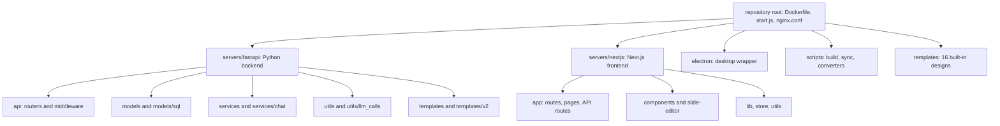

# File index

**Reads:** the whole repository at snapshot `571461f`  ·  **Builds on:** [Repository tour](presenton/02-repository-tour.md)  ·  **Time:** reference, skim as needed

This appendix is an annotated map of roughly 320 source and configuration files, grouped by directory, chosen because they carry behavior you will meet when reading or changing Presenton. Each row gives the file's line count at the snapshot, a one-line statement of its responsibility written after reading it, and the chapter that explains it in depth. Use it as a lookup table: find the file behind a stack trace, an endpoint, or a concept, then jump to the chapter.

## Step 1: How to read this index

Every table has the same four columns: **File** (path relative to the repository root), **Lines** (`wc -l` at the snapshot), **Responsibility**, and **Ch.** (the chapter that covers it, as a link). Chapter numbers map to these pages:

| Ch. | Page | Ch. | Page |
| --- | --- | --- | --- |
| 02 | [Repository tour](presenton/02-repository-tour.md) | 16 | [Template v2 format](presenton/16-template-v2-format.md) |
| 03 | [Runtime topology](presenton/03-runtime-topology.md) | 17 | [From template to schema to slide](presenton/17-template-to-slide.md) |
| 04 | [Running it locally](presenton/04-running-locally.md) | 18 | [Custom templates from PPTX](presenton/18-custom-templates.md) |
| 05 | [FastAPI app and startup](presenton/05-fastapi-startup.md) | 19 | [Themes and fonts](presenton/19-themes-and-fonts.md) |
| 06 | [Configuration and LLM providers](presenton/06-configuration-and-providers.md) | 20 | [Next.js architecture](presenton/20-nextjs-architecture.md) |
| 07 | [Data model](presenton/07-data-model.md) | 21 | [User journey](presenton/21-user-journey.md) |
| 08 | [Standard generation pipeline](presenton/08-standard-pipeline.md) | 22 | [Slide editor](presenton/22-slide-editor.md) |
| 09 | [Prompts and schemas](presenton/09-prompts-and-schemas.md) | 23 | [Settings, onboarding, auth UI](presenton/23-settings-and-auth-ui.md) |
| 10 | [Streaming (SSE)](presenton/10-streaming.md) | 24 | [PPTX and PDF export](presenton/24-export-pipeline.md) |
| 11 | [Document ingestion](presenton/11-document-ingestion.md) | 25 | [Auth and multi-user](presenton/25-auth-and-multiuser.md) |
| 12 | [Images, icons, web search](presenton/12-images-icons-search.md) | 26 | [Docker build and deployment](presenton/26-docker-and-deployment.md) |
| 13 | [Smart mode](presenton/13-smart-mode.md) | 27 | [Electron desktop app](presenton/27-electron.md) |
| 14 | [Editing and chat assistant](presenton/14-editing-and-chat.md) | 28 | [CI, tests, security](presenton/28-ci-tests-security.md) |
| 15 | [REST API, async tasks, webhooks, MCP](presenton/15-api-async-mcp.md) | | |

For every HTTP route, see the [Endpoint index](appendix-endpoints.md); for terms, the [Glossary](appendix-glossary.md).

!!! warning "Gotcha"
    Several concerns are implemented twice, once per runtime, and must be changed together: the user-config file lock (`servers/fastapi/utils/user_config_store.py`, `servers/nextjs/lib/user-config-store.ts`, `electron/app/utils/user-config-store.ts`), the desktop token guard (`servers/fastapi/api/v1/auth/desktop.py`, `servers/nextjs/lib/desktop-auth.ts`, `electron/app/utils/desktop-auth.ts`), the readable-file allowlist (`servers/nextjs/lib/readable-local-file.ts`, `electron/app/utils/readable-file-access.ts`), and the slide and outline limits (`servers/fastapi/constants/presentation.py`, `servers/nextjs/utils/presentationLimits.ts`).

## Step 2: Repository root, docs and CI

| File | Lines | Responsibility | Ch. |
| --- | --- | --- | --- |
| `README.md` | 985 | User-facing documentation: features, Docker run commands, environment variables, API usage examples. | [02](presenton/02-repository-tour.md) |
| `VISION.md` | 17 | Project vision statement: local, private, model-agnostic visual document generation. | [01](presenton/01-what-is-presenton.md) |
| `Dockerfile` | 153 | Production image: Python and Node toolchains, LiteParse, export runtime, nginx, FastAPI and Next.js builds; entrypoint `node start.js`. | [26](presenton/26-docker-and-deployment.md) |
| `Dockerfile.dev` | 93 | Development image with source bind mounts; installs LiteParse with Tesseract OCR. | [04](presenton/04-running-locally.md) |
| `docker-compose.yml` | 534 | Services `production`, `production-gpu`, `development`, `development-gpu` plus named volumes for node modules, LiteParse and the export runtime. | [26](presenton/26-docker-and-deployment.md) |
| `nginx.conf` | 213 | Port 80 reverse proxy: `/` to Next.js, `/api/v1/` and `/api/v2/` to FastAPI, `/mcp` to the MCP server, `/static/` and `/app_data/` from disk with `auth_request`. | [03](presenton/03-runtime-topology.md) |
| `start.js` | 738 | Container supervisor: seeds `userConfig.json` from env, starts nginx (`service nginx start`) and, alongside it, FastAPI (8000), Next.js (3000), MCP (8001) and optional Ollama; waits for FastAPI, Next.js and nginx to be ready. | [03](presenton/03-runtime-topology.md) |
| `package.json` | 26 | Root Node package: version `0.9.12-beta`, `presentationExportVersion` `v1.0.51`, LiteParse and sharp dependencies, converter and sync scripts. | [24](presenton/24-export-pipeline.md) |
| `layouts.json` | 6670 | A sample Template v2 layouts document (top-level `layouts` array). No code in the snapshot references this file by name. | [16](presenton/16-template-v2-format.md) |
| `test-local.sh` | 83 | Runs the same test and build checks as `.github/workflows/test-all.yml` locally. | [28](presenton/28-ci-tests-security.md) |
| `test_server.py` | 78 | Stub HTTP server answering `GET /versions` for testing the Electron update checker. | [27](presenton/27-electron.md) |
| `.do/deploy.template.yaml` | 25 | DigitalOcean App Platform spec using `ghcr.io/presenton/presenton:latest` on port 80. | [26](presenton/26-docker-and-deployment.md) |
| `.github/workflows/test-all.yml` | 111 | Main CI: Python and Node tests and builds on push and pull request to `main`. | [28](presenton/28-ci-tests-security.md) |
| `.github/workflows/codeql.yml` | 55 | CodeQL static analysis. | [28](presenton/28-ci-tests-security.md) |
| `.github/workflows/export-runtime-regressions.yml` | 39 | Regression tests for the export runtime sync scripts, triggered by `scripts/**` and package changes. | [28](presenton/28-ci-tests-security.md) |
| `.github/workflows/docker-release.yml` | 77 | Builds and publishes the Docker image on release. | [26](presenton/26-docker-and-deployment.md) |
| `.github/workflows/sync-releaes-to-r2.yml` | 56 | Uploads release assets to Cloudflare R2 on release (the filename keeps its upstream typo). | [28](presenton/28-ci-tests-security.md) |
| `.github/workflows/electron-linux-ubuntu22.yml` | 110 | Electron Linux test release on the `electron-linux-ubuntu22` branch. | [27](presenton/27-electron.md) |
| `.github/workflows/docs-pages.yml` | 48 | Publishes this tutorial to GitHub Pages when `tutorial/**` changes. | [28](presenton/28-ci-tests-security.md) |
| `docs/template-v2.md` | 176 | Upstream architecture note on Template v2. | [16](presenton/16-template-v2-format.md) |
| `docs/presentation-generation-modes.md` | 134 | Upstream note on Standard versus Smart modes and `PRESENTATION_GENERATION_MODE`. | [13](presenton/13-smart-mode.md) |
| `docs/presenton-resource-usage.md` | 181 | Upstream resource usage report, including the five-step Standard flow. | [08](presenton/08-standard-pipeline.md) |
| `docs/multi-docker-build.md` | 94 | Multi-architecture Docker release instructions. | [26](presenton/26-docker-and-deployment.md) |
| `docs/amazon-bedrock.md` | 191 | Configuring the Amazon Bedrock provider. | [06](presenton/06-configuration-and-providers.md) |

## Step 3: FastAPI entry points and app wiring

| File | Lines | Responsibility | Ch. |
| --- | --- | --- | --- |
| `servers/fastapi/server.py` | 29 | Uvicorn launcher: `--port` (required), `--reload`, `--log-level`; binds `127.0.0.1` and serves `api.main:app`. | [05](presenton/05-fastapi-startup.md) |
| `servers/fastapi/api/main.py` | 118 | Creates the `FastAPI` app, includes seven routers, mounts `/app_data/*` and `/static`, adds CORS, `UserConfigEnvUpdateMiddleware`, `SessionAuthMiddleware`, and the icon 404 fallback. | [05](presenton/05-fastapi-startup.md) |
| `servers/fastapi/api/lifespan.py` | 68 | Startup: logging, app-data dir, `migrate_database_on_startup`, `create_db_and_tables`, admin bootstrap, fail interrupted tasks, provider settings migration, default template import, env reload. | [05](presenton/05-fastapi-startup.md) |
| `servers/fastapi/api/middlewares.py` | 152 | `UserConfigEnvUpdateMiddleware` (reload config per request) and `SessionAuthMiddleware` (desktop guard, public and admin path rules, owner context, cloud proxy, app-data ownership). | [25](presenton/25-auth-and-multiuser.md) |
| `servers/fastapi/migrations.py` | 329 | Alembic driver: revision constants, schema-based revision inference for legacy databases, orphan revision repair, `migrate_database_on_startup`. | [07](presenton/07-data-model.md) |
| `servers/fastapi/alembic/env.py` | 98 | Alembic environment; the `alembic/versions/` directory holds 24 migrations from `00b3c27a13bc_init` to the unified API key change. | [07](presenton/07-data-model.md) |
| `servers/fastapi/mcp_server.py` | 480 | FastMCP server built from `openai_spec.json`: tool allowlist and renames, instructions text, `PresentonTokenVerifier`, internal session cookie injection, port 8001. | [15](presenton/15-api-async-mcp.md) |
| `servers/fastapi/openai_spec.json` | 1 (144 KB) | Committed, minified OpenAPI document consumed by the MCP server; regenerated manually. | [15](presenton/15-api-async-mcp.md) |
| `servers/fastapi/scripts/generate_openapi_spec.py` | 20 | Writes `app.openapi()` to `openai_spec.json`. | [15](presenton/15-api-async-mcp.md) |
| `servers/fastapi/scripts/warm_fastembed_cache.py` | 55 | Pre-downloads FastEmbed weights at image build: AllMiniLML6V2 for icons, and Mem0's default embedder models. | [26](presenton/26-docker-and-deployment.md) |
| `servers/fastapi/pyproject.toml` | 92 | Python dependencies, including `llmai==0.3.15`, `fastmcp>=4.1.2,<5`, `fastapi-users`, `fastembed-vectorstore`, `mem0ai[nlp]`. | [02](presenton/02-repository-tour.md) |
| `servers/fastapi/api/v1/ppt/router.py` | 40 | `API_V1_PPT_ROUTER` (`/api/v1/ppt`) including the seventeen endpoint routers. | [15](presenton/15-api-async-mcp.md) |
| `servers/fastapi/api/v2/router.py` | 7 | `API_V2_ROUTER` (`/api/v2`). | [15](presenton/15-api-async-mcp.md) |
| `servers/fastapi/api/v2/ppt/router.py` | 7 | `API_V2_PPT_ROUTER` (`/ppt`) including the v2 presentation router. | [15](presenton/15-api-async-mcp.md) |

## Step 4: FastAPI auth, admin and small routers

| File | Lines | Responsibility | Ch. |
| --- | --- | --- | --- |
| `servers/fastapi/api/v1/auth/router.py` | 201 | `/api/v1/auth` status, verify, setup, login and logout; sets and deletes the `presenton_session` cookie. | [25](presenton/25-auth-and-multiuser.md) |
| `servers/fastapi/api/v1/auth/users.py` | 233 | FastAPI Users integration: legacy-aware password helper, username user DB, `VersionedJWTStrategy` (claims `sub`, `av`), `read_user_from_cookie`, `get_current_admin`, `serialize_user`. | [25](presenton/25-auth-and-multiuser.md) |
| `servers/fastapi/api/v1/auth/principal.py` | 71 | `AuthPrincipal` dataclass and `resolve_request_principal`: cookie JWT first, then Bearer API key. | [25](presenton/25-auth-and-multiuser.md) |
| `servers/fastapi/api/v1/auth/config.py` | 107 | Cookie name and 30-day TTL, `AUTH_SECRET_KEY` creation, legacy PBKDF2 hash verification, mirroring admin credentials into `userConfig.json`. | [25](presenton/25-auth-and-multiuser.md) |
| `servers/fastapi/api/v1/auth/context.py` | 34 | `ContextVar`s for the current owner id and admin flag, used by ORM scoping and asset directories. | [25](presenton/25-auth-and-multiuser.md) |
| `servers/fastapi/api/v1/auth/assets.py` | 123 | Owner-scoped `StaticFiles` mounts for `/app_data/*`, private versus shared roots, traversal-safe path normalization and authorization. | [25](presenton/25-auth-and-multiuser.md) |
| `servers/fastapi/api/v1/auth/desktop.py` | 48 | Electron desktop guard: checks `Host`, `Origin` and the `x-presenton-desktop-token` header or cookie with `hmac.compare_digest`. | [27](presenton/27-electron.md) |
| `servers/fastapi/api/v1/auth/bootstrap.py` | 151 | Startup admin bootstrap: migrates the legacy single admin or creates one from `AUTH_USERNAME` and `AUTH_PASSWORD`; honors `RESET_AUTH` and `AUTH_OVERRIDE_FROM_ENV`; backfills legacy ownership. | [25](presenton/25-auth-and-multiuser.md) |
| `servers/fastapi/api/v1/auth/internal.py` | 25 | `authenticated_internal_request_headers`: mints a session cookie for internal server-to-server calls. | [25](presenton/25-auth-and-multiuser.md) |
| `servers/fastapi/api/v1/auth/schemas.py` | 81 | Pydantic request and response models for users and API keys (username 3 to 128 chars without spaces, password 8 to 128, login accepts 6). | [25](presenton/25-auth-and-multiuser.md) |
| `servers/fastapi/api/v1/auth/presenton_oauth.py` | 312 | `/api/v1/auth/presenton/*`: OAuth device flow linking the global Presenton Cloud provider. | [06](presenton/06-configuration-and-providers.md) |
| `servers/fastapi/api/v1/admin/router.py` | 264 | `/api/v1/admin/*`: API keys, provider settings, user management. | [25](presenton/25-auth-and-multiuser.md) |
| `servers/fastapi/api/v1/async_tasks/router.py` | 84 | `/api/v1/async-tasks` list and status endpoints over `async_tasks`. | [15](presenton/15-api-async-mcp.md) |
| `servers/fastapi/api/v1/webhook/router.py` | 53 | Webhook subscribe and unsubscribe. | [15](presenton/15-api-async-mcp.md) |
| `servers/fastapi/api/v1/mock/router.py` | 36 | Two mock endpoints returning sample webhook payload shapes. | [15](presenton/15-api-async-mcp.md) |

## Step 5: FastAPI endpoint modules

| File | Lines | Responsibility | Ch. |
| --- | --- | --- | --- |
| `servers/fastapi/api/v1/ppt/endpoints/presentation.py` | 3393 | The core of the Standard pipeline: create, prepare, SSE stream (Standard and Smart), update, export, one-shot generate (sync and async), edit and derive, plus layout, TOC, structure normalization and slide `ui` hydration helpers. | [08](presenton/08-standard-pipeline.md) |
| `servers/fastapi/api/v1/ppt/endpoints/outlines.py` | 276 | Outline read, replace, and SSE generation stream with document loading and `dirtyjson` parsing. | [08](presenton/08-standard-pipeline.md) |
| `servers/fastapi/api/v1/ppt/endpoints/slide.py` | 180 | Single-slide LLM edit for structured content and for HTML. | [14](presenton/14-editing-and-chat.md) |
| `servers/fastapi/api/v1/ppt/endpoints/template.py` | 2175 | Template v2 lifecycle: list, PPTX preview upload, init, async create and retry, layout generate, create and patch, block merge and theme, metadata update, get, delete, MCP upload. | [18](presenton/18-custom-templates.md) |
| `servers/fastapi/api/v1/ppt/endpoints/files.py` | 184 | Multipart and base64 (MCP) document upload to temp storage, decompose to text, update temp file. | [11](presenton/11-document-ingestion.md) |
| `servers/fastapi/api/v1/ppt/endpoints/fonts.py` | 172 | Font upload, list, delete, and PPTX font check. | [19](presenton/19-themes-and-fonts.md) |
| `servers/fastapi/api/v1/ppt/endpoints/images.py` | 372 | Image provider test, stock search, generation, uploads, and the image library. | [12](presenton/12-images-icons-search.md) |
| `servers/fastapi/api/v1/ppt/endpoints/icons.py` | 21 | `GET /icons/search` over `ICON_FINDER_SERVICE`. | [12](presenton/12-images-icons-search.md) |
| `servers/fastapi/api/v1/ppt/endpoints/chat.py` | 165 | Chat conversations, history, delete, message and streaming message (SSE). | [14](presenton/14-editing-and-chat.md) |
| `servers/fastapi/api/v1/ppt/endpoints/community.py` | 49 | Community catalog list and detail, proxied to the Presenton community API. | [13](presenton/13-smart-mode.md) |
| `servers/fastapi/api/v1/ppt/endpoints/generation.py` | 58 | Token defaults for a provider and model via `llmai.prepare_generation` with profiles `BALANCED` and `MODEL_MAX`. | [06](presenton/06-configuration-and-providers.md) |
| `servers/fastapi/api/v1/ppt/endpoints/codex_auth.py` | 349 | ChatGPT (Codex) OAuth: PKCE initiate, poll, manual exchange, refresh, status, logout. | [06](presenton/06-configuration-and-providers.md) |
| `servers/fastapi/api/v1/ppt/endpoints/ollama.py` | 70 | Ollama supported, available and library model lists, and SSE model pull; trusted-origin check for URL overrides. | [06](presenton/06-configuration-and-providers.md) |
| `servers/fastapi/api/v1/ppt/endpoints/openai.py` | 22 | OpenAI-compatible model discovery. | [06](presenton/06-configuration-and-providers.md) |
| `servers/fastapi/api/v1/ppt/endpoints/openrouter.py` | 164 | OpenRouter upstream provider discovery with redirect refusal and URL validation. | [06](presenton/06-configuration-and-providers.md) |
| `servers/fastapi/api/v1/ppt/endpoints/anthropic.py` | 21 | Anthropic model discovery. | [06](presenton/06-configuration-and-providers.md) |
| `servers/fastapi/api/v1/ppt/endpoints/google.py` | 16 | Google model discovery. | [06](presenton/06-configuration-and-providers.md) |
| `servers/fastapi/api/v2/ppt/endpoints/presentation.py` | 298 | Smart mode REST API: create the Smart presentation, generate and export (sync), or queue `presentation.smart.generate` (async) with progress updates. | [13](presenton/13-smart-mode.md) |

!!! warning "Gotcha"
    `servers/fastapi/api/v1/ppt/endpoints/slide.py` imports four private helpers from `presentation.py` (`_apply_template_content_to_ui`, `_get_presentation_stream_layout`, `_hydrate_template_slide_ui`, `_template_slide_ui`). The leading underscore does not mean "module private" here; renaming them breaks the slide router at import time.

## Step 6: FastAPI Pydantic models

| File | Lines | Responsibility | Ch. |
| --- | --- | --- | --- |
| `servers/fastapi/models/generate_presentation_request.py` | 64 | `GeneratePresentationRequest` (Standard one-shot API, default template `general`) and `GenerateSmartPresentationRequest`. | [15](presenton/15-api-async-mcp.md) |
| `servers/fastapi/models/presentation_outline_model.py` | 35 | `SlideOutlineModel` (Markdown `content`, word-limited) and `PresentationOutlineModel` (max 50 slides). | [09](presenton/09-prompts-and-schemas.md) |
| `servers/fastapi/models/presentation_structure_model.py` | 6 | `PresentationStructureModel`: `slides` is a list of layout indexes. | [08](presenton/08-standard-pipeline.md) |
| `servers/fastapi/models/presentation_with_slides.py` | 27 | Response model joining presentation fields with its slides, `generation_mode`, `type`, `can_regenerate`. | [07](presenton/07-data-model.md) |
| `servers/fastapi/models/presentation_and_path.py` | 11 | `PresentationAndPath` and `PresentationPathAndEditPath` (export results). | [24](presenton/24-export-pipeline.md) |
| `servers/fastapi/models/presentation_from_template.py` | 14 | `EditPresentationRequest` and `SlideContentUpdate` for `/edit` and `/derive`. | [15](presenton/15-api-async-mcp.md) |
| `servers/fastapi/models/presentation_layout.py` | 5 | Re-export of `PresentationLayoutModel` and `SlideLayoutModel` from `templates.presentation_layout`. | [17](presenton/17-template-to-slide.md) |
| `servers/fastapi/models/sse_response.py` | 56 | SSE frame builders: `SSEResponse`, `SSEStatusResponse`, `SSETraceResponse`, `SSEErrorResponse`, `SSECompleteResponse`. All emit `event: response`. | [10](presenton/10-streaming.md) |
| `servers/fastapi/models/chat.py` | 54 | Chat request, response, history and attachment models. | [14](presenton/14-editing-and-chat.md) |
| `servers/fastapi/models/image_prompt.py` | 25 | `ImagePrompt` with optional `theme_prompt` and paired `target_width`/`target_height`. | [12](presenton/12-images-icons-search.md) |
| `servers/fastapi/models/image_provider_test.py` | 24 | `ImageProviderTestConfig` posted to `/images/test`. | [12](presenton/12-images-icons-search.md) |
| `servers/fastapi/models/theme_data.py` | 34 | `PresentationThemeData`: color roles and text font. | [19](presenton/19-themes-and-fonts.md) |
| `servers/fastapi/models/user_config.py` | 163 | `UserConfig`: every recognized configuration key (provider, models, keys, image and web search settings). | [06](presenton/06-configuration-and-providers.md) |
| `servers/fastapi/models/api_error_model.py` | 13 | `APIErrorModel` (`status_code`, `detail`), also the failed webhook body. | [15](presenton/15-api-async-mcp.md) |
| `servers/fastapi/models/decomposed_file_info.py` | 6 | `DecomposedFileInfo` (`name`, `file_path`). | [11](presenton/11-document-ingestion.md) |
| `servers/fastapi/models/json_path_guide.py` | 14 | `DictGuide`, `ListGuide`, `JsonPathGuide`: addresses for nested keys inside slide content. | [12](presenton/12-images-icons-search.md) |

## Step 7: FastAPI SQL models

| File | Lines | Responsibility | Ch. |
| --- | --- | --- | --- |
| `servers/fastapi/models/sql/presentation.py` | 125 | `presentations` table and `PresentationVersion` (`v1-standard`, `v2-standard`): content, outlines, layout, structure, theme, fonts, `generation_mode`, `community_design_ids`, `owner_id`. | [07](presenton/07-data-model.md) |
| `servers/fastapi/models/sql/slide.py` | 45 | `slides` table: `layout_group`, `layout`, `index`, `content`, `html_content`, `speaker_note`, `properties`, `ui`; `get_new_slide` copier. | [07](presenton/07-data-model.md) |
| `servers/fastapi/models/sql/template_v2.py` | 60 | `template_v2` table: string id, `raw_layouts`, `layouts`, `components`, `merged_components`, `theme`, `assets`, `is_default`. | [16](presenton/16-template-v2-format.md) |
| `servers/fastapi/models/sql/user.py` | 45 | `user` table (SQLAlchemy declarative): username, `admin_slot`, password hash, flags, `auth_version`. | [25](presenton/25-auth-and-multiuser.md) |
| `servers/fastapi/models/sql/api_key.py` | 55 | `api_keys` table: 16-hex id, secret hash, encrypted token, owner and creator, expiry, last use, revocation. | [25](presenton/25-auth-and-multiuser.md) |
| `servers/fastapi/models/sql/async_task.py` | 61 | `async_tasks` table: `task-<hex>` id, `type`, `status`, `message`, `error`, `data`, hidden `payload`. | [15](presenton/15-api-async-mcp.md) |
| `servers/fastapi/models/sql/async_presentation_generation_status.py` | 30 | Older `async_presentation_generation_tasks` table, still created and owner-scoped. | [07](presenton/07-data-model.md) |
| `servers/fastapi/models/sql/chat_history_message.py` | 49 | `chat_history_messages`: per-conversation ordered messages with `tool_calls`. | [14](presenton/14-editing-and-chat.md) |
| `servers/fastapi/models/sql/image_asset.py` | 28 | `ImageAsset` (no explicit `__tablename__`, so the table is `imageasset`): generated or uploaded image path, `is_uploaded`, `extras`. | [12](presenton/12-images-icons-search.md) |
| `servers/fastapi/models/sql/font_upload.py` | 31 | `font_uploads`: stored font file plus parsed family, subfamily, weight and width metadata. | [19](presenton/19-themes-and-fonts.md) |
| `servers/fastapi/models/sql/webhook_subscription.py` | 31 | `webhook_subscriptions`: `webhook-<hex>` id, `url`, `secret`, `event`. | [15](presenton/15-api-async-mcp.md) |
| `servers/fastapi/models/sql/provider_settings.py` | 23 | `provider_settings` singleton (id 1) holding provider configuration as JSON. | [06](presenton/06-configuration-and-providers.md) |
| `servers/fastapi/models/sql/presenton_cloud_provider.py` | 33 | `presenton_cloud_provider` singleton: issuer, subject, email, encrypted access token, expiry. | [06](presenton/06-configuration-and-providers.md) |
| `servers/fastapi/models/sql/key_value.py` | 8 | `KeyValueSqlModel` (table `keyvaluesqlmodel`): generic key and JSON value rows. | [07](presenton/07-data-model.md) |
| `servers/fastapi/models/sql/ollama_pull_status.py` | 9 | `OllamaPullStatus` (table `ollamapullstatus`): Ollama model pull progress rows. | [06](presenton/06-configuration-and-providers.md) |

## Step 8: FastAPI enums and constants

| File | Lines | Responsibility | Ch. |
| --- | --- | --- | --- |
| `servers/fastapi/enums/llm_provider.py` | 20 | Sixteen text providers, from `ollama` to `codex`. | [06](presenton/06-configuration-and-providers.md) |
| `servers/fastapi/enums/image_provider.py` | 13 | Nine image providers: `pexels`, `pixabay`, `gemini_flash`, `nanobanana_pro`, `gpt-image-2`, `gpt-image-1.5`, `comfyui`, `open_webui`, `openai_compatible`. | [12](presenton/12-images-icons-search.md) |
| `servers/fastapi/enums/web_search_provider.py` | 11 | `auto`, `native`, `searxng`, `tavily`, `exa`, `brave`, `serper`. | [12](presenton/12-images-icons-search.md) |
| `servers/fastapi/enums/tone.py` | 11 | `default`, `casual`, `professional`, `funny`, `educational`, `sales_pitch`. | [09](presenton/09-prompts-and-schemas.md) |
| `servers/fastapi/enums/verbosity.py` | 8 | `concise`, `standard`, `text-heavy`. | [09](presenton/09-prompts-and-schemas.md) |
| `servers/fastapi/enums/async_task_status.py` | 7 | `pending`, `completed`, `error`. | [15](presenton/15-api-async-mcp.md) |
| `servers/fastapi/enums/webhook_event.py` | 6 | `presentation.generation.completed`, `presentation.generation.failed`. | [15](presenton/15-api-async-mcp.md) |
| `servers/fastapi/enums/llm_call_type.py` | 8 | Structured or unstructured, streaming or not. | [09](presenton/09-prompts-and-schemas.md) |
| `servers/fastapi/constants/presentation.py` | 53 | `MAX_NUMBER_OF_SLIDES = 50`, `MAX_OUTLINE_WORDS` (default 100), discovery and ordering of default templates. | [08](presenton/08-standard-pipeline.md) |
| `servers/fastapi/constants/llm.py` | 26 | Default model id per provider and the supported Codex models. | [06](presenton/06-configuration-and-providers.md) |
| `servers/fastapi/constants/documents.py` | 88 | Accepted upload extensions and MIME types per document family. | [11](presenton/11-document-ingestion.md) |
| `servers/fastapi/constants/supported_ollama_models.py` | 354 | Curated Ollama model families with sizes, and the merge with pulled models. | [06](presenton/06-configuration-and-providers.md) |

## Step 9: FastAPI services

| File | Lines | Responsibility | Ch. |
| --- | --- | --- | --- |
| `servers/fastapi/services/database.py` | 152 | Async engine and session maker, SQLite foreign keys, owner-scoped SELECT criteria via `do_orm_execute`, owner stamping in `before_flush`, table creation. | [07](presenton/07-data-model.md) |
| `servers/fastapi/services/api_keys.py` | 133 | `sk-presenton-<id>.<secret>` format, issue, verify (hash plus expiry and revocation), Fernet encryption for reveal. | [25](presenton/25-auth-and-multiuser.md) |
| `servers/fastapi/services/async_tasks.py` | 52 | `fail_interrupted_async_tasks`: marks tasks left pending by a restart as errors at startup. | [15](presenton/15-api-async-mcp.md) |
| `servers/fastapi/services/webhook_service.py` | 55 | Sends webhook POSTs to every matching subscription, with Bearer secret; errors are printed only. | [15](presenton/15-api-async-mcp.md) |
| `servers/fastapi/services/concurrent_service.py` | 40 | `CONCURRENT_SERVICE.run_task`: fire-and-forget `asyncio` tasks with an optional delay. | [15](presenton/15-api-async-mcp.md) |
| `servers/fastapi/services/provider_settings.py` | 191 | Read, sanitize, merge and save the provider settings row; mirror to `userConfig.json`; migrate from the file at startup. | [06](presenton/06-configuration-and-providers.md) |
| `servers/fastapi/services/presenton_cloud.py` | 219 | Presenton Cloud credential storage (encrypted), token validity, authenticated cloud requests, revoke. | [06](presenton/06-configuration-and-providers.md) |
| `servers/fastapi/services/presenton_cloud_proxy.py` | 708 | Forwards selected API and asset paths to Presenton Cloud when `LLM=presenton`, and syncs results locally. | [06](presenton/06-configuration-and-providers.md) |
| `servers/fastapi/services/presenton_cloud_persistence.py` | 246 | Writes cloud-created presentations and slides into the local tables. | [06](presenton/06-configuration-and-providers.md) |
| `servers/fastapi/services/community_presentations.py` | 473 | Community API client, id normalization (max 3), reference loading (max 6 slides, 90,000 characters), design context prompt. | [13](presenton/13-smart-mode.md) |
| `servers/fastapi/services/documents_loader.py` | 357 | `DocumentsLoader`: routes PDF, text, office, image and other files to LiteParse, the office extractor or OCR; cleans extracted text. | [11](presenton/11-document-ingestion.md) |
| `servers/fastapi/services/liteparse_service.py` | 469 | Runs the Node LiteParse runner as a subprocess (`LITEPARSE_DPI`, `LITEPARSE_NUM_WORKERS`, 600 s timeout). | [11](presenton/11-document-ingestion.md) |
| `servers/fastapi/services/office_document_service.py` | 171 | Pure-XML text extraction for DOCX, PPTX, XLSX and ODF files. | [11](presenton/11-document-ingestion.md) |
| `servers/fastapi/services/document_conversion_service.py` | 89 | Converts images to PNG with Pillow (EXIF-aware) before OCR. | [11](presenton/11-document-ingestion.md) |
| `servers/fastapi/services/score_based_chunker.py` | 163 | Heading-scored Markdown chunker. | [11](presenton/11-document-ingestion.md) |
| `servers/fastapi/services/temp_file_service.py` | 191 | Owner-scoped temp directory creation, path validation and cleanup (`TEMP_FILE_SERVICE`). | [11](presenton/11-document-ingestion.md) |
| `servers/fastapi/services/image_generation_service.py` | 1144 | Dispatch to OpenAI, Gemini, ComfyUI, Open WebUI, OpenAI-compatible, Pexels and Pixabay; size and ratio mapping; ComfyUI workflow injection. | [12](presenton/12-images-icons-search.md) |
| `servers/fastapi/services/icon_finder_service.py` | 179 | Lazy FastEmbed vector store over the bundled icon catalog; `search_icons` by weight. | [12](presenton/12-images-icons-search.md) |
| `servers/fastapi/services/export_task_service.py` | 863 | Runs the Node export runtime (`export`, PPTX to HTML or JSON, HTML or JSON to images) and moves outputs into owner directories. | [24](presenton/24-export-pipeline.md) |
| `servers/fastapi/services/mem0_oss_memory.py` | 218 | One shared Mem0 OSS client per process, configured from env, with operation locks. | [14](presenton/14-editing-and-chat.md) |
| `servers/fastapi/services/mem0_presentation_memory_service.py` | 245 | Per-presentation Mem0 memory: store generation context, outlines and slide edits; retrieve context (`MEM0_TOP_K` 8, 6000 characters). | [14](presenton/14-editing-and-chat.md) |

## Step 10: FastAPI chat assistant services

| File | Lines | Responsibility | Ch. |
| --- | --- | --- | --- |
| `servers/fastapi/services/chat/service.py` | 887 | `PresentationChatService`: builds the turn, runs the LLM tool loop (`MAX_TOOL_ROUNDS = 40`), parses attachments, persists turns, streams events. | [14](presenton/14-editing-and-chat.md) |
| `servers/fastapi/services/chat/tools.py` | 1863 | `ChatTools`: tool definitions (camelCase names such as `addNewSlide`, `getAvailableLayouts`, `searchSlide`) and their executors, with argument repair. | [14](presenton/14-editing-and-chat.md) |
| `servers/fastapi/services/chat/schemas.py` | 1065 | Strict Pydantic input schemas for every chat tool. | [14](presenton/14-editing-and-chat.md) |
| `servers/fastapi/services/chat/prompts.py` | 250 | Standard and Smart chat system prompts and `build_system_prompt`. | [14](presenton/14-editing-and-chat.md) |
| `servers/fastapi/services/chat/memory_layer.py` | 4131 | `PresentationChatMemoryLayer`: reads and mutates presentation state for tools (outlines, slides, layouts, insert boxes, smart HTML). | [14](presenton/14-editing-and-chat.md) |
| `servers/fastapi/services/chat/slide_ui_helpers.py` | 2271 | Validation and normalization of slide `ui` element trees: charts, tables, images, vectors, infographics. | [14](presenton/14-editing-and-chat.md) |
| `servers/fastapi/services/chat/sql_chat_history.py` | 275 | SQL persistence of chat threads: load, append, replace, delete, list. | [14](presenton/14-editing-and-chat.md) |
| `servers/fastapi/services/chat/chat_memory_store.py` | 354 | Legacy chat memory store, read when migrating old threads. | [14](presenton/14-editing-and-chat.md) |
| `servers/fastapi/services/chat/conversation_store.py` | 80 | `ChatConversationStore.load_history`: loads and migrates legacy history into SQL. | [14](presenton/14-editing-and-chat.md) |
| `servers/fastapi/services/chat/llm_tools.py` | 9 | Returns only function tools for chat; web search is deliberately not added. | [14](presenton/14-editing-and-chat.md) |
| `servers/fastapi/services/chat/presentation_context_store.py` | 5 | Alias: `PresentationContextStore` is `PresentationChatMemoryLayer`. | [14](presenton/14-editing-and-chat.md) |
| `servers/fastapi/services/chat/infographic_catalog.py` | 3 | Compatibility re-export of `utils.infographic_catalog`. | [14](presenton/14-editing-and-chat.md) |

## Step 11: FastAPI utilities

| File | Lines | Responsibility | Ch. |
| --- | --- | --- | --- |
| `servers/fastapi/utils/llm_config.py` | 524 | Builds the `llmai` client config per provider (`match` on `LLMProvider`), generation defaults (profile, max tokens, reasoning), Codex token refresh. | [06](presenton/06-configuration-and-providers.md) |
| `servers/fastapi/utils/llm_provider.py` | 193 | Provider selection predicates (`is_openai_selected` and others), model resolution, `get_llm_client`. | [06](presenton/06-configuration-and-providers.md) |
| `servers/fastapi/utils/llm_utils.py` | 535 | Structured generation with schema-validation retries, streaming events, token estimates, disconnect polling, generation metrics. | [09](presenton/09-prompts-and-schemas.md) |
| `servers/fastapi/utils/llm_client_error_handler.py` | 76 | Maps provider exceptions to HTTP errors, including the Codex re-auth marker header. | [06](presenton/06-configuration-and-providers.md) |
| `servers/fastapi/utils/available_models.py` | 252 | Model listing for OpenAI-compatible, Together, Anthropic and Google endpoints with URL validation. | [06](presenton/06-configuration-and-providers.md) |
| `servers/fastapi/utils/model_availability.py` | 226 | Pre-flight check that the configured LLM and image provider are usable. | [06](presenton/06-configuration-and-providers.md) |
| `servers/fastapi/utils/provider_error_messages.py` | 187 | Safe user-facing messages for invalid keys, moderation blocks and model access errors. | [06](presenton/06-configuration-and-providers.md) |
| `servers/fastapi/utils/get_env.py` | 488 | One getter per environment variable, plus generation mode, community flag, auth and Electron flags. | [06](presenton/06-configuration-and-providers.md) |
| `servers/fastapi/utils/set_env.py` | 379 | Matching setters used when loading configuration into the process environment. | [06](presenton/06-configuration-and-providers.md) |
| `servers/fastapi/utils/user_config.py` | 619 | `get_user_config`, `update_env_with_user_config` (file and DB settings into env), Codex token write-back. | [06](presenton/06-configuration-and-providers.md) |
| `servers/fastapi/utils/user_config_store.py` | 219 | Locked, atomic, retried read and write of `userConfig.json` with a backup copy. | [06](presenton/06-configuration-and-providers.md) |
| `servers/fastapi/utils/db_utils.py` | 126 | Database URL resolution (default SQLite `fastapi.db` in app data), async driver rewrite for PostgreSQL and MySQL, pool settings. | [07](presenton/07-data-model.md) |
| `servers/fastapi/utils/asset_directory_utils.py` | 235 | Owner-scoped `images`, `exports`, `uploads` directories and conversions between filesystem paths and `/app_data` URLs. | [25](presenton/25-auth-and-multiuser.md) |
| `servers/fastapi/utils/process_slides.py` | 453 | Asset hydration: finds `__image_prompt__` and `__icon_query__` keys in slide content, adds placeholders, fetches images and icons, writes URLs back. | [12](presenton/12-images-icons-search.md) |
| `servers/fastapi/utils/schema_utils.py` | 428 | JSON Schema surgery: add or remove fields, strict mode, `$ref` resolution, validation error formatting, constraint sentences for prompts. | [09](presenton/09-prompts-and-schemas.md) |
| `servers/fastapi/utils/dict_utils.py` | 89 | Path-based get and set in nested dicts, `deep_update`. | [12](presenton/12-images-icons-search.md) |
| `servers/fastapi/utils/outline_utils.py` | 205 | Title extraction, outline counts with TOC and title slide, TOC count, image URLs in outlines. | [08](presenton/08-standard-pipeline.md) |
| `servers/fastapi/utils/outline_limits.py` | 68 | Word counting and trimming that enforce `MAX_OUTLINE_WORDS`. | [08](presenton/08-standard-pipeline.md) |
| `servers/fastapi/utils/ppt_utils.py` | 82 | Finds the TOC or list layout index by regex for TOC insertion. | [08](presenton/08-standard-pipeline.md) |
| `servers/fastapi/utils/web_search.py` | 330 | Native versus external web search routing and SearXNG, Tavily, Exa, Brave and Serper clients. | [12](presenton/12-images-icons-search.md) |
| `servers/fastapi/utils/image_provider.py` | 61 | Image provider selection predicates and "image generation disabled" flag. | [12](presenton/12-images-icons-search.md) |
| `servers/fastapi/utils/image_generation_error.py` | 86 | Normalizes image provider exceptions into HTTP errors and per-slide warnings. | [12](presenton/12-images-icons-search.md) |
| `servers/fastapi/utils/icon_weights.py` | 54 | Phosphor weights (`bold` default, `duotone`, `fill`, `light`, `regular`, `thin`) and normalization. | [12](presenton/12-images-icons-search.md) |
| `servers/fastapi/utils/infographic_catalog.py` | 639 | Catalog of infographic types (timeline, funnel, gauge, matrix and more) with default sizes and data normalization. | [14](presenton/14-editing-and-chat.md) |
| `servers/fastapi/utils/latex_text.py` | 349 | Parses `<latex>` tags and Markdown bold into text runs for template text elements. | [17](presenton/17-template-to-slide.md) |
| `servers/fastapi/utils/smart_slide_layout.py` | 289 | Static HTML inspection of Smart slides (1280x720) for overflow and overlap risks. | [13](presenton/13-smart-mode.md) |
| `servers/fastapi/utils/font_uploads.py` | 463 | Font file validation, size limits, persistence, metadata extraction, listing, deletion, variant lookup. | [19](presenton/19-themes-and-fonts.md) |
| `servers/fastapi/utils/export_utils.py` | 75 | `export_presentation`: builds the `/pdf-maker` URL (cookie in the fragment) and calls the export runtime. | [24](presenton/24-export-pipeline.md) |
| `servers/fastapi/utils/export_permissions.py` | 86 | Sets group-readable permissions on exported files so nginx can serve them. | [24](presenton/24-export-pipeline.md) |
| `servers/fastapi/utils/filename_utils.py` | 18 | Byte-limited safe export basename. | [24](presenton/24-export-pipeline.md) |
| `servers/fastapi/utils/mcp_public_urls.py` | 52 | Detects MCP requests by header and makes result links absolute. | [15](presenton/15-api-async-mcp.md) |
| `servers/fastapi/utils/sse.py` | 38 | `safe_sse_stream`: wraps a generator, turns late exceptions into an SSE `error` frame, runs cleanup. | [10](presenton/10-streaming.md) |
| `servers/fastapi/utils/validators.py` | 48 | Upload count, size and type validation. | [11](presenton/11-document-ingestion.md) |
| `servers/fastapi/utils/ollama.py` | 231 | Ollama HTTP helpers: list pulled models, library catalog, streaming pull. | [06](presenton/06-configuration-and-providers.md) |
| `servers/fastapi/utils/ocr_language.py` | 126 | Maps UI language names to OCR language codes. | [11](presenton/11-document-ingestion.md) |
| `servers/fastapi/utils/path_helpers.py` | 29 | Resource and writable path resolution relative to the process working directory. | [05](presenton/05-fastapi-startup.md) |
| `servers/fastapi/utils/mime_types.py` | 40 | Registers explicit MIME types so static serving does not depend on the host database. | [05](presenton/05-fastapi-startup.md) |
| `servers/fastapi/utils/safe_logging.py` | 50 | Logging with control-character escaping to prevent log injection. | [28](presenton/28-ci-tests-security.md) |
| `servers/fastapi/utils/runtime_limits.py` | 66 | Memory snapshots and a bounded text buffer for subprocess output. | [24](presenton/24-export-pipeline.md) |

## Step 12: FastAPI LLM calls and OAuth utilities

| File | Lines | Responsibility | Ch. |
| --- | --- | --- | --- |
| `servers/fastapi/utils/llm_calls/generate_presentation_outlines.py` | 405 | Outline prompts and streaming generation, with web search status events. | [09](presenton/09-prompts-and-schemas.md) |
| `servers/fastapi/utils/llm_calls/generate_presentation_structure.py` | 211 | Picks a layout index per outline slide (structured output), including the slides-Markdown variant. | [09](presenton/09-prompts-and-schemas.md) |
| `servers/fastapi/utils/llm_calls/generate_slide_content.py` | 275 | Fills one slide's JSON schema from its outline, adding `__speaker_note__`. | [09](presenton/09-prompts-and-schemas.md) |
| `servers/fastapi/utils/llm_calls/generate_smart_presentation.py` | 936 | Smart deck prompts, HTML sanitizing rules, slide parsing, slide count resolution (default 8, max 50), up to 8 attempts. | [13](presenton/13-smart-mode.md) |
| `servers/fastapi/utils/llm_calls/generate_web_search_query.py` | 74 | Generates a search query for external web search. | [12](presenton/12-images-icons-search.md) |
| `servers/fastapi/utils/llm_calls/select_slide_type_on_edit.py` | 92 | Chooses a slide layout for an edit prompt. | [14](presenton/14-editing-and-chat.md) |
| `servers/fastapi/utils/llm_calls/edit_slide.py` | 167 | Rewrites a slide's structured content from a prompt. | [14](presenton/14-editing-and-chat.md) |
| `servers/fastapi/utils/llm_calls/edit_slide_html.py` | 95 | Rewrites a slide's HTML from a prompt and extracts the HTML from the reply. | [14](presenton/14-editing-and-chat.md) |
| `servers/fastapi/utils/oauth/openai_codex.py` | 614 | Python port of the Codex ChatGPT OAuth flow: authorize URL, callback server on port 1455, token exchange and refresh, account profile. | [06](presenton/06-configuration-and-providers.md) |
| `servers/fastapi/utils/oauth/pkce.py` | 23 | PKCE verifier and challenge generation. | [06](presenton/06-configuration-and-providers.md) |

## Step 13: FastAPI template package

| File | Lines | Responsibility | Ch. |
| --- | --- | --- | --- |
| `servers/fastapi/templates/default_templates.py` | 316 | Imports `templates/*/template.json` into `template_v2` rows (`is_default=True`) at startup, copies static assets, removes stale defaults. | [16](presenton/16-template-v2-format.md) |
| `servers/fastapi/templates/presentation_layout.py` | 62 | `SlideLayoutModel` (id, name, description, `json_schema`) and `PresentationLayoutModel` (name, `ordered`, icon type, slides). | [17](presenton/17-template-to-slide.md) |
| `servers/fastapi/templates/preview.py` | 62 | Thin wrappers exposing the font check and fonts-plus-preview handlers. | [18](presenton/18-custom-templates.md) |
| `servers/fastapi/templates/fonts_and_slides_preview.py` | 1934 | PPTX font check, font upload and replacement, slide preview rendering with local fonts, Tailwind and Chart.js assets. | [18](presenton/18-custom-templates.md) |
| `servers/fastapi/templates/pptx_font_utils.py` | 1669 | OOXML font extraction, theme typeface resolution, Google Fonts lookup, font replacement inside PPTX XML. | [19](presenton/19-themes-and-fonts.md) |

## Step 14: Template v2 engine

| File | Lines | Responsibility | Ch. |
| --- | --- | --- | --- |
| `servers/fastapi/templates/v2/models/elements.py` | 694 | Pydantic element models matching the frontend: text, image, text-list, table, vector, chart, infographic, container, flex, grid, group. | [16](presenton/16-template-v2-format.md) |
| `servers/fastapi/templates/v2/models/layouts.py` | 977 | Raw and final slide layouts, components, merged components, generation options and the visual-replacement planning models. | [16](presenton/16-template-v2-format.md) |
| `servers/fastapi/templates/v2/schema.py` | 1548 | Converts a layout into the content JSON Schema the LLM fills; only elements with `decorative: false` become fields. | [17](presenton/17-template-to-slide.md) |
| `servers/fastapi/templates/v2/content.py` | 87 | Applies generated content to element structures, including repeated top-level groups. | [17](presenton/17-template-to-slide.md) |
| `servers/fastapi/templates/v2/theme.py` | 806 | Builds a color and font profile from layouts, picks theme roles (LLM or deterministic), enforces contrast. | [19](presenton/19-themes-and-fonts.md) |
| `servers/fastapi/templates/v2/generation.py` | 1371 | Facade for PPTX-to-template generation: parallel per-slide layout generation (max 10 workers), prompted layouts, component merging; delegates to `certified_generation`. | [18](presenton/18-custom-templates.md) |
| `servers/fastapi/templates/v2/certified_generation.py` | 4633 | Multi-pass layout generation: visual data regions, flexible regions, text capacity, component clustering, validation retries (5). | [18](presenton/18-custom-templates.md) |
| `servers/fastapi/templates/v2/tools.py` | 123 | `previewSlide` LLM tool that renders a candidate layout for the model to inspect. | [18](presenton/18-custom-templates.md) |

## Step 15: Next.js app shell, routes and pages

| File | Lines | Responsibility | Ch. |
| --- | --- | --- | --- |
| `servers/nextjs/proxy.ts` | 176 | Request proxy (Next.js middleware): desktop guard, rewrites `/api/v1`, `/api/v2`, `/app_data`, `/static` to FastAPI, session check for `/api/*`, `/pdf-maker` export session cookie. | [20](presenton/20-nextjs-architecture.md) |
| `servers/nextjs/next.config.mjs` | 80 | Standalone output in `.next-build`, image remote patterns, unoptimized images for Electron, CORS header for vendored fonts. | [20](presenton/20-nextjs-architecture.md) |
| `servers/nextjs/app/layout.tsx` | 73 | Root layout and metadata. | [20](presenton/20-nextjs-architecture.md) |
| `servers/nextjs/app/page.tsx` | 28 | `/`: shows `AuthGate` until setup and sign-in are done (skipped when auth is disabled), then `Home` inside `ConfigurationInitializer`. | [21](presenton/21-user-journey.md) |
| `servers/nextjs/app/providers.tsx` | 12 | Redux `Provider` wrapper. | [20](presenton/20-nextjs-architecture.md) |
| `servers/nextjs/app/ConfigurationInitializer.tsx` | 387 | Loads auth status, runtime config, `/api/user-config` and Presenton status; fills Redux and routes to setup when unconfigured. | [23](presenton/23-settings-and-auth-ui.md) |
| `servers/nextjs/app/ChatGptAuthRedirectHandler.tsx` | 57 | Reacts to Codex re-auth events by redirecting to settings. | [23](presenton/23-settings-and-auth-ui.md) |
| `servers/nextjs/app/MixpanelInitializer.tsx` | 24 | Initializes anonymous analytics unless disabled. | [20](presenton/20-nextjs-architecture.md) |
| `servers/nextjs/app/(export)/pdf-maker/page.tsx` | 26 | `/pdf-maker?id=...` entry used by the headless export browser. | [24](presenton/24-export-pipeline.md) |
| `servers/nextjs/app/(export)/pdf-maker/PdfMakerPage.tsx` | 321 | Fetches the deck through `/api/export-presentation-data/{id}` with `x-export-cookie`, renders every slide at print size. | [24](presenton/24-export-pipeline.md) |
| `servers/nextjs/app/(presentation-generator)/layout.tsx` | 13 | Requires an app session for every generator route and wraps in `ConfigurationInitializer`. | [20](presenton/20-nextjs-architecture.md) |
| `servers/nextjs/app/(presentation-generator)/(dashboard)/layout.tsx` | 25 | Dashboard sidebar; hides Templates in Smart-only mode and Community when disabled. | [21](presenton/21-user-journey.md) |
| `servers/nextjs/app/(presentation-generator)/(dashboard)/dashboard/components/DashboardPage.tsx` | 620 | Presentation list, duplicate, delete, blank deck dialog. | [21](presenton/21-user-journey.md) |
| `servers/nextjs/app/(presentation-generator)/(dashboard)/settings/SettingPage.tsx` | 509 | Settings page: text, image and web search providers, Codex and Presenton account, privacy. | [23](presenton/23-settings-and-auth-ui.md) |
| `servers/nextjs/app/(presentation-generator)/(dashboard)/admin/AdminPanel.tsx` | 901 | Admin UI: users, password resets, API keys. | [23](presenton/23-settings-and-auth-ui.md) |
| `servers/nextjs/app/(presentation-generator)/(dashboard)/templates/components/TemplateLibraryUi.tsx` | 175 | Template library grid. | [18](presenton/18-custom-templates.md) |
| `servers/nextjs/app/(presentation-generator)/(dashboard)/community/components/CommunityPage.tsx` | 511 | Community design browser. | [13](presenton/13-smart-mode.md) |
| `servers/nextjs/app/(presentation-generator)/upload/components/UploadPage.tsx` | 691 | Prompt and document form: uploads files, decomposes them, calls `/presentation/create`, routes to the outline or presentation page. | [21](presenton/21-user-journey.md) |
| `servers/nextjs/app/(presentation-generator)/outline/components/OutlinePage.tsx` | 499 | Outline editing and template selection. | [21](presenton/21-user-journey.md) |
| `servers/nextjs/app/(presentation-generator)/outline/hooks/useOutlineStreaming.ts` | 264 | Consumes `/outlines/stream/{id}` SSE into Redux. | [10](presenton/10-streaming.md) |
| `servers/nextjs/app/(presentation-generator)/outline/hooks/usePresentationGeneration.ts` | 153 | Calls `/presentation/prepare` and navigates to `/presentation?id=...&stream=true`. | [21](presenton/21-user-journey.md) |
| `servers/nextjs/app/(presentation-generator)/presentation/components/PresentationPage.tsx` | 1055 | Editor page shell: slides, side panel, chat, presentation mode. | [22](presenton/22-slide-editor.md) |
| `servers/nextjs/app/(presentation-generator)/presentation/components/PresentationHeader.tsx` | 823 | Header actions including export through `POST /api/export-presentation` or the Electron IPC bridge. | [24](presenton/24-export-pipeline.md) |
| `servers/nextjs/app/(presentation-generator)/presentation/components/Chat.tsx` | 3443 | Chat assistant panel: streaming replies, tool activity, attachments, conversation list. | [14](presenton/14-editing-and-chat.md) |
| `servers/nextjs/app/(presentation-generator)/presentation/hooks/usePresentationStreaming.ts` | 723 | Consumes `/presentation/stream/{id}` SSE (chunks, slide assets, Smart HTML, metrics). | [10](presenton/10-streaming.md) |
| `servers/nextjs/app/(presentation-generator)/presentation/hooks/useAutoSave.tsx` | 212 | Debounced auto-save through `PATCH /presentation/update`. | [22](presenton/22-slide-editor.md) |
| `servers/nextjs/app/(presentation-generator)/presentation/utils/streamAssetMerge.ts` | 140 | Merges `slide_assets` updates without overwriting already-resolved asset URLs. | [10](presenton/10-streaming.md) |
| `servers/nextjs/app/(presentation-generator)/custom-template/hooks/useTemplateCreation.ts` | 877 | Step-by-step custom template flow: font check, preview upload, init, per-slide layouts, blocks. | [18](presenton/18-custom-templates.md) |
| `servers/nextjs/app/(presentation-generator)/template-preview/components/TemplatePreviewClient.tsx` | 1371 | Template preview and editor at `/template-preview?templateV2Id=...`. | [18](presenton/18-custom-templates.md) |
| `servers/nextjs/app/(presentation-generator)/documents-preview/components/DocumentPreviewPage.tsx` | 310 | Shows extracted document text before generation (Electron reads files through IPC). | [11](presenton/11-document-ingestion.md) |
| `servers/nextjs/app/(presentation-generator)/components/SmartHtmlSlide.tsx` | 320 | Renders a Smart slide's `html_content` with Tailwind and Chart.js runtimes. | [13](presenton/13-smart-mode.md) |
| `servers/nextjs/app/(presentation-generator)/components/TemplateV2HtmlSlidePreview.tsx` | 473 | Read-only HTML render of a Template v2 slide `ui`. | [17](presenton/17-template-to-slide.md) |
| `servers/nextjs/app/(presentation-generator)/components/V1ContentRender.tsx` | 262 | Renderer for legacy `v1-standard` slides. | [22](presenton/22-slide-editor.md) |
| `servers/nextjs/app/(presentation-generator)/services/api/presentation-generation.ts` | 368 | API client for create, blank, prepare, update, slide update, files, outlines, images, icons, regenerate. | [20](presenton/20-nextjs-architecture.md) |
| `servers/nextjs/app/(presentation-generator)/services/api/dashboard.ts` | 127 | API client for list, get, delete, duplicate. | [20](presenton/20-nextjs-architecture.md) |
| `servers/nextjs/app/(presentation-generator)/services/api/template.ts` | 347 | API client for templates and async template tasks. | [18](presenton/18-custom-templates.md) |
| `servers/nextjs/app/(presentation-generator)/services/api/chat.ts` | 410 | API client for chat endpoints, including the SSE reader. | [14](presenton/14-editing-and-chat.md) |
| `servers/nextjs/app/(presentation-generator)/services/api/images.ts` | 135 | API client for image search, generation, upload, library and provider test. | [12](presenton/12-images-icons-search.md) |
| `servers/nextjs/app/(presentation-generator)/services/api/community.ts` | 162 | API client for community designs with error state mapping. | [13](presenton/13-smart-mode.md) |
| `servers/nextjs/app/(presentation-generator)/services/api/api-error-handler.ts` | 172 | `ApiResponseHandler` and `ApiResponseError` for uniform error handling. | [20](presenton/20-nextjs-architecture.md) |

The 11 `servers/nextjs/app/api/**/route.ts` files are listed with their methods in [Endpoint index](appendix-endpoints.md), Step 10.

## Step 16: Next.js components

| File | Lines | Responsibility | Ch. |
| --- | --- | --- | --- |
| `servers/nextjs/components/Auth/AuthGate.tsx` | 454 | First-run setup and login screens. | [23](presenton/23-settings-and-auth-ui.md) |
| `servers/nextjs/components/Home.tsx` | 41 | Admin onboarding wizard (provider setup in `PresentonMode`, then `FinalStep`); non-admin users are redirected to `/upload`. | [21](presenton/21-user-journey.md) |
| `servers/nextjs/components/LLMSelection.tsx` | 405 | Text provider picker and per-provider configuration forms. | [23](presenton/23-settings-and-auth-ui.md) |
| `servers/nextjs/components/AdvancedTextProviderSettings.tsx` | 625 | Generation profile, max output tokens and reasoning settings; reads `/generation/defaults`. | [23](presenton/23-settings-and-auth-ui.md) |
| `servers/nextjs/components/ImageSelectionConfig.tsx` | 399 | Image provider picker and its fields. | [23](presenton/23-settings-and-auth-ui.md) |
| `servers/nextjs/components/OnBoarding/PresentonMode.tsx` | 1779 | Onboarding provider setup, including model discovery calls. | [23](presenton/23-settings-and-auth-ui.md) |
| `servers/nextjs/components/OnBoarding/OnboardingPresentonAccount.tsx` | 503 | Presenton Cloud account linking during onboarding (device flow UI). | [23](presenton/23-settings-and-auth-ui.md) |
| `servers/nextjs/components/OnBoarding/FinalStep.tsx` | 126 | Final onboarding step: telemetry choice and saving config through `/api/user-config`. | [23](presenton/23-settings-and-auth-ui.md) |
| `servers/nextjs/components/slide-editor/README.md` | 1289 | Upstream developer documentation for the Template v2 editor. | [22](presenton/22-slide-editor.md) |
| `servers/nextjs/components/slide-editor/types.ts` | 745 | Editor element and infographic types; stage geometry in canvas pixels. | [22](presenton/22-slide-editor.md) |
| `servers/nextjs/components/slide-editor/model/core.ts` | 199 | Stage constants (1280x720), raw `ui` types, selection types, history limit. | [22](presenton/22-slide-editor.md) |
| `servers/nextjs/components/slide-editor/model/model.ts` | 2336 | Pure functions that update components and elements inside a slide `ui` (move, resize, delete, scale). | [22](presenton/22-slide-editor.md) |
| `servers/nextjs/components/slide-editor/model/element-model.ts` | 249 | Element box, text, font, fill and table accessors. | [22](presenton/22-slide-editor.md) |
| `servers/nextjs/components/slide-editor/surface/TemplateV2KonvaSlide.tsx` | 3400 | The Konva editing surface: local `uiDraft`, selection, toolbars, `commitUi` into undo history and Redux. | [22](presenton/22-slide-editor.md) |
| `servers/nextjs/components/slide-editor/surface/nodes.tsx` | 6548 | Konva node renderers for every component and element type. | [22](presenton/22-slide-editor.md) |
| `servers/nextjs/components/slide-editor/text/TiptapInlineTextEditor.tsx` | 1028 | Tiptap-based inline rich-text editing over the canvas. | [22](presenton/22-slide-editor.md) |
| `servers/nextjs/components/slide-editor/importing/template-v2-import.ts` | 2235 | Adapts Template v2 API responses into editor decks and slides. | [22](presenton/22-slide-editor.md) |
| `servers/nextjs/components/slide-editor/charts/TemplateV2ChartJsElement.tsx` | 1203 | Chart element rendering with Chart.js. | [22](presenton/22-slide-editor.md) |
| `servers/nextjs/components/slide-editor/tables/TemplateV2TableElement.tsx` | 522 | Table element rendering and cell editing. | [22](presenton/22-slide-editor.md) |

## Step 17: Next.js lib, store, utils and types

| File | Lines | Responsibility | Ch. |
| --- | --- | --- | --- |
| `servers/nextjs/lib/template-v2-json-to-html.ts` | 4145 | Converts a Template v2 slide `ui` into standalone HTML (1280x720) for previews and export. | [24](presenton/24-export-pipeline.md) |
| `servers/nextjs/lib/run-bundled-presentation-export.ts` | 272 | Locates `presentation-export/` and runs the export runtime for PDF or PPTX. | [24](presenton/24-export-pipeline.md) |
| `servers/nextjs/lib/server-auth-role.ts` | 70 | `authStatusForRequest` (calls FastAPI `/api/v1/auth/status`) and `requireAdminApi`. | [25](presenton/25-auth-and-multiuser.md) |
| `servers/nextjs/lib/desktop-auth.ts` | 44 | Desktop token guard for Next.js requests. | [27](presenton/27-electron.md) |
| `servers/nextjs/lib/fastapi-internal.ts` | 51 | FastAPI base URL and auth headers for server-side calls. | [20](presenton/20-nextjs-architecture.md) |
| `servers/nextjs/lib/runtime-provider-config.ts` | 45 | Reads `userConfig.json` and redacts credential fields to `__configured__`. | [23](presenton/23-settings-and-auth-ui.md) |
| `servers/nextjs/lib/user-config-store.ts` | 232 | Locked read and update of `userConfig.json` from Node. | [06](presenton/06-configuration-and-providers.md) |
| `servers/nextjs/lib/readable-local-file.ts` | 143 | Owner-scoped allowlist for reading local files. | [25](presenton/25-auth-and-multiuser.md) |
| `servers/nextjs/lib/template-theme.ts` | 354 | Template theme defaults, normalization and resolution for a presentation. | [19](presenton/19-themes-and-fonts.md) |
| `servers/nextjs/lib/svg-color.ts` | 576 | SVG recoloring and `/api/update-svg` URL building. | [12](presenton/12-images-icons-search.md) |
| `servers/nextjs/lib/tailwind-browser.ts` | 49 | Injects the pinned Tailwind browser runtime for Smart HTML. | [13](presenton/13-smart-mode.md) |
| `servers/nextjs/lib/chart-browser.ts` | 136 | Loads Chart.js and its data-labels plugin in the browser. | [13](presenton/13-smart-mode.md) |
| `servers/nextjs/lib/math.ts` | 148 | LaTeX normalization, rendering and SVG data URIs. | [22](presenton/22-slide-editor.md) |
| `servers/nextjs/store/store.ts` | 18 | Redux store with four reducers. | [20](presenton/20-nextjs-architecture.md) |
| `servers/nextjs/store/slices/presentationGeneration.ts` | 608 | Presentation data, outlines, streaming flags, slide mutations, chat HTML selection. | [20](presenton/20-nextjs-architecture.md) |
| `servers/nextjs/store/slices/undoRedoSlice.ts` | 142 | Slide history with undo and redo. | [22](presenton/22-slide-editor.md) |
| `servers/nextjs/store/slices/userConfig.ts` | 32 | `llm_config` and the current user role. | [23](presenton/23-settings-and-auth-ui.md) |
| `servers/nextjs/store/slices/presentationGenUpload.ts` | 34 | Upload page state (`pptGenUpload`). | [21](presenton/21-user-journey.md) |
| `servers/nextjs/utils/api.ts` | 416 | `getApiUrl`, `getFastAPIUrl`, backend reachability, asset URL resolution. | [20](presenton/20-nextjs-architecture.md) |
| `servers/nextjs/utils/auth.ts` | 20 | `isAuthDisabled()` from `DISABLE_AUTH`. | [25](presenton/25-auth-and-multiuser.md) |
| `servers/nextjs/utils/serverAuth.ts` | 121 | `getServerAuthStatus`, `requireAppSession`, `requireAdminSession` for server components. | [25](presenton/25-auth-and-multiuser.md) |
| `servers/nextjs/utils/storeHelpers.ts` | 425 | LLM config normalization and validation, saving through `/api/user-config`. | [23](presenton/23-settings-and-auth-ui.md) |
| `servers/nextjs/utils/providerConstants.ts` | 325 | UI lists of text, image and web search providers and quality options. | [23](presenton/23-settings-and-auth-ui.md) |
| `servers/nextjs/utils/providerUtils.ts` | 460 | Provider switching and Ollama model listing and pulling. | [23](presenton/23-settings-and-auth-ui.md) |
| `servers/nextjs/utils/presentationGenerationMode.ts` | 34 | Normalizes `PRESENTATION_GENERATION_MODE` and picks the initial mode. | [13](presenton/13-smart-mode.md) |
| `servers/nextjs/utils/presentationLimits.ts` | 58 | Frontend copies of the slide and outline word limits. | [21](presenton/21-user-journey.md) |
| `servers/nextjs/utils/chatgptAuth.ts` | 127 | Codex re-auth detection and logout helper. | [23](presenton/23-settings-and-auth-ui.md) |
| `servers/nextjs/utils/mixpanel.ts` | 350 | Analytics events honoring `/api/telemetry-status`. | [20](presenton/20-nextjs-architecture.md) |
| `servers/nextjs/types/llm_config.ts` | 153 | `LLMConfig` interface mirroring the config keys. | [06](presenton/06-configuration-and-providers.md) |

!!! warning "Gotcha"
    The UI enforces limits from `servers/nextjs/utils/presentationLimits.ts`, while FastAPI enforces `MAX_NUMBER_OF_SLIDES` and `MAX_OUTLINE_WORDS` from `servers/fastapi/constants/presentation.py`. `MAX_OUTLINE_WORDS` is read from the environment by FastAPI, so changing it without updating the frontend constant lets the UI accept or trim content differently from the server.

## Step 18: Electron

| File | Lines | Responsibility | Ch. |
| --- | --- | --- | --- |
| `electron/app/main.ts` | 547 | Main process: sets `DISABLE_AUTH` and `PRESENTON_ELECTRON`, starts FastAPI and Next.js on free ports, initializes the desktop session, creates the window. | [27](presenton/27-electron.md) |
| `electron/app/preloads/index.ts` | 14 | Exposes `window.env` and `window.electron.exportPresentation` and `readFile` via `contextBridge`. | [27](presenton/27-electron.md) |
| `electron/app/ipc/export_handlers.ts` | 483 | `export-presentation` IPC: runs the export runtime and saves the file. | [27](presenton/27-electron.md) |
| `electron/app/ipc/read_file.ts` | 14 | `read-file` IPC handler. | [27](presenton/27-electron.md) |
| `electron/app/utils/servers.ts` | 428 | `startFastApiServer` and `startNextJsServer` child processes. | [27](presenton/27-electron.md) |
| `electron/app/utils/constants.ts` | 344 | App directories; `userConfig.json` lives in the user-data directory. | [27](presenton/27-electron.md) |
| `electron/app/utils/desktop-auth.ts` | 50 | Creates the desktop session cookie and token header. | [27](presenton/27-electron.md) |
| `electron/app/utils/export-chromium.ts` | 581 | Resolves, installs and repairs the Chromium used for export. | [27](presenton/27-electron.md) |
| `electron/app/utils/user-config-env.ts` | 45 | Seeds the desktop user config from env with Docker's normalization. | [27](presenton/27-electron.md) |
| `electron/app/utils/user-config-store.ts` | 233 | Electron copy of the locked `userConfig.json` store. | [27](presenton/27-electron.md) |
| `electron/app/utils/update-checker.ts` | 390 | Polls for new versions and injects an update banner. | [27](presenton/27-electron.md) |
| `electron/app/utils/imagemagick-runtime.ts` | 208 | Resolves the bundled ImageMagick for document extraction. | [27](presenton/27-electron.md) |
| `electron/build.js` | 1016 | `electron-builder` configuration and platform signing logic. | [27](presenton/27-electron.md) |

## Step 19: Root scripts and built-in templates

| File | Lines | Responsibility | Ch. |
| --- | --- | --- | --- |
| `scripts/sync-presentation-export.cjs` | 411 | Installs the pinned `@presenton/export-core` release into `presentation-export/` (`--force`, `--check-only`). | [24](presenton/24-export-pipeline.md) |
| `scripts/run-presentation-export.mjs` | 135 | Runner that calls `runTask` from `@presenton/export-core` with cookies, app-data and Chromium paths. | [24](presenton/24-export-pipeline.md) |
| `scripts/export-permissions.cjs` | 66 | Gives exported files a group the web server can read (`www-data` or `nginx`). | [24](presenton/24-export-pipeline.md) |
| `scripts/sync-document-dependencies.cjs` | 63 | Verifies or reinstalls LiteParse and sharp against the lockfile. | [11](presenton/11-document-ingestion.md) |
| `scripts/user-config-env.cjs` | 246 | Env-to-`userConfig.json` key list and normalization shared by Docker and Electron. | [06](presenton/06-configuration-and-providers.md) |
| `scripts/convert-template.mjs` | 364 | Repackages a template JSON into the built-in `template.json` format with static assets. | [16](presenton/16-template-v2-format.md) |
| `scripts/convert-presentation-template.mjs` | 357 | Converts a saved presentation JSON into a built-in template. | [16](presenton/16-template-v2-format.md) |
| `scripts/presenton-terminal-banner.mjs` | 191 | Startup banner printed by the container. | [26](presenton/26-docker-and-deployment.md) |
| `templates/general/template.json` | 17427 | Example built-in template: keys `id`, `name`, `description`, `thumbnail`, `merged_components` (15), `layouts` (12), `fonts`, `theme`. All 16 template folders share this shape plus a `static/` asset folder. | [16](presenton/16-template-v2-format.md) |

!!! warning "Gotcha"
    `templates/<name>/template.json` is not read at request time. `import_default_templates_on_startup` copies it into the `template_v2` table on every boot (`servers/fastapi/api/lifespan.py:64`). Editing a built-in template file requires a restart, and edits made to a default template through the API are blocked (`_require_private_template`) because the next boot would overwrite them.

## What you now know

- Where every major responsibility lives: routers in `servers/fastapi/api`, persistence in `models/sql` and `services/database.py`, generation in `utils/llm_calls` and `templates/v2`, and UI in `servers/nextjs/app` and `components/slide-editor`.
- Which files are the largest and densest: `presentation.py` (3393 lines), `template.py` (2175), `services/chat/memory_layer.py` (4131), `templates/v2/certified_generation.py` (4633), `slide-editor/surface/nodes.tsx` (6548) and `lib/template-v2-json-to-html.ts` (4145).
- Which concerns are duplicated across FastAPI, Next.js and Electron and must change together.
- That built-in templates are imported from `templates/*/template.json` at startup, not served from disk.

## Next

Look up unfamiliar terms in the [Glossary](appendix-glossary.md).
