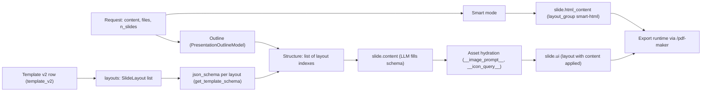

# Glossary

**Reads:** `servers/fastapi/models/sql/*.py`, `servers/fastapi/templates/v2/**`, `servers/fastapi/api/middlewares.py`, `servers/fastapi/api/v1/auth/*.py`, `servers/fastapi/utils/process_slides.py`, `servers/fastapi/models/sse_response.py`, `servers/fastapi/mcp_server.py`, `servers/nextjs/proxy.ts`, `start.js`  ·  **Builds on:** [Repository tour](presenton/02-repository-tour.md), [Data model](presenton/07-data-model.md)  ·  **Time:** reference, skim as needed

This glossary defines every term that has a precise meaning inside the Presenton code base or inside this book: database columns, JSON keys, template concepts, runtime processes, auth concepts, and the names of streamed events and webhook events. Each entry says what the thing is, where it lives (file and line at snapshot `571461f`), and which chapter explains it in depth. Terms are alphabetical; magic keys that start with underscores are sorted by their first letter.

## Step 1: How the core terms fit together

Most of the vocabulary hangs off one chain: a request produces an **outline**, the outline is matched to **layouts** of a **template** to form a **structure**, each structure entry becomes a **slide** whose **content** is generated against a layout's JSON Schema, and the slide's **ui** is the template layout with that content applied. Smart mode skips the template chain and stores raw HTML in **html_content**.

!!! note "How to read an entry"
    The bold-free first line is the term exactly as it appears in code or in this book. The definition gives the meaning, then the source location in inline code, then the chapter. Where two names exist for one thing (for example "block" in the UI and "merged component" in the code), both are listed and cross-referenced.

## Step 2: Terms A to C

Admin
:    A user whose `is_superuser` is true. Admin-only routes are decided in `SessionAuthMiddleware` (`servers/fastapi/api/middlewares.py:100` to `servers/fastapi/api/middlewares.py:114`): everything under `/api/v1/admin/` and `/api/v1/ppt/codex/auth/`, `POST` and `DELETE` on `/api/v1/ppt/fonts/`, and five discovery or test paths. An admin must also be using a browser session (`method == "jwt"`); an admin's API key gets `403 Admin browser session required`. See [Auth and multi-user](presenton/25-auth-and-multiuser.md).

`admin_slot`
:    A unique, nullable `String(32)` column on `user` (`servers/fastapi/models/sql/user.py:27`). The bootstrap and first-run setup write the value `"primary"` (`servers/fastapi/api/v1/auth/bootstrap.py:116`, `servers/fastapi/api/v1/auth/router.py:132`), so the unique constraint guarantees at most one primary admin. See [Auth and multi-user](presenton/25-auth-and-multiuser.md).

Alembic migration
:    Schema change scripts in `servers/fastapi/alembic/versions/`, driven by `servers/fastapi/migrations.py`. They run at startup unless `MIGRATE_DATABASE_ON_STARTUP` is set to something other than `true` or `True`; the default is `"true"` (`servers/fastapi/migrations.py:41`, `servers/fastapi/utils/get_env.py:454`). Right after `migrate_database_on_startup`, `create_db_and_tables` always creates any missing tables (`servers/fastapi/api/lifespan.py:57`, `servers/fastapi/services/database.py:117`). See [Data model](presenton/07-data-model.md).

API key
:    A user-scoped bearer token of the form `sk-presenton-<16 hex id>.<secret>` (`servers/fastapi/services/api_keys.py:19`, `servers/fastapi/services/api_keys.py:35`). The secret must be at least 32 characters (`servers/fastapi/services/api_keys.py:58`). Default expiry is 90 days, maximum 365 (`servers/fastapi/services/api_keys.py:20`, `servers/fastapi/services/api_keys.py:21`). Rows live in `api_keys`; the full token is stored Fernet-encrypted with a key derived (SHA-256) from the auth secret so an admin can reveal it (`servers/fastapi/services/api_keys.py:39`). Next.js forwards `Bearer sk-presenton-*` requests only to FastAPI paths (`servers/nextjs/proxy.ts:147`). See [Auth and multi-user](presenton/25-auth-and-multiuser.md).

`app_data` (APP_DATA_DIRECTORY)
:    The writable data root. `start.js` refuses to start without `APP_DATA_DIRECTORY` (`start.js:50`); the Docker image sets it to `/app_data` (`Dockerfile:82`); Python falls back to `/tmp/presenton` (`servers/fastapi/utils/asset_directory_utils.py:24`). It holds `fastapi.db` (default SQLite database, `servers/fastapi/utils/db_utils.py:58`), `userConfig.json`, `mem0/`, and the asset roots `images`, `exports`, `uploads`, `pptx-to-html`, `pptx-to-json` (private, per user under `users/<owner_id>/`) and `fonts`, `templates` (shared) (`servers/fastapi/api/v1/auth/assets.py:10` to `servers/fastapi/api/v1/auth/assets.py:17`). URLs under `/app_data/` map onto it. See [Runtime topology](presenton/03-runtime-topology.md).

Asset hydration
:    The step that turns placeholder asset keys in generated slide content into real URLs. `process_slide_and_fetch_assets` (`servers/fastapi/utils/process_slides.py:173`) walks the content for dicts carrying an image prompt or icon query (keys in `servers/fastapi/utils/process_slides.py:22` and `servers/fastapi/utils/process_slides.py:23`), generates or searches the asset, and writes `image_url`/`icon_url` (template slides) or `__image_url__`/`__icon_url__` (legacy slides) back (`servers/fastapi/utils/process_slides.py:110`). `process_slide_add_placeholder_assets` (`servers/fastapi/utils/process_slides.py:427`) fills placeholders first so the UI can render before assets arrive. The result is streamed as `slide_assets` events. See [Images, icons, web search](presenton/12-images-icons-search.md).

Async task
:    A row in `async_tasks` (`servers/fastapi/models/sql/async_task.py:16`) that tracks background work started by an `/async` endpoint. Id format `task-<64 hex>`; `status` is `pending`, `completed` or `error` (`servers/fastapi/enums/async_task_status.py:4`); `data` carries progress and results; `payload` is hidden from responses (`exclude=True`). Known `type` values: `presentation.generate` (`servers/fastapi/api/v1/ppt/endpoints/presentation.py:137`), `presentation.smart.generate` (`servers/fastapi/api/v2/ppt/endpoints/presentation.py:39`), `template.create` (`servers/fastapi/api/v1/ppt/endpoints/template.py:100`). Polled at `GET /api/v1/async-tasks/status/{id}`. Tasks left `pending` by a restart are failed at startup by `fail_interrupted_async_tasks`. See [REST API, async tasks, webhooks, MCP](presenton/15-api-async-mcp.md).

`async_presentation_generation_tasks`
:    The older task table (`servers/fastapi/models/sql/async_presentation_generation_status.py:13`), still created and owner-scoped (`servers/fastapi/services/database.py:62`). New code writes `async_tasks`. See [Data model](presenton/07-data-model.md).

`auth_version` (`av` claim)
:    Integer column on `user`, default 1 (`servers/fastapi/models/sql/user.py:43`). It is written into every session JWT as the `av` claim (`servers/fastapi/api/v1/auth/users.py:167`) and compared on read by `VersionedJWTStrategy` (`servers/fastapi/api/v1/auth/users.py:136`), so bumping it (password reset, for example) invalidates all existing sessions of that user. See [Auth and multi-user](presenton/25-auth-and-multiuser.md).

`AuthPrincipal` (principal)
:    The frozen dataclass describing who is calling: `user_id`, `username`, `is_admin`, and `method` (`"jwt"` or `"api_key"`) (`servers/fastapi/api/v1/auth/principal.py:15`). `resolve_request_principal` tries the `presenton_session` cookie first, then an `Authorization: Bearer` API key (`servers/fastapi/api/v1/auth/principal.py:22`). The middleware stores it at `request.state.auth_principal` (`servers/fastapi/api/middlewares.py:120`). See [Auth and multi-user](presenton/25-auth-and-multiuser.md).

Blank presentation
:    A deck created by `POST /api/v1/ppt/presentation/create/blank` with one empty slide. Its slides use `layout_group` `"blank"` (no template) and layout id `__blank_slide__`, and the `ui` is a single decorative white 1280 by 720 polygon (`servers/fastapi/api/v1/ppt/endpoints/presentation.py:138` to `servers/fastapi/api/v1/ppt/endpoints/presentation.py:160`). See [User journey](presenton/21-user-journey.md).

Block
:    The UI and chat-tool word for a **merged component**. `POST /api/v1/ppt/template/generate-blocks` writes `template.merged_components` (`servers/fastapi/api/v1/ppt/endpoints/template.py:1906`), and the chat tool `getAvailableBlocks` lists them (`servers/fastapi/services/chat/tools.py:186`). See [Custom templates from PPTX](presenton/18-custom-templates.md).

Chat assistant
:    The in-editor assistant implemented by `PresentationChatService` (`servers/fastapi/services/chat/service.py:74`). It runs an LLM tool loop of at most `MAX_TOOL_ROUNDS = 40` rounds (`servers/fastapi/services/chat/service.py:45`), persists turns in `chat_history_messages`, and streams `chunk`, `status`, `trace` and `complete` events from `POST /api/v1/ppt/chat/message/stream` (`servers/fastapi/api/v1/ppt/endpoints/chat.py:124`). See [Editing and chat assistant](presenton/14-editing-and-chat.md).

Chat tools
:    The camelCase function tools the chat model may call, defined in `ChatTools` (`servers/fastapi/services/chat/tools.py:84`): for example `addOutline`, `addNewSlide`, `getAvailableLayouts`, `getContentSchemaFromLayoutId`, `searchSlide`, `saveSlide`, `addElement`, `addInfographic`, `addComponent`, `generateAssets`, and for Smart decks `getSmartPresentationContext`. Their strict input schemas live in `servers/fastapi/services/chat/schemas.py`. See [Editing and chat assistant](presenton/14-editing-and-chat.md).

Codex (ChatGPT sign-in)
:    The `codex` LLM provider (`servers/fastapi/enums/llm_provider.py:20`), which uses a ChatGPT account through an OAuth PKCE flow instead of an API key. The Python port listens for the callback on `http://localhost:1455/auth/callback` (`servers/fastapi/utils/oauth/openai_codex.py:25`). Its routes under `/api/v1/ppt/codex/auth/` are admin-only. Token fields such as `CODEX_ACCESS_TOKEN` are "OAuth managed" and protected from ordinary settings saves (`servers/fastapi/services/provider_settings.py:17`). See [Configuration and LLM providers](presenton/06-configuration-and-providers.md).

Community designs (`community_design_ids`)
:    Presentations published to the Presenton community catalog, fetched from `https://api.presenton.ai/api/v3/community/presentations` (`servers/fastapi/services/community_presentations.py:15`). A Smart request can name up to 3 of them (`MAX_COMMUNITY_REFERENCES`), of which at most 6 slides and 90,000 characters are loaded as design references (`servers/fastapi/services/community_presentations.py:18` to `servers/fastapi/services/community_presentations.py:20`). The chosen ids are stored in `presentations.community_design_ids` (`servers/fastapi/models/sql/presentation.py:79`). Enabled by default; disabled when `PRESENTON_COMMUNITY_ENABLED` is `0`, `false`, `no` or `off` (`servers/fastapi/utils/get_env.py:32`). See [Smart mode](presenton/13-smart-mode.md).

Component
:    In Template v2, a named, positioned group of elements inside a slide layout: `Component(id, description, position, elements)` with at least one element (`servers/fastapi/templates/v2/models/layouts.py:54`). Component ids must be unique within a layout (`servers/fastapi/templates/v2/models/layouts.py:104`). A built-in layout such as the first layout of `templates/general/template.json` is just an id, a description and a list of components (for example `background_canvas`, `image_showcase_card`, `right_text_panel`). See [Template v2 format](presenton/16-template-v2-format.md).

`CONCURRENT_SERVICE`
:    A tiny fire-and-forget scheduler around `asyncio` tasks with an optional delay (`servers/fastapi/services/concurrent_service.py:40`). Used, for example, to send webhooks without blocking the response (`servers/fastapi/api/v1/ppt/endpoints/presentation.py:3133`). See [REST API, async tasks, webhooks, MCP](presenton/15-api-async-mcp.md).

`ConfigurationInitializer`
:    The Next.js client component that loads auth status, runtime config, `/api/user-config` and the Presenton account status into Redux and routes to setup when no provider is configured (`servers/nextjs/app/ConfigurationInitializer.tsx`). See [Settings, onboarding, auth UI](presenton/23-settings-and-auth-ui.md).

`content` (presentation)
:    The user's prompt text, a required `str` column on `presentations` (`servers/fastapi/models/sql/presentation.py:46`), and the `content` field of `GeneratePresentationRequest` (`servers/fastapi/models/generate_presentation_request.py:9`). Not to be confused with slide content. See [Standard generation pipeline](presenton/08-standard-pipeline.md).

## Step 3: Terms D to I

Decompose
:    Turning uploaded documents into plain text files before generation. `POST /api/v1/ppt/files/decompose` (`servers/fastapi/api/v1/ppt/endpoints/files.py:133`) runs `DocumentsLoader` (`servers/fastapi/services/documents_loader.py:163`) over the temp files and returns `DecomposedFileInfo` items (`name`, `file_path`). See [Document ingestion](presenton/11-document-ingestion.md).

`decorative`
:    A required boolean on the Template v2 element models that carry content (text, image, text-list, table, chart, infographic; for example `servers/fastapi/templates/v2/models/elements.py:218`). Only elements with `decorative: false` become fields in the layout's content schema (`_is_editable_element`, `servers/fastapi/templates/v2/schema.py:53`); decorative elements are drawn as-is and never rewritten by the LLM. See [From template to schema to slide](presenton/17-template-to-slide.md).

Default template (built-in template)
:    One of the 16 folders under `templates/` (`civic` to `verdant`) with a `template.json`. They are discovered at import time and ordered `momentum, dynamic, executive, general, modern, standard, swift` first (`servers/fastapi/constants/presentation.py:25`), then imported into `template_v2` with `is_default=True` on every startup by `import_default_templates_on_startup` (`servers/fastapi/templates/default_templates.py:22`). Default rows have `owner_id` null and are visible to everyone (`servers/fastapi/services/database.py:88`). The REST default template name is `general` (`servers/fastapi/models/generate_presentation_request.py:30`). See [Template v2 format](presenton/16-template-v2-format.md).

Derive / Edit (presentation)
:    Two one-shot API operations: `POST /api/v1/ppt/presentation/edit` replaces slide content in an existing deck and re-exports it, and `POST /api/v1/ppt/presentation/derive` copies a deck first and then applies the changes (`servers/fastapi/api/v1/ppt/endpoints/presentation.py:3301`, `servers/fastapi/api/v1/ppt/endpoints/presentation.py:3352`). Request models are in `servers/fastapi/models/presentation_from_template.py`. See [REST API, async tasks, webhooks, MCP](presenton/15-api-async-mcp.md).

Desktop guard
:    The Electron-only transport check applied before any auth logic. When `PRESENTON_ELECTRON=true`, every request must arrive with a `Host` among `PRESENTON_DESKTOP_ORIGINS`, a matching `Origin` if present, and the `x-presenton-desktop-token` header or `presenton_desktop_session` cookie equal to `PRESENTON_DESKTOP_TOKEN` (compared with `hmac.compare_digest`) (`servers/fastapi/api/v1/auth/desktop.py:25`). A token shorter than 32 characters, or no configured origins, yields `503 Desktop session unavailable`; a wrong `Host` or `Origin` yields `403 Forbidden desktop origin`, and a wrong token `401`. The same guard exists in `servers/nextjs/lib/desktop-auth.ts` and the token is minted per launch with 32 random bytes in `electron/app/utils/desktop-auth.ts`. See [Electron desktop app](presenton/27-electron.md).

`DISABLE_AUTH`
:    Environment flag that turns off login. `SessionAuthMiddleware` then skips all principal checks and only consults the Presenton Cloud proxy (`servers/fastapi/api/middlewares.py:59`). Electron runs in this mode, so desktop rows keep `owner_id` null. See [Auth and multi-user](presenton/25-auth-and-multiuser.md).

Element
:    The smallest Template v2 drawing unit, a Pydantic model discriminated by `type`: `text`, `container`, `image`, `text-list`, `table`, `vector`, `chart`, `infographic`, `flex`, `grid`, `group` (union `SlideElement` at `servers/fastapi/templates/v2/models/elements.py:624`). Most carry `position`, `size`, rotation and styling; content-bearing ones also carry the schema fields `decorative`, `name`, and limits such as `max_length`/`min_length` for text (`servers/fastapi/templates/v2/models/elements.py:217` to `servers/fastapi/templates/v2/models/elements.py:221`). The frontend draws them with Konva. See [Template v2 format](presenton/16-template-v2-format.md).

export-core (`@presenton/export-core`)
:    The npm package that actually renders exports. Its version is pinned by `presentationExportVersion` (`v1.0.51`) in the root `package.json:4`, installed into `presentation-export/` by `scripts/sync-presentation-export.cjs`, and invoked through `runTask` by `scripts/run-presentation-export.mjs:116`. See [PPTX and PDF export](presenton/24-export-pipeline.md).

Export runtime
:    The Node child process FastAPI launches for any headless-browser task. `ExportTaskService` (`servers/fastapi/services/export_task_service.py:121`) writes a task JSON and runs the runner with task `type` values `export`, `pptx-to-html`, `pptx-to-json`, `html-to-image`, `html-to-images`, `json-to-image`, `json-to-images` (`servers/fastapi/services/export_task_service.py:439` to `servers/fastapi/services/export_task_service.py:692`). In Docker the package lives at `EXPORT_PACKAGE_ROOT=/app/presentation-export` (`Dockerfile:84`). See [PPTX and PDF export](presenton/24-export-pipeline.md).

`exportCookie` / `x-export-cookie`
:    How the headless export browser authenticates. `_build_presentation_export_url` puts the caller's cookie header in the URL fragment as `exportCookie` (`servers/fastapi/utils/export_utils.py:36`), so it never reaches a server log. The `/pdf-maker` page reads it and sends it as the `x-export-cookie` header to `/api/export-presentation-data/{id}` (`servers/nextjs/app/api/export-presentation-data/[id]/route.ts:29`). See [PPTX and PDF export](presenton/24-export-pipeline.md).

FastEmbed
:    The local ONNX embedding library used twice: the icon search vector store (`FastembedEmbeddingModel.AllMiniLML6V2` in `servers/fastapi/services/icon_finder_service.py:28`, cache dir overridable with `PRESENTON_FASTEMBED_ICON_CACHE_DIR`) and Mem0's default embedder (`BAAI/bge-small-en-v1.5`, 384 dims, `servers/fastapi/services/mem0_oss_memory.py:105` to `servers/fastapi/services/mem0_oss_memory.py:109`). Weights are pre-downloaded at image build by `servers/fastapi/scripts/warm_fastembed_cache.py`. See [Images, icons, web search](presenton/12-images-icons-search.md).

FastMCP
:    The Python framework that turns the committed OpenAPI document into an MCP server (`servers/fastapi/mcp_server.py`). See **MCP**.

Fonts (presentation `fonts`, font uploads)
:    Two things. The `presentations.fonts` JSON column (`servers/fastapi/models/sql/presentation.py:74`) maps font family names to stylesheet URLs, for example `{"Poppins": "https://fonts.googleapis.com/css2?family=Poppins..."}` as in `templates/general/template.json`; Smart streams send it as a `fonts` event. Separately, user-uploaded font files are stored in `font_uploads` with parsed family, weight and width (`servers/fastapi/models/sql/font_upload.py:12`), and only admins may upload or delete them. See [Themes and fonts](presenton/19-themes-and-fonts.md).

Generation mode (presentation)
:    `presentations.generation_mode`, either `standard` or `smart` (`servers/fastapi/models/sql/presentation.py:75`). It decides whether `GET /presentation/stream/{id}` runs the template pipeline or delegates to `stream_smart_presentation` (`servers/fastapi/api/v1/ppt/endpoints/presentation.py:2289`). See [Smart mode](presenton/13-smart-mode.md).

Generation mode (deployment, `PRESENTATION_GENERATION_MODE`)
:    Deployment switch with values `both` (default), `standard` or `smart` (`servers/fastapi/utils/get_env.py:24`). It hides UI entry points and decides which MCP tools are exposed (`servers/fastapi/mcp_server.py:113`). See [Smart mode](presenton/13-smart-mode.md).

Generation profile
:    An `llmai` `GenerationProfile` that sets default output-token budgets. Presenton reads `LLM_GENERATION_PROFILE` (default `balanced`) in `get_generation_defaults` (`servers/fastapi/utils/llm_config.py:189`) together with `LLM_MAX_OUTPUT_TOKENS` and the `LLM_REASONING_*` settings. `POST /api/v1/ppt/generation/defaults` reports the token limits that the profiles `BALANCED` and `MODEL_MAX` would produce for a provider and model (`servers/fastapi/api/v1/ppt/endpoints/generation.py:27`). See [Configuration and LLM providers](presenton/06-configuration-and-providers.md).

`generation_metrics` (SSE)
:    A Smart-stream event carrying text generation metrics, emitted periodically (`SMART_GENERATION_METRICS_INTERVAL_SECONDS = 5.0`, `servers/fastapi/utils/llm_calls/generate_smart_presentation.py:50`) as `{"type": "generation_metrics", ...}` (`servers/fastapi/api/v1/ppt/endpoints/presentation.py:2169`). See [Streaming (SSE)](presenton/10-streaming.md).

`html_content`
:    Optional text column on `slides` (`servers/fastapi/models/sql/slide.py:27`) holding a Smart slide's full HTML section. It is rendered in the browser with the pinned Tailwind and Chart.js runtimes (`servers/nextjs/app/(presentation-generator)/components/SmartHtmlSlide.tsx`). Standard slides leave it null. See [Smart mode](presenton/13-smart-mode.md).

Icon query (`__icon_query__`)
:    The key the slide-content schema uses to ask for an icon by meaning. Accepted spellings are `__icon_query__`, `icon_query` and `query` (`servers/fastapi/utils/process_slides.py:23`). Asset hydration resolves it with `ICON_FINDER_SERVICE.search_icons` (`servers/fastapi/services/icon_finder_service.py:179`) to a static SVG in the requested icon weight. See [Images, icons, web search](presenton/12-images-icons-search.md).

Icon weight (`icon_type`)
:    The Phosphor style used for icons: `bold` (default), `duotone`, `fill`, `light`, `regular`, `thin` (`servers/fastapi/utils/icon_weights.py:5` to `servers/fastapi/utils/icon_weights.py:10`). Stored on the layout model as both `icon_type` and `icon_weight` (`servers/fastapi/templates/presentation_layout.py:21`) and resolved per template by `_template_icon_type` (`servers/fastapi/api/v1/ppt/endpoints/presentation.py:250`). See [Images, icons, web search](presenton/12-images-icons-search.md).

Image prompt (`__image_prompt__`)
:    The key the slide-content schema uses to ask for an image. Accepted spellings are `__image_prompt__`, `image_prompt` and `prompt` (`servers/fastapi/utils/process_slides.py:22`). The value becomes an `ImagePrompt` (`servers/fastapi/models/image_prompt.py`) with optional target width and height taken from the template element (`image_target_sizes_from_template`, `servers/fastapi/utils/process_slides.py:35`). See [Images, icons, web search](presenton/12-images-icons-search.md).

Image provider
:    Where images come from: `pexels`, `pixabay` (stock search), `gemini_flash`, `nanobanana_pro`, `gpt-image-2`, `gpt-image-1.5` (hosted generation), `comfyui`, `open_webui`, `openai_compatible` (self-hosted) (`servers/fastapi/enums/image_provider.py:4`). Dispatch is in `ImageGenerationService` (`servers/fastapi/services/image_generation_service.py:132`). See [Images, icons, web search](presenton/12-images-icons-search.md).

`ImageAsset` (image library)
:    Table of generated or uploaded images with `path`, `is_uploaded` and `extras` (`servers/fastapi/models/sql/image_asset.py:12`). There is no explicit `__tablename__`, so the table is SQLModel's default `imageasset` (created in `servers/fastapi/alembic/versions/00b3c27a13bc_init.py:34`). It is read and written by the image endpoints in `servers/fastapi/api/v1/ppt/endpoints/images.py`. See [Images, icons, web search](presenton/12-images-icons-search.md).

Infographic
:    A Template v2 element type (`type: "infographic"`) with 27 kinds from `progress_bar` and `gauge` to `org_chart`, `decision_tree` and `mind_map` (`InfographicType`, `servers/fastapi/templates/v2/models/elements.py:427`). Defaults and data normalization per kind are in `servers/fastapi/utils/infographic_catalog.py`. See [Editing and chat assistant](presenton/14-editing-and-chat.md).

`instructions`
:    Free-text extra guidance from the user, stored on `presentations.instructions` (`servers/fastapi/models/sql/presentation.py:67`) and injected into outline and slide prompts. See [Prompts and schemas](presenton/09-prompts-and-schemas.md).

`is_active` / `is_superuser` (user flags)
:    Boolean columns on the `user` table (`servers/fastapi/models/sql/user.py:31` to `servers/fastapi/models/sql/user.py:39`). `is_superuser` is what the rest of the code calls "admin": `AuthPrincipal.is_admin` is copied from it (`servers/fastapi/api/v1/auth/principal.py:34`). See [Auth and multi-user](presenton/25-auth-and-multiuser.md).

## Step 4: Terms L to O

Layout (slide layout)
:    One slide design inside a template. In the stored template it is a `SlideLayout(id, description, components)` (`servers/fastapi/templates/v2/models/layouts.py:98`). For generation it is reduced to a `SlideLayoutModel(id, name, description, json_schema)` (`servers/fastapi/templates/presentation_layout.py:11`) by `_build_template_layout_model` (`servers/fastapi/api/v1/ppt/endpoints/presentation.py:410`). On a slide row, `slides.layout` holds the layout id (`servers/fastapi/models/sql/slide.py:24`). See [From template to schema to slide](presenton/17-template-to-slide.md).

Layout (presentation `layout` column)
:    `presentations.layout` (`servers/fastapi/models/sql/presentation.py:65`) stores a copy of the template's `layouts` JSON with `name`, `template_id`, `icon_type` and `icon_weight` added (`_copy_template_layout_payload`, `servers/fastapi/api/v1/ppt/endpoints/presentation.py:232`). Copying it decouples a deck from later edits to its template. See [Data model](presenton/07-data-model.md).

Layout group (`layout_group`)
:    Required string on `slides` (`servers/fastapi/models/sql/slide.py:23`) naming the family a slide's layout belongs to. Values in this snapshot: the template id for template slides (`servers/fastapi/api/v1/ppt/endpoints/presentation.py:1815`), `"blank"` for blank decks, and `"smart-html"` for Smart slides (`servers/fastapi/api/v1/ppt/endpoints/presentation.py:2062`). See [Data model](presenton/07-data-model.md).

LiteParse
:    `@llamaindex/liteparse`, the Node document parser used for PDFs and other documents. `LiteParseService` (`servers/fastapi/services/liteparse_service.py:67`) runs `liteparse_runner.mjs` with `node` as a subprocess, with a 600-second default timeout and `LITEPARSE_DPI` (clamped 72 to 600) and `LITEPARSE_NUM_WORKERS` settings (`servers/fastapi/services/liteparse_service.py:68` to `servers/fastapi/services/liteparse_service.py:78`). See [Document ingestion](presenton/11-document-ingestion.md).

`llmai`
:    The provider-agnostic LLM client library Presenton depends on (`llmai==0.3.15` in `servers/fastapi/pyproject.toml`). It supplies `GenerationDefaults`, `GenerationProfile`, `prepare_generation` and model capabilities (`servers/fastapi/api/v1/ppt/endpoints/generation.py:2`). Per-provider client configuration is built in `servers/fastapi/utils/llm_config.py`. The library source is not part of this repository; its internals are not covered here. See [Configuration and LLM providers](presenton/06-configuration-and-providers.md).

LLM provider
:    The selected text model backend, stored in config key `LLM`. The enum lists 16: `ollama`, `deepseek`, `openai`, `google`, `vertex`, `azure`, `bedrock`, `openrouter`, `fireworks`, `together`, `cerebras`, `anthropic`, `litellm`, `lmstudio`, `custom`, `codex` (`servers/fastapi/enums/llm_provider.py:4`). The value `presenton` (Presenton Cloud) is handled outside this enum by the cloud proxy (`servers/fastapi/services/presenton_cloud_proxy.py:439`). See [Configuration and LLM providers](presenton/06-configuration-and-providers.md).

`MAX_NUMBER_OF_SLIDES`
:    Hard cap of 50 slides (`servers/fastapi/constants/presentation.py:4`), enforced on outlines (`max_length` in `servers/fastapi/models/presentation_outline_model.py:27`) and on Smart decks (`MAX_SMART_SLIDE_COUNT`). See [Standard generation pipeline](presenton/08-standard-pipeline.md).

`MAX_OUTLINE_WORDS`
:    Word limit per outline slide, default 100, read once from the environment at import (`servers/fastapi/constants/presentation.py:5` to `servers/fastapi/constants/presentation.py:23`) and enforced by `normalize_outline_content`. See [Standard generation pipeline](presenton/08-standard-pipeline.md).

MCP (Model Context Protocol server)
:    A separate process on port 8001 (`servers/fastapi/mcp_server.py:431`) that exposes a small allowlist of REST routes as tools, renamed to `start_standard_presentation`, `start_smart_presentation`, `list_templates`, `upload_template_assets`, `start_template_generation`, `upload_files`, `get_job_status` (`servers/fastapi/mcp_server.py:101`). It is built from the committed `openai_spec.json`, authenticates with the same API keys (`PresentonTokenVerifier`, `servers/fastapi/mcp_server.py:285`), mints a one-hour internal session for upstream calls (`servers/fastapi/mcp_server.py:39`), and is disabled in Electron (`servers/fastapi/mcp_server.py:319`). nginx proxies `/mcp`. See [REST API, async tasks, webhooks, MCP](presenton/15-api-async-mcp.md).

Mem0
:    The open-source memory layer used to give the chat assistant per-presentation context. `Mem0PresentationMemoryService` (`servers/fastapi/services/mem0_presentation_memory_service.py:18`) stores generation context, outlines and slide edits and retrieves at most `MEM0_TOP_K` (8) memories truncated to `MEM0_MAX_CONTEXT_CHARS` (6000). Storage defaults to `<app_data>/mem0` with a local Qdrant path and `history.db` (`servers/fastapi/services/mem0_oss_memory.py:94` to `servers/fastapi/services/mem0_oss_memory.py:103`). Turned off with `MEM0_ENABLED=false`, and disabled automatically if the spaCy model (`MEM0_SPACY_MODEL`, default `en_core_web_sm`) cannot be loaded, unless `MEM0_REQUIRE_SPACY_MODEL=false` (`servers/fastapi/services/mem0_oss_memory.py:63`). See [Editing and chat assistant](presenton/14-editing-and-chat.md).

Merged component
:    A deduplicated component shared across layouts: `MergedComponent(id, description, variants)` where each variant is a `Component` (`servers/fastapi/templates/v2/models/layouts.py:81`). Ids must be unique (`servers/fastapi/templates/v2/models/layouts.py:91`). Stored in `template_v2.merged_components`; the general template has 15. Called "blocks" in the UI. See [Template v2 format](presenton/16-template-v2-format.md).

nginx `auth_request`
:    The mechanism that protects files nginx serves directly from disk. Private `/app_data/` locations call the internal `/_auth_check` location, which proxies to FastAPI `GET /api/v1/auth/verify` with the original cookie and Authorization header (`nginx.conf:133` to `nginx.conf:142`). `/app_data/fonts/` and `/app_data/templates/` are public. See [Runtime topology](presenton/03-runtime-topology.md).

Ollama
:    Local model server and LLM provider. `start.js` can start `ollama serve` inside the container (`start.js:662`); `/api/v1/ppt/ollama/*` lists curated and pulled models and streams pulls, and the pull and "available" routes are admin-only. See [Configuration and LLM providers](presenton/06-configuration-and-providers.md).

`openai_spec.json`
:    A committed, minified OpenAPI document of the FastAPI app (`servers/fastapi/openai_spec.json`), written by `servers/fastapi/scripts/generate_openapi_spec.py` and loaded by the MCP server at import (`servers/fastapi/mcp_server.py:281`). It is not regenerated at runtime. See [Endpoint index](appendix-endpoints.md).

Outline
:    The first generation artifact: an ordered list of slide outlines, each a Markdown `content` string limited to `MAX_OUTLINE_WORDS` words (`SlideOutlineModel`, `servers/fastapi/models/presentation_outline_model.py:8`; `PresentationOutlineModel`, `servers/fastapi/models/presentation_outline_model.py:24`). Stored as JSON in `presentations.outlines` (`servers/fastapi/models/sql/presentation.py:51`) and streamed from `GET /api/v1/ppt/outlines/stream/{id}` (`servers/fastapi/api/v1/ppt/endpoints/outlines.py:84`). See [Standard generation pipeline](presenton/08-standard-pipeline.md).

`owner_id` (owner scoping)
:    Nullable foreign key to `user.id` with `ON DELETE CASCADE` on every user-owned table (for example `servers/fastapi/models/sql/presentation.py:25`). It defaults to `get_current_owner_id()`, a `ContextVar` set by the middleware for the duration of a request (`servers/fastapi/api/v1/auth/context.py:5`, `servers/fastapi/api/middlewares.py:127`). Two SQLAlchemy events enforce isolation: `do_orm_execute` adds `owner_id == current` to every SELECT on the strict models, and lets `template_v2` also match default rows (`servers/fastapi/services/database.py:67`); `before_flush` stamps new rows (`servers/fastapi/services/database.py:100`). The field is excluded from API responses (`exclude=True`). See [Auth and multi-user](presenton/25-auth-and-multiuser.md).

## Step 5: Terms P to R

`pdf-maker`
:    The Next.js page `/pdf-maker?id=<presentation id>` (`servers/nextjs/app/(export)/pdf-maker/page.tsx`) that the export runtime opens in a headless browser. It renders every slide at print size; the export runtime then produces the PDF or PPTX from it. The proxy treats `/pdf-maker` specially: an `exportSession` query parameter is turned into a `presenton_session` cookie and stripped by redirect (`servers/nextjs/proxy.ts:114`). See [PPTX and PDF export](presenton/24-export-pipeline.md).

Phosphor icons
:    The icon set bundled with Presenton: `servers/fastapi/assets/icons.json` declares the set label "Phosphor Icons", and `servers/fastapi/static/icons/<weight>/` holds the SVGs (1,512 files in `bold/` alone, named like `acorn-bold.svg`). A missing icon path returns `static/icons/placeholder.svg` instead of 404 (`servers/fastapi/api/main.py:107`). See [Images, icons, web search](presenton/12-images-icons-search.md).

Prepare (presentation)
:    `POST /api/v1/ppt/presentation/prepare` (`servers/fastapi/api/v1/ppt/endpoints/presentation.py:1840`): the step after outline editing that resolves the chosen template layout, computes the structure (including TOC slides) and saves both on the presentation, returning only `presentation_id`. The UI then opens `/presentation?id=...&stream=true`. See [Standard generation pipeline](presenton/08-standard-pipeline.md).

Presentation version (`v1-standard`, `v2-standard`)
:    `PresentationVersion` enum stored in `presentations.version` (`servers/fastapi/models/sql/presentation.py:16`). `v2-standard` is every deck created by this snapshot, Standard and Smart alike (`servers/fastapi/api/v1/ppt/endpoints/presentation.py:1747`). `v1-standard` is the value the migration back-fills for decks made before Template v2 (`servers/fastapi/alembic/versions/6e4a1b2c3d5f_add_template_v2_and_presentation_version.py:22`). The UI refuses to open v1 decks ("This deck was created in an older Presenton version", `servers/nextjs/app/(presentation-generator)/presentation/hooks/usePresentationData.ts:33`). See [Data model](presenton/07-data-model.md).

Presenton Cloud (`presenton` provider)
:    Optional hosted service at `https://api.presenton.ai` (`servers/fastapi/utils/get_env.py:7`). An admin links an account through an OAuth device flow under `/api/v1/auth/presenton/*`; the encrypted token sits in the `presenton_cloud_provider` singleton. When provider settings have `LLM == "presenton"`, `maybe_proxy_presenton_cloud_request` forwards selected generation, edit, Smart and asset paths to the cloud and persists results locally (`servers/fastapi/services/presenton_cloud_proxy.py:407`). See [Configuration and LLM providers](presenton/06-configuration-and-providers.md).

`presenton_session`
:    The browser session cookie (`SESSION_COOKIE_NAME`, `servers/fastapi/api/v1/auth/config.py:11`) holding a JWT with a 30-day lifetime (`SESSION_TTL_SECONDS`, `servers/fastapi/api/v1/auth/config.py:12`). Set by `POST /api/v1/auth/login` and setup, removed by logout. See [Auth and multi-user](presenton/25-auth-and-multiuser.md).

`properties` (slide)
:    Nullable JSON column on `slides` (`servers/fastapi/models/sql/slide.py:29`) used by the frontend as a per-item map of image display properties keyed by item index; the `updateImageProperties` reducer writes `slide.properties[itemIndex]` (`servers/nextjs/store/slices/presentationGeneration.ts:473`). The backend copies it but does not interpret it. See [Slide editor](presenton/22-slide-editor.md).

Provider settings
:    The `provider_settings` table, a singleton row with `id = 1` and a `config` JSON blob holding the text, image and web-search provider configuration (`servers/fastapi/models/sql/provider_settings.py:10`). `servers/fastapi/services/provider_settings.py` sanitizes, merges and saves it, mirrors it to `userConfig.json`, and migrates from the file at startup (`migrate_provider_settings_from_file`, `servers/fastapi/services/provider_settings.py:103`). Admins edit it through `/api/v1/admin/`. See [Configuration and LLM providers](presenton/06-configuration-and-providers.md).

`raw_layouts`
:    The intermediate template form produced when a PPTX is converted to JSON by the export runtime: `RawSlideLayouts(layouts=[RawSlideLayout(id, description, elements)])` (`servers/fastapi/templates/v2/models/layouts.py:44`, `servers/fastapi/api/v1/ppt/endpoints/template.py:964`). Flat element lists, before component grouping. Stored in `template_v2.raw_layouts`; null for built-in templates. See [Custom templates from PPTX](presenton/18-custom-templates.md).

Redux store
:    The Next.js client state with four reducers: `presentationGeneration`, `pptGenUpload`, `userConfig`, `undoRedo` (`servers/nextjs/store/store.ts:8`). See [Next.js architecture](presenton/20-nextjs-architecture.md).

Regenerate (Smart)
:    `POST /api/v1/ppt/presentation/{id}/regenerate` (`servers/fastapi/api/v1/ppt/endpoints/presentation.py:1615`) deletes all slides of a generated Smart deck so that the next stream generates it from scratch. It refuses non-Smart decks, decks whose `can_regenerate` is false, and Presenton Cloud (`400 Presenton Cloud does not support regeneration`). Ordinary SSE reconnects do not reset; they resume from saved slide checkpoints. See [Smart mode](presenton/13-smart-mode.md).

## Step 6: Terms S

`SessionAuthMiddleware`
:    The FastAPI middleware that owns authentication (`servers/fastapi/api/middlewares.py:29`). Order of checks: desktop guard, `DISABLE_AUTH` short circuit, public paths (`/api/v1/auth/status`, `verify`, `setup`, `login`, `logout`, plus `/app_data/fonts/` and `/app_data/templates/`), `428 Login setup is required` when no user exists, principal resolution, admin-only rules, owner context, Presenton Cloud proxy, and `/app_data` ownership. See [Auth and multi-user](presenton/25-auth-and-multiuser.md).

Slide
:    A row in `slides` (`servers/fastapi/models/sql/slide.py:9`): `presentation` (FK, cascade), `layout_group`, `layout`, `index`, `content`, `html_content`, `speaker_note`, `properties`, `ui`, `owner_id`. See [Data model](presenton/07-data-model.md).

Slide content (`content`)
:    The JSON object the LLM produces for one slide by filling the layout's JSON Schema (`slides.content`, `servers/fastapi/models/sql/slide.py:26`). It may contain image prompts and icon queries for hydration and the reserved `__speaker_note__` key, which is moved to `speaker_note` (`servers/fastapi/api/v1/ppt/endpoints/presentation.py:2388`). For Smart slides it is just `{"title": ...}` (`servers/fastapi/api/v1/ppt/endpoints/presentation.py:2064`). See [Prompts and schemas](presenton/09-prompts-and-schemas.md).

`slides_markdown`
:    Optional list on `GeneratePresentationRequest` (`servers/fastapi/models/generate_presentation_request.py:10`): one Markdown string per slide, used instead of LLM outline generation. When present it also fixes the slide count (`_requested_slide_count`, `servers/fastapi/api/v1/ppt/endpoints/presentation.py:190`). See [REST API, async tasks, webhooks, MCP](presenton/15-api-async-mcp.md).

Smart mode / Smart slide
:    The template-free generation path. The LLM writes each slide directly as a 1280 by 720 HTML `<section>` that is sanitized (no scripts other than vetted Chart.js initializers, no event handlers or `javascript:` URLs) and stored in `html_content` with `layout_group` and `layout` both `"smart-html"`. Defaults: 8 slides, maximum 50, up to 8 generation attempts (`servers/fastapi/utils/llm_calls/generate_smart_presentation.py:45` to `servers/fastapi/utils/llm_calls/generate_smart_presentation.py:49`). REST entry points are `POST /api/v2/ppt/presentation/generate/smart` and `.../generate/smart/async`. See [Smart mode](presenton/13-smart-mode.md).

`speaker_note`
:    Optional text column on `slides` (`servers/fastapi/models/sql/slide.py:28`), filled from the `__speaker_note__` property that `generate_slide_content` adds to every slide schema (`servers/fastapi/utils/llm_calls/generate_slide_content.py:217`). See [Prompts and schemas](presenton/09-prompts-and-schemas.md).

SSE event names
:    Every Presenton stream uses the single SSE event name `response` (`servers/fastapi/models/sse_response.py:19`); the kind of message is the `type` field inside the JSON `data`. The types are listed below.

    | `type` | Emitted by | Payload |
    | --- | --- | --- |
    | `chunk` | outlines, Standard stream, chat | `chunk`: text fragment of a JSON document or reply |
    | `status` | outlines, Smart stream, chat | `status`: human-readable progress |
    | `trace` | chat | `trace`: tool activity object |
    | `slide_assets` | Standard stream | `slide_index`, `slide`, `warnings` (for example `asset_generation_failed`) |
    | `slide_html` | Smart stream | `index`, `slide_id`, `html`, `slide` |
    | `fonts` | Smart stream | `fonts` map |
    | `generation_metrics` | Smart stream | metrics fields |
    | `complete` | all | one key: `presentation` or `chat` |
    | `error` | all, via `SSEErrorResponse` or `safe_sse_stream` | `detail`, optional `source`, `status_code`, `error_type`, `retryable`, `completed_slides`, `total_slides` (`servers/fastapi/models/sse_response.py:32`) |

    Sources: `servers/fastapi/api/v1/ppt/endpoints/presentation.py:2362` to `servers/fastapi/api/v1/ppt/endpoints/presentation.py:2464`, `servers/fastapi/api/v1/ppt/endpoints/chat.py:142` to `servers/fastapi/api/v1/ppt/endpoints/chat.py:161`, `servers/fastapi/utils/sse.py:10`. See [Streaming (SSE)](presenton/10-streaming.md).

Standard mode
:    The template-based pipeline: outline, prepare (layout and structure), per-slide content generation, asset hydration, `ui` hydration, then optional export. See [Standard generation pipeline](presenton/08-standard-pipeline.md).

`start.js`
:    The container supervisor (`start.js`). It requires `APP_DATA_DIRECTORY`, derives `userConfig.json` from it (`start.js:56`) and exports `USER_CONFIG_PATH` (`start.js:481`), then starts nginx with `service nginx start` (`start.js:698`, called at `start.js:733`) and, alongside it, FastAPI on 8000, Next.js on 3000, the MCP server on 8001 (`start.js:46` to `start.js:48`) and optionally Ollama (`start.js:662`), waiting until FastAPI, Next.js and nginx are ready (`start.js:682`). See [Runtime topology](presenton/03-runtime-topology.md).

Structure
:    The mapping from outline slides to template layouts: `PresentationStructureModel(slides: List[int])`, a list of layout indexes into the presentation's layout model (`servers/fastapi/models/presentation_structure_model.py:5`). Chosen by the LLM in `generate_presentation_structure` unless the layout is `ordered`, normalized and extended with TOC layouts, and stored in `presentations.structure` (`servers/fastapi/models/sql/presentation.py:66`). See [Standard generation pipeline](presenton/08-standard-pipeline.md).

## Step 7: Terms T to Z

Table of contents (TOC)
:    Optional generated slides listing the deck's sections, enabled by `include_table_of_contents` (`servers/fastapi/models/sql/presentation.py:70`). The number of TOC slides depends on the total (`get_no_of_toc_required_for_n_outlines`, `servers/fastapi/utils/outline_utils.py:52`), and the layout is found by regex over layout names (`select_toc_or_list_slide_layout_index`, `servers/fastapi/utils/ppt_utils.py:59`). See [Standard generation pipeline](presenton/08-standard-pipeline.md).

Template v2
:    The current template format and its table `template_v2` (`servers/fastapi/models/sql/template_v2.py:16`): string UUID `id`, `name`, `description`, `raw_layouts`, `components`, `merged_components`, `layouts`, `theme`, `assets`, `is_default`, `owner_id`. Built-in `template.json` files carry `id`, `name`, `description`, `thumbnail`, `merged_components`, `layouts`, `fonts`, `theme`. Custom templates are produced from a PPTX by the multi-pass generator in `servers/fastapi/templates/v2/generation.py` and `servers/fastapi/templates/v2/certified_generation.py`. A template name of the form `custom-<id>` is accepted and stripped to `<id>` (`servers/fastapi/api/v1/ppt/endpoints/presentation.py:200`). See [Template v2 format](presenton/16-template-v2-format.md).

Template schema (`get_template_schema`)
:    The JSON Schema derived from a template layout that the LLM must fill, built by `get_template_schema` (`servers/fastapi/templates/v2/schema.py:257`) from the non-decorative elements of each component, with table text capacity and repeated-group arrays handled specially. See [From template to schema to slide](presenton/17-template-to-slide.md).

Temp files
:    Uploaded documents live in owner-scoped temporary directories managed by `TEMP_FILE_SERVICE` (`servers/fastapi/services/temp_file_service.py:191`), rooted at `TEMP_DIRECTORY` or, when unset, `/tmp/presenton` (`servers/fastapi/services/temp_file_service.py:14`); the Docker image sets `TEMP_DIRECTORY=/tmp/presenton` (`Dockerfile:83`). See [Document ingestion](presenton/11-document-ingestion.md).

Theme
:    Colors and fonts for a presentation: `PresentationThemeData` with `colors` (`PresentationThemeColors`: roles `primary`, `background`, `card`, `stroke`, `background_text`, `primary_text`, `graph_0` to `graph_9`) and `fonts.textFont` (`name`, `url`) (`servers/fastapi/models/theme_data.py:4`, `servers/fastapi/models/theme_data.py:31`). Template themes are derived from layout colors by `servers/fastapi/templates/v2/theme.py` (LLM or deterministic role selection with contrast repair). Stored in `presentations.theme` and `template_v2.theme`. See [Themes and fonts](presenton/19-themes-and-fonts.md).

Tone and verbosity
:    Writing-style knobs on generation requests. Tone: `default`, `casual`, `professional`, `funny`, `educational`, `sales_pitch` (`servers/fastapi/enums/tone.py`). Verbosity: `concise`, `standard`, `text-heavy` (`servers/fastapi/enums/verbosity.py`). See [Prompts and schemas](presenton/09-prompts-and-schemas.md).

`ui` (slide)
:    Nullable JSON column on `slides` (`servers/fastapi/models/sql/slide.py:30`): the fully materialized Template v2 layout for this slide, that is the layout object (`id`, `description`, `components`, optionally `background` and `elements`) with the slide content applied to its non-decorative elements. Built by `_template_slide_ui` plus `_apply_template_content_to_ui` (`servers/fastapi/api/v1/ppt/endpoints/presentation.py:490`, `servers/fastapi/api/v1/ppt/endpoints/presentation.py:575`) and edited directly by the Konva editor. `templateV2UiToHtml` turns it into 1280 by 720 HTML (`servers/nextjs/lib/template-v2-json-to-html.ts:156`). See [From template to schema to slide](presenton/17-template-to-slide.md).

Undo history
:    The editor keeps at most `MAX_HISTORY_ENTRIES = 50` states (`servers/nextjs/components/slide-editor/model/core.ts:20`) in the `undoRedo` slice. See [Slide editor](presenton/22-slide-editor.md).

`userConfig.json`
:    The JSON configuration file at `USER_CONFIG_PATH` (in Docker, `<APP_DATA_DIRECTORY>/userConfig.json`, `start.js:56`). It is seeded from environment variables by `start.js` and `scripts/user-config-env.cjs`, read into the process environment on every request by `UserConfigEnvUpdateMiddleware` (`servers/fastapi/api/middlewares.py:23`), and written with a `.lock` file and a `.bak` backup (`servers/fastapi/utils/user_config_store.py:17` to `servers/fastapi/utils/user_config_store.py:22`). Identical locking code exists in Next.js and Electron. When Next.js returns it to the browser, secrets are replaced by `__configured__` (`servers/nextjs/lib/runtime-provider-config.ts:6`). See [Configuration and LLM providers](presenton/06-configuration-and-providers.md).

Web search provider
:    How outlines get fresh facts: `auto`, `native` (the LLM provider's built-in search), `searxng`, `tavily`, `exa`, `brave`, `serper` (`servers/fastapi/enums/web_search_provider.py:4`). Routing is in `servers/fastapi/utils/web_search.py`. Enabled per request by `web_search`. See [Images, icons, web search](presenton/12-images-icons-search.md).

Webhook / webhook events
:    Subscriptions in `webhook_subscriptions` (`webhook-<hex>` id, `url`, `secret`, `event`) created by `POST /api/v1/webhook/subscribe`. Two events exist: `presentation.generation.completed` and `presentation.generation.failed` (`servers/fastapi/enums/webhook_event.py:5`). `WebhookService.send_webhook` POSTs the JSON body (the `PresentationPathAndEditPath` on success, an `APIErrorModel` on failure) to every matching subscription with `Authorization: Bearer <secret>` when a secret is set, and only prints errors (`servers/fastapi/services/webhook_service.py:12`). See [REST API, async tasks, webhooks, MCP](presenton/15-api-async-mcp.md).

## Gotchas collected from the glossary

!!! warning "Gotcha"
    `trigger_webhook` exists on `GeneratePresentationRequest` (`servers/fastapi/models/generate_presentation_request.py:44`) but nothing in the FastAPI code reads it. The success and failure webhooks are scheduled unconditionally in `generate_presentation_handler` (`servers/fastapi/api/v1/ppt/endpoints/presentation.py:3133`, `servers/fastapi/api/v1/ppt/endpoints/presentation.py:3150`); filtering happens only by subscription event.

!!! warning "Gotcha"
    "Layout" means three different things: a template `SlideLayout` (components), a generation `SlideLayoutModel` (id plus JSON Schema), and the `presentations.layout` column (a copied template payload). The `slides.layout` column is only the layout id string. Read the type, not the name.

!!! warning "Gotcha"
    `presenton` is a valid value of the `LLM` setting but not a member of `LLMProvider` (`servers/fastapi/enums/llm_provider.py:4`). `get_llm_provider` answers `500 Invalid LLM provider` for it (`servers/fastapi/utils/llm_provider.py:47`), so any request that reaches local LLM code instead of being intercepted by the cloud proxy fails. When you add a route that calls the LLM, check whether it also needs a cloud proxy rule.

!!! warning "Gotcha"
    `owner_id` is null in two very different situations: built-in templates (shared with everyone because `is_default` is true) and every row created in auth-disabled mode, including Electron. If you turn auth on for a database created with `DISABLE_AUTH`, those rows are not visible to any user until ownership is backfilled (the bootstrap's legacy backfill in `servers/fastapi/api/v1/auth/bootstrap.py` exists for this reason).

!!! warning "Gotcha"
    All SSE messages share the event name `response`. A client that registers `addEventListener("chunk", ...)` receives nothing; it must listen for `response` and switch on `data.type`.

## What you now know

- The vocabulary of the data model: presentation, slide, `content`, `ui`, `html_content`, `properties`, `layout_group`, `version`, `owner_id`.
- The Template v2 hierarchy from element to component to layout to template, and where `decorative`, merged components ("blocks") and raw layouts fit.
- The runtime pieces by name: `start.js`, the export runtime and export-core, `/pdf-maker`, the MCP server, LiteParse, FastEmbed, Mem0, `llmai`.
- The auth terms: principal, API key format, `presenton_session`, `auth_version`, admin, desktop guard, `DISABLE_AUTH`.
- The names of every SSE message type, async task type and webhook event.

## Next

Use the [Endpoint index](appendix-endpoints.md) to find the HTTP route behind any term defined here.
