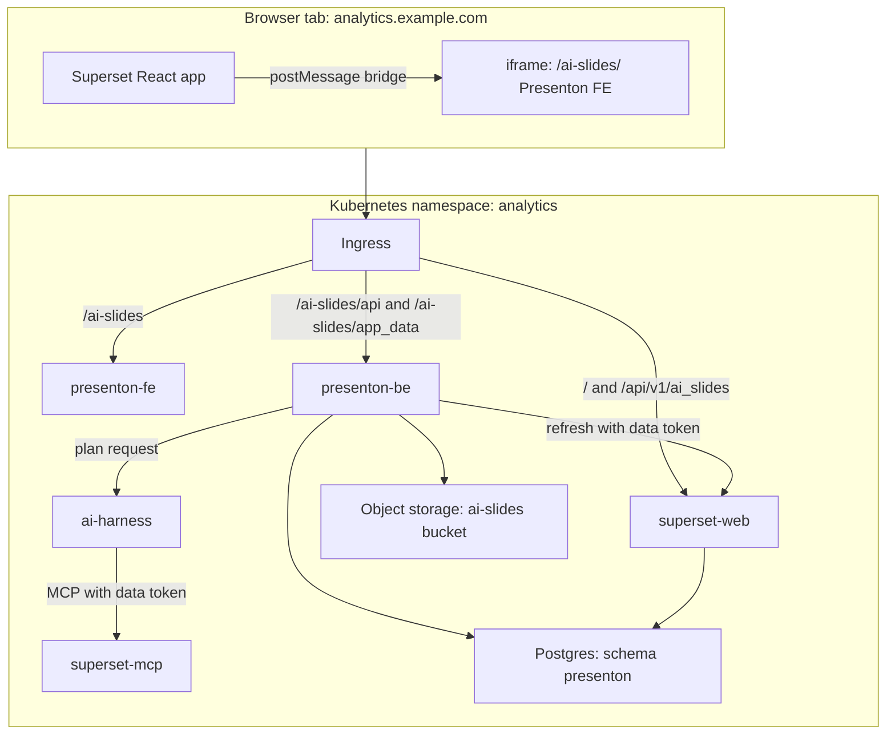
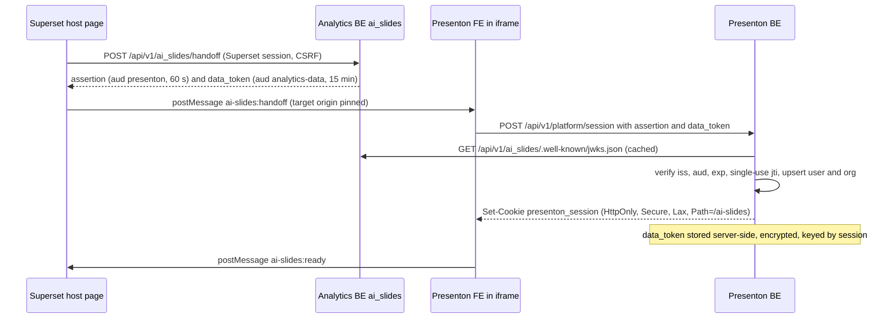
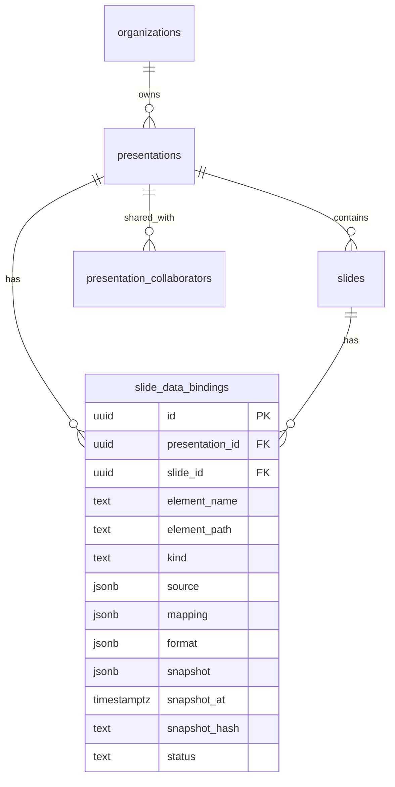
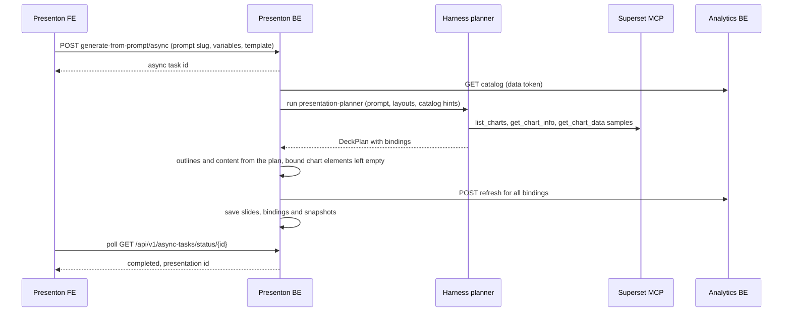
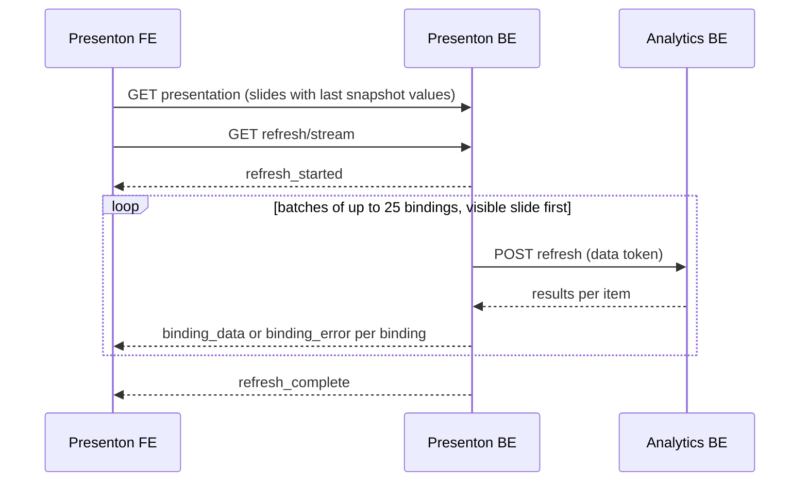

# Architecture and contracts

<div class="chapter-meta" markdown>
**Reads:** `servers/fastapi/templates/v2/models/elements.py`, `servers/fastapi/api/v1/auth/router.py`, `servers/fastapi/api/v1/async_tasks/router.py`, `servers/nextjs/lib/template-v2-json-to-html.ts`, `apache/superset: superset/config.py`  ·  **Builds on:** [Part VIII landing](index.md)  ·  **Time:** ~30 min
</div>

This chapter fixes the names, tables, endpoints and payloads that all nine stories share, so that teams working in parallel build pieces that fit. It walks through the deployment topology, the identity flow, the data-binding model, the three main request flows (generate, open, export), and the decisions behind each choice. Story chapters refer back here instead of redefining these contracts.

## Step 1: Fix the deployment topology

The recommended default serves Presenton under a path prefix on the analytics domain, rather than on its own subdomain.

| Public path | Served by | Notes |
| --- | --- | --- |
| `https://analytics.example.com/` | Superset web (Flask and React) | Unchanged |
| `/ai-slides/launch` | Superset, new host view (Story 5) | Renders the iframe and the postMessage bridge; needs an exact-match ingress rule ahead of `/ai-slides` |
| `/ai-slides/` | Presenton FE (Next.js, `basePath: "/ai-slides"`) | Story 5 makes the app prefix-aware |
| `/ai-slides/api/v1/`, `/ai-slides/api/v2/` | Presenton BE (FastAPI), prefix stripped to `/api/v1/...` and `/api/v2/...` | Story 9 ingress rule; other `/ai-slides/api/*` paths are Next.js route handlers |
| `/ai-slides/app_data/` | Presenton BE assets, auth-checked | Replaces the nginx `alias` blocks of the stock image |
| `/api/v1/ai_slides/*` | Superset, new `ai_slides` blueprint (Story 8) | Handoff, JWKS, refresh, catalog |
| `http://superset-mcp:5008/mcp` | Superset MCP service, internal only | Used by the harness |
| `http://ai-harness:8080` | Harness, internal only | Runs the `presentation-planner` skill |



Why same-origin is the default:

- **Cookies just work.** Presenton's session cookie is set with `samesite="lax"` (`servers/fastapi/api/v1/auth/router.py:47-55`). Inside a same-site iframe a Lax cookie is sent normally. On a separate subdomain that is still same-site, but on a different registrable domain the cookie becomes third-party and needs `SameSite=None; Secure`, plus partitioned cookies for browsers that block third-party cookies.
- **Framing is already allowed.** Superset's default `TALISMAN_CONFIG` content security policy sets `default-src 'self'` and no explicit `frame-src` (`apache/superset: superset/config.py:3116-3160`), so a same-origin iframe is permitted without changing Superset's CSP. A different origin would need `frame-src` added there.
- **No CORS.** The browser talks to one origin, so neither Superset nor Presenton needs CORS for the embedded flow.

!!! warning "Gotcha: cookie path on a shared origin"
    Stock Presenton sets `presenton_session` with `path="/"` (`servers/fastapi/api/v1/auth/router.py:54`). On a shared origin that cookie would also travel with every Superset request. Set `Path=/ai-slides` in the fork. Story 2 changes both `_set_login_cookie` and the fastapi-users cookie transport (`servers/fastapi/api/v1/auth/users.py:188-192`).

!!! warning "Gotcha: base path everywhere"
    Presenton assumes it owns `/`. Its Next.js proxy rewrites `/api/v1`, `/api/v2`, `/app_data` and `/static` to FastAPI (see [Next.js architecture](../presenton/20-nextjs-architecture.md)), and generated asset URLs start with `/app_data/`. Every one of these must become prefix-aware. Story 5 lists each touchpoint.

## Step 2: Fix the identity contract

One identity, owned by Superset, flows into Presenton and back out to every data call.



| Token | Issued by | Audience | Lifetime | Holder | Used for |
| --- | --- | --- | --- | --- | --- |
| Superset session cookie | Superset | Superset | Superset config | Browser | Calling the handoff endpoint |
| Handoff assertion (JWT, RS256) | Analytics BE | `presenton` | 60 s, single use | Browser, briefly | Creating a Presenton session |
| `presenton_session` | Presenton BE | Presenton | Presenton session TTL | Browser cookie | All Presenton API calls |
| Data token (JWT, RS256) | Analytics BE | `analytics-data`, scopes `ai_slides:refresh superset:chart:read superset:dashboard:read superset:dataset:read` | 15 min | Presenton BE only | Refresh API and harness/MCP calls as the user |

Assertion claims: `iss`, `aud`, `sub` (Superset user id), `username`, `email`, `first_name`, `last_name`, `org_id`, `roles`, `jti`, `iat`, `exp`. The data token carries the same `sub` and `username`, plus `scope`.

!!! warning "Gotcha: per-user MCP needs Superset master"
    Superset's MCP service maps JWT claims to a Superset user (by `preferred_username`, `username`, `email`, then `sub`) and checks `superset:*` scopes only on master; Superset 6.1.0 runs every MCP tool as one configured user. On 6.1 the harness must use the analytics catalog and refresh endpoints instead of MCP for anything user-specific ([Story 7](48-story7-harness-planner.md), [Story 8](49-story8-analytics-mcp.md)). That is also why the data token carries a `username` claim and read-only `superset:*` scopes.

!!! tip "Why a separate data token"
    Presenton BE must call Superset as the user long after the handoff. Storing the user's Superset session cookie would be fragile and over-privileged. A narrow token with its own audience and scope is easy to verify in Superset and to revoke by rotating keys. When it expires, the FE asks the parent page for a fresh handoff (`ai-slides:handoff-request`).

## Step 3: Fix the data-binding model

Presenton's Template v2 already has a chart element with real data fields. It has `chart_type` drawn from the `ChartType` enum (`servers/fastapi/templates/v2/models/elements.py:76-88`), plus `categories: list[str]` and `series: list[ChartSeries]`, where each series is `{name, values: list[float]}` (`elements.py:176-178`, `elements.py:361-393`). Today the language model invents those numbers. A binding replaces invention with a reference.



The source and mapping for one chart binding:

```json
{
  "kind": "chart",
  "element_name": "main_chart",
  "source": {
    "type": "superset_chart",
    "chart_id": 412,
    "dashboard_id": 37,
    "viz_type": "echarts_timeseries_bar",
    "datasource": "12__table",
    "overrides": {
      "time_range": "Last quarter",
      "extra_filters": [{ "col": "region", "op": "IN", "val": ["EMEA"] }]
    },
    "row_limit": 50
  },
  "mapping": {
    "x": "order_date",
    "series": ["SUM(revenue)"],
    "series_labels": { "SUM(revenue)": "Revenue" },
    "sort": "x_asc",
    "top_n": 12
  },
  "format": { "number": ",.0f", "prefix": "$" }
}
```

Resolution produces an element patch that the existing renderer already understands:

```json
{
  "categories": ["Jul", "Aug", "Sep"],
  "series": [{ "name": "Revenue", "values": [182340, 197800, 211050] }]
}
```

Three binding kinds cover v1:

| Kind | Target element | Mapping | Result written into |
| --- | --- | --- | --- |
| `chart` | Template v2 `chart` | `x`, `series`, labels, sort, top-N | `categories`, `series` |
| `metric` | Text element (a KPI) | `metric`, optional `compare` | Text run, formatted with `format` |
| `table` | Template v2 `table` | `columns`, `max_rows` | Table rows and header |

Statuses: `pending` (never resolved), `ok`, `stale` (snapshot older than `AI_SLIDES_STALE_AFTER_SECONDS`, default 3600), `error`, `forbidden` (the viewer may not see this data).

!!! note "Refreshable means resolvable"
    In v1, "refreshable" has one precise meaning: the source is a saved Superset chart that the analytics refresh API can execute, for the current user, with a `viz_type` that maps onto a Presenton `ChartType`. The planner (Story 7) and the catalog (Story 8) use exactly this rule.

## Step 4: Fix the API surface

### Analytics BE (Story 8)

| Method and path | Auth | Purpose |
| --- | --- | --- |
| `POST /api/v1/ai_slides/handoff` | Superset session and CSRF | Mint the assertion and the data token |
| `GET /api/v1/ai_slides/.well-known/jwks.json` | Public | Public keys for verification |
| `POST /api/v1/ai_slides/refresh` | Bearer data token | Execute up to 25 saved-chart queries as the user |
| `GET /api/v1/ai_slides/catalog` | Bearer data token | List refreshable charts the user can access |

Refresh request and response:

```json
{
  "items": [
    { "key": "b6c1...", "chart_id": 412, "dashboard_id": 37,
      "overrides": { "time_range": "Last quarter" }, "row_limit": 50, "force": false }
  ]
}
```

```json
{
  "results": [
    { "key": "b6c1...", "status": "ok",
      "colnames": ["order_date", "SUM(revenue)"], "coltypes": [2, 0],
      "data": [{ "order_date": "2026-07-01", "SUM(revenue)": 182340 }],
      "rowcount": 3, "query_ts": "2026-11-03T09:12:00Z",
      "is_cached": true, "cache_key": "4f1e...", "error": null }
  ]
}
```

### Presenton BE (Stories 1, 2 and 3)

| Method and path | Story | Purpose |
| --- | --- | --- |
| `POST /api/v1/platform/session` | 2 | Exchange the assertion for a Presenton session |
| `POST /api/v1/platform/session/refresh-data-token` | 2 | Replace an expiring data token |
| `GET /api/v1/ppt/presentation/{id}/bindings` | 1 | List bindings with snapshot and status |
| `PUT /api/v1/ppt/presentation/{id}/bindings/{binding_id}` | 1 | Edit overrides or mapping (owner or editor) |
| `GET /api/v1/ppt/presentation/{id}/refresh/stream` | 1 | Refresh-on-open, server-sent events |
| `POST /api/v1/ppt/presentation/{id}/refresh` | 1 | Batch refresh, used before export |
| `GET /api/v1/ppt/prompt-library` | 3 | List curated prompts |
| `GET /api/v1/ppt/prompt-library/{slug}` | 3 | Prompt detail with variables schema |
| `POST /api/v1/ppt/prompt-library/{slug}/render` | 3 | Validate variables, render the prompt |
| `GET /api/v1/ppt/templates/bundled` | 3 | Curated built-in templates |
| `POST /api/v1/ppt/presentation/generate-from-prompt/async` | 3 | Async generation from a prompt, polled with `GET /api/v1/async-tasks/status/{id}` (`servers/fastapi/api/v1/async_tasks/router.py:15`) |

Refresh stream events:

| Event | Payload | Meaning |
| --- | --- | --- |
| `refresh_started` | `{total}` | Number of bindings that will be resolved |
| `binding_loading` | `{binding_id, slide_id}` | A request for this binding is in flight |
| `binding_data` | `{binding_id, slide_id, element_name, element_patch, snapshot_at, changed}` | Fresh data; `element_patch` is merged into the slide |
| `binding_error` | `{binding_id, code, message}` | Resolution failed; the snapshot stays on screen |
| `binding_stale` | `{binding_id, snapshot_at, reason}` | Kept the old snapshot, for example on timeout |
| `refresh_complete` | `{ok, errors, stale, duration_ms}` | All bindings settled |

Wire format: like every Presenton stream ([Streaming (SSE)](../presenton/10-streaming.md)), each frame is sent as `event: response` and the event name above travels in the JSON `type` field, for example `data: {"type": "binding_data", "binding_id": "...", ...}`.

### Harness (Story 7)

`POST http://ai-harness:8080/v1/skills/presentation-planner:run` with `{prompt, template_id, layout_catalog, dashboard_id, chart_ids, n_slides, language}` and the user's data token returns a validated `DeckPlan`. Each slide has a `layout_id`, an `outline` and a list of bindings.

## Step 5: Walk the three request flows

### Flow A: generate a deck from a prompt



### Flow B: open a deck

The editor renders immediately from stored snapshots, then streams fresh data in. Story 4 covers the UI side.



### Flow C: export

Export runs a non-streaming batch refresh first. Bindings that fail keep their last snapshot, and the slide gets a "data as of" footnote. Then the stock export pipeline runs ([PPTX and PDF export](../presenton/24-export-pipeline.md)), so the export runtime never needs to know about bindings.

## Step 6: Record the key decisions

| Decision | Choice | Alternatives | Reason |
| --- | --- | --- | --- |
| Hosting | Same origin under `/ai-slides/` | Separate subdomain | Lax cookies, default CSP and no CORS all work |
| Identity | Superset-signed assertion exchanged for a Presenton session | Shared session store, OIDC provider | No new identity provider; Superset stays the source of truth |
| Data access | Presenton BE calls the analytics refresh API with a user data token | FE calls Superset directly; refresh via harness | Server-side caching, export support, one enforcement point (decided by the Story 1 spike) |
| Binding source | Saved Superset charts only | Ad-hoc SQL, dataset queries | Reuses governed chart definitions; easy to explain "refreshable" |
| Charting library | Keep Presenton's vendored Chart.js (`servers/nextjs/lib/template-v2-json-to-html.ts:1074`) | ECharts, as in Superset | Already used by the editor and the export render path |
| Refresh timing | On open and before export | Scheduled refresh, native refresh in PPTX | Smallest change that delivers live data |
| Custom templates | Upload disabled by flag | Ship now | Pending decision on vision-model cost and governance |

## Step 7: Agree the shared configuration

| Variable | Service | Default | Purpose |
| --- | --- | --- | --- |
| `AI_SLIDES_BASE_PATH` | FE, BE | `/ai-slides` | Path prefix for routing and generated URLs |
| `PRESENTON_PUBLIC_URL` | BE | `https://analytics.example.com/ai-slides` | Absolute links in API and export results |
| `AI_SLIDES_ISSUER` | BE | `https://analytics.example.com` | Expected `iss` in assertions |
| `AI_SLIDES_JWKS_URL` | BE | `http://superset-web:8088/api/v1/ai_slides/.well-known/jwks.json` | Key set for verification |
| `AI_SLIDES_ANALYTICS_URL` | BE | `http://superset-web:8088` | Refresh and catalog API base |
| `AI_SLIDES_HARNESS_URL` | BE | `http://ai-harness:8080` | Planner skill endpoint |
| `AI_SLIDES_STALE_AFTER_SECONDS` | BE, FE | `3600` | When a snapshot is shown as stale |
| `AI_SLIDES_CUSTOM_TEMPLATES_ENABLED` | BE, FE | `false` | Gate for template upload |
| `AI_SLIDES_DATA_TOKEN_KEY` | BE | secret | Encrypts stored data tokens |
| `AI_SLIDES_SIGNING_KEY` | Superset | secret | RSA private key for assertions and data tokens |
| `DATABASE_URL` | BE | secret | Postgres DSN, schema `presenton` |

## Step 8: Agree the definition of done

Every story is done when:

1. Code is behind a feature flag or role until the pilot is enabled.
2. Unit tests and at least one contract test against the shared payloads in this chapter pass in CI.
3. Every data path runs as the requesting user, and a test proves that a user without access sees `forbidden`, not data.
4. Metrics and structured logs exist for the new code path (Story 9 lists the names).
5. The relevant chapter in this part is updated if a contract changed.

## What you now know

- The same-origin topology, and why it removes most cookie, CSP and CORS work.
- The handoff and data-token flow that makes every data call run as the Superset user.
- The `slide_data_bindings` model and how it fills Presenton's existing chart fields.
- The full API surface across the analytics BE, the Presenton BE and the harness, plus the refresh event stream.
- The decisions, shared configuration and definition of done that every story follows.

## Next

Start with [Story 1: Dynamic data, binding storage and refresh service](42-story1-dynamic-data.md).
