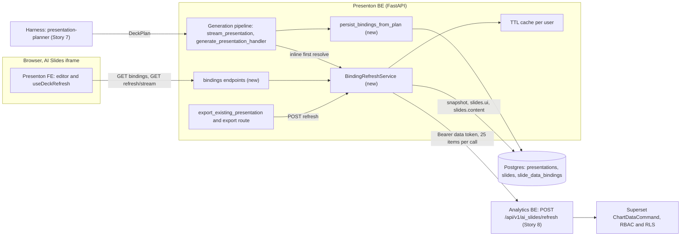
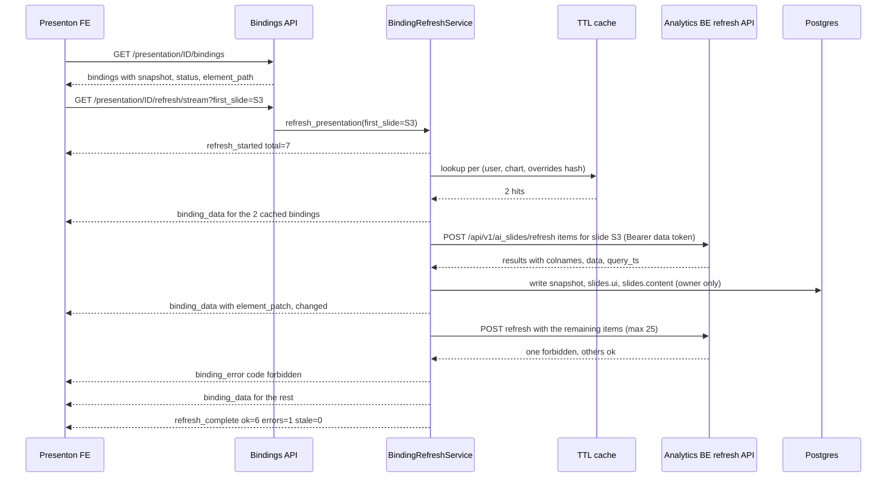
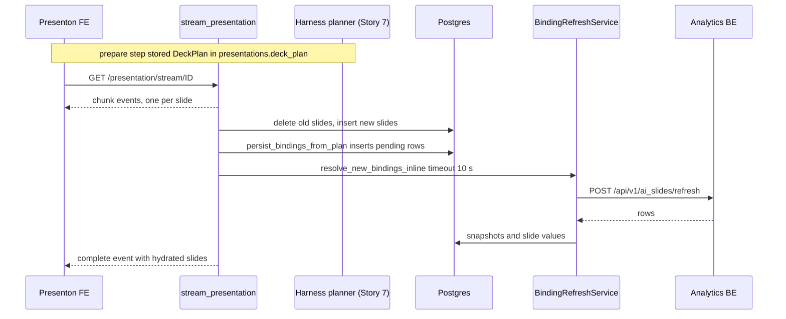

# Story 1: Dynamic data, binding storage and refresh service

<div class="chapter-meta" markdown>
**Reads:** `servers/fastapi/models/sql/slide.py`, `servers/fastapi/migrations.py`, `servers/fastapi/alembic/versions/a7d4c9e2f1b3_add_async_tasks.py`, `servers/fastapi/api/v1/ppt/endpoints/presentation.py`, `servers/fastapi/templates/v2/models/elements.py`, `servers/fastapi/utils/sse.py`, `servers/fastapi/models/sse_response.py`, `servers/fastapi/utils/export_utils.py`, `servers/fastapi/services/database.py`  ·  **Builds on:** [Architecture and contracts](41-architecture-and-contracts.md)  ·  **Time:** ~50 min
</div>

## What you will learn

This chapter turns Story 1 into an implementation plan for the Presenton backend. You will run a three-day spike that picks how chart data is refreshed, then build the `slide_data_bindings` table (SQLModel model and Alembic migration), hook binding creation into the generation pipeline, and write the `BindingRefreshService` with its four endpoints. It ends with export integration, the error matrix, metrics, tests and the rollout plan.

## Step 1: The story, its owners and its acceptance criteria

The architect's backlog row, transcribed exactly:

| # | Story | What it does | Owners |
|---|---|---|---|
| 1 | [Presenton BE] Dynamic data: refresh spike, binding storage and refresh service | Stores a Superset data binding for each chart or metric and refreshes values on open, after a spike picks the refresh approach. | Srini, Sourav, Nitesh |

**Goal.** Every chart, metric and table that the planner (Story 7) binds to a saved Superset chart keeps a durable link to that chart. When a deck is opened, exported or explicitly refreshed, Presenton re-runs the chart's query as the current user, maps the result into the Template v2 element, and stores the latest snapshot so the next open renders instantly.

**Suggested split of work.** Srini owns the spike and the refresh service, Sourav owns binding creation in the generation pipeline and export integration, Nitesh owns the migration and the contract with Story 8 (refresh API). This split is a recommendation, not part of the backlog.

**Relationship to Part VII.** Part VII's `DataBinding` ([Data-bound slide model](../superset/33-data-bound-model.md)) becomes one `slide_data_bindings` row here, and Part VII's Binding Resolver becomes the refresh service of this chapter plus the analytics refresh API of [Story 8](49-story8-analytics-mcp.md). Native PPTX refresh in place is out of scope: Part VIII refreshes on open in the browser and bakes the latest snapshot into exports.

### 1.1 Acceptance criteria

| ID | Given | When | Then |
|---|---|---|---|
| AC1 | A spike report exists | The team reviews it | ADR-AIS-001 records the chosen approach with latency, RLS and export measurements for all three candidates |
| AC2 | A DeckPlan with 4 bindings on 3 slides | Generation finishes | 4 rows exist in `slide_data_bindings` with correct `slide_id`, `element_name`, `element_path`, `kind`, and status `ok` (or `pending` if the inline resolve timed out) |
| AC3 | A saved deck with bindings whose snapshots are 2 h old | The user opens it | The deck renders from snapshots immediately, the refresh stream emits `refresh_started`, one `binding_data` per binding, then `refresh_complete` |
| AC4 | Two users with different RLS on the same dataset | Each refreshes the same chart binding | Each receives only rows their RLS allows. Cache entries are never shared across users |
| AC5 | A user without access to the chart's datasource | The deck refreshes | That binding's status becomes `forbidden`, other bindings still refresh |
| AC6 | The analytics refresh API is down | The user exports to PPTX | Export completes within the export timeout using the stored snapshot, and each affected slide shows a "Data as of" footnote |
| AC7 | A refresh returns new values | Refresh completes | `slides.ui` and `slides.content` hold the new values, `snapshot_hash` changes, and `binding_data.changed` is `true` |
| AC8 | The editor autosaves a reordered deck | `PATCH /api/v1/ppt/presentation/update` runs | No binding rows are deleted |
| AC9 | 30 bindings in one deck | Refresh runs | The analytics BE receives at most 25 items per call and at most 4 concurrent calls |
| AC10 | Migration on an existing SQLite and an existing Postgres database | `alembic upgrade head` runs | The table and indexes exist, `migrations.REVISION_HEAD` equals the new revision, downgrade drops them |

## Step 2: The refresh spike

The backlog requires a spike before the service is built, because the refresh path decides security, caching and whether export can ever refresh. Time-box it to three working days (the critical path in [Architecture and contracts](41-architecture-and-contracts.md) budgets ~3 days).

### 2.1 The three candidates

**A. Presenton FE calls the Superset chart data API from the iframe.** Same-origin routing means the iframe already carries Superset's `session` cookie, so the Presenton frontend can call `GET /api/v1/chart/{pk}/data/` directly. That endpoint loads the chart's saved query context (`apache/superset: superset/charts/data/api.py:89`), applies dashboard native filters when `filters_dashboard_id` is passed (`apache/superset: superset/charts/data/api.py:193`) and runs `ChartDataCommand` (`apache/superset: superset/commands/chart/data/get_data_command.py:36`). It fails with "Chart has no query context saved" for charts that were never re-saved (`apache/superset: superset/charts/data/api.py:180`). The `POST /api/v1/chart/data` variant (`apache/superset: superset/charts/data/api.py:271`) needs a CSRF token because `WTF_CSRF_ENABLED = True` by default (`apache/superset: superset/config.py:387`).

**B. Presenton BE refresh service calls the analytics BE refresh API with the user's data token (recommended default).** The Presenton backend sends `POST /api/v1/ai_slides/refresh` with up to 25 items, authenticated by the 15-minute data token from the handoff (see [Architecture and contracts](41-architecture-and-contracts.md)). Story 8 runs `ChartDataCommand` per item as the token's user, so RBAC and RLS apply, and returns rows. Presenton maps rows into elements, persists snapshots, and streams patches to the browser.

**C. Refresh through the harness and the Superset MCP service.** The Presenton backend asks the harness to call the MCP `get_chart_data` tool per chart. The tool is designed for an agent to inspect samples, not for bulk deterministic refresh.

### 2.2 Comparison

| Criterion | A: FE to chart data API | B: BE refresh service (recommended) | C: Harness and MCP |
|---|---|---|---|
| Security | Browser holds Superset session, Presenton FE code issues arbitrary chart queries; any XSS in Presenton can read all charts | Data token is server-side only, scope `ai_slides:refresh`, never reaches the browser | Token flows to the harness, plus an LLM-driven runtime in the data path |
| RLS | Applied (user's session) | Applied, Story 8 runs the command as the token's user | Applied if MCP is user-scoped |
| Caching | Superset cache only; `DATA_CACHE_CONFIG` defaults to `NullCache` (`apache/superset: superset/config.py:1532`), so production must configure it either way | Superset cache plus a Presenton TTL cache keyed per user; batching dedups | MCP plus harness, opaque |
| Latency | Lowest per chart (no extra hop), but N parallel requests from the browser | One extra hop, but one batched call per 25 bindings | Highest: harness scheduling plus tool calls |
| Coupling | FE must understand every viz's query context and result shape; async query mode returns a job instead of rows when `GLOBAL_ASYNC_QUERIES` is on (`apache/superset: superset/charts/data/api.py:252`) | One stable contract (`/api/v1/ai_slides/refresh`) owned by the team | Coupled to MCP tool schemas and row limits |
| Export support | None: the headless export browser has only the `presenton_session` cookie, not a Superset session | Yes: export calls the batch refresh server-side | Possible but slow |
| Offline or scheduled refresh | No | Possible later with a service identity (out of scope for v1) | Possible but not deterministic |
| Persisting snapshots | FE would have to write back through autosave | Service writes `slides.ui` directly | Service writes after harness returns |

### 2.3 Spike plan

| Day | Experiment | Measurement |
|---|---|---|
| 1 | **E1 (A):** in the dev stack, a throwaway page inside the iframe calls `GET /api/v1/chart/{pk}/data/` for 12 charts from one dashboard, cold and warm | p50/p95 per chart and for all 12, number of charts failing with "no query context saved", behavior with `GLOBAL_ASYNC_QUERIES` on |
| 1 | **E1b:** same as E1 but as two users with different RLS rules | Row counts differ as expected (pass/fail) |
| 2 | **E2 (B):** stub Story 8 endpoint as a Flask blueprint that loops over items and runs `ChartDataCommand` under `override_user`; Presenton side is a 100-line `httpx` script | p50/p95 for one batched call of 12 items, cold and warm; `is_cached` ratio; RLS pass/fail with two data tokens |
| 2 | **E2b:** export simulation: call the stub from inside the FastAPI process while the headless export browser renders | Whether data arrives before `/pdf-maker` loads (it should, refresh runs before export) |
| 3 | **E3 (C):** harness run calling MCP `get_chart_data` for the same 12 charts | p50/p95, row limits hit, failure rate |
| 3 | Write ADR-AIS-001, present to the team | Decision |

Fix the inputs so numbers are comparable: one dashboard with 12 charts (4 time series bars, 4 big numbers, 2 tables, 2 pies), 10 warm-up runs discarded, 50 measured runs per scenario, Superset data cache configured to Redis with a 300 s timeout.

!!! warning "Gotcha: charts without a saved query context"
    Both A and B depend on `query_context` stored on the chart. Charts created before query contexts were persisted, or never re-saved, fail. Story 8 can fall back to building a query context from `form_data`, but count these charts in E1 so the planner (Story 7) can mark them `refreshable: false` instead of failing at refresh time.

### 2.4 Decision record

```markdown title="docs/adr/ADR-AIS-001-refresh-path.md (new)"
# ADR-AIS-001: How AI Slides refreshes bound chart data

Status: Proposed (accepted after spike review)
Date: 2026-11-xx
Deciders: Srini, Sourav, Nitesh

## Context
Bound elements must refresh on open and before export, as the current user,
with Superset RBAC and RLS enforced. Export runs in a headless browser that has
no Superset session.

## Options
A. Presenton FE calls /api/v1/chart/{pk}/data/ from the same-origin iframe.
B. Presenton BE calls analytics BE POST /api/v1/ai_slides/refresh with the
   user's data token, batches up to 25 items, persists snapshots.
C. Presenton BE asks the harness to call MCP get_chart_data.

## Measurements (fill from the spike)
| Scenario | A p95 | B p95 | C p95 | RLS correct | Export can refresh |
|---|---|---|---|---|---|
| 12 charts, cold | | | | | |
| 12 charts, warm | | | | | |

## Decision
Option B. It is the only option that refreshes during export, keeps the
data token out of the browser, gives one contract to test, and lets the
backend persist snapshots and write values into slides.

## Consequences
- Story 8 must ship POST /api/v1/ai_slides/refresh before Story 4 can finish.
- One extra network hop per refresh, mitigated by batching and a per-user
  TTL cache in Presenton.
- Scheduled refresh without a user session stays out of scope.
- Option A remains a fallback for read-only previews if Story 8 slips.
```

## Step 3: Architecture



## Step 4: Binding storage

### 4.1 Conventions to copy

Every owned table in Presenton follows the same pattern: a UUID primary key with `default_factory=uuid.uuid4`, and an `owner_id` that defaults to the request's owner and is excluded from API output.

```python title="servers/fastapi/models/sql/slide.py (excerpt)"
class SlideModel(SQLModel, table=True):
    __tablename__ = "slides"

    id: uuid.UUID = Field(primary_key=True, default_factory=uuid.uuid4)
    owner_id: Optional[uuid.UUID] = Field(
        default_factory=get_current_owner_id,
        exclude=True,
        sa_column=Column(
            ForeignKey("user.id", ondelete="CASCADE"), nullable=True, index=True
        ),
    )
    presentation: uuid.UUID = Field(
        sa_column=Column(ForeignKey("presentations.id", ondelete="CASCADE"), index=True)
    )
```

`get_current_owner_id()` reads a context variable set per request (`servers/fastapi/api/v1/auth/context.py:13`). Two session event hooks then enforce tenancy: every ORM SELECT gets `owner_id == current owner` criteria for each model in `_STRICT_OWNER_MODELS` (`servers/fastapi/services/database.py:56`, `:67`), and every new row of those models is stamped with the current owner before flush (`servers/fastapi/services/database.py:100`). Timestamps use `DateTime(timezone=True)` with `get_current_utc_datetime` (`servers/fastapi/models/sql/presentation.py:52-64`).

### 4.2 The SQLModel model

```python title="servers/fastapi/models/sql/slide_data_binding.py (new)"
from datetime import datetime
from typing import Literal, Optional
import uuid

from sqlalchemy import JSON, Column, DateTime, ForeignKey, String, UniqueConstraint
from sqlalchemy.dialects.postgresql import JSONB
from sqlmodel import Field, SQLModel

from api.v1.auth.context import get_current_owner_id
from utils.datetime_utils import get_current_utc_datetime

# JSON on SQLite (desktop, tests), JSONB on Postgres (analytics platform).
JSON_DOCUMENT = JSON().with_variant(JSONB(), "postgresql")

BindingKind = Literal["chart", "metric", "table"]
BindingStatus = Literal["ok", "stale", "error", "forbidden", "pending"]


class SlideDataBindingModel(SQLModel, table=True):
    __tablename__ = "slide_data_bindings"
    __table_args__ = (
        UniqueConstraint(
            "slide_id", "element_name", name="uq_slide_data_bindings_slide_element"
        ),
    )

    id: uuid.UUID = Field(primary_key=True, default_factory=uuid.uuid4)
    owner_id: Optional[uuid.UUID] = Field(
        default_factory=get_current_owner_id,
        exclude=True,
        sa_column=Column(
            ForeignKey("user.id", ondelete="CASCADE"), nullable=True, index=True
        ),
    )
    org_id: Optional[str] = Field(
        default=None, sa_column=Column(String(255), nullable=True, index=True)
    )
    presentation_id: uuid.UUID = Field(
        sa_column=Column(
            ForeignKey("presentations.id", ondelete="CASCADE"),
            nullable=False,
            index=True,
        )
    )
    slide_id: uuid.UUID = Field(
        sa_column=Column(
            ForeignKey("slides.id", ondelete="CASCADE"), nullable=False, index=True
        )
    )
    element_name: str = Field(sa_column=Column(String(255), nullable=False))
    element_path: str = Field(sa_column=Column(String(1024), nullable=False))
    kind: str = Field(sa_column=Column(String(16), nullable=False))
    source: dict = Field(sa_column=Column(JSON_DOCUMENT, nullable=False))
    mapping: dict = Field(sa_column=Column(JSON_DOCUMENT, nullable=False))
    format: Optional[dict] = Field(
        default=None, sa_column=Column(JSON_DOCUMENT, nullable=True)
    )
    snapshot: Optional[dict] = Field(
        default=None, sa_column=Column(JSON_DOCUMENT, nullable=True)
    )
    snapshot_at: Optional[datetime] = Field(
        default=None, sa_column=Column(DateTime(timezone=True), nullable=True)
    )
    snapshot_hash: Optional[str] = Field(
        default=None, sa_column=Column(String(64), nullable=True)
    )
    status: str = Field(
        default="pending",
        sa_column=Column(String(16), nullable=False, default="pending", index=True),
    )
    error: Optional[dict] = Field(
        default=None, sa_column=Column(JSON_DOCUMENT, nullable=True)
    )
    created_at: datetime = Field(
        sa_column=Column(
            DateTime(timezone=True), nullable=False, default=get_current_utc_datetime
        ),
    )
    updated_at: datetime = Field(
        sa_column=Column(
            DateTime(timezone=True),
            nullable=False,
            default=get_current_utc_datetime,
            onupdate=get_current_utc_datetime,
        ),
    )
```

Three registration steps make the model live:

1. Import it in `servers/fastapi/alembic/env.py` next to the other models (`servers/fastapi/alembic/env.py:15-33`) so autogenerate and `target_metadata` see it.
2. Add it to `_STRICT_OWNER_MODELS` (`servers/fastapi/services/database.py:56`) so selects are owner-scoped exactly like slides. Story 2 later replaces owner scoping with `require_presentation_access` for all three tables together ([Story 2](43-story2-platform-integration.md)).
3. Add a local column `deck_plan` (nullable JSON) to `PresentationModel` (`servers/fastapi/models/sql/presentation.py:21`). The REST path in [Story 7](48-story7-harness-planner.md) runs the planner and builds slides in one request and hands the DeckPlan over in memory; the editor's streaming path prepares in one request and streams in another, so it needs the plan stored on the row in between. The DeckPlan shape is owned by Story 7; the column is a local addition not listed in the contracts table.

!!! warning "Gotcha: JSON columns are not mutation-tracked"
    The `JSON` and `JSONB` column types do not use `MutableDict`, so `binding.snapshot["series"] = ...` or `slide.ui["components"][0] = ...` is invisible to the unit of work. Always build a new dict and reassign (`slide.ui = new_ui`). Presenton's own code does this, for example `slide.ui = _apply_template_content_to_ui(slide.ui, slide.content)` (`servers/fastapi/api/v1/ppt/endpoints/presentation.py:2396`).

### 4.3 The Alembic migration

The repository's recent migrations are defensive: they inspect the live schema before creating anything, because `migrations.py` stamps legacy databases and can re-run upgrades (`servers/fastapi/alembic/versions/a7d4c9e2f1b3_add_async_tasks.py:22-59`). Follow that style.

```python title="servers/fastapi/alembic/versions/3a9e5c7d1b42_add_slide_data_bindings.py (new)"
"""add slide data bindings

Revision ID: 3a9e5c7d1b42
Revises: 026c0ba8b35c
Create Date: 2026-11-03 00:00:00.000000

"""
from typing import Sequence, Union

from alembic import op
import sqlalchemy as sa
from sqlalchemy.dialects import postgresql


# revision identifiers, used by Alembic.
revision: str = "3a9e5c7d1b42"
down_revision: Union[str, None] = "026c0ba8b35c"
branch_labels: Union[str, Sequence[str], None] = None
depends_on: Union[str, Sequence[str], None] = None

JSON_DOCUMENT = sa.JSON().with_variant(postgresql.JSONB(), "postgresql")
TABLE = "slide_data_bindings"


def _has_table(table_name: str) -> bool:
    return table_name in sa.inspect(op.get_bind()).get_table_names()


def _has_column(table_name: str, column_name: str) -> bool:
    columns = sa.inspect(op.get_bind()).get_columns(table_name)
    return column_name in {column["name"] for column in columns}


def _has_index(table_name: str, index_name: str) -> bool:
    indexes = sa.inspect(op.get_bind()).get_indexes(table_name)
    return index_name in {index["name"] for index in indexes}


def upgrade() -> None:
    if not _has_table(TABLE):
        op.create_table(
            TABLE,
            sa.Column("id", sa.Uuid(), nullable=False),
            sa.Column("owner_id", sa.Uuid(), nullable=True),
            sa.Column("org_id", sa.String(length=255), nullable=True),
            sa.Column("presentation_id", sa.Uuid(), nullable=False),
            sa.Column("slide_id", sa.Uuid(), nullable=False),
            sa.Column("element_name", sa.String(length=255), nullable=False),
            sa.Column("element_path", sa.String(length=1024), nullable=False),
            sa.Column("kind", sa.String(length=16), nullable=False),
            sa.Column("source", JSON_DOCUMENT, nullable=False),
            sa.Column("mapping", JSON_DOCUMENT, nullable=False),
            sa.Column("format", JSON_DOCUMENT, nullable=True),
            sa.Column("snapshot", JSON_DOCUMENT, nullable=True),
            sa.Column("snapshot_at", sa.DateTime(timezone=True), nullable=True),
            sa.Column("snapshot_hash", sa.String(length=64), nullable=True),
            sa.Column("status", sa.String(length=16), nullable=False,
                      server_default="pending"),
            sa.Column("error", JSON_DOCUMENT, nullable=True),
            sa.Column("created_at", sa.DateTime(timezone=True), nullable=False),
            sa.Column("updated_at", sa.DateTime(timezone=True), nullable=False),
            sa.ForeignKeyConstraint(["owner_id"], ["user.id"], ondelete="CASCADE"),
            sa.ForeignKeyConstraint(
                ["presentation_id"], ["presentations.id"], ondelete="CASCADE"
            ),
            sa.ForeignKeyConstraint(["slide_id"], ["slides.id"], ondelete="CASCADE"),
            sa.PrimaryKeyConstraint("id"),
            sa.UniqueConstraint(
                "slide_id", "element_name", name="uq_slide_data_bindings_slide_element"
            ),
        )

    for column in ("presentation_id", "slide_id", "owner_id", "org_id", "status"):
        index_name = f"ix_{TABLE}_{column}"
        if not _has_index(TABLE, index_name):
            op.create_index(op.f(index_name), TABLE, [column], unique=False)

    # Postgres only: find every deck that uses a chart (Story 8 cache
    # invalidation and "where is this chart used" lookups).
    if op.get_bind().dialect.name == "postgresql" and not _has_index(
        TABLE, "ix_slide_data_bindings_chart_id"
    ):
        op.execute(
            "CREATE INDEX ix_slide_data_bindings_chart_id "
            "ON slide_data_bindings (((source->>'chart_id')::int))"
        )

    if _has_table("presentations") and not _has_column("presentations", "deck_plan"):
        op.add_column("presentations", sa.Column("deck_plan", sa.JSON(), nullable=True))


def downgrade() -> None:
    if _has_table("presentations") and _has_column("presentations", "deck_plan"):
        op.drop_column("presentations", "deck_plan")
    if _has_table(TABLE):
        if op.get_bind().dialect.name == "postgresql":
            op.execute("DROP INDEX IF EXISTS ix_slide_data_bindings_chart_id")
        for column in ("status", "org_id", "owner_id", "slide_id", "presentation_id"):
            index_name = f"ix_{TABLE}_{column}"
            if _has_index(TABLE, index_name):
                op.drop_index(op.f(index_name), table_name=TABLE)
        op.drop_table(TABLE)
```

The revision ID is an example; generate your own with `alembic revision`. The table is created without a schema qualifier on purpose: Story 2 points `search_path` at the `presenton` schema, so the same migration works on SQLite and on the analytics Postgres.

Then advance the head constant that the startup migrator and the tests both read:

```python title="servers/fastapi/migrations.py (excerpt)"
REVISION_UNIFIED_API_KEYS = "026c0ba8b35c"
REVISION_HEAD = REVISION_UNIFIED_API_KEYS
```

becomes

```python title="servers/fastapi/migrations.py (change)"
REVISION_UNIFIED_API_KEYS = "026c0ba8b35c"
REVISION_SLIDE_DATA_BINDINGS = "3a9e5c7d1b42"
REVISION_HEAD = REVISION_SLIDE_DATA_BINDINGS
```

!!! warning "Gotcha: teach the schema inference about the new table"
    `_infer_revision_from_schema` (`servers/fastapi/migrations.py:117`) guesses the applied revision when `alembic_version` points at a revision that no longer exists in the codebase. Its newest answer today is `REVISION_TEMPLATE_V2_THEME` (`servers/fastapi/migrations.py:144`). Add a first branch: if `slide_data_bindings` is in `tables`, return `REVISION_SLIDE_DATA_BINDINGS`. Otherwise a database that already has the table can be re-stamped to an older revision, and the next upgrade re-runs `create_table` (harmless only because of the `_has_table` guard above, which is why the guards matter).

### 4.4 Indexes and why each exists

| Index | Query it serves |
|---|---|
| `ix_slide_data_bindings_presentation_id` | `GET .../bindings`, refresh-on-open (all bindings of a deck) |
| `ix_slide_data_bindings_slide_id` | Cascade deletes, per-slide patching |
| `uq_slide_data_bindings_slide_element` | One binding per element; makes `persist_bindings_from_plan` idempotent with an upsert |
| `ix_slide_data_bindings_owner_id`, `ix_slide_data_bindings_org_id` | Owner scoping today, org scoping in Story 2 |
| `ix_slide_data_bindings_status` | Ops queries ("how many bindings are in `error`") |
| `ix_slide_data_bindings_chart_id` (Postgres) | Impact analysis when a Superset chart changes or is deleted |

### 4.5 JSON shapes

`source` (v1 supports saved charts only):

```json
{ "type": "superset_chart", "chart_id": 412, "dashboard_id": 37,
  "viz_type": "echarts_timeseries_bar", "datasource": "12__table",
  "overrides": { "time_range": "Last quarter",
                 "extra_filters": [ {"col": "region", "op": "IN", "val": ["EMEA"]} ] },
  "row_limit": 50 }
```

`mapping` per kind:

=== "chart"

    ```json
    { "x": "order_date", "series": ["SUM(revenue)"],
      "series_labels": {"SUM(revenue)": "Revenue"}, "sort": "x_asc", "top_n": 12 }
    ```

=== "metric"

    ```json
    { "metric": "SUM(revenue)", "compare": "previous_period", "x": "order_date" }
    ```

=== "table"

    ```json
    { "columns": ["region", "revenue"], "max_rows": 10,
      "labels": {"region": "Region", "revenue": "Revenue"} }
    ```

`format`:

```json
{ "number": ",.1f", "currency": {"symbol": "EUR", "symbolPosition": "prefix"},
  "prefix": "", "suffix": "", "date": "%b %Y", "delta": "+.1%",
  "columns": {"revenue": ",.0f"}, "null_text": "n/a" }
```

`snapshot` is the last resolved element data plus a `meta` block that is excluded from the hash:

=== "chart"

    ```json
    { "categories": ["Jul 2026", "Aug 2026", "Sep 2026"],
      "series": [ {"name": "Revenue", "values": [1210.5, 1302.0, 1288.75]} ],
      "meta": { "rowcount": 3, "truncated": false, "nulls_coerced": 0,
                "is_cached": true, "resolved_by": "7f1c...", "query_ts": "2026-11-03T09:12:00Z" } }
    ```

=== "metric"

    ```json
    { "value": 3801.25, "text": "€3.8k (+3.1%)", "delta": 0.031,
      "meta": { "rowcount": 2, "resolved_by": "7f1c...", "query_ts": "2026-11-03T09:12:00Z" } }
    ```

=== "table"

    ```json
    { "columns": ["Region", "Revenue"],
      "rows": [["EMEA", "1,302"], ["APAC", "988"]],
      "meta": { "rowcount": 2, "truncated": false, "resolved_by": "7f1c..." } }
    ```

`error` is always `{"code": "<machine code>", "message": "<user-safe text>"}`; codes are listed in Step 9.

## Step 5: Where bindings get created

### 5.1 How elements are identified

A bound element is found by its Template v2 `name`. Only elements with `decorative: false` and a `name` receive generated content; the hydrator checks both before applying a value (`servers/fastapi/api/v1/ppt/endpoints/presentation.py:666-672`), and the set of value-bearing types includes `chart`, `text` and `table` (`servers/fastapi/api/v1/ppt/endpoints/presentation.py:503-511`). The `Chart` model carries the data the binding replaces:

```python title="servers/fastapi/templates/v2/models/elements.py (excerpt)"
class ChartSeries(BaseModel):
    name: str
    values: list[float]
```

and `Chart` has `chart_type`, `categories: Optional[list[str]]`, `series: Optional[list[ChartSeries]]`, `decorative` and `name` (`servers/fastapi/templates/v2/models/elements.py:361-393`). Pie and donut charts keep only the first series (`servers/fastapi/templates/v2/models/elements.py:395-403`), so a pie binding with two series silently loses the second. A metric binds to a `Text` element (`servers/fastapi/templates/v2/models/elements.py:203-221`) and a table binding to `Table` (`servers/fastapi/templates/v2/models/elements.py:302-318`).

The kind-to-type rule is strict: `chart` needs `type == "chart"`, `metric` needs `type == "text"`, `table` needs `type == "table"`.

A slide's `ui` is a copy of the layout: `{"components": [{"id", "position", "elements": [...]}], ...}` (see [Template v2 format](../presenton/16-template-v2-format.md)). Elements nest through `child` (container) and `children` (flex, grid, group). The `element_path` is an RFC 6901 JSON Pointer into `slides.ui`, for example `/components/3/elements/0` or `/components/1/elements/2/child`.

```python title="servers/fastapi/services/data_bindings/elements.py (new)"
from typing import Any, Iterator, Optional

REPEATING_TYPES = {"flex", "grid"}


def _escape(token: str) -> str:
    return token.replace("~", "~0").replace("/", "~1")


def _tokens(pointer: str) -> list[str]:
    if pointer == "":
        return []
    if not pointer.startswith("/"):
        raise ValueError(f"invalid JSON pointer: {pointer!r}")
    return [t.replace("~1", "/").replace("~0", "~") for t in pointer[1:].split("/")]


def resolve_pointer(document: Any, pointer: str) -> Any:
    node = document
    for token in _tokens(pointer):
        node = node[int(token)] if isinstance(node, list) else node[token]
    return node


def replace_at_pointer(document: Any, pointer: str, value: Any) -> None:
    tokens = _tokens(pointer)
    parent = resolve_pointer(document, "".join(f"/{_escape(t)}" for t in tokens[:-1]))
    last = tokens[-1]
    if isinstance(parent, list):
        parent[int(last)] = value
    else:
        parent[last] = value


def iter_named_elements(ui: dict) -> Iterator[tuple[str, dict, bool]]:
    """Yield (pointer, element, inside_repeated_region) for every named element."""

    def walk(node: Any, pointer: str, repeated: bool) -> Iterator[tuple[str, dict, bool]]:
        if not isinstance(node, dict):
            return
        if isinstance(node.get("name"), str) and node.get("type"):
            yield pointer, node, repeated
        child_repeated = repeated or node.get("type") in REPEATING_TYPES
        if isinstance(node.get("child"), dict):
            yield from walk(node["child"], f"{pointer}/child", child_repeated)
        for i, child in enumerate(node.get("children") or []):
            yield from walk(child, f"{pointer}/children/{i}", child_repeated)

    for ci, component in enumerate(ui.get("components") or []):
        for ei, element in enumerate((component or {}).get("elements") or []):
            yield from walk(element, f"/components/{ci}/elements/{ei}", False)


def find_element(ui: dict, name: str) -> Optional[tuple[str, dict]]:
    matches = [(p, e) for p, e, repeated in iter_named_elements(ui)
               if e.get("name") == name and not repeated]
    return matches[0] if len(matches) == 1 else None
```

!!! warning "Gotcha: names are unique per layout, not per slide"
    Names inside repeated flex and grid regions are duplicated or renumbered when the hydrator expands an array (`_normalize_repeated_names`, `servers/fastapi/api/v1/ppt/endpoints/presentation.py:813`). `find_element` therefore refuses elements inside repeated regions and refuses ambiguous names. The planner must bind only to non-repeated elements; Story 7's validator should reject the plan otherwise.

### 5.2 Where in the pipeline

Two code paths create slides from a template and must persist bindings.

1. The streaming path used by the editor, `stream_presentation` (`servers/fastapi/api/v1/ppt/endpoints/presentation.py:2281-2524`). It builds `SlideModel` rows with `ui=_template_slide_ui(presentation.layout, slide_layout.id)` (`:2383-2391`), hydrates them with `_apply_template_content_to_ui` (`:2396`), and finally replaces the deck's slides:

```python title="servers/fastapi/api/v1/ppt/endpoints/presentation.py (excerpt)"
        for slide in slides:
            slide.ui = _apply_template_content_to_ui(slide.ui, slide.content)

        # Moved this here to make sure new slides are generated before deleting the old ones
        await sql_session.execute(
            delete(SlideModel).where(
                SlideModel.presentation == id,
                SlideModel.owner_id == get_current_owner_id(),
            )
        )
        await sql_session.commit()

        sql_session.add(presentation)
        sql_session.add_all(slides)
        sql_session.add_all(generated_assets)
        await sql_session.commit()
```

2. The REST path `generate_presentation_handler` (`servers/fastapi/api/v1/ppt/endpoints/presentation.py:2684`), which hydrates with `_hydrate_template_slide_ui` (`:3084-3085`), saves at `:3088-3091` and exports at `:3099`.

The hook goes right after each final commit, because bindings reference `slides.id` and the slide IDs only become durable then. In the REST path it must run before the export at `:3099` so the generated file already contains real numbers.

```python title="servers/fastapi/api/v1/ppt/endpoints/presentation.py (change inside stream_presentation.inner)"
        sql_session.add(presentation)
        sql_session.add_all(slides)
        sql_session.add_all(generated_assets)
        await sql_session.commit()

        # NEW (Story 1): bind planned elements, then resolve them once inline.
        bindings = await persist_bindings_from_plan(sql_session, presentation, slides)
        if bindings:
            await resolve_new_bindings_inline(
                sql_session,
                presentation_id=id,
                slides=slides,
                token=await get_request_data_token(sql_session),
                user_key=str(get_current_owner_id()),
                timeout_s=10.0,
            )
```

`get_request_data_token` is Story 2's helper; when it returns `None` (no platform session, for example in local development) the inline resolve is skipped and the bindings stay `pending`. `resolve_new_bindings_inline` drains `BindingRefreshService.refresh_presentation(...)` (Step 6) with `persist=True` under `asyncio.wait_for`; on timeout it simply returns, leaving `pending` rows for the refresh-on-open stream. Because it mutates the same `SlideModel` instances held in `slides`, the `complete` event built from `slides` (`:2503-2511`) already carries the resolved values.

### 5.3 From DeckPlan to rows

```python title="servers/fastapi/services/data_bindings/persistence.py (new)"
import logging
from typing import Any

from sqlalchemy.ext.asyncio import AsyncSession

from models.sql.presentation import PresentationModel
from models.sql.slide import SlideModel
from models.sql.slide_data_binding import SlideDataBindingModel
from services.data_bindings.elements import find_element

LOGGER = logging.getLogger(__name__)
EXPECTED_ELEMENT_TYPE = {"chart": "chart", "metric": "text", "table": "table"}
MAX_BINDINGS_PER_SLIDE = 3   # Story 7 limit
MAX_BINDINGS_PER_DECK = 12   # Story 7 limit


def _match_plan_to_slides(plan_slides: list[dict], slides: list[SlideModel]):
    """Pair plan slides with saved slides by order and layout id.

    Plan indexes are 1-based and can drift from slide indexes when a table of
    contents is inserted, so match on layout id in order instead of index.
    """
    ordered = sorted(slides, key=lambda s: s.index)
    cursor = 0
    for plan_slide in sorted(plan_slides, key=lambda s: int(s.get("index", 0))):
        while cursor < len(ordered) and ordered[cursor].layout != plan_slide.get("layout_id"):
            cursor += 1
        if cursor == len(ordered):
            return
        yield plan_slide, ordered[cursor]
        cursor += 1


async def persist_bindings_from_plan(
    session: AsyncSession,
    presentation: PresentationModel,
    slides: list[SlideModel],
    plan: dict[str, Any] | None = None,
) -> list[SlideDataBindingModel]:
    # REST path: Story 7 passes its in-memory DeckPlan. Streaming path: prepare
    # and stream are separate requests, so the plan is read back from the row.
    plan = plan or presentation.deck_plan
    if not plan:
        return []

    rows: list[SlideDataBindingModel] = []
    for plan_slide, slide in _match_plan_to_slides(plan.get("slides") or [], slides):
        for planned in (plan_slide.get("bindings") or [])[:MAX_BINDINGS_PER_SLIDE]:
            if len(rows) >= MAX_BINDINGS_PER_DECK:
                break
            kind = planned.get("kind")
            located = find_element(slide.ui or {}, planned.get("element_name", ""))
            if kind not in EXPECTED_ELEMENT_TYPE or located is None:
                LOGGER.warning("Skipping binding: slide=%s element=%s kind=%s",
                               slide.id, planned.get("element_name"), kind)
                continue
            pointer, element = located
            if element.get("type") != EXPECTED_ELEMENT_TYPE[kind]:
                LOGGER.warning("Element type mismatch: %s is %s, binding kind %s",
                               pointer, element.get("type"), kind)
                continue
            source = dict(planned["source"])
            source.setdefault("row_limit", 50)
            source.setdefault("overrides", {})
            rows.append(
                SlideDataBindingModel(
                    presentation_id=presentation.id,
                    slide_id=slide.id,
                    element_name=planned["element_name"],
                    element_path=pointer,
                    kind=kind,
                    source=source,
                    mapping=planned.get("mapping") or {},
                    format=planned.get("format"),
                    status="pending",
                    owner_id=presentation.owner_id,
                    org_id=getattr(presentation, "org_id", None),
                )
            )

    session.add_all(rows)
    await session.commit()
    return rows
```

!!! warning "Gotcha: autosave deletes and re-inserts every slide"
    `update_presentation` handles structural autosaves (reorder, add, delete) by deleting all of the deck's slides and adding the client's list back with the same IDs (`servers/fastapi/api/v1/ppt/endpoints/presentation.py:2568-2574`). With `slide_id ... ON DELETE CASCADE`, that delete wipes every binding even though the slides come back a millisecond later, and SQLite enforces it too because Presenton turns on `PRAGMA foreign_keys=ON` (`servers/fastapi/services/database.py:45-50`). Story 1 must change that block to delete only slides whose IDs are absent from the payload and `merge` the rest. AC8 exists for this. Regeneration (`stream_presentation`) still deletes and recreates slides with new IDs, which correctly drops old bindings; the new plan recreates them.

```python title="servers/fastapi/api/v1/ppt/endpoints/presentation.py (change inside update_presentation)"
        incoming_ids = [slide.id for slide in slides]
        await sql_session.execute(
            delete(SlideModel).where(
                SlideModel.presentation == presentation.id,
                SlideModel.owner_id == get_current_owner_id(),
                SlideModel.id.not_in(incoming_ids),
            )
        )
        for slide in slides:
            await sql_session.merge(slide)
```

`duplicate_presentation` (`servers/fastapi/api/v1/ppt/endpoints/presentation.py:1584-1612`) builds new slides with `slide.get_new_slide(...)`; extend it to copy bindings with an old-to-new slide ID map and status `pending`, so the copy refreshes as its new owner.

!!! tip "Keep the LLM away from bound numbers"
    Until Story 7 removes bound elements from the content schema, the slide-content LLM still invents `categories` and `series` for bound charts. The inline resolve overwrites them, but if it times out the placeholder numbers stay visible. Set bound elements to empty data in `persist_bindings_from_plan` (empty `categories` and `series`, metric text "...") so a timeout shows a loading state rather than fake numbers.

## Step 6: The refresh service

### 6.1 Sequence: refresh on open



### 6.2 Sequence: binding creation at generation time



### 6.3 Settings

| Variable (new unless noted) | Default | Meaning |
|---|---|---|
| `AI_SLIDES_ANALYTICS_URL` | `http://superset-web:8088` | Internal base URL of the analytics BE (set per environment in [Story 9](50-story9-infra.md)) |
| `AI_SLIDES_STALE_AFTER_SECONDS` (contract) | `3600` | Snapshot age after which the UI shows "stale" |
| `AI_SLIDES_REFRESH_BATCH_SIZE` | `25` | Items per analytics call (hard max 25) |
| `AI_SLIDES_REFRESH_CONCURRENCY` | `4` | Concurrent analytics calls per refresh |
| `AI_SLIDES_REFRESH_CALL_TIMEOUT_SECONDS` | `30` | Deadline for one batched call |
| `AI_SLIDES_REFRESH_CACHE_TTL_SECONDS` | `60` | Presenton-side result cache TTL (recommended default) |
| `AI_SLIDES_EXPORT_REFRESH_TIMEOUT_SECONDS` | `20` | Budget for refresh before export, then fail open |
| `AI_SLIDES_DATA_BINDINGS_ENABLED` | `false` | Feature flag for the endpoints and pipeline hooks |

### 6.4 Number formatting

Superset already has a server-side port of its d3-format and `SMART_NUMBER` formatters: `format_number_with_config(d3_format, currency, value)` (`apache/superset: superset/utils/number_format.py:166`), whose module docstring says it reproduces what users see in the browser. Vendor it (Apache-2.0, same license as Presenton's `servers/fastapi/LICENSE`) as `servers/fastapi/services/data_bindings/number_format.py`, with two edits: drop the `flask` and `flask_babel` imports and make the locale a parameter of `get_currency_locale` (`apache/superset: superset/utils/number_format.py:527`), and add `babel` to `servers/fastapi/pyproject.toml` because the module imports `babel.numbers`. That gives SI suffixes with `G` shown as `B`, two decimals down to 1, and the same rounding as d3 (`apache/superset: superset/utils/number_format.py:392-420`).

### 6.5 Mappers: result to element data

```python title="servers/fastapi/services/data_bindings/mappers.py (new)"
import math
from dataclasses import dataclass, field
from datetime import datetime, timezone
from typing import Any

from services.data_bindings.number_format import format_number_with_config

MAX_CATEGORIES = 24   # same caps as the chart content schema (templates/v2/schema.py)
MAX_SERIES = 12
MAX_TABLE_ROWS = 50
TEMPORAL = 2          # Superset GenericDataType.TEMPORAL


class MappingError(ValueError):
    pass


@dataclass
class Mapped:
    value: dict[str, Any]
    meta: dict[str, Any] = field(default_factory=dict)


def _num(raw: Any) -> float | None:
    if raw is None or isinstance(raw, bool):
        return None
    try:
        value = float(raw)
    except (TypeError, ValueError):
        return None
    return value if math.isfinite(value) else None


def _sort_key(raw: Any) -> tuple[int, Any]:
    if raw is None:
        return (2, "")
    number = _num(raw)
    return (0, number) if number is not None else (1, str(raw))


def _label(raw: Any, coltype: int | None, fmt: dict) -> str:
    if raw is None:
        return fmt.get("null_text", "n/a")
    if coltype == TEMPORAL and isinstance(raw, (int, float)):
        moment = datetime.fromtimestamp(raw / 1000, tz=timezone.utc)
        return moment.strftime(fmt.get("date") or "%Y-%m-%d")
    return str(raw)


def format_number(value: float | None, fmt: dict, d3: str | None = None) -> str:
    if value is None:
        return fmt.get("null_text", "n/a")
    body = format_number_with_config(
        d3 or fmt.get("number") or "SMART_NUMBER", fmt.get("currency"), value
    )
    return f"{fmt.get('prefix', '')}{body}{fmt.get('suffix', '')}"


def _columns(result: dict) -> tuple[list[str], dict[str, int]]:
    names = list(result.get("colnames") or [])
    return names, dict(zip(names, result.get("coltypes") or []))


def map_chart(result: dict, mapping: dict, fmt: dict) -> Mapped:
    names, types = _columns(result)
    x, series_cols = mapping.get("x"), list(mapping.get("series") or [])
    if not x or not series_cols:
        raise MappingError("chart mapping needs 'x' and 'series'")
    missing = [c for c in (x, *series_cols) if c not in names]
    if missing:
        raise MappingError(f"columns missing from result: {missing}")

    rows = list(result.get("data") or [])
    order = mapping.get("sort", "x_asc")
    if order in ("x_asc", "x_desc"):
        rows.sort(key=lambda r: _sort_key(r.get(x)), reverse=order == "x_desc")
    elif order in ("value_asc", "value_desc"):
        rows.sort(key=lambda r: _sort_key(r.get(series_cols[0])),
                  reverse=order == "value_desc")

    limit = min(int(mapping.get("top_n") or MAX_CATEGORIES), MAX_CATEGORIES)
    truncated = len(rows) > limit
    # Time axes keep the most recent points, rankings keep the top rows.
    rows = rows[-limit:] if order == "x_asc" else rows[:limit]

    labels = mapping.get("series_labels") or {}
    nulls = 0
    series = []
    for col in series_cols[:MAX_SERIES]:
        values = []
        for row in rows:
            number = _num(row.get(col))
            if number is None:
                nulls += 1
                number = 0.0
            values.append(number)
        series.append({"name": labels.get(col, col), "values": values})

    return Mapped(
        value={"categories": [_label(r.get(x), types.get(x), fmt) for r in rows],
               "series": series},
        meta={"rowcount": result.get("rowcount"), "truncated": truncated,
              "nulls_coerced": nulls},
    )


def map_metric(result: dict, mapping: dict, fmt: dict) -> Mapped:
    names, _ = _columns(result)
    metric = mapping.get("metric")
    if metric not in names:
        raise MappingError(f"metric {metric!r} missing from result")
    rows = list(result.get("data") or [])
    if mapping.get("x") in names:
        rows.sort(key=lambda r: _sort_key(r.get(mapping["x"])))
    current = _num(rows[-1].get(metric)) if rows else None
    delta = None
    if mapping.get("compare") == "previous_period" and len(rows) >= 2:
        previous = _num(rows[-2].get(metric))
        if current is not None and previous not in (None, 0.0):
            delta = (current - previous) / abs(previous)
    text = format_number(current, fmt)
    if delta is not None:
        text = f"{text} ({format_number_with_config(fmt.get('delta', '+.1%'), None, delta)})"
    return Mapped(value={"value": current, "text": text, "delta": delta},
                  meta={"rowcount": result.get("rowcount")})


def map_table(result: dict, mapping: dict, fmt: dict) -> Mapped:
    names, types = _columns(result)
    columns = list(mapping.get("columns") or names)
    missing = [c for c in columns if c not in names]
    if missing:
        raise MappingError(f"columns missing from result: {missing}")
    limit = min(int(mapping.get("max_rows") or 10), MAX_TABLE_ROWS)
    data = list(result.get("data") or [])
    per_column = fmt.get("columns") or {}

    def cell(row: dict, col: str) -> str:
        raw = row.get(col)
        number = _num(raw) if types.get(col) == 0 else None
        if number is not None:
            return format_number(number, {**fmt, "prefix": "", "suffix": ""},
                                 per_column.get(col))
        return _label(raw, types.get(col), fmt)

    labels = mapping.get("labels") or {}
    return Mapped(
        value={"columns": [labels.get(c, c) for c in columns],
               "rows": [[cell(r, c) for c in columns] for r in data[:limit]]},
        meta={"rowcount": result.get("rowcount"), "truncated": len(data) > limit},
    )


MAPPERS = {"chart": map_chart, "metric": map_metric, "table": map_table}


def map_result(kind: str, result: dict, mapping: dict, fmt: dict) -> Mapped:
    return MAPPERS[kind](result, mapping or {}, fmt or {})
```

!!! warning "Gotcha: `ChartSeries.values` cannot hold nulls"
    `values: list[float]` (`servers/fastapi/templates/v2/models/elements.py:178`) rejects `None`, so the mapper coerces nulls to `0.0` and counts them in `meta.nulls_coerced`. A zero is a lie for a missing month; Story 4 shows a small "n gaps filled with 0" hint when the count is non-zero. Changing the model to `list[Optional[float]]` would ripple into the renderer and export, so it is deferred.

### 6.6 Writing values into the slide

The safest way to change an element is the same function generation uses, `_apply_template_content_value` (`servers/fastapi/api/v1/ppt/endpoints/presentation.py:865-881`), which dispatches to the chart, text and table applicators. That keeps text styling (the first run's font is reused, `servers/fastapi/api/v1/ppt/endpoints/presentation.py:946-962`) and table cell styling (`servers/fastapi/api/v1/ppt/endpoints/presentation.py:1047-1096`).

```python title="servers/fastapi/api/v1/ppt/endpoints/presentation.py (excerpt of _apply_template_chart_content)"
    if isinstance(value.get("categories"), list) and value["categories"]:
        updated["categories"] = value["categories"]
    if isinstance(value.get("series"), list) and value["series"]:
        updated["series"] = value["series"]
```

!!! warning "Gotcha: empty results do not clear a chart"
    The chart applicator above only copies non-empty lists, so a query that returns zero rows would leave last quarter's numbers on the slide. `write_value` below sets `categories` and `series` directly when the mapped lists are empty. The text applicator has the same shape: an empty string leaves the element unchanged (`servers/fastapi/api/v1/ppt/endpoints/presentation.py:950-952`), which is why metric text falls back to `null_text`.

```python title="servers/fastapi/services/data_bindings/patching.py (new)"
import copy
from datetime import datetime
from typing import Any

from models.sql.slide_data_binding import SlideDataBindingModel
from services.data_bindings.elements import (
    find_element, replace_at_pointer, resolve_pointer,
)

PATCH_KEYS = {"chart": ("categories", "series"), "metric": ("runs",),
              "table": ("columns", "rows")}
EXPECTED_TYPE = {"chart": "chart", "metric": "text", "table": "table"}
FOOTNOTE_NAME = "ai_slides_data_as_of"


class ElementMissing(LookupError):
    pass


def _locate(ui: dict, binding: SlideDataBindingModel) -> tuple[str, dict]:
    try:
        element = resolve_pointer(ui, binding.element_path)
        if isinstance(element, dict) and element.get("name") == binding.element_name:
            return binding.element_path, element
    except (KeyError, IndexError, ValueError, TypeError):
        pass
    found = find_element(ui, binding.element_name)   # the user moved it
    if found is None:
        raise ElementMissing(binding.element_name)
    return found


def write_value(ui: dict, content: dict, binding: SlideDataBindingModel,
                value: dict[str, Any]) -> dict[str, Any]:
    # Lazy import: the endpoint module imports this package (circular otherwise).
    from api.v1.ppt.endpoints.presentation import (
        _apply_template_content_value, _template_component_content_keys,
    )

    pointer, element = _locate(ui, binding)
    if element.get("type") != EXPECTED_TYPE[binding.kind]:
        raise ElementMissing(binding.element_name)

    if binding.kind == "chart":
        content_value = {"categories": value["categories"], "series": value["series"]}
        updated = _apply_template_content_value(element, content_value)
        updated["categories"] = value["categories"]   # also when empty
        updated["series"] = value["series"]
    elif binding.kind == "metric":
        content_value = value["text"]
        updated = _apply_template_content_value(element, content_value)
    else:
        content_value = {"columns": value["columns"], "rows": value["rows"]}
        updated = _apply_template_content_value(element, content_value)

    replace_at_pointer(ui, pointer, updated)
    binding.element_path = pointer

    # Mirror into slides.content so any later re-hydration keeps the data.
    component_index = int(pointer.split("/")[2])
    if "/children/" not in pointer:
        key = _template_component_content_keys(ui["components"])[component_index]
        bucket = content.setdefault(key, {})
        if isinstance(bucket, dict):
            if binding.kind == "chart" and isinstance(bucket.get(binding.element_name), dict):
                bucket[binding.element_name] = {**bucket[binding.element_name], **content_value}
            else:
                bucket[binding.element_name] = copy.deepcopy(content_value)

    return {key: copy.deepcopy(updated.get(key)) for key in PATCH_KEYS[binding.kind]}


def sync_data_as_of_footnote(ui: dict, oldest_failed_snapshot: datetime | None) -> None:
    """Add, update or remove the slide-level 'Data as of' footnote."""
    elements = [e for e in (ui.get("elements") or [])
                if not (isinstance(e, dict) and e.get("name") == FOOTNOTE_NAME)]
    if oldest_failed_snapshot is not None:
        label = oldest_failed_snapshot.strftime("Data as of %d %b %Y, %H:%M UTC")
        elements.append({
            "type": "text", "name": FOOTNOTE_NAME, "decorative": True,
            "position": {"x": 40, "y": 694}, "size": {"width": 600, "height": 18},
            "runs": [{"text": label, "font": {"size": 10, "color": "#667085"}}],
            "max_length": 80, "min_length": 0,
        })
    ui["elements"] = elements
```

The footnote lives in the slide's root `elements` array, which the HTML renderer draws alongside components (`templateV2RenderPayload`, `servers/nextjs/lib/template-v2-json-to-html.ts:188-214`), so the editor and `/pdf-maker` show the same thing.

### 6.7 `BindingRefreshService`

```python title="servers/fastapi/services/data_bindings/refresh_service.py (new)"
import asyncio
import copy
import hashlib
import json
import logging
import os
import time
import uuid
from collections import Counter
from dataclasses import dataclass, field
from datetime import datetime, timezone
from typing import Any, AsyncIterator, Optional

import httpx
from sqlalchemy.ext.asyncio import AsyncSession
from sqlmodel import select

from models.sql.slide import SlideModel
from models.sql.slide_data_binding import SlideDataBindingModel
from services.data_bindings.mappers import MappingError, map_result
from services.data_bindings.patching import (
    ElementMissing, sync_data_as_of_footnote, write_value,
)

LOGGER = logging.getLogger(__name__)
TRANSIENT = {"timeout", "analytics_unavailable", "analytics_error", "missing_result"}
STATUS_TO_CODE = {"not_found": "chart_not_found", "unsupported": "unsupported_viz",
                  "error": "analytics_error"}


class DataTokenExpired(RuntimeError):
    pass


@dataclass(frozen=True)
class RefreshSettings:
    analytics_url: str = "http://superset-web:8088"
    batch_size: int = 25
    concurrency: int = 4
    call_timeout_s: float = 30.0
    cache_ttl_s: float = 60.0
    stale_after_s: int = 3600

    @classmethod
    def from_env(cls) -> "RefreshSettings":
        env = os.getenv
        return cls(
            analytics_url=env("AI_SLIDES_ANALYTICS_URL", cls.analytics_url).rstrip("/"),
            batch_size=min(int(env("AI_SLIDES_REFRESH_BATCH_SIZE", "25")), 25),
            concurrency=max(1, int(env("AI_SLIDES_REFRESH_CONCURRENCY", "4"))),
            call_timeout_s=float(env("AI_SLIDES_REFRESH_CALL_TIMEOUT_SECONDS", "30")),
            cache_ttl_s=float(env("AI_SLIDES_REFRESH_CACHE_TTL_SECONDS", "60")),
            stale_after_s=int(env("AI_SLIDES_STALE_AFTER_SECONDS", "3600")),
        )


class AnalyticsRefreshClient:
    def __init__(self, base_url: str, client: Optional[httpx.AsyncClient] = None):
        self._url = f"{base_url}/api/v1/ai_slides/refresh"
        self._client = client or httpx.AsyncClient()

    async def refresh(self, token: str, items: list[dict]) -> list[dict]:
        response = await self._client.post(
            self._url, json={"items": items},
            headers={"Authorization": f"Bearer {token}"},
        )
        if response.status_code == 401:
            raise DataTokenExpired()
        response.raise_for_status()
        return list(response.json().get("results") or [])


class TTLCache:
    def __init__(self, ttl_s: float, max_entries: int = 4096, clock=time.monotonic):
        self._ttl, self._max, self._clock = ttl_s, max_entries, clock
        self._data: dict[tuple, tuple[float, dict]] = {}

    def get(self, key: tuple) -> Optional[dict]:
        hit = self._data.get(key)
        if hit is None or hit[0] < self._clock():
            self._data.pop(key, None)
            return None
        return hit[1]

    def put(self, key: tuple, value: dict) -> None:
        if len(self._data) >= self._max:
            self._data.pop(next(iter(self._data)))   # oldest insertion
        self._data[key] = (self._clock() + self._ttl, value)


def canonical_hash(value: Any) -> str:
    payload = json.dumps(value, sort_keys=True, separators=(",", ":"),
                         ensure_ascii=False, allow_nan=False)
    return hashlib.sha256(payload.encode("utf-8")).hexdigest()


@dataclass
class Outcome:
    binding: SlideDataBindingModel
    status: str                      # ok | stale | error | forbidden
    value: Optional[dict] = None
    meta: dict = field(default_factory=dict)
    snapshot_at: Optional[datetime] = None
    snapshot_hash: Optional[str] = None
    changed: bool = False
    error: Optional[dict] = None
    element_patch: Optional[dict] = None


@dataclass
class RefreshEvent:
    type: str
    data: dict


class BindingRefreshService:
    def __init__(self, settings: RefreshSettings, client: AnalyticsRefreshClient,
                 cache: Optional[TTLCache] = None):
        self.settings = settings
        self._client = client
        self._cache = cache or TTLCache(settings.cache_ttl_s)

    # ---------- public API ----------
    async def refresh_presentation(
        self, session: AsyncSession, presentation_id: uuid.UUID, *,
        token: str, user_key: str, persist: bool,
        first_slide_id: Optional[uuid.UUID] = None,
        binding_ids: Optional[list[uuid.UUID]] = None, force: bool = False,
        slides: Optional[list[SlideModel]] = None,
    ) -> AsyncIterator[RefreshEvent]:
        started = time.perf_counter()
        bindings = await self._load_bindings(session, presentation_id, binding_ids)
        slide_map = {s.id: s for s in (slides or await self._load_slides(session, presentation_id))}
        batches = self._batches(bindings, slide_map, first_slide_id)
        yield RefreshEvent("refresh_started", {"total": len(bindings)})

        queue: asyncio.Queue = asyncio.Queue()
        gate = asyncio.Semaphore(self.settings.concurrency)

        async def run(batch: list[SlideDataBindingModel]) -> None:
            async with gate:
                await queue.put(("loading", batch))
                try:
                    outcomes = await self._resolve(batch, token, user_key, force)
                except Exception:                     # never lose a batch silently
                    LOGGER.exception("refresh batch failed")
                    outcomes = [self._failure(b, "analytics_error", "Refresh failed")
                                for b in batch]
                await queue.put(("done", outcomes))

        tasks = [asyncio.create_task(run(batch)) for batch in batches]
        counts: Counter = Counter()
        try:
            remaining = len(tasks)
            while remaining:
                kind, payload = await queue.get()
                if kind == "loading":
                    for b in payload:
                        yield RefreshEvent("binding_loading",
                                           {"binding_id": str(b.id), "slide_id": str(b.slide_id)})
                    continue
                remaining -= 1
                await self._apply(session, payload, slide_map, persist)
                for outcome in payload:
                    counts[outcome.status] += 1
                    yield self._event(outcome)
        finally:
            for task in tasks:
                task.cancel()                          # client went away
        yield RefreshEvent("refresh_complete", {
            "ok": counts["ok"], "errors": counts["error"] + counts["forbidden"],
            "stale": counts["stale"],
            "duration_ms": int((time.perf_counter() - started) * 1000),
        })

    async def collect(self, *args, **kwargs) -> list[RefreshEvent]:
        return [event async for event in self.refresh_presentation(*args, **kwargs)]

    # ---------- loading and ordering ----------
    async def _load_bindings(self, session, presentation_id, binding_ids):
        query = select(SlideDataBindingModel).where(
            SlideDataBindingModel.presentation_id == presentation_id)
        if binding_ids:
            query = query.where(SlideDataBindingModel.id.in_(binding_ids))
        return list(await session.scalars(query))

    async def _load_slides(self, session, presentation_id):
        return list(await session.scalars(
            select(SlideModel).where(SlideModel.presentation == presentation_id)))

    def _batches(self, bindings, slide_map, first_slide_id):
        def order(b):
            slide = slide_map.get(b.slide_id)
            return (0 if b.slide_id == first_slide_id else 1,
                    slide.index if slide else 10_000, b.element_path)

        ordered = sorted(bindings, key=order)
        first = [b for b in ordered if b.slide_id == first_slide_id]
        rest = [b for b in ordered if b.slide_id != first_slide_id]
        size = self.settings.batch_size
        batches = [first] if first else []           # visible slide gets its own call
        batches += [rest[i:i + size] for i in range(0, len(rest), size)]
        return batches

    # ---------- resolving ----------
    def _cache_key(self, user_key: str, b: SlideDataBindingModel) -> tuple:
        src = b.source or {}
        overrides_hash = canonical_hash({"dashboard_id": src.get("dashboard_id"),
                                         "overrides": src.get("overrides") or {}})
        return (user_key, src.get("chart_id"), overrides_hash, src.get("row_limit"))

    @staticmethod
    def _item(b: SlideDataBindingModel, force: bool) -> dict:
        src = b.source or {}
        return {"key": str(b.id), "chart_id": src["chart_id"],
                "dashboard_id": src.get("dashboard_id"),
                "overrides": src.get("overrides") or {},
                "row_limit": min(int(src.get("row_limit") or 50), 1000),
                "force": force}

    async def _resolve(self, batch, token, user_key, force) -> list[Outcome]:
        outcomes, pending = [], []
        for b in batch:
            key = self._cache_key(user_key, b)
            hit = None if force else self._cache.get(key)
            if hit is not None:
                outcomes.append(self._from_result(b, hit, user_key))
            else:
                pending.append((b, key))
        if not pending:
            return outcomes
        try:
            results = await asyncio.wait_for(
                self._client.refresh(token, [self._item(b, force) for b, _ in pending]),
                timeout=self.settings.call_timeout_s)
        except DataTokenExpired:
            return outcomes + [self._failure(b, "data_token_expired",
                                             "Your session expired. Reconnecting.")
                               for b, _ in pending]
        except asyncio.TimeoutError:
            return outcomes + [self._failure(b, "timeout", "The data source is slow")
                               for b, _ in pending]
        except httpx.HTTPError:
            return outcomes + [self._failure(b, "analytics_unavailable",
                                             "The analytics service is unavailable")
                               for b, _ in pending]
        by_key = {r.get("key"): r for r in results}
        for b, key in pending:
            result = by_key.get(str(b.id))
            if result is None:
                outcomes.append(self._failure(b, "missing_result", "No result returned"))
                continue
            if result.get("status") == "ok":
                self._cache.put(key, result)
            outcomes.append(self._from_result(b, result, user_key))
        return outcomes

    def _from_result(self, b, result: dict, user_key: str) -> Outcome:
        status = result.get("status")
        if status == "forbidden":
            return Outcome(b, "forbidden", error={
                "code": "forbidden", "message": "You don't have access to this data"})
        if status != "ok":
            message = (result.get("error") or {}).get("message") or "Refresh failed"
            return self._failure(b, STATUS_TO_CODE.get(status, "analytics_error"), message)
        try:
            mapped = map_result(b.kind, result, b.mapping, b.format)
        except MappingError as exc:
            return self._failure(b, "mapping_invalid", str(exc))
        digest = canonical_hash(mapped.value)
        return Outcome(
            b, "ok", value=mapped.value,
            meta={**mapped.meta, "is_cached": result.get("is_cached"),
                  "query_ts": result.get("query_ts"), "resolved_by": user_key},
            snapshot_at=_parse_ts(result.get("query_ts")),
            snapshot_hash=digest, changed=digest != b.snapshot_hash)

    def _failure(self, b, code: str, message: str) -> Outcome:
        # Transient failures keep a usable snapshot visible as "stale".
        status = "stale" if code in TRANSIENT and b.snapshot else "error"
        return Outcome(b, status, error={"code": code, "message": message})

    # ---------- applying ----------
    async def _apply(self, session, outcomes, slide_map, persist: bool) -> None:
        by_slide: dict[uuid.UUID, list[Outcome]] = {}
        for outcome in outcomes:
            by_slide.setdefault(outcome.binding.slide_id, []).append(outcome)

        for slide_id, items in by_slide.items():
            slide = slide_map.get(slide_id)
            if slide is None:
                continue
            if persist:
                # Re-read under a row lock: an autosave may have changed this
                # slide since the stream started (no-op lock on SQLite).
                await session.refresh(slide, with_for_update=True)
            ui = copy.deepcopy(slide.ui or {})
            content = copy.deepcopy(slide.content or {})
            for outcome in items:
                b = outcome.binding
                if outcome.status == "ok":
                    try:
                        outcome.element_patch = write_value(ui, content, b, outcome.value)
                    except ElementMissing:
                        outcome.status, outcome.error = "error", {
                            "code": "element_missing",
                            "message": "The bound element was removed from the slide"}
                        b.status, b.error = outcome.status, outcome.error
                        continue
                    b.snapshot = {**outcome.value, "meta": outcome.meta}
                    b.snapshot_at = outcome.snapshot_at or datetime.now(timezone.utc)
                    b.snapshot_hash = outcome.snapshot_hash
                    b.error = None
                elif (outcome.error or {}).get("code") == "data_token_expired":
                    continue                           # session problem, not a data problem
                else:
                    b.error = outcome.error
                b.status = outcome.status
            failed = [o.binding.snapshot_at for o in items
                      if o.status == "stale" and o.binding.snapshot_at]
            sync_data_as_of_footnote(ui, min(failed) if failed else None)
            slide.ui, slide.content = ui, content      # reassign, see Gotcha in 4.2

            if persist:
                session.add(slide)
                session.add_all([o.binding for o in items])
                await session.commit()

    @staticmethod
    def _event(o: Outcome) -> RefreshEvent:
        b = o.binding
        if o.status == "ok":
            return RefreshEvent("binding_data", {
                "binding_id": str(b.id), "slide_id": str(b.slide_id),
                "element_name": b.element_name, "element_patch": o.element_patch,
                "snapshot_at": b.snapshot_at.isoformat() if b.snapshot_at else None,
                "changed": o.changed, "meta": {"nulls_coerced": o.meta.get("nulls_coerced", 0),
                                               "truncated": o.meta.get("truncated", False)}})
        if o.status == "stale":
            return RefreshEvent("binding_stale", {
                "binding_id": str(b.id),
                "snapshot_at": b.snapshot_at.isoformat() if b.snapshot_at else None,
                "reason": o.error["code"] if o.error else "unknown"})
        return RefreshEvent("binding_error", {
            "binding_id": str(b.id), "code": (o.error or {}).get("code", o.status),
            "message": (o.error or {}).get("message", "")})


def _parse_ts(value: Any) -> Optional[datetime]:
    if not isinstance(value, str):
        return None
    return datetime.fromisoformat(value.replace("Z", "+00:00"))
```

Status transitions follow one table:

| From | Analytics result | To | Snapshot |
|---|---|---|---|
| any | `ok`, mapping succeeds | `ok` | replaced, hash updated |
| any | `forbidden` | `forbidden` | kept in the row, never rendered for this user (see 6.8) |
| `ok`, `stale` (snapshot exists) | timeout, 5xx, network, missing result | `stale` | kept, footnote added |
| `pending` (no snapshot) | same transient failures | `error` | none |
| any | `not_found`, `unsupported`, mapping error, element removed | `error` | kept but flagged |

!!! warning "Gotcha: one refresh must never share results across users"
    The cache key starts with `user_key` because RLS makes the same chart return different rows for different users. Keying by chart alone would serve the owner's rows to a viewer. The same reasoning applies to Superset's own cache, which includes RLS clauses in its key; do not add a shared Redis layer on the Presenton side without the user in the key.

!!! warning "Gotcha: never write back a slide loaded at stream start"
    A refresh stream can run for many seconds while the editor autosaves the same slide through `PATCH /api/v1/ppt/presentation/slide_update` (`servers/fastapi/api/v1/ppt/endpoints/presentation.py:2585-2617`). Committing the `ui` copy that was loaded when the stream began would silently revert the user's edit. `_apply` therefore re-reads each slide with `session.refresh(slide, with_for_update=True)` immediately before patching it, so the patch lands on the latest saved `ui` and the row lock serializes it against a concurrent save on Postgres.

!!! warning "Gotcha: the stream holds one `AsyncSession` for its whole life"
    `get_async_session` (`servers/fastapi/services/database.py:111`) yields one session per request, and a StreamingResponse keeps the request open. The service commits per slide so locks are short, but a deck with 30 bindings and a slow analytics BE holds a pooled connection for up to `call_timeout_s` times the number of batch waves. Size the pool for it in [Story 9](50-story9-infra.md), or open a short-lived session per `_apply` call with `async_session_maker` (`servers/fastapi/services/database.py:53`).

### 6.8 Who may persist

Contract rule: viewers may refresh, and refresh always runs as the requesting user. Persisting a non-owner's results would overwrite the stored snapshot with that user's RLS view, and serving the owner's snapshot to a viewer would leak rows the viewer cannot see. The design, aligned with [Story 2](43-story2-platform-integration.md):

- `persist=True` only when the requesting user is the deck's owner (`access.role == Role.OWNER`). Editors and viewers get `element_patch` computed on an in-memory copy and streamed; nothing is written. The stored snapshot is therefore always the owner's view, and `snapshot.meta.resolved_by` records it.
- Story 2's `AI_SLIDES_SHARED_SNAPSHOT_POLICY` (default `redact`) makes `GET /api/v1/ppt/presentation/{id}` and `GET .../bindings` replace bound element values with a pending placeholder for non-owners, so their first paint shows skeletons, and their own refresh stream fills the elements. Story 1 supplies the helper Story 2 calls, `mask_bound_elements(slides, bindings)`, built on `iter_named_elements`.
- Slide writes must not smuggle a non-owner's live values (or pre-refresh values restored by Undo) into storage. `update_presentation_slide` (`servers/fastapi/api/v1/ppt/endpoints/presentation.py:2585-2617`) and `update_presentation` call a new `reapply_binding_snapshots(slide, bindings)` before saving: for each binding on the slide with a snapshot, it runs `write_value` with the stored snapshot, so bound element data in the database always equals the owner's last snapshot no matter what the browser sent.

```python title="servers/fastapi/services/data_bindings/patching.py (addition)"
def reapply_binding_snapshots(slide, bindings) -> None:
    """Make stored bound values win over whatever the client sent."""
    ui = copy.deepcopy(slide.ui or {})
    content = copy.deepcopy(slide.content or {})
    for binding in bindings:
        if binding.slide_id != slide.id or not binding.snapshot:
            continue
        value = {k: v for k, v in binding.snapshot.items() if k != "meta"}
        try:
            write_value(ui, content, binding, value)
        except ElementMissing:
            continue   # the user deleted the element; the binding becomes orphaned
    slide.ui, slide.content = ui, content
```

## Step 7: The endpoints

| Method and path | Role | Purpose |
|---|---|---|
| `GET /api/v1/ppt/presentation/{id}/bindings` | viewer | List bindings with snapshot, status, `element_path` |
| `PUT /api/v1/ppt/presentation/{id}/bindings/{binding_id}` | editor | Edit `overrides`, `row_limit`, `mapping`, `format` |
| `GET /api/v1/ppt/presentation/{id}/refresh/stream` | viewer | SSE refresh-on-open |
| `POST /api/v1/ppt/presentation/{id}/refresh` | viewer | Non-streaming batch, used before export and for single-binding retry |

### 7.1 Wire format

Presenton's SSE helpers always emit `event: response` and put the discriminator in the JSON `type` field:

```python title="servers/fastapi/models/sse_response.py (excerpt)"
class SSEResponse(BaseModel):
    event: str
    data: str

    def to_string(self):
        return f"event: {self.event}\ndata: {self.data}\n\n"
```

Every existing client filters on `event: response` (for example `streamChatMessage`, `servers/nextjs/app/(presentation-generator)/services/api/chat.ts:151-153`). The refresh stream therefore carries the contract event names (`refresh_started`, `binding_loading`, `binding_data`, `binding_error`, `binding_stale`, `refresh_complete`) in `type`, inside `event: response` frames:

```text
event: response
data: {"type": "binding_data", "binding_id": "5b0e...", "slide_id": "0c2a...", "element_name": "main_chart", "element_patch": {"categories": ["Jul 2026", "Aug 2026"], "series": [{"name": "Revenue", "values": [1210.5, 1302.0]}]}, "snapshot_at": "2026-11-03T09:12:00+00:00", "changed": true, "meta": {"nulls_coerced": 0, "truncated": false}}

```

### 7.2 Code

```python title="servers/fastapi/api/v1/ppt/endpoints/bindings.py (new)"
import json
import logging
import uuid
from typing import Any, Optional

from fastapi import APIRouter, Body, Depends, HTTPException, Query, Request
from fastapi.responses import StreamingResponse
from pydantic import BaseModel, Field
from sqlalchemy.ext.asyncio import AsyncSession
from sqlmodel import select

from api.v1.auth.access import PresentationAccess, Role, presentation_access  # Story 2
from api.v1.auth.principal import principal_from_request
from models.sql.slide_data_binding import SlideDataBindingModel
from models.sse_response import SSEResponse
from services.data_bindings.factory import get_refresh_service
from services.data_bindings.refresh_service import BindingRefreshService
from services.database import get_async_session
from services.platform_tokens import get_request_data_token                  # Story 2
from utils.sse import safe_sse_stream

LOGGER = logging.getLogger(__name__)
BINDINGS_ROUTER = APIRouter(prefix="/presentation", tags=["Presentation data bindings"])


class BindingOut(BaseModel):
    id: uuid.UUID
    slide_id: uuid.UUID
    element_name: str
    element_path: str
    kind: str
    source: dict
    mapping: dict
    format: Optional[dict] = None
    snapshot: Optional[dict] = None
    snapshot_at: Optional[Any] = None
    status: str
    error: Optional[dict] = None


class BindingUpdate(BaseModel):
    overrides: Optional[dict] = None
    row_limit: Optional[int] = Field(default=None, ge=1, le=1000)
    mapping: Optional[dict] = None
    format: Optional[dict] = None


class RefreshRequest(BaseModel):
    binding_ids: Optional[list[uuid.UUID]] = None
    force: bool = False


async def _refresh_identity(request: Request, access: PresentationAccess,
                            sql_session: AsyncSession) -> tuple[str, str, bool]:
    """(data token, cache user key, persist?) for the requesting user."""
    token = await get_request_data_token(sql_session)
    if not token:
        raise HTTPException(401, "data_token_missing")
    user_key = str(principal_from_request(request).user_id)
    return token, user_key, access.role == Role.OWNER   # only the owner's view is stored


def _frame(event_type: str, data: dict) -> str:
    return SSEResponse(
        event="response", data=json.dumps({"type": event_type, **data}, default=str)
    ).to_string()


@BINDINGS_ROUTER.get("/{id}/bindings", response_model=list[BindingOut])
async def list_bindings(
    id: uuid.UUID,
    access: PresentationAccess = Depends(presentation_access(Role.VIEWER)),
    sql_session: AsyncSession = Depends(get_async_session),
):
    # Story 2 redacts snapshots here for non-owners (AI_SLIDES_SHARED_SNAPSHOT_POLICY).
    rows = await sql_session.scalars(
        select(SlideDataBindingModel).where(SlideDataBindingModel.presentation_id == id))
    return [BindingOut(**row.model_dump()) for row in rows]


@BINDINGS_ROUTER.put("/{id}/bindings/{binding_id}", response_model=BindingOut)
async def update_binding(id: uuid.UUID, binding_id: uuid.UUID,
                         body: BindingUpdate = Body(...),
                         access: PresentationAccess = Depends(presentation_access(Role.EDITOR)),
                         sql_session: AsyncSession = Depends(get_async_session)):
    binding = await sql_session.get(SlideDataBindingModel, binding_id)
    if not binding or binding.presentation_id != id:
        raise HTTPException(404, "Binding not found")
    source = dict(binding.source)
    if body.overrides is not None:
        source["overrides"] = body.overrides
    if body.row_limit is not None:
        source["row_limit"] = body.row_limit
    binding.source = source                       # chart_id is immutable in v1
    if body.mapping is not None:
        binding.mapping = body.mapping
    if body.format is not None:
        binding.format = body.format
    binding.status = "pending"
    sql_session.add(binding)
    await sql_session.commit()
    return BindingOut(**binding.model_dump())


@BINDINGS_ROUTER.get("/{id}/refresh/stream")
async def stream_refresh(
    id: uuid.UUID,
    request: Request,
    first_slide: Optional[uuid.UUID] = None,
    binding_id: Optional[list[uuid.UUID]] = Query(default=None),
    force: bool = False,
    access: PresentationAccess = Depends(presentation_access(Role.VIEWER)),
    sql_session: AsyncSession = Depends(get_async_session),
    service: BindingRefreshService = Depends(get_refresh_service),
):
    token, user_key, persist = await _refresh_identity(request, access, sql_session)

    async def inner():
        async for event in service.refresh_presentation(
            sql_session, id, token=token, user_key=user_key,
            persist=persist, first_slide_id=first_slide,
            binding_ids=binding_id, force=force,
        ):
            yield _frame(event.type, event.data)

    async def rollback():
        await sql_session.rollback()

    return StreamingResponse(
        safe_sse_stream(inner(), logger=LOGGER,
                        error_detail="Failed to refresh presentation data.",
                        on_error=rollback),
        media_type="text/event-stream",
        headers={"Cache-Control": "no-cache", "X-Accel-Buffering": "no"},
    )


@BINDINGS_ROUTER.post("/{id}/refresh")
async def refresh_batch(
    id: uuid.UUID,
    request: Request,
    body: RefreshRequest = Body(default_factory=RefreshRequest),
    access: PresentationAccess = Depends(presentation_access(Role.VIEWER)),
    sql_session: AsyncSession = Depends(get_async_session),
    service: BindingRefreshService = Depends(get_refresh_service),
):
    token, user_key, persist = await _refresh_identity(request, access, sql_session)
    events = await service.collect(
        sql_session, id, token=token, user_key=user_key, persist=persist,
        binding_ids=body.binding_ids, force=body.force)
    summary = next(e.data for e in events if e.type == "refresh_complete")
    results = [{"type": e.type, **e.data} for e in events
               if e.type in ("binding_data", "binding_error", "binding_stale")]
    return {**summary, "results": results}
```

Register it the same way `PRESENTATION_ROUTER` is registered: `API_V1_PPT_ROUTER.include_router(BINDINGS_ROUTER)` in `servers/fastapi/api/v1/ppt/router.py` (the existing include is at `servers/fastapi/api/v1/ppt/router.py:37`, the router prefix `/api/v1/ppt` at `:22`). `get_refresh_service` returns a process-wide singleton built from `RefreshSettings.from_env()` so the TTL cache survives across requests. `presentation_access(min_role)`, `Role`, `PresentationAccess` (`servers/fastapi/api/v1/auth/access.py`) and `get_request_data_token(session)` (`servers/fastapi/services/platform_tokens.py`) are new modules from [Story 2](43-story2-platform-integration.md). Until Story 2 lands, a shim dependency performs the existing owner-scoped `sql_session.get(PresentationModel, id)` check and returns `Role.OWNER`, and the token comes from a dev-only `AI_SLIDES_DEV_DATA_TOKEN` variable.

!!! warning "Gotcha: `safe_sse_stream` swallows cancellation"
    When the browser closes the stream, `safe_sse_stream` catches `asyncio.CancelledError` and returns (`servers/fastapi/utils/sse.py:21-23`). The service's `finally` block cancels its batch tasks, but any batch already committed stays committed, which is the desired behavior: a user who navigates away still leaves fresher snapshots for the next open.

!!! warning "Gotcha: proxies buffer SSE"
    Nginx and most ingress controllers buffer responses by default, so the browser would receive all `binding_data` frames at the end. `X-Accel-Buffering: no` disables buffering for nginx; [Streaming (SSE)](../presenton/10-streaming.md) covers the proxy settings Presenton already relies on, and Story 9 must apply the same to the `/ai-slides/api` ingress route.

## Step 8: Export calls refresh first

There are two export entry points (see [PPTX and PDF export](../presenton/24-export-pipeline.md)):

1. FastAPI REST: `export_existing_presentation` (`servers/fastapi/api/v1/ppt/endpoints/presentation.py:1642-1678`) and the generate, edit and derive handlers, all through `export_presentation` (`servers/fastapi/utils/export_utils.py:43-75`).
2. The editor: `PresentationHeader` posts to the Next.js route `POST /api/export-presentation` (`servers/nextjs/app/api/export-presentation/route.ts:92`), which runs the bundled exporter directly (`servers/nextjs/app/api/export-presentation/route.ts:139`) without calling FastAPI's export.

Both read slides back from the database through `/pdf-maker`, so refreshing means "write fresh values into `slides.ui` before the headless browser loads the deck."

```python title="servers/fastapi/services/data_bindings/export_hook.py (new)"
import asyncio
import logging
import os

LOGGER = logging.getLogger(__name__)


async def refresh_before_export(service, session, presentation_id, *,
                                token, user_key, is_owner: bool) -> str:
    """Return 'fresh', 'partial' or 'snapshot'. Never raises (fail open)."""
    if not is_owner or not token:
        return "snapshot"   # non-owner exports follow Story 2's snapshot policy
    budget = float(os.getenv("AI_SLIDES_EXPORT_REFRESH_TIMEOUT_SECONDS", "20"))
    try:
        events = await asyncio.wait_for(
            service.collect(session, presentation_id, token=token,
                            user_key=user_key, persist=True),
            timeout=budget)
    except Exception:
        LOGGER.warning("Export refresh failed, exporting snapshots: %s", presentation_id,
                       exc_info=True)
        return "snapshot"
    summary = next(e.data for e in events if e.type == "refresh_complete")
    return "fresh" if summary["errors"] == 0 and summary["stale"] == 0 else "partial"
```

In `export_existing_presentation`, call it after the 404 check and before `export_presentation(...)` (`servers/fastapi/api/v1/ppt/endpoints/presentation.py:1668`). In the Next.js route, add a best-effort call before `runBundledPresentationExport`, forwarding the browser cookie:

```ts title="servers/nextjs/app/api/export-presentation/route.ts (change, before runBundledPresentationExport)"
// NEW (Story 1): refresh bound data first. Fail open: export snapshots.
try {
  await fetch(`${fastApiInternalUrl}/api/v1/ppt/presentation/${id}/refresh`, {
    method: "POST",
    headers: { cookie: cookieHeader, "content-type": "application/json" },
    body: JSON.stringify({}),
    signal: AbortSignal.timeout(20_000),
  });
} catch (error) {
  console.warn("AI Slides refresh before export failed, exporting snapshots", error);
}
```

`fastApiInternalUrl` stands for whatever the route already uses to reach FastAPI (check the helpers in `servers/nextjs/lib/fastapi-internal.ts`). When a refresh fails, the service has already added the "Data as of" footnote to affected slides (Step 6.6); when the whole refresh times out, nothing new was written and slides that were already stale still carry their footnote from the last failed refresh.

!!! warning "Gotcha: a timed-out export refresh can still be writing"
    `asyncio.wait_for` cancels `collect`, but a slide commit that started before the deadline finishes first. Export may therefore contain a mix of fresh and old slides; the per-slide footnote is what keeps that honest. Do not try to make export transactional across slides.

## Step 9: Error handling matrix

| Condition | Detected where | Binding status | `error.code` | Stream event | User sees (Story 4) | Retry |
|---|---|---|---|---|---|---|
| Item `forbidden` | analytics result | `forbidden` | `forbidden` | `binding_error` | "You don't have access to this data" | No |
| Item `not_found` | analytics result | `error` | `chart_not_found` | `binding_error` | "Source chart was deleted" | No |
| Item `unsupported` | analytics result | `error` | `unsupported_viz` | `binding_error` | "This chart type cannot refresh" | No |
| Item `error` with snapshot | analytics result | `stale` | `analytics_error` | `binding_stale` | Stale chip and footnote | Yes |
| Call timeout | `asyncio.wait_for` | `stale` or `error` | `timeout` | `binding_stale` or `binding_error` | Stale chip or retry | Yes, backoff |
| HTTP 5xx or network | `httpx.HTTPError` | `stale` or `error` | `analytics_unavailable` | same | same | Yes, backoff |
| HTTP 401 | client | unchanged on disk, `error` in stream | `data_token_expired` | `binding_error` | Silent reconnect via handoff, then retry | Yes, after new token |
| Mapping column missing | mapper | `error` | `mapping_invalid` | `binding_error` | "Chart changed in Superset, rebind" | No |
| Element removed or retyped | `write_value` | `error` | `element_missing` | `binding_error` | Binding listed as orphaned | No |
| Result absent for a key | client | `stale` or `error` | `missing_result` | as above | as above | Yes |
| Unexpected exception in a batch | `run()` | `stale` or `error` | `analytics_error` | as above | as above | Yes |

## Step 10: Observability

Presenton has no Prometheus client today; add `prometheus_client` and expose `/metrics` on the internal port (scraping, dashboards and alerts are configured in [Story 9](50-story9-infra.md), whose metric names this table matches). The inline resolve during generation is recorded as `trigger="open"`, because it is the deck's first open; the stream endpoint is `open`, the header button and single-binding retries are `manual`.

| Metric (new) | Type | Labels | Use |
|---|---|---|---|
| `ai_slides_refresh_runs_total` | counter | `trigger` (`open`, `export`, `manual`) | Volume |
| `ai_slides_refresh_duration_seconds` | histogram | `trigger` | Stream accept to `refresh_complete`; Story 9 alerts when p95 for `open` exceeds 5 s |
| `ai_slides_refresh_bindings_total` | counter | `status`, `kind` | One per binding result; Story 9's success-ratio alert reads it |
| `ai_slides_refresh_upstream_duration_seconds` | histogram | `status` | The `POST /api/v1/ai_slides/refresh` call as seen from Presenton |
| `ai_slides_analytics_batch_size` | histogram | none | Batching effectiveness |
| `ai_slides_refresh_cache_total` | counter | `result` (`hit`, `miss`) | Cache tuning |
| `ai_slides_snapshot_age_seconds` | histogram | `kind` | Age at open, drives the stale threshold |
| `ai_slides_export_refresh_total` | counter | `result` (`fresh`, `partial`, `snapshot`) | Fail-open rate |

Logs carry `presentation_id`, binding counts, codes and durations, never row values. Error codes go into structured logs rather than metric labels, to keep cardinality low. Wrap each analytics call in an OpenTelemetry span named `ai_slides.refresh.batch` and propagate the trace header to Story 8.

## Step 11: Tests

Follow the existing layout: unit tests in `servers/fastapi/tests/unit`, using `pytest` (`servers/fastapi/pyproject.toml:68`) and the `FakeAsyncSession` helper in `servers/fastapi/tests/conftest.py:8` where a real database is not needed.

**Mapper unit tests** (`tests/unit/test_data_binding_mappers.py`):

```python title="servers/fastapi/tests/unit/test_data_binding_mappers.py (new)"
import pytest

from services.data_bindings.mappers import MappingError, map_chart, map_metric

RESULT = {
    "colnames": ["order_date", "SUM(revenue)"], "coltypes": [2, 0], "rowcount": 3,
    "data": [{"order_date": 1785542400000, "SUM(revenue)": 1302.0},
             {"order_date": 1782864000000, "SUM(revenue)": 1210.5},
             {"order_date": 1788220800000, "SUM(revenue)": None}],
}


def test_chart_sorts_by_time_and_coerces_nulls():
    mapped = map_chart(RESULT, {"x": "order_date", "series": ["SUM(revenue)"],
                                "series_labels": {"SUM(revenue)": "Revenue"}},
                       {"date": "%b %Y"})
    assert mapped.value["categories"] == ["Jul 2026", "Aug 2026", "Sep 2026"]
    assert mapped.value["series"] == [{"name": "Revenue", "values": [1210.5, 1302.0, 0.0]}]
    assert mapped.meta["nulls_coerced"] == 1


def test_chart_keeps_latest_points_when_truncating():
    mapped = map_chart(RESULT, {"x": "order_date", "series": ["SUM(revenue)"], "top_n": 2}, {})
    assert len(mapped.value["categories"]) == 2 and mapped.meta["truncated"] is True


def test_missing_column_is_a_mapping_error():
    with pytest.raises(MappingError):
        map_chart(RESULT, {"x": "region", "series": ["SUM(revenue)"]}, {})


def test_metric_delta_against_previous_row():
    result = {"colnames": ["d", "m"], "coltypes": [2, 0],
              "data": [{"d": 1, "m": 100.0}, {"d": 2, "m": 110.0}]}
    mapped = map_metric(result, {"metric": "m", "x": "d", "compare": "previous_period"},
                        {"number": ",.0f"})
    assert mapped.value["delta"] == pytest.approx(0.1)
    assert mapped.value["text"].startswith("110")
```

Add tests for `write_value` (chart, metric and table applied to a fixture slide `ui` taken from a bundled template, element moved to a new path, element deleted, empty result clears data), `sync_data_as_of_footnote` (added, updated, removed), and `canonical_hash` stability across key order.

**Contract test against a fake analytics API.** Build the service with `httpx.AsyncClient(transport=httpx.MockTransport(handler))`. The handler asserts `Authorization: Bearer <token>`, at most 25 items per request, and returns scripted results. Cases: 30 bindings produce two calls (first slide alone, then 25 and 4 if the first slide has one binding); `forbidden` for one key leaves others `ok`; a 401 maps every pending binding to `data_token_expired`; a handler that sleeps past `call_timeout_s` yields `stale` for bindings with snapshots and `error` without; a second refresh within the TTL makes zero calls; a second refresh with a different `user_key` makes calls again (AC4). Keep the scripted JSON in a shared fixture file that Story 8's own tests also load, so both sides test the same contract.

**Migration test.** Mirror `servers/fastapi/tests/unit/test_migrations.py`: create a temporary SQLite database, run `command.upgrade(_alembic_config(url), "head")`, then assert `version == migrations.REVISION_HEAD` (the existing tests do this at `servers/fastapi/tests/unit/test_migrations.py:118`), that `slide_data_bindings` exists with the five indexes and the unique constraint, and that `presentations.deck_plan` exists. Run `downgrade` to `026c0ba8b35c` and assert the table is gone. Add one test that seeds a binding, deletes its slide, and asserts the binding is gone (cascade), plus the AC8 test that calls `update_presentation` with reordered slides and asserts the binding survives. Run the Postgres variant in CI against a service container.

**Endpoint tests.** `GET .../bindings` for another owner's deck returns 404 through owner scoping; SSE frames parse as `event: response` with the expected `type` order (`refresh_started` first, `refresh_complete` last).

## Step 12: Rollout

1. Merge the migration and model behind `AI_SLIDES_DATA_BINDINGS_ENABLED=false`. The table exists but nothing writes it.
2. Ship the `update_presentation` upsert change on its own first. It changes autosave behavior for every deck and deserves a separate canary.
3. Enable binding creation in the dev environment with a stub Story 8 endpoint that returns fixture rows.
4. When Story 8's real endpoint is in staging, run the contract tests against it nightly.
5. Enable refresh-on-open for internal users, watch `ai_slides_refresh_bindings_total{status="error"}` and refresh p95.
6. Enable export refresh, watch `ai_slides_export_refresh_total{result="snapshot"}`.
7. Turn the flag on for all AI Slides users.

## Step 13: Risks

| Risk | Impact | Mitigation |
|---|---|---|
| Story 8 slips | Story 4 cannot show live data | Fixture-backed stub endpoint; Option A as a read-only fallback documented in the ADR |
| Viewer sees owner's data via snapshot | Data leak across RLS | Persist only for the owner, Story 2 redaction policy, `reapply_binding_snapshots` on slide writes (6.8) |
| Autosave cascade deletes bindings | Silent loss of every binding | Upsert change plus AC8 test before any binding is written |
| Charts change in Superset (columns renamed) | `mapping_invalid` errors | Clear user message; Story 7 re-plan action; chart-id index for impact analysis |
| Large decks hold DB connections | Pool exhaustion | Per-slide commits, pool sizing, short-lived sessions |
| Null coercion misrepresents data | Misleading charts | `nulls_coerced` hint in UI, consider `Optional[float]` later |
| Data token expires mid-refresh | Bulk `data_token_expired` | 15-minute token refreshed by FE handoff before opening the stream when less than 2 minutes remain |

## Tracking: subtasks, effort and release dates

This story is planned as 7 subtasks, 19 d in total, finishing in train R7 on Fri 8 Jan 2027. The full plan, the weekly load per person and the spreadsheet download are in the [release plan and tracker](51-release-plan.md).

| ID | SubTask | Owner | Effort | Depends on | Release date | Status |
| --- | --- | --- | --- | --- | --- | --- |
| 1.1 | Refresh spike: prototype options A, B and C, measure, write and approve the decision record | Srini, Nitesh | 3 d | - | R1 · Fri 13 Nov 2026 | Not started |
| 1.2 | slide_data_bindings SQLModel model and Alembic migration | Srini | 2 d | 1.1, 2.1 | R2 · Fri 20 Nov 2026 | Not started |
| 1.3 | Create bindings during generation from the DeckPlan | Srini | 3 d | 1.2, 7.1 | R4 · Fri 4 Dec 2026 | Not started |
| 1.4 | BindingRefreshService: batching, mapping, caching, snapshot write-back | Srini | 4 d | 1.2, 8.3 | R5 · Fri 11 Dec 2026 | Not started |
| 1.5 | Bindings API: GET and PUT bindings, refresh SSE stream, batch refresh | Sourav | 3 d | 1.4 | R5 · Fri 11 Dec 2026 | Not started |
| 1.6 | Export pre-refresh with 'data as of' fallback footnote | Sourav | 2 d | 1.4 | R7 · Fri 8 Jan 2027 | Not started |
| 1.7 | Tests (mappers, contract test against fake refresh API, migration) and metrics | Srini | 2 d | 1.5 | R6 · Fri 18 Dec 2026 | Not started |


## What you now know

- Why Option B (backend refresh service with a server-side data token) is the recommended refresh path: it is the only option that refreshes during export and keeps RLS per user, and the spike that confirms it fits in three days.
- How `slide_data_bindings` is modeled to match Presenton's SQLModel and Alembic conventions, including `owner_id` defaults, defensive migrations, `REVISION_HEAD` and schema inference.
- How bound elements are located by `name` and JSON Pointer in `slides.ui`, and where `stream_presentation` and `generate_presentation_handler` persist bindings after slides are saved.
- How `BindingRefreshService` batches 25 items per call, limits concurrency, caches per user, maps rows to chart, metric and table data, and writes values into `slides.ui` and `slides.content` with the generation pipeline's own applicators.
- Which traps break the feature: autosave cascades, JSON mutation tracking, empty results, cross-user snapshots and buffered SSE.

## Next

Continue with [Story 2: platform integration](43-story2-platform-integration.md), which supplies `require_presentation_access`, the data token store and Postgres that this chapter builds on.
