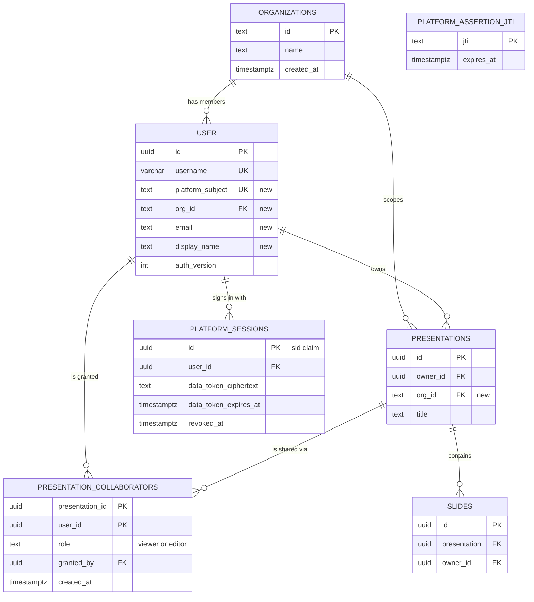
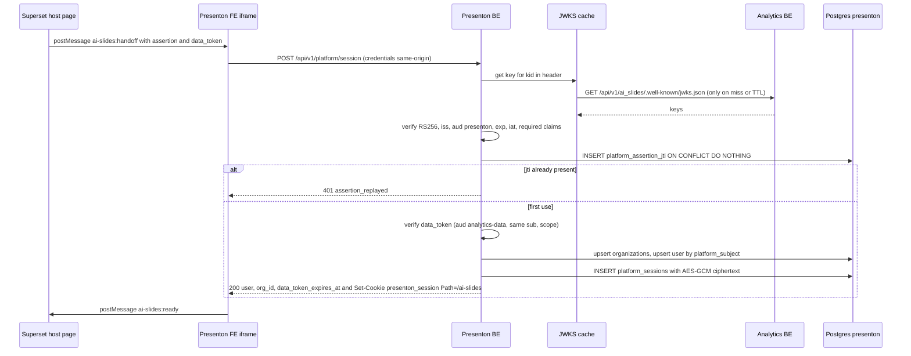

# Story 2: Platform integration, Postgres, access control, pod-ready API

<div class="chapter-meta" markdown>
**Reads:** `servers/fastapi/services/database.py`, `servers/fastapi/utils/db_utils.py`, `servers/fastapi/migrations.py`, `servers/fastapi/alembic/env.py`, `servers/fastapi/api/v1/auth/users.py`, `servers/fastapi/api/v1/auth/router.py`, `servers/fastapi/api/v1/auth/principal.py`, `servers/fastapi/api/v1/auth/context.py`, `servers/fastapi/api/v1/auth/assets.py`, `servers/fastapi/api/middlewares.py`, `servers/fastapi/api/lifespan.py`  ·  **Builds on:** [Architecture and contracts](41-architecture-and-contracts.md), [Data model](../presenton/07-data-model.md), [Auth and multi-user](../presenton/25-auth-and-multiuser.md)  ·  **Time:** ~60 min
</div>

This chapter turns Story 2 into code. You will move Presenton's metadata into a dedicated `presenton` schema of the analytics Postgres, replace username and password login with the Superset handoff from the contracts chapter, add organizations and collaborators with a single access dependency, and remove the assumptions that keep stock Presenton from running as several stateless pods. Every change starts from the code that exists today, with file and line references, and every new file is labeled as new.

## Step 0: The story, its owner and its acceptance criteria

| # | Story | What it does | Owner |
| --- | --- | --- | --- |
| 2 | [Presenton BE] Platform Integration: Postgres, access control, pod-ready API | Moves metadata to the analytics Postgres, enforces owner, org and collaborator access with platform identity, and makes the API fit the analytics pod. | Nitesh |

Story 2 and Story 5 (menu, iframe, handoff) unblock any production use. Story 1 (bindings) and Story 3 (prompt library) add tables to the schema created here, so the Postgres and Alembic work in Step 1 and Step 2 should land first.

Acceptance criteria:

1. **Given** the analytics Postgres with an empty `presenton` schema, **when** the `presenton-migrate` Job runs `alembic upgrade head`, **then** every Presenton table and `presenton.alembic_version` exist in schema `presenton`, and nothing is created in `public`.
2. **Given** a BE pod with `MIGRATE_DATABASE_ON_STARTUP=false`, **when** it starts, **then** it issues no DDL and `/readyz` returns 503 until the database revision equals the image's expected head.
3. **Given** a valid handoff assertion and data token, **when** the FE posts them to `POST /api/v1/platform/session`, **then** the BE upserts the user by `platform_subject`, sets `presenton_session` (HttpOnly, Secure, SameSite=Lax, Path=/ai-slides) and returns `{user, org_id, data_token_expires_at}` without echoing the data token.
4. **Given** an assertion that was already used, expired, signed by an unknown key, or carries the wrong `aud` or `iss`, **when** it is posted, **then** the response is 401 and no cookie is set.
5. **Given** `AI_SLIDES_LOCAL_LOGIN_ENABLED=false`, **when** anyone calls `/api/v1/auth/setup` or `/api/v1/auth/login`, **then** the response is 404.
6. **Given** user B in the same org as owner A and no share, **when** B lists or opens A's deck, **then** the list omits it and the open returns 404. **When** A shares it with B as `viewer`, **then** B can open, refresh and export but every edit, share and delete endpoint returns 403.
7. **Given** two BE replicas behind one Service, **when** a session cookie issued by replica 1 is presented to replica 2, **then** it is accepted (shared signing key, no local state).
8. **Given** a rolling update, **when** a pod receives SIGTERM, **then** it fails readiness, finishes in-flight requests up to the grace period, and does not mark other pods' running async tasks as failed.

## Step 1: Move the database to Postgres schema `presenton`

### 1.1 How Presenton picks its database today

All URL handling lives in `get_database_url_and_connect_args` (`servers/fastapi/utils/db_utils.py:57`). With no `DATABASE_URL` it falls back to `sqlite:///<APP_DATA_DIRECTORY>/fastapi.db` (`:58-60`). A `postgresql://` URL is rewritten to `postgresql+asyncpg://` (`:66-67`). If the URL has a query string, the function inspects only `sslmode` (turning it into an `ssl.create_default_context()` connect argument, `:84-86`) and then rebuilds the URL with an empty query (`:88-96`). The engine is created once at import time in `servers/fastapi/services/database.py:34-42`, with pool settings only for non-SQLite URLs:

```python title="servers/fastapi/utils/db_utils.py (excerpt)"
    return {
        "pool_size": _int_env("DB_POOL_SIZE", 5),
        "max_overflow": _int_env("DB_MAX_OVERFLOW", 10),
        "pool_timeout": _int_env("DB_POOL_TIMEOUT", 30),
        "pool_recycle": _int_env("DB_POOL_RECYCLE", 1800),
        "pool_pre_ping": os.getenv("DB_POOL_PRE_PING", "true").lower()
        not in ("false", "0", "no"),
    }
```

Migrations run synchronously. `_run_migrations` (`servers/fastapi/migrations.py:52`) takes the same URL, converts it with `to_sync_sqlalchemy_url` to `postgresql+psycopg://` (`servers/fastapi/utils/db_utils.py:114-116`), repairs orphan revisions and stamps legacy databases, then calls `command.upgrade(config, "head")` (`servers/fastapi/migrations.py:69`). `alembic/env.py` configures the context with only `connection`, `target_metadata` and `compare_type` (`servers/fastapi/alembic/env.py:86-90`), so the version table lands in the connection's default schema. The [Data model](../presenton/07-data-model.md) chapter walks the full revision chain.

!!! warning "Gotcha: every query parameter in `DATABASE_URL` is dropped"
    Because the query string is rebuilt as empty (`servers/fastapi/utils/db_utils.py:88-96`), you cannot pass `options=-csearch_path=presenton`, `prepared_statement_cache_size=0` or `application_name` in the URL. They silently disappear. Also, `migrations.py:59` discards the `connect_args`, so the Alembic connection never receives the `ssl` context: psycopg's default `sslmode=prefer` still negotiates TLS if the server offers it, but without certificate verification. Every setting below therefore goes through code or role defaults, not the URL.

### 1.2 Provision the schema and two roles (DBA, once per environment)

Use one role that owns the schema and runs migrations, and one runtime role with only DML rights. Role-level `search_path` is the robust way to select the schema, because it works through PgBouncer and for both the asyncpg runtime engine and the psycopg Alembic engine without code.

```sql title="ops/sql/presenton-schema.sql (new)"
CREATE ROLE presenton_migrator LOGIN PASSWORD :'migrator_password';
CREATE ROLE presenton_app      LOGIN PASSWORD :'app_password';

CREATE SCHEMA presenton AUTHORIZATION presenton_migrator;
REVOKE ALL ON SCHEMA presenton FROM PUBLIC;
GRANT USAGE ON SCHEMA presenton TO presenton_app;

ALTER DEFAULT PRIVILEGES FOR ROLE presenton_migrator IN SCHEMA presenton
  GRANT SELECT, INSERT, UPDATE, DELETE ON TABLES TO presenton_app;
ALTER DEFAULT PRIVILEGES FOR ROLE presenton_migrator IN SCHEMA presenton
  GRANT USAGE, SELECT ON SEQUENCES TO presenton_app;

ALTER ROLE presenton_migrator IN DATABASE analytics SET search_path = presenton;
ALTER ROLE presenton_app      IN DATABASE analytics SET search_path = presenton;
ALTER ROLE presenton_app      IN DATABASE analytics SET statement_timeout = '60s';
ALTER ROLE presenton_app      IN DATABASE analytics SET idle_in_transaction_session_timeout = '60s';
```

The BE Deployment gets `DATABASE_URL=postgresql://presenton_app:...@pg:5432/analytics?sslmode=require`. The migrate Job gets the same URL with `presenton_migrator`.

### 1.3 Make the schema explicit in code as well

Role defaults can be forgotten in a new environment, so the fork also sets the schema in code. Two small changes:

```python title="servers/fastapi/utils/db_utils.py (fork change, appended to get_database_url_and_connect_args)"
    schema = (os.getenv("DB_SCHEMA") or "").strip()            # new, e.g. "presenton"
    if "postgresql+asyncpg" in database_url:
        if schema and os.getenv("DB_SET_SEARCH_PATH", "true") == "true":
            connect_args["server_settings"] = {
                "search_path": schema,
                "application_name": os.getenv("POD_NAME", "presenton-be"),
            }
        if os.getenv("DB_PGBOUNCER_TRANSACTION_MODE", "false") == "true":
            connect_args["statement_cache_size"] = 0            # asyncpg's own cache
            connect_args["prepared_statement_name_func"] = (
                lambda: f"__asyncpg_{uuid.uuid4()}__"
            )
    return database_url, connect_args
```

```python title="servers/fastapi/alembic/env.py (fork change in run_migrations_online)"
    schema = os.getenv("DB_SCHEMA") or None
    with connectable.connect() as connection:
        if schema and connection.dialect.name == "postgresql":
            connection.exec_driver_sql(f'SET search_path TO "{schema}"')
        context.configure(
            connection=connection,
            target_metadata=target_metadata,
            compare_type=True,
            version_table_schema=schema,   # presenton.alembic_version
        )
        with context.begin_transaction():
            context.run_migrations()
```

Do not add `schema=` to `SQLModel.metadata` or to each model. The models reference each other with unqualified foreign keys such as `ForeignKey("user.id", ...)` (`servers/fastapi/models/sql/presentation.py:29`), and SQLite tests in `servers/fastapi/tests/unit/test_owner_isolation.py` create tables in an unqualified in-memory database. `search_path` keeps both working.

!!! warning "Gotcha: PgBouncer in transaction mode"
    SQLAlchemy's asyncpg dialect prepares statements, and asyncpg caches them per connection. Behind PgBouncer in transaction mode, consecutive transactions may land on different server connections, which yields `prepared statement "__asyncpg_stmt_1__" does not exist`. Set `DB_PGBOUNCER_TRANSACTION_MODE=true` (above) and, because the URL query is stripped, also pass SQLAlchemy's `prepared_statement_cache_size=0` through `create_async_engine(..., connect_args=...)` rather than the URL. Two more traps: PgBouncer rejects unknown startup parameters, so `server_settings={"search_path": ...}` fails unless `search_path` is in `track_extra_parameters` (set `DB_SET_SEARCH_PATH=false` and rely on the role default), and `SET` statements do not survive across transactions. PgBouncer 1.21+ with `max_prepared_statements > 0` removes the first problem. Session mode removes all of them at the cost of pooling efficiency.

### 1.4 Pool sizing for pods

Each BE pod owns one engine. The worst case connection count is `replicas x (DB_POOL_SIZE + DB_MAX_OVERFLOW)`. With the stock defaults (5 + 10) and an HPA maximum of 6, that is 90 connections from one service, which is too many to share a database with Superset. Recommended defaults:

| Variable | Stock default | Recommended for pods | Why |
| --- | --- | --- | --- |
| `DB_POOL_SIZE` | 5 | 5 | One uvicorn worker per pod; most requests hold a connection briefly |
| `DB_MAX_OVERFLOW` | 10 | 5 | Caps a pod at 10 connections |
| `DB_POOL_TIMEOUT` | 30 | 10 | Fail fast and let the ingress retry on another pod |
| `DB_POOL_RECYCLE` | 1800 | 1800 | Below typical firewall idle timeouts |
| `DB_POOL_PRE_PING` | true | true | Survives a Postgres failover |

!!! warning "Gotcha: long SSE streams hold sessions"
    Endpoints that receive `sql_session: AsyncSession = Depends(get_async_session)` keep that session open for the life of the request. For the streaming endpoints (`GET /api/v1/ppt/presentation/stream/{id}`, `servers/fastapi/api/v1/ppt/endpoints/presentation.py:2281`) that can be minutes. A connection is only checked out while a transaction is active, but a stream that awaits an LLM between two queries inside one transaction holds it. Add the `idle_in_transaction_session_timeout` from 1.2 and watch the pool metric from Story 9.

### 1.5 Migrations as a Kubernetes Job

`MIGRATE_DATABASE_ON_STARTUP` defaults to `"true"` (`servers/fastapi/utils/get_env.py:453-454`), and the lifespan runs `migrate_database_on_startup()` then `create_db_and_tables()` on every start (`servers/fastapi/api/lifespan.py:56-57`). With several replicas starting together, several Alembic runs race for the same revision. Set `MIGRATE_DATABASE_ON_STARTUP=false` in the Deployment and run `presenton-migrate` before each rollout (Story 9 owns the manifest and the Helm hook).

Setting the flag to `false` is not enough, because of what `create_db_and_tables` does in that branch:

```python title="servers/fastapi/services/database.py (excerpt)"
async def create_db_and_tables():
    should_run_alembic = get_migrate_database_on_startup_env() in ["true", "True"]
    if not should_run_alembic:
        async with sql_engine.begin() as conn:
            await conn.run_sync(
                lambda sync_conn: SQLModel.metadata.create_all(
                    sync_conn,
                    tables=[
                        PresentationModel.__table__,
                        # ...
```

If a pod starts before the Job, `create_all` creates tables with no `alembic_version` row, and the next migration run goes through the legacy-stamp heuristics in `_stamp_legacy_database_if_needed` (`servers/fastapi/migrations.py:264`). Add a guard (new env `DB_SCHEMA_MANAGED_EXTERNALLY=true`) that turns `create_db_and_tables` into a no-op, and let `/readyz` (Step 6) refuse traffic until the revision matches. The runtime role from 1.2 has no DDL rights, so a missed flag fails loudly instead of creating tables.

The Job's command is a new module, so it can also run the one-time bootstrap that should not race across pods:

```python title="servers/fastapi/scripts/ai_slides_migrate.py (new)"
import asyncio

from migrations import _run_migrations
from services.database import async_session_maker, dispose_engines
from services.provider_settings import migrate_provider_settings_from_file
from templates.default_templates import import_default_templates_on_startup


async def main() -> None:
    await asyncio.to_thread(_run_migrations)          # alembic upgrade head
    async with async_session_maker() as session:
        await migrate_provider_settings_from_file(session)   # creates the single row once
    await import_default_templates_on_startup()
    await dispose_engines()


if __name__ == "__main__":
    asyncio.run(main())
```

Keep `REVISION_HEAD` in `servers/fastapi/migrations.py:37` pointing at the newest revision of the fork (the stock value is `"026c0ba8b35c"`), because `/readyz` compares against it.

### 1.6 Copying existing SQLite data (only if a pilot ran on SQLite)

If a team already used a Docker pilot, copy its rows once. Reuse the model metadata, so type conversion (for example SQLite's 32-character UUID strings into Postgres `uuid`) is done by SQLAlchemy's `Uuid` type:

```python title="servers/fastapi/scripts/sqlite_to_postgres.py (new, outline)"
import sys
from sqlalchemy import create_engine, insert, select
from sqlmodel import SQLModel
import alembic.env  # noqa: F401  (imports every model, registering all tables)

src = create_engine(sys.argv[1])          # sqlite:////app_data/fastapi.db
dst = create_engine(sys.argv[2])          # postgresql+psycopg://presenton_migrator@.../analytics
SKIP = {"alembic_version"}

with src.connect() as s, dst.begin() as d:
    for table in SQLModel.metadata.sorted_tables:     # parents before children
        if table.name in SKIP:
            continue
        rows = [dict(r) for r in s.execute(select(table)).mappings()]
        for start in range(0, len(rows), 500):
            d.execute(insert(table), rows[start:start + 500])
        print(table.name, len(rows))
```

Run it after `alembic upgrade head` on an empty schema, then map local accounts to platform identities with an `UPDATE "user" SET platform_subject = ... WHERE username = ...` from a reviewed CSV, and copy `app_data/{images,exports,uploads}/users/<uuid>/` to the new storage keeping the same relative paths. Importing `alembic.env` directly runs migrations as a side effect, so in practice copy its model import block into the script instead.

## Step 2: Schema changes for platform identity and access

All new tables live in schema `presenton`. The ER diagram shows the new tables and columns next to the existing ones they touch.



### 2.1 Models

The existing `User` is a plain SQLAlchemy declarative model sharing `SQLModel.metadata` (`servers/fastapi/models/sql/user.py:12-16`). Add columns there, and new SQLModel tables next to the others:

```python title="servers/fastapi/models/sql/user.py (fork change, new columns)"
    platform_subject: Mapped[Optional[str]] = mapped_column(
        String(255), unique=True, index=True, nullable=True
    )
    org_id: Mapped[Optional[str]] = mapped_column(
        String(128), ForeignKey("organizations.id"), index=True, nullable=True
    )
    email: Mapped[Optional[str]] = mapped_column(String(320), nullable=True)
    display_name: Mapped[Optional[str]] = mapped_column(String(255), nullable=True)
```

```python title="servers/fastapi/models/sql/platform.py (new)"
from datetime import datetime
from typing import Optional
import uuid

from sqlalchemy import Column, DateTime, ForeignKey, String, Text, CheckConstraint
from sqlmodel import Field, SQLModel

from utils.datetime_utils import get_current_utc_datetime


class Organization(SQLModel, table=True):
    __tablename__ = "organizations"
    id: str = Field(primary_key=True, max_length=128)   # platform org id
    name: str = Field(max_length=255)
    created_at: datetime = Field(sa_column=Column(DateTime(timezone=True),
                                 nullable=False, default=get_current_utc_datetime))


class PresentationCollaborator(SQLModel, table=True):
    __tablename__ = "presentation_collaborators"
    __table_args__ = (CheckConstraint("role IN ('viewer','editor')", name="ck_collab_role"),)
    presentation_id: uuid.UUID = Field(sa_column=Column(
        ForeignKey("presentations.id", ondelete="CASCADE"), primary_key=True))
    user_id: uuid.UUID = Field(sa_column=Column(
        ForeignKey("user.id", ondelete="CASCADE"), primary_key=True, index=True))
    role: str = Field(sa_column=Column(String(16), nullable=False))
    granted_by: Optional[uuid.UUID] = Field(default=None, sa_column=Column(
        ForeignKey("user.id", ondelete="SET NULL"), nullable=True))
    created_at: datetime = Field(sa_column=Column(DateTime(timezone=True),
                                 nullable=False, default=get_current_utc_datetime))


class PlatformSession(SQLModel, table=True):
    __tablename__ = "platform_sessions"
    id: uuid.UUID = Field(primary_key=True, default_factory=uuid.uuid4)
    user_id: uuid.UUID = Field(sa_column=Column(
        ForeignKey("user.id", ondelete="CASCADE"), nullable=False, index=True))
    data_token_ciphertext: Optional[str] = Field(default=None, sa_column=Column(Text))
    data_token_expires_at: Optional[datetime] = Field(
        default=None, sa_column=Column(DateTime(timezone=True)))
    created_at: datetime = Field(sa_column=Column(DateTime(timezone=True),
                                 nullable=False, default=get_current_utc_datetime))
    revoked_at: Optional[datetime] = Field(default=None, sa_column=Column(DateTime(timezone=True)))


class PlatformAssertionJti(SQLModel, table=True):
    __tablename__ = "platform_assertion_jti"
    jti: str = Field(primary_key=True, max_length=128)
    expires_at: datetime = Field(sa_column=Column(DateTime(timezone=True),
                                 nullable=False, index=True))
```

`PresentationModel` gets `org_id: Optional[str] = Field(default=None, sa_column=Column(String(128), ForeignKey("organizations.id"), index=True))`. Register the new models in both import lists that feed metadata: `servers/fastapi/alembic/env.py:15-33` and `servers/fastapi/services/database.py:12-28`.

### 2.2 The Alembic revision

```python title="servers/fastapi/alembic/versions/a1s2b3c4d5e6_ai_slides_platform_access.py (new)"
"""ai slides: organizations, collaborators, platform sessions

Revision ID: a1s2b3c4d5e6
Revises: 026c0ba8b35c
"""
from alembic import op
import sqlalchemy as sa

revision = "a1s2b3c4d5e6"
down_revision = "026c0ba8b35c"


def upgrade() -> None:
    op.create_table(
        "organizations",
        sa.Column("id", sa.String(128), primary_key=True),
        sa.Column("name", sa.String(255), nullable=False),
        sa.Column("created_at", sa.DateTime(timezone=True), nullable=False),
    )
    with op.batch_alter_table("user") as batch:
        batch.add_column(sa.Column("platform_subject", sa.String(255), nullable=True))
        batch.add_column(sa.Column("org_id", sa.String(128), nullable=True))
        batch.add_column(sa.Column("email", sa.String(320), nullable=True))
        batch.add_column(sa.Column("display_name", sa.String(255), nullable=True))
        batch.create_unique_constraint("uq_user_platform_subject", ["platform_subject"])
        batch.create_foreign_key("fk_user_org", "organizations", ["org_id"], ["id"])
    with op.batch_alter_table("presentations") as batch:
        batch.add_column(sa.Column("org_id", sa.String(128), nullable=True))
        batch.create_foreign_key("fk_presentations_org", "organizations", ["org_id"], ["id"])
        batch.create_index("ix_presentations_org_id", ["org_id"])
    op.create_table(
        "presentation_collaborators",
        sa.Column("presentation_id", sa.Uuid(), sa.ForeignKey("presentations.id", ondelete="CASCADE"), primary_key=True),
        sa.Column("user_id", sa.Uuid(), sa.ForeignKey("user.id", ondelete="CASCADE"), primary_key=True),
        sa.Column("role", sa.String(16), nullable=False),
        sa.Column("granted_by", sa.Uuid(), sa.ForeignKey("user.id", ondelete="SET NULL"), nullable=True),
        sa.Column("created_at", sa.DateTime(timezone=True), nullable=False),
        sa.CheckConstraint("role IN ('viewer','editor')", name="ck_collab_role"),
    )
    op.create_index("ix_presentation_collaborators_user_id", "presentation_collaborators", ["user_id"])
    # platform_sessions and platform_assertion_jti follow the models above
    # ...


def downgrade() -> None:
    op.drop_table("presentation_collaborators")
    # ... reverse order
```

`batch_alter_table` keeps the revision runnable on SQLite in CI. Update `REVISION_HEAD` in `migrations.py` and add a branch to `_infer_revision_from_schema` (`servers/fastapi/migrations.py:117`) only if you need to support stamping legacy databases that already contain these tables. For a fresh Postgres schema you do not.

## Step 3: The platform identity handoff on the Presenton side

### 3.1 What exists and what changes

Today a session is a JWT in cookie `presenton_session` with a 30-day TTL (`servers/fastapi/api/v1/auth/config.py:11-12`). The token is written by `VersionedJWTStrategy.write_token` and carries `sub`, `av` (the user's `auth_version`) and `aud`:

```python title="servers/fastapi/api/v1/auth/users.py (excerpt)"
    async def write_token(self, user: User) -> str:
        return generate_jwt(
            {
                "sub": str(user.id),
                "av": user.auth_version,
                "aud": self.token_audience,
            },
            self.encode_key,
            self.lifetime_seconds,
            algorithm=self.algorithm,
        )


def get_jwt_strategy(
    lifetime_seconds: int = SESSION_TTL_SECONDS,
) -> VersionedJWTStrategy:
    return VersionedJWTStrategy(
        secret=get_or_create_auth_secret(),
        lifetime_seconds=lifetime_seconds,
    )
```

The login endpoint sets the cookie with `path="/"` (`servers/fastapi/api/v1/auth/router.py:46-55`), and `read_token` rejects tokens whose `av` no longer matches the user row (`servers/fastapi/api/v1/auth/users.py:159-160`). The [Auth and multi-user](../presenton/25-auth-and-multiuser.md) chapter covers every branch.

The fork keeps this machinery. The handoff endpoint becomes a second way to obtain the same cookie, the token gets one extra claim (`sid`, the `platform_sessions.id`), and the cookie path becomes `/ai-slides`.



### 3.2 JWKS cache with rotation

PyJWT is already installed (it is what `fastapi_users.jwt` uses, and `servers/fastapi/api/v1/auth/users.py:5` imports `jwt`), and `cryptography` is a direct dependency (`servers/fastapi/pyproject.toml:18`). `joserfc` is only a transitive constraint (`servers/fastapi/pyproject.toml:44`), so use PyJWT. Its `PyJWKClient` is synchronous, so the fork wraps `httpx` (already a dependency, `servers/fastapi/pyproject.toml:26`) in a small async cache:

```python title="servers/fastapi/services/platform_identity.py (new, part 1)"
import asyncio, os, time
import httpx, jwt

_JWKS_TTL = int(os.getenv("AI_SLIDES_JWKS_TTL_SECONDS", "300"))
_MIN_REFRESH_INTERVAL = 30   # bound refetches triggered by unknown kids


class JwksCache:
    def __init__(self, url: str):
        self._url, self._keys, self._fetched_at = url, {}, 0.0
        self._lock = asyncio.Lock()

    async def _refresh(self) -> None:
        async with httpx.AsyncClient(timeout=3.0) as client:
            resp = await client.get(self._url)
            resp.raise_for_status()
        jwk_set = jwt.PyJWKSet.from_dict(resp.json())
        self._keys = {k.key_id: k for k in jwk_set.keys if k.key_id}
        self._fetched_at = time.monotonic()

    async def get_key(self, kid: str) -> jwt.PyJWK:
        age = time.monotonic() - self._fetched_at
        if kid in self._keys and age < _JWKS_TTL:
            return self._keys[kid]
        async with self._lock:
            age = time.monotonic() - self._fetched_at
            if kid not in self._keys or age >= _JWKS_TTL:
                if kid in self._keys or age >= _MIN_REFRESH_INTERVAL:
                    try:
                        await self._refresh()
                    except httpx.HTTPError:
                        if kid not in self._keys:   # serve stale keys during outages
                            raise
        if kid not in self._keys:
            raise jwt.InvalidKeyError(f"unknown kid {kid}")
        return self._keys[kid]


JWKS = JwksCache(os.environ.get("AI_SLIDES_JWKS_URL", ""))
```

Rotation works without coordination: Story 8 publishes the new key in the JWKS before signing with it, an unknown `kid` triggers at most one refetch per 30 seconds, and the old key stays published for at least the longest token lifetime (15 minutes for data tokens).

### 3.3 Verifying the assertion and the data token

```python title="servers/fastapi/services/platform_identity.py (new, part 2)"
ISSUER = os.environ.get("AI_SLIDES_ISSUER", "https://analytics.example.com")
LEEWAY = 30


async def verify_platform_jwt(token: str, *, audience: str, max_lifetime: int) -> dict:
    header = jwt.get_unverified_header(token)
    if header.get("alg") != "RS256" or not header.get("kid"):
        raise jwt.InvalidTokenError("unexpected header")
    key = await JWKS.get_key(header["kid"])
    claims = jwt.decode(
        token, key.key, algorithms=["RS256"], audience=audience, issuer=ISSUER,
        leeway=LEEWAY,
        options={"require": ["exp", "iat", "iss", "aud", "sub", "jti"]},
    )
    if claims["exp"] - claims["iat"] > max_lifetime + LEEWAY:
        raise jwt.InvalidTokenError("lifetime too long")
    return claims
```

The assertion is verified with `audience="presenton", max_lifetime=60`. The data token is verified with `audience="analytics-data", max_lifetime=900`, and the endpoint also checks `data_claims["sub"] == assertion_claims["sub"]` and that `"ai_slides:refresh"` is in `data_claims["scope"].split()`. Presenton verifies the data token only to bind it to the right user and learn its expiry. Superset remains the authority that enforces it on every refresh call.

### 3.4 Single-use `jti`

```python title="servers/fastapi/services/platform_identity.py (new, part 3)"
from datetime import datetime, timezone
from sqlalchemy.dialects.postgresql import insert as pg_insert
from sqlalchemy import delete
from models.sql.platform import PlatformAssertionJti


async def consume_jti(session, jti: str, exp: int) -> bool:
    expires_at = datetime.fromtimestamp(exp, tz=timezone.utc)
    stmt = (
        pg_insert(PlatformAssertionJti)
        .values(jti=jti, expires_at=expires_at)
        .on_conflict_do_nothing(index_elements=["jti"])
    )
    result = await session.execute(stmt)
    await session.execute(delete(PlatformAssertionJti).where(
        PlatformAssertionJti.expires_at < datetime.now(timezone.utc)))
    return result.rowcount == 1
```

The primary key makes the check atomic across pods. If the platform already runs Redis for Superset, `SET ai-slides:jti:<jti> 1 NX EX 120` is an equivalent alternative with no table. Postgres is the recommended default here because Presenton has no Redis client today.

!!! warning "Gotcha: `on_conflict_do_nothing` is Postgres-only"
    The SQLite engine used in CI does not compile the PostgreSQL `insert`. Use `sqlalchemy.dialects.sqlite.insert` when `session.bind.dialect.name == "sqlite"` (it has the same `on_conflict_do_nothing`), or the tests in Step 7 will not run.

### 3.5 Encrypting the data token at rest

The contracts require the data token to be encrypted and keyed by session. Use AES-GCM with the session id as associated data, so a ciphertext copied into another session row fails to decrypt. The key comes from `AI_SLIDES_DATA_TOKEN_KEY` (32 random bytes, base64); a `kid` prefix supports rotation.

```python title="servers/fastapi/services/platform_tokens.py (new)"
import base64, os, uuid
from cryptography.hazmat.primitives.ciphers.aead import AESGCM


def _keys() -> dict[str, bytes]:
    # AI_SLIDES_DATA_TOKEN_KEY="k2:<b64>" ; AI_SLIDES_DATA_TOKEN_OLD_KEYS="k1:<b64>,..."
    raw = [os.environ["AI_SLIDES_DATA_TOKEN_KEY"]]
    raw += [k for k in os.getenv("AI_SLIDES_DATA_TOKEN_OLD_KEYS", "").split(",") if k]
    return {kid: base64.b64decode(b64) for kid, b64 in (item.split(":", 1) for item in raw)}


def encrypt_data_token(token: str, sid: uuid.UUID) -> str:
    kid, key = next(iter(_keys().items()))
    nonce = os.urandom(12)
    ct = AESGCM(key).encrypt(nonce, token.encode(), sid.bytes)
    return f"{kid}:{base64.urlsafe_b64encode(nonce + ct).decode()}"


def decrypt_data_token(blob: str, sid: uuid.UUID) -> str:
    kid, payload = blob.split(":", 1)
    data = base64.urlsafe_b64decode(payload)
    return AESGCM(_keys()[kid]).decrypt(data[:12], data[12:], sid.bytes).decode()
```

Data tokens live 15 minutes, so rotating the key is simple: deploy with the new key first and the old one in `AI_SLIDES_DATA_TOKEN_OLD_KEYS`, wait 15 minutes, then remove the old one.

!!! warning "Gotcha: do not reuse `AUTH_SECRET_KEY` for this"
    Presenton already derives a Fernet key from the session signing secret for API keys (`servers/fastapi/services/api_keys.py:39-43`). Reusing that secret would mean that rotating the cookie-signing key also makes every stored API key and data token undecryptable. Keep the two keys separate.

### 3.6 The endpoint

```python title="servers/fastapi/api/v1/platform/router.py (new)"
import os, secrets, uuid
from datetime import datetime, timezone
from fastapi import APIRouter, Depends, HTTPException, Request
from pydantic import BaseModel
from sqlalchemy import select
from sqlalchemy.ext.asyncio import AsyncSession
from starlette.responses import JSONResponse

from api.v1.auth.users import PASSWORD_HELPER, get_platform_jwt_strategy
from api.v1.auth.config import SESSION_COOKIE_NAME
from models.sql.platform import Organization, PlatformSession
from models.sql.user import User
from services.database import get_async_session
from services.platform_identity import consume_jti, verify_platform_jwt
from services.platform_tokens import encrypt_data_token

API_V1_PLATFORM_ROUTER = APIRouter(prefix="/api/v1/platform", tags=["Platform"])
BASE_PATH = os.getenv("AI_SLIDES_BASE_PATH", "/ai-slides")
SESSION_TTL = int(os.getenv("AI_SLIDES_SESSION_TTL_SECONDS", "28800"))
ADMIN_ROLES = {r.strip() for r in os.getenv("AI_SLIDES_ADMIN_ROLES", "").split(",") if r.strip()}


class HandoffBody(BaseModel):
    assertion: str
    data_token: str


@API_V1_PLATFORM_ROUTER.post("/session")
async def create_platform_session(body: HandoffBody, request: Request,
                                  session: AsyncSession = Depends(get_async_session)):
    try:
        claims = await verify_platform_jwt(body.assertion, audience="presenton", max_lifetime=60)
        data = await verify_platform_jwt(body.data_token, audience="analytics-data", max_lifetime=900)
    except Exception:
        raise HTTPException(401, "invalid_assertion")
    if data["sub"] != claims["sub"] or "ai_slides:refresh" not in str(data.get("scope", "")).split():
        raise HTTPException(401, "invalid_data_token")
    if not await consume_jti(session, claims["jti"], claims["exp"]):
        raise HTTPException(401, "assertion_replayed")

    org_id = str(claims.get("org_id") or "") or None
    if org_id and await session.get(Organization, org_id) is None:
        session.add(Organization(id=org_id, name=org_id))

    subject = str(claims["sub"])
    user = await session.scalar(select(User).where(User.platform_subject == subject))
    if user is None:
        user = User(username=f"superset:{subject}", platform_subject=subject,
                    hashed_password=PASSWORD_HELPER.hash(secrets.token_urlsafe(32)),
                    is_active=True, is_verified=True, auth_version=1)
        session.add(user)
    user.org_id = org_id
    user.email = claims.get("email")
    user.display_name = " ".join(filter(None, [claims.get("first_name"), claims.get("last_name")])) \
        or claims.get("username")
    user.is_superuser = bool(ADMIN_ROLES.intersection(claims.get("roles") or []))
    await session.flush()

    sid = uuid.uuid4()
    expires_at = datetime.fromtimestamp(data["exp"], tz=timezone.utc)
    session.add(PlatformSession(id=sid, user_id=user.id,
                                data_token_ciphertext=encrypt_data_token(body.data_token, sid),
                                data_token_expires_at=expires_at))
    await session.commit()

    token = await get_platform_jwt_strategy(SESSION_TTL).write_token_with_sid(user, sid)
    response = JSONResponse({
        "user": {"id": str(user.id), "username": claims.get("username"),
                 "display_name": user.display_name, "role": "admin" if user.is_superuser else "user"},
        "org_id": org_id,
        "data_token_expires_at": expires_at.isoformat(),
    })
    response.set_cookie(SESSION_COOKIE_NAME, token, max_age=SESSION_TTL, httponly=True,
                        secure=True, samesite="lax", path=BASE_PATH)
    return response
```

`POST /api/v1/platform/session/refresh-data-token` has the same body. It requires a valid `presenton_session` cookie, verifies both tokens the same way, requires `claims["sub"] == user.platform_subject`, and updates the existing `platform_sessions` row (new ciphertext, new expiry) without issuing a new cookie. Include the router in `servers/fastapi/api/main.py` next to `API_V1_AUTH_ROUTER` (`:71`).

The strategy subclass adds the `sid` claim. `read_token` in `VersionedJWTStrategy` ignores unknown claims, so existing validation is unchanged:

```python title="servers/fastapi/api/v1/auth/users.py (fork addition)"
class PlatformJWTStrategy(VersionedJWTStrategy):
    async def write_token_with_sid(self, user: User, sid: uuid.UUID) -> str:
        return generate_jwt(
            {"sub": str(user.id), "av": user.auth_version,
             "aud": self.token_audience, "sid": str(sid)},
            self.encode_key, self.lifetime_seconds, algorithm=self.algorithm,
        )


def get_platform_jwt_strategy(lifetime_seconds: int) -> PlatformJWTStrategy:
    return PlatformJWTStrategy(secret=get_or_create_auth_secret(),
                               lifetime_seconds=lifetime_seconds)
```

!!! warning "Gotcha: the signing secret lives in a file today"
    `get_or_create_auth_secret` reads `AUTH_SECRET_KEY` from `userConfig.json` and, if it is missing, generates a random one and writes it back (`servers/fastapi/api/v1/auth/config.py:71-81`). In pods there is no shared `userConfig.json`, so every replica would invent its own key and reject the others' cookies, and with `USER_CONFIG_PATH` unset the write raises `ValueError("USER_CONFIG_PATH is not set")` (`servers/fastapi/api/v1/auth/config.py:34-35`). The fork reads `os.environ["AUTH_SECRET_KEY"]` first and refuses to start in platform mode without it. The secret comes from the secrets store (Story 9).

!!! warning "Gotcha: the cookie path must change in three places"
    Login sets `path="/"` (`servers/fastapi/api/v1/auth/router.py:54`), logout deletes with `path="/"` (`servers/fastapi/api/v1/auth/router.py:199`), and the Next.js `pdf-maker` handoff sets `path: "/"` (`servers/nextjs/proxy.ts:130`). A cookie deleted with a different path than it was set with is not deleted. On the shared origin a `/`-scoped `presenton_session` would also travel with every Superset request. Use `AI_SLIDES_BASE_PATH` in all three.

### 3.7 Local login: disable, do not delete

Add `AI_SLIDES_LOCAL_LOGIN_ENABLED` (default `true` upstream, `false` in our Helm values). When it is `false`, `/api/v1/auth/setup` and `/api/v1/auth/login` return 404, `/api/v1/auth/status` reports `configured: true` with the platform user, and admin user management endpoints under `/api/v1/admin/` that create password users return 404. Keep the code so the fork stays rebasable and so engineers can still run a local Docker build without Superset.

!!! warning "Gotcha: startup crashes once platform users exist"
    `bootstrap_database_admin` runs on every start (`servers/fastapi/api/lifespan.py:58`). If no superuser exists but other users do, it raises:

    ```python title="servers/fastapi/api/v1/auth/bootstrap.py (excerpt)"
            account_count = int(
                await session.scalar(select(func.count()).select_from(User)) or 0
            )
            if account_count:
                raise RuntimeError(
                    "User accounts exist but no bootstrap administrator is configured"
                )
    ```

    Platform users are created with `is_superuser=False` unless their Superset roles match `AI_SLIDES_ADMIN_ROLES`, so the second pod restart after the first handoff would crash. Skip `bootstrap_database_admin` when local login is disabled.

### 3.8 Middleware and principal changes

`SessionAuthMiddleware` (`servers/fastapi/api/middlewares.py:29`) does four things that need adjusting. First, its public paths (`:30-36`) need `/api/v1/platform/session`. Second, it returns 428 when the `user` table is empty:

```python title="servers/fastapi/api/middlewares.py (excerpt)"
        async with async_session_maker() as session:
            configured = bool(
                await session.scalar(select(func.count()).select_from(User))
            )
            if not configured:
                return JSONResponse(
                    status_code=428,
                    content={
                        "detail": "Login setup is required",
                        "setup_required": True,
                    },
                )
```

In platform mode that check is meaningless (the first handoff creates the first user) and costs a `COUNT(*)` on every request. Skip it when local login is disabled. Third, after `resolve_request_principal` (`:94`) the middleware sets the owner contextvars (`:127-128`); the fork also sets a new `_CURRENT_PLATFORM_SESSION_ID` contextvar and `request.state.platform_session_id`. Fourth, API keys (`principal.method == "api_key"`) are a second, Superset-unaware way in. Disable them with `AI_SLIDES_API_KEYS_ENABLED=false` unless a service integration needs them.

`resolve_request_principal` (`servers/fastapi/api/v1/auth/principal.py:22`) gains two fields on `AuthPrincipal` (`org_id: str | None`, `session_id: uuid.UUID | None`) and one check: when the cookie token carries `sid`, load that `platform_sessions` row and treat the request as unauthenticated if it is missing or `revoked_at` is set. That gives server-side logout, which the stateless JWT alone cannot do. Keep `method="jwt"` for cookie sessions, because the admin gate in the middleware compares against it (`servers/fastapi/api/middlewares.py:115`).

Other code reads the stored data token through one helper (new, `services/platform_tokens.py`): `get_request_data_token(session) -> str | None`, which looks up the current session id, checks `data_token_expires_at`, and decrypts. Stories 1, 3 and 7 call it; nothing else touches the table.

!!! warning "Gotcha: the export cookie forwards Superset's session"
    `build_export_cookie_header` passes the browser's whole `Cookie` header to the export runtime (`servers/fastapi/api/v1/ppt/endpoints/presentation.py:1482-1484`). On the shared origin that header also contains Superset's `session` cookie, because a `Path=/` cookie is sent to `/ai-slides/api/...` too. Filter it down to `presenton_session` before it reaches Chromium. While there, note that `ExportTaskService._build_node_env` copies the full process environment into the Node child (`servers/fastapi/services/export_task_service.py:154`), so `DATABASE_URL` and LLM keys are visible to the export runtime. Pass an allow-listed environment instead.

## Step 4: Access control

### 4.1 How isolation works today

Presenton scopes data with a request contextvar, not with explicit checks. `SessionAuthMiddleware` stores the principal's user id with `set_current_owner_id` (`servers/fastapi/api/v1/auth/context.py:21-22`), and a session-wide ORM listener adds a criterion to every `SELECT`:

```python title="servers/fastapi/services/database.py (excerpt)"
@event.listens_for(Session, "do_orm_execute")
def _scope_owned_selects(execute_state) -> None:
    """Apply tenant criteria to every ORM SELECT performed during a request."""
    owner_id = get_current_owner_id()
    if (
        owner_id is None
        or not execute_state.is_select
        or execute_state.execution_options.get("skip_owner_scope")
    ):
        return

    statement = execute_state.statement
    for model in _STRICT_OWNER_MODELS:
        statement = statement.options(
            with_loader_criteria(
                model,
                lambda row: row.owner_id == owner_id,
                include_aliases=True,
            )
        )
```

`_STRICT_OWNER_MODELS` lists presentations, slides, chat messages, image assets, async tasks and webhooks (`servers/fastapi/services/database.py:56-64`). A second listener, `_stamp_new_owned_rows`, overwrites `owner_id` on every new owned row with the current user (`servers/fastapi/services/database.py:100-108`). This is why `sql_session.get(PresentationModel, id)` in `get_presentation` (`servers/fastapi/api/v1/ppt/endpoints/presentation.py:1557`) returns `None` for someone else's deck: the listener filtered it out, and the endpoint answers 404. There is no owner check in the endpoint itself.

That design is good defense in depth, and the fork keeps it. It is also why sharing cannot be bolted on in endpoints alone: a collaborator's `SELECT` never sees the row.

### 4.2 Extend the listener to "accessible", keep strict owner for private data

Split the models into two groups. Presentations and slides become "accessible if owned or shared"; chat messages, image assets, async tasks and webhooks stay strictly owner-scoped (a collaborator's chat history with the assistant is personal).

```python title="servers/fastapi/services/database.py (fork change)"
_STRICT_OWNER_MODELS = (
    ChatHistoryMessageModel, ImageAsset, AsyncTaskModel,
    AsyncPresentationGenerationTaskModel, WebhookSubscription,
)


def _accessible_presentation_ids(owner_id, org_id):
    shared = select(PresentationCollaborator.presentation_id).where(
        PresentationCollaborator.user_id == owner_id)
    clause = or_(PresentationModel.owner_id == owner_id, PresentationModel.id.in_(shared))
    if org_id is not None and get_org_visibility() == "org_read":
        clause = or_(clause, PresentationModel.org_id == org_id)
    return select(PresentationModel.id).where(clause)

# inside _scope_owned_selects, after the strict loop:
    org_id = get_current_org_id()                        # new contextvar
    statement = statement.options(
        with_loader_criteria(
            PresentationModel,
            lambda row: or_(
                row.owner_id == owner_id,
                row.id.in_(select(PresentationCollaborator.presentation_id)
                           .where(PresentationCollaborator.user_id == owner_id)),
            ),
            include_aliases=True,
        ),
        with_loader_criteria(
            SlideModel,
            lambda row: row.presentation.in_(_accessible_presentation_ids(owner_id, org_id)),
            include_aliases=True,
        ),
    )
```

The org-visibility branch for `PresentationModel` is omitted from the lambda for brevity; add it exactly as in the helper. `with_loader_criteria` also applies the `PresentationModel` criterion to the subquery inside the slide criterion, which is harmless because the two clauses are identical. Its lambdas are cached by code location and closure variables, so keep the structure stable and cover it with the test in Step 7.

!!! warning "Gotcha: new rows are stamped with the wrong owner"
    `_stamp_new_owned_rows` sets `instance.owner_id = owner_id` for every new slide (`servers/fastapi/services/database.py:106-108`). When an editor adds or regenerates slides in someone else's deck, the new slides would belong to the editor, and the owner's own listener would then hide them. Add a `_CURRENT_RESOURCE_OWNER_ID` contextvar that `require_presentation_access` sets to `presentation.owner_id`, and stamp slides with it when present. The same applies to the explicit filter in `update_presentation`, which deletes only the current user's slides before re-adding them (`servers/fastapi/api/v1/ppt/endpoints/presentation.py:2568-2573`), and the identical filters at `:1636`, `:2493` and `:3332`. Replace `get_current_owner_id()` with `presentation.owner_id` there.

### 4.3 Role matrix

| Action | Owner | Editor | Viewer | Same org, not shared |
| --- | --- | --- | --- | --- |
| See in dashboard list, open deck | yes | yes | yes | no (yes with `AI_SLIDES_ORG_VISIBILITY=org_read`, as viewer) |
| Refresh data (`/refresh`, `/refresh/stream`) | yes, as self | yes, as self | yes, as self | no |
| Refresh result persisted to shared `snapshot` and `slides.content` | yes | yes | no (results stream to the viewer only) | no |
| Export PPTX or PDF | yes | yes | yes, with the viewer's own refresh | no |
| Duplicate into own deck | yes | yes | no | no |
| Edit slides, title, outline, theme | yes | yes | no | no |
| Edit bindings (`PUT .../bindings/{binding_id}`) | yes | yes | no | no |
| Chat assistant edits, regenerate | yes | yes | no | no |
| List collaborators | yes | yes | yes | no |
| Add or remove collaborators | yes | no | no | no |
| Delete deck | yes | no | no | no |

!!! warning "Gotcha: a shared snapshot can leak data across RLS boundaries"
    Refresh-on-open renders the stored snapshot first (contracts chapter, Step 3), and successful refreshes are baked into `slides.content`. If the owner can see all regions and a viewer only EMEA, the viewer's first paint would show the owner's numbers. The recommended default, `AI_SLIDES_SHARED_SNAPSHOT_POLICY=redact`, makes `GET /presentation/{id}` and `GET .../bindings` replace bound element values with a pending placeholder for non-owners until their own refresh fills them, and makes non-owner exports render `forbidden` elements as "No access" instead of falling back to the snapshot. `share` treats the snapshot like a static screenshot the owner chose to distribute. Pick it only with sign-off from whoever owns the RLS policies.

### 4.4 The `require_presentation_access` dependency

```python title="servers/fastapi/api/v1/auth/access.py (new)"
from dataclasses import dataclass
from enum import IntEnum
import uuid

from fastapi import Depends, HTTPException, Path, Request
from sqlalchemy import select
from sqlalchemy.ext.asyncio import AsyncSession

from api.v1.auth.context import set_current_resource_owner_id   # new contextvar setter
from api.v1.auth.principal import principal_from_request
from models.sql.platform import PresentationCollaborator
from models.sql.presentation import PresentationModel
from services.database import get_async_session
from utils.get_env import get_org_visibility                    # new, "none" | "org_read"


class Role(IntEnum):
    VIEWER = 1
    EDITOR = 2
    OWNER = 3


@dataclass(frozen=True)
class PresentationAccess:
    presentation: PresentationModel
    role: Role


async def require_presentation_access(
    presentation_id: uuid.UUID, min_role: Role, *, session: AsyncSession, request: Request
) -> PresentationAccess:
    principal = principal_from_request(request)             # 401 if missing
    presentation = await session.get(
        PresentationModel, presentation_id,
        execution_options={"skip_owner_scope": True},        # decide explicitly below
    )
    if presentation is None:
        raise HTTPException(404, "Presentation not found")

    role: Role | None = None
    if presentation.owner_id == principal.user_id:
        role = Role.OWNER
    else:
        granted = await session.scalar(
            select(PresentationCollaborator.role)
            .where(PresentationCollaborator.presentation_id == presentation_id,
                   PresentationCollaborator.user_id == principal.user_id)
            .execution_options(skip_owner_scope=True))
        if granted:
            role = Role.EDITOR if granted == "editor" else Role.VIEWER
        elif (get_org_visibility() == "org_read" and principal.org_id
              and presentation.org_id == principal.org_id):
            role = Role.VIEWER

    if role is None:
        raise HTTPException(404, "Presentation not found")   # no existence oracle
    if role < min_role:
        raise HTTPException(403, f"{min_role.name.lower()} access required")
    set_current_resource_owner_id(presentation.owner_id)
    request.state.presentation_role = role
    return PresentationAccess(presentation=presentation, role=role)


def presentation_access(min_role: Role):
    """Dependency for routes whose path parameter is `id` (Presenton's convention)."""
    async def _dep(request: Request, id: uuid.UUID = Path(...),
                   session: AsyncSession = Depends(get_async_session)) -> PresentationAccess:
        return await require_presentation_access(id, min_role, session=session, request=request)
    return _dep
```

Wiring examples:

```python title="servers/fastapi/api/v1/ppt/endpoints/presentation.py (fork change)"
@PRESENTATION_ROUTER.get("/{id}", response_model=PresentationWithSlides)
async def get_presentation(
    id: uuid.UUID,
    request: Request,
    access: PresentationAccess = Depends(presentation_access(Role.VIEWER)),
    sql_session: AsyncSession = Depends(get_async_session),
):
    presentation = access.presentation
    # ... unchanged slide query, then redact bound values when access.role != Role.OWNER


@PRESENTATION_ROUTER.delete("/{id}", status_code=204)
async def delete_presentation(
    id: uuid.UUID,
    access: PresentationAccess = Depends(presentation_access(Role.OWNER)),
    sql_session: AsyncSession = Depends(get_async_session),
):
    await sql_session.delete(access.presentation)
    await sql_session.commit()
```

Endpoints that carry the id in the body call the function directly: `update_presentation` uses `id` from `Body()` (`servers/fastapi/api/v1/ppt/endpoints/presentation.py:2529`), `update_presentation_slide` uses `slide.presentation` (`:2592`), `edit`/`derive` use `data.presentation_id` (`:3307`, `:3358`), and the outline routes use path `{id}` (`servers/fastapi/api/v1/ppt/endpoints/outlines.py:44-84`). Add a test that walks `app.routes` and fails if any route under `/api/v1/ppt/presentation`, `/api/v1/ppt/slide` or `/api/v1/ppt/outlines` lacks the dependency or an allow-list entry.

!!! warning "Gotcha: dependency contextvars and the session identity map"
    The dependency loads the presentation with `skip_owner_scope=True`, so the row is in the session's identity map. A later `session.get(PresentationModel, id)` in the endpoint returns that cached object without a new `SELECT`, which is what you want, but also means the listener cannot catch a mistake there. Treat the dependency as the authority. Async dependencies run in the endpoint's context, so the contextvar it sets is visible to the handler. A `BackgroundTasks` function also inherits the copied context, but a task started later with its own context (for example through `asyncio.create_task` from another request) does not.

### 4.5 Sharing endpoints

```python title="servers/fastapi/api/v1/ppt/endpoints/collaborators.py (new)"
from typing import Literal
COLLAB_ROUTER = APIRouter(prefix="/presentation/{id}/collaborators", tags=["Sharing"])


class AddCollaborator(BaseModel):
    user_id: uuid.UUID
    role: Literal["viewer", "editor"]


@COLLAB_ROUTER.get("")
async def list_collaborators(access=Depends(presentation_access(Role.VIEWER)),
                             session: AsyncSession = Depends(get_async_session)):
    rows = await session.execute(
        select(PresentationCollaborator, User)
        .join(User, User.id == PresentationCollaborator.user_id)
        .where(PresentationCollaborator.presentation_id == access.presentation.id))
    return [{"user_id": str(u.id), "display_name": u.display_name, "role": c.role}
            for c, u in rows.all()]


@COLLAB_ROUTER.post("", status_code=201)
async def add_collaborator(body: AddCollaborator, request: Request,
                           access=Depends(presentation_access(Role.OWNER)),
                           session: AsyncSession = Depends(get_async_session)):
    principal = principal_from_request(request)
    target = await session.get(User, body.user_id)
    if target is None or not target.is_active or target.id == access.presentation.owner_id:
        raise HTTPException(404, "User not found")
    if principal.org_id and target.org_id != principal.org_id:
        raise HTTPException(403, "cross_org_share_not_allowed")
    existing = await session.get(PresentationCollaborator, (access.presentation.id, target.id))
    if existing:
        existing.role = body.role
    else:
        session.add(PresentationCollaborator(presentation_id=access.presentation.id,
                    user_id=target.id, role=body.role, granted_by=principal.user_id))
    await session.commit()
    return {"user_id": str(target.id), "role": body.role}


@COLLAB_ROUTER.delete("/{user_id}", status_code=204)
async def remove_collaborator(user_id: uuid.UUID,
                              access=Depends(presentation_access(Role.OWNER)),
                              session: AsyncSession = Depends(get_async_session)):
    await session.execute(delete(PresentationCollaborator).where(
        PresentationCollaborator.presentation_id == access.presentation.id,
        PresentationCollaborator.user_id == user_id))
    await session.commit()
```

Include it in `API_V1_PPT_ROUTER` (`servers/fastapi/api/v1/ppt/router.py:22`) next to `PRESENTATION_ROUTER`; the paths do not collide because `/presentation/{id}/collaborators` has an extra segment. A share target must already exist in Presenton, which means they opened AI Slides once. A companion `GET /api/v1/ppt/collaborators/candidates?q=` searches active users with the caller's `org_id` by `display_name` and `email`. Sharing with users who never opened AI Slides needs a Superset user lookup and is out of scope for v1.

### 4.6 Dashboard list: owned plus shared

`get_all_presentations` (`servers/fastapi/api/v1/ppt/endpoints/presentation.py:1499-1548`) selects presentations, optionally joined to slide index 0, and relies on the listener for scoping. With 4.2 in place, shared decks appear automatically. Add a `scope: Literal["all", "mine", "shared"] = "all"` query parameter (`mine` adds `PresentationModel.owner_id == principal.user_id`, `shared` adds the opposite), and extend each item with `access` (`owner`, `editor` or `viewer`) and `owner_display_name` using one extra query that loads the collaborator rows for the returned ids. The response model `PresentationWithSlides` gets those two optional fields, so the existing dashboard keeps working.

### 4.7 Assets under `/app_data`

Asset paths are owner-partitioned on disk: `_owned_directory` writes to `<root>/users/<owner_id>/` (`servers/fastapi/utils/asset_directory_utils.py:23-30`), and authorization is pure path logic:

```python title="servers/fastapi/api/v1/auth/assets.py (excerpt)"
    root = parts[0]
    if root in SHARED_APP_DATA_ROOTS:
        return True
    if root not in PRIVATE_APP_DATA_ROOTS or len(parts) < 2:
        return False

    relative_parts = parts[1:]
    if relative_parts[0] == "users":
        return (
            len(relative_parts) >= 3
            and relative_parts[1] == str(user_id)
        )
```

A viewer of a shared deck therefore gets 404 for every image the owner generated, and an editor who uploads an image stores it under the editor's own folder, which the owner then cannot load. The fork adds one relation: user U may read `users/<X>/...` under `images` and `uploads` if U and X share at least one presentation (either direction, as owner or collaborator). The check needs the database, but `_namespace_authorized` and `_OwnerScopedStaticFiles.lookup_path` (`servers/fastapi/api/v1/auth/assets.py:25-36`) are synchronous, so `SessionAuthMiddleware` computes the set once per `/app_data/` request and stores it in a new contextvar that `_namespace_authorized` consults:

```python title="servers/fastapi/api/middlewares.py (fork change, before the /app_data check)"
                if path.startswith("/app_data/"):
                    asset_owner = owner_segment_of(path)            # new helper, or None
                    if asset_owner and asset_owner != str(principal.user_id):
                        if await users_share_a_presentation(session, principal.user_id, asset_owner):
                            set_extra_authorized_asset_owner(asset_owner)
```

`exports/users/<X>/` stays strictly owner-only: a collaborator who exports gets a file in their own folder. All image and upload filenames are random UUIDs (`servers/fastapi/api/v1/ppt/endpoints/images.py:322`, `servers/fastapi/services/image_generation_service.py:292`), so the residual risk of the coarse relation is that a collaborator who learns another file name from the same owner could fetch it. Record it as an accepted v1 risk; the object-storage phase in Story 9 replaces path checks with per-presentation keys and short-lived signed URLs.

## Step 5: Org scoping

`org_id` comes only from the verified assertion. The handoff upserts the `organizations` row, stamps `user.org_id`, and a new contextvar `_CURRENT_ORG_ID` is set by the middleware next to the owner id. Extend `_stamp_new_owned_rows` to stamp `PresentationModel.org_id` from it on insert. A user who moves orgs in Superset keeps ownership of their decks (owner always wins), but their old org's `org_read` visibility follows the deck's `org_id`, not the user's current org. Collaborator grants across orgs are refused in `add_collaborator`.

## Step 6: Make the API pod-ready

### 6.1 One process per container

The stock image starts `node /app/start.js` (`Dockerfile:153`), which spawns FastAPI with `python server.py --port 8000` (`start.js:521-536`), the app MCP server on 8001 (`start.js:608-610`), Next.js on 3000, and nginx on 80 (`start.js:698`), and writes `userConfig.json` from environment variables (`start.js:490-497`). `server.py` binds `host = "127.0.0.1"` (`servers/fastapi/server.py:21`), which is unreachable from a Kubernetes Service. The [Runtime topology](../presenton/03-runtime-topology.md) chapter walks this supervisor.

In pods, run uvicorn directly:

```bash title="presenton-be container command"
uvicorn api.main:app --host 0.0.0.0 --port 8000 --workers 1 \
  --proxy-headers --forwarded-allow-ips "*" \
  --timeout-keep-alive 75 --timeout-graceful-shutdown 90 \
  --no-server-header --log-config /etc/presenton/log-config.json
```

| Decision | Recommended default | Reason |
| --- | --- | --- |
| Workers per pod | 1, scale with replicas | `CONCURRENT_SERVICE`, Chromium export children and memory spikes (heap reached 11.8 GB during the load test, `docs/presenton-resource-usage.md:21`) are per process; Kubernetes limits and HPA work on pods |
| Gunicorn | not needed | One worker per pod; Kubernetes restarts the container |
| `--forwarded-allow-ips` | `*` only because NetworkPolicy restricts ingress to the ingress controller | `_secure_request` trusts `x-forwarded-proto` (`servers/fastapi/api/v1/auth/router.py:39-43`) |
| App MCP server (`mcp_server.py`) | not started | The contracts disable Presenton's own MCP; the harness talks to Superset MCP |
| nginx | not used | Ingress does routing; FastAPI serves `/app_data` through the auth-checked mounts (`servers/fastapi/api/main.py:77-82`) |
| `USER_CONFIG_PATH` | unset | Provider settings come from env and the `provider_settings` row |

`UserConfigEnvUpdateMiddleware` calls `update_env_with_user_config()` on every request (`servers/fastapi/api/middlewares.py:23-26`). With `USER_CONFIG_PATH` unset it only reads env, which is what we want. Admin settings saved through the UI go to the single `provider_settings` row (`servers/fastapi/services/provider_settings.py:137`), which is shared through Postgres. Lock provider choice for AI Slides by making those admin routes return 404 when `AI_SLIDES_PROVIDER_SETTINGS_LOCKED=true`, so keys come only from secrets.

### 6.2 `/healthz` and `/readyz`

Neither path starts with `/api/` or `/app_data/`, so `SessionAuthMiddleware._requires_auth` returns `False` for them (`servers/fastapi/api/middlewares.py:44-53`) and they need no auth. The ingress does not route them publicly (Story 9).

```python title="servers/fastapi/api/health.py (new)"
import asyncio, os, time, uuid
import httpx
from fastapi import APIRouter
from sqlalchemy import text
from starlette.responses import JSONResponse

from migrations import REVISION_HEAD
from services.database import sql_engine
from utils.get_env import get_app_data_directory_env

HEALTH_ROUTER = APIRouter(include_in_schema=False)
SHUTTING_DOWN = asyncio.Event()
_harness_cache: dict = {"ok": None, "at": 0.0}


@HEALTH_ROUTER.get("/healthz")
async def healthz():
    return {"status": "ok"}          # process and event loop alive; no dependencies


async def _check_db() -> str | None:
    async with sql_engine.connect() as conn:
        rev = (await conn.execute(text("SELECT version_num FROM alembic_version"))).scalar()
    return None if rev == REVISION_HEAD else f"schema at {rev}, expected {REVISION_HEAD}"


async def _check_storage() -> str | None:
    probe = os.path.join(get_app_data_directory_env(), "exports", f".readyz-{uuid.uuid4()}")
    def _touch():
        with open(probe, "w") as f:
            f.write("ok")
        os.remove(probe)
    await asyncio.to_thread(_touch)
    return None


async def _check_harness() -> str | None:
    if time.monotonic() - _harness_cache["at"] < 15:
        return _harness_cache["ok"]
    url = os.getenv("AI_SLIDES_HARNESS_URL", "http://ai-harness:8080") + "/healthz"
    try:
        async with httpx.AsyncClient(timeout=1.0) as c:
            r = await c.get(url)
        result = None if r.status_code == 200 else f"harness {r.status_code}"
    except httpx.HTTPError as exc:
        result = f"harness unreachable: {type(exc).__name__}"
    _harness_cache.update(ok=result, at=time.monotonic())
    return result


@HEALTH_ROUTER.get("/readyz")
async def readyz():
    if SHUTTING_DOWN.is_set():
        return JSONResponse({"status": "shutting_down"}, status_code=503)
    checks = {}
    for name, fn in (("db", _check_db), ("storage", _check_storage), ("harness", _check_harness)):
        try:
            checks[name] = await asyncio.wait_for(fn(), timeout=2.0)
        except Exception as exc:
            checks[name] = f"{type(exc).__name__}"
    strict = {"db", "storage"} | ({"harness"} if os.getenv("AI_SLIDES_READYZ_REQUIRE_HARNESS") == "true" else set())
    failed = {k: v for k, v in checks.items() if v and k in strict}
    body = {"status": "ok" if not failed else "fail", "checks": checks}
    return JSONResponse(body, status_code=200 if not failed else 503)
```

!!! warning "Gotcha: a dependency in readiness can take the whole service down"
    If `/readyz` fails whenever the harness is down, every BE pod leaves the Service at once and users lose deck viewing and editing, which do not need the harness. The recommended default reports harness reachability in the body (and as a metric) but fails readiness on it only when `AI_SLIDES_READYZ_REQUIRE_HARNESS=true`. The database and storage checks always gate readiness.

### 6.3 Graceful shutdown

On SIGTERM uvicorn stops accepting connections, waits for open requests and their background tasks up to `--timeout-graceful-shutdown`, then runs the lifespan exit, which calls `dispose_engines()` (`servers/fastapi/api/lifespan.py:67-68`). Three additions make that clean in Kubernetes:

1. A `preStop` sleep of 10 seconds plus setting `SHUTTING_DOWN` (via a signal handler installed in the lifespan) so `/readyz` returns 503 and endpoints are removed before connections are refused.
2. SSE streams are long. Streams still open when the grace period ends are cut. `safe_sse_stream` treats cancellation as a client disconnect and returns quietly (`servers/fastapi/utils/sse.py:21-23`), so no error event is sent. The Story 4 refresh stream reconnects and is idempotent. A generation stream (`/presentation/stream/{id}`) is not resumable and leaves a partially generated deck, so set `terminationGracePeriodSeconds` above the 95th percentile generation time (Story 9 sizes it).
3. Async jobs started with `BackgroundTasks` (for example `generate_presentation_async`, `servers/fastapi/api/v1/ppt/endpoints/presentation.py:3264-3271`) run inside the process. Presenton handles a dead process by failing every `PENDING` task at startup:

```python title="servers/fastapi/services/async_tasks.py (excerpt)"
    result = await session.execute(
        select(AsyncTaskModel).where(
            AsyncTaskModel.status == AsyncTaskStatus.PENDING
        )
    )
    interrupted_tasks = list(result.scalars().all())
    if not interrupted_tasks:
        return 0

    interrupted_at = get_current_utc_datetime()
    for task in interrupted_tasks:
        task.status = AsyncTaskStatus.ERROR
        task.message = "Background task interrupted by server restart"
```

!!! warning "Gotcha: one pod's restart fails every other pod's jobs"
    `fail_interrupted_async_tasks` runs in every pod's lifespan (`servers/fastapi/api/lifespan.py:62`) and selects all pending tasks, not only its own. With three replicas, scaling up or restarting one pod marks jobs running on the other two as failed while they are still working. The fork adds `runner_id` (the pod name from `POD_NAME`) and `heartbeat_at` to `async_tasks`, has the running task update `heartbeat_at` every 30 seconds, and changes the startup sweep (and a periodic reaper) to fail only `PENDING` tasks whose `heartbeat_at` is older than `AI_SLIDES_TASK_STALE_SECONDS` (default 180). Story 3's async generation depends on this.

### 6.4 Statelessness

| State | Today | In pods |
| --- | --- | --- |
| Database | SQLite in `APP_DATA_DIRECTORY` by default | Postgres schema `presenton` (Step 1) |
| Session signing key | Generated into `userConfig.json` | `AUTH_SECRET_KEY` from secret |
| Provider keys and model choice | `userConfig.json` written by `start.js` plus `provider_settings` row | Env from secrets; settings UI locked |
| Exports, images, uploads, fonts, templates | Local `APP_DATA_DIRECTORY` | Shared RWX volume in phase 1, object storage in phase 2 (Story 9 details the touchpoints) |
| Temp files and Chromium profile | `TEMP_DIRECTORY` (`/tmp/presenton`) | `emptyDir` per pod; nothing shared |
| Async task execution | In-process `BackgroundTasks` | Same, with heartbeat (6.3) |
| JWKS, jti | n/a | Per-pod cache; jti in Postgres |

### 6.5 Structured JSON logs and request ids

`_configure_application_logging` sets the level from `LOG_LEVEL` and reuses uvicorn's handlers (`servers/fastapi/api/lifespan.py:19-41`). Add `LOG_FORMAT=json` with a small formatter (no new dependency) and a request-id middleware that reads `X-Request-ID` (ingress-nginx generates one by default) or creates one, stores it in a contextvar, echoes it in the response, and lets the formatter add it:

```python title="servers/fastapi/utils/json_logging.py (new)"
import json, logging, contextvars
REQUEST_ID = contextvars.ContextVar("request_id", default=None)


class JsonFormatter(logging.Formatter):
    def format(self, record: logging.LogRecord) -> str:
        from api.v1.auth.context import get_current_owner_id
        payload = {
            "ts": self.formatTime(record, "%Y-%m-%dT%H:%M:%S%z"),
            "level": record.levelname, "logger": record.name,
            "msg": record.getMessage(), "request_id": REQUEST_ID.get(),
            "user_id": str(get_current_owner_id() or "") or None,
        }
        if record.exc_info:
            payload["exc"] = self.formatException(record.exc_info)
        return json.dumps(payload, default=str)
```

Never log assertions, data tokens, cookies or prompt text. Presenton already routes sensitive log calls through `utils/safe_logging.py` (`safe_log`, used for example in `servers/fastapi/utils/runtime_limits.py:25`); keep using it.

### 6.6 `root_path` and the `/ai-slides` prefix

The ingress strips `/ai-slides` (Story 9), so FastAPI sees `/api/v1/...` exactly as today and all of the middleware's prefix checks (`servers/fastapi/api/middlewares.py:44-53`, `:100-114`) keep working. Do not also pass `--root-path /ai-slides` to uvicorn unless you test it: Starlette versions differ in how `root_path` combines with `scope["path"]` in `request.url.path`, and every check in the middleware compares against that value. Not verified for the pinned versions. For correct links in `/docs`, set `FastAPI(servers=[{"url": "/ai-slides"}])` instead. Absolute links in API results use `PRESENTON_PUBLIC_URL` (`servers/fastapi/utils/get_env.py:17-21`), set to `https://analytics.example.com/ai-slides`.

### 6.7 Configuration reference

| Variable | Default (fork) | Purpose |
| --- | --- | --- |
| `DATABASE_URL` | secret | `postgresql://presenton_app@.../analytics?sslmode=require` |
| `DB_SCHEMA` | `presenton` | search_path and Alembic version table schema |
| `DB_SET_SEARCH_PATH` | `true` | Send `search_path` as a startup parameter (false behind PgBouncer) |
| `DB_PGBOUNCER_TRANSACTION_MODE` | `false` | Disable asyncpg statement caches |
| `DB_POOL_SIZE`, `DB_MAX_OVERFLOW`, `DB_POOL_TIMEOUT` | 5, 5, 10 | Per-pod pool |
| `MIGRATE_DATABASE_ON_STARTUP` | `false` | Migrations run in the Job |
| `DB_SCHEMA_MANAGED_EXTERNALLY` | `true` | Skip `create_all` at startup |
| `AUTH_SECRET_KEY` | secret | Shared HS256 key for `presenton_session` |
| `AI_SLIDES_LOCAL_LOGIN_ENABLED` | `false` | Disable setup and password login |
| `AI_SLIDES_API_KEYS_ENABLED` | `false` | Disable `sk-presenton-` bearer keys |
| `AI_SLIDES_ISSUER` | `https://analytics.example.com` | Expected `iss` |
| `AI_SLIDES_JWKS_URL` | `http://superset-web:8088/api/v1/ai_slides/.well-known/jwks.json` | Key set |
| `AI_SLIDES_JWKS_TTL_SECONDS` | `300` | Cache TTL |
| `AI_SLIDES_DATA_TOKEN_KEY`, `AI_SLIDES_DATA_TOKEN_OLD_KEYS` | secret | AES-GCM keys `kid:base64` |
| `AI_SLIDES_SESSION_TTL_SECONDS` | `28800` | Cookie and JWT lifetime (stock is 30 days) |
| `AI_SLIDES_BASE_PATH` | `/ai-slides` | Cookie path, docs server URL |
| `AI_SLIDES_ADMIN_ROLES` | empty | Superset roles mapped to Presenton admin |
| `AI_SLIDES_ORG_VISIBILITY` | `none` | `org_read` lets same-org users view |
| `AI_SLIDES_SHARED_SNAPSHOT_POLICY` | `redact` | `share` exposes owner snapshots to collaborators |
| `AI_SLIDES_PROVIDER_SETTINGS_LOCKED` | `true` | Hide provider settings admin routes |
| `AI_SLIDES_HARNESS_URL` | `http://ai-harness:8080` | Readiness probe target |
| `AI_SLIDES_READYZ_REQUIRE_HARNESS` | `false` | Gate readiness on the harness |
| `AI_SLIDES_TASK_STALE_SECONDS` | `180` | Heartbeat age before a task is failed |
| `PRESENTON_PUBLIC_URL` | `https://analytics.example.com/ai-slides` | Absolute links |
| `LOG_FORMAT`, `LOG_LEVEL` | `json`, `INFO` | Logging |
| `POD_NAME` | from downward API | `runner_id`, `application_name` |

## Step 7: Tests

Follow the existing style: `servers/fastapi/tests/unit/test_owner_isolation.py` builds an in-memory `sqlite+aiosqlite` engine, creates only the tables it needs, imports `services.database` for its listeners, and sets the owner contextvar around queries. `servers/fastapi/tests/conftest.py:8-56` provides `FakeAsyncSession` for handler-level tests.

```python title="servers/fastapi/tests/unit/test_collaborator_access.py (new)"
import asyncio, uuid
import pytest
from fastapi import HTTPException
from sqlalchemy import select
from sqlalchemy.ext.asyncio import async_sessionmaker, create_async_engine

from api.v1.auth.access import Role, require_presentation_access
from api.v1.auth.context import reset_current_owner_id, set_current_owner_id
from models.sql.platform import Organization, PresentationCollaborator
from models.sql.presentation import PresentationModel, PresentationVersion
from models.sql.slide import SlideModel
from models.sql.user import User
from services import database as _events  # noqa: F401


def _user(uid, name):
    return User(id=uid, username=name, hashed_password="x", is_active=True,
                is_superuser=False, is_verified=True)


class _Req:
    def __init__(self, principal):
        self.state = type("S", (), {"auth_principal": principal})()


def test_viewer_sees_shared_deck_but_cannot_edit():
    async def run():
        engine = create_async_engine("sqlite+aiosqlite:///:memory:")
        maker = async_sessionmaker(engine, expire_on_commit=False)
        async with engine.begin() as conn:
            for t in (Organization, User, PresentationModel, SlideModel, PresentationCollaborator):
                await conn.run_sync(t.__table__.create)
        owner, viewer, stranger = uuid.uuid4(), uuid.uuid4(), uuid.uuid4()
        deck = uuid.uuid4()
        async with maker() as s:
            s.add_all([_user(owner, "o"), _user(viewer, "v"), _user(stranger, "s"),
                       PresentationModel(id=deck, owner_id=owner, content="c", n_slides=1,
                                         language="English", version=PresentationVersion.V2_STANDARD),
                       PresentationCollaborator(presentation_id=deck, user_id=viewer, role="viewer")])
            await s.commit()

        for who, expect_visible in ((viewer, True), (stranger, False)):
            token = set_current_owner_id(who)
            try:
                async with maker() as s:
                    found = (await s.execute(select(PresentationModel))).scalars().all()
                    assert (len(found) == 1) is expect_visible
            finally:
                reset_current_owner_id(token)

        principal = type("P", (), {"user_id": viewer, "org_id": None})()
        async with maker() as s:
            access = await require_presentation_access(deck, Role.VIEWER, session=s, request=_Req(principal))
            assert access.role is Role.VIEWER
            with pytest.raises(HTTPException) as exc:
                await require_presentation_access(deck, Role.EDITOR, session=s, request=_Req(principal))
            assert exc.value.status_code == 403
    asyncio.run(run())
```

The handoff tests generate an RSA key in the test, serve its JWK through a monkeypatched `JwksCache._refresh`, and assert:

| Test | Expectation |
| --- | --- |
| valid assertion and data token | 200, `Set-Cookie` contains `Path=/ai-slides; HttpOnly; Secure; SameSite=lax`, body has no `data_token` |
| same assertion twice | second call 401 `assertion_replayed` |
| `aud="analytics-data"` used as assertion | 401 |
| `exp - iat = 600` on the assertion | 401 `lifetime too long` |
| unknown `kid` | one JWKS refetch, then 401; a second unknown `kid` within 30 s causes no refetch |
| data token for another `sub` | 401 `invalid_data_token` |
| encrypted token copied to another `platform_sessions` row | `decrypt_data_token` raises `InvalidTag` |
| login with `AI_SLIDES_LOCAL_LOGIN_ENABLED=false` | 404 |
| lifespan with platform users and no admin | starts (bootstrap skipped) |
| route inventory | every presentation, slide and outline route has the access dependency |
| `fail_interrupted_async_tasks` | leaves tasks with a fresh `heartbeat_at` untouched |

Add one Postgres job to CI (a `postgres:16` service container) that runs `alembic upgrade head` with `DB_SCHEMA=presenton` and asserts `to_regclass('presenton.alembic_version')` is not null and no table exists in `public`. CI today runs the FastAPI suite only against SQLite (see [CI, tests, security](../presenton/28-ci-tests-security.md)).

## Step 8: Security review checklist

- [ ] Assertion: RS256 only, `kid` required, `iss`, `aud`, `exp`, `iat`, `sub`, `jti` required, lifetime at most 60 s plus 30 s leeway, single use enforced by a primary key.
- [ ] Data token: separate audience, same `sub`, scope checked, never returned to the browser, AES-GCM with session id as associated data, separate key from `AUTH_SECRET_KEY`.
- [ ] Assertion and data token arrive only in a POST body; never in URLs or logs.
- [ ] `presenton_session`: HttpOnly, Secure, SameSite=Lax, Path=/ai-slides, 8 hour TTL; logout revokes the `platform_sessions` row.
- [ ] `AUTH_SECRET_KEY` from the secret store, identical across replicas, rotation procedure documented (rotating it logs everyone out and breaks stored API keys).
- [ ] Local login, setup and API keys disabled in platform mode.
- [ ] Every presentation, slide, outline, binding, export and chat endpoint goes through `require_presentation_access`; the route inventory test enforces it.
- [ ] No access returns 404, insufficient role returns 403.
- [ ] Shared snapshot policy is `redact` unless the RLS owner signed off.
- [ ] Export cookie filtered to `presenton_session`; export child environment allow-listed.
- [ ] Runtime DB role has no DDL; schema `presenton` revoked from `PUBLIC`.
- [ ] Logs carry request id and user id, never tokens or prompt text.

## Step 9: Rollout and risks

Rollout order: (1) DBA provisions schema and roles in dev; (2) merge the Postgres and Alembic changes, run the Job in dev; (3) merge the handoff endpoint behind `AI_SLIDES_LOCAL_LOGIN_ENABLED=true` so both login paths work while Story 5 lands; (4) merge the access dependency and listener changes with the route inventory test; (5) turn local login off in staging and run the pilot group; (6) production with `org_read` off.

| Risk | Impact | Mitigation |
| --- | --- | --- |
| Listener change hides or exposes rows unexpectedly | Data leak or missing decks | Keep strict models strict, add isolation tests per model, run the route inventory test |
| `fail_interrupted_async_tasks` across pods | Jobs fail during every rollout | Heartbeat change in 6.3 before running more than one replica |
| Snapshot leak to viewers | RLS bypass | `redact` default, explicit sign-off for `share` |
| PgBouncer prepared statement errors | Intermittent 500s | Transaction-mode flag, or session mode, tested in staging with the real pooler |
| Upstream rebase conflicts in `database.py`, `middlewares.py`, `users.py` | Slow upstream sync | Keep changes small and flag-guarded; most new code lives in new files |
| Data token expiry during long generation | Refresh calls fail mid-job | FE requests a new handoff before expiry; background jobs fail with a clear `data_token_expired` code (Story 7) |

## Tracking: subtasks, effort and release dates

This story is planned as 6 subtasks, 15 d in total, finishing in train R9 on Fri 22 Jan 2027. The full plan, the weekly load per person and the spreadsheet download are in the [release plan and tracker](51-release-plan.md).

| ID | SubTask | Owner | Effort | Depends on | Release date | Status |
| --- | --- | --- | --- | --- | --- | --- |
| 2.1 | Postgres schema presenton, pool settings, migration Kubernetes Job | Nitesh | 2 d | - | R2 · Fri 20 Nov 2026 | Not started |
| 2.2 | POST /api/v1/platform/session: JWKS verification, jti replay guard, user and org upsert, cookie path | Nitesh | 3 d | 2.1, 8.2 | R5 · Fri 11 Dec 2026 | Not started |
| 2.3 | Encrypted data-token storage and refresh-data-token endpoint | Nitesh | 2 d | 2.2 | R8 · Fri 15 Jan 2027 | Not started |
| 2.4 | organizations and presentation_collaborators tables, require_presentation_access on every endpoint | Nitesh | 4 d | 2.2 | R7 · Fri 8 Jan 2027 | Not started |
| 2.5 | Sharing endpoints, owned plus shared listing, app_data asset authorization | Nitesh | 2 d | 2.4 | R8 · Fri 15 Jan 2027 | Not started |
| 2.6 | Pod readiness: /healthz, /readyz, JSON logs, graceful shutdown, root_path, local login off | Nitesh | 2 d | 2.1 | R9 · Fri 22 Jan 2027 | Not started |


## What you now know

- How Presenton chooses and migrates its database, why URL parameters are lost, and how to put every table and the Alembic version table in schema `presenton` with role defaults and a migrate Job.
- How the handoff endpoint verifies a Superset assertion with a rotating JWKS, enforces single use, stores the data token encrypted per session, and issues the existing `presenton_session` cookie through the fastapi-users strategy.
- Why owner isolation lives in ORM listeners, how to extend them to collaborators without loosening private tables, and how `require_presentation_access` enforces the role matrix.
- Which pieces of stock Presenton assume one container (supervisor, loopback bind, file-based secret, startup task sweep, bootstrap admin) and how to replace each.
- How to test all of it with the suite's existing in-memory SQLite pattern plus one Postgres migration job.

## Next

Continue with [Story 3: Prompt library and custom templates backend](44-story3-prompt-library-backend.md).
