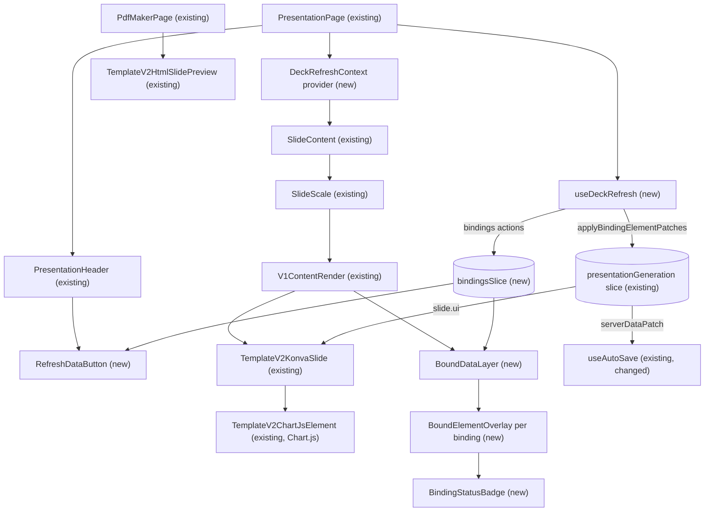
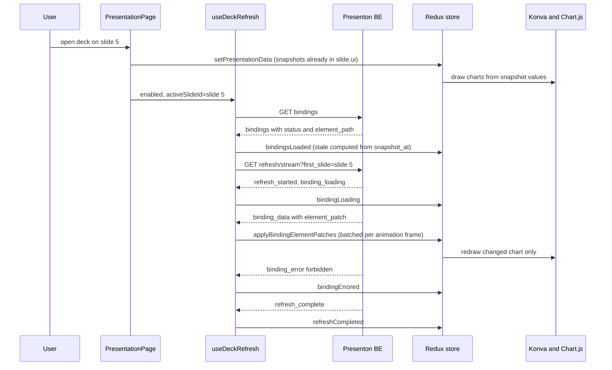
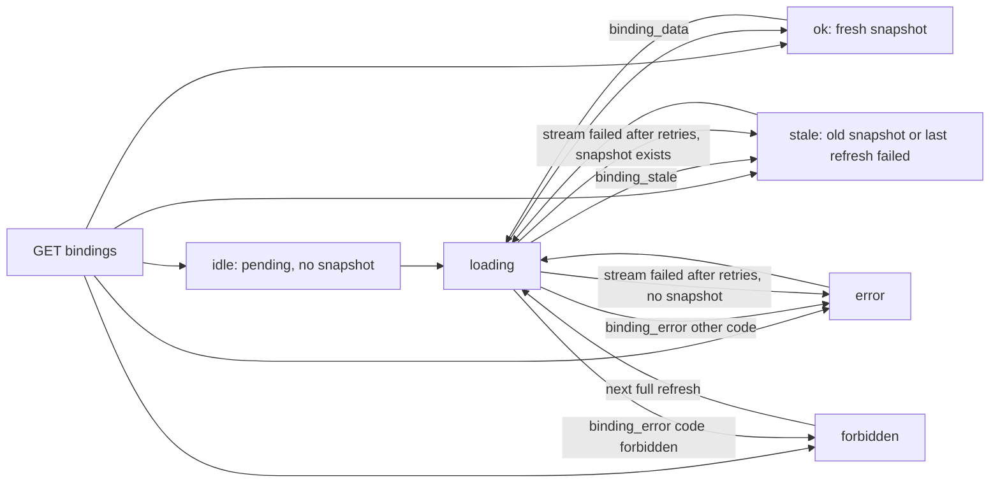

# Story 4: Native charts and async refresh UX

<div class="chapter-meta" markdown>
**Reads:** `servers/nextjs/lib/template-v2-json-to-html.ts`, `servers/nextjs/lib/chart-browser.ts`, `servers/nextjs/components/slide-editor/charts/TemplateV2ChartJsElement.tsx`, `servers/nextjs/components/slide-editor/surface/TemplateV2KonvaSlide.tsx`, `servers/nextjs/store/slices/presentationGeneration.ts`, `servers/nextjs/app/(presentation-generator)/presentation/hooks/useAutoSave.tsx`, `servers/nextjs/app/(presentation-generator)/presentation/utils/autoSaveDiff.ts`, `servers/nextjs/app/(presentation-generator)/presentation/hooks/usePresentationStreaming.ts`, `servers/nextjs/app/(presentation-generator)/services/api/chat.ts`, `servers/nextjs/app/(export)/pdf-maker/PdfMakerPage.tsx`  ·  **Builds on:** [Story 1: dynamic data](42-story1-dynamic-data.md)  ·  **Time:** ~45 min
</div>

## What you will learn

This chapter implements the frontend half of refresh-on-open. You will see how Presenton draws charts today in three places (editor canvas, HTML preview, export page), why the recommended design keeps the vendored Chart.js runtime, and how live data reaches the screen by patching element JSON in the Redux store while a per-element overlay shows loading, stale, error and forbidden states. You get the full TypeScript for the refresh hook, the `bindingsSlice`, the overlay components and the autosave changes, plus ordering, cancellation, backoff and the test plan.

## Step 1: The story and its acceptance criteria

| # | Story | What it does | Owners |
|---|---|---|---|
| 4 | [Presenton FE] Native charts and async refresh UX | Renders charts with a charting library from stored bindings and fills them in progressively with loading, error and stale states. | Srini, Sourav, Nitesh |

A suggested split: Sourav owns the hook, slices and autosave integration, Srini owns overlays and visual states, Nitesh owns the contract tests against the Story 1 stream. This split is a recommendation.

| ID | Given | When | Then |
|---|---|---|---|
| AC1 | A deck whose bindings all have snapshots younger than `AI_SLIDES_STALE_AFTER_SECONDS` | The user opens it | Charts render immediately from the stored slide JSON, no skeletons appear, the refresh stream runs in the background |
| AC2 | A deck with a binding that has no snapshot | The user opens it | That element shows a shimmer skeleton until `binding_data` arrives, then the real chart |
| AC3 | The user is on slide 5 | The deck opens | Slide 5's bindings are requested first (`first_slide`) and fill before other slides |
| AC4 | A binding's refresh fails transiently and it has a snapshot | Refresh completes | The element shows the last data and a chip "Data as of 3 h ago" |
| AC5 | A binding fails without a snapshot | Refresh completes | An error panel with a Retry button covers the element; Retry refreshes only that binding |
| AC6 | The user lacks access to the chart's data | Refresh completes | The element shows "You don't have access to this data" and no numbers |
| AC7 | Data patches arrive | Autosave runs | No slide update request is sent for data-only changes, and no undo entry is created |
| AC8 | The user is typing in a text box on the active slide | A patch for that slide arrives | The patch is held until the text box loses focus |
| AC9 | The user leaves the page mid-refresh | Navigation happens | The fetch is aborted and no further Redux updates happen |
| AC10 | The deck is exported | `/pdf-maker` renders | Charts show the latest snapshot and no overlay, badge or skeleton is in the DOM |
| AC11 | A screen reader user opens a deck | Refresh starts and ends | One polite announcement at start and one summary at the end, no per-chart chatter |

## Step 2: How charts render in Presenton today

A Template v2 chart is plain JSON: `chart_type`, `categories`, `series` and styling (see [Template v2 format](../presenton/16-template-v2-format.md)). Three renderers read it, and all three use the same vendored Chart.js build:

```ts title="servers/nextjs/lib/chart-browser.ts (excerpt)"
export const CHART_BROWSER_SCRIPT_URL = "/vendor/chart-4.5.1.umd.min.js";
export const CHART_DATALABELS_SCRIPT_URL =
  "/vendor/chartjs-plugin-datalabels-2.2.0.min.js";
```

The files live in `servers/nextjs/public/vendor/`, and `loadChartBrowserRuntime()` injects them once per page and caches the promise on `window.__PRESENTON_CHART_BROWSER_RUNTIME__` (`servers/nextjs/lib/chart-browser.ts:98-136`). Chart.js is not an npm dependency of the Next.js app; `package.json` lists `recharts` (used by `components/ui/chart.tsx`) but no Chart.js package.

| Where | Component | How the chart is drawn |
|---|---|---|
| Editor canvas | `TemplateV2KonvaSlide` renders `TemplateV2ChartJsElement` | Draws Chart.js into an off-screen canvas and shows it as a Konva image (`servers/nextjs/components/slide-editor/charts/TemplateV2ChartJsElement.tsx:120-166`). It redraws when `chartRenderSignature` changes, which includes `categories` and `series` (`servers/nextjs/components/slide-editor/charts/TemplateV2ChartJsElement.tsx:170-200`) |
| Thumbnails, previews, export | `TemplateV2HtmlSlidePreview` | Renders `templateV2UiToHtmlFragment(slide.ui)` (`servers/nextjs/app/(presentation-generator)/components/TemplateV2HtmlSlidePreview.tsx:245-250`), then hydrates every `canvas[data-presenton-chart]` with Chart.js (`:294-336`) |
| Standalone HTML | `templateV2UiToHtml` | Embeds the vendored scripts and an inline bootstrap (`servers/nextjs/lib/template-v2-json-to-html.ts:3166-3172`) |

The HTML renderer serializes the whole Chart.js config into the canvas:

```ts title="servers/nextjs/lib/template-v2-json-to-html.ts (excerpt)"
function renderChart(item: JsonRecord, mode: RenderMode): string {
  const box = readBox(item);
  const width = Math.max(1, box.width ?? 1);
  const height = Math.max(1, box.height ?? 1);
  const config = chartConfig(item, height);

  return `<div style="${frameStyle(item, mode)}${transformStyle(
    item
  )}overflow:hidden"><canvas data-presenton-chart="true" data-chart-config="${escapeAttribute(
    JSON.stringify(config)
  )}" width="${cssNumber(Math.round(width))}" height="${cssNumber(
    Math.round(height)
  )}" style="display:block;width:100%;height:100%"></canvas></div>`;
}
```

`chartConfig` (`servers/nextjs/lib/template-v2-json-to-html.ts:2261`) puts `categories` into `data.labels` (`:2332`). The export page uses the same preview component for Template v2 slides:

```tsx title="servers/nextjs/app/(export)/pdf-maker/PdfMakerPage.tsx (excerpt)"
                      {useTemplateV2HtmlPreview ? (
                        <TemplateV2HtmlSlidePreview
                          slide={slide}
                          fonts={presentationData?.fonts}
                          fixedSize
                        />
```

and it loads slides from the database through `/api/export-presentation-data/{id}` (`servers/nextjs/app/(export)/pdf-maker/PdfMakerPage.tsx:206-222`). In short: whatever is in `slides.ui` when export runs is what the PPTX or PDF contains. Story 1 writes refreshed values there, so export fidelity is a backend concern and the frontend only has to keep its in-memory copy in step.

### 2.1 Library decision

The backlog says "renders charts with a charting library". The analytics platform's own library is ECharts (`apache/superset: superset-frontend/package.json:167` pins `echarts` `^6.1.0`), so the question is whether AI Slides should switch.

| Criterion | Keep Chart.js 4.5.1 (recommended) | Switch to ECharts |
|---|---|---|
| Export fidelity | Unchanged: `/pdf-maker` already draws `canvas[data-presenton-chart]`; whatever export-core does with those canvases keeps working | Every chart in the export DOM changes shape; export-core's handling of charts cannot be verified from this repository ([PPTX and PDF export](../presenton/24-export-pipeline.md)), so PPTX output is at risk |
| Editor | `TemplateV2ChartJsElement` and the chart editor (`components/slide-editor/charts/`) already speak Chart.js | Konva integration, hit-testing and the chart editor need a rewrite |
| Template v2 chart types | All 11 `ChartType` values are mapped today | New mapping for every type |
| Visual parity with Superset dashboards | Different look (fonts, axis styles) | Closer to dashboards |
| Delivery cost | None for rendering; work goes into data and states | Weeks, across three renderers |
| License | MIT (`public/vendor/chart-4.5.1-LICENSE.md`) | Apache-2.0 |

**Decision:** keep Chart.js. "Native" in the story means drawn from data, never a screenshot, which Chart.js already does in all three render paths. Parity with Superset styling is handled by theme colors in the binding's element, not by swapping libraries. ECharts stays the documented alternative if the product later demands pixel parity with dashboards.

### 2.2 Data patching versus a separate chart component

| Option | How | Verdict |
|---|---|---|
| **Patch element JSON in Redux, overlay per bound element (recommended)** | `binding_data.element_patch` is merged into `slides[i].ui` at `element_path`. The existing renderers redraw. A `BoundElementOverlay` positioned over the element shows status | One source of truth, editor and export agree, minimal new rendering code |
| Separate React `BoundChart` | Render bound charts with their own component on top of the Konva stage, keep stale data in `ui` | Two renderers for one element, export shows different data than the editor, selection and drag conflict with an HTML layer on top of Konva |

The contract's "bound chart React component around Chart.js" is the overlay: it wraps the existing Chart.js element with status UI and never draws the chart itself.

## Step 3: Component architecture



`PdfMakerPage` never mounts `useDeckRefresh` or `BoundDataLayer`, which is how export stays overlay-free by construction.



## Step 4: State

### 4.1 Where the deck lives today

The store has four reducers (`servers/nextjs/store/store.ts:7-14`); the deck is `state.presentationGeneration.presentationData`, owned by the slice named `presentationGeneration` (`servers/nextjs/store/slices/presentationGeneration.ts:81-82`). The closest existing action to what we need is `updateSlideUi`:

```ts title="servers/nextjs/store/slices/presentationGeneration.ts (excerpt)"
    updateSlideUi: (
      state,
      action: PayloadAction<{ index: number; ui: Record<string, unknown> | null }>
    ) => {
      if (
        state.presentationData &&
        state.presentationData.slides[action.payload.index]
      ) {
        state.presentationData.slides[action.payload.index].ui =
          action.payload.ui;
      }
    },
```

It replaces a whole `ui` by array index. That is wrong for data patches: the slide may have moved since the stream started, and replacing the whole `ui` would discard an edit the user made to another element on the same slide a moment earlier. The new reducer addresses slides by ID and elements by JSON Pointer, and changes only the patched keys.

### 4.2 Pure patch helpers

```ts title="servers/nextjs/app/(presentation-generator)/presentation/utils/bindingPatch.ts (new)"
export interface BindingElementPatch {
  bindingId: string;
  slideId: string;
  elementPath: string;
  elementName: string;
  patch: Record<string, unknown>;
}

export interface CanvasBox {
  x: number;
  y: number;
  width: number;
  height: number;
}

type Rec = Record<string, any>;
const isRecord = (value: unknown): value is Rec =>
  typeof value === "object" && value !== null && !Array.isArray(value);
const num = (value: unknown) => (typeof value === "number" && Number.isFinite(value) ? value : 0);

export function pointerTokens(pointer: string): string[] {
  if (!pointer) return [];
  if (!pointer.startsWith("/")) throw new Error(`Invalid JSON pointer: ${pointer}`);
  return pointer
    .slice(1)
    .split("/")
    .map((token) => token.replace(/~1/g, "/").replace(/~0/g, "~"));
}

export function resolvePointer(document: unknown, pointer: string): unknown {
  let node: any = document;
  for (const token of pointerTokens(pointer)) {
    if (node == null) return undefined;
    node = Array.isArray(node) ? node[Number(token)] : node[token];
  }
  return node;
}

/** Same rule as the backend: unique, named, not inside a flex or grid region. */
export function findNamedElement(ui: Rec, name: string): { pointer: string; element: Rec } | null {
  const matches: { pointer: string; element: Rec }[] = [];
  const walk = (node: unknown, pointer: string, repeated: boolean) => {
    if (!isRecord(node)) return;
    if (node.name === name && typeof node.type === "string" && !repeated) {
      matches.push({ pointer, element: node });
    }
    const childRepeated = repeated || node.type === "flex" || node.type === "grid";
    if (isRecord(node.child)) walk(node.child, `${pointer}/child`, childRepeated);
    (Array.isArray(node.children) ? node.children : []).forEach((child: unknown, i: number) =>
      walk(child, `${pointer}/children/${i}`, childRepeated),
    );
  };
  (Array.isArray(ui.components) ? ui.components : []).forEach((component: unknown, ci: number) => {
    const elements = isRecord(component) && Array.isArray(component.elements) ? component.elements : [];
    elements.forEach((element: unknown, ei: number) =>
      walk(element, `/components/${ci}/elements/${ei}`, false),
    );
  });
  return matches.length === 1 ? matches[0] : null;
}

/** Mutates `ui` (an Immer draft in the reducer). Returns false if nothing matched. */
export function applyElementPatch(
  ui: Rec,
  patch: Pick<BindingElementPatch, "elementPath" | "elementName" | "patch">,
): boolean {
  let target = resolvePointer(ui, patch.elementPath);
  if (!isRecord(target) || target.name !== patch.elementName) {
    target = findNamedElement(ui, patch.elementName)?.element;
  }
  if (!isRecord(target)) return false;
  for (const [key, value] of Object.entries(patch.patch)) {
    target[key] = structuredClone(value);
  }
  return true;
}

/**
 * Element box in the 1280 x 720 slide space. Components are absolute on the
 * canvas, elements are relative to their component, group and container
 * children are relative to their parent, and flex or grid children are flowed,
 * so for those we fall back to the flowing parent's box.
 */
export function elementCanvasBox(ui: Rec, pointer: string): CanvasBox | null {
  const tokens = pointerTokens(pointer);
  if (tokens[0] !== "components") return null;
  const component = ui.components?.[Number(tokens[1])];
  if (!isRecord(component)) return null;

  let originX = num(component.position?.x);
  let originY = num(component.position?.y);
  let parent: Rec = component;
  let box: CanvasBox | null = isRecord(component.size)
    ? { x: originX, y: originY, width: num(component.size.width), height: num(component.size.height) }
    : null;

  let i = 2;
  while (i < tokens.length) {
    let node: unknown;
    if (tokens[i] === "elements" || tokens[i] === "children") {
      node = parent[tokens[i]]?.[Number(tokens[i + 1])];
      i += 2;
    } else if (tokens[i] === "child") {
      node = parent.child;
      i += 1;
    } else {
      return box;
    }
    if (!isRecord(node) || parent.type === "flex" || parent.type === "grid") return box;
    const x = originX + num(node.position?.x);
    const y = originY + num(node.position?.y);
    if (isRecord(node.size)) {
      box = { x, y, width: num(node.size.width), height: num(node.size.height) };
    }
    originX = x;
    originY = y;
    parent = node;
  }
  return box;
}

export function formatDataAge(snapshotAt: string | null, now: number): string {
  if (!snapshotAt) return "No data yet";
  const minutes = Math.max(0, Math.round((now - Date.parse(snapshotAt)) / 60_000));
  if (minutes < 1) return "Data as of just now";
  if (minutes < 60) return `Data as of ${minutes} min ago`;
  const hours = Math.round(minutes / 60);
  if (hours < 48) return `Data as of ${hours} h ago`;
  return `Data as of ${Math.round(hours / 24)} d ago`;
}
```

### 4.3 The new reducer in the existing slice

Add one state field and one reducer to `presentationGenerationSlice`:

```ts title="servers/nextjs/store/slices/presentationGeneration.ts (change)"
import {
  applyElementPatch,
  type BindingElementPatch,
} from "@/app/(presentation-generator)/presentation/utils/bindingPatch";

interface PresentationGenerationState {
  // ...existing fields
  /** Bumped when server-originated data patches land, read by useAutoSave. */
  serverDataPatch: { revision: number; slideIds: string[] } | null;
}

const initialState: PresentationGenerationState = {
  // ...existing fields
  serverDataPatch: null,
};

// inside reducers: { ... }
    applyBindingElementPatches: (
      state,
      action: PayloadAction<{ patches: BindingElementPatch[] }>
    ) => {
      const slides = state.presentationData?.slides;
      if (!Array.isArray(slides)) return;
      const touched = new Set<string>();
      for (const patch of action.payload.patches) {
        const slide = slides.find((item: Slide) => item.id === patch.slideId);
        if (!slide?.ui) continue;
        if (applyElementPatch(slide.ui as Record<string, any>, patch)) {
          touched.add(patch.slideId);
        }
      }
      if (touched.size > 0) {
        state.serverDataPatch = {
          revision: (state.serverDataPatch?.revision ?? 0) + 1,
          slideIds: Array.from(touched),
        };
      }
    },
```

and export `applyBindingElementPatches` next to the other actions (`servers/nextjs/store/slices/presentationGeneration.ts:575-606`). Immer copies only the objects on the patched path, so untouched slides keep their identity and their memoized HTML thumbnails (`useMemo` on `slide` in `servers/nextjs/app/(presentation-generator)/components/TemplateV2HtmlSlidePreview.tsx:245`) do not re-render.

!!! warning "Gotcha: a new `ui` object resets the Konva surface"
    `TemplateV2KonvaSlide` treats any `layout` prop that differs from its own last commit as an external replacement. It re-clones the layout and clears the selection, inline edit, table selection, chart editor selection and its local undo stack:

    ```tsx title="servers/nextjs/components/slide-editor/surface/TemplateV2KonvaSlide.tsx (excerpt)"
      useEffect(() => {
        if (layout === currentUiRef.current) return;
        const next = normalizeMarkdownTextInUi(cloneJson(layout as RawUi));
        currentUiRef.current = next;
        setUiDraft(next);
        componentAlignmentDragRef.current = null;
        elementAlignmentDragRef.current = null;
        multiComponentDragRef.current = null;
        clearAlignmentGuides();
        setSelection(null);
        clearTableCellSelection();
        clearInlineEdit();
    ```

    A data patch on the slide being edited therefore drops the user's selection. The hook defers patches for the active slide while the user is typing (Step 5.3) and batches all patches per animation frame so a slide resets at most once per frame. A deeper fix, merging external patches into `uiDraft` without resetting, belongs in the slide editor and is out of scope for v1.

### 4.4 `bindingsSlice`

```ts title="servers/nextjs/store/slices/bindingsSlice.ts (new)"
import { createSelector, createSlice, PayloadAction } from "@reduxjs/toolkit";

export type BindingUiStatus = "idle" | "loading" | "ok" | "stale" | "error" | "forbidden";
export type BindingKind = "chart" | "metric" | "table";
export interface BindingError { code: string; message: string }

export interface ServerBinding {
  id: string;
  slide_id: string;
  element_name: string;
  element_path: string;
  kind: BindingKind;
  status: "ok" | "stale" | "error" | "forbidden" | "pending";
  snapshot: unknown | null;
  snapshot_at: string | null;
  error: BindingError | null;
}

export interface BindingEntry {
  id: string;
  slideId: string;
  elementName: string;
  elementPath: string;
  kind: BindingKind;
  status: BindingUiStatus;
  snapshotAt: string | null;
  hasSnapshot: boolean;
  error: BindingError | null;
  staleReason: string | null;
  nullsCoerced: number;
}

export interface RefreshSummary { ok: number; errors: number; stale: number; duration_ms: number }

export interface BindingsState {
  presentationId: string | null;
  byId: Record<string, BindingEntry>;
  order: string[];
  staleAfterMs: number;
  needsReauth: boolean;
  run: {
    runId: number;
    phase: "idle" | "running" | "complete" | "failed";
    total: number;
    settled: number;
    completedAt: number | null;
    summary: RefreshSummary | null;
    message: string | null;
  };
}

export const DEFAULT_STALE_AFTER_MS = 3_600_000; // AI_SLIDES_STALE_AFTER_SECONDS default

const initialState: BindingsState = {
  presentationId: null,
  byId: {},
  order: [],
  staleAfterMs: DEFAULT_STALE_AFTER_MS,
  needsReauth: false,
  run: { runId: 0, phase: "idle", total: 0, settled: 0, completedAt: null, summary: null, message: null },
};

export function entryFromServer(b: ServerBinding, now: number, staleAfterMs: number): BindingEntry {
  const hasSnapshot = b.snapshot != null;
  const old = b.snapshot_at ? now - Date.parse(b.snapshot_at) > staleAfterMs : false;
  const status: BindingUiStatus =
    b.status === "ok" ? (old ? "stale" : "ok")
      : b.status === "pending" ? "idle"
        : b.status;
  return {
    id: b.id,
    slideId: b.slide_id,
    elementName: b.element_name,
    elementPath: b.element_path,
    kind: b.kind,
    status,
    snapshotAt: b.snapshot_at,
    hasSnapshot,
    error: b.error,
    staleReason: old ? "age" : null,
    nullsCoerced: 0,
  };
}

type RunScoped<T> = T & { runId: number };

const bindingsSlice = createSlice({
  name: "bindings",
  initialState,
  reducers: {
    bindingsLoaded: (
      state,
      action: PayloadAction<{ presentationId: string; bindings: ServerBinding[]; now: number; staleAfterMs?: number }>
    ) => {
      const { presentationId, bindings, now } = action.payload;
      state.presentationId = presentationId;
      state.staleAfterMs = action.payload.staleAfterMs ?? state.staleAfterMs;
      state.byId = {};
      state.order = [];
      for (const binding of bindings) {
        state.byId[binding.id] = entryFromServer(binding, now, state.staleAfterMs);
        state.order.push(binding.id);
      }
    },
    refreshStarted: (state, action: PayloadAction<RunScoped<{ total: number }>>) => {
      const sameRun = state.run.runId === action.payload.runId;
      state.run = {
        ...state.run,
        runId: action.payload.runId,
        phase: "running",
        total: sameRun ? state.run.total || action.payload.total : action.payload.total,
        settled: sameRun ? state.run.settled : 0,
        summary: null,
        message: null,
      };
    },
    bindingLoading: (state, action: PayloadAction<RunScoped<{ bindingId: string }>>) => {
      const entry = state.byId[action.payload.bindingId];
      if (entry && action.payload.runId === state.run.runId) entry.status = "loading";
    },
    bindingDataReceived: (
      state,
      action: PayloadAction<RunScoped<{ bindingId: string; snapshotAt: string | null; nullsCoerced?: number }>>
    ) => {
      const entry = state.byId[action.payload.bindingId];
      if (!entry || action.payload.runId !== state.run.runId) return;
      entry.status = "ok";
      entry.snapshotAt = action.payload.snapshotAt;
      entry.hasSnapshot = true;
      entry.error = null;
      entry.staleReason = null;
      entry.nullsCoerced = action.payload.nullsCoerced ?? 0;
      state.run.settled += 1;
    },
    bindingErrored: (
      state,
      action: PayloadAction<RunScoped<{ bindingId: string; code: string; message: string }>>
    ) => {
      const entry = state.byId[action.payload.bindingId];
      if (!entry || action.payload.runId !== state.run.runId) return;
      if (action.payload.code === "data_token_expired") {
        state.needsReauth = true; // not settled: the hook retries after a new handoff
        return;
      }
      entry.status = action.payload.code === "forbidden" ? "forbidden" : "error";
      entry.error = { code: action.payload.code, message: action.payload.message };
      state.run.settled += 1;
    },
    bindingStaled: (
      state,
      action: PayloadAction<RunScoped<{ bindingId: string; snapshotAt: string | null; reason: string }>>
    ) => {
      const entry = state.byId[action.payload.bindingId];
      if (!entry || action.payload.runId !== state.run.runId) return;
      entry.status = "stale";
      entry.snapshotAt = action.payload.snapshotAt ?? entry.snapshotAt;
      entry.staleReason = action.payload.reason;
      state.run.settled += 1;
    },
    refreshCompleted: (state, action: PayloadAction<RunScoped<{ summary: RefreshSummary; now: number }>>) => {
      if (action.payload.runId !== state.run.runId) return;
      state.run.phase = "complete";
      state.run.summary = action.payload.summary;
      state.run.completedAt = action.payload.now;
      state.needsReauth = false;
    },
    refreshFailed: (state, action: PayloadAction<RunScoped<{ message: string }>>) => {
      if (action.payload.runId !== state.run.runId) return;
      state.run.phase = "failed";
      state.run.message = action.payload.message;
      for (const id of state.order) {
        const entry = state.byId[id];
        if (entry.status === "loading" || entry.status === "idle") {
          entry.status = entry.hasSnapshot ? "stale" : "error";
          entry.staleReason = entry.hasSnapshot ? "refresh_failed" : null;
          entry.error = entry.hasSnapshot ? null : { code: "refresh_failed", message: action.payload.message };
        }
      }
    },
    bindingsReset: () => initialState,
  },
});

export const {
  bindingsLoaded, refreshStarted, bindingLoading, bindingDataReceived,
  bindingErrored, bindingStaled, refreshCompleted, refreshFailed, bindingsReset,
} = bindingsSlice.actions;
export default bindingsSlice.reducer;

type StateWithBindings = { bindings: BindingsState };

export const selectBindingsForSlide = createSelector(
  [
    (state: StateWithBindings) => state.bindings.byId,
    (state: StateWithBindings) => state.bindings.order,
    (_state: StateWithBindings, slideId: string | null) => slideId,
  ],
  (byId, order, slideId) =>
    slideId ? order.map((id) => byId[id]).filter((b) => b && b.slideId === slideId) : [],
);
```

Register it as `bindings: bindingsReducer` in `servers/nextjs/store/store.ts`. Every run-scoped action carries `runId`, and reducers ignore stale runs, which is what makes cancellation safe: an aborted stream's last frames cannot overwrite a newer run.

The UI status is derived, not copied. The server knows five statuses (`ok`, `stale`, `error`, `forbidden`, `pending`); the browser adds `idle` and `loading` and recomputes `stale` from snapshot age, because a snapshot that was `ok` when written becomes stale simply by time passing. The transitions:



A `forbidden` binding is re-queried by every full refresh (the server does not skip it), so access granted in Superset shows up on the next open or the next **Refresh data** click. It never gets a per-element Retry button, because retrying a permission error immediately only produces the same answer. A `data_token_expired` error is not a state at all; it sets `needsReauth`, leaves the binding `loading`, and the hook retries after a new handoff.

## Step 5: The refresh hook

### 5.1 Why `fetch` and not `EventSource`

The generation stream uses `EventSource`:

```ts title="servers/nextjs/app/(presentation-generator)/presentation/hooks/usePresentationStreaming.ts (excerpt)"
    const openStream = () => {
      closeEventSource();
      eventSource = new EventSource(
        getApiUrl(`/api/v1/ppt/presentation/stream/${presentationId}`)
      );

      eventSource.addEventListener("response", async (event) => {
```

with its own retry counter (`MAX_STREAM_RETRIES = 3`, `STREAM_RETRY_DELAY_MS = 1_000`, `servers/nextjs/app/(presentation-generator)/presentation/hooks/usePresentationStreaming.ts:27-28`). The refresh stream needs an `AbortSignal` for navigation, explicit control over reconnects (an `EventSource` reconnects on its own and would restart the whole refresh), and a retry that only asks for unsettled bindings. Presenton already has a `fetch` plus `ReadableStream` SSE reader for chat:

```ts title="servers/nextjs/app/(presentation-generator)/services/api/chat.ts (excerpt)"
  while (true) {
    const { done, value } = await reader.read();
    if (done) {
      break;
    }
    buffer += decoder.decode(value, { stream: true });

    let delimiterIndex = buffer.indexOf("\n\n");
    while (delimiterIndex >= 0) {
      const frame = buffer.slice(0, delimiterIndex);
      buffer = buffer.slice(delimiterIndex + 2);
      processSseFrame(frame);
      delimiterIndex = buffer.indexOf("\n\n");
    }
  }
```

The refresh hook copies that pattern, including the frame rule that only `event: response` frames are processed and the payload's `type` field carries the event name (`servers/nextjs/app/(presentation-generator)/services/api/chat.ts:135-165`). Story 1 emits refresh events the same way.

```ts title="servers/nextjs/app/(presentation-generator)/presentation/utils/refreshStream.ts (new)"
export type RefreshStreamEvent =
  | { type: "refresh_started"; total: number }
  | { type: "binding_loading"; binding_id: string; slide_id: string }
  | {
      type: "binding_data";
      binding_id: string;
      slide_id: string;
      element_name: string;
      element_patch: Record<string, unknown>;
      snapshot_at: string | null;
      changed: boolean;
      meta?: { nulls_coerced?: number; truncated?: boolean };
    }
  | { type: "binding_error"; binding_id: string; code: string; message: string }
  | { type: "binding_stale"; binding_id: string; snapshot_at: string | null; reason: string }
  | { type: "refresh_complete"; ok: number; errors: number; stale: number; duration_ms: number }
  | { type: "error"; detail?: string };

export function parseSseFrame(frame: string): RefreshStreamEvent | null {
  let eventName = "";
  const dataLines: string[] = [];
  for (const line of frame.split("\n")) {
    if (line.startsWith("event:")) eventName = line.slice(6).trim();
    else if (line.startsWith("data:")) dataLines.push(line.slice(5).trimStart());
  }
  if ((eventName && eventName !== "response") || dataLines.length === 0) return null;
  try {
    const parsed = JSON.parse(dataLines.join("\n"));
    return parsed && typeof parsed.type === "string" ? (parsed as RefreshStreamEvent) : null;
  } catch {
    return null;
  }
}

export function createSseFrameParser() {
  let buffer = "";
  return {
    push(chunk: string): RefreshStreamEvent[] {
      buffer += chunk.replace(/\r/g, "");
      const events: RefreshStreamEvent[] = [];
      let index = buffer.indexOf("\n\n");
      while (index >= 0) {
        const event = parseSseFrame(buffer.slice(0, index));
        buffer = buffer.slice(index + 2);
        if (event) events.push(event);
        index = buffer.indexOf("\n\n");
      }
      return events;
    },
    flush(): RefreshStreamEvent[] {
      const rest = buffer;
      buffer = "";
      const event = rest.trim() ? parseSseFrame(rest) : null;
      return event ? [event] : [];
    },
  };
}
```

### 5.2 API client

```ts title="servers/nextjs/app/(presentation-generator)/services/api/bindings.ts (new)"
import { getApiUrl } from "@/utils/api";
import { ApiResponseHandler } from "./api-error-handler";
import { getHeader } from "./header";
import type { ServerBinding } from "@/store/slices/bindingsSlice";
import type { RefreshStreamEvent } from "../../presentation/utils/refreshStream";

export interface RefreshBatchResponse {
  ok: number;
  errors: number;
  stale: number;
  duration_ms: number;
  results: RefreshStreamEvent[];
}

export class BindingsApi {
  static async list(presentationId: string, signal?: AbortSignal): Promise<ServerBinding[]> {
    const response = await fetch(
      getApiUrl(`/api/v1/ppt/presentation/${presentationId}/bindings`),
      { headers: getHeader(), credentials: "include", cache: "no-store", signal }
    );
    return ApiResponseHandler.handleResponse(response, "Failed to load data bindings");
  }

  static async refresh(
    presentationId: string,
    body: { binding_ids?: string[]; force?: boolean },
    signal?: AbortSignal
  ): Promise<RefreshBatchResponse> {
    const response = await fetch(
      getApiUrl(`/api/v1/ppt/presentation/${presentationId}/refresh`),
      {
        method: "POST",
        headers: getHeader(),
        credentials: "include",
        body: JSON.stringify(body),
        signal,
      }
    );
    return ApiResponseHandler.handleResponse(response, "Failed to refresh data");
  }
}
```

### 5.3 `useDeckRefresh`

```ts title="servers/nextjs/app/(presentation-generator)/presentation/hooks/useDeckRefresh.ts (new)"
"use client";
import { useCallback, useEffect, useRef } from "react";
import { useDispatch } from "react-redux";
import { getApiUrl } from "@/utils/api";
import { store } from "@/store/store";
import { applyBindingElementPatches } from "@/store/slices/presentationGeneration";
import {
  bindingDataReceived, bindingErrored, bindingLoading, bindingsLoaded,
  bindingsReset, bindingStaled, refreshCompleted, refreshFailed, refreshStarted,
} from "@/store/slices/bindingsSlice";
import { BindingsApi } from "../../services/api/bindings";
import { createSseFrameParser, type RefreshStreamEvent } from "../utils/refreshStream";
import type { BindingElementPatch } from "../utils/bindingPatch";

const MAX_ATTEMPTS = 3;
const BASE_DELAY_MS = 1_000;
const MAX_DELAY_MS = 8_000;

class DataTokenExpiredError extends Error {}

export interface UseDeckRefreshOptions {
  enabled?: boolean;
  activeSlideId?: string | null;
  onDataTokenExpired?: () => Promise<void> | void;
}

/** Story 5 owns the bridge; this default only asks the parent for a new handoff. */
function requestHandoffFromParent(): Promise<void> {
  if (typeof window === "undefined" || window.parent === window) return Promise.resolve();
  window.parent.postMessage({ type: "ai-slides:handoff-request" }, window.location.origin);
  return new Promise((resolve) => setTimeout(resolve, 1_500));
}

/** Narrower than isEditableTarget: buttons and dialogs do not count as typing. */
function isTyping(): boolean {
  const active = typeof document !== "undefined" ? document.activeElement : null;
  return Boolean(active?.closest("[contenteditable='true'],textarea,input"));
}

const backoff = (attempt: number) => {
  const base = Math.min(MAX_DELAY_MS, BASE_DELAY_MS * 2 ** (attempt - 1));
  return base * (0.8 + Math.random() * 0.4);
};

const sleep = (ms: number, signal: AbortSignal) =>
  new Promise<void>((resolve, reject) => {
    const timer = setTimeout(resolve, ms);
    signal.addEventListener("abort", () => {
      clearTimeout(timer);
      reject(new DOMException("Aborted", "AbortError"));
    }, { once: true });
  });

export function useDeckRefresh(presentationId: string, options: UseDeckRefreshOptions = {}) {
  const { enabled = true, activeSlideId = null } = options;
  const dispatch = useDispatch();
  const controllerRef = useRef<AbortController | null>(null);
  const runIdRef = useRef(0);
  const activeSlideRef = useRef<string | null>(activeSlideId);
  const tokenHandlerRef = useRef(options.onDataTokenExpired ?? requestHandoffFromParent);
  const queuedRef = useRef<BindingElementPatch[]>([]);
  const heldRef = useRef<BindingElementPatch[]>([]);
  const frameRef = useRef<number | null>(null);

  useEffect(() => {
    activeSlideRef.current = activeSlideId;
  }, [activeSlideId]);

  const flushPatches = useCallback(() => {
    frameRef.current = null;
    const typing = isTyping();
    const ready: BindingElementPatch[] = [];
    const held: BindingElementPatch[] = [];
    for (const patch of [...heldRef.current, ...queuedRef.current]) {
      (typing && patch.slideId === activeSlideRef.current ? held : ready).push(patch);
    }
    queuedRef.current = [];
    heldRef.current = held;
    if (ready.length) dispatch(applyBindingElementPatches({ patches: ready }));
  }, [dispatch]);

  const queuePatch = useCallback((patch: BindingElementPatch) => {
    queuedRef.current.push(patch);
    if (frameRef.current === null) frameRef.current = requestAnimationFrame(flushPatches);
  }, [flushPatches]);

  // Held patches land as soon as the user leaves the text box.
  useEffect(() => {
    const onFocusOut = () => {
      if (heldRef.current.length && frameRef.current === null) {
        frameRef.current = requestAnimationFrame(flushPatches);
      }
    };
    document.addEventListener("focusout", onFocusOut);
    return () => document.removeEventListener("focusout", onFocusOut);
  }, [flushPatches]);

  const handleEvent = useCallback(
    (event: RefreshStreamEvent, runId: number, settled: Set<string>): "complete" | "token" | void => {
      switch (event.type) {
        case "refresh_started":
          dispatch(refreshStarted({ runId, total: event.total }));
          return;
        case "binding_loading":
          dispatch(bindingLoading({ runId, bindingId: event.binding_id }));
          return;
        case "binding_data": {
          const entry = store.getState().bindings.byId[event.binding_id];
          if (entry && event.element_patch) {
            queuePatch({
              bindingId: event.binding_id,
              slideId: event.slide_id,
              elementPath: entry.elementPath,
              elementName: event.element_name,
              patch: event.element_patch,
            });
          }
          settled.add(event.binding_id);
          dispatch(bindingDataReceived({
            runId, bindingId: event.binding_id, snapshotAt: event.snapshot_at,
            nullsCoerced: event.meta?.nulls_coerced,
          }));
          return;
        }
        case "binding_stale":
          settled.add(event.binding_id);
          dispatch(bindingStaled({
            runId, bindingId: event.binding_id, snapshotAt: event.snapshot_at, reason: event.reason,
          }));
          return;
        case "binding_error":
          if (event.code === "data_token_expired") {
            dispatch(bindingErrored({ runId, bindingId: event.binding_id, code: event.code, message: event.message }));
            return "token";
          }
          settled.add(event.binding_id);
          dispatch(bindingErrored({ runId, bindingId: event.binding_id, code: event.code, message: event.message }));
          return;
        case "refresh_complete":
          dispatch(refreshCompleted({
            runId, now: Date.now(),
            summary: { ok: event.ok, errors: event.errors, stale: event.stale, duration_ms: event.duration_ms },
          }));
          return "complete";
        case "error":
          throw new Error(event.detail || "Refresh stream failed");
      }
    },
    [dispatch, queuePatch]
  );

  const streamOnce = useCallback(
    async (runId: number, signal: AbortSignal, settled: Set<string>, pending: string[] | null, force: boolean) => {
      const params = new URLSearchParams();
      if (activeSlideRef.current) params.set("first_slide", activeSlideRef.current);
      if (force) params.set("force", "true");
      pending?.forEach((id) => params.append("binding_id", id));
      const response = await fetch(
        getApiUrl(`/api/v1/ppt/presentation/${presentationId}/refresh/stream?${params.toString()}`),
        { credentials: "include", headers: { Accept: "text/event-stream" }, cache: "no-store", signal }
      );
      if (!response.ok || !response.body) throw new Error(`Refresh stream HTTP ${response.status}`);

      const reader = response.body.getReader();
      const decoder = new TextDecoder("utf-8");
      const parser = createSseFrameParser();
      let complete = false;
      let tokenExpired = false;
      const consume = (events: RefreshStreamEvent[]) => {
        for (const event of events) {
          const result = handleEvent(event, runId, settled);
          if (result === "complete") complete = true;
          if (result === "token") tokenExpired = true;
        }
      };
      while (true) {
        const { done, value } = await reader.read();
        if (done) break;
        consume(parser.push(decoder.decode(value, { stream: true })));
      }
      consume(parser.flush());
      if (tokenExpired) throw new DataTokenExpiredError();
      if (!complete) throw new Error("Refresh stream ended before refresh_complete");
    },
    [handleEvent, presentationId]
  );

  const refresh = useCallback(
    async ({ force = false }: { force?: boolean } = {}) => {
      controllerRef.current?.abort();
      const controller = new AbortController();
      controllerRef.current = controller;
      const runId = ++runIdRef.current;
      const settled = new Set<string>();
      try {
        const bindings = await BindingsApi.list(presentationId, controller.signal);
        if (controller.signal.aborted) return;
        dispatch(bindingsLoaded({ presentationId, bindings, now: Date.now() }));
        if (bindings.length === 0) return;

        for (let attempt = 1; ; attempt += 1) {
          const pending = attempt === 1 ? null : bindings.map((b) => b.id).filter((id) => !settled.has(id));
          if (pending && pending.length === 0) return;
          try {
            await streamOnce(runId, controller.signal, settled, pending, force);
            return;
          } catch (error) {
            if (controller.signal.aborted) return;
            if (error instanceof DataTokenExpiredError) await tokenHandlerRef.current();
            if (attempt >= MAX_ATTEMPTS) {
              dispatch(refreshFailed({ runId, message: error instanceof Error ? error.message : String(error) }));
              return;
            }
            await sleep(backoff(attempt), controller.signal);
          }
        }
      } catch (error) {
        if (!controller.signal.aborted) {
          dispatch(refreshFailed({ runId, message: error instanceof Error ? error.message : String(error) }));
        }
      }
    },
    [dispatch, presentationId, streamOnce]
  );

  const retryBinding = useCallback(
    async (bindingId: string) => {
      const runId = runIdRef.current;
      const settled = new Set<string>();
      dispatch(bindingLoading({ runId, bindingId }));
      try {
        const result = await BindingsApi.refresh(presentationId, { binding_ids: [bindingId], force: true });
        result.results.forEach((event) => handleEvent(event, runId, settled));
      } catch (error) {
        dispatch(bindingErrored({
          runId, bindingId, code: "retry_failed",
          message: error instanceof Error ? error.message : "Retry failed",
        }));
      }
    },
    [dispatch, handleEvent, presentationId]
  );

  useEffect(() => {
    if (!enabled || !presentationId) return;
    void refresh();
    return () => {
      controllerRef.current?.abort();
      controllerRef.current = null;
      if (frameRef.current !== null) cancelAnimationFrame(frameRef.current);
      frameRef.current = null;
      queuedRef.current = [];
      heldRef.current = [];
      dispatch(bindingsReset());
    };
  }, [dispatch, enabled, presentationId, refresh]);

  return { refresh, retryBinding };
}
```

!!! warning "Gotcha: `isEditableTarget` is the wrong test for typing"
    The editor's `isEditableTarget` (`servers/nextjs/components/slide-editor/model/core.ts:192-199`) also matches `button`, `select`, `[role='dialog']` and `[data-inline-edit-ignore='true']`. Right after the user clicks **Refresh data**, the focused element is that button, so using it would hold every patch for the active slide. `isTyping()` checks only `contenteditable`, `textarea` and `input`.

!!! warning "Gotcha: the stream event that ends a broken stream is `error`, not `binding_error`"
    If the backend generator raises after the response started, `safe_sse_stream` emits an `SSEErrorResponse`, whose payload `type` is `"error"` (`servers/fastapi/models/sse_response.py:32-45`). The hook treats it as a stream failure and retries the unsettled bindings with backoff.

### 5.4 Wiring it into `PresentationPage`

`PresentationPage` already calls its hooks before the `isPresentMode` early return (`useAutoSave` at `servers/nextjs/app/(presentation-generator)/presentation/components/PresentationPage.tsx:275-282`, `usePresentationStreaming` at `:306-316`, the present-mode return at `:794-806`). Add the refresh hook after `usePresentationStreaming`, so it runs in both edit and present mode:

```tsx title="servers/nextjs/app/(presentation-generator)/presentation/components/PresentationPage.tsx (change)"
  const activeSlideId =
    presentationData?.slides?.[isPresentMode ? presentSlideFromUrl : selectedSlide]?.id ?? null;

  const deckRefresh = useDeckRefresh(presentation_id, {
    enabled:
      !!presentationData &&
      !stream &&
      !loading &&
      isTemplateV2Presentation &&
      process.env.NEXT_PUBLIC_AI_SLIDES_DATA_BINDINGS === "true",
    activeSlideId,
  });
```

Wrap the page content in `<DeckRefreshContext.Provider value={deckRefresh}>` and pass `onRefreshData={() => deckRefresh.refresh({ force: true })}` to `PresentationHeader`. The generation stream (`stream` set) is excluded because Story 1 resolves new bindings inline before the generation `complete` event.

## Step 6: Autosave must not save data patches as edits

Autosave ignores changes that arrive while it is paused and treats them as already persisted:

```tsx title="servers/nextjs/app/(presentation-generator)/presentation/hooks/useAutoSave.tsx (excerpt)"
        if (autoSavePaused) {
            // Changes arriving while editing is paused are server-originated
            // hydration/streaming updates and are already persisted.
            wasAutoSavePausedRef.current = true;
            pendingSaveRef.current = false;
            if (!isSavingRef.current) {
                acknowledgedDataRef.current = createAutoSaveSnapshot(presentationData);
            }
            if (saveTimeoutRef.current) {
                clearTimeout(saveTimeoutRef.current);
                saveTimeoutRef.current = null;
            }
            return;
        }
```

Refresh patches are also server-originated. For the deck owner they are already persisted (Story 1 writes them into `slides.ui`); for editors and viewers they are deliberately not persisted, because the stored snapshot is always the owner's RLS view. Either way the browser must not save them as edits. Pausing autosave for the whole refresh would block saving real edits for several seconds, so instead re-acknowledge exactly the patched slides, and only if they had no unsaved user edit before the patch.

```ts title="servers/nextjs/app/(presentation-generator)/presentation/utils/autoSaveDiff.ts (addition)"
/**
 * Data patches from the refresh stream are already persisted server-side.
 * Re-acknowledge a patched slide only if it was clean before the patch; if the
 * user had an unsaved edit, leave it dirty so the edit (now carrying the fresh
 * data too) is saved.
 */
export const acknowledgeServerPatchedSlides = (
  acknowledged: AutoSaveSnapshot,
  previous: PresentationData | null,
  next: PresentationData,
  slideIds: string[]
): AutoSaveSnapshot => {
  const byId = (data: PresentationData | null) =>
    new Map<string, any>(
      (Array.isArray(data?.slides) ? data!.slides : []).map((slide: any) => [slide?.id, slide])
    );
  const before = byId(previous);
  const after = byId(next);
  const slideFingerprints = { ...acknowledged.slideFingerprints };
  for (const id of slideIds) {
    const prevSlide = before.get(id);
    const nextSlide = after.get(id);
    if (!prevSlide || !nextSlide) continue;
    if (slideFingerprints[id] === fingerprintValue(prevSlide)) {
      slideFingerprints[id] = fingerprintValue(nextSlide);
    }
  }
  return { ...acknowledged, slideFingerprints };
};
```

```tsx title="servers/nextjs/app/(presentation-generator)/presentation/hooks/useAutoSave.tsx (change)"
    const serverDataPatch = useSelector(
        (state: RootState) => state.presentationGeneration.serverDataPatch
    );
    const previousDataRef = useRef<PresentationData | null>(null);
    const seenPatchRevisionRef = useRef(0);

    // In the main effect, after the autoSavePaused branch and before addToHistory:
        if (serverDataPatch && serverDataPatch.revision !== seenPatchRevisionRef.current) {
            seenPatchRevisionRef.current = serverDataPatch.revision;
            const acknowledged = acknowledgedDataRef.current;
            if (acknowledged && acknowledged.presentationId === presentationData.id) {
                acknowledgedDataRef.current = acknowledgeServerPatchedSlides(
                    acknowledged,
                    previousDataRef.current,
                    presentationData,
                    serverDataPatch.slideIds
                );
                const changes = getAutoSaveChanges(acknowledgedDataRef.current, presentationData);
                if (
                    !changes.structuralChange &&
                    !changes.metadataChanged &&
                    changes.changedSlides.length === 0
                ) {
                    return; // data-only change: no undo entry, no save request
                }
            }
        }

    // A separate effect declared after the main one, so the main effect still
    // sees the previous render's data:
    useEffect(() => {
        previousDataRef.current = presentationData;
    }, [presentationData]);
```

Returning before `dispatch(addToHistory(...))` (`servers/nextjs/app/(presentation-generator)/presentation/hooks/useAutoSave.tsx:163-166`) keeps data patches out of app-level undo.

!!! warning "Gotcha: undo can bring old numbers back"
    History entries recorded before a refresh still hold the old values, and a dirty slide saved by an editor carries that editor's live values. Neither may reach the database. Story 1 makes the slide update endpoints call `reapply_binding_snapshots` before saving, so stored bound values always equal the owner's last snapshot ([Story 1](42-story1-dynamic-data.md)). In the browser, Undo after a refresh still shows old numbers on screen until the next refresh; that is cosmetic, not a data problem.

!!! warning "Gotcha: hand-edited bound data is overwritten"
    The chart editor (`components/slide-editor/charts/ChartEditorContent.tsx`) lets users type values into a chart. For a bound chart those values are replaced on the next refresh. Show a "Values come from Superset" notice in the chart editor when `selectBindingsForSlide` contains the chart's name, and disable value editing for bound charts in v1.

## Step 7: Overlays and badges

### 7.1 Where the layer mounts

`V1ContentRender` wraps the Konva slide in a positioned box (`servers/nextjs/app/(presentation-generator)/components/V1ContentRender.tsx:223-252`). Mount the layer as a sibling after `TemplateV2KonvaSlide`, so it scales with the slide in both the editor and presentation mode (presentation mode also renders `SlideScale` with `isEditMode={false}`, `servers/nextjs/app/(presentation-generator)/presentation/components/PresentationMode.tsx:102-124`):

```tsx title="servers/nextjs/app/(presentation-generator)/components/V1ContentRender.tsx (change)"
                <TemplateV2KonvaSlide
                    layout={directLayout ?? BLANK_TEMPLATE_V2_LAYOUT}
                    // ...existing props
                />
                <BoundDataLayer slide={safeSlide} interactive={isEditMode} />
```

### 7.2 Context, layer and overlay

```tsx title="servers/nextjs/app/(presentation-generator)/presentation/components/data/DeckRefreshContext.tsx (new)"
"use client";
import { createContext, useContext } from "react";

export interface DeckRefreshApi {
  refresh: (options?: { force?: boolean }) => Promise<void>;
  retryBinding: (bindingId: string) => Promise<void>;
}

export const DeckRefreshContext = createContext<DeckRefreshApi | null>(null);
export const useDeckRefreshApi = () => useContext(DeckRefreshContext);
```

```tsx title="servers/nextjs/app/(presentation-generator)/presentation/components/data/BoundDataLayer.tsx (new)"
"use client";
import React from "react";
import { useSelector } from "react-redux";
import type { RootState } from "@/store/store";
import { selectBindingsForSlide } from "@/store/slices/bindingsSlice";
import { elementCanvasBox } from "../../utils/bindingPatch";
import { BoundElementOverlay } from "./BoundElementOverlay";
import { useDeckRefreshApi } from "./DeckRefreshContext";

const SLIDE_WIDTH = 1280;
const SLIDE_HEIGHT = 720;

export function BoundDataLayer({ slide, interactive }: { slide: any; interactive: boolean }) {
  const bindings = useSelector((state: RootState) => selectBindingsForSlide(state, slide?.id ?? null));
  const api = useDeckRefreshApi();
  if (!bindings.length || !slide?.ui) return null;

  return (
    <div data-ai-slides-overlay="true" className="pointer-events-none absolute inset-0 z-[25]">
      {bindings.map((binding) => {
        const box = elementCanvasBox(slide.ui, binding.elementPath);
        if (!box) return null;
        return (
          <div
            key={binding.id}
            className="absolute"
            style={{
              left: `${(box.x / SLIDE_WIDTH) * 100}%`,
              top: `${(box.y / SLIDE_HEIGHT) * 100}%`,
              width: `${(box.width / SLIDE_WIDTH) * 100}%`,
              height: `${(box.height / SLIDE_HEIGHT) * 100}%`,
            }}
          >
            <BoundElementOverlay
              binding={binding}
              interactive={interactive && Boolean(api)}
              onRetry={api ? () => void api.retryBinding(binding.id) : undefined}
            />
          </div>
        );
      })}
    </div>
  );
}
```

Percentages make the layer independent of the editor's display scale. Thumbnails render through `TemplateV2HtmlSlidePreview`, not `V1ContentRender`, so they never get overlays.

```tsx title="servers/nextjs/app/(presentation-generator)/presentation/components/data/BindingStatusBadge.tsx (new)"
"use client";
import React from "react";
import { AlertTriangle, Clock, Loader2, Lock } from "lucide-react";
import { cn } from "@/lib/utils";
import type { BindingUiStatus } from "@/store/slices/bindingsSlice";
import { formatDataAge } from "../../utils/bindingPatch";

const STYLES: Partial<Record<BindingUiStatus, string>> = {
  loading: "border-[#E1E3E9] bg-white/95 text-[#344054]",
  stale: "border-[#FEDF89] bg-[#FFFAEB] text-[#B54708]",
  error: "border-[#FECDCA] bg-[#FEF3F2] text-[#B42318]",
  forbidden: "border-[#E4E7EC] bg-[#F9FAFB] text-[#475467]",
};

export function BindingStatusBadge({
  status, snapshotAt, now = Date.now(), className,
}: { status: BindingUiStatus; snapshotAt: string | null; now?: number; className?: string }) {
  if (status === "ok" || status === "idle") return null;
  const label =
    status === "loading" ? "Refreshing"
      : status === "stale" ? formatDataAge(snapshotAt, now)
        : status === "forbidden" ? "No access"
          : "Couldn't refresh";
  const Icon = status === "loading" ? Loader2 : status === "stale" ? Clock : status === "forbidden" ? Lock : AlertTriangle;
  return (
    <span
      className={cn(
        "inline-flex h-6 items-center gap-1 rounded-full border px-2 font-syne text-[11px] font-semibold shadow-[0_1px_2px_rgba(16,24,40,0.06)]",
        STYLES[status],
        className
      )}
      title={snapshotAt ? new Date(snapshotAt).toLocaleString() : undefined}
    >
      <Icon
        aria-hidden="true"
        className={cn("h-3 w-3", status === "loading" && "animate-spin motion-reduce:animate-none")}
      />
      {label}
    </span>
  );
}
```

```tsx title="servers/nextjs/app/(presentation-generator)/presentation/components/data/BoundElementOverlay.tsx (new)"
"use client";
import React from "react";
import { AlertCircle, Lock, RotateCcw } from "lucide-react";
import type { BindingEntry } from "@/store/slices/bindingsSlice";
import { BindingStatusBadge } from "./BindingStatusBadge";

const KIND_LABEL = { chart: "chart", metric: "metric", table: "table" } as const;

function RetryButton({ onRetry, label }: { onRetry?: () => void; label: string }) {
  if (!onRetry) return null;
  return (
    <button
      type="button"
      onClick={onRetry}
      aria-label={`Retry loading data for ${label}`}
      data-testid="binding-retry"
      className="pointer-events-auto inline-flex h-6 items-center gap-1 rounded-full border border-[#E1E3E9] bg-white px-2 font-syne text-[11px] font-semibold text-[#344054] transition-colors hover:border-[#D8D3FE] hover:text-[#6847F4] focus-visible:outline-none focus-visible:ring-2 focus-visible:ring-[#7A5AF8]"
    >
      <RotateCcw className="h-3 w-3" aria-hidden="true" />
      Retry
    </button>
  );
}

function Corner({ children }: { children: React.ReactNode }) {
  return <div className="absolute right-1.5 top-1.5 flex items-center gap-1">{children}</div>;
}

function Panel({ icon, title, body, children }: {
  icon: React.ReactNode; title: string; body?: string; children?: React.ReactNode;
}) {
  return (
    <div
      role="group"
      aria-label={title}
      className="absolute inset-0 flex flex-col items-center justify-center gap-1.5 rounded-md border border-dashed border-[#D0D5DD] bg-[#F9FAFB]/95 p-3 text-center font-syne"
    >
      {icon}
      <p className="text-[13px] font-semibold text-[#101323]">{title}</p>
      {body ? <p className="max-w-[90%] text-[11px] text-[#667085]">{body}</p> : null}
      {children}
    </div>
  );
}

export function BoundElementOverlay({
  binding, interactive, onRetry, now = Date.now(),
}: { binding: BindingEntry; interactive: boolean; onRetry?: () => void; now?: number }) {
  const label = `${binding.elementName.replace(/_/g, " ")} ${KIND_LABEL[binding.kind]}`;
  const retry = interactive ? onRetry : undefined;

  if (binding.status === "forbidden") {
    return (
      <Panel
        icon={<Lock className="h-5 w-5 text-[#475467]" aria-hidden="true" />}
        title="You don't have access to this data"
        body="Ask the deck owner or a Superset admin for access to the source chart."
      />
    );
  }

  if ((binding.status === "loading" || binding.status === "idle") && !binding.hasSnapshot) {
    return (
      <div
        data-testid="binding-skeleton"
        aria-hidden="true"
        className="absolute inset-0 overflow-hidden rounded-md bg-[#F1F1F4]"
      >
        <div className="absolute inset-0 -translate-x-full animate-ai-slides-shimmer bg-gradient-to-r from-transparent via-white/70 to-transparent motion-reduce:animate-none" />
      </div>
    );
  }

  if (binding.status === "error" && !binding.hasSnapshot) {
    return (
      <Panel
        icon={<AlertCircle className="h-5 w-5 text-[#B42318]" aria-hidden="true" />}
        title="Couldn't load this data"
        body={binding.error?.message}
      >
        <RetryButton onRetry={retry} label={label} />
      </Panel>
    );
  }

  if (binding.status === "ok") {
    return binding.nullsCoerced > 0 && interactive ? (
      <Corner>
        <span className="rounded-full border border-[#E4E7EC] bg-white/95 px-2 py-0.5 font-syne text-[11px] text-[#475467]">
          {binding.nullsCoerced} gaps shown as 0
        </span>
      </Corner>
    ) : null;
  }

  return (
    <Corner>
      <BindingStatusBadge status={binding.status} snapshotAt={binding.snapshotAt} now={now} />
      {binding.status !== "loading" ? <RetryButton onRetry={retry} label={label} /> : null}
    </Corner>
  );
}
```

Add the shimmer animation next to the existing accordion keyframes in `servers/nextjs/tailwind.config.ts` (`keyframes` at `:61`, `animation` at `:79`):

```ts title="servers/nextjs/tailwind.config.ts (change)"
      keyframes: {
        // ...existing accordion keyframes
        "ai-slides-shimmer": { "100%": { transform: "translateX(100%)" } },
      },
      animation: {
        // ...existing accordion animations
        "ai-slides-shimmer": "ai-slides-shimmer 1.4s ease-in-out infinite",
      },
```

### 7.3 Status at a glance

| Status | Has snapshot | Edit mode | Presentation mode |
|---|---|---|---|
| `idle` or `loading` | no | Shimmer skeleton over the element | Same skeleton |
| `loading` | yes | Chart visible, "Refreshing" badge | Chart visible, badge |
| `ok` | yes | Nothing (gap hint if nulls were coerced) | Nothing |
| `stale` | yes | "Data as of 3 h ago" chip plus Retry | Chip only |
| `error` | yes | "Couldn't refresh" chip plus Retry | Chip only |
| `error` | no | Error panel with message and Retry | Error panel, no button |
| `forbidden` | any | "You don't have access to this data" panel | Same panel |

### 7.4 The header button and the announcer

```tsx title="servers/nextjs/app/(presentation-generator)/presentation/components/data/RefreshDataButton.tsx (new)"
"use client";
import React from "react";
import { useSelector } from "react-redux";
import { RefreshCw } from "lucide-react";
import ToolTip from "@/components/ToolTip";
import { cn } from "@/lib/utils";
import type { RootState } from "@/store/store";

export function RefreshDataButton({ onRefresh, disabled }: { onRefresh: () => void; disabled?: boolean }) {
  const run = useSelector((state: RootState) => state.bindings.run);
  const count = useSelector((state: RootState) => state.bindings.order.length);
  if (count === 0) return null;
  const running = run.phase === "running";
  const label = running ? `Refreshing ${run.settled}/${run.total}` : "Refresh data";

  return (
    <ToolTip content={running ? label : "Re-run the Superset queries behind this deck"}>
      <button
        type="button"
        data-testid="refresh-data-btn"
        aria-label={label}
        aria-busy={running}
        disabled={disabled || running}
        onClick={onRefresh}
        className="inline-flex h-[38px] items-center gap-2 rounded-full border border-[#EDECEC] bg-[#F6F6F9] px-3.5 font-syne text-xs font-semibold text-[#101323] transition-colors hover:border-[#D8D3FE] hover:bg-[#F0EDFF] hover:text-[#6847F4] focus-visible:outline-none focus-visible:ring-2 focus-visible:ring-[#7A5AF8] focus-visible:ring-offset-2 disabled:cursor-not-allowed disabled:opacity-50"
      >
        <RefreshCw
          aria-hidden="true"
          className={cn("h-3.5 w-3.5", running && "animate-spin motion-reduce:animate-none")}
        />
        <span className="hidden xl:inline">{label}</span>
      </button>
    </ToolTip>
  );
}

export function DataRefreshAnnouncer() {
  const run = useSelector((state: RootState) => state.bindings.run);
  const message =
    run.phase === "running" ? `Refreshing data for ${run.total} elements.`
      : run.phase === "complete" && run.summary
        ? `Data refreshed. ${run.summary.ok} up to date${run.summary.errors ? `, ${run.summary.errors} could not be loaded` : ""}${run.summary.stale ? `, ${run.summary.stale} showing older data` : ""}.`
        : run.phase === "failed" ? "Data refresh failed. Showing the last saved data." : "";
  return (
    <div role="status" aria-live="polite" className="sr-only">
      {message}
    </div>
  );
}
```

Place `RefreshDataButton` first inside the header's right-hand group (`<div className="flex shrink-0 items-center gap-2.5">`, `servers/nextjs/app/(presentation-generator)/presentation/components/PresentationHeader.tsx:606`), with `disabled={isStreaming}`, and render `DataRefreshAnnouncer` once in `PresentationPage`. Its classes copy the keyboard-shortcuts button next to it (`servers/nextjs/app/(presentation-generator)/presentation/components/PresentationHeader.tsx:730-740`). The polite live region follows the same pattern Presenton uses elsewhere, for example `servers/nextjs/app/(presentation-generator)/outline/components/OutlineContent.tsx:85`.

**Accessibility checklist.** Skeletons are `aria-hidden` (the announcer speaks for them); panels are labelled `role="group"`; every Retry is a real `button` with a specific `aria-label`; the header button sets `aria-busy`; spinners and shimmer stop under `prefers-reduced-motion` via `motion-reduce:animate-none`; badge colors keep text contrast at or above 4.5:1 on their backgrounds (amber `#B54708` on `#FFFAEB`, red `#B42318` on `#FEF3F2`).

## Step 8: Ordering, cancellation, backoff and concurrency

**Progressive fill.** The hook sends `first_slide=<active slide id>`. Story 1's service puts that slide's bindings into their own first batch, then the rest in deck order in batches of up to 25 (see [Story 1](42-story1-dynamic-data.md)). Charts already showing snapshot data stay visible while they refresh, so in practice the user sees skeletons only for never-resolved bindings.

**Navigation inside the deck.** Moving to another slide does not restart the stream. The first slide's batch is a head start, not a priority queue; restarting would waste work already in flight on the server.

**Cancellation.** Unmount or a new `presentationId` aborts the `AbortController`; `fetch` rejects with `AbortError`, the reader stops, and pending animation frames are cancelled. The backend sees the disconnect and cancels unstarted batches (`safe_sse_stream` handles `CancelledError`, `servers/fastapi/utils/sse.py:21-23`). Late frames from an aborted run are ignored by `runId` checks in every reducer.

**Backoff.** Network errors, non-2xx responses and streams that end without `refresh_complete` retry up to 3 attempts with exponential backoff (1 s, 2 s, 4 s, capped at 8 s, plus or minus 20 % jitter). Retries ask only for unsettled bindings with repeated `binding_id` parameters. `data_token_expired` first triggers a new handoff through the parent page (contract message `ai-slides:handoff-request`, owned by [Story 5](46-story5-menu-and-iframe.md)), then retries.

**Concurrency.** One stream per open deck in the browser. Fan-out happens server-side: at most 4 concurrent analytics calls per refresh, 25 items each. A single-binding Retry uses the non-streaming `POST .../refresh` with `binding_ids` and `force: true`, so it never opens a second stream.

!!! warning "Gotcha: one deck in two tabs refreshes twice"
    Each tab runs its own stream. Story 1's per-user TTL cache absorbs the duplicate within 60 s, but both tabs write the same values, and each tab's autosave re-acknowledges independently. Do not add cross-tab coordination in v1; it is cheap to tolerate.

**Presentation mode.** The hook keeps running (it is called before the present-mode return), overlays render without buttons, and the active slide is `presentSlideFromUrl`. The audience sees a skeleton only for elements that never had data, and a small "Data as of" chip for stale ones, which is honest in a live meeting.

**Export.** `/pdf-maker` never mounts `useDeckRefresh` or `BoundDataLayer`; it fetches slides from the database (`servers/nextjs/app/(export)/pdf-maker/PdfMakerPage.tsx:206-222`), and for the owner Story 1 refreshes server-side before the exporter loads the page (non-owner exports follow Story 2's snapshot policy). The exported deck therefore shows the latest snapshot, plus the "Data as of" footnote that Story 1 writes into `slides.ui` for slides whose refresh failed. Clicking Export while a refresh stream is running is safe; the server-side refresh before export hits the same cache.

## Step 9: Testing

### 9.1 Unit tests with `node --test`

The Next.js package runs `node --test` (`servers/nextjs/package.json:11`) over `tests/*.test.mjs`, and tests bundle TypeScript modules with esbuild first (`servers/nextjs/tests/presentation-autosave.test.mjs:12-24`). Follow that pattern.

```js title="servers/nextjs/tests/deck-refresh-state.test.mjs (new)"
import assert from "node:assert/strict";
import { mkdtemp, rm, writeFile } from "node:fs/promises";
import { tmpdir } from "node:os";
import path from "node:path";
import test from "node:test";
import { pathToFileURL } from "node:url";
import { build } from "esbuild";

let mod;
let dir;

test.before(async () => {
  dir = await mkdtemp(path.join(tmpdir(), "presenton-deck-refresh-"));
  const entry = path.join(dir, "entry.ts");
  await writeFile(entry, [
    `export * from ${JSON.stringify(path.resolve("store/slices/bindingsSlice.ts"))};`,
    `export { default as bindingsReducer } from ${JSON.stringify(path.resolve("store/slices/bindingsSlice.ts"))};`,
    `export * from ${JSON.stringify(path.resolve("app/(presentation-generator)/presentation/utils/bindingPatch.ts"))};`,
    `export * from ${JSON.stringify(path.resolve("app/(presentation-generator)/presentation/utils/refreshStream.ts"))};`,
    `export * from ${JSON.stringify(path.resolve("app/(presentation-generator)/presentation/utils/autoSaveDiff.ts"))};`,
  ].join("\n"));
  const outfile = path.join(dir, "bundle.mjs");
  await build({
    entryPoints: [entry], outfile, bundle: true, platform: "node", format: "esm",
    tsconfig: path.resolve("tsconfig.json"), logLevel: "silent",
  });
  mod = await import(pathToFileURL(outfile).href);
});

test.after(async () => { await rm(dir, { recursive: true, force: true }); });

const server = (overrides = {}) => ({
  id: "b1", slide_id: "s1", element_name: "main_chart",
  element_path: "/components/0/elements/1", kind: "chart", status: "ok",
  snapshot: { categories: [] }, snapshot_at: "2026-11-03T08:00:00Z", error: null,
  ...overrides,
});

test("old snapshots load as stale, pending loads as idle", () => {
  const now = Date.parse("2026-11-03T11:00:00Z");
  let state = mod.bindingsReducer(undefined, { type: "init" });
  state = mod.bindingsReducer(state, mod.bindingsLoaded({
    presentationId: "p", now,
    bindings: [server(), server({ id: "b2", status: "pending", snapshot: null, snapshot_at: null })],
  }));
  assert.equal(state.byId.b1.status, "stale");
  assert.equal(state.byId.b2.status, "idle");
  assert.equal(state.byId.b2.hasSnapshot, false);
});

test("events from an old run are ignored", () => {
  let state = mod.bindingsReducer(undefined, mod.bindingsLoaded({ presentationId: "p", now: 0, bindings: [server()] }));
  state = mod.bindingsReducer(state, mod.refreshStarted({ runId: 2, total: 1 }));
  state = mod.bindingsReducer(state, mod.bindingErrored({ runId: 1, bindingId: "b1", code: "forbidden", message: "" }));
  assert.notEqual(state.byId.b1.status, "forbidden");
});

test("forbidden and token expiry are handled differently", () => {
  let state = mod.bindingsReducer(undefined, mod.bindingsLoaded({ presentationId: "p", now: 0, bindings: [server()] }));
  state = mod.bindingsReducer(state, mod.refreshStarted({ runId: 1, total: 1 }));
  state = mod.bindingsReducer(state, mod.bindingErrored({ runId: 1, bindingId: "b1", code: "data_token_expired", message: "" }));
  assert.equal(state.needsReauth, true);
  assert.equal(state.run.settled, 0);
  state = mod.bindingsReducer(state, mod.bindingErrored({ runId: 1, bindingId: "b1", code: "forbidden", message: "x" }));
  assert.equal(state.byId.b1.status, "forbidden");
});

test("applyElementPatch follows the element when its path moved", () => {
  const ui = { components: [{ elements: [{ type: "text", name: "title" },
    { type: "chart", name: "main_chart", categories: ["Q1"], series: [] }] }] };
  const ok = mod.applyElementPatch(ui, {
    elementPath: "/components/0/elements/0", elementName: "main_chart",
    patch: { categories: ["Jul 2026"], series: [{ name: "Revenue", values: [1] }] },
  });
  assert.equal(ok, true);
  assert.deepEqual(ui.components[0].elements[1].categories, ["Jul 2026"]);
  assert.equal(ui.components[0].elements[0].categories, undefined);
});

test("elementCanvasBox adds component and element offsets", () => {
  const ui = { components: [{ position: { x: 100, y: 50 }, size: { width: 600, height: 400 },
    elements: [{ type: "chart", name: "c", position: { x: 20, y: 30 }, size: { width: 300, height: 200 } }] }] };
  assert.deepEqual(mod.elementCanvasBox(ui, "/components/0/elements/0"), { x: 120, y: 80, width: 300, height: 200 });
});

test("SSE parser keeps partial frames and ignores other event names", () => {
  const parser = mod.createSseFrameParser();
  assert.deepEqual(parser.push('event: response\ndata: {"type":"refresh_started","total":2}\n\nevent: resp'), [
    { type: "refresh_started", total: 2 },
  ]);
  assert.deepEqual(parser.push('onse\ndata: {"type":"refresh_complete","ok":2,"errors":0,"stale":0,"duration_ms":5}\n\n'), [
    { type: "refresh_complete", ok: 2, errors: 0, stale: 0, duration_ms: 5 },
  ]);
  assert.deepEqual(parser.push('event: ping\ndata: {"type":"x"}\n\n'), []);
});

test("clean patched slides are re-acknowledged, dirty ones are not", () => {
  const before = { id: "p", title: "T", n_slides: 2, slides: [
    { id: "s1", index: 0, ui: { v: 1 } }, { id: "s2", index: 1, ui: { v: 1 } }] };
  const ack = mod.createAutoSaveSnapshot(before);
  const dirty = { ...before, slides: [before.slides[0], { id: "s2", index: 1, ui: { v: 1, edit: true } }] };
  const after = { ...before, slides: [{ id: "s1", index: 0, ui: { v: 2 } }, { id: "s2", index: 1, ui: { v: 2, edit: true } }] };
  const next = mod.acknowledgeServerPatchedSlides(ack, dirty, after, ["s1", "s2"]);
  const changes = mod.getAutoSaveChanges(next, after);
  assert.deepEqual(changes.changedSlides.map((s) => s.id), ["s2"]);
});

test("formatDataAge produces the chip text", () => {
  const now = Date.parse("2026-11-03T12:00:00Z");
  assert.equal(mod.formatDataAge("2026-11-03T09:00:00Z", now), "Data as of 3 h ago");
});
```

Add a renderer test that proves export sees patched data: patch a chart in a `ui` fixture with `applyElementPatch`, call `templateV2UiToHtmlFragment` (bundled as in `servers/nextjs/tests/template-v2-json-to-html-metadata.test.mjs:13-31`), and assert the output contains the new category label inside `data-chart-config` and contains no `data-ai-slides-overlay`.

### 9.2 Cypress component tests

Cypress is configured for Next.js component testing (`servers/nextjs/cypress.config.ts:5-10`), specs sit next to their components, and they build a throwaway Redux store, as `PresentationActions.cy.tsx` does (`servers/nextjs/app/(presentation-generator)/presentation/components/PresentationActions.cy.tsx:11-18`).

```tsx title="servers/nextjs/app/(presentation-generator)/presentation/components/data/BoundElementOverlay.cy.tsx (new)"
import React from "react";
import "@/app/globals.css";
import { BoundElementOverlay } from "./BoundElementOverlay";
import type { BindingEntry } from "@/store/slices/bindingsSlice";

const base: BindingEntry = {
  id: "b1", slideId: "s1", elementName: "main_chart", elementPath: "/components/0/elements/0",
  kind: "chart", status: "ok", snapshotAt: "2026-11-03T09:00:00Z", hasSnapshot: true,
  error: null, staleReason: null, nullsCoerced: 0,
};
const NOW = Date.parse("2026-11-03T12:00:00Z");

function Frame({ children }: { children: React.ReactNode }) {
  return <div style={{ position: "relative", width: 480, height: 270, background: "#fff" }}>{children}</div>;
}

describe("BoundElementOverlay", () => {
  it("shows a skeleton while loading without a snapshot", () => {
    cy.mount(<Frame><BoundElementOverlay binding={{ ...base, status: "loading", hasSnapshot: false }} interactive now={NOW} /></Frame>);
    cy.get('[data-testid="binding-skeleton"]').should("exist").and("have.attr", "aria-hidden", "true");
  });

  it("shows the stale chip with age and a retry button in edit mode", () => {
    const onRetry = cy.stub().as("retry");
    cy.mount(<Frame><BoundElementOverlay binding={{ ...base, status: "stale" }} interactive onRetry={onRetry} now={NOW} /></Frame>);
    cy.contains("Data as of 3 h ago").should("be.visible");
    cy.get('[data-testid="binding-retry"]').click();
    cy.get("@retry").should("have.been.calledOnce");
  });

  it("hides retry in presentation mode", () => {
    cy.mount(<Frame><BoundElementOverlay binding={{ ...base, status: "stale" }} interactive={false} onRetry={() => {}} now={NOW} /></Frame>);
    cy.get('[data-testid="binding-retry"]').should("not.exist");
  });

  it("shows the error panel when nothing can be shown", () => {
    cy.mount(<Frame><BoundElementOverlay binding={{ ...base, status: "error", hasSnapshot: false,
      error: { code: "chart_not_found", message: "Source chart was deleted" } }} interactive onRetry={() => {}} now={NOW} /></Frame>);
    cy.get('[role="group"]').should("have.attr", "aria-label", "Couldn't load this data");
    cy.contains("Source chart was deleted");
  });

  it("shows the forbidden panel even with a snapshot", () => {
    cy.mount(<Frame><BoundElementOverlay binding={{ ...base, status: "forbidden" }} interactive now={NOW} /></Frame>);
    cy.contains("You don't have access to this data");
    cy.get('[data-testid="binding-retry"]').should("not.exist");
  });

  it("renders nothing when data is fresh", () => {
    cy.mount(<Frame><BoundElementOverlay binding={base} interactive now={NOW} /></Frame>);
    cy.get('[data-testid="binding-skeleton"], [data-testid="binding-retry"]').should("not.exist");
  });
});
```

Add a second spec for `RefreshDataButton` and `DataRefreshAnnouncer` with a `configureStore({ reducer: { bindings: bindingsReducer } })` harness: dispatch `refreshStarted`, assert `aria-busy="true"` and the "Refreshing 0/3" label; dispatch `refreshCompleted`, assert the live region text.

### 9.3 Visual checks

Run these by hand against the dev stack with a fixture deck (one chart per state) before each release, and capture screenshots for the PR:

1. Editor at 100 % and at the smallest editor width: overlay boxes line up with chart edges.
2. Presentation mode full screen: chips readable, no buttons.
3. `prefers-reduced-motion` on: no shimmer, no spinner rotation.
4. Export to PDF and PPTX: latest values, no overlays, "Data as of" footnote only on slides with failed refreshes.
5. A bound element inside a flex region: overlay covers the whole flex parent (documented fallback).

## Step 10: Edge cases

These are the situations that come up in review and in bug reports. Each one has a defined behavior so the team does not rediscover it.

**The user reorders slides during a refresh.** Patches address slides by `slideId` and elements by pointer plus name, never by index, so a reorder in the middle of a stream is harmless. The reorder itself triggers a structural autosave; Story 1 changes `update_presentation` to upsert so the binding rows survive it (`servers/fastapi/api/v1/ppt/endpoints/presentation.py:2568-2574` is the block that must change).

**The user deletes a bound slide.** The slide disappears from `presentationData.slides`; any later `binding_data` for it finds no slide and `applyBindingElementPatches` skips it. When the structural autosave deletes the slide row, the database cascade removes the binding. The bindings slice still holds the entry until the next `GET bindings`; `selectBindingsForSlide` returns nothing for a slide that no longer renders, so no stray overlay appears.

**The user deletes or retypes a bound element.** `applyElementPatch` first tries the pointer, then the unique name; if neither matches, it returns `false` and nothing changes. On the server, `write_value` raises `element_missing` and the binding becomes `error` with an "orphaned" message. Show orphaned bindings in a small list under **Refresh data** (a v1.1 follow-up) so users can remove them.

**The user duplicates a bound element on a slide.** The copy carries the same `name`, which makes the name ambiguous; `findNamedElement` refuses ambiguous names, so only the pointer lookup can match. That keeps the original bound and leaves the copy static. This mirrors the backend rule in Story 1.

**The deck is huge.** Twenty slides with 12 bindings is the planner's ceiling (Story 7 limits). At that size there is one stream, at most one batch for the first slide plus one batch of 11, and at most 12 Konva resets spread over two animation frames. If product later lifts the limits, keep the per-frame batching and consider coalescing patches per slide in the reducer.

**The theme or template changes after binding.** Patches only touch data keys (`categories` and `series`, `runs`, `columns` and `rows`). Colors, fonts, axis styles and positions remain whatever the slide JSON says, so a theme change or a manual restyle survives every refresh.

**The browser is offline or the backend restarts.** `fetch` rejects, the hook backs off three times, then dispatches `refreshFailed`. Bindings with snapshots become `stale` with reason `refresh_failed`, those without become `error`, and the announcer says "Data refresh failed. Showing the last saved data." The **Refresh data** button stays enabled for a manual retry.

**The tab is hidden for a long time.** The hook does not poll. When the user returns after more than `AI_SLIDES_STALE_AFTER_SECONDS`, the age-based `stale` chip is computed only when bindings are reloaded. A small optional improvement is a `visibilitychange` listener that calls `refresh()` when the page becomes visible and `run.completedAt` is older than the stale threshold.

**Smart (HTML) presentations.** Smart decks store `html_content` instead of Template v2 `ui` and render charts through `useSmartChartInjection`. They have no element names or pointers, so bindings are not supported there; the hook is disabled unless `isTemplateV2Presentation` is true.

## Step 11: Rollout and risks

Roll out behind the same flag as Story 1, exposed to the browser as `NEXT_PUBLIC_AI_SLIDES_DATA_BINDINGS`:

1. Merge the slices, helpers and unit tests with the flag off. Nothing renders differently.
2. Merge the autosave change on its own, with its tests, because it touches every deck. Watch the autosave error rate.
3. Turn the flag on in dev against Story 1's fixture-backed stub, and run the visual checklist.
4. Turn it on in staging against the real Story 8 endpoint; run the Cypress specs in CI on every PR from then on.
5. Enable for internal users, then all AI Slides users, watching Story 1's `ai_slides_refresh_duration_seconds` and `ai_slides_refresh_bindings_total{status="error"}`.

| Risk | Impact | Mitigation |
|---|---|---|
| Konva reset drops a user's selection when a patch lands | Annoying during editing | Per-frame batching, typing deferral, refresh runs right after open when the user is not editing yet; editor-level merge as a follow-up |
| Undo restores pre-refresh numbers | Old numbers on screen | Server re-applies snapshots on save (Story 1); next refresh corrects the screen |
| Overlay misaligned for flow-laid elements | Cosmetic | Fallback to the flowing parent's box; planner avoids binding inside flex and grid |
| Users edit bound chart values by hand | Edits silently replaced | Notice and disabled value editing for bound charts |
| Data token expiry storms | Many `data_token_expired` errors | Single handoff request, then one retry of unsettled bindings |
| Chart.js and Superset look different | Product feedback | Theme colors per binding; ECharts documented as the alternative |

## Tracking: subtasks, effort and release dates

This story is planned as 6 subtasks, 13 d in total, finishing in train R10 on Fri 29 Jan 2027. The full plan, the weekly load per person and the spreadsheet download are in the [release plan and tracker](51-release-plan.md).

| ID | SubTask | Owner | Effort | Depends on | Release date | Status |
| --- | --- | --- | --- | --- | --- | --- |
| 4.1 | Chart rendering decision and element-patch reducer on the existing Chart.js path | Sourav | 2 d | 1.2 | R3 · Fri 27 Nov 2026 | Not started |
| 4.2 | useDeckRefresh SSE hook and bindingsSlice | Sourav | 3 d | 1.5, 4.1 | R6 · Fri 18 Dec 2026 | Not started |
| 4.3 | Overlay states (loading, error, stale, forbidden), status badge, retry, Refresh data button | Radhika (proposed) | 3 d | 4.2 | R7 · Fri 8 Jan 2027 | Not started |
| 4.4 | Autosave interaction, visible-slide-first ordering, cancellation | Srini | 2 d | 4.2 | R10 · Fri 29 Jan 2027 | Not started |
| 4.5 | Presentation mode and export render checks | Nitesh | 1 d | 4.3 | R9 · Fri 22 Jan 2027 | Not started |
| 4.6 | Reducer unit tests and Cypress component tests for every state | Radhika (proposed) | 2 d | 4.3 | R7 · Fri 8 Jan 2027 | Not started |


## What you now know

- Presenton draws Template v2 charts with one vendored Chart.js 4.5.1 runtime in the editor, the HTML previews and `/pdf-maker`, which is why keeping Chart.js preserves export fidelity while ECharts would put the PPTX path at risk.
- Live data reaches the screen by merging `element_patch` into `slides[].ui` with a new `applyBindingElementPatches` reducer in the `presentationGeneration` slice, while a separate `bindingsSlice` tracks per-binding status for overlays.
- `useDeckRefresh` reads the refresh stream with `fetch` and `ReadableStream` like Presenton's chat client, batches patches per frame, holds them while the user types, cancels with `AbortController` and retries unsettled bindings with backoff.
- Autosave re-acknowledges clean patched slides so data patches create neither save requests nor undo entries, and the Konva surface's reset-on-new-layout behavior is the main UX trap to design around.
- Overlays cover loading, stale, error and forbidden states accessibly, and export stays overlay-free because `/pdf-maker` never mounts them.

## Next

Continue with [Story 5: analytics menu and iframe](46-story5-menu-and-iframe.md), which adds the AI Slides menu item and the handoff bridge that `useDeckRefresh` calls when the data token expires.
