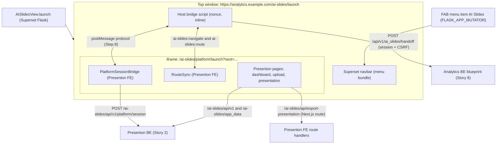
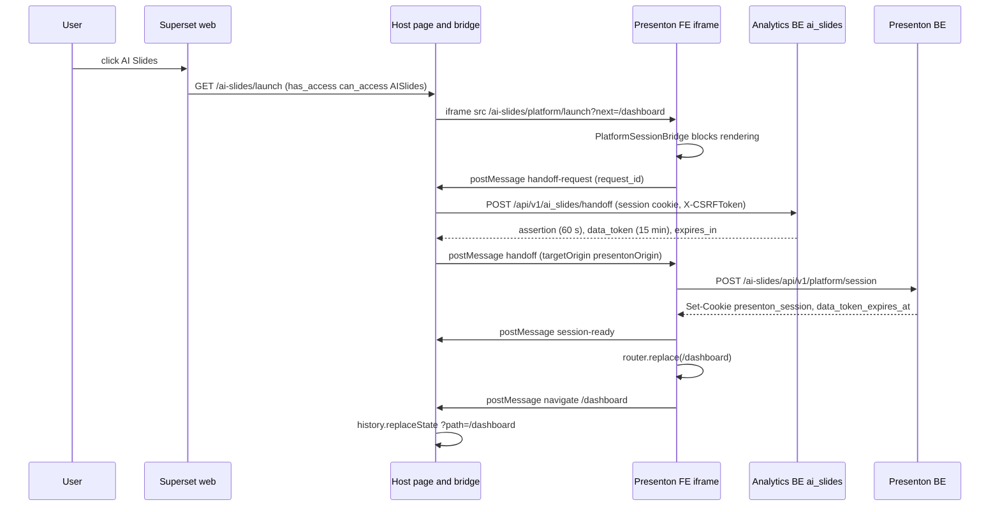
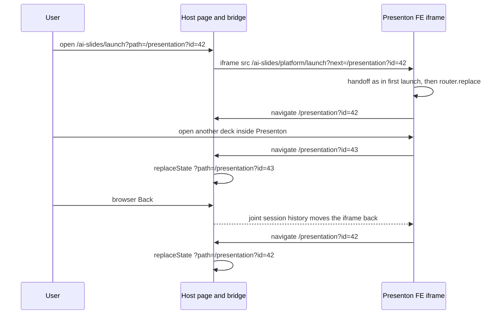
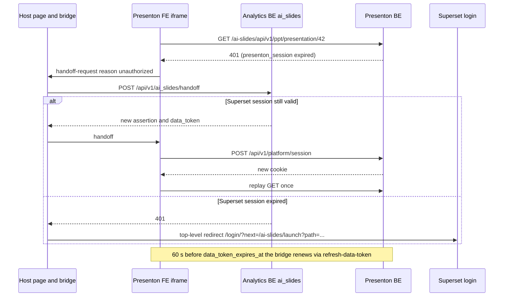

# Story 5: Analytics menu and iframe hardening

<div class="chapter-meta" markdown>
**Reads:** `servers/nextjs/next.config.mjs`, `servers/nextjs/proxy.ts`, `servers/nextjs/utils/api.ts`, `servers/nextjs/utils/image-url-converter.ts`, `servers/nextjs/app/api/export-presentation/route.ts`, `apache/superset: superset/views/base.py`, `apache/superset: superset/initialization/__init__.py`  ·  **Builds on:** [Architecture and contracts](41-architecture-and-contracts.md), [Next.js architecture](../presenton/20-nextjs-architecture.md), [Story 2](43-story2-platform-integration.md)  ·  **Time:** ~40 min
</div>

This chapter turns Story 5 into code. You will add an **AI Slides** item to the Superset navbar, build the Superset-side host page `/ai-slides/launch` that frames Presenton, move the Presenton frontend under the `/ai-slides` base path without breaking any of its root-relative assumptions, and write the browser half of the session handoff (`PlatformSessionBridge`). Along the way you will define the postMessage protocol between the two windows, size the iframe correctly, keep deep links in sync in both directions, and make downloads and fullscreen presentation work inside the frame.

Everything marked **new** below is code the team writes in the fork or in the analytics platform repository. Everything cited as `path:line` exists today, either in the Presenton snapshot or in `apache/superset` master (2026-11-02). Where a Superset behavior differs between the 6.1.0 release and master, the text says so.

## Step 0: The story

| # | Story | What it does | Owner |
| --- | --- | --- | --- |
| 5 | [Presenton FE] Analytics menu and iframe hardening | Adds the "AI Slides" menu item and makes the embedded Presenton iframe reliable (sizing, deep links, session handoff, base path). | Sourav |

Acceptance criteria (written for this chapter; the architect's row lists the four themes, these make them testable):

1. A user with the `can_access on AISlides` permission sees **AI Slides** in the Superset navbar; a user without it does not, and a direct request to `/ai-slides/launch` returns Superset's normal access-denied response.
2. Clicking the item opens `/ai-slides/launch`, which shows the Superset navbar on top and Presenton below it, filling the remaining viewport with no double scrollbars at 1280x720 and 1920x1080.
3. The user lands in Presenton signed in as themselves without seeing any Presenton login form. No token ever appears in a URL, in browser storage, or in Presenton JavaScript-readable cookies.
4. Every Presenton request (pages, `/api/v1`, `/api/v2`, Next.js route handlers, `/app_data`, `/static`, `/vendor`, `/_next`) is served under `/ai-slides`. Nothing requests a root-relative Presenton URL.
5. `/ai-slides/launch?path=/presentation?id=<uuid>` opens that deck directly. Navigating inside Presenton updates the parent URL (shareable), and browser Back/Forward keep both in step.
6. When the Presenton session or data token expires, the iframe obtains a new handoff silently. When the Superset session itself has expired, the top window goes to the Superset login page and returns to the same deck afterwards.
7. Presentation mode can enter browser fullscreen from inside the iframe; PPTX and PDF exports download from inside the iframe.
8. Presenton pages cannot be framed by any origin other than the analytics origin, and both sides reject postMessage traffic from unexpected origins or windows.
9. An automated end-to-end suite covers launch, deep link, expiry, export and fullscreen, and the manual QA matrix below is signed off for the supported browsers.

## Step 1: The moving parts

The default topology from the contracts is same-origin path routing: Superset at `https://analytics.example.com/`, Presenton FE at `/ai-slides/`, Presenton BE at `/ai-slides/api/` with the prefix stripped. Story 5 owns three pieces of code on top of that.



| Piece | Lives in | New or changed |
| --- | --- | --- |
| Navbar item, permission, host view, host template, host bridge script | analytics platform repo, package `ai_slides_superset` (Story 8 owns its API half) | new |
| `basePath`, `withBasePath`, URL resolver fixes, export URL fixes | Presenton fork, `servers/nextjs` | changed |
| `PlatformSessionBridge`, `RouteSync`, `/platform/launch` page | Presenton fork, `servers/nextjs` | new |

!!! warning "Gotcha: the ingress rules in the contracts need two refinements"
    The contracts route `/ai-slides` to Presenton FE and `/ai-slides/api(/|$)(.*)` to Presenton BE. Two paths break under those rules as written. First, `/ai-slides/launch` is a **Superset** page, so the ingress needs an exact-match rule for it that sits ahead of the `/ai-slides` prefix rule. Second, Presenton FE has its own route handlers under `/api` (for example `/api/export-presentation`, `/api/user-config`, `/api/runtime-config`, listed in `servers/nextjs/app/api/`), and `proxy.ts` only forwards `/api/v1` and `/api/v2` to FastAPI (`servers/nextjs/proxy.ts:25-32`). The BE rule must therefore match `/ai-slides/api/v1/` and `/ai-slides/api/v2/` only; everything else under `/ai-slides/api/` must reach Next.js. Coordinate both changes with [Story 9](50-story9-infra.md).

## Step 2: Add the AI Slides menu item

### 2.1 How the Superset navbar is built

The navbar is a React component, but its items come from the server. `menu_data()` builds the payload, and the first key is the Flask-AppBuilder menu:

```python title="apache/superset: superset/views/base.py:299-324 (excerpt)"
def menu_data(user: User) -> dict[str, Any]:
    # The archived view inherits BaseSupersetView from this module.
    from superset.views.archived_assets import can_access_recently_archived

    languages = {
        lang: {**appbuilder.languages[lang], "url": appbuilder.get_url_for_locale(lang)}
        for lang in appbuilder.languages
    }
    # ...
    return {
        "menu": appbuilder.menu.get_data(),
```

`menu_data(g.user)` is embedded in every page's bootstrap payload (`apache/superset: superset/views/base.py:686`). Flask-AppBuilder's `Menu.get_data` (FAB 5.0.x source, `flask_appbuilder/menu.py`; Superset pins `flask-appbuilder>=5.3.0, <6.0.0` at `apache/superset: pyproject.toml:56`, so re-check on upgrade) drops every item whose name the user has no `menu_access` permission for, and every item whose `cond` callable returns false. On the client, `MenuWrapper` moves the `Data`, `Security` and `Manage` categories into the settings dropdown and keeps everything else as a top-level navbar entry (`apache/superset: superset-frontend/src/features/home/Menu.tsx:497-556`). A top-level item with a `url` that is not a frontend route renders as a plain link, so clicking it is a full page load (`apache/superset: superset-frontend/src/features/home/Menu.tsx:285-305`). That is exactly what we want: `/ai-slides/launch` is a server-rendered Flask view.

### 2.2 Option A: a Flask-AppBuilder link registered at startup

Superset registers its own navbar links with `appbuilder.add_link`, and bakes the application root into the href because FAB renders it verbatim:

```python title="apache/superset: superset/initialization/__init__.py:354-364"
        # FAB renders this href verbatim in menus and does not apply
        # SCRIPT_NAME at render time, so the application_root has to be baked
        # in at registration. The previous hardcoded `/superset/welcome/`
        # collided with non-`/superset/` deployments AND with the new
        # `Superset.route_base = ""`. `app_root` is normalized above.
        appbuilder.add_link(
            "Home",
            label=_("Home"),
            href=f"{app_root}/welcome/",
            cond=lambda: bool(current_app.config["LOGO_TARGET_PATH"]),
        )
```

The supported hook for a deployment to do the same is `FLASK_APP_MUTATOR` (`apache/superset: superset/config.py:2360-2364`), which Superset calls inside the app context after Flask-AppBuilder is configured and **before** `init_views()`:

```python title="apache/superset: superset/initialization/__init__.py:1125-1136"
        # Hook that provides administrators a handle on the Flask APP
        # after initialization
        if flask_app_mutator := self.config["FLASK_APP_MUTATOR"]:
            flask_app_mutator(self.superset_app)

        # Sync configuration to database (themes, etc.)
        # This can be called separately in multi-tenant environments
        self.superset_app.sync_config_to_db()

        self.init_views()

        self.init_all_dependencies_and_extensions()
```

Two consequences follow. The FAB menu is an ordered list and `add_link` appends, so a link added from the mutator appears **first**, to the left of Dashboards. And code in the mutator runs before `init_all_dependencies_and_extensions()`, so it must not import `superset_core` decorators (they would bind the unreplaced stubs). Both are acceptable for a link and a view. If product wants the item after **SQL**, Superset also reads an undocumented `APP_INITIALIZER` class from config (`apache/superset: superset/app.py:86`); a subclass of `SupersetAppInitializer` that overrides `init_views()`, calls `super().init_views()` and then adds the link places it last. Prefer the documented mutator unless placement matters.

### 2.3 Option B: a Superset extension contribution

The new extension framework (`ENABLE_EXTENSIONS`, `.supx` bundles) only renders contribution areas in SQL Lab in 6.1.0 (`sqllab.leftSidebar`, `sqllab.rightSidebar`, `sqllab.panels`, `sqllab.editor`, `sqllab.statusBar`, `sqllab.results`, `sqllab.queryHistory`), plus a global chat slot on master only (see [Building the Superset extension](../superset/36-superset-extension.md) and [Superset landscape](../superset/31-superset-landscape.md)). There is **no navbar area**. The ids people quote for dashboards, such as `dashboard.nav.right`, belong to the older build-time UI-override registry in `@superset-ui/core`, which a `.supx` remote cannot reach. Option B is therefore not viable for the menu item in either version.

### 2.4 Option C: dashboard and chart entry points

The legacy registry does expose two useful places, but only to deployments that build their own Superset frontend:

| Key | Rendered by | Context | 6.1 / master |
| --- | --- | --- | --- |
| `dashboard.nav.right` | `apache/superset: superset-frontend/src/dashboard/components/Header/index.tsx:618,780` | none (a component with no props) | 6.1 and master |
| `dashboard.slice.header.menu` | `apache/superset: superset-frontend/src/dashboard/components/SliceHeaderControls/index.tsx:538-556` | `{sliceId, sliceName, dashboardId}`, items unshifted into the chart menu | master only |

The registration hook is `setupCodeOverrides()`, an empty function called by the SPA entry (`apache/superset: superset-frontend/src/setup/setupCodeOverrides.ts:34-36`, called at `apache/superset: superset-frontend/src/views/App.tsx:59`). If the analytics platform already maintains a frontend build, this **new** code adds "Create slides from this dashboard" and "Create slides from this chart":

```tsx title="superset-frontend/src/setup/setupCodeOverrides.ts (new, analytics platform fork)"
import { getExtensionsRegistry } from '@superset-ui/core';
import { useSelector } from 'react-redux';
import { Button } from '@superset-ui/core/components';

const LAUNCH = '/ai-slides/launch';

function launchUrl(presentonPath: string): string {
  // The host page validates `path` again server-side (Step 3).
  return `${LAUNCH}?path=${encodeURIComponent(presentonPath)}`;
}

function CreateSlidesFromDashboard() {
  // dashboard.nav.right receives no props; the dashboard id is in redux.
  const dashboardId = useSelector(
    (state: { dashboardInfo?: { id?: number } }) => state.dashboardInfo?.id,
  );
  if (!dashboardId) return null;
  return (
    <Button
      buttonStyle="secondary"
      onClick={() =>
        window.location.assign(launchUrl(`/upload?dashboard_id=${dashboardId}`))
      }
    >
      Create slides
    </Button>
  );
}

export default function setupCodeOverrides() {
  const registry = getExtensionsRegistry();
  registry.set('dashboard.nav.right', CreateSlidesFromDashboard);
  // master only: the key is absent from the 6.1.0 types.
  registry.set('dashboard.slice.header.menu', ({ sliceId, dashboardId }) => [
    {
      key: 'ai-slides-create',
      label: 'Create slides from this chart',
      onClick: () =>
        window.location.assign(
          launchUrl(`/upload?dashboard_id=${dashboardId}&chart_id=${sliceId}`),
        ),
    },
  ]);
}
```

The Presenton side of `/upload?dashboard_id=...&chart_id=...` (pre-selecting data for the planner) belongs to [Story 6](47-story6-prompt-library-ui.md) and [Story 7](48-story7-harness-planner.md). The `Button` import path and the `dashboardInfo` slice should be checked against the frontend version you build; `TypedRegistry.set` itself is stable (`apache/superset: superset-frontend/packages/superset-ui-core/src/models/TypedRegistry.ts:55-57`).

### 2.5 Recommendation and the full code

Ship **Option A** for the menu item (works on 6.1.0 and master, no frontend build), and add **Option C** later if and only if the platform already builds its own Superset frontend. All of the Python below is **new** and lives in a package installed into the Superset image, `ai_slides_superset`, which [Story 8](49-story8-analytics-mcp.md) also uses for its API blueprint.

```python title="ai_slides_superset/menu.py (new)"
from __future__ import annotations

from typing import Any

from flask import Flask
from flask_babel import lazy_gettext as _

MENU_NAME = "AI Slides"          # FAB view-menu name for menu_access
VIEW_MENU = "AISlides"           # FAB view-menu name for can_access


def mutate_app(app: Flask) -> None:
    """FLASK_APP_MUTATOR: register the host view and the navbar link.

    Runs inside the app context, after configure_fab() and before init_views().
    Imports Superset lazily: superset_config.py imports this module.
    """
    from superset.extensions import appbuilder, security_manager

    from ai_slides_superset.views import AISlidesView

    app_root = (app.config.get("APPLICATION_ROOT") or "/").rstrip("/")

    appbuilder.add_view_no_menu(AISlidesView)

    from ai_slides_superset.cli import init_role

    app.cli.add_command(init_role)   # exposes: superset ai-slides-init-role

    def _can_launch() -> bool:
        # Hide the item when the role lacks the view permission, even if an
        # admin granted menu_access by mistake.
        return security_manager.can_access("can_access", VIEW_MENU)

    appbuilder.add_link(
        MENU_NAME,
        label=_("AI Slides"),
        href=f"{app_root}/ai-slides/launch",
        icon="fa-file-powerpoint-o",
        category="",
        category_icon="",
        cond=_can_launch,
    )
```

```python title="superset_config.py (additions, new)"
from ai_slides_superset import blueprint as ai_slides_blueprint  # Story 8
from ai_slides_superset.menu import mutate_app
from ai_slides_superset.security import AISlidesSecurityManager

FLASK_APP_MUTATOR = mutate_app
BLUEPRINTS = [ai_slides_blueprint]
CUSTOM_SECURITY_MANAGER = AISlidesSecurityManager

# Where Presenton is served, and the page a launch without ?path= opens.
AI_SLIDES_FRONTEND_PATH = "/ai-slides"
AI_SLIDES_PRESENTON_ORIGIN = "https://analytics.example.com"  # subdomain topology: the slides origin
AI_SLIDES_DEFAULT_PATH = "/dashboard"
```

!!! warning "Gotcha: keep the config import graph flat"
    `superset_config.py` is imported while `superset.config` itself is still loading. `ai_slides_superset/__init__.py` and `menu.py` must therefore import only Flask and the standard library at module level and import `superset.*` inside functions. The one exception is the security manager below: subclassing `SupersetSecurityManager` from config is the documented pattern for `CUSTOM_SECURITY_MANAGER` (`apache/superset: superset/config.py:255`).

### 2.6 Permission gating

The host view declares `class_permission_name = "AISlides"` and a method permission `access`, so Flask-AppBuilder checks `can_access on AISlides` (the same mechanism `SqllabView` uses with `@permission_name("read")`, `apache/superset: superset/views/sqllab.py:33-49`). `add_link` additionally creates `menu_access on AI Slides`.

`superset init` creates both permissions: it calls `appbuilder.add_permissions(update_perms=True)` and then `security_manager.sync_role_definitions()` (`apache/superset: superset/cli/main.py:78-85`). Left alone, `sync_role_definitions` would hand the new permission to **Alpha and Gamma**, because the built-in role predicates grant every permission that is not marked admin-only, alpha-only or SQL Lab-only (`apache/superset: superset/security/manager.py:3715-3745`). To roll out to a pilot group, mark the view menus admin-only and grant them to a dedicated role:

```python title="ai_slides_superset/security.py (new)"
from superset.security.manager import SupersetSecurityManager


class AISlidesSecurityManager(SupersetSecurityManager):
    # Admins get AI Slides automatically; everyone else through the
    # "AI Slides User" role. _is_admin_only() reads this set.
    ADMIN_ONLY_VIEW_MENUS = SupersetSecurityManager.ADMIN_ONLY_VIEW_MENUS | {
        "AISlides",
        "AI Slides",
    }
```

`_is_admin_only` checks `pvm.view_menu.name in self.ADMIN_ONLY_VIEW_MENUS` (`apache/superset: superset/security/manager.py:3650-3670`). After `superset init`, create the role once (an Alembic-free, idempotent CLI step in the deploy Job from [Story 9](50-story9-infra.md)):

```python title="ai_slides_superset/cli.py (new, run with: superset ai-slides-init-role)"
import click
from flask.cli import with_appcontext


@click.command("ai-slides-init-role")
@with_appcontext
def init_role() -> None:
    from superset import db
    from superset.extensions import security_manager as sm

    role = sm.find_role("AI Slides User") or sm.add_role("AI Slides User")
    for perm, view in (("can_access", "AISlides"), ("menu_access", "AI Slides")):
        pvm = sm.find_permission_view_menu(perm, view)
        if pvm is None:
            raise click.ClickException(f"{perm} on {view} missing: run superset init first")
        sm.add_permission_role(role, pvm)
    db.session.commit()
```

Users then need **both** their normal data roles (Gamma plus dataset grants) and **AI Slides User**. The analytics BE checks the same `can_access on AISlides` on the handoff and on every Bearer request ([Story 8](49-story8-analytics-mcp.md)), so revoking the role stops refresh within one data-token lifetime.

## Step 3: The host page `/ai-slides/launch`

### 3.1 Rendering the Superset navbar outside the SPA

Superset ships a dedicated webpack entry that mounts only the navbar into `#app-menu`:

```tsx title="apache/superset: superset-frontend/src/views/menu.tsx:21-47 (excerpt)"
// Menu App. Used in views that do not already include the Menu component in the layout.
// eg, backend rendered views
// ...
const store = setupStore({ disableDebugger: true });
const bootstrapData = getBootstrapData();
const menu = { ...bootstrapData.common.menu_data };
// ...
const menuMountPoint = document.getElementById('app-menu');
```

The entry is registered as `menu` (`apache/superset: superset-frontend/webpack.config.js:325`), and `getBootstrapData()` reads `#app[data-bootstrap]` (`apache/superset: superset-frontend/src/utils/getBootstrapData.ts:24-33`). `get_spa_template_context(entry, ...)` produces the full template context, including the bootstrap JSON with `common.menu_data` (`apache/superset: superset/views/base.py:811-902`). So the host page renders `superset/spa.html` semantics with `entry="menu"` and a body that contains `#app` (data only), `#app-menu` and the iframe.

!!! warning "Gotcha: the `menu` entry is lightly exercised"
    No template on master currently mounts `#app-menu` (a grep of `superset/templates` and `superset/views` finds none), so this entry has fewer eyes on it than the SPA. Check the rendered navbar visually after every Superset upgrade. The fallback, if it ever breaks, is a React route for `/ai-slides/launch` inside a custom frontend build, which renders the same iframe and bridge.

### 3.2 The view (Python, new)

```python title="ai_slides_superset/views.py (new)"
from __future__ import annotations

import re
from urllib.parse import quote

from flask import current_app, request, url_for
from flask_appbuilder import permission_name
from flask_appbuilder.api import expose
from flask_appbuilder.security.decorators import has_access

from superset.extensions import appbuilder, event_logger
from superset.superset_typing import FlaskResponse
from superset.views.base import BaseSupersetView, get_spa_template_context

# Presenton app paths only: one leading slash, URL-safe characters, bounded.
_SAFE_PATH = re.compile(r"^/(?!/)[A-Za-z0-9\-._~!$&'()*+,;=:@/%?]{0,511}$")
_BLOCKED = ("/platform/", "/api/", "/app_data/", "/static/", "/_next/", "/pdf-maker")


def sanitize_presenton_path(raw: str | None) -> str:
    default = current_app.config.get("AI_SLIDES_DEFAULT_PATH", "/dashboard")
    if not raw or "\\" in raw or not _SAFE_PATH.match(raw):
        return default
    if raw.startswith(_BLOCKED):
        return default
    return raw


class AISlidesView(BaseSupersetView):
    route_base = "/ai-slides"
    class_permission_name = "AISlides"
    method_permission_name = {"launch": "access"}

    @expose("/launch", methods=("GET",))
    @has_access
    @permission_name("access")
    @event_logger.log_this
    def launch(self) -> FlaskResponse:
        presenton_path = sanitize_presenton_path(request.args.get("path"))
        fe_base = current_app.config.get("AI_SLIDES_FRONTEND_PATH", "/ai-slides")
        presenton_origin = current_app.config["AI_SLIDES_PRESENTON_ORIGIN"]
        iframe_src = (
            f"{presenton_origin}{fe_base}/platform/launch?next={quote(presenton_path, safe='')}"
        )
        config = {
            "protocolVersion": 1,
            "presentonOrigin": presenton_origin,
            "presentonBasePath": fe_base,
            "handoffUrl": url_for("ai_slides.handoff"),
            "csrfUrl": "/api/v1/security/csrf_token/",
            "loginUrl": appbuilder.get_url_for_login,
            "launchUrl": url_for("AISlidesView.launch"),
            "initialPath": presenton_path,
        }
        context = get_spa_template_context("menu")
        return self.render_template(
            "ai_slides/launch.html",
            iframe_src=iframe_src,
            ai_slides_config=config,
            **context,
        )
```

`url_for("ai_slides.handoff")` resolves the Story 8 blueprint route, so the page works under a Superset `APPLICATION_ROOT`. `appbuilder.get_url_for_login` is the same value Superset puts into `navbar_right.user_login_url` (`apache/superset: superset/views/base.py:353`). The CSRF token endpoint is `GET /api/v1/security/csrf_token/` (`apache/superset: superset/security/api.py:173-185`).

### 3.3 The template (HTML, new)

The template ships inside the Story 8 blueprint package (`Blueprint(..., template_folder="templates")`), and Flask's loader searches blueprint template folders, so `render_template("ai_slides/launch.html")` finds it.

```html title="ai_slides_superset/templates/ai_slides/launch.html (new)"



AI Slides


  <div id="app" data-bootstrap="{{ bootstrap_data }}" hidden></div>
  <div class="ai-slides-shell">
    <div id="app-menu"></div>
    <main class="ai-slides-main">
      <iframe
        id="ai-slides-frame"
        title="AI Slides"
        src="{{ iframe_src }}"
        allow="fullscreen; clipboard-read; clipboard-write"
        allowfullscreen
        referrerpolicy="same-origin"
      ></iframe>
      <div id="ai-slides-status" role="status" aria-live="polite" hidden></div>
    </main>
  </div>
  <script type="application/json" id="ai-slides-config">{{ ai_slides_config | tojson }}</script>
  <style>
    html, body { height: 100%; margin: 0; overflow: hidden; }
    .ai-slides-shell { display: flex; flex-direction: column; height: 100vh; height: 100dvh; }
    #app-menu { flex: 0 0 auto; }
    .ai-slides-main {
      position: relative;
      flex: 0 0 auto;
      height: calc(100dvh - var(--ai-slides-nav-height, 56px));
    }
    #ai-slides-frame { position: absolute; inset: 0; width: 100%; height: 100%; border: 0; display: block; }
    #ai-slides-status {
      position: absolute; inset: 0; display: flex; align-items: center; justify-content: center;
      background: rgba(255, 255, 255, 0.92); font: 14px Inter, Helvetica, Arial, sans-serif;
    }
  </style>



  {{ super() }}
  <script nonce="{{ ai_macros.get_nonce() }}">
    /* host bridge: see Step 3.4 */
  </script>

```

!!! warning "Gotcha: Superset's CSP ignores `'self'` for scripts"
    The default `TALISMAN_CONFIG` sets `"script-src": ["'self'", "'strict-dynamic'"]` with `content_security_policy_nonce_in: ["script-src"]` (`apache/superset: superset/config.py:3116-3161`). Under CSP Level 3, `'strict-dynamic'` makes browsers ignore host sources such as `'self'`, so **every** script tag on the host page needs the request nonce, inline or not. That is why the bridge is an inline script whose `nonce` attribute is rendered by the `get_nonce()` macro (which calls Talisman's `csp_nonce()`, `apache/superset: superset/templates/superset/macros.html`). Inline styles are fine because `style-src` includes `'unsafe-inline'`.

### 3.4 The host bridge script (JavaScript, new)

This is the complete script that goes inside the nonce'd tag. It sizes the iframe, answers handoff requests, mirrors the iframe route into the parent URL, and enforces origin and window checks on every message.

```js title="host bridge (inline in launch.html, new)"
(function () {
  "use strict";
  var cfg = JSON.parse(document.getElementById("ai-slides-config").textContent);
  var frame = document.getElementById("ai-slides-frame");
  var statusEl = document.getElementById("ai-slides-status");
  var V = cfg.protocolVersion;
  var SAFE_PATH = /^\/(?!\/)[A-Za-z0-9\-._~!$&'()*+,;=:@\/%?]{0,511}$/;
  var currentPath = cfg.initialPath;
  var csrfToken = (document.getElementById("csrf_token") || {}).value || "";
  var handoffInFlight = null;

  // 1. Sizing: iframe height = viewport minus the measured navbar height.
  var menu = document.getElementById("app-menu");
  function applyNavHeight() {
    var h = Math.ceil(menu.getBoundingClientRect().height);
    document.documentElement.style.setProperty("--ai-slides-nav-height", h + "px");
  }
  if (window.ResizeObserver) new ResizeObserver(applyNavHeight).observe(menu);
  window.addEventListener("resize", applyNavHeight);
  applyNavHeight();
  frame.addEventListener("load", function () { frame.focus(); });

  function showStatus(text) {
    statusEl.textContent = text || "";
    statusEl.hidden = !text;
  }

  function send(message) {
    if (!frame.contentWindow) return;
    message.v = V;
    // Never "*": the handoff message carries tokens.
    frame.contentWindow.postMessage(message, cfg.presentonOrigin);
  }

  function goToLogin() {
    var back = cfg.launchUrl + "?path=" + encodeURIComponent(currentPath);
    window.location.assign(cfg.loginUrl + "?next=" + encodeURIComponent(back));
  }

  async function refreshCsrf() {
    var res = await fetch(cfg.csrfUrl, { credentials: "same-origin" });
    if (!res.ok) throw new Error("csrf_" + res.status);
    csrfToken = (await res.json()).result;
  }

  async function callHandoff(retried) {
    var res = await fetch(cfg.handoffUrl, {
      method: "POST",
      credentials: "same-origin",
      headers: { "Content-Type": "application/json", "X-CSRFToken": csrfToken },
      body: "{}",
    });
    if (res.status === 400 && !retried) {
      // Superset answers JSON CSRF failures with 400 (error_handling.py).
      await refreshCsrf();
      return callHandoff(true);
    }
    if (res.status === 401) { goToLogin(); throw new Error("superset_session_expired"); }
    if (res.status === 403) throw new Error("forbidden");
    if (!res.ok) throw new Error("handoff_" + res.status);
    return res.json(); // { assertion, data_token, expires_in }
  }

  async function answerHandoff(requestId) {
    try {
      // Coalesce bursts (several 401s at once) into one Superset call.
      handoffInFlight = handoffInFlight || callHandoff(false);
      var grant = await handoffInFlight;
      send({
        type: "ai-slides:handoff",
        request_id: requestId,
        assertion: grant.assertion,
        data_token: grant.data_token,
        expires_in: grant.expires_in,
      });
    } catch (err) {
      send({ type: "ai-slides:handoff-error", request_id: requestId, code: String(err.message || err) });
    } finally {
      handoffInFlight = null;
    }
  }

  function mirrorPath(path) {
    if (!SAFE_PATH.test(path) || path === currentPath) return;
    currentPath = path;
    var url = cfg.launchUrl + "?path=" + encodeURIComponent(path);
    // replaceState, not pushState: the iframe navigation already added a
    // joint session history entry, so Back keeps working without doubling.
    window.history.replaceState({ aiSlidesPath: path }, "", url);
  }

  window.addEventListener("message", function (event) {
    if (event.origin !== cfg.presentonOrigin) return;
    if (event.source !== frame.contentWindow) return;
    var data = event.data;
    if (!data || typeof data !== "object" || data.v !== V || typeof data.type !== "string") return;
    switch (data.type) {
      case "ai-slides:handoff-request":
        if (typeof data.request_id === "string" && data.request_id.length <= 64) {
          answerHandoff(data.request_id);
        }
        break;
      case "ai-slides:session-ready":
        showStatus("");
        break;
      case "ai-slides:session-error":
        showStatus("AI Slides could not start a session. Reload the page to try again.");
        break;
      case "ai-slides:navigate":
        if (typeof data.path === "string") mirrorPath(data.path);
        if (typeof data.title === "string") document.title = "AI Slides · " + data.title.slice(0, 120);
        break;
      case "ai-slides:open-superset":
        // Leave AI Slides for a Superset page, such as a source dashboard.
        if (typeof data.path === "string" && SAFE_PATH.test(data.path) && data.path.indexOf("/ai-slides") !== 0) {
          window.location.assign(data.path);
        }
        break;
    }
  });

  // Back/Forward in the parent after a full reload of /ai-slides/launch.
  window.addEventListener("popstate", function () {
    var params = new URLSearchParams(window.location.search);
    var path = params.get("path");
    if (path && SAFE_PATH.test(path) && path !== currentPath) {
      currentPath = path;
      send({ type: "ai-slides:route", path: path });
    }
  });
})();
```

## Step 4: Serve Presenton FE under `/ai-slides`

### 4.1 `basePath` in `next.config.mjs`

Today the config has no `basePath` and one header rule (`servers/nextjs/next.config.mjs:8-23`). The change is small; the work is everywhere else.

```js title="servers/nextjs/next.config.mjs (changed lines)"
const basePath = (process.env.AI_SLIDES_BASE_PATH || "").trim().replace(/\/+$/, "");

const nextConfig = {
  ...(basePath ? { basePath } : {}),
  env: {
    // Inlined at build time so client and server code share one value.
    NEXT_PUBLIC_BASE_PATH: basePath,
  },
  reactStrictMode: false,
  distDir: ".next-build",
  output: "standalone",
  // ... unchanged turbopack, images ...
  async headers() {
    return [
      {
        // Next.js prefixes `source` with basePath automatically.
        source: "/vendor/fonts/:path*",
        headers: [{ key: "Access-Control-Allow-Origin", value: "*" }],
      },
      // Frame protection headers: Story 8, Step 9.
    ];
  },
};
```

!!! warning "Gotcha: `basePath` is a build-time value"
    Next.js bakes `basePath` and every `NEXT_PUBLIC_*` value into the build output. The AI Slides image must be built with `AI_SLIDES_BASE_PATH=/ai-slides`, and the same image cannot be reused for a root-path deployment. Add it as a build arg in the Dockerfile stage that runs `next build` ([Story 9](50-story9-infra.md)).

What Next.js prefixes for you, and what it does not:

| API | Gets `/ai-slides` automatically? |
| --- | --- |
| `next/link`, `useRouter().push/replace`, `redirect()` from `next/navigation` | yes |
| `headers()`, `rewrites()`, `redirects()` sources in `next.config.mjs` | yes |
| `_next/static` chunks | yes |
| `fetch("/api/...")`, `new EventSource("/...")` | **no** |
| ``, CSS `url(/...)`, `<script src="/...">`, `next/image` `src` strings | **no** (Next.js documents that `next/image` needs the prefix added by hand) |
| `window.location.assign/replace("/...")`, `<a href="/...">` built by hand | **no** |
| `usePathname()` result | returns the path **without** the base path |

### 4.2 One helper for everything

```ts title="servers/nextjs/utils/basePath.ts (new)"
export const BASE_PATH = (process.env.NEXT_PUBLIC_BASE_PATH || "").replace(/\/+$/, "");

const ABSOLUTE = /^(?:[a-z][a-z0-9+.-]*:)?\/\//i;

/** Prefix a root-relative path with the deployment base path, idempotently. */
export function withBasePath(path: string): string {
  if (!BASE_PATH || !path) return path;
  if (ABSOLUTE.test(path) || path.startsWith("data:") || path.startsWith("blob:")) {
    return path;
  }
  const rooted = path.startsWith("/") ? path : `/${path}`;
  if (rooted === BASE_PATH || rooted.startsWith(`${BASE_PATH}/`) || rooted.startsWith(`${BASE_PATH}?`)) {
    return rooted;
  }
  return `${BASE_PATH}${rooted}`;
}

/** Remove the base path so path-shape checks see the app-relative path. */
export function stripBasePath(path: string): string {
  if (!BASE_PATH) return path;
  if (path === BASE_PATH) return "/";
  return path.startsWith(`${BASE_PATH}/`) ? path.slice(BASE_PATH.length) : path;
}
```

### 4.3 The URL resolver in `utils/api.ts`

`getApiUrl` and `resolveBackendAssetUrl` are the two choke points that about 90 call sites already use. In the browser's web runtime both return the root-relative path unchanged:

```ts title="servers/nextjs/utils/api.ts:88-100"
function resolveBackendPathForRuntime(path: string): string {
  const normalizedPath = withLeadingSlash(path);

  // Docker/web runtime should stay same-origin and use nginx reverse proxy.
  if (
    typeof window !== "undefined" &&
    !shouldUseDirectFastApiOriginInBrowser()
  ) {
    return normalizedPath;
  }

  return `${getFastAPIUrl()}${normalizedPath}`;
}
```

Three edits make them prefix-aware (changed code):

```ts title="servers/nextjs/utils/api.ts (changed)"
import { stripBasePath, withBasePath } from "@/utils/basePath";

function resolveBackendPathForRuntime(path: string): string {
  const normalizedPath = withLeadingSlash(path);
  if (typeof window !== "undefined" && !shouldUseDirectFastApiOriginInBrowser()) {
    return withBasePath(normalizedPath);            // was: normalizedPath
  }
  return `${getFastAPIUrl()}${normalizedPath}`;
}

export function getApiUrl(path: string): string {
  if (isAbsoluteHttpUrl(path)) return path;
  const normalizedPath = withLeadingSlash(path);
  const isFastApiEndpoint =
    normalizedPath.startsWith("/api/v1/") || normalizedPath.startsWith("/api/v2/");
  if (!isFastApiEndpoint) {
    // Next.js route handlers (/api/export-presentation, /api/user-config, ...)
    return typeof window !== "undefined" ? withBasePath(normalizedPath) : normalizedPath;
  }
  if (typeof window === "undefined" && !getConfiguredFastApiUrl()) {
    return normalizedPath;
  }
  return resolveBackendPathForRuntime(normalizedPath);
}

function toBackendServedPath(rawPath: string): string {
  // Strip first: "/ai-slides/_next/static/..." must not match "/static/".
  const normalized = stripBasePath(rawPath.replace(/\\/g, "/"));
  // ... the rest of the function is unchanged ...
}
```

!!! warning "Gotcha: `/_next/static/` becomes `/static/` without the strip"
    `toBackendServedPath` protects Next.js assets with `normalized.startsWith("/_next/static/")` and then looks for `"/static/"` anywhere in the path (`servers/nextjs/utils/api.ts:235-251`). Under a base path a chunk URL is `/ai-slides/_next/static/...`, the `startsWith` guard no longer matches, `indexOf("/static/")` finds the inner segment, and the resolver rewrites the chunk to FastAPI's `/static/...`. `setupImageUrlConverter` runs this on every `` it sees through a `MutationObserver` (`servers/nextjs/utils/image-url-converter.ts:7-17`, `22-51`), so any image Next.js serves from `_next/static/media` would break. Stripping the base path first restores the guard.

### 4.4 Raw `fetch` calls and hard navigations

About 74 `fetch(` call sites do not go through `getApiUrl`, many with root-relative literals, for example:

| Call site | Literal |
| --- | --- |
| `servers/nextjs/app/(presentation-generator)/presentation/components/PresentationHeader.tsx:256` and `:338` | `"/api/export-presentation"` |
| `servers/nextjs/app/(export)/pdf-maker/PdfMakerPage.tsx:210` | `` `/api/export-presentation-data/${id}` `` |
| `servers/nextjs/app/ConfigurationInitializer.tsx:254` and `:346` | `'/api/user-config'`, `"/api/runtime-config"` |
| `servers/nextjs/app/(presentation-generator)/(dashboard)/admin/AdminPanel.tsx:94` | `"/api/v1/admin/users"` |
| `servers/nextjs/components/Auth/LogoutButton.tsx:59`, `servers/nextjs/components/Auth/AuthGate.tsx:80` | `window.location.replace("/")` |

Each one, unprefixed, sends the browser to **Superset's** `/api/...` or `/`. Wrap every literal in `withBasePath(...)` (or `getApiUrl(...)`), then stop regressions with a lint rule in `servers/nextjs/eslint.config.mjs`:

```js title="servers/nextjs/eslint.config.mjs (new rule block)"
{
  files: ["app/**/*.{ts,tsx}", "components/**/*.{ts,tsx}", "lib/**/*.ts", "utils/**/*.ts", "store/**/*.ts"],
  rules: {
    "no-restricted-syntax": [
      "error",
      {
        selector: "CallExpression[callee.name='fetch'] > Literal[value=/^\\//]:first-child",
        message: "Root-relative fetch: wrap the path in withBasePath() or getApiUrl().",
      },
      {
        selector: "CallExpression[callee.name='fetch'] > TemplateLiteral:first-child > TemplateElement[value.raw=/^\\//]",
        message: "Root-relative fetch: wrap the path in withBasePath() or getApiUrl().",
      },
      {
        selector: "CallExpression[callee.object.property.name='location'][callee.property.name=/^(assign|replace)$/] > Literal[value=/^\\//]",
        message: "Root-relative navigation: use withBasePath() or the Next.js router.",
      },
    ],
  },
},
```

### 4.5 `proxy.ts`

`proxy.ts` (the Next.js 16 name for middleware) keeps working because `request.nextUrl.pathname` excludes the base path, so `isFastApiApiPath` still sees `/api/v1/...` and `rewriteToFastApi` sends FastAPI an unprefixed path (`servers/nextjs/proxy.ts:25-49`). Three changes remain:

```ts title="servers/nextjs/proxy.ts (changed)"
import { withBasePath } from "@/utils/basePath";

function isApiAuthExempt(pathname: string): boolean {
  return (
    pathname.startsWith("/api/v1/auth/") ||
    pathname === "/api/v1/platform/session" ||                 // new: Story 2 handoff
    pathname === "/api/v1/platform/session/refresh-data-token" || // new
    pathname === "/api/telemetry-status" ||
    pathname === "/api/update-svg" ||
    pathname.startsWith("/api/export-presentation-data/")
  );
}

export async function proxy(request: NextRequest) {
  const denied = desktopRequestDenied(request);
  if (denied) return denied;
  const { pathname } = request.nextUrl;
  if (!pathname.startsWith("/api/") && !isFastApiAssetPath(pathname) && pathname !== "/pdf-maker") {
    // new: let server layouts know which page was requested (Step 7.3).
    const headers = new Headers(request.headers);
    headers.set("x-ai-slides-path", `${pathname}${request.nextUrl.search}`);
    return NextResponse.next({ request: { headers } });
  }
  // ... unchanged until the pdf-maker cookie ...
      response.cookies.set({
        name: SESSION_COOKIE_NAME,
        value: exportSession,
        maxAge: SESSION_TTL_SECONDS,
        httpOnly: true,
        secure: /* unchanged */ true,
        sameSite: "lax",
        path: withBasePath("/") || "/",                       // was: "/"
      });
  // ... rest unchanged ...
}
```

The FastAPI side of the exemption (`_PUBLIC_AUTH_PATHS` at `servers/fastapi/api/middlewares.py:30-36`) is part of [Story 2](43-story2-platform-integration.md). Under the contract ingress the browser's `/ai-slides/api/v1/...` requests go straight to FastAPI and never pass through `proxy.ts`; the proxy path still matters for server-side calls and for local development without the ingress.

### 4.6 Static assets referenced from code

About 65 occurrences of `src="/`, `href="/"` and `url(/` exist under `app`, `components` and `lib` (for example `servers/nextjs/app/not-found.tsx:19`, `servers/nextjs/app/(presentation-generator)/outline/components/OutlineStandardHeader.tsx:25`). Two families need particular care:

- **Vendored runtimes injected into slide HTML.** `CHART_BROWSER_SCRIPT_URL = "/vendor/chart-4.5.1.umd.min.js"` (`servers/nextjs/lib/chart-browser.ts:1-3`), `TAILWIND_BROWSER_SCRIPT_URL` (`servers/nextjs/lib/tailwind-browser.ts:2-3`) and font URLs `/vendor/fonts/...` (`servers/nextjs/components/slide-editor/text/local-fonts.ts:25`). Smart slides render in `srcDoc` iframes (`servers/nextjs/app/(presentation-generator)/components/SmartHtmlSlide.tsx:266-273`), whose relative URLs resolve against the parent document, so an unprefixed `/vendor/...` loads from Superset and 404s. Export these constants through `withBasePath`.
- **`next/image` with a string `src`.** Add the prefix by hand, as Next.js documents for `basePath`.

### 4.7 The export pipeline

Exports touch three root-path assumptions:

1. **The download URL.** The Next.js export route returns `/api/export-presentation/file?name=...` (`servers/nextjs/app/api/export-presentation/route.ts:35-52`), and the header clicks a synthetic `<a download>` with that href (`servers/nextjs/app/(presentation-generator)/presentation/components/PresentationHeader.tsx:426-434`). Return `withBasePath(...)` from `buildExportDownloadUrl` so every caller gets a correct link.
2. **The headless renderer URL.** FastAPI builds `f"{_get_next_public_url().rstrip('/')}/pdf-maker?..."` from `NEXT_PUBLIC_URL` (`servers/fastapi/utils/export_utils.py:18-40`), and the Next.js bundled export does the same (`servers/nextjs/lib/run-bundled-presentation-export.ts:159-170`). No code change is needed: set `NEXT_PUBLIC_URL` to the **internal** FE URL including the base path, for example `http://presenton-fe:3000/ai-slides`.
3. **The `pdf-maker` page itself.** It fetches `/api/export-presentation-data/${id}` with a raw literal (`servers/nextjs/app/(export)/pdf-maker/PdfMakerPage.tsx:210`); wrap it.

### 4.8 `PRESENTON_PUBLIC_URL`

FastAPI turns host-relative links in MCP and async-task results into absolute ones by plain concatenation, `f"{configured_origin}{value}"` (`servers/fastapi/utils/mcp_public_urls.py:17-25`), with the configured value read and right-stripped by `get_presenton_public_url()` (`servers/fastapi/utils/get_env.py:17-21`). A path-bearing value works, which is why `PRESENTON_PUBLIC_URL=https://analytics.example.com/ai-slides` is the contract value. For links that a user should open inside Superset, prefer the launch URL form (`/ai-slides/launch?path=...`); a bare `/ai-slides/presentation?id=...` link opened in a new tab is caught by the bridge's top-level redirect (Step 7.2).

### 4.9 Base path checklist

| Area | File | Change |
| --- | --- | --- |
| Build | `servers/nextjs/next.config.mjs` | `basePath`, `env.NEXT_PUBLIC_BASE_PATH` |
| Helper | `servers/nextjs/utils/basePath.ts` | new |
| Resolver | `servers/nextjs/utils/api.ts` | prefix in `resolveBackendPathForRuntime`, `getApiUrl`; strip in `toBackendServedPath` |
| Raw fetches and navigations | about 74 fetch sites, `servers/nextjs/components/Auth/LogoutButton.tsx:59`, `servers/nextjs/components/Auth/AuthGate.tsx:80` | wrap; lint rule |
| Proxy | `servers/nextjs/proxy.ts` | session exemptions, path header, cookie path |
| Static refs | `lib/chart-browser.ts`, `lib/tailwind-browser.ts`, `local-fonts.ts`, `` literals | wrap |
| Export | `app/api/export-presentation/route.ts`, `servers/nextjs/app/(export)/pdf-maker/PdfMakerPage.tsx:210`, env `NEXT_PUBLIC_URL` | wrap, env |
| Public links | env `PRESENTON_PUBLIC_URL` | `https://analytics.example.com/ai-slides` |

## Step 5: Sizing and fullscreen

**Height.** The host computes `height: calc(100dvh - var(--ai-slides-nav-height))` and a `ResizeObserver` on `#app-menu` keeps the variable current (Step 3.4). The navbar's height is not constant: the environment tag, a long brand text or a narrow window can change it, so measuring beats hard-coding 56 px. `100dvh` avoids the mobile URL-bar jump; the `100vh` line before it is the fallback. Inside the frame nothing changes: Presenton's `h-screen` layouts now mean "the iframe's viewport", which is exactly the space left under the navbar. Set `overflow: hidden` on the host `body` so only the iframe scrolls.

**Focus.** Presentation mode reads arrow keys inside the iframe. The host calls `frame.focus()` on `load`, and Presenton should keep its own focus handling.

**Fullscreen.** Presenton enters fullscreen on `#presentation-mode-wrapper`, falling back to `document.documentElement`:

```ts title="servers/nextjs/app/(presentation-generator)/presentation/hooks/usePresentationNavigation.ts:68-82"
  const toggleFullscreen = useCallback((target?: Element | null) => {
    if (!document.fullscreenElement) {
      const fullscreenTarget =
        target ?? document.getElementById("presentation-mode-wrapper") ?? document.documentElement;
      fullscreenTarget
        .requestFullscreen()
        .then(() => setIsFullscreen(true))
        .catch(() => setIsFullscreen(false));
    } else {
      document
        .exitFullscreen()
        .then(() => setIsFullscreen(false))
        .catch(() => setIsFullscreen(Boolean(document.fullscreenElement)));
    }
  }, [setIsFullscreen]);
```

`requestFullscreen()` inside an iframe needs the frame to be allowed the `fullscreen` feature, hence `allow="fullscreen"` plus the legacy `allowfullscreen` attribute on the iframe. The element that goes fullscreen is inside the iframe, so the Superset navbar disappears with it, and `Escape` returns to the framed view. The call still needs a user gesture inside the iframe; keyboard shortcuts work once the iframe has focus.

!!! warning "Gotcha: a Permissions-Policy header can silently veto fullscreen"
    `allow="fullscreen"` only delegates what the top document itself has. If an ingress or a future Talisman setting sends `Permissions-Policy: fullscreen=()` on the Superset host page, `requestFullscreen()` rejects and Presenton's catch handler just leaves `isFullscreen` false. Include fullscreen in the QA matrix and check response headers of `/ai-slides/launch` when it fails.

## Step 6: Deep links in both directions

The parent URL is the shareable one: `/ai-slides/launch?path=%2Fpresentation%3Fid%3D<uuid>`. The flow:

1. **Parent to iframe at load.** The view sanitizes `path` and builds `iframe src = /ai-slides/platform/launch?next=<path>` (Step 3.2). After the session exists, the launch page does `router.replace(next)` (Step 7.1).
2. **Iframe to parent on every route change.** `RouteSync` listens with `usePathname()` and `useSearchParams()` and posts `ai-slides:navigate`; the host validates the path and calls `history.replaceState`.
3. **Parent to iframe on Back/Forward.** Most Back presses are handled by the browser itself: navigations inside an iframe are entries in the **joint session history**, so Back moves the iframe back and Next.js updates the route, which `RouteSync` mirrors again. The parent's own `popstate` (for example after a reload restored a parent entry) posts `ai-slides:route`, and `RouteSync` performs `router.replace`.

```tsx title="servers/nextjs/components/platform/RouteSync.tsx (new)"
"use client";

import { usePathname, useRouter, useSearchParams } from "next/navigation";
import { useEffect, useRef } from "react";
import { isEmbeddedMode, isHostMessage, isSafeAppPath, postToHost } from "@/utils/platformBridge";

const NOT_MIRRORED = ["/platform/", "/pdf-maker"];

export function RouteSync() {
  const pathname = usePathname();          // without the base path
  const searchParams = useSearchParams();
  const router = useRouter();
  const lastFromHost = useRef<string | null>(null);

  useEffect(() => {
    if (!isEmbeddedMode() || !pathname) return;
    if (NOT_MIRRORED.some((p) => pathname.startsWith(p))) return;
    const query = searchParams?.toString();
    const path = query ? `${pathname}?${query}` : pathname;
    if (path === lastFromHost.current) return;   // loop guard
    postToHost({ type: "ai-slides:navigate", path, title: document.title });
  }, [pathname, searchParams]);

  useEffect(() => {
    if (!isEmbeddedMode()) return;
    const onMessage = (event: MessageEvent) => {
      if (!isHostMessage(event) || event.data.type !== "ai-slides:route") return;
      const path = event.data.path;
      if (!isSafeAppPath(path)) return;
      lastFromHost.current = path;
      router.replace(path);
    };
    window.addEventListener("message", onMessage);
    return () => window.removeEventListener("message", onMessage);
  }, [router]);

  return null;
}
```

!!! warning "Gotcha: `useSearchParams` needs a Suspense boundary"
    In the App Router a client component that calls `useSearchParams()` must sit under `<Suspense>`, otherwise `next build` fails the static prerender of pages above it. Mount `RouteSync` as `<Suspense fallback={null}><RouteSync /></Suspense>` (Step 7.2), and do the same for the launch page.

Both sides apply the same path rule (one leading slash, no `//`, bounded URL-safe characters, not `/platform/`, `/api/`, `/app_data/`, `/_next/` or `/pdf-maker`). The server applies it again in `sanitize_presenton_path`, because the parent URL can be edited by anyone.

## Step 7: The client side of the session handoff

[Story 2](43-story2-platform-integration.md) owns `POST /api/v1/platform/session` on Presenton BE and [Story 8](49-story8-analytics-mcp.md) owns `POST /api/v1/ai_slides/handoff` on the analytics BE. Story 5 owns the browser code in between: the host bridge (Step 3.4) and the iframe side below. The request body sent to Presenton BE is `{"assertion": "<JWT>", "data_token": "<JWT>"}`; Story 2 defines its validation.

### 7.1 Shared helpers and the launch page

```ts title="servers/nextjs/utils/platformBridge.ts (new)"
export const AI_SLIDES_PROTOCOL_VERSION = 1;

export function isEmbeddedMode(): boolean {
  return process.env.NEXT_PUBLIC_AI_SLIDES_EMBEDDED === "true";
}

/** Same-origin topology: our own origin. Subdomain topology: configured. */
export function getParentOrigin(): string {
  const configured = (process.env.NEXT_PUBLIC_AI_SLIDES_PARENT_ORIGIN || "").trim();
  if (configured) return configured.replace(/\/+$/, "");
  return window.location.origin;
}

export type HostMessage =
  | { v: 1; type: "ai-slides:handoff"; request_id: string; assertion: string; data_token: string; expires_in: number }
  | { v: 1; type: "ai-slides:handoff-error"; request_id: string; code: string }
  | { v: 1; type: "ai-slides:route"; path: string };

export function isHostMessage(event: MessageEvent): event is MessageEvent<HostMessage> {
  if (window.parent === window) return false;
  if (event.origin !== getParentOrigin()) return false;
  if (event.source !== window.parent) return false;
  const data = event.data as { v?: unknown; type?: unknown } | null;
  return (
    !!data &&
    typeof data === "object" &&
    data.v === AI_SLIDES_PROTOCOL_VERSION &&
    typeof data.type === "string" &&
    data.type.startsWith("ai-slides:")
  );
}

export function postToHost(message: Record<string, unknown>): void {
  if (window.parent === window) return;
  window.parent.postMessage({ v: AI_SLIDES_PROTOCOL_VERSION, ...message }, getParentOrigin());
}

const SAFE_PATH = /^\/(?!\/)[A-Za-z0-9\-._~!$&'()*+,;=:@/%?]{0,511}$/;
const BLOCKED = ["/platform/", "/api/", "/app_data/", "/static/", "/_next/", "/pdf-maker"];

export function isSafeAppPath(value: unknown): value is string {
  return (
    typeof value === "string" &&
    !value.includes("\\") &&
    SAFE_PATH.test(value) &&
    !BLOCKED.some((prefix) => value.startsWith(prefix))
  );
}

export function newRequestId(): string {
  return crypto.randomUUID();
}
```

```tsx title="servers/nextjs/app/platform/launch/page.tsx (new)"
import { Suspense } from "react";
import LaunchRedirect from "./LaunchRedirect";

// Outside the (presentation-generator) group: no requireAppSession() here.
export default function PlatformLaunchPage() {
  return (
    <Suspense fallback={null}>
      <LaunchRedirect />
    </Suspense>
  );
}
```

```tsx title="servers/nextjs/app/platform/launch/LaunchRedirect.tsx (new)"
"use client";

import { useRouter, useSearchParams } from "next/navigation";
import { useEffect } from "react";
import { isSafeAppPath } from "@/utils/platformBridge";

export default function LaunchRedirect() {
  const params = useSearchParams();
  const router = useRouter();
  useEffect(() => {
    // PlatformSessionBridge renders this only after the session exists.
    const next = params.get("next");
    router.replace(isSafeAppPath(next) ? next : "/dashboard");
  }, [params, router]);
  return null;
}
```

### 7.2 `PlatformSessionBridge`

The component wraps the whole app in `app/providers.tsx`. It blocks rendering until a session exists, performs the handoff over postMessage, schedules data-token renewal, recovers from 401s by requesting a new handoff and replaying the request once, and refuses to run outside the Superset host.

```tsx title="servers/nextjs/components/platform/PlatformSessionBridge.tsx (new)"
"use client";

import { usePathname } from "next/navigation";
import { ReactNode, useCallback, useEffect, useRef, useState } from "react";
import { BASE_PATH, withBasePath } from "@/utils/basePath";
import { getParentOrigin, isEmbeddedMode, isHostMessage, newRequestId, postToHost } from "@/utils/platformBridge";

type Phase = "starting" | "exchanging" | "ready" | "failed";
type Reason = "launch" | "unauthorized" | "data_token_expiring" | "retry";
type Grant = { assertion: string; data_token: string; expires_in: number };
type SessionResponse = { user: { id: string; username: string }; org_id: string; data_token_expires_at: string };

const HANDOFF_TIMEOUT_MS = 15_000;
const RENEW_LEAD_MS = 60_000;
const SESSION_URL = "/api/v1/platform/session";
const RENEW_URL = "/api/v1/platform/session/refresh-data-token";
const NOT_BRIDGED = ["/pdf-maker"];              // headless export renderer

export function PlatformSessionBridge({ children }: { children: ReactNode }) {
  const pathname = usePathname() || "/";
  const active = isEmbeddedMode() && !NOT_BRIDGED.some((p) => pathname.startsWith(p));
  const [phase, setPhase] = useState<Phase>(active ? "starting" : "ready");
  const [failure, setFailure] = useState<string | null>(null);

  const nativeFetch = useRef<typeof fetch | null>(null);
  const pending = useRef<{ id: string; resolve: (g: Grant) => void; reject: (e: Error) => void } | null>(null);
  const inflight = useRef<Promise<void> | null>(null);
  const hasSession = useRef(false);
  const renewTimer = useRef<number | null>(null);
  const renewDueAt = useRef<number>(0);

  // Answers from the host, matched by request_id.
  useEffect(() => {
    if (!active) return;
    const onMessage = (event: MessageEvent) => {
      if (!isHostMessage(event)) return;
      const data = event.data;
      const waiter = pending.current;
      if (!waiter || !("request_id" in data) || data.request_id !== waiter.id) return;
      pending.current = null;
      if (data.type === "ai-slides:handoff" && typeof data.assertion === "string" && typeof data.data_token === "string") {
        waiter.resolve({ assertion: data.assertion, data_token: data.data_token, expires_in: data.expires_in });
      } else if (data.type === "ai-slides:handoff-error") {
        waiter.reject(new Error(data.code || "handoff_failed"));
      }
    };
    window.addEventListener("message", onMessage);
    return () => window.removeEventListener("message", onMessage);
  }, [active]);

  const requestGrant = useCallback((reason: Reason) => {
    return new Promise<Grant>((resolve, reject) => {
      const id = newRequestId();
      pending.current?.reject(new Error("superseded"));
      const timer = window.setTimeout(() => {
        if (pending.current?.id === id) {
          pending.current = null;
          reject(new Error("handoff_timeout"));
        }
      }, HANDOFF_TIMEOUT_MS);
      pending.current = {
        id,
        resolve: (g) => { window.clearTimeout(timer); resolve(g); },
        reject: (e) => { window.clearTimeout(timer); reject(e); },
      };
      postToHost({ type: "ai-slides:handoff-request", request_id: id, reason });
    });
  }, []);

  const scheduleRenewal = useCallback((expiresAtIso: string) => {
    if (renewTimer.current) window.clearTimeout(renewTimer.current);
    const expiresAt = Date.parse(expiresAtIso);
    if (Number.isNaN(expiresAt)) return;
    renewDueAt.current = expiresAt - RENEW_LEAD_MS;
    const delay = Math.max(5_000, renewDueAt.current - Date.now());
    renewTimer.current = window.setTimeout(() => {
      void ensureSessionRef.current?.("data_token_expiring").catch(() => undefined);
    }, delay);
  }, []);

  const ensureSession = useCallback((reason: Reason): Promise<void> => {
    if (inflight.current) return inflight.current;   // one handoff at a time
    const run = (async () => {
      const grant = await requestGrant(reason);
      if (!hasSession.current) setPhase("exchanging");
      const renewing = hasSession.current && reason === "data_token_expiring";
      const doFetch = nativeFetch.current ?? window.fetch.bind(window);
      const res = await doFetch(withBasePath(renewing ? RENEW_URL : SESSION_URL), {
        method: "POST",
        credentials: "same-origin",
        cache: "no-store",
        headers: { "Content-Type": "application/json" },
        body: JSON.stringify({ assertion: grant.assertion, data_token: grant.data_token }),
      });
      if (!res.ok) throw new Error(`session_${res.status}`);
      const session = (await res.json()) as SessionResponse;
      hasSession.current = true;
      scheduleRenewal(session.data_token_expires_at);
      setFailure(null);
      setPhase("ready");
      postToHost({ type: "ai-slides:session-ready" });
    })()
      .catch((err: unknown) => {
        const code = err instanceof Error ? err.message : "session_failed";
        if (!hasSession.current || code.startsWith("session_4")) {
          setFailure(code);
          setPhase("failed");
        }
        postToHost({ type: "ai-slides:session-error", code });
        throw err;
      })
      .finally(() => { inflight.current = null; });
    inflight.current = run;
    return run;
  }, [requestGrant, scheduleRenewal]);

  const ensureSessionRef = useRef(ensureSession);
  ensureSessionRef.current = ensureSession;

  // 401 recovery for same-origin Presenton API calls, replayed once.
  useEffect(() => {
    if (!active) return;
    const original = window.fetch;
    nativeFetch.current = original.bind(window);
    const apiPrefix = `${BASE_PATH}/api/`;
    const shouldRecover = (input: RequestInfo | URL) => {
      try {
        const url = new URL(typeof input === "string" || input instanceof URL ? input : input.url, window.location.href);
        if (url.origin !== window.location.origin || !url.pathname.startsWith(apiPrefix)) return false;
        return !url.pathname.includes("/api/v1/platform/session") && !url.pathname.includes("/api/v1/auth/");
      } catch {
        return false;
      }
    };
    const replayable = (input: RequestInfo | URL, init?: RequestInit) =>
      !(input instanceof Request) &&
      (init?.body == null || typeof init.body === "string" || init.body instanceof FormData ||
        init.body instanceof URLSearchParams || init.body instanceof Blob);

    const patched: typeof window.fetch = async (input, init) => {
      const response = await original(input, init);
      if (response.status !== 401 || !shouldRecover(input)) return response;
      try {
        await ensureSessionRef.current("unauthorized");
      } catch {
        return response;
      }
      return replayable(input, init) ? original(input, init) : response;
    };
    window.fetch = patched;
    return () => { if (window.fetch === patched) window.fetch = original; };
  }, [active]);

  // Start: refuse to run top-level, otherwise hand off once.
  useEffect(() => {
    if (!active) return;
    if (window.parent === window) {
      const here = `${pathname}${window.location.search}`;
      window.location.replace(`${getParentOrigin()}/ai-slides/launch?path=${encodeURIComponent(here)}`);
      return;
    }
    void ensureSession("launch").catch(() => undefined);
    const onVisible = () => {
      if (document.visibilityState === "visible" && hasSession.current && Date.now() >= renewDueAt.current) {
        void ensureSessionRef.current("data_token_expiring").catch(() => undefined);
      }
    };
    document.addEventListener("visibilitychange", onVisible);
    return () => {
      document.removeEventListener("visibilitychange", onVisible);
      if (renewTimer.current) window.clearTimeout(renewTimer.current);
    };
    // Run once per document; route changes do not restart the handoff.
    // eslint-disable-next-line react-hooks/exhaustive-deps
  }, [active]);

  if (phase === "ready") return <>{children}</>;
  return (
    <div role="status" aria-live="polite" className="fixed inset-0 z-[9999] flex flex-col items-center justify-center gap-3 bg-white text-sm text-gray-700">
      {phase === "failed" ? (
        <>
          <p>AI Slides could not confirm your analytics session ({failure}).</p>
          <button
            type="button"
            className="rounded-md border px-3 py-1.5 hover:bg-gray-50"
            onClick={() => { setPhase("starting"); void ensureSession("retry").catch(() => undefined); }}
          >
            Try again
          </button>
        </>
      ) : (
        <p>Connecting to AI Slides...</p>
      )}
    </div>
  );
}
```

```tsx title="servers/nextjs/app/providers.tsx (changed)"
'use client';

import { Suspense } from 'react';
import { Provider } from 'react-redux';
import { store } from '../store/store';
import ChatGptAuthRedirectHandler from './ChatGptAuthRedirectHandler';
import { PlatformSessionBridge } from '@/components/platform/PlatformSessionBridge';
import { RouteSync } from '@/components/platform/RouteSync';

export function Providers({ children }: { children: React.ReactNode }) {
  return (
    <Provider store={store}>
      <PlatformSessionBridge>
        <ChatGptAuthRedirectHandler />
        {children}
        <Suspense fallback={null}>
          <RouteSync />
        </Suspense>
      </PlatformSessionBridge>
    </Provider>
  );
}
```

!!! warning "Gotcha: never bridge the headless export renderer"
    `pdf-maker` is rendered by a headless browser that authenticates with an `exportSession` cookie set by `proxy.ts` (`servers/nextjs/proxy.ts:114-136`), not inside Superset. `Providers` wraps every page from `app/layout.tsx`, so without the `NOT_BRIDGED` exemption the bridge would see a top-level window, redirect to Superset and every PPTX/PDF export would render a Superset login page.

!!! warning "Gotcha: the interceptor only sees `fetch`"
    The 401 recovery wraps `window.fetch`. Requests made with `EventSource`, `XMLHttpRequest` or `navigator.sendBeacon` bypass it. For SSE streams (the refresh stream from [Story 4](45-story4-native-charts-ux.md) and Presenton's generation streams), treat a stream error after a 401 as "call `ensureSession('unauthorized')`, then reconnect". The scheduled renewal 60 seconds before `data_token_expires_at` keeps these cases rare.

### 7.3 Keep the deep link when a server layout rejects the request

Server layouts call `requireAppSession()`, which redirects unauthenticated requests to `/?reason=unauthorized` (`servers/nextjs/utils/serverAuth.ts:94-108`) and loses the requested page. `redirect()` is base-path aware, so only the destination needs to change in embedded mode, using the header that `proxy.ts` now sets:

```ts title="servers/nextjs/utils/serverAuth.ts (changed)"
import { headers } from "next/headers";
import { redirect } from "next/navigation";

async function redirectToPlatformLaunch(): Promise<never> {
  const h = await headers();
  const requested = h.get("x-ai-slides-path") || "/dashboard";
  redirect(`/platform/launch?next=${encodeURIComponent(requested)}`);
}

export async function requireAppSession() {
  if (isAuthDisabled()) return;
  const s = await getServerAuthStatus();
  if (process.env.NEXT_PUBLIC_AI_SLIDES_EMBEDDED === "true" && (!s.configured || !s.authenticated)) {
    await redirectToPlatformLaunch();
  }
  // ... unchanged non-embedded branches ...
}
```

`proxy.ts` overwrites `x-ai-slides-path` on every page request, so a client cannot inject a different value, and `LaunchRedirect` validates `next` again before navigating.

## Step 8: The message protocol

All messages are plain objects with `v: 1` and a `type` starting with `ai-slides:`. Receivers drop anything else.

| Type | Direction | Payload | Receiver checks |
| --- | --- | --- | --- |
| `ai-slides:handoff-request` | iframe to host | `request_id` (uuid), `reason` (`launch`, `unauthorized`, `data_token_expiring`, `retry`) | host: `event.origin === presentonOrigin`, `event.source === frame.contentWindow`, `request_id` length at most 64 |
| `ai-slides:handoff` | host to iframe | `request_id`, `assertion`, `data_token`, `expires_in` | iframe: `event.origin === parentOrigin`, `event.source === window.parent`, `request_id` matches the pending request |
| `ai-slides:handoff-error` | host to iframe | `request_id`, `code` (`superset_session_expired`, `forbidden`, `handoff_<status>`) | same as above |
| `ai-slides:session-ready` | iframe to host | none | host origin and source checks |
| `ai-slides:session-error` | iframe to host | `code` | host origin and source checks; host shows a banner |
| `ai-slides:navigate` | iframe to host | `path`, optional `title` | host checks plus the safe-path rule |
| `ai-slides:route` | host to iframe | `path` | iframe checks plus `isSafeAppPath` |
| `ai-slides:open-superset` | iframe to host | `path` (a Superset path, for example `/dashboard/37/`) | host checks, safe-path rule, must not start with `/ai-slides` |

Senders always pass an explicit `targetOrigin` (`cfg.presentonOrigin` on the host, `getParentOrigin()` in the iframe). The contract's `ai-slides:handoff` message is extended here with `request_id`, `data_token` and `expires_in`; it is still the only message that carries tokens.

## Step 9: Clickjacking and postMessage security

**Framing.** Two different headers protect two different documents. The Superset host page is a top-level document; Talisman's default `frame_options` is `SAMEORIGIN` (flask-talisman `talisman.py`, default argument of `init_app`), which prevents other sites from framing the host page that holds the handoff bridge. Presenton's own responses need `Content-Security-Policy: frame-ancestors 'self'` (same-origin topology) or `frame-ancestors https://analytics.example.com` (subdomain topology), set in Next.js `headers()` and in FastAPI middleware. The exact configuration is in [Story 8, Step 9](49-story8-analytics-mcp.md). The bridge's top-level redirect adds a third layer: even a page that loads Presenton top-level gets sent to Superset.

**postMessage rules, all enforced in the code above:**

1. Check both `event.origin` and `event.source`. Origin alone is not enough in the same-origin topology, because every Superset page and every Presenton page share that origin; `event.source === frame.contentWindow` (host) and `event.source === window.parent` (iframe) pin the conversation to the two windows that should be talking.
2. Never use `"*"` as `targetOrigin`. If the iframe were navigated somewhere else (for example by an open redirect), a wildcard would deliver tokens to it.
3. Correlate request and response with a random `request_id`, and accept a handoff only while a request is pending.
4. Keep tokens in memory for the duration of one `POST /api/v1/platform/session` call. The assertion lives 60 seconds and is single-use (`jti`, checked by Presenton BE), and the data token is stored server-side by Presenton BE and never returned to the browser.
5. Validate every path on receipt, on both sides and on the server.

!!! warning "Gotcha: same-origin means a cross-site scripting bug anywhere on the origin reaches the bridge"
    In the same-origin topology, script injected into any Superset page could open `/ai-slides/launch` in a hidden frame and call the handoff endpoint itself; origin checks cannot help because the attacker is the origin. The mitigations are Superset's nonce-based CSP, the CSRF requirement on the handoff, the 60-second single-use assertion, and the data token's narrow scope ([Story 8](49-story8-analytics-mcp.md)). The subdomain topology isolates Presenton's DOM from Superset's, at the price of the cookie settings in Story 8.

## Step 10: Downloads, popups and the `sandbox` question

**Downloads.** The export flow ends with a synthetic anchor: `link.href = path; link.download = fileName; link.click()` (`servers/nextjs/app/(presentation-generator)/presentation/components/PresentationHeader.tsx:426-434`). The file route answers with `Content-Disposition: attachment` (`servers/nextjs/app/api/export-presentation/file/route.ts:55`, `89-91`). In an iframe without a `sandbox` attribute this behaves exactly as at top level, provided the href carries the base path (Step 4.7).

**Popups.** Presenton opens a few external pages with `window.open(url, "_blank", "noopener,noreferrer")`, for example in Codex settings (`servers/nextjs/components/CodexConfig.tsx:134`). These work from an unsandboxed iframe. Hide provider and account settings in AI Slides mode anyway (Story 2 and [Story 6](47-story6-prompt-library-ui.md)), because users should not configure LLM keys inside the analytics platform.

**Sandbox.** Recommended default: **no `sandbox` attribute** in the same-origin topology. A sandbox that keeps `allow-scripts` and `allow-same-origin` for same-origin content is not a security boundary (the framed document can reach into its parent and remove the attribute), while every missing token breaks a feature. If a security review insists, this is the minimum set that keeps Presenton working:

| Token | Needed for |
| --- | --- |
| `allow-scripts` | the whole app |
| `allow-same-origin` | cookies, `fetch` to `/ai-slides/api`, `localStorage` |
| `allow-forms` | file uploads and form posts |
| `allow-downloads` | PPTX and PDF export downloads |
| `allow-popups`, `allow-popups-to-escape-sandbox` | external links opened in new tabs behave like normal pages |
| `allow-modals` | `window.confirm` and `alert` if any remain |

Never add `allow-top-navigation`; the bridge's `ai-slides:open-superset` message lets the host perform the few top-level navigations Presenton needs.

## Step 11: The flows end to end

First launch:



Deep link and in-app navigation:



Session and token expiry:



## Step 12: Tests

### 12.1 End-to-end scenarios

Presenton's Cypress setup is component-only today (`servers/nextjs/cypress.config.ts` defines only `component`), and Cypress needs workarounds to drive iframes. Playwright's `frameLocator` handles the host plus iframe pair directly, so the recommended default is a new Playwright suite in the analytics platform repo that runs against the dev environment from [Story 9](50-story9-infra.md). Scenarios:

| # | Scenario | Pass condition |
| --- | --- | --- |
| E1 | Navbar visibility | user with AI Slides User sees the item; Gamma-only user does not; Gamma-only GET `/ai-slides/launch` is denied |
| E2 | First launch | iframe shows the Presenton dashboard; no request in the HAR has a token in its URL; `presenton_session` cookie is HttpOnly with path `/ai-slides` |
| E3 | Base path | no network request from the iframe to a root path other than `/ai-slides/...` (assert on `page.on("request")`) |
| E4 | Deep link | `/ai-slides/launch?path=/presentation?id=<fixture>` opens that deck |
| E5 | Route mirroring | opening a deck inside Presenton updates `page.url()`; Back returns to the previous deck |
| E6 | Malicious path | `?path=//evil.example`, `?path=/api/v1/x`, `?path=/platform/launch` fall back to `/dashboard` |
| E7 | Presenton session expiry | delete `presenton_session` then click inside Presenton: the request succeeds after a silent handoff |
| E8 | Superset session expiry | clear the Superset `session` cookie, trigger a 401: top window lands on `/login/` with `next` back to the same deck |
| E9 | Data token renewal | with a 90-second test TTL, `refresh-data-token` is called before expiry |
| E10 | Export | PPTX and PDF downloads complete (`page.waitForEvent("download")`) |
| E11 | Fullscreen | Present then fullscreen: `document.fullscreenElement` is set inside the frame |
| E12 | Message spoofing | a second same-origin iframe posting `ai-slides:handoff` is ignored; a message without `v: 1` is ignored |
| E13 | Framing denial | a page on another origin framing `/ai-slides/dashboard` is blocked (`frame-ancestors`) |
| E14 | Top-level visit | opening `/ai-slides/dashboard` directly redirects to `/ai-slides/launch?path=/dashboard` |

```ts title="e2e/ai-slides.spec.ts (new, Playwright)"
import { expect, test } from "@playwright/test";

test("deep link opens the deck inside the Superset shell", async ({ page }) => {
  const rootRequests: string[] = [];
  page.on("request", (req) => {
    const url = new URL(req.url());
    if (req.frame() !== page.mainFrame() && !url.pathname.startsWith("/ai-slides/")) {
      rootRequests.push(url.pathname);
    }
  });
  await page.goto(`/ai-slides/launch?path=${encodeURIComponent(`/presentation?id=${process.env.DECK_ID}`)}`);
  const app = page.frameLocator("#ai-slides-frame");
  await expect(app.getByTestId("presentation-header")).toBeVisible({ timeout: 20_000 });
  expect(page.url()).toContain(encodeURIComponent(`/presentation?id=${process.env.DECK_ID}`));
  expect(rootRequests).toEqual([]);
});
```

`getByTestId("presentation-header")` assumes a `data-testid` added for the test; add the ids the suite needs as part of this story.

### 12.2 Unit tests

- `withBasePath` and `stripBasePath`: idempotence, absolute URLs, `data:` and `blob:`, `/ai-slidesx` not treated as prefixed.
- `toBackendServedPath`: `/ai-slides/_next/static/media/a.png` is left unchanged; `/ai-slides/app_data/images/x.png` maps to `/ai-slides/app_data/images/x.png` after `resolveBackendAssetUrl`.
- `isSafeAppPath` and the Python `sanitize_presenton_path` share one table of good and bad inputs.
- `PlatformSessionBridge` with a mocked `window.parent`: wrong origin, wrong source and wrong `request_id` are ignored; a 401 triggers exactly one handoff for three concurrent requests.

### 12.3 Manual QA matrix

| Check | Chrome (latest) | Edge (latest) | Firefox (latest, ETP standard) | Safari 17+ macOS (ITP on) |
| --- | --- | --- | --- | --- |
| Navbar item and access denied | | | | |
| First launch without login form | | | | |
| Height correct, single scrollbar, window resize | | | | |
| Deep link, in-app navigation, Back/Forward | | | | |
| Silent re-handoff after deleting `presenton_session` | | | | |
| Superset logout then return | | | | |
| Fullscreen presentation and Escape | | | | |
| PPTX and PDF download | | | | |
| Clipboard copy inside editor | | | | |

**Safari and third-party cookies.** In the recommended same-origin topology the iframe is first-party, so Safari's Intelligent Tracking Prevention and Firefox's Enhanced Tracking Protection do not affect `presenton_session`. A sibling subdomain under the same registrable domain (`slides.analytics.example.com` framed by `analytics.example.com`) is still same-site, so `SameSite=Lax` cookies are sent. Only a **cross-site** deployment (Presenton on a different registrable domain) makes the iframe cookie third-party: Safari blocks those by default, and Chrome expects `SameSite=None; Secure; Partitioned`. Whether a given Safari version honors partitioned cookies, or requires the Storage Access API (`document.requestStorageAccess()` after a user gesture), was not verified for this chapter; test it on the exact versions in the matrix before committing to a cross-site topology.

## Tracking: subtasks, effort and release dates

This story is planned as 6 subtasks, 12 d in total, finishing in train R8 on Fri 15 Jan 2027. The full plan, the weekly load per person and the spreadsheet download are in the [release plan and tracker](51-release-plan.md).

| ID | SubTask | Owner | Effort | Depends on | Release date | Status |
| --- | --- | --- | --- | --- | --- | --- |
| 5.1 | AI Slides menu item and role permission in Superset | Sourav | 1 d | - | R8 · Fri 15 Jan 2027 | Not started |
| 5.2 | Superset host page /ai-slides/launch with iframe and postMessage bridge | Sourav | 2 d | 8.2 | R2 · Fri 20 Nov 2026 | Not started |
| 5.3 | Next.js basePath /ai-slides and prefix fixes (proxy, asset URLs, export route) | Sourav | 3 d | - | R1 · Fri 13 Nov 2026 | Not started |
| 5.4 | PlatformSessionBridge component with re-handoff on expiry | Sourav | 2 d | 2.2, 5.2 | R7 · Fri 8 Jan 2027 | Not started |
| 5.5 | Iframe sizing, fullscreen, deep links, downloads | Sourav | 2 d | 5.3 | R2 · Fri 20 Nov 2026 | Not started |
| 5.6 | End-to-end tests and browser QA matrix | Sourav | 2 d | 5.4, 5.5 | R8 · Fri 15 Jan 2027 | Not started |


## What you now know

- Superset's navbar items come from Flask-AppBuilder's menu via `menu_data()`, so a `FLASK_APP_MUTATOR` that calls `add_view_no_menu` and `add_link` is the version-independent way to add **AI Slides**; the new extension framework has no navbar area, and dashboard or chart buttons need a custom frontend build.
- `can_access on AISlides` gates the host view, the menu link and (in Story 8) every API call; marking the view menus admin-only keeps `sync_role_definitions` from granting them to Gamma.
- The host page reuses Superset's `menu` webpack entry, sizes the iframe from a measured navbar height, and runs a nonce'd bridge script because Superset's CSP uses `'strict-dynamic'`.
- Next.js `basePath` only covers router, link and config paths; fetches, hard navigations, static references, export URLs and the asset resolver in `utils/api.ts` all need `withBasePath`, and `toBackendServedPath` must strip the prefix first.
- `PlatformSessionBridge` blocks the UI until a handoff completes, renews before the data token expires, recovers from 401s once, and never runs for the headless `pdf-maker` renderer; every postMessage is checked for origin, source, version and request id.

## Next

The prompt library and template picker that users reach through this embedded shell are built in [Story 6: Prompt library and template UI](47-story6-prompt-library-ui.md).
