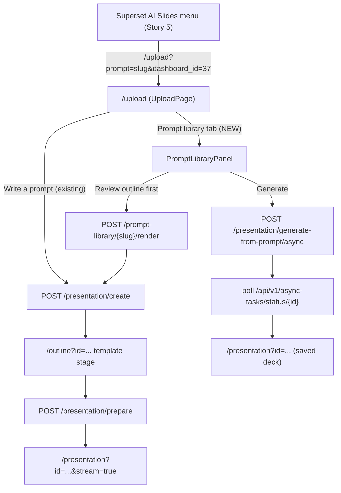
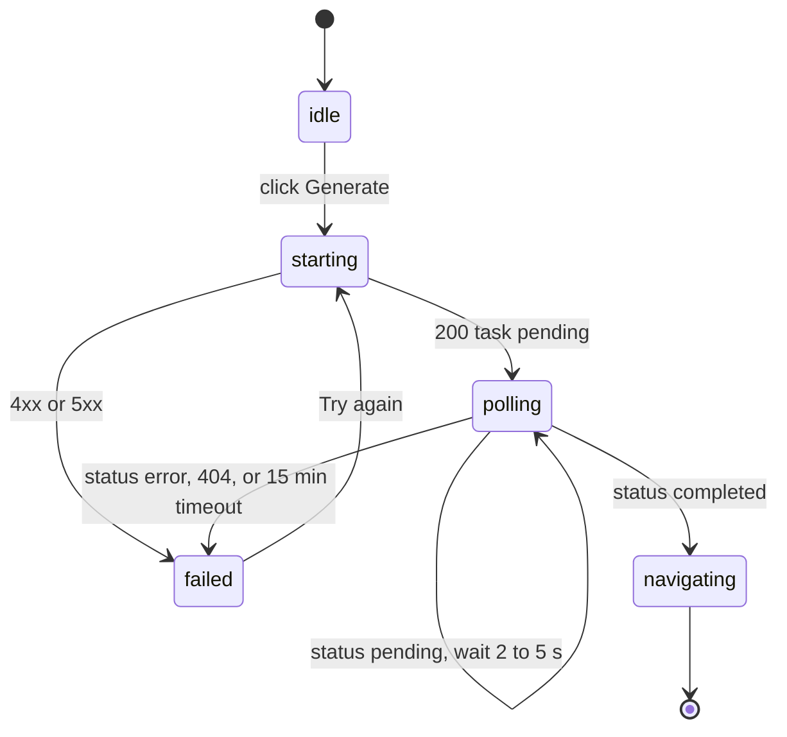
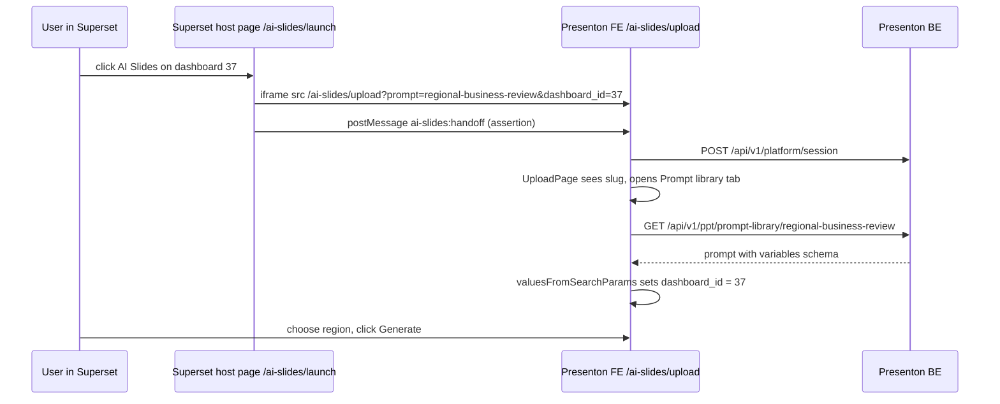

# Story 6: Prompt library and template UI

<div class="chapter-meta" markdown>
**Reads:** `servers/nextjs/app/(presentation-generator)/upload/components/UploadPage.tsx`, `servers/nextjs/app/(presentation-generator)/outline/components/TemplateSelection.tsx`, `servers/nextjs/app/(presentation-generator)/(dashboard)/templates/components/TemplatePanel.tsx`, `servers/nextjs/app/(presentation-generator)/hooks/useTemplateSummaries.ts`, `servers/nextjs/app/(presentation-generator)/services/api/template.ts`, `servers/nextjs/app/api/runtime-config/route.ts`  ·  **Builds on:** [Story 3, prompt library backend](44-story3-prompt-library-backend.md), [User journey](../presenton/21-user-journey.md)  ·  **Time:** ~45 min
</div>

## What you will learn

This chapter builds the browser half of the prompt library inside Presenton's Next.js app: where it attaches to the existing upload page, outline template stage and template library; how a runtime flag hides every custom template upload entry point; and the full TypeScript for an API client, data hooks, a searchable `PromptLibraryPanel`, a JSON Schema driven `PromptVariablesForm` with a dashboard picker, a `TemplatePicker` for bundled templates, and a `GenerateFromPromptButton` that starts Story 3's async generation, polls the task and navigates to the deck. It ends with deep links from Superset, analytics events, and `node --test` plus Cypress component tests that match the repository's setup.

## Step 1: The story, the owner and the acceptance criteria

| # | Story | What it does | Owners |
|---|---|---|---|
| 6 | [Presenton FE] Prompt library and template UI | Lets users browse and use curated prompts and select templates, with template upload on hold. | Radhika |

Acceptance criteria:

1. The upload page offers a **Prompt library** tab next to the free-text prompt. It lists prompts from `GET /api/v1/ppt/prompt-library` with search, category filters, loading, empty and error states.
2. Selecting a prompt shows a form generated from its `variables` JSON Schema. A field marked `x-ai-slides-widget: "dashboard"` renders a dashboard picker fed by the analytics catalog (`GET /api/v1/ai_slides/catalog`). Server validation errors appear on the matching fields.
3. A template picker shows the bundled templates from `GET /api/v1/ppt/templates/bundled` with thumbnails, a selected state and a **Recommended** badge; the recommended template is preselected.
4. **Generate** calls `POST /api/v1/ppt/presentation/generate-from-prompt/async`, polls `GET /api/v1/async-tasks/status/{id}`, shows progress, and navigates to `/presentation?id=...` on completion. Failures are shown with a retry.
5. **Review outline first** renders the prompt and continues through Presenton's existing outline page with the recommended template suggested.
6. With `AI_SLIDES_CUSTOM_TEMPLATES_ENABLED` off, no custom template entry point is visible (upload page, outline template stage, template library, template editor) and `/custom-template` redirects away.
7. `/upload?prompt=<slug>&dashboard_id=37` opens the library with that prompt selected and the dashboard prefilled. An unknown slug falls back to Presenton's existing free-text behavior.
8. Everything is operable by keyboard, has visible focus, and announces async progress to screen readers.

## Step 2: Where it plugs into Presenton's Next.js app

### 2.1 The upload page

`app/(presentation-generator)/upload/page.tsx` is a server component. It reads `PRESENTATION_GENERATION_MODE` and `PRESENTON_COMMUNITY_ENABLED` from the server environment and renders the client component `UploadPage` with them as props (`servers/nextjs/app/(presentation-generator)/upload/page.tsx:46` to `:65`). That is the pattern to copy for any server-known flag: read on the server, pass down.

`UploadPage` (`servers/nextjs/app/(presentation-generator)/upload/components/UploadPage.tsx:151`) keeps everything in local `useState`: a `PresentationConfig` (`:167` to `:177`, type in `upload/type.ts:122`), the uploaded files, the generation mode and an optional community reference. On mount it reads `window.location.search` directly (not `useSearchParams`) and already supports three query parameters (`:179` to `:225`): `prompt` (copied into the text box), `mode` (`standard` or `smart`) and `communityId`.

On Generate, `handleDirectPresentationGeneration` (`:535`) calls `PresentationGenerationApi.createPresentation` (`:549`, client at `services/api/presentation-generation.ts:82`, which posts to `/api/v1/ppt/presentation/create`), stores the config in Redux with `setPptGenUploadState` (`:568`), clears outlines, stores the presentation id, and pushes the destination from `getGenerationDestination` (`:309` to `:316`): `/outline?id=...` in standard mode, `/presentation?id=...&stream=true&type=smart` in smart mode. So Presenton's web flow never uses the async generate API; it is "create row, then stream". Story 6 adds a second, direct path through Story 3's async route.

### 2.2 The outline page and its template stage

`OutlinePage` (`servers/nextjs/app/(presentation-generator)/outline/components/OutlinePage.tsx:113`) starts in a template stage (`isTemplateStage`, `:127`). It reads `?template=` as `suggestedTemplate` (`:121`) and passes it to `TemplateSelection`, whose effect resolves the suggestion by id or by normalized name (`outline/components/TemplateSelection.tsx:53` to `:90`); `OutlinePage` preselects it only if nothing is selected yet (`OutlinePage.tsx:409`). Picking a template starts outline streaming; **Generate** calls `presentationPrepare` with `layout: selectedTemplateId` and replaces the route with `/presentation?id=...&stream=true&type=standard` (`outline/hooks/usePresentationGeneration.ts:107` to `:123`).

`TemplateSelection` loads templates through `useTemplateSummaries` (`TemplateSelection.tsx:50` to `:51`) and renders the **Build Templates** card `CreateCustomTemplate` in two places (`:154` to `:159` and `:174` to `:179`), hidden only when the provider is Presenton Cloud.

### 2.3 The template library and the custom template route

`(dashboard)/templates/page.tsx` redirects to `/dashboard` in smart-only mode and otherwise renders `TemplatePanel` (`servers/nextjs/app/(presentation-generator)/(dashboard)/templates/page.tsx:7` to `:18`). `TemplatePanel` shows tabs for built-in and custom templates and three custom template entry points: the **New Template** link (`TemplatePanel.tsx:116` to `:130`), the "create your own" link (`:138`), and `<CreateCustomTemplate libraryPage />` in the custom tab (`:152`). `CreateCustomTemplate` itself always navigates to `/custom-template` (`CreateCustomTemplate.tsx:22` to `:26`). The route `custom-template/page.tsx` is a `force-dynamic` server component with the same smart-mode redirect (`servers/nextjs/app/(presentation-generator)/custom-template/page.tsx:5` to `:16`). The template editor allows editing whenever `!template.is_default` (`template-preview/components/TemplatePreviewClient.tsx:275`).

### 2.4 How data is fetched and held

Presenton does not use RTK Query. Server data lives in hooks with `useState` and `useEffect`, such as `useTemplateSummaries` (`servers/nextjs/app/(presentation-generator)/hooks/useTemplateSummaries.ts:73`), which loads default and custom templates in parallel (`:106` to `:118`), and `useTemplateDetails` (`hooks/useTemplateDetails.ts:22`). API clients are classes with static methods under `app/(presentation-generator)/services/api/`, for example `TemplateService.getTemplateSummaries` (`services/api/template.ts:122` to `:140`), built on three helpers:

- `getApiUrl(path)` (`servers/nextjs/utils/api.ts:123`) routes paths that start with `/api/v1/` or `/api/v2/` to FastAPI and leaves other paths alone.
- `getHeader()` (`services/api/header.ts:1`) returns the JSON headers every client sends.
- `ApiResponseHandler.handleResponse` (`services/api/api-error-handler.ts:34`) returns parsed JSON or throws `ApiResponseError` with `status`, `code` and `retryable` (`:12` to `:31`).

Redux (`servers/nextjs/store/store.ts`) holds cross-page generation state: `presentationGeneration` (presentation id, outlines) and `pptGenUpload` (`setPptGenUploadState`, `store/slices/presentationGenUpload.ts:20`). Story 6 follows the same split: hooks for library data, and the two existing slices only when handing off to the outline page. No new slice is needed, because the selected prompt never has to survive a navigation; the direct path ends on the presentation page, and the outline path writes the rendered prompt into `pptGenUpload`.

### 2.5 The runtime-config route

`GET /api/runtime-config` (`servers/nextjs/app/api/runtime-config/route.ts:7` to `:19`) is a Next.js route handler: it checks the session with `authStatusForRequest`, then returns `readRuntimeProviderConfig()` (`servers/nextjs/lib/runtime-provider-config.ts:23`), which is `{configured, config}` with secrets redacted. `ConfigurationInitializer` fetches it for non-admin users (`servers/nextjs/app/ConfigurationInitializer.tsx:90` and `:346`); admins fetch `/api/user-config` instead (`:90`). Story 6 adds a `features` object to the runtime-config response and reads it with its own small hook, so admins and regular users see the same flags.



### 2.6 File plan

| File (under `servers/nextjs/`) | Status | Purpose |
|---|---|---|
| `lib/ai-slides-features.ts` | NEW | read flags from the server environment |
| `app/api/runtime-config/route.ts` | MODIFIED | add `features` to the response |
| `app/(presentation-generator)/hooks/useAiSlidesFeatures.ts` | NEW | cached client read of `features` |
| `app/(presentation-generator)/services/api/prompt-library.ts` | NEW | Presenton BE and Superset catalog clients |
| `utils/promptLibrary.ts` | NEW | schema, validation, deep-link and progress helpers |
| `app/(presentation-generator)/hooks/usePromptLibrary.ts` | NEW | list, detail and bundled template hooks |
| `app/(presentation-generator)/upload/components/prompt-library/*.tsx` | NEW | panel, cards, form, pickers, button |
| `app/(presentation-generator)/upload/components/UploadPage.tsx` | MODIFIED | tabs, deep link, outline hand-off |
| `app/(presentation-generator)/outline/components/TemplateSelection.tsx` | MODIFIED | hide Build Templates card |
| `app/(presentation-generator)/(dashboard)/templates/components/TemplatePanel.tsx` | MODIFIED | hide New Template links and card |
| `app/(presentation-generator)/template-preview/components/TemplatePreviewClient.tsx` | MODIFIED | read-only editor when disabled |
| `app/(presentation-generator)/custom-template/page.tsx` | MODIFIED | server redirect when disabled |
| `utils/mixpanel.ts` | MODIFIED | new `MixpanelEvent` members |
| `tests/prompt-library-utils.test.mjs`, `*.cy.tsx` | NEW | tests |

Nothing in the presentation editor, the outline page logic or the streaming pipeline changes. The direct path ends on `/presentation?id=...` exactly like a deck opened from the dashboard, so Story 4's refresh-on-open behavior applies to it without any special case.

## Step 3: UX design

### 3.1 Wireframe

```text
+--------------------------------------------------------------------------------+
|  Turn Ideas into Slides                                                        |
|  [ Write a prompt ]  [ Prompt library ]          Slides: Auto   Language: Auto  |
+--------------------------------------------------------------------------------+
|  Search prompts [______________________]                                       |
|  (All 12) (Business review 4) (Sales 3) (Operations 3) (Marketing 2)           |
|                                                                                |
|  +------------------+ +------------------+ +------------------+                |
|  | BUSINESS REVIEW  | | SALES            | | OPERATIONS       |                |
|  | Regional business| | Pipeline health  | | Weekly ops pulse |                |
|  | review        (*)| |                  | |                  |                |
|  | Live data 8 sl.  | | Live data        | | Live data  Org   |                |
|  +------------------+ +------------------+ +------------------+                |
|                                                                                |
|  -- Regional business review ------------------------------------------------- |
|  Dashboard  [ Sales overview (#37), 14 refreshable charts      v ]             |
|  Period     [ Last quarter v ]     Region [ EMEA v ]                           |
|  Audience   [ the leadership team ]                                            |
|                                                                                |
|  Template                                                                      |
|  +---------+ +---------+ +---------+ +---------+                               |
|  |thumbnail| |thumbnail| |thumbnail| |thumbnail|                               |
|  |Momentum | |Executive| |General  | |Modern   |                               |
|  |28 lay.  | |Recommend| |12 lay.  | |10 lay.  |                               |
|  +---------+ +---(*)---+ +---------+ +---------+                               |
|                                                                                |
|  [ Review outline first ]                         [ Generate presentation ]    |
|  Generating slides ........................ 3 of 8   [=========-------]         |
+--------------------------------------------------------------------------------+
```

### 3.2 States

| Region | Loading | Empty | Error |
|---|---|---|---|
| Prompt grid | 6 `Skeleton` cards (`components/ui/skeleton.tsx`) | "No prompts match" with a "Clear filters" button; "No prompts available" when the library itself is empty | message from the API plus **Try again** |
| Variables form | `Skeleton` rows while `GET /{slug}` loads | prompt with no variables shows "No inputs needed" | inline field errors from `422 invalid_variables`; banner for other errors |
| Dashboard picker | spinner text in the list | "No dashboards with refreshable charts" | "Dashboards could not be loaded" and a retry option |
| Templates | 4 skeleton thumbnails | "No bundled templates configured" | message plus retry |
| Generation | button shows "Starting..."; then progress with message | n/a | "Generation failed: ..." with **Try again**; 401 `data_token_missing` triggers a session refresh request (Story 5) |

### 3.3 Keyboard and accessibility

- Tabs use Radix `Tabs` (`components/ui/tabs.tsx`), which provides arrow-key navigation and `aria-selected`.
- Category filters are toggle buttons with `aria-pressed`.
- The prompt grid and the template grid are `role="radiogroup"` with roving `tabIndex`: Tab enters the group on the selected card, arrow keys move and select, Home and End jump. Cards are real `<button>` elements with `role="radio"` and `aria-checked`.
- Every form control has a `<Label htmlFor>`; errors are linked with `aria-describedby` and `aria-invalid`.
- The dashboard picker uses the `Popover` plus `Command` (cmdk) combobox pattern already shipped in `components/ui/popover.tsx` and `components/ui/command.tsx`.
- Progress lives in an `aria-live="polite"` region and uses the Radix `Progress` primitive (`components/ui/progress.tsx`).
- Focus rings use Presenton's existing `focus-visible:ring-2 focus-visible:ring-[#7A5AF8]` styling (as in `UploadPage.tsx:628`).

## Step 4: Deliver the runtime flag

### 4.1 Server side (NEW and MODIFIED)

```ts title="servers/nextjs/lib/ai-slides-features.ts (NEW)"
export type AiSlidesFeatures = {
  promptLibraryEnabled: boolean;
  customTemplatesEnabled: boolean;
  plannerEnabled: boolean;
};

export const DEFAULT_AI_SLIDES_FEATURES: AiSlidesFeatures = {
  promptLibraryEnabled: true,
  customTemplatesEnabled: false, // fail closed until the flag is known
  plannerEnabled: false,
};

const isTrue = (value: string | undefined) =>
  ["1", "true", "yes", "on"].includes((value ?? "").trim().toLowerCase());

/** Server-only: reads the same variables as the FastAPI backend. */
export function readAiSlidesFeatures(env: NodeJS.ProcessEnv = process.env): AiSlidesFeatures {
  return {
    promptLibraryEnabled:
      env.AI_SLIDES_PROMPT_LIBRARY_ENABLED === undefined
        ? true
        : isTrue(env.AI_SLIDES_PROMPT_LIBRARY_ENABLED),
    customTemplatesEnabled: isTrue(env.AI_SLIDES_CUSTOM_TEMPLATES_ENABLED),
    plannerEnabled: isTrue(env.AI_SLIDES_PLANNER_ENABLED),
  };
}
```

```ts title="servers/nextjs/app/api/runtime-config/route.ts (MODIFIED)"
import { NextResponse } from "next/server";
import { authStatusForRequest } from "@/lib/server-auth-role";
import { readRuntimeProviderConfig } from "@/lib/runtime-provider-config";
import { readAiSlidesFeatures } from "@/lib/ai-slides-features"; // NEW

export const dynamic = "force-dynamic";

export async function GET(request: Request) {
  const auth = await authStatusForRequest(request);
  if (!auth.authenticated) {
    return NextResponse.json({ detail: "Unauthorized" }, { status: 401 });
  }
  const features = readAiSlidesFeatures(); // NEW
  try {
    return NextResponse.json({ ...readRuntimeProviderConfig(), features });
  } catch {
    return NextResponse.json({ configured: false, config: {}, features }, { status: 200 });
  }
}
```

!!! warning "Gotcha"
    The flag is enforced by FastAPI (Story 3 returns `403 custom_templates_disabled`) and displayed by Next.js. Both pods must read the same value, so put `AI_SLIDES_CUSTOM_TEMPLATES_ENABLED` in one ConfigMap mounted by `presenton-be` and `presenton-fe` (Story 9). A mismatch is not a security issue (the backend wins) but shows users buttons that always fail. Also keep the variable name free of the `NEXT_PUBLIC_` prefix: those are inlined at build time, and the flag must change without rebuilding the image.

### 4.2 Client hook (NEW)

```ts title="servers/nextjs/app/(presentation-generator)/hooks/useAiSlidesFeatures.ts (NEW)"
"use client";

import { useEffect, useState } from "react";
import { DEFAULT_AI_SLIDES_FEATURES, type AiSlidesFeatures } from "@/lib/ai-slides-features";
import { withBasePath } from "@/utils/basePath"; // Story 5 seam: prefixes "/ai-slides"

let featuresRequest: Promise<AiSlidesFeatures> | null = null;

function loadFeatures(): Promise<AiSlidesFeatures> {
  featuresRequest ??= fetch(withBasePath("/api/runtime-config"), { cache: "no-store" })
    .then((response) => (response.ok ? response.json() : null))
    .then((body) => ({ ...DEFAULT_AI_SLIDES_FEATURES, ...(body?.features ?? {}) }))
    .catch(() => {
      featuresRequest = null; // retry on next mount
      return DEFAULT_AI_SLIDES_FEATURES;
    });
  return featuresRequest;
}

export function useAiSlidesFeatures() {
  const [features, setFeatures] = useState<AiSlidesFeatures | null>(null);
  useEffect(() => {
    let active = true;
    loadFeatures().then((value) => active && setFeatures(value));
    return () => {
      active = false;
    };
  }, []);
  return { features: features ?? DEFAULT_AI_SLIDES_FEATURES, loaded: features !== null };
}
```

!!! warning "Gotcha"
    `fetch("/api/runtime-config")` is resolved against the site origin, and Next.js applies `basePath` to `next/link` and router navigation, not to `fetch`. Behind `/ai-slides`, the existing calls in `ConfigurationInitializer.tsx:90` and `:346` hit Superset unless Story 5 prefixes them. This chapter assumes Story 5 ships a `withBasePath(path)` helper (recommended name, `utils/basePath.ts`) and uses it for every Next.js route handler call. FastAPI calls go through `getApiUrl` and are Story 5's concern in one place.

### 4.3 Hiding every custom template entry point (MODIFIED)

```tsx title="servers/nextjs/app/(presentation-generator)/outline/components/TemplateSelection.tsx (MODIFIED, excerpt)"
import { useAiSlidesFeatures } from "../../hooks/useAiSlidesFeatures"; // NEW
// ...
    const { features } = useAiSlidesFeatures();                          // NEW
    const canCreateTemplates = !presentonCloudOnly && features.customTemplatesEnabled;
// ... both places that rendered CreateCustomTemplate (was :154 and :174):
              {canCreateTemplates && (
                <CreateCustomTemplate selectionPage onClick={onCreateTemplate} />
              )}
```

In `TemplatePanel.tsx`, wrap the **New Template** link (`:116` to `:130`), replace the "Choose a template or create your own." paragraph (`:136` to `:141`) with "Choose a template." when disabled, and render `<CreateCustomTemplate libraryPage />` (`:152`) only when `features.customTemplatesEnabled`. In `TemplatePreviewClient.tsx:275` change the rule to `Boolean(template && !template.is_default && features.customTemplatesEnabled)` so the editor opens read-only. Finally, block the route on the server:

```tsx title="servers/nextjs/app/(presentation-generator)/custom-template/page.tsx (MODIFIED)"
import CustomTemplatePage from "./CustomTemplatePage";
import { redirect } from "next/navigation";
import { normalizePresentationGenerationMode } from "@/utils/presentationGenerationMode";
import { readAiSlidesFeatures } from "@/lib/ai-slides-features"; // NEW

export const dynamic = "force-dynamic";

export default function Page() {
    if (
        normalizePresentationGenerationMode(
            process.env.PRESENTATION_GENERATION_MODE,
        ) === "smart"
    ) {
        redirect("/dashboard");
    }
    if (!readAiSlidesFeatures().customTemplatesEnabled) {          // NEW
        redirect("/templates");
    }

    return <CustomTemplatePage />;
}
```

## Step 5: The API client (NEW)

The client follows `TemplateService`: static methods, `getApiUrl`, `getHeader`, `ApiResponseHandler`. One addition: `ApiResponseError` carries only `message`, `status` and `code`, so a `422 invalid_variables` would lose the per-field list. The client therefore reads `detail.errors` itself before falling back to the shared handler.

```ts title="servers/nextjs/app/(presentation-generator)/services/api/prompt-library.ts (NEW)"
import { getApiUrl } from "@/utils/api";
import { ApiResponseHandler } from "./api-error-handler";
import { getHeader } from "./header";
import type { AsyncTaskResponse } from "./template";

export type JsonSchema = {
  type?: string | string[];
  title?: string;
  description?: string;
  enum?: Array<string | number>;
  default?: unknown;
  minimum?: number;
  maximum?: number;
  minLength?: number;
  maxLength?: number;
  pattern?: string;
  properties?: Record<string, JsonSchema>;
  required?: string[];
  additionalProperties?: boolean;
  "x-ai-slides-widget"?: "dashboard";
};

export interface PromptSummary {
  slug: string;
  title: string;
  description?: string | null;
  category: string;
  tags: string[];
  recommended_template_id?: string | null;
  default_n_slides?: number | null;
  tone: string;
  verbosity: string;
  version: number;
  scope: "global" | "org";
  requires_dashboard: boolean;
}

export interface PromptDetail extends PromptSummary {
  variables: JsonSchema;
  prompt_template: string;
  instructions?: string | null;
}

export interface PromptListResponse {
  items: PromptSummary[];
  total: number;
  page: number;
  page_size: number;
  categories: Array<{ category: string; count: number }>;
}

export interface RenderPromptRequest {
  variables: Record<string, unknown>;
  template_id?: string | null;
  n_slides?: number | null;
  language?: string | null;
}

export interface RenderPromptResponse {
  slug: string;
  version: number;
  content: string;
  instructions: string | null;
  variables: Record<string, unknown>;
  n_slides: number | null;
  tone: string;
  verbosity: string;
  language: string | null;
  template_id: string;
  recommended_template_id: string | null;
}

export interface BundledTemplate {
  id: string;
  name: string;
  description?: string | null;
  layout_count: number;
  chart_layout_count: number;
  thumbnail?: string | null;
  recommended: boolean;
}

export interface GenerationTaskData {
  created_slides?: number;
  remaining_slides?: number;
  presentation_id?: string;
  path?: string;
  edit_path?: string;
}

export interface GenerationTask extends AsyncTaskResponse {
  data?: GenerationTaskData | null;
  error?: { status_code?: number; detail?: unknown } | null;
}

export interface FieldError {
  path: string; // JSON pointer, e.g. "/region"
  message: string;
}

export class PromptVariablesError extends Error {
  constructor(message: string, readonly fieldErrors: FieldError[]) {
    super(message);
    this.name = "PromptVariablesError";
  }
}

async function parse<T>(response: Response, fallback: string): Promise<T> {
  if (response.status === 422) {
    const body = await response.clone().json().catch(() => null);
    const detail = body?.detail;
    if (detail && !Array.isArray(detail) && Array.isArray(detail.errors)) {
      throw new PromptVariablesError(detail.message || fallback, detail.errors);
    }
  }
  return ApiResponseHandler.handleResponse(response, fallback);
}

export class PromptLibraryApi {
  static async list(
    params: { category?: string | null; q?: string; page?: number; pageSize?: number },
    signal?: AbortSignal,
  ): Promise<PromptListResponse> {
    const search = new URLSearchParams({
      page: String(params.page ?? 1),
      page_size: String(params.pageSize ?? 48),
    });
    if (params.category) search.set("category", params.category);
    if (params.q?.trim()) search.set("q", params.q.trim());
    const response = await fetch(getApiUrl(`/api/v1/ppt/prompt-library?${search}`), {
      headers: getHeader(),
      signal,
    });
    return parse(response, "Could not load the prompt library");
  }

  static async get(slug: string, signal?: AbortSignal): Promise<PromptDetail> {
    const response = await fetch(
      getApiUrl(`/api/v1/ppt/prompt-library/${encodeURIComponent(slug)}`),
      { headers: getHeader(), signal },
    );
    return parse(response, "Could not load the prompt");
  }

  static async render(slug: string, body: RenderPromptRequest): Promise<RenderPromptResponse> {
    const response = await fetch(
      getApiUrl(`/api/v1/ppt/prompt-library/${encodeURIComponent(slug)}/render`),
      { method: "POST", headers: getHeader(), body: JSON.stringify(body) },
    );
    return parse(response, "Could not prepare the prompt");
  }

  static async bundledTemplates(promptSlug?: string | null, signal?: AbortSignal) {
    const search = promptSlug ? `?${new URLSearchParams({ prompt_slug: promptSlug })}` : "";
    const response = await fetch(getApiUrl(`/api/v1/ppt/templates/bundled${search}`), {
      headers: getHeader(),
      signal,
    });
    const body = await parse<{ items: BundledTemplate[] }>(response, "Could not load templates");
    return body.items ?? [];
  }

  static async generateFromPrompt(
    body: RenderPromptRequest & { prompt_slug: string; export_as?: "pptx" | "pdf" },
  ): Promise<GenerationTask> {
    const response = await fetch(
      getApiUrl(`/api/v1/ppt/presentation/generate-from-prompt/async`),
      { method: "POST", headers: getHeader(), body: JSON.stringify(body), cache: "no-cache" },
    );
    return parse(response, "Could not start generation");
  }

  static async getTask(taskId: string, signal?: AbortSignal): Promise<GenerationTask> {
    const response = await fetch(
      getApiUrl(`/api/v1/async-tasks/status/${encodeURIComponent(taskId)}`),
      { headers: getHeader(), signal, cache: "no-store" },
    );
    return parse(response, "Could not read generation progress");
  }
}

/** Superset catalog (Story 8). Same origin as the parent app, NOT FastAPI. */
export interface CatalogChart {
  chart_id: number;
  slice_name: string;
  viz_type: string;
  datasource: string;
  dashboards: Array<{ id: number; dashboard_title: string }>;
  refreshable: boolean;
  reason: string | null;
}

export class AnalyticsCatalogApi {
  static async search(
    params: { q?: string; dashboardId?: number; page?: number },
    signal?: AbortSignal,
  ): Promise<CatalogChart[]> {
    const url = new URL("/api/v1/ai_slides/catalog", window.location.origin);
    if (params.q?.trim()) url.searchParams.set("q", params.q.trim());
    if (params.dashboardId) url.searchParams.set("dashboard_id", String(params.dashboardId));
    url.searchParams.set("page", String(params.page ?? 0));
    const response = await fetch(url.toString(), {
      credentials: "same-origin",
      headers: { Accept: "application/json" },
      signal,
    });
    const body = await ApiResponseHandler.handleResponse(response, "Could not load dashboards");
    return Array.isArray(body) ? body : (body?.result ?? []);
  }
}
```

!!! warning "Gotcha"
    Never wrap the catalog URL in `getApiUrl`. It treats every path starting with `/api/v1/` as a FastAPI path (`utils/api.ts:129` to `:131`) and would send the request to Presenton, which has no such route. With same-origin routing (contract §2), `/api/v1/ai_slides/...` at the site root is Superset, and the browser attaches Superset's session cookie automatically. The shape of each `dashboards` entry (`{id, dashboard_title}`) is a local assumption to confirm with Story 8; the contract only says "dashboards".

### 5.1 Error codes the UI handles

Story 3 returns structured `detail` objects, which `extractApiErrorMetadata` (`servers/nextjs/utils/apiErrorMessages.ts:21`) turns into `ApiResponseError.code`. The UI reacts to these codes, never to message text:

| Status and code | Source | UI behavior |
|---|---|---|
| `404 prompt_not_found` | detail, render, generate | deep link: fall back to free text; otherwise "This prompt is no longer available" and reload the list |
| `422 invalid_variables`, `missing_variables` | render, generate | map `errors[].path` to fields with `fieldErrorsToMap`; focus stays on the button |
| `422 prompt_too_long` | render, generate | form-level error; usually means a free-text input is near its limit |
| `422` with a list `detail` | FastAPI body validation (for example `n_slides` above 50) | form-level error from the shared handler's message |
| `400 Template not found...` | `check_if_api_request_is_valid` | reload bundled templates and clear the selection |
| `401 data_token_missing` | generate (planner enabled) | ask the Superset parent for a new handoff, then let the user retry |
| `403 custom_templates_disabled` | any template creation route | should never be reachable from the UI; log it as a gating bug |
| task `status: "error"`, `error.detail` such as `planner_status_503` | polling | "Generation failed" with the detail and **Try again** |

## Step 6: Pure helpers and data hooks

### 6.1 Schema to fields (NEW)

Keeping schema logic in a framework-free module makes it testable with `node --test`.

```ts title="servers/nextjs/utils/promptLibrary.ts (NEW)"
import type { CatalogChart, FieldError, GenerationTask, JsonSchema } from "@/app/(presentation-generator)/services/api/prompt-library";

export type FieldKind = "dashboard" | "enum" | "text" | "integer" | "number" | "boolean" | "unsupported";

export interface VariableField {
  name: string;
  label: string;
  description?: string;
  kind: FieldKind;
  required: boolean;
  options?: Array<string | number>;
  defaultValue?: unknown;
  min?: number;
  max?: number;
  maxLength?: number;
  pattern?: string;
}

export const PROMPT_SLUG_RE = /^[a-z0-9][a-z0-9-]{1,63}$/;
export const isPromptSlug = (value?: string | null): value is string =>
  typeof value === "string" && PROMPT_SLUG_RE.test(value);

const humanize = (name: string) =>
  name.replace(/_/g, " ").replace(/^\w/, (c) => c.toUpperCase());

export function schemaToFields(schema: JsonSchema | null | undefined): VariableField[] {
  const required = new Set(schema?.required ?? []);
  return Object.entries(schema?.properties ?? {}).map(([name, prop]) => {
    const type = Array.isArray(prop.type) ? prop.type.find((t) => t !== "null") : prop.type;
    const kind: FieldKind =
      prop["x-ai-slides-widget"] === "dashboard" ? "dashboard"
      : prop.enum ? "enum"
      : type === "string" ? "text"
      : type === "integer" ? "integer"
      : type === "number" ? "number"
      : type === "boolean" ? "boolean"
      : "unsupported";
    return {
      name, kind,
      label: prop.title ?? humanize(name),
      description: prop.description,
      required: required.has(name),
      options: prop.enum,
      defaultValue: prop.default,
      min: prop.minimum, max: prop.maximum,
      maxLength: prop.maxLength, pattern: prop.pattern,
    };
  });
}

export function initialValues(fields: VariableField[], overrides: Record<string, unknown> = {}) {
  const values: Record<string, unknown> = {};
  for (const field of fields) {
    if (field.name in overrides) values[field.name] = overrides[field.name];
    else if (field.defaultValue !== undefined) values[field.name] = field.defaultValue;
  }
  return values;
}

/** Fast client-side checks; the server (jsonschema) stays authoritative. */
export function validateValues(fields: VariableField[], values: Record<string, unknown>) {
  const errors: Record<string, string> = {};
  for (const f of fields) {
    const v = values[f.name];
    const empty = v === undefined || v === null || v === "";
    if (empty) {
      if (f.required) errors[f.name] = `${f.label} is required`;
      continue;
    }
    if ((f.kind === "integer" || f.kind === "number" || f.kind === "dashboard") && typeof v === "number") {
      if (f.kind !== "number" && !Number.isInteger(v)) errors[f.name] = "Use a whole number";
      else if (f.min !== undefined && v < f.min) errors[f.name] = `Must be at least ${f.min}`;
      else if (f.max !== undefined && v > f.max) errors[f.name] = `Must be at most ${f.max}`;
    }
    if (f.kind === "enum" && f.options && !f.options.includes(v as string | number)) {
      errors[f.name] = "Choose one of the options";
    }
    if (f.kind === "text" && typeof v === "string") {
      if (f.maxLength !== undefined && v.length > f.maxLength) errors[f.name] = `At most ${f.maxLength} characters`;
      else if (f.pattern) {
        try {
          if (!new RegExp(f.pattern).test(v)) errors[f.name] = "Contains characters that are not allowed";
        } catch {
          /* pattern only valid server side; let the server decide */
        }
      }
    }
  }
  return errors;
}

export function coerceParam(field: VariableField, raw: string): unknown {
  const value = raw.trim();
  if (!value) return undefined;
  if (field.kind === "integer" || field.kind === "dashboard") {
    return /^\d{1,12}$/.test(value) ? Number(value) : undefined;
  }
  if (field.kind === "number") return Number.isFinite(Number(value)) ? Number(value) : undefined;
  if (field.kind === "boolean") return value === "true" ? true : value === "false" ? false : undefined;
  if (field.kind === "enum") return field.options?.find((o) => String(o) === value);
  if (field.kind === "text") return value.slice(0, field.maxLength ?? 200);
  return undefined;
}

/** Only schema-declared names are read; everything else in the URL is ignored. */
export function valuesFromSearchParams(fields: VariableField[], params: URLSearchParams) {
  const values: Record<string, unknown> = {};
  for (const field of fields) {
    const raw = params.get(field.name);
    if (raw === null) continue;
    const coerced = coerceParam(field, raw);
    if (coerced !== undefined) values[field.name] = coerced;
  }
  return values;
}

export const fieldErrorsToMap = (errors: FieldError[]) =>
  Object.fromEntries(errors.map((e) => [e.path.replace(/^\//, "").split("/")[0] || "_form", e.message]));

export function taskProgressPercent(task: GenerationTask | null): number {
  if (!task) return 0;
  if (task.status === "completed") return 100;
  const created = task.data?.created_slides ?? 0;
  const total = created + (task.data?.remaining_slides ?? 0);
  return total > 0 ? Math.min(95, Math.round(5 + (created / total) * 85)) : 5;
}

export function dashboardsFromCatalog(charts: CatalogChart[]) {
  const byId = new Map<number, { id: number; title: string; refreshableCharts: number }>();
  for (const chart of charts) {
    for (const d of chart.dashboards ?? []) {
      const entry = byId.get(d.id) ?? { id: d.id, title: d.dashboard_title, refreshableCharts: 0 };
      if (chart.refreshable) entry.refreshableCharts += 1;
      byId.set(d.id, entry);
    }
  }
  return [...byId.values()].filter((d) => d.refreshableCharts > 0).sort((a, b) => a.title.localeCompare(b.title));
}

/** Allow only in-app presentation routes from task data (no open redirects). */
export const safeEditPath = (task: GenerationTask) => {
  const path = task.data?.edit_path;
  if (path && path.startsWith("/presentation?")) return path;
  return task.data?.presentation_id ? `/presentation?id=${encodeURIComponent(task.data.presentation_id)}` : null;
};
```

### 6.2 Hooks (NEW)

```ts title="servers/nextjs/app/(presentation-generator)/hooks/usePromptLibrary.ts (NEW)"
"use client";

import { useEffect, useState } from "react";
import {
  PromptLibraryApi, type BundledTemplate, type PromptDetail, type PromptListResponse,
} from "../services/api/prompt-library";

const message = (e: unknown, fallback: string) => (e instanceof Error ? e.message : fallback);

function useDebounced<T>(value: T, delayMs: number) {
  const [debounced, setDebounced] = useState(value);
  useEffect(() => {
    const id = setTimeout(() => setDebounced(value), delayMs);
    return () => clearTimeout(id);
  }, [value, delayMs]);
  return debounced;
}

export function usePromptLibrary({ category, query }: { category: string | null; query: string }) {
  const [data, setData] = useState<PromptListResponse | null>(null);
  const [loading, setLoading] = useState(true);
  const [error, setError] = useState<string | null>(null);
  const [reloadKey, setReloadKey] = useState(0);
  const q = useDebounced(query, 250);

  useEffect(() => {
    const controller = new AbortController();
    setLoading(true);
    setError(null);
    PromptLibraryApi.list({ category, q }, controller.signal)
      .then(setData)
      .catch((e) => !controller.signal.aborted && setError(message(e, "Could not load prompts")))
      .finally(() => !controller.signal.aborted && setLoading(false));
    return () => controller.abort();
  }, [category, q, reloadKey]);

  return {
    items: data?.items ?? [],
    categories: data?.categories ?? [],
    loading, error,
    reload: () => setReloadKey((k) => k + 1),
  };
}

export function usePromptDetail(slug: string | null) {
  const [prompt, setPrompt] = useState<PromptDetail | null>(null);
  const [loading, setLoading] = useState(false);
  const [error, setError] = useState<{ message: string; status?: number } | null>(null);

  useEffect(() => {
    if (!slug) {
      setPrompt(null);
      return;
    }
    const controller = new AbortController();
    setLoading(true);
    setError(null);
    PromptLibraryApi.get(slug, controller.signal)
      .then(setPrompt)
      .catch((e) => !controller.signal.aborted &&
        setError({ message: message(e, "Could not load the prompt"), status: (e as { status?: number }).status }))
      .finally(() => !controller.signal.aborted && setLoading(false));
    return () => controller.abort();
  }, [slug]);

  return { prompt, loading, error };
}

export function useBundledTemplates(promptSlug: string | null) {
  const [templates, setTemplates] = useState<BundledTemplate[]>([]);
  const [loading, setLoading] = useState(true);
  const [error, setError] = useState<string | null>(null);

  useEffect(() => {
    const controller = new AbortController();
    setLoading(true);
    PromptLibraryApi.bundledTemplates(promptSlug, controller.signal)
      .then((items) => { setTemplates(items); setError(null); })
      .catch((e) => !controller.signal.aborted && setError(message(e, "Could not load templates")))
      .finally(() => !controller.signal.aborted && setLoading(false));
    return () => controller.abort();
  }, [promptSlug]);

  return { templates, loading, error };
}
```

!!! warning "Gotcha"
    Deep-link parameters are read once, from `window.location.search` inside `UploadPage`'s mount effect (`UploadPage.tsx:180`), and passed down as `deepLinkParams`; the panel never calls `useSearchParams`. In the App Router, a client component that calls `useSearchParams` needs a `<Suspense>` boundary above it (the `outline` and `upload` routes get one from their `loading.tsx` files). Reading the URL in one place keeps that requirement out of the reusable components and keeps them mountable in Cypress, and it means a later `router.replace` that cleans the URL does not re-trigger prefilling.

## Step 7: The components (NEW)

All components live in `servers/nextjs/app/(presentation-generator)/upload/components/prompt-library/`. They take callbacks (`onNavigate`, `onReviewOutline`) instead of calling `useRouter` or `useDispatch` themselves, which keeps them mountable in Cypress component tests without a Next.js router or Redux store.

### 7.1 `PromptCard`

```tsx title="upload/components/prompt-library/PromptCard.tsx (NEW)"
"use client";

import { memo } from "react";
import { BarChart3, Check } from "lucide-react";
import { cn } from "@/lib/utils";
import type { PromptSummary } from "../../../services/api/prompt-library";

export const PromptCard = memo(function PromptCard({
  prompt, selected, tabIndex, onSelect,
}: {
  prompt: PromptSummary;
  selected: boolean;
  tabIndex: number;
  onSelect: (slug: string) => void;
}) {
  return (
    <button
      type="button"
      role="radio"
      aria-checked={selected}
      tabIndex={tabIndex}
      data-slug={prompt.slug}
      onClick={() => onSelect(prompt.slug)}
      className={cn(
        "flex h-full w-full flex-col gap-2 rounded-xl border bg-white p-4 text-left transition-colors",
        "focus-visible:outline-none focus-visible:ring-2 focus-visible:ring-[#7A5AF8]",
        selected ? "border-[#7A5AF8] ring-2 ring-[#7A5AF8]/20" : "border-[#EDEEEF] hover:border-[#D8D3FA]",
      )}
    >
      <span className="flex items-center justify-between gap-2">
        <span className="font-syne text-[11px] font-semibold uppercase tracking-wide text-[#6553E8]">
          {prompt.category.replace(/-/g, " ")}
        </span>
        {selected && <Check aria-hidden="true" className="h-4 w-4 text-[#7A5AF8]" />}
      </span>
      <span className="font-manrope text-sm font-semibold text-[#191919]">{prompt.title}</span>
      {prompt.description && <span className="line-clamp-2 text-xs text-[#4C4C4C]">{prompt.description}</span>}
      <span className="mt-auto flex flex-wrap items-center gap-1.5 pt-1 text-[11px] text-[#808080]">
        {prompt.requires_dashboard && (
          <span className="inline-flex items-center gap-1 rounded-full bg-[#F4F2FF] px-2 py-0.5 text-[#5141E5]">
            <BarChart3 aria-hidden="true" className="h-3 w-3" /> Live data
          </span>
        )}
        {prompt.scope === "org" && <span className="rounded-full bg-[#F6F6F9] px-2 py-0.5">Your org</span>}
        {prompt.default_n_slides ? <span>{prompt.default_n_slides} slides</span> : null}
      </span>
    </button>
  );
});
```

A shared roving-focus handler for both radio grids:

```ts title="upload/components/prompt-library/rovingRadio.ts (NEW)"
import type { KeyboardEvent } from "react";

export function handleRadioGridKeyDown(event: KeyboardEvent<HTMLElement>, onSelect: (id: string) => void, attr: string) {
  const radios = Array.from(event.currentTarget.querySelectorAll<HTMLElement>('[role="radio"]'));
  const index = radios.indexOf(document.activeElement as HTMLElement);
  if (index < 0) return;
  const next =
    event.key === "ArrowRight" || event.key === "ArrowDown" ? (index + 1) % radios.length
    : event.key === "ArrowLeft" || event.key === "ArrowUp" ? (index - 1 + radios.length) % radios.length
    : event.key === "Home" ? 0
    : event.key === "End" ? radios.length - 1
    : -1;
  if (next < 0) return;
  event.preventDefault();
  radios[next].focus();
  const id = radios[next].getAttribute(attr);
  if (id) onSelect(id);
}
```

### 7.2 `PromptVariablesForm` and `DashboardPicker`

```tsx title="upload/components/prompt-library/PromptVariablesForm.tsx (NEW)"
"use client";

import { Input } from "@/components/ui/input";
import { Label } from "@/components/ui/label";
import { Switch } from "@/components/ui/switch";
import { Select, SelectContent, SelectItem, SelectTrigger, SelectValue } from "@/components/ui/select";
import type { VariableField } from "@/utils/promptLibrary";
import { DashboardPicker } from "./DashboardPicker";

export function PromptVariablesForm({
  fields, values, errors, disabled, onChange,
}: {
  fields: VariableField[];
  values: Record<string, unknown>;
  errors: Record<string, string>;
  disabled?: boolean;
  onChange: (name: string, value: unknown) => void;
}) {
  if (fields.length === 0) return <p className="text-sm text-[#4C4C4C]">No inputs needed for this prompt.</p>;

  return (
    <div className="grid grid-cols-1 gap-4 sm:grid-cols-2" data-testid="prompt-variables-form">
      {fields.map((field) => {
        const id = `prompt-var-${field.name}`;
        const errorId = `${id}-error`;
        const error = errors[field.name];
        const common = {
          id,
          disabled,
          "aria-invalid": Boolean(error),
          "aria-describedby": error ? errorId : field.description ? `${id}-help` : undefined,
        };
        return (
          <div key={field.name} className={field.kind === "dashboard" ? "sm:col-span-2" : undefined}>
            <Label htmlFor={id} className="mb-1.5 block text-[13px] font-medium text-[#191919]">
              {field.label}
              {field.required && <span aria-hidden="true" className="text-[#7A5AF8]"> *</span>}
            </Label>

            {field.kind === "dashboard" && (
              <DashboardPicker
                {...common}
                value={typeof values[field.name] === "number" ? (values[field.name] as number) : null}
                onChange={(dashboardId) => onChange(field.name, dashboardId)}
              />
            )}

            {field.kind === "enum" && (
              <Select
                value={values[field.name] === undefined ? undefined : String(values[field.name])}
                onValueChange={(raw) => onChange(field.name, field.options?.find((o) => String(o) === raw))}
                disabled={disabled}
              >
                <SelectTrigger {...common}><SelectValue placeholder={`Choose ${field.label.toLowerCase()}`} /></SelectTrigger>
                <SelectContent>
                  {field.options?.map((option) => (
                    <SelectItem key={String(option)} value={String(option)}>{String(option)}</SelectItem>
                  ))}
                </SelectContent>
              </Select>
            )}

            {(field.kind === "text" || field.kind === "integer" || field.kind === "number") && (
              <Input
                {...common}
                type={field.kind === "text" ? "text" : "number"}
                inputMode={field.kind === "integer" ? "numeric" : undefined}
                min={field.min}
                max={field.max}
                maxLength={field.maxLength}
                value={values[field.name] === undefined ? "" : String(values[field.name])}
                onChange={(event) => {
                  const raw = event.target.value;
                  onChange(field.name, field.kind === "text" ? raw : raw === "" ? undefined : Number(raw));
                }}
              />
            )}

            {field.kind === "boolean" && (
              <Switch {...common} checked={values[field.name] === true}
                      onCheckedChange={(checked) => onChange(field.name, checked)} />
            )}

            {field.kind === "unsupported" && (
              <p className="text-xs text-[#808080]">This input is set automatically.</p>
            )}

            {field.description && !error && (
              <p id={`${id}-help`} className="mt-1 text-xs text-[#808080]">{field.description}</p>
            )}
            {error && <p id={errorId} role="alert" className="mt-1 text-xs text-[#D92D20]">{error}</p>}
          </div>
        );
      })}
    </div>
  );
}
```

```tsx title="upload/components/prompt-library/DashboardPicker.tsx (NEW)"
"use client";

import { useEffect, useMemo, useState } from "react";
import { ChevronsUpDown } from "lucide-react";
import { Button } from "@/components/ui/button";
import { Popover, PopoverContent, PopoverTrigger } from "@/components/ui/popover";
import { Command, CommandEmpty, CommandGroup, CommandInput, CommandItem, CommandList } from "@/components/ui/command";
import { AnalyticsCatalogApi, type CatalogChart } from "../../../services/api/prompt-library";
import { dashboardsFromCatalog } from "@/utils/promptLibrary";

export function DashboardPicker({
  id, value, onChange, disabled, ...aria
}: {
  id: string;
  value: number | null;
  onChange: (dashboardId: number | null) => void;
  disabled?: boolean;
  "aria-invalid"?: boolean;
  "aria-describedby"?: string;
}) {
  const [open, setOpen] = useState(false);
  const [query, setQuery] = useState("");
  const [charts, setCharts] = useState<CatalogChart[]>([]);
  const [state, setState] = useState<"idle" | "loading" | "error">("idle");

  useEffect(() => {
    const controller = new AbortController();
    const timer = setTimeout(() => {
      setState("loading");
      AnalyticsCatalogApi.search({ q: query }, controller.signal)
        .then((items) => { setCharts(items); setState("idle"); })
        .catch(() => !controller.signal.aborted && setState("error"));
    }, 250);
    return () => { clearTimeout(timer); controller.abort(); };
  }, [query]);

  const dashboards = useMemo(() => dashboardsFromCatalog(charts), [charts]);
  const selected = dashboards.find((d) => d.id === value);

  return (
    <Popover open={open} onOpenChange={setOpen}>
      <PopoverTrigger asChild>
        <Button id={id} type="button" variant="outline" role="combobox" aria-expanded={open}
                disabled={disabled} className="w-full justify-between font-normal" {...aria}>
          {selected ? `${selected.title} (#${selected.id}), ${selected.refreshableCharts} refreshable charts`
            : value ? `Dashboard #${value}` : "Choose a dashboard"}
          <ChevronsUpDown aria-hidden="true" className="opacity-50" />
        </Button>
      </PopoverTrigger>
      <PopoverContent className="w-[--radix-popover-trigger-width] p-0" align="start">
        <Command shouldFilter={false}>
          <CommandInput placeholder="Search dashboards or charts" value={query} onValueChange={setQuery} />
          <CommandList>
            {state === "loading" && <div className="p-3 text-sm text-[#808080]">Loading dashboards...</div>}
            {state === "error" && <div className="p-3 text-sm text-[#D92D20]">Dashboards could not be loaded.</div>}
            {state === "idle" && <CommandEmpty>No dashboards with refreshable charts.</CommandEmpty>}
            <CommandGroup>
              {dashboards.map((d) => (
                <CommandItem key={d.id} value={String(d.id)} onSelect={() => { onChange(d.id); setOpen(false); }}>
                  <span className="flex-1">{d.title}</span>
                  <span className="text-xs text-[#808080]">{d.refreshableCharts} charts</span>
                </CommandItem>
              ))}
            </CommandGroup>
          </CommandList>
        </Command>
      </PopoverContent>
    </Popover>
  );
}
```

!!! warning "Gotcha"
    A dashboard appearing in the picker is a convenience, not a permission. The catalog runs as the logged-in Superset user, so it only lists what that user can access, but a deep link can still carry `dashboard_id=999`. The form shows "Dashboard #999" and lets the request through; the planner and refresh API then evaluate access under the user's data token (Stories 7 and 8) and exclude what the user may not see. Do not add client-side "access checks" that could be mistaken for enforcement.

### 7.3 `TemplatePicker`

It reuses `TemplateThumbnailPreview` (`servers/nextjs/app/(presentation-generator)/components/TemplateListUi.tsx:24`), which resolves `/app_data/...` thumbnails through `resolveBackendAssetUrl` (`:35`) and draws a placeholder when there is none. The existing `TemplateListCard` (`:72`) is a `role="button"` card with a fixed "Suggested" label; a picker needs radio semantics and a "Recommended" label, so the card is new while the thumbnail is shared.

```tsx title="upload/components/prompt-library/TemplatePicker.tsx (NEW)"
"use client";

import { CheckCircle2 } from "lucide-react";
import { cn } from "@/lib/utils";
import { Skeleton } from "@/components/ui/skeleton";
import { TemplateThumbnailPreview } from "../../../components/TemplateListUi";
import type { BundledTemplate } from "../../../services/api/prompt-library";
import { handleRadioGridKeyDown } from "./rovingRadio";

export function TemplatePicker({
  templates, loading, error, selectedId, onSelect,
}: {
  templates: BundledTemplate[];
  loading: boolean;
  error: string | null;
  selectedId: string | null;
  onSelect: (id: string) => void;
}) {
  if (loading) {
    return (
      <div className="grid grid-cols-2 gap-3 md:grid-cols-4" aria-busy="true">
        {Array.from({ length: 4 }, (_, i) => <Skeleton key={i} className="aspect-video w-full rounded-xl" />)}
      </div>
    );
  }
  if (error) return <p role="alert" className="text-sm text-[#D92D20]">Templates could not be loaded: {error}</p>;
  if (templates.length === 0) return <p className="text-sm text-[#4C4C4C]">No bundled templates configured.</p>;

  const focusId = selectedId ?? templates[0].id;
  return (
    <div
      role="radiogroup"
      aria-label="Template"
      className="grid grid-cols-2 gap-3 md:grid-cols-4"
      onKeyDown={(event) => handleRadioGridKeyDown(event, onSelect, "data-template-id")}
    >
      {templates.map((template) => {
        const selected = template.id === selectedId;
        return (
          <button
            key={template.id}
            type="button"
            role="radio"
            aria-checked={selected}
            tabIndex={template.id === focusId ? 0 : -1}
            data-template-id={template.id}
            onClick={() => onSelect(template.id)}
            className={cn(
              "relative overflow-hidden rounded-xl border bg-white text-left",
              "focus-visible:outline-none focus-visible:ring-2 focus-visible:ring-[#7A5AF8]",
              selected ? "border-[#7A5AF8] ring-2 ring-[#7A5AF8]/25" : "border-[#EDEEEF] hover:border-[#D8D3FA]",
            )}
          >
            <div className="relative aspect-video bg-[#F8FBFB]">
              <TemplateThumbnailPreview thumbnail={template.thumbnail} templateName={template.name} flush />
              {selected && (
                <CheckCircle2 aria-hidden="true" className="absolute right-2 top-2 h-5 w-5 rounded-full bg-white text-[#7A5AF8]" />
              )}
            </div>
            <div className="flex items-center justify-between gap-2 border-t border-[#EDEEEF] px-3 py-2">
              <span className="truncate font-syne text-sm font-semibold capitalize text-[#191919]">{template.name}</span>
              {template.recommended ? (
                <span className="shrink-0 rounded-full bg-[#F4F2FF] px-2 py-0.5 text-[10px] font-semibold text-[#5141E5]">
                  Recommended
                </span>
              ) : (
                <span className="shrink-0 text-[11px] text-[#808080]">{template.chart_layout_count} chart layouts</span>
              )}
            </div>
          </button>
        );
      })}
    </div>
  );
}
```

### 7.4 `GenerateFromPromptButton`



```tsx title="upload/components/prompt-library/GenerateFromPromptButton.tsx (NEW)"
"use client";

import { useEffect, useRef, useState } from "react";
import { Button } from "@/components/ui/button";
import { Progress } from "@/components/ui/progress";
import {
  PromptLibraryApi, PromptVariablesError, type FieldError, type GenerationTask, type RenderPromptRequest,
} from "../../../services/api/prompt-library";
import { safeEditPath, taskProgressPercent } from "@/utils/promptLibrary";
import { MixpanelEvent, trackEvent } from "@/utils/mixpanel";

const MAX_WAIT_MS = 15 * 60 * 1000;
type Phase = "idle" | "starting" | "polling" | "navigating" | "failed";

export function GenerateFromPromptButton({
  promptSlug, request, disabled, onValidate, onFieldErrors, onNavigate, onSessionExpired,
}: {
  promptSlug: string;
  request: RenderPromptRequest;
  disabled?: boolean;
  onValidate: () => boolean;
  onFieldErrors: (errors: FieldError[]) => void;
  onNavigate: (path: string) => void;
  onSessionExpired?: () => void;
}) {
  const [phase, setPhase] = useState<Phase>("idle");
  const [task, setTask] = useState<GenerationTask | null>(null);
  const [error, setError] = useState<string | null>(null);
  const abortRef = useRef<AbortController | null>(null);

  useEffect(() => () => abortRef.current?.abort(), []);

  const poll = async (taskId: string, startedAt: number, signal: AbortSignal) => {
    let delay = 2000;
    while (!signal.aborted) {
      await new Promise((resolve) => setTimeout(resolve, delay));
      if (signal.aborted) return;
      let current: GenerationTask;
      try {
        current = await PromptLibraryApi.getTask(taskId, signal);
      } catch (e) {
        if (signal.aborted) return;
        const status = (e as { status?: number }).status;
        if (status === 404) throw new Error("The generation task was lost, please try again.");
        delay = Math.min(delay * 2, 10000); // transient error: back off and keep polling
        continue;
      }
      setTask(current);
      if (current.status === "completed") return current;
      if (current.status === "error") {
        const detail = current.error?.detail;
        throw new Error(typeof detail === "string" ? detail : current.message || "Generation failed");
      }
      if (Date.now() - startedAt > MAX_WAIT_MS) throw new Error("Generation is taking too long.");
      delay = Date.now() - startedAt > 60000 ? 5000 : 2000;
    }
  };

  const start = async () => {
    if (!onValidate()) return;
    abortRef.current?.abort();
    const controller = new AbortController();
    abortRef.current = controller;
    setPhase("starting");
    setError(null);
    setTask(null);
    const startedAt = Date.now();
    trackEvent(MixpanelEvent.PromptLibrary_Generation_Started, {
      prompt_slug: promptSlug, template_id: request.template_id, n_slides: request.n_slides ?? null,
      variable_keys: Object.keys(request.variables).sort().join(","),
    });
    try {
      const created = await PromptLibraryApi.generateFromPrompt({ prompt_slug: promptSlug, ...request });
      setTask(created);
      setPhase("polling");
      const done = await poll(created.id, startedAt, controller.signal);
      if (!done) return; // unmounted
      const path = safeEditPath(done);
      trackEvent(MixpanelEvent.PromptLibrary_Generation_Completed, {
        prompt_slug: promptSlug, duration_ms: Date.now() - startedAt,
        slides: done.data?.created_slides ?? null,
      });
      if (path) {
        setPhase("navigating");
        onNavigate(path);
      }
    } catch (e) {
      if (controller.signal.aborted) return;
      if (e instanceof PromptVariablesError) onFieldErrors(e.fieldErrors);
      if ((e as { code?: string }).code === "data_token_missing") onSessionExpired?.();
      const text = e instanceof Error ? e.message : "Generation failed";
      setError(text);
      setPhase("failed");
      trackEvent(MixpanelEvent.PromptLibrary_Generation_Failed, {
        prompt_slug: promptSlug, code: (e as { code?: string }).code ?? null,
      });
    }
  };

  const busy = phase === "starting" || phase === "polling" || phase === "navigating";
  return (
    <div className="flex flex-col items-stretch gap-2 sm:items-end">
      <Button type="button" onClick={start} disabled={disabled || busy} aria-describedby="prompt-generation-status"
              className="bg-[#7A5AF8] text-white hover:bg-[#6553E8]">
        {phase === "starting" ? "Starting..." : busy ? "Generating..." : phase === "failed" ? "Try again" : "Generate presentation"}
      </Button>
      <div id="prompt-generation-status" aria-live="polite" className="min-h-[36px] w-full sm:w-80">
        {busy && (
          <>
            <p className="text-xs text-[#4C4C4C]">
              {task?.message ?? "Queued for generation"}
              {task?.data?.created_slides !== undefined && task.data.remaining_slides !== undefined &&
                ` (${task.data.created_slides} of ${task.data.created_slides + task.data.remaining_slides} slides)`}
            </p>
            <Progress value={taskProgressPercent(task)} aria-label="Generation progress" className="mt-1" />
          </>
        )}
        {phase === "failed" && error && <p role="alert" className="text-xs text-[#D92D20]">Generation failed: {error}</p>}
      </div>
    </div>
  );
}
```

!!! warning "Gotcha"
    The task's progress `data` reports `created_slides` and `remaining_slides`, but Story 3's handler only writes the `presentations` and `slides` rows near the end (after all content and assets, before export). Until the task completes, the deck does not exist in the dashboard list, and navigating early to `/presentation?id=...` shows "not found". Navigate only on `completed`. There is also no cancel endpoint: leaving the page stops polling, not generation.

!!! warning "Gotcha"
    Track variable **names**, not values. `audience` is free text and `region` can be sensitive in some orgs; `MixpanelProps` is a free-form record (`servers/nextjs/utils/mixpanel.ts:194`) and nothing strips values for you. `trackEvent` (`:280`) already respects Presenton's telemetry opt-out.

### 7.5 `PromptLibraryPanel`

```tsx title="upload/components/prompt-library/PromptLibraryPanel.tsx (NEW)"
"use client";

import { useEffect, useMemo, useRef, useState } from "react";
import { Search } from "lucide-react";
import { Button } from "@/components/ui/button";
import { Input } from "@/components/ui/input";
import { Skeleton } from "@/components/ui/skeleton";
import { cn } from "@/lib/utils";
import { useBundledTemplates, usePromptDetail, usePromptLibrary } from "../../../hooks/usePromptLibrary";
import { PromptLibraryApi, type RenderPromptResponse } from "../../../services/api/prompt-library";
import {
  fieldErrorsToMap, initialValues, schemaToFields, validateValues, valuesFromSearchParams,
} from "@/utils/promptLibrary";
import { MixpanelEvent, trackEvent } from "@/utils/mixpanel";
import { PromptCard } from "./PromptCard";
import { PromptVariablesForm } from "./PromptVariablesForm";
import { TemplatePicker } from "./TemplatePicker";
import { GenerateFromPromptButton } from "./GenerateFromPromptButton";
import { handleRadioGridKeyDown } from "./rovingRadio";

export type PromptLibraryPanelProps = {
  initialSlug?: string | null;
  deepLinkParams?: URLSearchParams | null;
  nSlides: number | null;
  language: string | null;
  plannerEnabled: boolean;
  onNavigate: (path: string) => void;
  onReviewOutline: (rendered: RenderPromptResponse, templateId: string) => Promise<void>;
  onDeepLinkFallback?: (text: string) => void;
  onSessionExpired?: () => void;
};

export function PromptLibraryPanel(props: PromptLibraryPanelProps) {
  const [query, setQuery] = useState("");
  const [category, setCategory] = useState<string | null>(null);
  const [slug, setSlug] = useState<string | null>(props.initialSlug ?? null);
  const [values, setValues] = useState<Record<string, unknown>>({});
  const [errors, setErrors] = useState<Record<string, string>>({});
  const [templateId, setTemplateId] = useState<string | null>(null);
  const [reviewing, setReviewing] = useState(false);
  const appliedDeepLink = useRef(false);

  const library = usePromptLibrary({ category, query });
  const detail = usePromptDetail(slug);
  const bundled = useBundledTemplates(slug);
  const fields = useMemo(() => schemaToFields(detail.prompt?.variables), [detail.prompt]);

  useEffect(() => trackEvent(MixpanelEvent.PromptLibrary_Viewed, { deep_link: Boolean(props.initialSlug) }), [props.initialSlug]);

  // Initialize values when a prompt loads; apply deep-link values once.
  useEffect(() => {
    if (!detail.prompt) return;
    const fromUrl = !appliedDeepLink.current && props.deepLinkParams
      ? valuesFromSearchParams(fields, props.deepLinkParams) : {};
    appliedDeepLink.current = true;
    setValues(initialValues(fields, fromUrl));
    setErrors({});
  }, [detail.prompt, fields, props.deepLinkParams]);

  // Unknown deep-link slug: hand the text back to Presenton's free-text prompt.
  useEffect(() => {
    if (props.initialSlug && slug === props.initialSlug && detail.error?.status === 404) {
      props.onDeepLinkFallback?.(props.initialSlug);
      setSlug(null);
    }
  }, [detail.error, props, slug]);

  // Preselect the recommended template whenever the list changes.
  useEffect(() => {
    const recommended = bundled.templates.find((t) => t.recommended) ?? bundled.templates[0];
    setTemplateId((current) =>
      current && bundled.templates.some((t) => t.id === current) ? current : recommended?.id ?? null);
  }, [bundled.templates]);

  const selectPrompt = (next: string) => {
    if (next === slug) return;
    setSlug(next);
    setTemplateId(null);
    trackEvent(MixpanelEvent.PromptLibrary_Prompt_Selected, { prompt_slug: next });
  };

  const request = {
    variables: values, template_id: templateId, n_slides: props.nSlides, language: props.language,
  };
  const validate = () => {
    const next = validateValues(fields, values);
    setErrors(next);
    return Object.keys(next).length === 0 && Boolean(templateId);
  };

  const reviewOutline = async () => {
    if (!slug || !templateId || !validate()) return;
    setReviewing(true);
    try {
      const rendered = await PromptLibraryApi.render(slug, request);
      await props.onReviewOutline(rendered, templateId);
    } catch (e) {
      if (e && typeof e === "object" && "fieldErrors" in e) {
        setErrors(fieldErrorsToMap((e as { fieldErrors: { path: string; message: string }[] }).fieldErrors));
      } else {
        setErrors({ _form: e instanceof Error ? e.message : "Could not prepare the prompt" });
      }
    } finally {
      setReviewing(false);
    }
  };

  const focusSlug = slug && library.items.some((p) => p.slug === slug) ? slug : library.items[0]?.slug;

  return (
    <section aria-label="Prompt library" className="space-y-6">
      <div className="flex flex-col gap-3">
        <div className="relative">
          <Search aria-hidden="true" className="absolute left-3 top-1/2 h-4 w-4 -translate-y-1/2 text-[#808080]" />
          <Input aria-label="Search prompts" placeholder="Search prompts" className="pl-9"
                 value={query} onChange={(e) => setQuery(e.target.value)} />
        </div>
        <div className="flex flex-wrap gap-2" aria-label="Categories">
          {[{ category: null as string | null, count: library.categories.reduce((n, c) => n + c.count, 0) },
            ...library.categories].map((facet) => (
            <button key={facet.category ?? "all"} type="button" aria-pressed={category === facet.category}
                    onClick={() => setCategory(facet.category)}
                    className={cn("rounded-full border px-3 py-1 text-xs font-medium focus-visible:outline-none focus-visible:ring-2 focus-visible:ring-[#7A5AF8]",
                      category === facet.category ? "border-[#7A5AF8] bg-[#F4F2FF] text-[#5141E5]" : "border-[#EDEEEF] bg-white text-[#191919]")}>
              {(facet.category ?? "all").replace(/-/g, " ")} ({facet.count})
            </button>
          ))}
        </div>
      </div>

      <div aria-live="polite" aria-busy={library.loading}>
        {library.loading ? (
          <div className="grid grid-cols-1 gap-3 sm:grid-cols-2 lg:grid-cols-3">
            {Array.from({ length: 6 }, (_, i) => <Skeleton key={i} className="h-[132px] rounded-xl" />)}
          </div>
        ) : library.error ? (
          <div role="alert" className="flex items-center justify-between rounded-xl border border-[#FDA29B] bg-[#FFFBFA] p-4 text-sm">
            <span>Prompts could not be loaded: {library.error}</span>
            <Button variant="outline" size="sm" onClick={library.reload}>Try again</Button>
          </div>
        ) : library.items.length === 0 ? (
          <div className="rounded-xl border border-dashed border-[#EDEEEF] p-6 text-center text-sm text-[#4C4C4C]">
            {query || category ? "No prompts match your search." : "No prompts available yet."}
            {(query || category) && (
              <Button variant="link" onClick={() => { setQuery(""); setCategory(null); }}>Clear filters</Button>
            )}
          </div>
        ) : (
          <div role="radiogroup" aria-label="Prompts" className="grid grid-cols-1 gap-3 sm:grid-cols-2 lg:grid-cols-3"
               onKeyDown={(event) => handleRadioGridKeyDown(event, selectPrompt, "data-slug")}>
            {library.items.map((p) => (
              <PromptCard key={p.slug} prompt={p} selected={p.slug === slug}
                          tabIndex={p.slug === focusSlug ? 0 : -1} onSelect={selectPrompt} />
            ))}
          </div>
        )}
      </div>

      {slug && (
        <div className="space-y-5 rounded-2xl border border-[#EDEEEF] bg-white p-5">
          <h2 className="font-syne text-lg font-medium text-[#101323]">{detail.prompt?.title ?? "Loading prompt..."}</h2>
          {detail.loading ? (
            <div className="space-y-3"><Skeleton className="h-9" /><Skeleton className="h-9" /></div>
          ) : detail.prompt ? (
            <PromptVariablesForm fields={fields} values={values} errors={errors}
                                 onChange={(name, value) => {
                                   setValues((v) => ({ ...v, [name]: value }));
                                   setErrors(({ [name]: _removed, ...rest }) => rest);
                                 }} />
          ) : detail.error && detail.error.status !== 404 ? (
            <p role="alert" className="text-sm text-[#D92D20]">{detail.error.message}</p>
          ) : null}

          <div>
            <h3 className="mb-2 text-[13px] font-medium text-[#191919]">Template</h3>
            <TemplatePicker templates={bundled.templates} loading={bundled.loading} error={bundled.error}
                            selectedId={templateId}
                            onSelect={(id) => {
                              setTemplateId(id);
                              trackEvent(MixpanelEvent.PromptLibrary_Template_Selected, { prompt_slug: slug, template_id: id });
                            }} />
          </div>

          {errors._form && <p role="alert" className="text-sm text-[#D92D20]">{errors._form}</p>}
          <div className="flex flex-col-reverse gap-3 sm:flex-row sm:items-start sm:justify-between">
            <div className="flex flex-col gap-1">
              <Button type="button" variant="outline" onClick={reviewOutline} disabled={reviewing || !detail.prompt}>
                {reviewing ? "Preparing outline..." : "Review outline first"}
              </Button>
              {detail.prompt?.requires_dashboard && props.plannerEnabled && (
                <p className="max-w-xs text-xs text-[#808080]">
                  Outline review creates a deck without live data links. Use Generate for refreshable charts.
                </p>
              )}
            </div>
            <GenerateFromPromptButton
              promptSlug={slug} request={request} disabled={!detail.prompt || !templateId}
              onValidate={validate} onNavigate={props.onNavigate}
              onFieldErrors={(list) => setErrors(fieldErrorsToMap(list))}
              onSessionExpired={props.onSessionExpired}
            />
          </div>
        </div>
      )}
    </section>
  );
}
```

How the panel's effects fit together, in the order they run after a prompt is chosen:

1. `selectPrompt` sets `slug` and clears `templateId`, which triggers two fetches in parallel: `usePromptDetail(slug)` and `useBundledTemplates(slug)` (the latter passes `prompt_slug` so the backend marks the recommended template).
2. When the bundled list arrives, the preselection effect keeps the current template if it is still in the list and otherwise picks the `recommended` one, falling back to the first. A user's explicit choice therefore survives a refetch, while switching prompts resets to the new recommendation.
3. When the detail arrives, `schemaToFields` derives the field list and the initialization effect computes values: schema defaults, overlaid once with deep-link values. The `appliedDeepLink` ref guarantees that URL values are applied to the first prompt only; choosing a different prompt later starts from that prompt's defaults.
4. If the deep-link slug returns 404, the fallback effect hands the slug text back to `UploadPage`, which switches to the free-text tab.
5. On **Generate**, the button runs `validate` (client-side checks plus "a template is selected"), posts, polls and finally calls `onNavigate`. On **Review outline first**, the panel renders the prompt on the server (so the outline sees exactly the text the backend validated) and delegates the Redux hand-off to `UploadPage`.

Values are kept as typed JavaScript values (numbers for integers, the original enum value rather than its string form), because the backend validates with JSON Schema types: sending `"37"` for an `integer` field fails with `invalid_variables` even though it looks right in the form.

## Step 8: Integrating with the existing flow

### 8.1 Placing the panel on the upload page (MODIFIED)

`UploadPage` gains a tab state and two callbacks. The outline-review callback reproduces exactly what `handleDirectPresentationGeneration` does today (`UploadPage.tsx:549` to `:582`), so the outline page receives the same Redux state it always gets.

```tsx title="servers/nextjs/app/(presentation-generator)/upload/components/UploadPage.tsx (MODIFIED, excerpt)"
import { Tabs, TabsContent, TabsList, TabsTrigger } from "@/components/ui/tabs";
import { PromptLibraryPanel } from "./prompt-library/PromptLibraryPanel";
import { useAiSlidesFeatures } from "../../hooks/useAiSlidesFeatures";
import { isPromptSlug } from "@/utils/promptLibrary";
import type { RenderPromptResponse } from "../../services/api/prompt-library";
// ...
  const { features } = useAiSlidesFeatures();
  const [inputTab, setInputTab] = useState<"write" | "library">("write");
  const [deepLink, setDeepLink] = useState<{ slug: string; params: URLSearchParams } | null>(null);

  useEffect(() => {
    const params = new URLSearchParams(window.location.search);
    const requestedPrompt = params.get("prompt")?.trim();
    // ... existing mode and communityId handling unchanged ...
    if (requestedPrompt && isPromptSlug(requestedPrompt)) {
      setDeepLink({ slug: requestedPrompt, params });          // NEW: library deep link
      setInputTab("library");
      trackEvent(MixpanelEvent.PromptLibrary_Deep_Link_Opened, { prompt_slug: requestedPrompt });
    } else if (requestedPrompt) {
      setConfig((current) => ({ ...current, prompt: requestedPrompt }));   // existing behavior
    }
    // ...
  }, [communityEnabled, pathname, presentationGenerationMode]);

  const handleReviewOutline = async (rendered: RenderPromptResponse, templateId: string) => {
    const created = await PresentationGenerationApi.createPresentation({
      content: rendered.content,
      n_slides: rendered.n_slides,
      file_paths: [],
      language: rendered.language ?? config.language ?? "",
      tone: rendered.tone,
      verbosity: rendered.verbosity,
      instructions: rendered.instructions,
      include_table_of_contents: false,
      include_title_slide: true,
      web_search: false,
      generation_mode: "standard",
    });
    dispatch(setPptGenUploadState({
      config: { ...config, prompt: rendered.content, instructions: rendered.instructions ?? "",
                tone: rendered.tone as ToneType, verbosity: rendered.verbosity as VerbosityType,
                slides: rendered.n_slides ? String(rendered.n_slides) : null,
                includeTitleSlide: true, includeTableOfContents: false, webSearch: false },
      files: [],
    }));
    dispatch(clearOutlines());
    dispatch(setPresentationId(created.id));
    const destination = `/outline?${new URLSearchParams({ id: created.id, template: templateId })}`;
    trackEvent(MixpanelEvent.Navigation, { from: pathname, to: "/outline" });
    router.push(destination);
  };

  // In the JSX, replace the PromptInput block (was :648 to :672) with:
  //   <Tabs value={inputTab} onValueChange={(v) => setInputTab(v as "write" | "library")}>
  //     <TabsList aria-label="Prompt source">
  //       <TabsTrigger value="write">Write a prompt</TabsTrigger>
  //       {features.promptLibraryEnabled && <TabsTrigger value="library">Prompt library</TabsTrigger>}
  //     </TabsList>
  //     <TabsContent value="write">{/* existing PromptInput with SupportingDoc footer */}</TabsContent>
  //     <TabsContent value="library">
  //       <PromptLibraryPanel
  //         initialSlug={deepLink?.slug} deepLinkParams={deepLink?.params}
  //         nSlides={parseLimitedSlideCount(config.slides)}
  //         language={config.language === LanguageType.Auto ? null : config.language}
  //         plannerEnabled={features.plannerEnabled}
  //         onNavigate={(path) => router.push(path)}
  //         onReviewOutline={handleReviewOutline}
  //         onDeepLinkFallback={(text) => { setConfig((c) => ({ ...c, prompt: text })); setInputTab("write"); }}
  //         onSessionExpired={() => window.parent.postMessage({ type: "ai-slides:handoff-request" }, window.location.origin)}
  //       />
  //     </TabsContent>
  //   </Tabs>
```

The existing `ConfigurationSelects` row (`UploadPage.tsx:641` to `:645`) stays visible for both tabs, so slide count and language apply to library prompts too; the panel passes them as `n_slides` and `language` overrides. The Smart/Standard toggle does not apply to the library tab: library generation always uses Story 3's standard pipeline route.

### 8.2 Outline review versus direct generation

| | Direct (**Generate presentation**) | Outline review (**Review outline first**) |
|---|---|---|
| Backend calls | `generate-from-prompt/async`, then polling | `render`, `presentation/create`, outline stream, `presentation/prepare`, slide stream |
| Planner and data bindings | yes, when enabled and the prompt has a dashboard field | no (v1) |
| User edits before slides | none | outlines, order, template |
| Lands on | `/presentation?id=...` (saved deck) | `/presentation?id=...&stream=true&type=standard` |
| Recommended for | data decks (default) | narrative prompts without dashboards |

Bringing the planner into the outline path is possible later (the planner's outlines could be streamed into the outline editor and the plan kept server-side), but it needs a backend change in the outline stream and is out of scope for Story 6.

### 8.3 Deep links from Superset (coordinate with Story 5)



Rules for the link format, to agree with [Story 5: Analytics menu and iframe](46-story5-menu-and-iframe.md):

- Target `/ai-slides/upload?...` directly. `ConfigurationInitializer` sends `/` to `/upload` with `router.push('/upload')` (`servers/nextjs/app/ConfigurationInitializer.tsx:329` to `:330` and `:373` to `:374`), which drops any query string.
- `prompt` carries the slug (contract). Any other parameter is used only if the selected prompt's schema declares it (`valuesFromSearchParams`), and is coerced by type. Tokens never go in the URL (contract §3).
- If the slug does not resolve (404), the text is handed back to the free-text box, which preserves Presenton's original `?prompt=` behavior for plain words.

!!! warning "Gotcha"
    The iframe can render `/upload` before Story 5's handoff has created the Presenton session, and the first `GET /prompt-library` then returns 401. Either gate the page on Story 5's "session ready" signal, or make `usePromptLibrary` retry once after the handoff completes. Retrying blindly on every 401 hides real session expiry.

### 8.4 Analytics events (NEW)

Add to `MixpanelEvent` (`servers/nextjs/utils/mixpanel.ts:7`):

| Enum member | Event name | Properties |
|---|---|---|
| `PromptLibrary_Viewed` | `Prompt Library Viewed` | `deep_link` |
| `PromptLibrary_Prompt_Selected` | `Prompt Library Prompt Selected` | `prompt_slug` |
| `PromptLibrary_Template_Selected` | `Prompt Library Template Selected` | `prompt_slug`, `template_id` |
| `PromptLibrary_Deep_Link_Opened` | `Prompt Library Deep Link Opened` | `prompt_slug` |
| `PromptLibrary_Generation_Started` | `Prompt Library Generation Started` | `prompt_slug`, `template_id`, `n_slides`, `variable_keys` |
| `PromptLibrary_Generation_Completed` | `Prompt Library Generation Completed` | `prompt_slug`, `duration_ms`, `slides` |
| `PromptLibrary_Generation_Failed` | `Prompt Library Generation Failed` | `prompt_slug`, `code` |

Backend-side counts (generation duration, failures by code) belong in Story 9's Prometheus metrics; the browser events answer product questions (which prompts are used, how often outline review is chosen, drop-off between selection and generation).

### 8.5 Rollout checklist

Before enabling the tab for users, verify in the dev environment of Story 9:

- With the flag off, search the rendered HTML of `/upload`, `/outline` (template stage), `/templates` (both tabs) and `/template-preview` for "Build Template", "New Template" and "create your own": none may appear, and `/ai-slides/custom-template` must redirect.
- Open the deep link from Superset's AI Slides menu for a dashboard the test user can see and for one they cannot. The first deck contains bound charts; the second either excludes the charts or fails with a planner error, but never shows data from the forbidden dashboard.
- Tab through the whole panel without a mouse: tabs, search, categories, prompt grid (arrows), each field, dashboard combobox, template grid (arrows), both buttons. Focus must always be visible.
- With a screen reader, start a generation and confirm progress messages are announced without repeated focus jumps.
- Kill the `presenton-be` pod during a generation: the poller must end in "Generation failed" (after restart the task is marked failed by `fail_interrupted_async_tasks`) rather than spin forever.
- Resize the iframe to 900 px wide (Superset with the side menu open): the grids drop to two columns and nothing scrolls horizontally.

## Step 9: Testing

### 9.1 `node --test` for the pure helpers

The repository's Node tests live in `servers/nextjs/tests/*.test.mjs` and run with `npm test` (`"test": "node --test"` in `package.json`). TypeScript modules are bundled first with `esbuild` into a temporary file and imported, as `tests/runtime-provider-config.test.mjs` does. The same pattern:

```js title="servers/nextjs/tests/prompt-library-utils.test.mjs (NEW)"
import assert from "node:assert/strict";
import { mkdtemp, rm, writeFile } from "node:fs/promises";
import { tmpdir } from "node:os";
import path from "node:path";
import test from "node:test";
import { pathToFileURL } from "node:url";
import { build } from "esbuild";

let lib;
let dir;

test.before(async () => {
  dir = await mkdtemp(path.join(tmpdir(), "presenton-prompt-library-"));
  const entry = path.join(dir, "entry.ts");
  const out = path.join(dir, "bundle.mjs");
  await writeFile(entry, `export * from ${JSON.stringify(path.resolve("utils/promptLibrary.ts"))};
export { readAiSlidesFeatures } from ${JSON.stringify(path.resolve("lib/ai-slides-features.ts"))};`);
  await build({ entryPoints: [entry], outfile: out, bundle: true, platform: "node", format: "esm",
                tsconfig: path.resolve("tsconfig.json"), logLevel: "silent" });
  lib = await import(`${pathToFileURL(out).href}?cache=${Date.now()}`);
});

test.after(async () => dir && rm(dir, { recursive: true, force: true }));

const schema = {
  type: "object", required: ["dashboard_id", "region"],
  properties: {
    dashboard_id: { type: "integer", minimum: 1, "x-ai-slides-widget": "dashboard" },
    region: { type: "string", enum: ["EMEA", "AMER"] },
    audience: { type: "string", maxLength: 10, default: "leaders" },
  },
};

test("schemaToFields maps widgets, enums and defaults", () => {
  const fields = lib.schemaToFields(schema);
  assert.deepEqual(fields.map((f) => [f.name, f.kind, f.required]),
    [["dashboard_id", "dashboard", true], ["region", "enum", true], ["audience", "text", false]]);
  assert.deepEqual(lib.initialValues(fields), { audience: "leaders" });
});

test("deep-link params are filtered by schema and coerced", () => {
  const fields = lib.schemaToFields(schema);
  const params = new URLSearchParams("prompt=x&dashboard_id=37&region=Mars&instructions=evil");
  assert.deepEqual(lib.valuesFromSearchParams(fields, params), { dashboard_id: 37 });
});

test("validateValues reports required and length errors", () => {
  const fields = lib.schemaToFields(schema);
  const errors = lib.validateValues(fields, { audience: "a very long audience" });
  assert.ok(errors.dashboard_id && errors.region && errors.audience);
});

test("safeEditPath refuses non-presentation targets", () => {
  assert.equal(lib.safeEditPath({ data: { edit_path: "https://evil.example/x", presentation_id: "p1" } }),
               "/presentation?id=p1");
  assert.equal(lib.isPromptSlug("regional-business-review"), true);
  assert.equal(lib.isPromptSlug("Make me a deck"), false);
});

test("custom templates stay disabled unless explicitly enabled", () => {
  assert.equal(lib.readAiSlidesFeatures({}).customTemplatesEnabled, false);
  assert.equal(lib.readAiSlidesFeatures({ AI_SLIDES_CUSTOM_TEMPLATES_ENABLED: "true" }).customTemplatesEnabled, true);
});
```

### 9.2 Cypress component tests

`cypress.config.ts` configures component testing with the Next.js webpack dev server, and existing specs sit next to components (`servers/nextjs/components/ui/switch.cy.tsx`, `dialog.cy.tsx`) and under `cypress/security/`. They import `@/app/globals.css` and use `cy.mount` registered in `cypress/support/component.ts`.

```tsx title="upload/components/prompt-library/PromptLibraryPanel.cy.tsx (NEW)"
import React from "react";
import "@/app/globals.css";
import { PromptLibraryPanel } from "./PromptLibraryPanel";

const detail = {
  slug: "regional-business-review", title: "Regional business review", category: "business-review",
  tags: [], tone: "professional", verbosity: "concise", version: 3, scope: "global", requires_dashboard: true,
  recommended_template_id: "executive", default_n_slides: 8, prompt_template: "...", instructions: null,
  variables: { type: "object", required: ["region"],
               properties: { region: { type: "string", title: "Region", enum: ["EMEA", "AMER"] } } },
};

describe("PromptLibraryPanel", () => {
  beforeEach(() => {
    cy.intercept("GET", "**/api/v1/ppt/prompt-library?*", {
      items: [detail], total: 1, page: 1, page_size: 48, categories: [{ category: "business-review", count: 1 }],
    }).as("list");
    cy.intercept("GET", "**/api/v1/ppt/prompt-library/regional-business-review", detail).as("detail");
    cy.intercept("GET", "**/api/v1/ppt/templates/bundled*", { items: [
      { id: "momentum", name: "Momentum", layout_count: 28, chart_layout_count: 5, recommended: false },
      { id: "executive", name: "Executive", layout_count: 32, chart_layout_count: 7, recommended: true },
    ] });
  });

  it("selects by keyboard, preselects the recommended template and maps server errors", () => {
    const onNavigate = cy.stub().as("navigate");
    cy.intercept("POST", "**/generate-from-prompt/async", {
      statusCode: 422,
      body: { detail: { code: "invalid_variables", message: "Invalid", errors: [{ path: "/region", message: "bad region" }] } },
    });
    cy.mount(<PromptLibraryPanel nSlides={null} language={null} plannerEnabled onNavigate={onNavigate}
                                 onReviewOutline={cy.stub().resolves()} />);
    cy.wait("@list");
    cy.get('[role="radiogroup"][aria-label="Prompts"] [role="radio"]').first().focus().type(" ");
    cy.wait("@detail");
    cy.get('[data-template-id="executive"]').should("have.attr", "aria-checked", "true");
    cy.contains("Recommended").should("be.visible");
    cy.contains("button", "Generate presentation").click();
    cy.contains("Region is required").should("be.visible");          // client-side check first
    cy.get("#prompt-var-region").click();
    cy.get('[role="option"]').contains("EMEA").click();
    cy.contains("button", "Generate presentation").click();
    cy.get("#prompt-var-region-error").should("contain", "bad region"); // server error on the field
    cy.get("@navigate").should("not.have.been.called");
  });

  it("polls the task and navigates on completion", () => {
    cy.intercept("POST", "**/generate-from-prompt/async", { id: "task-1", type: "presentation.generate_from_prompt",
      status: "pending", message: "Queued for generation", data: { created_slides: 0, remaining_slides: 8 } });
    cy.intercept("GET", "**/api/v1/async-tasks/status/task-1", { id: "task-1", status: "completed",
      data: { presentation_id: "p1", edit_path: "/presentation?id=p1" } });
    const onNavigate = cy.stub().as("navigate");
    cy.mount(<PromptLibraryPanel initialSlug="regional-business-review"
                                 deepLinkParams={new URLSearchParams("region=EMEA")}
                                 nSlides={null} language={null} plannerEnabled onNavigate={onNavigate}
                                 onReviewOutline={cy.stub().resolves()} />);
    cy.wait("@detail");
    cy.contains("button", "Generate presentation").click();
    cy.get("#prompt-generation-status").should("contain", "Queued for generation");
    cy.get("@navigate", { timeout: 6000 }).should("have.been.calledWith", "/presentation?id=p1");
  });
});
```

Also add a component test for `TemplateSelection` with the features endpoint intercepted (`cy.intercept("GET", "**/api/runtime-config", { features: { customTemplatesEnabled: false } })`) asserting that "Build Templates" is absent; that component calls `useSelector`, so mount it inside a Redux `<Provider>` with a minimal store.

!!! warning "Gotcha"
    Components that call `useRouter` from `next/navigation` throw when mounted outside the App Router ("invariant expected app router to be mounted"). That is why the panel and the button receive `onNavigate` and `onReviewOutline` as props and `UploadPage` owns `router.push` and `dispatch`. Keep it that way when adding features, or every component test needs a hand-built router context.

## Tracking: subtasks, effort and release dates

This story is planned as 7 subtasks, 13 d in total, finishing in train R10 on Fri 29 Jan 2027. The full plan, the weekly load per person and the spreadsheet download are in the [release plan and tracker](51-release-plan.md).

| ID | SubTask | Owner | Effort | Depends on | Release date | Status |
| --- | --- | --- | --- | --- | --- | --- |
| 6.1 | Prompt library API client and state | Radhika | 1 d | 3.1 | R3 · Fri 27 Nov 2026 | Not started |
| 6.2 | PromptLibraryPanel and PromptCard with search and category filters | Radhika | 3 d | 6.1 | R4 · Fri 4 Dec 2026 | Not started |
| 6.3 | PromptVariablesForm from JSON Schema, with dashboard picker | Radhika | 3 d | 6.2, 8.4 | R5 · Fri 11 Dec 2026 | Not started |
| 6.4 | TemplatePicker with bundled templates and recommended badge | Radhika | 2 d | 3.3 | R2 · Fri 20 Nov 2026 | Not started |
| 6.5 | GenerateFromPromptButton with async progress, navigation and ?prompt= deep link | Radhika | 2 d | 3.4, 6.3 | R9 · Fri 22 Jan 2027 | Not started |
| 6.6 | Hide template upload entry points via runtime flag | Radhika | 0.5 d | - | R1 · Fri 13 Nov 2026 | Not started |
| 6.7 | Unit and Cypress component tests | Radhika | 1.5 d | 6.5 | R10 · Fri 29 Jan 2027 | Not started |


## What you now know

- Story 6 attaches to three existing places: a new tab on `UploadPage` (which already reads `?prompt=`, `?mode=` and `?communityId=` from `window.location.search`), the outline page's template stage (which accepts `?template=` as a suggestion), and the template library, where every `CreateCustomTemplate` and `/custom-template` link is gated.
- Feature flags travel from the same environment variables FastAPI reads, through `readAiSlidesFeatures` on the server, the `features` field of `/api/runtime-config`, and the cached `useAiSlidesFeatures` hook, failing closed for custom templates; `custom-template/page.tsx` also redirects on the server.
- Data follows Presenton's patterns: static API client classes over `getApiUrl` and `ApiResponseHandler`, `useState`/`useEffect` hooks instead of RTK Query, and the two existing Redux slices only for the outline hand-off; the Superset catalog is called same-origin and never through `getApiUrl`.
- The panel is built from small accessible components (radio grids with roving focus, a JSON Schema driven form with a cmdk dashboard combobox, a bundled template picker with a Recommended badge, and a generate button that polls `/api/v1/async-tasks/status/{id}` and navigates only on completion).
- Deep links use `?prompt=<slug>` plus schema-declared variables, fall back to the original free-text behavior on 404, and must target `/ai-slides/upload` directly; tests split into `node --test` for pure helpers and Cypress component tests with intercepted APIs.

## Next

Continue with [Story 7: Harness presentation planner](48-story7-harness-planner.md), which produces the `DeckPlan` that the **Generate presentation** button triggers through Story 3.
