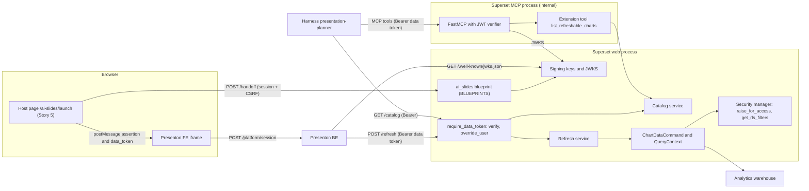
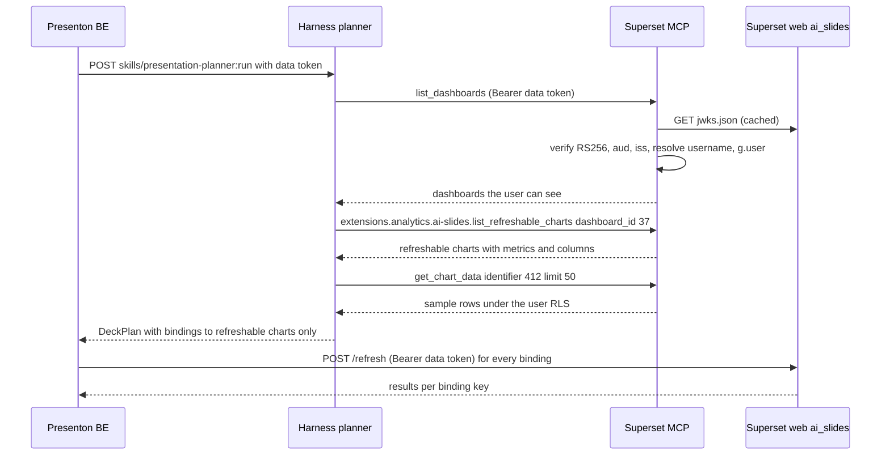

# Story 8: Analytics refresh APIs, MCP catalog, user-context enforcement, CSP and cookies

<div class="chapter-meta" markdown>
**Reads:** `apache/superset: superset/charts/data/api.py`, `apache/superset: superset/commands/chart/data/get_data_command.py`, `apache/superset: superset/security/manager.py`, `apache/superset: superset/mcp_service/mcp_config.py`, `apache/superset: superset/mcp_service/auth.py`, `apache/superset: superset/config.py`, `servers/fastapi/api/v1/auth/router.py`  ·  **Builds on:** [Architecture and contracts](41-architecture-and-contracts.md), [Story 5](46-story5-menu-and-iframe.md), [Security, RLS, auth](../superset/38-security.md)  ·  **Time:** ~45 min
</div>

Story 8 is the analytics-platform half of AI Slides. This chapter builds the Superset-side `ai_slides` blueprint: the handoff that turns a Superset browser session into a signed assertion and a short-lived **data token**, the JWKS that Presenton and the MCP service verify those tokens against, a decorator that runs each Bearer request as the token's Superset user, the batch refresh API that re-executes saved charts through Superset's own chart-data command (so RBAC and row-level security apply unchanged), and the catalog that tells the planner which charts can be refreshed at all. It then configures Superset's MCP service so the harness acts as the same user, and sets the Content Security Policy and cookie attributes that the embedded iframe from [Story 5](46-story5-menu-and-iframe.md) needs.

Code marked **new** is written by the team in a Python package installed into the Superset image, `ai_slides_superset` (the same package that holds the Story 5 host page). Every Superset function it calls is cited from `apache/superset` master (2026-11-02); differences from the 6.1.0 release are flagged where the source or `UPDATING.md` shows them.

## Step 0: The story

| # | Story | What it does | Owner |
| --- | --- | --- | --- |
| 8 | [Analytics BE/MCP] Refresh APIs, MCP catalog, user-context enforcement, CSP and cookies | Lets Presenton and the harness discover and refresh Superset data per user, with RBAC enforcement and the iframe CSP and cookie settings. | Nitesh |

Acceptance criteria:

1. `POST /api/v1/ai_slides/handoff` returns `{assertion, data_token, expires_in}` only for an authenticated Superset browser session with a valid CSRF token and `can_access on AISlides`; it returns 401 for anonymous and 403 for users without the permission.
2. `GET /api/v1/ai_slides/.well-known/jwks.json` publishes every active verification key with a stable `kid`; a key rotation needs no Presenton or harness deploy.
3. Every Bearer endpoint rejects tokens with a wrong signature, `aud`, `iss`, expired `exp` or missing scope, and runs the request as exactly the user in `sub`.
4. `POST /api/v1/ai_slides/refresh` accepts at most 25 items, returns one result per item in the contract shape, and returns `forbidden` (not data) for a chart the user cannot access. Row-level security filters for the user appear in the executed SQL.
5. `overrides` (`time_range`, `extra_filters`) change the result; filters on columns that are not dataset columns are rejected.
6. `GET /api/v1/ai_slides/catalog` lists only charts the user can access, marks unsupported visualization types (deck.gl, maps, multi-query) as not refreshable with a reason, and filters by dashboard and text.
7. The harness, holding the user's data token, can call the read-only Superset MCP tools and `list_refreshable_charts` as that user, and cannot call any mutating tool.
8. Superset can frame `/ai-slides/` and nothing else can; Presenton responses carry `frame-ancestors`; cookies carry the attributes in Step 9.
9. Integration tests (Superset pytest style) cover RLS on refresh, forbidden charts, overrides, token validation and the CSRF behavior.

## Step 1: Architecture



| Method and path | Auth | CSRF | Caller |
| --- | --- | --- | --- |
| `POST /api/v1/ai_slides/handoff` | Superset session cookie | required | host page bridge |
| `GET /api/v1/ai_slides/.well-known/jwks.json` | none (public keys only) | n/a | Presenton BE, MCP service |
| `POST /api/v1/ai_slides/refresh` | Bearer data token, scope `ai_slides:refresh` | exempt | Presenton BE |
| `GET /api/v1/ai_slides/catalog` | Bearer data token, scope `ai_slides:refresh` | n/a (GET) | harness, Presenton BE |

Presenton BE and the harness call Superset on its **internal** service URL (for example `http://superset:8088`), not through the public ingress.

## Step 2: Packaging: a Flask blueprint, not an extension `@api`

Two mechanisms can add REST endpoints to Superset.

**`BLUEPRINTS` config.** Superset registers each `Blueprint` listed in config during `init_app`, before CSRF and the middlewares are configured:

```python title="apache/superset: superset/initialization/__init__.py:1813-1820"
    def register_blueprints(self) -> None:
        # Register custom blueprints from config
        for bp in self.config["BLUEPRINTS"]:
            try:
                logger.info("Registering blueprint: %s", bp.name)
                self.superset_app.register_blueprint(bp)
            except Exception:  # pylint: disable=broad-except
                logger.exception("blueprint registration failed")
```

The key is declared as `BLUEPRINTS: list[Blueprint] = []` (`apache/superset: superset/config.py:2431`) and the call sits at `apache/superset: superset/initialization/__init__.py:1434`, followed by `configure_wtf()` at line 1435. Routes keep whatever URL prefix the blueprint declares, so `url_prefix="/api/v1/ai_slides"` yields exactly the contract paths. It works on 6.1.0 and master and needs no feature flag.

**Extension `@api`.** `superset_core.rest_api.decorators.api` registers a `RestApi` class, but inside an extension context the base path becomes `/extensions/{publisher}/{name}`:

```python title="apache/superset: superset/core/api/core_api_injection.py:189-207"
            if context:
                # EXTENSION CONTEXT
                base_path = (
                    f"/extensions/{context.extension.publisher}/"
                    f"{context.extension.name}"
                )
                prefixed_id = (
                    f"extensions.{context.extension.publisher}."
                    f"{context.extension.name}.{id}"
                )

            else:
                # HOST CONTEXT
                base_path = "/api/v1"
                prefixed_id = id

            # Add resource_name to path for both contexts
            if resource_name:
                base_path += f"/{resource_name}"
```

That moves the endpoints to `/extensions/analytics/ai-slides/...`, contradicting the contract paths, and it requires `ENABLE_EXTENSIONS` (default `False`, development lifecycle) in every process. `RestApi` also subclasses FAB's `BaseApi`, which is CSRF-exempt by default, so a session-authenticated handoff would need `csrf_exempt = False` set explicitly (see [Building the Superset extension](../superset/36-superset-extension.md)).

**Recommended default: the blueprint.** Use the extension mechanism for exactly one thing, the custom MCP tool in Step 8, where it is the only supported registration path.

```text title="ai_slides_superset package layout (new)"
ai_slides_superset/
    __init__.py        Blueprint object, imports api.py to register routes
    api.py             handoff, jwks, refresh, catalog routes
    keys.py            signing keys, kid, JWKS
    tokens.py          mint and verify assertion and data token
    auth.py            require_data_token decorator, audit helper
    refresh.py         refresh service
    catalog.py         catalog service
    viz_map.py         viz_type to Presenton chart mapping
    menu.py, views.py, security.py, cli.py   Story 5
    templates/ai_slides/launch.html          Story 5
```

```python title="ai_slides_superset/__init__.py (new)"
from flask import Blueprint

# Imported from superset_config.py: Flask and stdlib only at module level.
blueprint = Blueprint(
    "ai_slides",
    __name__,
    url_prefix="/api/v1/ai_slides",
    template_folder="templates",
)

from ai_slides_superset import api as _api  # noqa: E402,F401  (registers routes)
```

```python title="superset_config.py (additions for Story 8, new)"
import os

from ai_slides_superset import blueprint as ai_slides_blueprint

BLUEPRINTS = [ai_slides_blueprint]

AI_SLIDES_ISSUER = "https://analytics.example.com"
AI_SLIDES_ASSERTION_TTL_SECONDS = 60
AI_SLIDES_DATA_TOKEN_TTL_SECONDS = 900
# PEM private keys, active key first. Mounted from Vault / External Secrets.
AI_SLIDES_SIGNING_KEYS = [
    k for k in (
        os.environ.get("AI_SLIDES_SIGNING_KEY_CURRENT"),
        os.environ.get("AI_SLIDES_SIGNING_KEY_PREVIOUS"),
    ) if k
]
AI_SLIDES_MAX_ITEMS = 25
AI_SLIDES_MAX_ROW_LIMIT = 500
AI_SLIDES_DEFAULT_ORG_ID = "default"
```

!!! warning "Gotcha: lazy imports everywhere in the blueprint"
    `superset_config.py` runs while `superset.config` is still loading, and `register_blueprints()` runs before Flask-AppBuilder is configured (`configure_fab()` happens later, inside `init_app_in_ctx`, `apache/superset: superset/initialization/__init__.py:1114`). Module-level code in `api.py` and its imports may use Flask, PyJWT, `cryptography` and the standard library only. Import `superset.*` inside the view functions, which run at request time when `appbuilder.sm`, `db` and the event logger exist.

## Step 3: Signing keys and the JWKS endpoint

Superset already depends on `PyJWT>=2.15.1` and `cryptography>=50.0.2` (`apache/superset: pyproject.toml:53`, `104`), so no new dependency is needed. Keys are RSA private keys in PEM form, generated once per rotation with `openssl genpkey -algorithm RSA -pkeyopt rsa_keygen_bits:3072` and stored in the secret manager. They are never derived from `SECRET_KEY`: that secret signs Superset's session cookie and, through Flask-JWT-Extended, its own API tokens.

The `kid` is the RFC 7638 thumbprint of the public key, so it is stable, unique and needs no bookkeeping.

```python title="ai_slides_superset/keys.py (new)"
from __future__ import annotations

import base64
import hashlib
import json
from dataclasses import dataclass
from functools import lru_cache
from typing import Any

from cryptography.hazmat.primitives import serialization
from cryptography.hazmat.primitives.asymmetric import rsa
from flask import current_app
from jwt.algorithms import RSAAlgorithm


@dataclass(frozen=True)
class SigningKey:
    kid: str
    private_key: rsa.RSAPrivateKey

    @property
    def public_key(self) -> rsa.RSAPublicKey:
        return self.private_key.public_key()

    def public_jwk(self) -> dict[str, Any]:
        jwk = RSAAlgorithm.to_jwk(self.public_key, as_dict=True)
        jwk.update({"kid": self.kid, "use": "sig", "alg": "RS256"})
        return jwk


def _thumbprint(public_key: rsa.RSAPublicKey) -> str:
    """RFC 7638 JWK thumbprint (required members e, kty, n in lexical order)."""
    jwk = RSAAlgorithm.to_jwk(public_key, as_dict=True)
    canonical = json.dumps(
        {"e": jwk["e"], "kty": jwk["kty"], "n": jwk["n"]},
        separators=(",", ":"),
        sort_keys=True,
    )
    digest = hashlib.sha256(canonical.encode("utf-8")).digest()
    return base64.urlsafe_b64encode(digest).rstrip(b"=").decode("ascii")


@lru_cache(maxsize=1)
def signing_keys() -> tuple[SigningKey, ...]:
    pems: list[str] = [p for p in current_app.config.get("AI_SLIDES_SIGNING_KEYS", []) if p]
    if not pems:
        raise RuntimeError("AI_SLIDES_SIGNING_KEYS is empty")
    keys: list[SigningKey] = []
    for pem in pems:
        key = serialization.load_pem_private_key(pem.encode("utf-8"), password=None)
        if not isinstance(key, rsa.RSAPrivateKey) or key.key_size < 2048:
            raise RuntimeError("AI Slides signing keys must be RSA, at least 2048 bits")
        keys.append(SigningKey(kid=_thumbprint(key.public_key()), private_key=key))
    return tuple(keys)


def active_key() -> SigningKey:
    return signing_keys()[0]


def key_by_kid(kid: str | None) -> SigningKey | None:
    return next((k for k in signing_keys() if k.kid == kid), None)


def jwks() -> dict[str, Any]:
    return {"keys": [k.public_jwk() for k in signing_keys()]}
```

Rotation is a three-deploy procedure that never invalidates a live token:

| Phase | `AI_SLIDES_SIGNING_KEY_CURRENT` | `..._PREVIOUS` | Effect |
| --- | --- | --- | --- |
| 0. Steady state | K1 | (empty) | JWKS = {K1}; tokens signed with K1 |
| 1. Pre-publish | K1 | K2 | JWKS = {K1, K2}; still signing with K1. Wait for verifier JWKS caches to expire (Presenton BE and FastMCP cache JWKS; budget 10 minutes) |
| 2. Promote | K2 | K1 | signing with K2; K1 still verifies tokens issued up to 15 minutes ago |
| 3. Retire | K2 | (empty) | after at least `AI_SLIDES_DATA_TOKEN_TTL_SECONDS` plus cache TTL |

## Step 4: Tokens and the handoff endpoint

### 4.1 Claims

The assertion's claims are fixed by the contracts; the data token adds a scope list and the `username` claim that Superset's MCP resolver reads (Step 8.3).

| Claim | Assertion (`aud=presenton`) | Data token (`aud=analytics-data`) |
| --- | --- | --- |
| `iss` | `AI_SLIDES_ISSUER` | same |
| `sub` | Superset user id as a string | same |
| `username`, `org_id` | yes | yes |
| `email`, `first_name`, `last_name`, `roles` | yes | no (not needed for data access) |
| `scope` | no | `ai_slides:refresh superset:chart:read superset:dashboard:read superset:dataset:read` |
| `iat`, `exp`, `jti` | `exp = iat + 60` | `exp = iat + 900` |

```python title="ai_slides_superset/tokens.py (new)"
from __future__ import annotations

import time
import uuid
from typing import Any

import jwt
from flask import current_app

from ai_slides_superset.keys import active_key, key_by_kid

ASSERTION_AUDIENCE = "presenton"
DATA_AUDIENCE = "analytics-data"
DATA_SCOPES = (
    "ai_slides:refresh",
    "superset:chart:read",
    "superset:dashboard:read",
    "superset:dataset:read",
)


def _issuer() -> str:
    return current_app.config["AI_SLIDES_ISSUER"]


def _sign(claims: dict[str, Any], ttl: int) -> tuple[str, int]:
    key = active_key()
    now = int(time.time())
    exp = now + ttl
    payload = {"iss": _issuer(), "iat": now, "exp": exp, "jti": uuid.uuid4().hex, **claims}
    token = jwt.encode(payload, key.private_key, algorithm="RS256", headers={"kid": key.kid})
    return token, exp


def mint_assertion(user: Any, roles: list[str], org_id: str) -> str:
    token, _ = _sign(
        {
            "aud": ASSERTION_AUDIENCE,
            "sub": str(user.id),
            "username": user.username,
            "email": user.email,
            "first_name": user.first_name,
            "last_name": user.last_name,
            "org_id": org_id,
            "roles": roles,
        },
        ttl=current_app.config.get("AI_SLIDES_ASSERTION_TTL_SECONDS", 60),
    )
    return token


def mint_data_token(user: Any, org_id: str) -> tuple[str, int]:
    return _sign(
        {
            "aud": DATA_AUDIENCE,
            "sub": str(user.id),
            "username": user.username,
            "org_id": org_id,
            "scope": " ".join(DATA_SCOPES),
        },
        ttl=current_app.config.get("AI_SLIDES_DATA_TOKEN_TTL_SECONDS", 900),
    )


def verify_data_token(token: str) -> dict[str, Any]:
    """Raise jwt.InvalidTokenError (or a subclass) unless the token is valid."""
    header = jwt.get_unverified_header(token)
    if header.get("alg") != "RS256":
        raise jwt.InvalidAlgorithmError("RS256 required")
    key = key_by_kid(header.get("kid"))
    if key is None:
        raise jwt.InvalidKeyError("unknown kid")
    return jwt.decode(
        token,
        key.public_key,
        algorithms=["RS256"],
        audience=DATA_AUDIENCE,
        issuer=_issuer(),
        leeway=30,
        options={"require": ["exp", "iat", "iss", "aud", "sub", "jti"]},
    )
```

### 4.2 The handoff route

The current user comes from Flask-AppBuilder, which sets `g.user = current_user` before each request, and the role names from `security_manager.get_user_roles()` (`apache/superset: superset/security/manager.py:6066`). Superset has no organization concept, so `org_id` comes from a deployment hook (recommended default: a constant, `AI_SLIDES_DEFAULT_ORG_ID`; a multi-tenant platform supplies `AI_SLIDES_ORG_RESOLVER(user) -> str`).

```python title="ai_slides_superset/api.py (new, part 1 of 3)"
from __future__ import annotations

import logging
from typing import Any

from flask import current_app, g, request, Response

from ai_slides_superset import blueprint
from ai_slides_superset.auth import audit, json_error, json_response, require_data_token

logger = logging.getLogger(__name__)


def _org_id_for(user: Any) -> str:
    resolver = current_app.config.get("AI_SLIDES_ORG_RESOLVER")
    if callable(resolver):
        return str(resolver(user))
    return str(current_app.config.get("AI_SLIDES_DEFAULT_ORG_ID", "default"))


@blueprint.route("/handoff", methods=["POST"])
def handoff() -> Response:
    """Session + CSRF only: Flask-WTF protects this POST (not in the exempt list)."""
    from superset.extensions import security_manager

    from ai_slides_superset.tokens import mint_assertion, mint_data_token

    user = getattr(g, "user", None)
    if user is None or user.is_anonymous:
        return json_error(401, "not_authenticated", "Sign in to Superset first.")
    if security_manager.is_guest_user(user):
        return json_error(403, "guest_not_allowed", "Embedded guests cannot use AI Slides.")
    if request.headers.get("Sec-Fetch-Site", "same-origin") not in ("same-origin", "none"):
        return json_error(403, "cross_site_request", "Handoff is same-origin only.")
    if not security_manager.can_access("can_access", "AISlides"):
        return json_error(403, "ai_slides_not_permitted", "AI Slides is not enabled for your role.")

    roles = [role.name for role in security_manager.get_user_roles()]
    org_id = _org_id_for(user)
    assertion = mint_assertion(user, roles, org_id)
    data_token, data_exp = mint_data_token(user, org_id)
    audit("ai_slides.handoff", org_id=org_id, data_token_exp=data_exp)
    response = json_response(
        {
            "assertion": assertion,
            "data_token": data_token,
            "expires_in": current_app.config.get("AI_SLIDES_ASSERTION_TTL_SECONDS", 60),
        }
    )
    response.headers["Cache-Control"] = "no-store"
    return response


@blueprint.route("/.well-known/jwks.json", methods=["GET"])
def jwks() -> Response:
    from ai_slides_superset.keys import jwks as build_jwks

    response = json_response(build_jwks())
    response.headers["Cache-Control"] = "public, max-age=300"
    return response
```

CSRF protection is automatic: `configure_wtf()` calls `csrf.init_app(app)` and exempts only the entries of `WTF_CSRF_EXEMPT_LIST` (`apache/superset: superset/initialization/__init__.py:1792-1797`), so a blueprint POST that is not listed requires the `X-CSRFToken` header that the host bridge sends. A JSON request with a bad token gets a 400 JSON error from Superset's `CSRFError` handler (`apache/superset: superset/views/error_handling.py:229-247`), which the bridge handles by fetching a fresh token and retrying once.

!!! warning "Gotcha: a Bearer FAB token can also authenticate `/handoff`"
    Superset's `request_loader` accepts `Authorization: Bearer` Flask-JWT-Extended tokens from `/api/v1/security/login` and sets `g.user` (`apache/superset: superset/security/manager.py:2446-2470`). Without further checks, a script holding such a token could mint AI Slides tokens. The CSRF requirement already blocks it (API clients do not carry the session-bound CSRF token), and the `Sec-Fetch-Site` check adds a browser-only signal. Do not add `/handoff` to `WTF_CSRF_EXEMPT_LIST`.

## Step 5: Data token verification and user-context enforcement

### 5.1 How Superset itself switches users

Three patterns exist in Superset, and the decorator reuses the third:

1. **Browser and FAB JWT requests.** `request_loader` resolves the user per request (guest token first when `EMBEDDED_SUPERSET` is on, then a Flask-JWT-Extended Bearer token) and sets `g.user` (`apache/superset: superset/security/manager.py:2446-2470`).
2. **MCP tools.** `_setup_user_context()` resolves the MCP principal and assigns `g.user = user` before the tool body runs (`apache/superset: superset/mcp_service/auth.py:1108-1132`).
3. **Background work.** `override_user(user, force=True)` swaps `g.user` for the duration of a `with` block and restores it afterwards (`apache/superset: superset/utils/core.py:1633-1660`). The GTF chart-query task and the dashboard Excel export use it to run queries as the requester.

Everything downstream reads `g.user`: `can_access` (`apache/superset: superset/security/manager.py:2530-2545`), `raise_for_access`, the DAO base filters, and `get_rls_filters`, which returns nothing when `g.user` is unset and caches per user and table in `g._rls_filter_cache` (`apache/superset: superset/security/manager.py:6110-6131`).

!!! warning "Gotcha: Superset's request loader sees our Bearer token first"
    Because the refresh call carries `Authorization: Bearer <data token>`, Superset's `request_loader` tries `verify_jwt_in_request()` on it, fails (our token is RS256 with a different issuer, not a Flask-JWT-Extended token signed with `SECRET_KEY`), and returns `None`, so the request starts anonymous (`apache/superset: superset/security/manager.py:2460-2470`). That is the desired outcome. Never "simplify" by minting data tokens as Flask-JWT-Extended tokens: they would then authenticate against **every** Superset API with full user rights, instead of only the scoped AI Slides endpoints.

### 5.2 The decorator

```python title="ai_slides_superset/auth.py (new)"
from __future__ import annotations

import logging
from functools import wraps
from typing import Any, Callable, TypeVar

import jwt
from flask import g, request, Response

logger = logging.getLogger(__name__)
F = TypeVar("F", bound=Callable[..., Response])


def json_response(payload: Any, status: int = 200) -> Response:
    # Same serializer settings as BaseSupersetView.json_response
    from superset.utils import json

    return Response(
        json.dumps(payload, default=json.json_int_dttm_ser, ignore_nan=True),
        status=status,
        content_type="application/json; charset=utf-8",
    )


def json_error(status: int, code: str, message: str) -> Response:
    response = json_response({"error": {"code": code, "message": message}}, status)
    if status == 401:
        response.headers["WWW-Authenticate"] = f'Bearer error="invalid_token", error_description="{code}"'
    elif status == 403 and code == "insufficient_scope":
        response.headers["WWW-Authenticate"] = 'Bearer error="insufficient_scope"'
    return response


def audit(action: str, **payload: Any) -> None:
    """Superset's own event log (logs table / EVENT_LOGGER), never the request body."""
    from superset.extensions import event_logger

    try:
        event_logger.log_with_context(
            action=action, include_request_data=False, log_to_statsd=True, **payload
        )
    except Exception:  # pylint: disable=broad-except
        logger.warning("ai_slides audit log failed for %s", action, exc_info=True)


def _load_user(claims: dict[str, Any]) -> Any | None:
    from superset.extensions import security_manager

    username = claims.get("username")
    if not isinstance(username, str) or not username:
        return None
    finder = getattr(security_manager, "find_user_with_relationships", None)
    user = finder(username=username) if finder else security_manager.find_user(username=username)
    # Bind both claims: a renamed or recreated account must not inherit tokens.
    if user is None or str(user.id) != str(claims.get("sub")):
        return None
    return user


def require_data_token(scope: str) -> Callable[[F], F]:
    def decorator(view: F) -> F:
        @wraps(view)
        def wrapper(*args: Any, **kwargs: Any) -> Response:
            from superset.extensions import security_manager
            from superset.utils.core import override_user

            from ai_slides_superset.tokens import verify_data_token

            header = request.headers.get("Authorization", "")
            if not header.lower().startswith("bearer "):
                return json_error(401, "missing_token", "Bearer data token required.")
            try:
                claims = verify_data_token(header[7:].strip())
            except jwt.ExpiredSignatureError:
                return json_error(401, "token_expired", "Data token expired.")
            except jwt.InvalidTokenError:
                return json_error(401, "invalid_token", "Data token rejected.")

            if scope not in str(claims.get("scope", "")).split():
                return json_error(403, "insufficient_scope", f"Scope {scope} required.")

            user = _load_user(claims)
            if user is None or not user.is_active:
                return json_error(401, "unknown_user", "Token user is not an active Superset user.")

            with override_user(user, force=True):
                # Re-check the feature permission: roles can change within 15 minutes.
                if not security_manager.can_access("can_access", "AISlides"):
                    return json_error(403, "ai_slides_not_permitted", "AI Slides is not enabled for this user.")
                g.ai_slides_claims = claims
                return view(*args, **kwargs)

        return wrapper  # type: ignore[return-value]

    return decorator
```

`find_user_with_relationships` eager-loads roles and groups (`apache/superset: superset/security/manager.py:6003-6025`); the fallback to FAB's `find_user` keeps the code working on releases that lack it. Audit rows go through `event_logger.log_with_context` (`apache/superset: superset/utils/log.py:259-268`), which records the overridden user, so the Superset action log shows who refreshed what. `include_request_data=False` keeps filter values out of the log.

## Step 6: The refresh API

### 6.1 What Superset does for a saved chart today

`GET /api/v1/chart/<pk>/data/` is the closest built-in: it loads `chart.query_context`, overrides three keys, applies dashboard filter context (master), exposes the body to Jinja, builds the query context and runs `ChartDataCommand`:

```python title="apache/superset: superset/charts/data/api.py:168-189 (excerpt)"
        chart = self.datamodel.get(pk, self._base_filters)
        if not chart:
            return self.response_404()

        try:
            json_body = json.loads(chart.query_context)
        except (TypeError, json.JSONDecodeError):
            json_body = None

        if json_body is None:
            return self.response_400(
                message=_(
                    "Chart has no query context saved. Please save the chart again."
                )
            )

        # override saved query context
        json_body["result_format"] = request.args.get(
            "format", ChartDataResultFormat.JSON
        )
        json_body["result_type"] = request.args.get("type", ChartDataResultType.FULL)
        json_body["force"] = request.args.get("force")
```

```python title="apache/superset: superset/charts/data/api.py:221-230 (excerpt)"
        # We need to apply the form data to the global context as jinja
        # templating pulls form data from the request globally, so this
        # fallback ensures it has the filters and extra_form_data applied
        # when used in get_sqla_query which constructs the final query.
        set_form_data(json_body)

        try:
            query_context = self._create_query_context_from_form(json_body)
            command = ChartDataCommand(query_context)
            command.validate()
```

`_create_query_context_from_form` loads the body through `ChartDataQueryContextSchema` with a `QueryContextFactory` (`apache/superset: superset/charts/data/api.py:760-780`). `ChartDataCommand.validate()` is `self._query_context.raise_for_access()` and `run()` returns `{"query_context", "queries"}` after raising on any failed query (`apache/superset: superset/commands/chart/data/get_data_command.py:36-108`). Why not call that HTTP endpoint from Presenton? It takes one chart per call, it has no override input on 6.1.0, it requires a FAB token or session (not our scoped token), and on 6.1.0 with `GLOBAL_ASYNC_QUERIES` a Bearer client gets a 202 it cannot complete. Running the same command in-process inside our blueprint avoids all four.

### 6.2 Charts without a stored `query_context`

`query_context` is produced in the browser by each plugin's `buildQuery` and saved from Explore, so old, imported or API-created charts can have `NULL`. Superset handles this three ways:

- The chart data GET returns 400 "Chart has no query context saved" (above).
- Explore backfills it the next time someone with write access opens the chart (`apache/superset: superset-frontend/src/explore/components/ExploreChartPanel/index.tsx:235-254`).
- On **master**, a server-side builder reconstructs one from `params`: `build_query_context_from_form_data(form_data, datasource, viz_type=None)` in `apache/superset: superset/common/form_data_query_context.py:1801-1813`, used by the dashboard Excel export and every MCP chart tool. MCP `get_chart_data` prefers the saved `query_context` ("Use the chart's saved query_context - this is the key!", `apache/superset: superset/mcp_service/chart/tool/get_chart_data.py:768`) and falls back to the form-data builder with a warning that numbers may diverge (`apache/superset: superset/mcp_service/chart/tool/get_chart_data.py:905-929`). The module does not exist in 6.1.0.

**Decision:** prefer the stored `query_context`; on master fall back to `build_query_context_from_form_data` and report `query_context_source: "rebuilt_from_form_data"` so Presenton can show a subtle "re-save this chart in Superset for exact numbers" hint; on 6.1.0 return `unsupported` with code `no_query_context`. The catalog applies the same rule, so the planner never proposes such a chart on 6.1.0.

### 6.3 Overrides as `extra_form_data`

Contract overrides (`time_range`, `extra_filters`) are converted to Superset's `extra_form_data` vocabulary, the same keys native filters publish (`EXTRA_FORM_DATA_APPEND_KEYS` and `EXTRA_FORM_DATA_OVERRIDE_REGULAR_MAPPINGS`, `apache/superset: superset/constants.py:209-229`). Two merge helpers exist:

- `merge_extra_form_data(form_data)` works on **form data**, before `buildQuery` (`apache/superset: superset/utils/core.py:1184`). Not applicable to a stored query context.
- `apply_dashboard_filter_context(query_context, extra_form_data)` works on an **already built query context**: it appends `filters` with `isExtra: True` to every query, copies extra overrides, maps `time_range` and `time_grain_sqla`, and marks existing time-range filters (`apache/superset: superset/charts/data/dashboard_filter_context.py:365-408`). It is exactly the merge we need, and it is what the chart data GET uses for `filters_dashboard_id`. Master only.

On 6.1.0 the refresh service uses a small local equivalent (append filters, set `time_range`, rewrite `TEMPORAL_RANGE` filter values). Treat it as an approximation and cover each supported visualization type with a test.

!!! warning "Gotcha: an override filter is a SQL surface"
    A Superset filter's `col` may be an adhoc column with a `sqlExpression`. Accept only plain strings that name a column of the chart's dataset, and only operators from `FilterOperator` (`apache/superset: superset/utils/core.py:329`). Otherwise a Presenton binding edit could inject SQL that runs with the user's warehouse access.

### 6.4 Row caps and caching

`QueryObjectFactory` replaces a `row_limit` of 0 with `ROW_LIMIT` (50000) and clamps to `SQL_MAX_ROW` (100000) (see [Superset landscape](../superset/31-superset-landscape.md)). Slides need far less, so each query's `row_limit` is clamped to `min(item.row_limit, AI_SLIDES_MAX_ROW_LIMIT)` before loading the context. Caching is Superset's own: `force: false` lets `QueryContext` serve from the data cache (which is `NullCache` unless `DATA_CACHE_CONFIG` is set), `force: true` re-runs the query. The cache key already includes the user's RLS clauses through `get_rls_cache_key` (`apache/superset: superset/security/manager.py:6304`), so two users never share cached rows.

!!! warning "Gotcha: the row cap applies before post-processing"
    For timeseries charts with a `groupby`, rows are long-format (one row per time bucket and series) and the plugin's `pivot` post-processing turns them into wide columns afterwards. A cap of 50 on a 12-month by 10-series chart returns 50 of 120 rows and silently drops points. Keep the cap per binding (`row_limit` in the binding `source`), return `truncated: true` when `rowcount` reaches it, and let Story 1 surface it.

### 6.5 Where RLS happens

Nothing in the refresh service mentions RLS, and that is the point. While building SQL for a dataset, `SqlaTable.get_sqla_row_level_filters` asks the security manager for the current user's filters and adds them to the WHERE clause:

```python title="apache/superset: superset/connectors/sqla/models.py:1189-1199"
        all_filters: list[TextClause] = []
        filter_groups: dict[Union[int, str], list[TextClause]] = defaultdict(list)
        try:
            for filter_ in security_manager.get_rls_filters(self):
                clause = self.text(
                    f"({template_processor.process_template(filter_.clause)})"
                )
                if filter_.group_key:
                    filter_groups[filter_.group_key].append(clause)
                else:
                    all_filters.append(clause)
```

The query builder appends those clauses to every query (`apache/superset: superset/models/helpers.py:7543`). Because the refresh body runs inside `override_user(token_user)`, `get_rls_filters` resolves the token user's roles (master: subjects, which include roles and groups; 6.1.0: roles only, per [Security, RLS, auth](../superset/38-security.md)), so the deck shows exactly the rows that user would see on the dashboard. Jinja macros in RLS clauses, such as `current_username()`, render as that user too.

### 6.6 The service

```python title="ai_slides_superset/refresh.py (new)"
from __future__ import annotations

import copy
import logging
from dataclasses import dataclass, field
from typing import Any

from flask import current_app, g

from ai_slides_superset.viz_map import is_refreshable_viz

logger = logging.getLogger(__name__)

ALLOWED_OPS = {"==", "!=", ">", "<", ">=", "<=", "IN", "NOT IN", "LIKE", "ILIKE",
               "IS NULL", "IS NOT NULL", "TEMPORAL_RANGE"}


class ItemError(Exception):
    def __init__(self, status: str, code: str, message: str) -> None:
        super().__init__(message)
        self.status, self.code, self.message = status, code, message


@dataclass
class RefreshItem:
    key: str
    chart_id: int
    dashboard_id: int | None = None
    overrides: dict[str, Any] = field(default_factory=dict)
    row_limit: int = 50
    force: bool = False


def parse_items(body: Any) -> list[RefreshItem]:
    max_items = current_app.config.get("AI_SLIDES_MAX_ITEMS", 25)
    raw = body.get("items") if isinstance(body, dict) else None
    if not isinstance(raw, list) or not 1 <= len(raw) <= max_items:
        raise ValueError(f"items must be a list of 1 to {max_items} entries")
    items = []
    for entry in raw:
        if not isinstance(entry, dict):
            raise ValueError("each item must be an object")
        key, chart_id = entry.get("key"), entry.get("chart_id")
        if not isinstance(key, str) or not 0 < len(key) <= 64:
            raise ValueError("key must be a string of 1 to 64 characters")
        if not isinstance(chart_id, int) or isinstance(chart_id, bool) or chart_id <= 0:
            raise ValueError("chart_id must be a positive integer")
        dashboard_id = entry.get("dashboard_id")
        if dashboard_id is not None and (not isinstance(dashboard_id, int) or dashboard_id <= 0):
            raise ValueError("dashboard_id must be a positive integer")
        overrides = entry.get("overrides") or {}
        if not isinstance(overrides, dict):
            raise ValueError("overrides must be an object")
        row_limit = entry.get("row_limit", 50)
        if not isinstance(row_limit, int) or row_limit <= 0:
            raise ValueError("row_limit must be a positive integer")
        items.append(RefreshItem(key, chart_id, dashboard_id, overrides, row_limit,
                                 bool(entry.get("force", False))))
    return items


def _load_chart(item: RefreshItem) -> Any:
    from superset.daos.chart import ChartDAO
    from superset.extensions import security_manager

    # Look up without the base filter so we can say "forbidden" rather than
    # "not_found" for charts the viewer cannot see (contract section 6).
    chart = ChartDAO.find_by_id(item.chart_id, skip_base_filter=True)
    if chart is None:
        raise ItemError("not_found", "chart_not_found", "Chart does not exist.")
    if not security_manager.can_access_chart(chart):
        raise ItemError("forbidden", "chart_forbidden", "You cannot access this chart.")
    if not is_refreshable_viz(chart.viz_type):
        raise ItemError("unsupported", "unsupported_viz_type", f"{chart.viz_type} cannot be refreshed.")
    return chart


def _parse_json(text: str | None) -> dict[str, Any] | None:
    from superset.utils import json

    try:
        value = json.loads(text) if text else None
    except (TypeError, ValueError):
        return None
    return value if isinstance(value, dict) else None


def _base_body(chart: Any) -> tuple[dict[str, Any], str]:
    saved = _parse_json(chart.query_context)
    if saved and saved.get("queries"):
        return copy.deepcopy(saved), "saved_query_context"
    try:  # master only
        from superset.common.form_data_query_context import build_query_context_from_form_data
    except ImportError as ex:
        raise ItemError("unsupported", "no_query_context",
                        "Open and save this chart in Superset once.") from ex
    form_data = _parse_json(chart.params) or {}
    body = build_query_context_from_form_data(
        form_data, {"id": chart.datasource_id, "type": chart.datasource_type}, viz_type=chart.viz_type
    )
    return body, "rebuilt_from_form_data"


def _extra_form_data(chart: Any, overrides: dict[str, Any]) -> dict[str, Any]:
    efd: dict[str, Any] = {}
    if (time_range := overrides.get("time_range")) is not None:
        if not isinstance(time_range, str) or len(time_range) > 100:
            raise ItemError("error", "invalid_override", "time_range must be a short string.")
        efd["time_range"] = time_range
    if (grain := overrides.get("time_grain_sqla")) is not None:
        if not isinstance(grain, str) or len(grain) > 20:
            raise ItemError("error", "invalid_override", "time_grain_sqla must be an ISO 8601 duration.")
        efd["time_grain_sqla"] = grain
    filters = overrides.get("extra_filters") or []
    if not isinstance(filters, list) or len(filters) > 10:
        raise ItemError("error", "invalid_override", "extra_filters must be a list of at most 10.")
    if filters:
        datasource = chart.datasource
        known = {c.column_name for c in getattr(datasource, "columns", []) if c.filterable}
        clean = []
        for flt in filters:
            col, op = (flt or {}).get("col"), str((flt or {}).get("op", "")).upper()
            if not isinstance(col, str) or col not in known:
                raise ItemError("error", "invalid_override", f"Unknown filter column {col!r}.")
            if op not in ALLOWED_OPS:
                raise ItemError("error", "invalid_override", f"Operator {op!r} not allowed.")
            clean.append({"col": col, "op": op, "val": flt.get("val")})
        efd["filters"] = clean
    return efd


def _apply_efd_61(body: dict[str, Any], efd: dict[str, Any]) -> None:
    """Local approximation of master's apply_dashboard_filter_context for 6.1.0."""
    filters = efd.get("filters", [])
    for query in body.get("queries", []):
        query["filters"] = (query.get("filters") or []) + [{**f, "isExtra": True} for f in filters]
        if time_range := efd.get("time_range"):
            query["time_range"] = time_range
            for flt in query["filters"]:
                if flt.get("op") == "TEMPORAL_RANGE" and not flt.get("isExtra"):
                    flt["val"] = time_range
        if grain := efd.get("time_grain_sqla"):
            query.setdefault("extras", {})["time_grain_sqla"] = grain
        query["extra_form_data"] = efd


def build_body(chart: Any, item: RefreshItem) -> tuple[dict[str, Any], str, int]:
    body, source = _base_body(chart)
    expected = {"id": chart.datasource_id, "type": chart.datasource_type}
    ds = body.get("datasource") or {}
    if str(ds.get("id")) != str(expected["id"]) or ds.get("type", "table") != expected["type"]:
        raise ItemError("error", "datasource_mismatch", "Saved query targets another datasource.")
    if len(body.get("queries", [])) != 1:
        raise ItemError("unsupported", "multi_query", "Charts with several queries are not supported.")

    body.update(result_type="full", result_format="json", force=item.force)
    form_data = body.get("form_data") if isinstance(body.get("form_data"), dict) else {}
    form_data["slice_id"] = chart.id
    if item.dashboard_id:
        form_data["dashboardId"] = item.dashboard_id   # dashboard-derived access (master)
    body["form_data"] = form_data

    if efd := _extra_form_data(chart, item.overrides):
        try:
            from superset.charts.data.dashboard_filter_context import apply_dashboard_filter_context
        except ImportError:  # 6.1.0
            apply_dashboard_filter_context = _apply_efd_61
        apply_dashboard_filter_context(body, dict(efd))

    cap = min(item.row_limit, current_app.config.get("AI_SLIDES_MAX_ROW_LIMIT", 500))
    for query in body["queries"]:
        current = query.get("row_limit") or 0
        query["row_limit"] = cap if current <= 0 else min(current, cap)
    return body, source, cap


def execute(body: dict[str, Any]) -> dict[str, Any]:
    from superset.charts.schemas import ChartDataQueryContextSchema
    from superset.commands.chart.data.get_data_command import ChartDataCommand
    from superset.common.query_context_factory import QueryContextFactory

    try:
        from superset.charts.data.form_data import set_form_data
    except ImportError:  # older layouts: same effect as the master helper
        def set_form_data(form_data: dict[str, Any]) -> None:
            g.form_data = form_data

    set_form_data(body)   # Jinja filter_values() reads the request form data
    schema = ChartDataQueryContextSchema()
    schema.query_context_factory = QueryContextFactory()
    query_context = schema.load(body)
    command = ChartDataCommand(query_context)
    command.validate()    # query_context.raise_for_access(): RBAC on the datasource
    return command.run()


def _iso(value: Any) -> str | None:
    if not value:
        return None
    text = str(value)
    return text[:-6] + "Z" if text.endswith("+00:00") else text


def refresh_one(item: RefreshItem) -> dict[str, Any]:
    from marshmallow import ValidationError

    from superset.commands.chart.exceptions import ChartDataCacheLoadError, ChartDataQueryFailedError
    from superset.daos.exceptions import DatasourceNotFound
    from superset.exceptions import QueryObjectValidationError, SupersetSecurityException

    base = {"key": item.key, "colnames": [], "coltypes": [], "data": [], "rowcount": 0,
            "query_ts": None, "is_cached": False, "cache_key": None, "error": None}
    try:
        chart = _load_chart(item)
        body, source, cap = build_body(chart, item)
        payload = execute(body)
    except ItemError as ex:
        return {**base, "status": ex.status, "error": {"code": ex.code, "message": ex.message}}
    except SupersetSecurityException:
        return {**base, "status": "forbidden", "error": {"code": "datasource_forbidden",
                                                         "message": "You cannot access this data."}}
    except DatasourceNotFound:
        return {**base, "status": "not_found", "error": {"code": "datasource_not_found",
                                                         "message": "The chart's dataset no longer exists."}}
    except (QueryObjectValidationError, ValidationError, KeyError, ValueError) as ex:
        return {**base, "status": "error", "error": {"code": "invalid_query", "message": str(ex)[:500]}}
    except ChartDataCacheLoadError as ex:
        return {**base, "status": "error", "error": {"code": "cache_load_failed", "message": str(ex)[:500]}}
    except ChartDataQueryFailedError as ex:
        return {**base, "status": "error", "error": {"code": "query_failed", "message": str(ex)[:500]}}
    except Exception:  # pylint: disable=broad-except
        logger.exception("ai_slides refresh failed for chart %s", item.chart_id)
        return {**base, "status": "error", "error": {"code": "internal_error", "message": "Refresh failed."}}

    query = payload["queries"][0]
    rowcount = int(query.get("rowcount") or 0)
    return {
        **base,
        "status": "ok",
        "colnames": query.get("colnames") or [],
        "coltypes": query.get("coltypes") or [],
        "data": query.get("data") or [],
        "rowcount": rowcount,
        "query_ts": _iso(query.get("queried_dttm") or query.get("cached_dttm")),
        "is_cached": bool(query.get("is_cached")),
        "cache_key": query.get("cache_key"),
        # Local additions (contract allows extra fields):
        "truncated": rowcount >= cap,
        "query_context_source": source,
        "applied_filters": query.get("applied_filters", []),
        "rejected_filters": query.get("rejected_filters", []),
    }
```

The payload keys come straight from Superset: `colnames`, `coltypes` and `data` are set in `_materialize_full_payload` (`apache/superset: superset/common/query_actions.py:222-240`), `data` is a list of records produced by `df_to_records` for JSON results (`apache/superset: superset/common/query_context_processor.py:659-693`), and `cache_key`, `queried_dttm`, `is_cached` and `rowcount` come from `get_df_payload` (`apache/superset: superset/common/query_context_processor.py:423-439`). `queried_dttm` is an ISO timestamp in UTC (`apache/superset: superset/common/utils/query_cache_manager.py:124-126`). Temporal values in `data` are pandas timestamps; the `json_int_dttm_ser` serializer in `json_response` turns them into epoch milliseconds, the same encoding `/api/v1/chart/data` uses.

Error mapping summary:

| Condition | Result `status` | `error.code` | HTTP |
| --- | --- | --- | --- |
| body invalid, more than 25 items | (whole call) | `invalid_request` | 400 |
| token missing, invalid, expired, unknown user | (whole call) | see decorator | 401 |
| scope missing, AI Slides permission revoked | (whole call) | `insufficient_scope`, `ai_slides_not_permitted` | 403 |
| chart id does not exist or is soft-deleted | `not_found` | `chart_not_found` | 200 |
| chart exists, user cannot access it | `forbidden` | `chart_forbidden` | 200 |
| `raise_for_access` on the query context fails | `forbidden` | `datasource_forbidden` | 200 |
| viz type not supported, multi-query, no `query_context` on 6.1.0 | `unsupported` | `unsupported_viz_type`, `multi_query`, `no_query_context` | 200 |
| query or cache failure | `error` | `query_failed`, `cache_load_failed`, `invalid_query` | 200 |

`can_access_chart` wraps `raise_for_access(chart=chart)` (`apache/superset: superset/security/manager.py:2797-2808`); on master the chart branch accepts admins, editors, explicit viewers, or users with access to the chart's datasource (`apache/superset: superset/security/manager.py:5950-5963`).

!!! warning "Gotcha: `not_found` versus `forbidden` reveals that a chart id exists"
    Looking charts up with `skip_base_filter=True` lets the API tell a viewer "forbidden" instead of "not found", which the contract's viewer semantics need. The cost is that a caller can learn whether an id exists. Chart ids are sequential integers and the response contains no name or data, so the team accepts this; if policy forbids it, use the base-filtered `ChartDAO.find_by_id(item.chart_id)` and map `None` to `not_found`.

### 6.7 The route

```python title="ai_slides_superset/api.py (new, part 2 of 3)"
@blueprint.route("/refresh", methods=["POST"])
@require_data_token("ai_slides:refresh")
def refresh() -> Response:
    from ai_slides_superset.refresh import parse_items, refresh_one

    try:
        items = parse_items(request.get_json(silent=True))
    except ValueError as ex:
        return json_error(400, "invalid_request", str(ex))
    results = [refresh_one(item) for item in items]
    audit(
        "ai_slides.refresh",
        chart_ids=[i.chart_id for i in items],
        statuses=[r["status"] for r in results],
        forced=sum(1 for i in items if i.force),
    )
    return json_response({"results": results})
```

Items run sequentially in one request thread. Twenty-five uncached warehouse queries can exceed a gunicorn worker timeout; Presenton BE ([Story 1](42-story1-dynamic-data.md)) should send small batches (5 to 10) in parallel and use `force` only for an explicit "refresh now".

## Step 7: The catalog endpoint

### 7.1 Which charts are refreshable

A chart is **refreshable** when all of the following hold: it is a saved chart the user can access; its `viz_type` maps to a Presenton element (table below); it has exactly one query; and it has a stored `query_context` (or the master form-data builder is available). Everything else is listed with `refreshable: false` and a `reason`, which [Story 7](48-story7-harness-planner.md) copies into the plan's `excluded` list.

| `viz_type` (Superset `VizType`) | Kind | Presenton `ChartType` |
| --- | --- | --- |
| `echarts_timeseries_bar` | chart | `bar`; `horizontal_bar` when `orientation == "horizontal"`; `stacked_bar` / `horizontal_stacked_bar` when `stack` is set |
| `echarts_timeseries_line`, `echarts_timeseries_smooth`, `echarts_timeseries_step`, `echarts_timeseries` | chart | `line` |
| `echarts_area` | chart | `area` |
| `echarts_timeseries_scatter` | chart | `scatter` |
| `pie` | chart | `pie`; `donut` when `donut` is true |
| `radar` | chart | `radar` |
| `funnel` | chart | `horizontal_bar` |
| `histogram_v2` | chart | `bar` |
| `big_number_total`, `big_number`, `pop_kpi` | metric | (text run) |
| `table`, `ag-grid-table`, `pivot_table_v2` | table | (table element) |
| `deck_*`, `world_map`, `country_map`, `mapbox`, `point_cluster_map`, `cartodiagram` | not refreshable | reason `not_refreshable:deck.gl` or `not_refreshable:map` |
| `mixed_timeseries` and everything else | not refreshable | reason `not_refreshable:<viz_type>` or `multi_query` |

The ids are from `apache/superset: superset-frontend/packages/superset-ui-core/src/chart/types/VizType.ts:19-70`; the Presenton enum is `ChartType` in `servers/fastapi/templates/v2/models/elements.py:76-87`. The form-data keys `orientation`, `stack` and `donut` are the control names in the ECharts plugins (`apache/superset: superset-frontend/plugins/plugin-chart-echarts/src/Timeseries/Regular/Bar/controlPanel.tsx:358`, `apache/superset: superset-frontend/plugins/plugin-chart-echarts/src/Timeseries/Area/controlPanel.tsx:118`, `apache/superset: superset-frontend/plugins/plugin-chart-echarts/src/Pie/controlPanel.tsx:270`).

```python title="ai_slides_superset/viz_map.py (new)"
from __future__ import annotations

from typing import Any

_LINE = {"echarts_timeseries_line", "echarts_timeseries_smooth", "echarts_timeseries_step", "echarts_timeseries"}
_METRIC = {"big_number_total", "big_number", "pop_kpi"}
_TABLE = {"table", "ag-grid-table", "pivot_table_v2"}
_MAPS = {"world_map", "country_map", "mapbox", "point_cluster_map", "cartodiagram"}
_CHART = _LINE | {"echarts_timeseries_bar", "echarts_area", "echarts_timeseries_scatter",
                  "pie", "radar", "funnel", "histogram_v2"}


def is_refreshable_viz(viz_type: str | None) -> bool:
    return bool(viz_type) and (viz_type in _CHART or viz_type in _METRIC or viz_type in _TABLE)


def unsupported_reason(viz_type: str | None) -> str | None:
    if is_refreshable_viz(viz_type):
        return None
    if viz_type and viz_type.startswith("deck_"):
        return "not_refreshable:deck.gl"
    if viz_type in _MAPS:
        return "not_refreshable:map"
    return f"not_refreshable:{viz_type}"


def presenton_target(viz_type: str, form_data: dict[str, Any]) -> dict[str, Any]:
    if viz_type in _METRIC:
        return {"kind": "metric", "chart_type": None}
    if viz_type in _TABLE:
        return {"kind": "table", "chart_type": None}
    if viz_type == "echarts_timeseries_bar":
        horizontal = form_data.get("orientation") == "horizontal"
        stacked = bool(form_data.get("stack"))
        chart_type = {(False, False): "bar", (True, False): "horizontal_bar",
                      (False, True): "stacked_bar", (True, True): "horizontal_stacked_bar"}[(horizontal, stacked)]
    elif viz_type in _LINE:
        chart_type = "line"
    elif viz_type == "pie":
        chart_type = "donut" if form_data.get("donut") else "pie"
    else:
        chart_type = {"echarts_area": "area", "echarts_timeseries_scatter": "scatter", "radar": "radar",
                      "funnel": "horizontal_bar", "histogram_v2": "bar"}[viz_type]
    return {"kind": "chart", "chart_type": chart_type}
```

### 7.2 Listing what the user can see

The list must apply the same visibility Superset's chart list uses. `ChartDAO` declares `base_filter = ChartFilter` (`apache/superset: superset/daos/chart.py:46-47`) and `BaseDAO._apply_base_filter` applies it with an `SQLAInterface` (`apache/superset: superset/daos/base.py:284-296`); the catalog does the same on its own query so it can join dashboards and paginate.

```python title="ai_slides_superset/catalog.py (new)"
from __future__ import annotations

from typing import Any

from flask import current_app

from ai_slides_superset.viz_map import is_refreshable_viz, presenton_target, unsupported_reason


def _labels(chart: Any) -> tuple[list[str], list[str], dict[str, Any] | None, dict[str, Any]]:
    from superset.utils import json
    from superset.utils.core import get_column_names, get_metric_names

    def load(text: str | None) -> dict[str, Any] | None:
        try:
            value = json.loads(text) if text else None
        except (TypeError, ValueError):
            return None
        return value if isinstance(value, dict) else None

    qc, form_data = load(chart.query_context), load(chart.params) or {}
    if qc and qc.get("queries"):
        query = qc["queries"][0]
        return get_metric_names(query.get("metrics") or []), get_column_names(query.get("columns") or []), qc, form_data
    metrics = form_data.get("metrics") or ([form_data["metric"]] if form_data.get("metric") else [])
    columns = form_data.get("groupby") or []
    return get_metric_names(metrics), get_column_names(columns), None, form_data


def describe(chart: Any) -> dict[str, Any]:
    from superset.extensions import security_manager

    metrics, columns, qc, form_data = _labels(chart)
    reason = unsupported_reason(chart.viz_type)
    if reason is None and qc is None:
        try:
            import superset.common.form_data_query_context  # noqa: F401  master only
        except ImportError:
            reason = "no_query_context"
    if reason is None and qc is not None and len(qc.get("queries", [])) != 1:
        reason = "multi_query"
    target = presenton_target(chart.viz_type, form_data) if reason is None else {"kind": None, "chart_type": None}
    return {
        "chart_id": chart.id,
        "slice_name": chart.slice_name,
        "viz_type": chart.viz_type,
        "datasource": f"{chart.datasource_id}__{chart.datasource_type}",
        "dashboards": [
            {"id": d.id, "title": d.dashboard_title}
            for d in chart.dashboards
            if security_manager.can_access_dashboard(d)
        ],
        "refreshable": reason is None,
        "reason": reason,
        "metrics": metrics,
        "columns": columns,
        "kind": target["kind"],
        "presenton_chart_type": target["chart_type"],
    }


def list_catalog(dashboard_id: int | None, q: str, page: int, page_size: int,
                 include_unrefreshable: bool) -> tuple[list[dict[str, Any]], int]:
    from flask_appbuilder.models.sqla.interface import SQLAInterface

    from superset import db
    from superset.charts.filters import ChartFilter
    from superset.daos.dashboard import DashboardDAO
    from superset.models.dashboard import Dashboard
    from superset.models.slice import Slice
    from ai_slides_superset.viz_map import _CHART, _METRIC, _TABLE

    query = db.session.query(Slice)
    query = ChartFilter("id", SQLAInterface(Slice, db.session)).apply(query, None)
    if dashboard_id is not None:
        if DashboardDAO.find_by_id(dashboard_id) is None:   # DashboardAccessFilter
            return [], 0
        query = query.filter(Slice.dashboards.any(Dashboard.id == dashboard_id))
    if q:
        escaped = q.replace("\\", "\\\\").replace("%", "\\%").replace("_", "\\_")
        query = query.filter(Slice.slice_name.ilike(f"%{escaped}%", escape="\\"))
    if not include_unrefreshable:
        query = query.filter(Slice.viz_type.in_(sorted(_CHART | _METRIC | _TABLE)))
    total = query.count()
    charts = query.order_by(Slice.changed_on.desc()).offset(page * page_size).limit(page_size).all()
    entries = [describe(chart) for chart in charts]
    if not include_unrefreshable:
        entries = [e for e in entries if e["refreshable"]]
    return entries, total
```

```python title="ai_slides_superset/api.py (new, part 3 of 3)"
@blueprint.route("/catalog", methods=["GET"])
@require_data_token("ai_slides:refresh")
def catalog() -> Response:
    from ai_slides_superset.catalog import list_catalog

    page = max(0, request.args.get("page", default=0, type=int) or 0)
    page_size = min(100, max(1, request.args.get("page_size", default=50, type=int) or 50))
    entries, total = list_catalog(
        dashboard_id=request.args.get("dashboard_id", type=int),
        q=(request.args.get("q") or "").strip()[:100],
        page=page,
        page_size=page_size,
        include_unrefreshable=request.args.get("include_unrefreshable") == "true",
    )
    response = json_response(entries)          # contract: a JSON array
    response.headers["X-Total-Count"] = str(total)
    return response
```

`Slice.dashboards` is the backref of `Dashboard.slices` (`apache/superset: superset/models/dashboard.py:357`). `get_metric_names` and `get_column_names` produce the same labels Superset uses as result column names (`apache/superset: superset/utils/core.py:1466-1487`), which is what a binding `mapping` refers to.

## Step 8: The MCP catalog for the harness

### 8.1 Built-in tools the planner needs

Superset's MCP service runs as a separate process (`superset mcp run`, `apache/superset: superset/cli/mcp.py:28-41`) and registers about 80 tools on master (24 in 6.1.0, per [Superset landscape](../superset/31-superset-landscape.md)). The planner from Story 7 needs read-only discovery and samples:

| Tool | Module (decorator line) | Use in planning | 6.1 / master |
| --- | --- | --- | --- |
| `list_dashboards` | `apache/superset: superset/mcp_service/dashboard/tool/list_dashboards.py:63` | pick a dashboard from the prompt | both |
| `get_dashboard_info` | `apache/superset: superset/mcp_service/dashboard/tool/get_dashboard_info.py:97` | charts and filters of the dashboard | both |
| `get_dashboard_layout` | `apache/superset: superset/mcp_service/dashboard/tool/get_dashboard_layout.py:192` | tabs and order, to map to slide order | master |
| `list_charts` | `apache/superset: superset/mcp_service/chart/tool/list_charts.py:174` | search charts | both |
| `get_chart_info` | `apache/superset: superset/mcp_service/chart/tool/get_chart_info.py:451` | viz type, metrics, columns | both |
| `get_chart_data` | `apache/superset: superset/mcp_service/chart/tool/get_chart_data.py:2033` | a small sample to write outlines | both (master is viz-aware) |
| `get_dataset_info` | `apache/superset: superset/mcp_service/dataset/tool/get_dataset_info.py:51` | column labels and formats | both |

The data tools run `ChartDataCommand` under the resolved user, so samples respect RBAC and RLS like the refresh API.

### 8.2 Restricting the tool set

The harness talks to a dedicated, internal-only MCP deployment (`http://superset-mcp:5008/mcp`). Restrict it three ways, from strongest to weakest:

1. **Scopes in the token (master).** When a JWT carries scopes, every tool call is checked against `superset:<action>` or `superset:<resource>:<action>` (`apache/superset: superset/mcp_service/auth.py:195-235`), with `read` and `get` mapping to `read` and `write`, `update`, `delete`, `execute_sql_query` mapping to `write` (`apache/superset: superset/security/api_key_scopes.py:22-29`). The data token carries only `superset:chart:read superset:dashboard:read superset:dataset:read`, so every mutating tool and `execute_sql` is denied even if it is registered.
2. **An allowlist policy (master).** `MCP_RESTRICTED_TOOL_POLICY(user)` returns the set of callable tool function names, default-deny for anything else (`apache/superset: superset/mcp_service/mcp_config.py:283-287`, enforced in `apache/superset: superset/mcp_service/auth.py:339-367`). On a harness-only deployment, return the same allowlist for every principal.
3. **Removing tools (master).** `MCP_DISABLED_TOOLS` removes tools before the server advertises them (`apache/superset: superset/mcp_service/mcp_config.py:155-163`, `apache/superset: superset/mcp_service/app.py:1000-1015`), which also keeps them out of the LLM's tool list.

!!! warning "Gotcha: a scoped token that lacks `superset:*` scopes is denied everywhere"
    On master, `_token_scope_allows` only skips scope checks for tokens with **no** scopes (`apache/superset: superset/mcp_service/auth.py:211-213`). A data token carrying just `ai_slides:refresh` would be rejected by every tool. That is why `DATA_SCOPES` in `tokens.py` includes the three per-resource read scopes.

### 8.3 MCP JWT auth so the harness acts as the user

The harness forwards the user's data token as `Authorization: Bearer` on the MCP transport. Configure the MCP process (it reads the same `superset_config.py`):

```python title="superset_config.py (MCP process additions, new)"
MCP_AUTH_ENABLED = True
MCP_JWT_ALGORITHM = "RS256"
MCP_JWT_ISSUER = "https://analytics.example.com"
MCP_JWT_AUDIENCE = "analytics-data"
# Internal URL of the web service that serves the JWKS (Step 3).
MCP_JWKS_URI = "http://superset:8088/api/v1/ai_slides/.well-known/jwks.json"
MCP_RBAC_ENABLED = True            # default; keep it
# MCP_DEV_USERNAME must NOT be set: startup fails with MCP_AUTH_ENABLED.

HARNESS_MCP_TOOLS = frozenset({
    "list_dashboards", "get_dashboard_info", "get_dashboard_layout",
    "list_charts", "get_chart_info", "get_chart_data", "get_dataset_info",
    "list_refreshable_charts",     # function name of the extension tool (8.4)
})
MCP_RESTRICTED_TOOL_POLICY = lambda user: HARNESS_MCP_TOOLS  # noqa: E731
MCP_DISABLED_TOOLS = {"execute_sql", "generate_dashboard", "generate_chart", "update_chart"}

# Optional: accept only the username claim (never fall back to email or sub).
def ai_slides_user_resolver(app, access_token):
    claims = getattr(access_token, "claims", None) or {}
    return claims.get("username")   # default_user_resolver order: preferred_username, username, email, sub

MCP_USER_RESOLVER = ai_slides_user_resolver
```

What each key does, verified in source:

- `create_default_mcp_auth_factory` refuses to start when `MCP_AUTH_ENABLED` is set together with `MCP_DEV_USERNAME`, or without `MCP_JWT_AUDIENCE`, or without any of `MCP_JWKS_URI`, `MCP_JWT_PUBLIC_KEY`, `MCP_JWT_SECRET` (`apache/superset: superset/mcp_service/mcp_config.py:622-700`).
- `_build_jwt_verifier` passes `MCP_JWT_ISSUER`, `MCP_JWT_AUDIENCE`, `MCP_REQUIRED_SCOPES`, the algorithm and `jwks_uri` or `public_key` to FastMCP's verifier (`apache/superset: superset/mcp_service/mcp_config.py:868-935`).
- The user is resolved by `MCP_USER_RESOLVER` (default `default_user_resolver`, which prefers `preferred_username`, then `username`, `email`, `sub`; `apache/superset: superset/mcp_service/mcp_config.py:937-969`) and loaded with `load_user_with_relationships`; a JWT with no resolvable or unknown user fails closed (`apache/superset: superset/mcp_service/auth.py:750-777`).

The tool function names in the allowlist matter: `_tool_denied_for_principal` compares `func.__name__`, not the registered (possibly prefixed) tool name (`apache/superset: superset/mcp_service/auth.py:367`).

!!! warning "Gotcha: per-user MCP is a master feature"
    6.1.0 shipped `MCP_AUTH_ENABLED`, `MCP_JWT_ISSUER`, `MCP_JWT_AUDIENCE`, `MCP_JWKS_URI` and `MCP_JWT_PUBLIC_KEY` (documented in `apache/superset: UPDATING.md`, section `## 6.1.0`, around line 2840), but its `get_user_from_request()` only checks a `g.user` set by external middleware and then `MCP_DEV_USERNAME`; it does not map JWT claims to Superset users (see [Superset landscape](../superset/31-superset-landscape.md)). On 6.1.0 the JWT authenticates the transport while every tool runs as one fixed user, which would break the "acts as the user" requirement. On a 6.1.0 platform, keep the harness off MCP and give it the catalog endpoint plus `POST /refresh` with a small `row_limit` for samples. `MCP_USER_RESOLVER`, `MCP_DISABLED_TOOLS`, `MCP_RESTRICTED_TOOL_POLICY` and scope enforcement are master only.

### 8.4 A custom tool: `list_refreshable_charts`

`superset_core.mcp.decorators.tool` exists in both 6.1.0 and master with the same signature (`apache/superset: superset-core/src/superset_core/mcp/decorators.py:51-61`). It cannot be called from `superset_config.py` or `FLASK_APP_MUTATOR`: the host replaces the stub only in `init_all_dependencies_and_extensions()`, after the mutator ran, so an early import binds the stub and raises `NotImplementedError`. The supported route is a small extension whose backend entrypoint is imported after injection. In extension context the tool is registered as `extensions.<publisher>.<name>.<function>` (`apache/superset: superset/core/mcp/core_mcp_injection.py:123-142`), so with publisher `analytics` and name `ai-slides` the harness sees `extensions.analytics.ai-slides.list_refreshable_charts` (the contract's `ai_slides.list_refreshable_charts` is the logical name; the harness maps it).

```python title="ai-slides extension: backend/src/analytics/ai_slides/entrypoint.py (new)"
from __future__ import annotations

from typing import Any

from pydantic import BaseModel, Field
from superset_core.mcp.decorators import tool


class ListRefreshableChartsRequest(BaseModel):
    dashboard_id: int | None = Field(default=None, gt=0)
    q: str | None = Field(default=None, max_length=100)
    page: int = Field(default=0, ge=0)
    page_size: int = Field(default=25, ge=1, le=50)


@tool(
    tags=["discovery"],
    class_permission_name="Chart",      # read on Chart, scope superset:chart:read
    description=(
        "List saved Superset charts the current user can access that AI Slides can "
        "refresh, with metrics, columns and the Presenton chart type. Use only these "
        "chart ids in data bindings."
    ),
)
def list_refreshable_charts(request: ListRefreshableChartsRequest) -> dict[str, Any]:
    # ai_slides_superset is pip-installed in the image; the .supx carries only this file.
    from ai_slides_superset.catalog import list_catalog

    entries, total = list_catalog(
        dashboard_id=request.dashboard_id,
        q=(request.q or "").strip(),
        page=request.page,
        page_size=request.page_size,
        include_unrefreshable=False,
    )
    return {"charts": entries, "total": total, "page": request.page}
```

`@tool` with `protect=True` (the default) wraps the function in `mcp_auth_hook`, which sets `g.user` from the token and checks `can_read on Chart` before the body runs; synchronous functions are supported (`apache/superset: superset/mcp_service/auth.py:1286-1300`, `inspect.iscoroutinefunction` branch). The MCP process needs `FEATURE_FLAGS = {"ENABLE_EXTENSIONS": True}` and the bundle in `EXTENSIONS_PATH`. If `fastmcp` is missing in a process, the stub is never replaced and the extension fails to import there; that is harmless in the web process as long as nothing else lives in this extension.

The harness flow, end to end:



## Step 9: CSP and cookies

### 9.1 Superset: allow framing `/ai-slides`

The default policy has no `frame-src`, so framing falls back to `default-src 'self'` (`apache/superset: superset/config.py:3116-3161`). In the same-origin topology `/ai-slides/` is `'self'` and **no change is required**. Make it explicit anyway, so a later tightening of `default-src` does not silently break AI Slides, and add the slides origin in the subdomain topology:

```python title="superset_config.py (Talisman, new)"
import copy

from superset.config import TALISMAN_CONFIG as _DEFAULT_TALISMAN  # defined before superset_config loads

TALISMAN_ENABLED = True
TALISMAN_CONFIG = copy.deepcopy(_DEFAULT_TALISMAN)
TALISMAN_CONFIG["content_security_policy"]["frame-src"] = [
    "'self'",
    # subdomain topology only:
    # "https://slides.analytics.example.com",
]
TALISMAN_CONFIG["force_https"] = False          # TLS terminates at the ingress
TALISMAN_CONFIG["session_cookie_secure"] = True
```

`superset/config.py` imports `superset_config` near its end (`apache/superset: superset/config.py:3880-3884`), after `TALISMAN_CONFIG` is defined, which is why the import above works. Remember that debug mode uses `TALISMAN_DEV_CONFIG` instead (`apache/superset: superset/initialization/__init__.py:1710-1720`); set `frame-src` there too for local development. Talisman's default `X-Frame-Options: SAMEORIGIN` on Superset responses stays as is: it keeps other sites from framing the host page that performs the handoff. If the platform also uses Superset's embedded dashboards on other sites, it already overrides frame options for those, and nothing here changes that.

### 9.2 Presenton: `frame-ancestors` on every response

Presenton sends no framing headers today (`servers/nextjs/next.config.mjs:15-23` only sets a CORS header for fonts; the FastAPI app adds CORS and auth middlewares only, `servers/fastapi/api/main.py:92-103`). Add them in both servers, because the ingress sends HTML from Next.js and JSON, images and exports from FastAPI.

```js title="servers/nextjs/next.config.mjs (headers, changed)"
// Build-time value: headers() is compiled into the routes manifest.
const frameAncestors = (process.env.AI_SLIDES_FRAME_ANCESTORS || "'self'").trim();
const frameHeaders = [
  { key: "Content-Security-Policy", value: `frame-ancestors ${frameAncestors}` },
  // X-Frame-Options cannot name another origin; send it only for 'self'.
  ...(frameAncestors === "'self'" ? [{ key: "X-Frame-Options", value: "SAMEORIGIN" }] : []),
  { key: "Referrer-Policy", value: "same-origin" },
];

// inside nextConfig:
  async headers() {
    return [
      { source: "/vendor/fonts/:path*", headers: [{ key: "Access-Control-Allow-Origin", value: "*" }] },
      { source: "/:path*", headers: frameHeaders },   // prefixed with basePath automatically
    ];
  },
```

```python title="servers/fastapi/api/main.py (new middleware, after the existing ones)"
_FRAME_ANCESTORS = (os.getenv("AI_SLIDES_FRAME_ANCESTORS") or "'self'").strip()


@app.middleware("http")
async def frame_protection_middleware(request: Request, call_next):
    response = await call_next(request)
    response.headers.setdefault("Content-Security-Policy", f"frame-ancestors {_FRAME_ANCESTORS}")
    if _FRAME_ANCESTORS == "'self'":
        response.headers.setdefault("X-Frame-Options", "SAMEORIGIN")
    return response
```

Subdomain topology: `AI_SLIDES_FRAME_ANCESTORS=https://analytics.example.com` on both servers. Never use `*`.

!!! warning "Gotcha: `frame-ancestors` checks every ancestor, including Presenton's own sandboxed frames"
    Smart slides render in `sandbox="allow-scripts"` `srcDoc` iframes (`servers/nextjs/app/(presentation-generator)/components/SmartHtmlSlide.tsx:266-273`). A `srcDoc` document has no response headers, so it is unaffected. But if a future change loads a Presenton **URL** inside an opaque-origin sandbox, `frame-ancestors 'self'` blocks it, because an opaque origin never matches `'self'`. Keep slide previews on `srcDoc`.

### 9.3 Session cookies on both sides

**Superset.** The keys and defaults are `SESSION_COOKIE_HTTPONLY = True`, `SESSION_COOKIE_SECURE = False`, `SESSION_COOKIE_SAMESITE = "Lax"` (`apache/superset: superset/config.py:3216-3218`). For AI Slides: set `SESSION_COOKIE_SECURE = True` in production; keep `Lax` in **both** topologies, because the Superset cookie is only ever used by the top-level Superset page and its same-origin bridge calls. Do not set `SESSION_COOKIE_DOMAIN` to the parent domain in the subdomain topology; that would send Superset's session to Presenton.

**Presenton.** The login cookie is set with `path="/"`, `samesite="lax"`, `httponly=True` and `secure` derived from the request scheme (`servers/fastapi/api/v1/auth/router.py:46-55`), and the configured FastAPI Users transport mirrors those attributes (`servers/fastapi/api/v1/auth/users.py:187-193`); the name and default lifetime are `presenton_session` and 30 days (`servers/fastapi/api/v1/auth/config.py:11-12`). The platform session cookie from Story 2 should use:

| Attribute | Same-origin topology | Subdomain (same-site) | Cross-site deployment |
| --- | --- | --- | --- |
| `Path` | `/ai-slides` (set explicitly: FastAPI sees the stripped path) | `/` | `/` |
| `HttpOnly` | yes | yes | yes |
| `Secure` | yes | yes | yes |
| `SameSite` | `Lax` | `Lax` (sibling subdomains are same-site) | `None` |
| `Partitioned` | no | no | yes (CHIPS) |
| `Max-Age` | 8 hours recommended (each launch re-hands off) | same | same |

The contract lists `SameSite=None; Secure; Partitioned` for the subdomain alternative. Strictly, those attributes are required only when the Presenton host is on a **different registrable domain** from Superset; under one registrable domain `Lax` is sent to the iframe. Starlette 1.6.0 (`servers/fastapi/uv.lock:2842-2843`) accepts `partitioned=True` in `set_cookie`. `logout` must delete the cookie with the same `path` it was set with (today `path="/"`, `servers/fastapi/api/v1/auth/router.py:191-201`).

!!! warning "Gotcha: Superset's `session` cookie reaches Presenton, and Presenton forwards whole cookie headers"
    In the same-origin topology Superset's `session` cookie (path `/`) is sent with every `/ai-slides/...` request. Presenton's export copies the **entire** `Cookie` header into the export task: the Next.js route reads `req.headers.get("cookie")` (`servers/nextjs/app/api/export-presentation/route.ts:116`) and the runner writes it into `export_task.json` and the `#exportCookie=` URL fragment (`servers/nextjs/lib/run-bundled-presentation-export.ts:171-188`); FastAPI's API export does the same with `exportCookie` (`servers/fastapi/utils/export_utils.py:35-36`). That would copy a Superset session into temp files and a headless browser. Fix it twice: at the ingress, rewrite the `Cookie` header on `/ai-slides/` routes to keep only `presenton_session` (for nginx: `proxy_set_header Cookie "presenton_session=$cookie_presenton_session";`), and in Presenton, filter the forwarded header down to `presenton_session` before building the export task.

**Logout propagation (optional hardening).** Flask-Login emits `user_logged_out` when Superset logs a user out. A receiver connected in `FLASK_APP_MUTATOR` can expire `presenton_session` on that response (`Set-Cookie: presenton_session=; Path=/ai-slides; Max-Age=0; Secure; HttpOnly; SameSite=Lax`), because both cookies live on the same host in the same-origin topology. This was not verified against every Flask-AppBuilder auth view; test it with the platform's auth type.

### 9.4 CSRF exemptions for Bearer endpoints

Only the Bearer POST needs an exemption. Flask-WTF matches string exemptions against `f"{view.__module__}.{view.__name__}"` (flask-wtf 1.2.x `csrf.py`), and `functools.wraps` in the decorator keeps both, so the entry is the module path of `api.py` plus the function name. Keep Superset's defaults in the list (`apache/superset: superset/config.py:390-404`):

```python title="superset_config.py (CSRF, new)"
from superset.config import WTF_CSRF_EXEMPT_LIST as _DEFAULT_CSRF_EXEMPT

WTF_CSRF_EXEMPT_LIST = [
    *_DEFAULT_CSRF_EXEMPT,
    "ai_slides_superset.api.refresh",    # Bearer data token, no cookies
]
```

`/handoff` must stay protected, and the GET endpoints need nothing. On 6.1.0 the default list is shorter (master added `superset.datasource.api.query` and `superset.dashboards.api.export_xlsx`); importing the defaults instead of copying them keeps the list right for either version.

## Step 10: Tests

The tests run in Superset's integration harness (`tests/integration_tests`, `SupersetTestCase`), with the AI Slides package installed, `BLUEPRINTS`, `FLASK_APP_MUTATOR`, `CUSTOM_SECURITY_MANAGER` and the CSRF exemption added to the test config, and `superset init` run by the test bootstrap so `can_access on AISlides` exists (admins get it through the admin-only rule from Story 5). A fixture creates a throwaway RSA key so no secret is needed.

```python title="tests/integration_tests/ai_slides/conftest.py (new)"
import pytest
from cryptography.hazmat.primitives import serialization
from cryptography.hazmat.primitives.asymmetric import rsa

from ai_slides_superset.keys import signing_keys


@pytest.fixture(autouse=True)
def ai_slides_keys(app_context):
    from flask import current_app

    key = rsa.generate_private_key(public_exponent=65537, key_size=2048)
    pem = key.private_bytes(
        serialization.Encoding.PEM,
        serialization.PrivateFormat.PKCS8,
        serialization.NoEncryption(),
    ).decode()
    current_app.config.update(AI_SLIDES_SIGNING_KEYS=[pem], AI_SLIDES_ISSUER="https://test")
    signing_keys.cache_clear()
    yield
    signing_keys.cache_clear()
```

```python title="tests/integration_tests/ai_slides/test_refresh_api.py (new)"
import pytest

from superset import db, security_manager
from superset.connectors.sqla.models import RowLevelSecurityFilter, SqlaTable
from superset.models.slice import Slice
from superset.subjects.models import Subject
from superset.subjects.types import SubjectType
from superset.utils import json
from tests.integration_tests.base_tests import SupersetTestCase
from tests.integration_tests.constants import ADMIN_USERNAME
from tests.integration_tests.fixtures.birth_names_dashboard import (  # noqa: F401
    load_birth_names_dashboard_with_slices,
    load_birth_names_data,
)

from ai_slides_superset.tokens import mint_data_token

REFRESH = "/api/v1/ai_slides/refresh"


def bearer(username: str) -> dict[str, str]:
    user = security_manager.find_user(username)
    token, _ = mint_data_token(user, org_id="test")
    return {"Authorization": f"Bearer {token}"}


def pin_query_context(chart: Slice) -> int:
    chart.query_context = json.dumps({
        "datasource": {"id": chart.datasource_id, "type": "table"},
        "queries": [{
            "columns": ["gender"],
            "metrics": [{"expressionType": "SQL", "sqlExpression": "SUM(num)", "label": "births"}],
            "filters": [{"col": "ds", "op": "TEMPORAL_RANGE", "val": "No filter"}],
            "row_limit": 100,
        }],
        "form_data": {"slice_id": chart.id, "viz_type": "pie"},
        "result_type": "full",
        "result_format": "json",
    })
    db.session.commit()
    return chart.id


@pytest.mark.usefixtures("load_birth_names_dashboard_with_slices")
class TestAISlidesRefresh(SupersetTestCase):
    def grant_ai_slides(self, role_name: str) -> None:
        role = security_manager.find_role(role_name)
        for perm, view in (("can_access", "AISlides"), ("menu_access", "AI Slides")):
            security_manager.add_permission_role(role, security_manager.find_permission_view_menu(perm, view))
        db.session.commit()

    def test_admin_refresh_ok_without_csrf(self):
        chart_id = pin_query_context(self.get_slice("Genders"))
        rv = self.client.post(REFRESH, json={"items": [{"key": "b1", "chart_id": chart_id}]},
                              headers=bearer(ADMIN_USERNAME))
        assert rv.status_code == 200
        result = rv.json["results"][0]
        assert result["status"] == "ok"
        assert set(result["colnames"]) == {"gender", "births"}
        assert result["query_context_source"] == "saved_query_context"

    def test_forbidden_chart_returns_forbidden_not_data(self):
        chart_id = pin_query_context(self.get_slice("Genders"))
        self.create_user_with_roles("ai_no_data", ["ai_no_data_role"], should_create_roles=True)
        self.grant_ai_slides("ai_no_data_role")
        rv = self.client.post(REFRESH, json={"items": [{"key": "b1", "chart_id": chart_id}]},
                              headers=bearer("ai_no_data"))
        result = rv.json["results"][0]
        assert result["status"] == "forbidden"
        assert result["data"] == []

    def test_rls_is_applied_for_token_user(self):
        chart_id = pin_query_context(self.get_slice("Genders"))
        table = db.session.query(SqlaTable).filter_by(table_name="birth_names").one()
        self.create_user_with_roles("ai_rls", ["ai_rls_role"], should_create_roles=True)
        self.grant_role_access_to_table(table, "ai_rls_role")
        self.grant_ai_slides("ai_rls_role")
        role = security_manager.find_role("ai_rls_role")
        rls = RowLevelSecurityFilter(name="ai_rls_girls", filter_type="Regular", clause="gender = 'girl'")
        rls.tables.append(table)
        # master: subjects; on 6.1.0 use rls.roles.append(role)
        rls.subjects.append(db.session.query(Subject).filter_by(role_id=role.id, type=SubjectType.ROLE).one())
        db.session.add(rls)
        db.session.commit()
        try:
            rv = self.client.post(REFRESH, json={"items": [{"key": "b1", "chart_id": chart_id, "force": True}]},
                                  headers=bearer("ai_rls"))
            rows = rv.json["results"][0]["data"]
            assert {row["gender"] for row in rows} == {"girl"}
        finally:
            db.session.delete(rls)
            db.session.commit()

    def test_overrides_filter_and_unknown_column(self):
        chart_id = pin_query_context(self.get_slice("Genders"))
        ok = self.client.post(REFRESH, headers=bearer(ADMIN_USERNAME), json={"items": [{
            "key": "b1", "chart_id": chart_id,
            "overrides": {"extra_filters": [{"col": "gender", "op": "IN", "val": ["boy"]}]},
        }]})
        assert {r["gender"] for r in ok.json["results"][0]["data"]} == {"boy"}
        bad = self.client.post(REFRESH, headers=bearer(ADMIN_USERNAME), json={"items": [{
            "key": "b2", "chart_id": chart_id,
            "overrides": {"extra_filters": [{"col": "1=1) OR (1", "op": "IN", "val": ["x"]}]},
        }]})
        assert bad.json["results"][0]["error"]["code"] == "invalid_override"

    def test_token_validation(self):
        chart_id = pin_query_context(self.get_slice("Genders"))
        body = {"items": [{"key": "b1", "chart_id": chart_id}]}
        assert self.client.post(REFRESH, json=body).status_code == 401
        assert self.client.post(REFRESH, json=body, headers={"Authorization": "Bearer x.y.z"}).status_code == 401
        too_many = {"items": [{"key": f"k{i}", "chart_id": chart_id} for i in range(26)]}
        assert self.client.post(REFRESH, json=too_many, headers=bearer(ADMIN_USERNAME)).status_code == 400
```

The helpers used are real: `create_user_with_roles(username, roles, should_create_roles=False)` and `grant_role_access_to_table(table, role_name)` on `SupersetTestCase` (`apache/superset: tests/integration_tests/base_tests.py:178`, `453`), the birth-names fixtures (`apache/superset: tests/integration_tests/fixtures/birth_names_dashboard.py:37-53`), and the RLS model plus role-subject lookup used by Superset's own RLS tests (`apache/superset: tests/integration_tests/security/row_level_security_tests.py:138-160`). Add, in the same style:

- **Handoff:** anonymous gets 401; logged-in Gamma without the AI Slides role gets 403; a POST without `X-CSRFToken` gets 400 with the CSRF error; a valid call returns three fields and `Cache-Control: no-store`; the assertion verifies against the JWKS with `aud=presenton`.
- **Tokens:** wrong `aud`, wrong `iss`, unknown `kid`, `alg=HS256` with the public key as secret, expired (`freezegun`), missing `ai_slides:refresh` scope (403), `sub` that does not match the username (401).
- **Catalog:** a Gamma user without access to `birth_names` sees none of its charts; `include_unrefreshable=true` lists `word_cloud` with `reason = "not_refreshable:word_cloud"`; `dashboard_id` of an inaccessible dashboard returns an empty list.
- **Row cap:** `row_limit: 1` returns one row and `truncated: true`.
- **MCP (master, in `tests/unit_tests/mcp_service` style):** a data token resolves to its user; a mutating tool is denied by scope; `list_refreshable_charts` is listed and returns the same entries as the REST catalog.

## Step 11: Rollout and risks

Rollout order:

1. Ship the package with the blueprint, keys and JWKS behind the `AI Slides User` role; enable for the team only. Verify the JWKS from Presenton BE's network.
2. Turn on `/handoff` with Story 5's host page in the dev environment; run the Story 5 end-to-end suite.
3. Enable `/refresh` and `/catalog`; compare 50 refreshed charts against the same charts on their dashboards (same filters) and investigate any numeric difference. On master, list every chart reported as `rebuilt_from_form_data` and ask owners to re-save them.
4. Bring up the harness-only MCP deployment with JWT auth, scopes and the allowlist; run the Story 7 eval set and require zero access violations.
5. Apply the CSP and cookie settings, then widen the role to the pilot group.

| Risk | Impact | Mitigation |
| --- | --- | --- |
| Internal imports (`ChartDataCommand`, `QueryContextFactory`, `ChartDataQueryContextSchema`, `apply_dashboard_filter_context`) change between Superset versions | refresh breaks on upgrade | all imports live in `refresh.py`; CI runs the integration tests against the exact Superset version the platform deploys; feature-detect with `ImportError` as shown |
| Long batches block web workers | timeouts, slow Superset UI | max 25 items, recommended batches of 5 to 10 in parallel from Presenton BE, data cache enabled, `force` only on demand |
| Signing key leak | anyone can impersonate any user to the refresh API and MCP | keys only in the secret manager; 15-minute data tokens; rotation runbook in Step 3; alert on handoff volume per user |
| 6.1.0 MCP runs every tool as one user | data exposure through the planner | do not enable MCP for the harness on 6.1.0; use REST catalog and refresh |
| Stored `query_context` drifts from `params` | deck numbers differ from the dashboard | prefer `query_context` (what dashboards render); surface `query_context_source` |
| Superset session cookie forwarded by Presenton exports | session theft from temp files | ingress cookie rewrite plus Presenton cookie filtering (Step 9.3) |
| Row caps truncate long-format timeseries | missing points on slides | per-binding `row_limit`, `truncated` flag shown by Story 1 and Story 4 |

## Tracking: subtasks, effort and release dates

This story is planned as 7 subtasks, 15 d in total, finishing in train R10 on Fri 29 Jan 2027. The full plan, the weekly load per person and the spreadsheet download are in the [release plan and tracker](51-release-plan.md).

| ID | SubTask | Owner | Effort | Depends on | Release date | Status |
| --- | --- | --- | --- | --- | --- | --- |
| 8.1 | ai_slides blueprint scaffold, signing keys and JWKS endpoint | Nitesh | 2 d | - | R1 · Fri 13 Nov 2026 | Not started |
| 8.2 | Handoff endpoint and data-token verification with user context | Nitesh | 2 d | 8.1 | R1 · Fri 13 Nov 2026 | Not started |
| 8.3 | Refresh API: saved query context, overrides merge, ChartDataCommand, normalization, errors | Nitesh | 4 d | 8.2, 1.1 | R4 · Fri 4 Dec 2026 | Not started |
| 8.4 | Catalog endpoint with refreshable rules | Nitesh | 2 d | 8.3 | R4 · Fri 4 Dec 2026 | Not started |
| 8.5 | MCP: JWT auth as the user, tool allowlist, custom catalog tool | Nitesh | 2 d | 8.2 | R5 · Fri 11 Dec 2026 | Not started |
| 8.6 | CSP, cookie settings and CSRF exemptions for Bearer endpoints | Nitesh | 1 d | - | R10 · Fri 29 Jan 2027 | Not started |
| 8.7 | Integration tests: RLS, forbidden charts, overrides | Nitesh | 2 d | 8.4 | R9 · Fri 22 Jan 2027 | Not started |


## What you now know

- The analytics BE is a plain Flask blueprint registered through `BLUEPRINTS` at the contract paths; the extension `@api` would move routes under `/extensions/...`, so extensions are used only for the custom MCP tool.
- The handoff mints a 60-second assertion and a 15-minute, scoped data token with RS256 keys that have RFC 7638 `kid`s and a JWKS endpoint, behind session, CSRF and `can_access on AISlides`.
- `require_data_token` verifies the token itself, binds `sub` and `username`, and runs the request under `override_user`, so every Superset permission check and every RLS clause sees the token's user.
- Refresh re-runs each chart's stored `query_context` (or, on master, one rebuilt from form data) through `ChartDataQueryContextSchema` and `ChartDataCommand`, merges overrides as `extra_form_data`, caps rows and maps failures to per-item statuses; the catalog applies the same rules and a viz-type map to Presenton chart types.
- On master the harness can use Superset's MCP as the user with `MCP_AUTH_ENABLED`, `MCP_JWKS_URI`, `MCP_JWT_AUDIENCE`, the user resolver, read-only scopes and an allowlist; on 6.1.0 it must not, and the iframe works with `frame-src 'self'`, `frame-ancestors` on Presenton, `Lax` cookies and a single CSRF exemption.

## Next

Deploying both Presenton services, the ingress rules, secrets and the MCP deployment described here is covered in [Story 9: Deployment](50-story9-infra.md).
