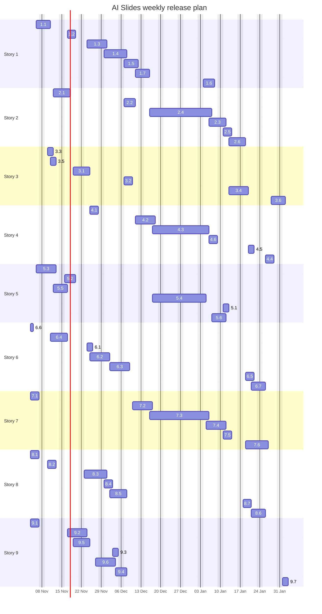

# Release plan and tracker

<div class="chapter-meta" markdown>
**Reads:** the architect's story sheet  ·  **Builds on:** [Part VIII landing](index.md), [Architecture and contracts](41-architecture-and-contracts.md)  ·  **Time:** ~15 min
</div>

This page breaks the nine stories into trackable subtasks. Each subtask has an owner, an effort estimate, a weekly release date and a status, matching the columns of the team's story sheet (SubTasks, Effort, Release Date, Status). The schedule respects task dependencies and each person's weekly capacity. A spreadsheet version is available for the team tracker.

[:material-microsoft-excel: Download tracker (.xlsx)](../assets/ai-slides-tracker.xlsx){ .md-button .md-button--primary } [:material-file-delimited: Download tracker (.csv)](../assets/ai-slides-tracker.csv){ .md-button }

## Step 1: Understand the planning rules

| Rule | Value |
| --- | --- |
| Release cadence | Weekly release train, every Friday. Code freeze Thursday 17:00, deploy to staging Friday morning, production promotion after sign-off |
| Plan start | Wednesday 4 November 2026 (the first train, R1, has 8 working days) |
| Holiday break | No release trains from 21 December 2026 to 1 January 2027 (assumed; adjust to the team calendar) |
| Effort unit | Ideal person-days (`d`) of focused work, including tests and code review, excluding meetings |
| Capacity | 0.8 focus-days per working day per person (4 per 5-day week); one subtask at a time per person, critical-path work first |
| Release date of a subtask | The Friday of the train it ships in, to dev or staging behind a feature flag |
| Release date of a story | The release date of its last subtask |
| Dependencies | A subtask is never scheduled before the train of anything it depends on |

!!! note "Estimates are starting points"
    The efforts below were derived from the implementation steps in each story chapter. Re-estimate in the first planning meeting, update the spreadsheet, and keep this page in sync (the generator script is described at the end of this page).

## Step 2: Read the release calendar

| Train | Release date | Capacity per person |
| --- | --- | --- |
| R1 | Fri 13 Nov 2026 | 6 d |
| R2 | Fri 20 Nov 2026 | 4 d |
| R3 | Fri 27 Nov 2026 | 4 d |
| R4 | Fri 4 Dec 2026 | 4 d |
| R5 | Fri 11 Dec 2026 | 4 d |
| R6 | Fri 18 Dec 2026 | 4 d |
| R7 | Fri 8 Jan 2027 | 4 d |
| R8 | Fri 15 Jan 2027 | 4 d |
| R9 | Fri 22 Jan 2027 | 4 d |
| R10 | Fri 29 Jan 2027 | 4 d |
| R11 | Fri 5 Feb 2027 | 4 d |

## Step 3: Read the story summary

| # | Story | Owner | SubTasks | Effort | Starts | Release date | Status |
| --- | --- | --- | --- | --- | --- | --- | --- |
| 1 | [\[Presenton BE\] Dynamic data: refresh spike, binding storage and refresh service](42-story1-dynamic-data.md) | Srini, Sourav, Nitesh | 7 | 19 d | R1 | R7 · Fri 8 Jan 2027 | Not started |
| 2 | [\[Presenton BE\] Platform Integration: Postgres, access control, pod-ready API](43-story2-platform-integration.md) | Nitesh | 6 | 15 d | R2 | R9 · Fri 22 Jan 2027 | Not started |
| 3 | [\[Presenton BE\] Prompt library and custom templates backend](44-story3-prompt-library-backend.md) | Srini | 6 | 10 d | R1 | R11 · Fri 5 Feb 2027 | Not started |
| 4 | [\[Presenton FE\] Native charts and async refresh UX](45-story4-native-charts-ux.md) | Srini, Sourav, Nitesh | 6 | 13 d | R3 | R10 · Fri 29 Jan 2027 | Not started |
| 5 | [\[Presenton FE\] Analytics menu and iframe hardening](46-story5-menu-and-iframe.md) | Sourav | 6 | 12 d | R1 | R8 · Fri 15 Jan 2027 | Not started |
| 6 | [\[Presenton FE\] Prompt library and template UI](47-story6-prompt-library-ui.md) | Radhika | 7 | 13 d | R1 | R10 · Fri 29 Jan 2027 | Not started |
| 7 | [\[Harness\] presentation-planner skill and refreshable-only data selection](48-story7-harness-planner.md) | Srini, Nitesh | 6 | 17 d | R1 | R10 · Fri 29 Jan 2027 | Not started |
| 8 | [\[Analytics BE/MCP\] Refresh APIs, MCP catalog, user-context enforcement, CSP and cookies](49-story8-analytics-mcp.md) | Nitesh | 7 | 15 d | R1 | R10 · Fri 29 Jan 2027 | Not started |
| 9 | [\[Infra\] Deploy Presenton BE and FE alongside the analytics platform](50-story9-infra.md) | Nitesh, Sourav | 7 | 15 d | R1 | R11 · Fri 5 Feb 2027 | Not started |
| | **Total** | | **58** | **129 d** | | **R11 · Fri 5 Feb 2027** | |

## Step 4: Track the subtasks

Status values: `Not started`, `In progress`, `In review`, `Blocked`, `Done`. Update the Status column in the spreadsheet; the trains and dates only change when the plan is re-baselined.

### Story 1: \[Presenton BE\] Dynamic data: refresh spike, binding storage and refresh service

Owner: Srini, Sourav, Nitesh · Effort: 19 d · Release: R7 (Fri 8 Jan 2027) · [Implementation guide](42-story1-dynamic-data.md)

| ID | SubTask | Owner | Effort | Depends on | Release date | Status |
| --- | --- | --- | --- | --- | --- | --- |
| 1.1 | Refresh spike: prototype options A, B and C, measure, write and approve the decision record | Srini, Nitesh | 3 d | - | R1 · Fri 13 Nov 2026 | Not started |
| 1.2 | slide_data_bindings SQLModel model and Alembic migration | Srini | 2 d | 1.1, 2.1 | R2 · Fri 20 Nov 2026 | Not started |
| 1.3 | Create bindings during generation from the DeckPlan | Srini | 3 d | 1.2, 7.1 | R4 · Fri 4 Dec 2026 | Not started |
| 1.4 | BindingRefreshService: batching, mapping, caching, snapshot write-back | Srini | 4 d | 1.2, 8.3 | R5 · Fri 11 Dec 2026 | Not started |
| 1.5 | Bindings API: GET and PUT bindings, refresh SSE stream, batch refresh | Sourav | 3 d | 1.4 | R5 · Fri 11 Dec 2026 | Not started |
| 1.6 | Export pre-refresh with 'data as of' fallback footnote | Sourav | 2 d | 1.4 | R7 · Fri 8 Jan 2027 | Not started |
| 1.7 | Tests (mappers, contract test against fake refresh API, migration) and metrics | Srini | 2 d | 1.5 | R6 · Fri 18 Dec 2026 | Not started |

### Story 2: \[Presenton BE\] Platform Integration: Postgres, access control, pod-ready API

Owner: Nitesh · Effort: 15 d · Release: R9 (Fri 22 Jan 2027) · [Implementation guide](43-story2-platform-integration.md)

| ID | SubTask | Owner | Effort | Depends on | Release date | Status |
| --- | --- | --- | --- | --- | --- | --- |
| 2.1 | Postgres schema presenton, pool settings, migration Kubernetes Job | Nitesh | 2 d | - | R2 · Fri 20 Nov 2026 | Not started |
| 2.2 | POST /api/v1/platform/session: JWKS verification, jti replay guard, user and org upsert, cookie path | Nitesh | 3 d | 2.1, 8.2 | R5 · Fri 11 Dec 2026 | Not started |
| 2.3 | Encrypted data-token storage and refresh-data-token endpoint | Nitesh | 2 d | 2.2 | R8 · Fri 15 Jan 2027 | Not started |
| 2.4 | organizations and presentation_collaborators tables, require_presentation_access on every endpoint | Nitesh | 4 d | 2.2 | R7 · Fri 8 Jan 2027 | Not started |
| 2.5 | Sharing endpoints, owned plus shared listing, app_data asset authorization | Nitesh | 2 d | 2.4 | R8 · Fri 15 Jan 2027 | Not started |
| 2.6 | Pod readiness: /healthz, /readyz, JSON logs, graceful shutdown, root_path, local login off | Nitesh | 2 d | 2.1 | R9 · Fri 22 Jan 2027 | Not started |

### Story 3: \[Presenton BE\] Prompt library and custom templates backend

Owner: Srini · Effort: 10 d · Release: R11 (Fri 5 Feb 2027) · [Implementation guide](44-story3-prompt-library-backend.md)

| ID | SubTask | Owner | Effort | Depends on | Release date | Status |
| --- | --- | --- | --- | --- | --- | --- |
| 3.1 | prompt_library_items model, migration and curated seed import | Srini | 2 d | 2.1 | R3 · Fri 27 Nov 2026 | Not started |
| 3.2 | List, detail and render endpoints with JSON Schema validation | Srini | 2 d | 3.1 | R5 · Fri 11 Dec 2026 | Not started |
| 3.3 | GET /api/v1/ppt/templates/bundled | Srini | 1 d | - | R1 · Fri 13 Nov 2026 | Not started |
| 3.4 | POST generate-from-prompt/async with planner stage and task polling | Srini | 3 d | 3.2, 7.5 | R9 · Fri 22 Jan 2027 | Not started |
| 3.5 | Gate custom template upload behind AI_SLIDES_CUSTOM_TEMPLATES_ENABLED and record open questions | Srini | 1 d | - | R1 · Fri 13 Nov 2026 | Not started |
| 3.6 | Backend tests for prompt library and async generation | Srini | 1 d | 3.4 | R11 · Fri 5 Feb 2027 | Not started |

### Story 4: \[Presenton FE\] Native charts and async refresh UX

Owner: Srini, Sourav, Nitesh · Effort: 13 d · Release: R10 (Fri 29 Jan 2027) · [Implementation guide](45-story4-native-charts-ux.md)

| ID | SubTask | Owner | Effort | Depends on | Release date | Status |
| --- | --- | --- | --- | --- | --- | --- |
| 4.1 | Chart rendering decision and element-patch reducer on the existing Chart.js path | Sourav | 2 d | 1.2 | R3 · Fri 27 Nov 2026 | Not started |
| 4.2 | useDeckRefresh SSE hook and bindingsSlice | Sourav | 3 d | 1.5, 4.1 | R6 · Fri 18 Dec 2026 | Not started |
| 4.3 | Overlay states (loading, error, stale, forbidden), status badge, retry, Refresh data button | Radhika (proposed) | 3 d | 4.2 | R7 · Fri 8 Jan 2027 | Not started |
| 4.4 | Autosave interaction, visible-slide-first ordering, cancellation | Srini | 2 d | 4.2 | R10 · Fri 29 Jan 2027 | Not started |
| 4.5 | Presentation mode and export render checks | Nitesh | 1 d | 4.3 | R9 · Fri 22 Jan 2027 | Not started |
| 4.6 | Reducer unit tests and Cypress component tests for every state | Radhika (proposed) | 2 d | 4.3 | R7 · Fri 8 Jan 2027 | Not started |

### Story 5: \[Presenton FE\] Analytics menu and iframe hardening

Owner: Sourav · Effort: 12 d · Release: R8 (Fri 15 Jan 2027) · [Implementation guide](46-story5-menu-and-iframe.md)

| ID | SubTask | Owner | Effort | Depends on | Release date | Status |
| --- | --- | --- | --- | --- | --- | --- |
| 5.1 | AI Slides menu item and role permission in Superset | Sourav | 1 d | - | R8 · Fri 15 Jan 2027 | Not started |
| 5.2 | Superset host page /ai-slides/launch with iframe and postMessage bridge | Sourav | 2 d | 8.2 | R2 · Fri 20 Nov 2026 | Not started |
| 5.3 | Next.js basePath /ai-slides and prefix fixes (proxy, asset URLs, export route) | Sourav | 3 d | - | R1 · Fri 13 Nov 2026 | Not started |
| 5.4 | PlatformSessionBridge component with re-handoff on expiry | Sourav | 2 d | 2.2, 5.2 | R7 · Fri 8 Jan 2027 | Not started |
| 5.5 | Iframe sizing, fullscreen, deep links, downloads | Sourav | 2 d | 5.3 | R2 · Fri 20 Nov 2026 | Not started |
| 5.6 | End-to-end tests and browser QA matrix | Sourav | 2 d | 5.4, 5.5 | R8 · Fri 15 Jan 2027 | Not started |

### Story 6: \[Presenton FE\] Prompt library and template UI

Owner: Radhika · Effort: 13 d · Release: R10 (Fri 29 Jan 2027) · [Implementation guide](47-story6-prompt-library-ui.md)

| ID | SubTask | Owner | Effort | Depends on | Release date | Status |
| --- | --- | --- | --- | --- | --- | --- |
| 6.1 | Prompt library API client and state | Radhika | 1 d | 3.1 | R3 · Fri 27 Nov 2026 | Not started |
| 6.2 | PromptLibraryPanel and PromptCard with search and category filters | Radhika | 3 d | 6.1 | R4 · Fri 4 Dec 2026 | Not started |
| 6.3 | PromptVariablesForm from JSON Schema, with dashboard picker | Radhika | 3 d | 6.2, 8.4 | R5 · Fri 11 Dec 2026 | Not started |
| 6.4 | TemplatePicker with bundled templates and recommended badge | Radhika | 2 d | 3.3 | R2 · Fri 20 Nov 2026 | Not started |
| 6.5 | GenerateFromPromptButton with async progress, navigation and ?prompt= deep link | Radhika | 2 d | 3.4, 6.3 | R9 · Fri 22 Jan 2027 | Not started |
| 6.6 | Hide template upload entry points via runtime flag | Radhika | 0.5 d | - | R1 · Fri 13 Nov 2026 | Not started |
| 6.7 | Unit and Cypress component tests | Radhika | 1.5 d | 6.5 | R10 · Fri 29 Jan 2027 | Not started |

### Story 7: \[Harness\] presentation-planner skill and refreshable-only data selection

Owner: Srini, Nitesh · Effort: 17 d · Release: R10 (Fri 29 Jan 2027) · [Implementation guide](48-story7-harness-planner.md)

| ID | SubTask | Owner | Effort | Depends on | Release date | Status |
| --- | --- | --- | --- | --- | --- | --- |
| 7.1 | Skill scaffold: SKILL.md, DeckPlan JSON Schema and Pydantic models, layout catalog input | Srini | 2 d | - | R1 · Fri 13 Nov 2026 | Not started |
| 7.2 | Catalog and MCP tool integration (list, info, row-limited samples) with the data token | Nitesh | 3 d | 8.4, 8.5 | R6 · Fri 18 Dec 2026 | Not started |
| 7.3 | Refreshable-only selection, viz_type compatibility table, ranking | Srini | 3 d | 7.1, 7.2 | R7 · Fri 8 Jan 2027 | Not started |
| 7.4 | Deterministic validators, bounded repair loop, limits and budgets | Srini | 3 d | 7.3 | R8 · Fri 15 Jan 2027 | Not started |
| 7.5 | Presenton BE harness client: DeckPlan to structure and bindings | Srini | 2 d | 7.4, 1.3 | R8 · Fri 15 Jan 2027 | Not started |
| 7.6 | Eval set (40+ cases), runner and CI gate | Srini | 4 d | 7.4 | R10 · Fri 29 Jan 2027 | Not started |

### Story 8: \[Analytics BE/MCP\] Refresh APIs, MCP catalog, user-context enforcement, CSP and cookies

Owner: Nitesh · Effort: 15 d · Release: R10 (Fri 29 Jan 2027) · [Implementation guide](49-story8-analytics-mcp.md)

| ID | SubTask | Owner | Effort | Depends on | Release date | Status |
| --- | --- | --- | --- | --- | --- | --- |
| 8.1 | ai_slides blueprint scaffold, signing keys and JWKS endpoint | Nitesh | 2 d | - | R1 · Fri 13 Nov 2026 | Not started |
| 8.2 | Handoff endpoint and data-token verification with user context | Nitesh | 2 d | 8.1 | R1 · Fri 13 Nov 2026 | Not started |
| 8.3 | Refresh API: saved query context, overrides merge, ChartDataCommand, normalization, errors | Nitesh | 4 d | 8.2, 1.1 | R4 · Fri 4 Dec 2026 | Not started |
| 8.4 | Catalog endpoint with refreshable rules | Nitesh | 2 d | 8.3 | R4 · Fri 4 Dec 2026 | Not started |
| 8.5 | MCP: JWT auth as the user, tool allowlist, custom catalog tool | Nitesh | 2 d | 8.2 | R5 · Fri 11 Dec 2026 | Not started |
| 8.6 | CSP, cookie settings and CSRF exemptions for Bearer endpoints | Nitesh | 1 d | - | R10 · Fri 29 Jan 2027 | Not started |
| 8.7 | Integration tests: RLS, forbidden charts, overrides | Nitesh | 2 d | 8.4 | R9 · Fri 22 Jan 2027 | Not started |

### Story 9: \[Infra\] Deploy Presenton BE and FE alongside the analytics platform

Owner: Nitesh, Sourav · Effort: 15 d · Release: R11 (Fri 5 Feb 2027) · [Implementation guide](50-story9-infra.md)

| ID | SubTask | Owner | Effort | Depends on | Release date | Status |
| --- | --- | --- | --- | --- | --- | --- |
| 9.1 | Split the Dockerfile into presenton-be and presenton-fe images | Sourav | 2 d | - | R1 · Fri 13 Nov 2026 | Not started |
| 9.2 | Dev namespace: Helm chart, prefix ingress, migrate Job | Nitesh | 3 d | 9.1 | R3 · Fri 27 Nov 2026 | Not started |
| 9.3 | Secrets through External Secrets | Sourav | 1 d | 9.2 | R4 · Fri 4 Dec 2026 | Not started |
| 9.4 | Storage: RWX PVC for v1, object-storage plan | Sourav | 1 d | 9.2 | R5 · Fri 11 Dec 2026 | Not started |
| 9.5 | CI/CD: build, scan, push, deploy dev, staging and prod | Sourav | 3 d | 9.1 | R3 · Fri 27 Nov 2026 | Not started |
| 9.6 | Monitoring: metrics, tracing, dashboards, alerts | Sourav | 3 d | 9.2 | R4 · Fri 4 Dec 2026 | Not started |
| 9.7 | Production rollout: canary and pilot role | Nitesh, Sourav | 2 d | all other subtasks | R11 · Fri 5 Feb 2027 | Not started |

## Step 5: Check the weekly load per person

Person-days of subtasks that ship in each train. A subtask counts in the train it finishes in, so a long subtask can make one train look heavier than 4 d while the previous train looks light.

| Train | Srini | Sourav | Nitesh | Radhika |
| --- | --- | --- | --- | --- |
| R1 (13 Nov) | 5.5 | 5 | 5.5 | 0.5 |
| R2 (20 Nov) | 2 | 4 | 2 | 2 |
| R3 (27 Nov) | 2 | 5 | 3 | 1 |
| R4 (04 Dec) | 3 | 4 | 6 | 3 |
| R5 (11 Dec) | 6 | 4 | 5 | 3 |
| R6 (18 Dec) | 2 | 3 | 3 | 0 |
| R7 (08 Jan) | 3 | 4 | 4 | 5 |
| R8 (15 Jan) | 5 | 3 | 4 | 0 |
| R9 (22 Jan) | 3 | 0 | 5 | 2 |
| R10 (29 Jan) | 6 | 0 | 1 | 1.5 |
| R11 (05 Feb) | 1 | 1 | 1 | 0 |
| **Total** | **38.5** | **33** | **39.5** | **18** |

## Step 6: Read the schedule as a Gantt chart



## Step 7: Watch the scheduling risks

!!! warning "Gotcha: Srini and Nitesh set the end date"
    Srini carries 38.5 d and Nitesh 39.5 d, against 33 d for Sourav and 18 d for Radhika. Nitesh owns all of Stories 2 and 8 (identity handoff, refresh API, catalog), which most other work waits on, and Srini owns the binding service, the planner and the prompt backend. The plan finishes in R11 only if both stay focused. Protect their time, pair on 8.3 (refresh API) if it slips, and treat any new request for either of them as a date change.

!!! info "Proposed reassignments"
    Subtasks marked `(proposed)` are assigned to someone who is not listed as an owner of that story on the architect's sheet. They balance the load and should be confirmed by the architect. Radhika has spare capacity after Story 6, so the Story 4 overlay states and component tests (4.3, 4.6) are proposed for her; she is already building the same UI patterns in Story 6.

Other risks that move dates:

- The Story 1 spike (1.1) can change the refresh approach. If it selects option A (browser calls Superset directly), subtasks 1.4, 1.5 and 8.3 change shape; re-plan at the end of R1.
- Story 8 depends on how the analytics platform packages Superset changes (blueprint or extension). Settle that in R1.
- The harness team's availability for Story 7 integration (7.2) is an external dependency.
- Custom template upload stays out of the plan until the pending decision is made.

## Step 8: Keep the tracker in sync

This page, the tracking table in each story chapter, and both spreadsheet downloads are generated from one subtask list (IDs, efforts, owners, dependencies) by `tutorial/scripts/gen_release_plan.py`. The script schedules subtasks day by day: critical-path work first, one subtask at a time per person, never before its dependencies. Each subtask then ships in the first Friday train on or after its finish day. To re-plan, edit the `T` list or the `RELEASES` calendar in the script and regenerate (it needs `openpyxl`):

```bash
python tutorial/scripts/gen_release_plan.py tutorial/content/delivery/51-release-plan.md tutorial/content/assets /tmp/ai-slides-snippets
```

Then paste the regenerated per-story tables from the snippets folder into the Tracking section of each story chapter, and commit. Statuses live in the team spreadsheet; copy them back here at each release review if you want the site to show progress.

## What you now know

- The 58 subtasks behind the nine stories, with owners, effort and dependencies.
- The weekly release train, from R1 on Fri 13 Nov 2026 to R11 on Fri 5 Feb 2027, and which train each subtask ships in.
- The total estimated effort (129 d) and the weekly load per person.
- The scheduling risks, starting with the critical path through Stories 8 and 2.

## Next

Start building with [Story 1: Dynamic data, binding storage and refresh service](42-story1-dynamic-data.md).
