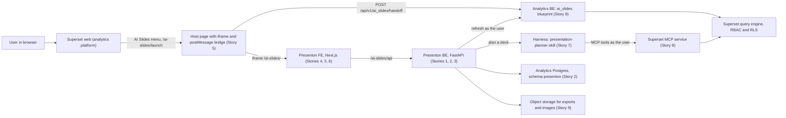
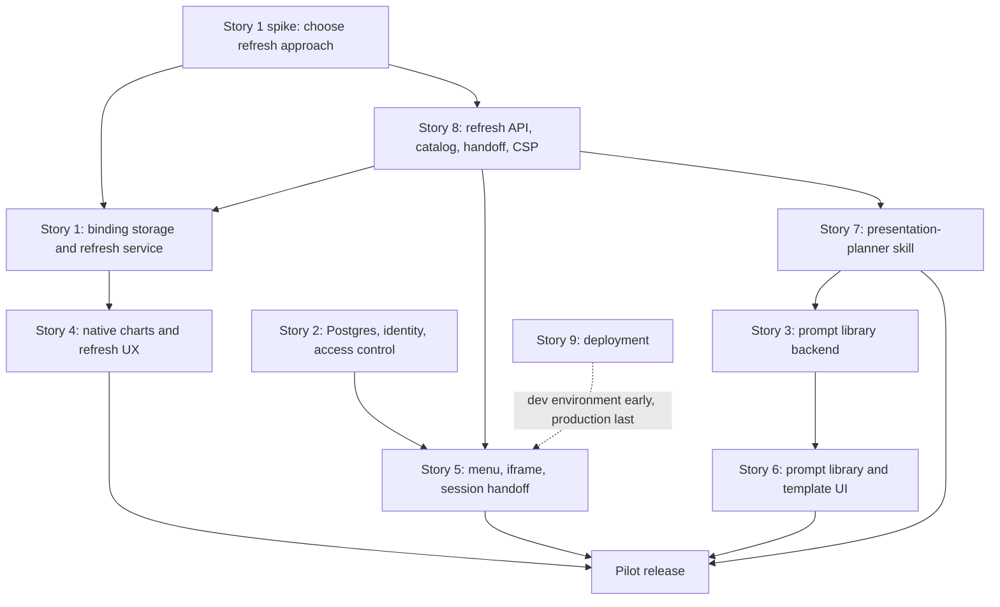

# Part VIII · AI Slides delivery plan

**Reads:** the architect's story backlog, `servers/fastapi/templates/v2/models/elements.py`, `servers/nextjs/lib/template-v2-json-to-html.ts`  ·  **Builds on:** [Part VII landing](../superset/index.md), [Template v2 format](../presenton/16-template-v2-format.md)  ·  **Time:** ~15 min

Part VII describes a long-term, Superset-native design. Part VIII is the plan the team is actually building first. It forks Presenton, embeds it inside the Superset-based analytics platform as a feature called **AI Slides**, and makes every chart and metric in a generated deck a live binding to Superset data that refreshes when the deck is opened. This part takes the architect's nine stories and turns each one into an implementation guide, with architecture diagrams, the exact code changes in the Presenton fork and in the analytics backend, UI component code, tests and rollout steps.

## The nine stories

The backlog below is transcribed from the architect's story sheet. Each row links to the chapter that explains how to build it.

| # | Story | What it does | Owners | Chapter |
| --- | --- | --- | --- | --- |
| 1 | [Presenton BE] Dynamic data: refresh spike, binding storage and refresh service | Stores a Superset data binding for each chart or metric and refreshes values on open, after a spike picks the refresh approach. | Srini, Sourav, Nitesh | [Story 1](42-story1-dynamic-data.md) |
| 2 | [Presenton BE] Platform Integration: Postgres, access control, pod-ready API | Moves metadata to the analytics Postgres, enforces owner, org and collaborator access with platform identity, and makes the API fit the analytics pod. | Nitesh | [Story 2](43-story2-platform-integration.md) |
| 3 | [Presenton BE] Prompt library and custom templates backend | Provides APIs for curated prompts and bundled templates and async generation, with custom template upload on hold pending a decision. | Srini | [Story 3](44-story3-prompt-library-backend.md) |
| 4 | [Presenton FE] Native charts and async refresh UX | Renders charts with a charting library from stored bindings and fills them in progressively with loading, error and stale states. | Srini, Sourav, Nitesh | [Story 4](45-story4-native-charts-ux.md) |
| 5 | [Presenton FE] Analytics menu and iframe hardening | Adds the "AI Slides" menu item and makes the embedded Presenton iframe reliable (sizing, deep links, session handoff, base path). | Sourav | [Story 5](46-story5-menu-and-iframe.md) |
| 6 | [Presenton FE] Prompt library and template UI | Lets users browse and use curated prompts and select templates, with template upload on hold. | Radhika | [Story 6](47-story6-prompt-library-ui.md) |
| 7 | [Harness] presentation-planner skill and refreshable-only data selection | Plans decks and picks only charts and metrics that Superset can refresh and the user can access, with validation, limits and an eval set. | Srini, Nitesh | [Story 7](48-story7-harness-planner.md) |
| 8 | [Analytics BE/MCP] Refresh APIs, MCP catalog, user-context enforcement, CSP and cookies | Lets Presenton and the harness discover and refresh Superset data per user, with RBAC enforcement and the iframe CSP and cookie settings. | Nitesh | [Story 8](49-story8-analytics-mcp.md) |
| 9 | [Infra] Deploy Presenton BE and FE alongside the analytics platform | Deploys both Presenton services with routing, secrets, storage, harness connectivity, CI/CD and monitoring. | Nitesh, Sourav | [Story 9](50-story9-infra.md) |

## The system in one picture

Three ideas hold the plan together:

1. **One identity.** The user is signed in to Superset only. The host page exchanges the Superset session for a short-lived signed assertion. Presenton turns that into its own session, and every data call afterwards runs as that same Superset user, so roles and row-level security apply unchanged ([Story 2](43-story2-platform-integration.md), [Story 8](49-story8-analytics-mcp.md)).
2. **Bindings, not numbers.** A chart on a slide stores a reference to a saved Superset chart plus a mapping, never typed-in values. The planner only proposes charts that Superset can refresh and the user can see ([Story 7](48-story7-harness-planner.md)). The refresh service resolves them on open ([Story 1](42-story1-dynamic-data.md)), and the editor fills them in progressively ([Story 4](45-story4-native-charts-ux.md)).
3. **Same origin.** Presenton is served under `/ai-slides/` on the analytics domain. That keeps cookies, Content Security Policy and API calls simple, and it is why Next.js `basePath` and prefix-aware routing matter so much ([Story 5](46-story5-menu-and-iframe.md), [Story 9](50-story9-infra.md)).

## Dependencies and sequencing

A practical order for a small team:

| Phase | Goal | Stories | Exit criteria |
| --- | --- | --- | --- |
| 0. Foundations | A deployable fork on a dev cluster, signed in through Superset | 9 (dev only), 2 (Postgres and handoff), 1 (spike) | A user clicks AI Slides in dev Superset and lands in Presenton as themselves; the spike's decision record is approved |
| 1. Live data | A generated deck whose charts refresh on open | 8, 1, 4 | A deck generated from a dashboard shows fresh values after the underlying data changes; forbidden charts show a clear state |
| 2. Guided generation | Prompts, templates and a planner that only picks refreshable data | 3, 6, 7 | The eval set passes with zero refreshable-violations and zero access-violations |
| 3. Production | Hardened embedding, monitoring, rollout | 5, 9 (production) | SLOs and alerts in place; pilot group enabled by role |

## How this part relates to Part VII

Part VIII is a pragmatic subset of the Part VII design, built by extending Presenton instead of writing a new renderer.

| Part VII concept | Part VIII equivalent | Difference |
| --- | --- | --- |
| DataBinding in the Document Spec ([data-bound model](../superset/33-data-bound-model.md)) | A row in `slide_data_bindings` | Only saved Superset charts are binding sources in v1 |
| Binding Resolver | Presenton BE refresh service plus the analytics refresh API | Resolution happens when a deck is opened or exported |
| Planner ([generation flow](../superset/34-generation-flow.md)) | Harness `presentation-planner` skill | Runs in the team's agent harness and talks to the Superset MCP service |
| Native PPTX refresh in place ([native rendering](../superset/35-native-rendering.md)) | Not in scope | Exports contain the latest snapshot plus a "data as of" note |

## Reading order

1. [Release plan and tracker](51-release-plan.md): 58 subtasks with owner, effort, weekly release date and status, plus an Excel tracker download.
2. [Architecture and contracts](41-architecture-and-contracts.md): the shared names, tables, endpoints and payloads every story uses.
3. Stories 1 to 9, in order, or jump to your own story. Each story chapter ends with its own tracking table.

## What you now know

- The nine stories, their owners, and the chapter that implements each one.
- The three ideas that make the plan coherent: one identity, bindings instead of numbers, same-origin embedding.
- The dependency order and a four-phase delivery plan.
- How the near-term plan maps onto the long-term Part VII design.

## Next

Read [Architecture and contracts](41-architecture-and-contracts.md) before any individual story.
