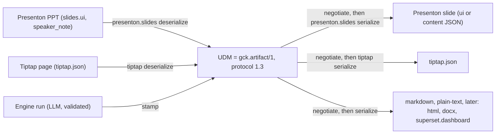
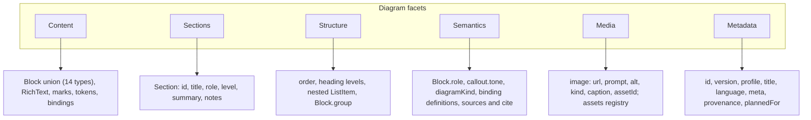

# Unified Document Model

<div class="chapter-meta" markdown>
**Reads:** `tutorial/prototypes/udm/core/udm.ts`, `tutorial/prototypes/udm/core/udm-runtime.mjs`, `tutorial/prototypes/udm/core/adapter.ts`, `tutorial/prototypes/udm/examples/chart-and-table/2-udm.json`, `tutorial/prototypes/udm/examples/doc-to-slides/2-udm.json`, `servers/fastapi/templates/v2/models/elements.py`  ·  **Builds on:** [Artifact Spec and targets](../ai-component/62-artifact-spec-and-targets.md), [Feasibility analysis](71-feasibility.md)  ·  **Time:** ~45 min
</div>

## What you will learn

This chapter specifies the Unified Document Model (UDM), the "Canonical IR" in the team's diagram that Presenton slides, Tiptap pages and every later module map to. You will see why the UDM is not a new format but the Part IX Artifact Spec (`gck.artifact/1`) shipped as protocol 1.3, a target-agnostic profile; how the diagram's six facets (Content, Sections, Structure, Semantics, Media, Metadata) map onto concrete fields; the full TypeScript and Pydantic types; a field-by-field mapping from Artifact 1.2 to UDM 1.3 so there is exactly one canonical format; and the rules for ids, provenance, extension bags, versioning, data bindings and number tokens. Every JSON example is copied from the runnable prototype in `tutorial/prototypes/udm/examples/`, which converted all 383 bundled Presenton layouts into a valid UDM.

## Step 1: One canonical format, not a third one

The team's diagram has two producers (Presenton PPT, Tiptap Page), one Canonical IR in the middle, and one serializer per output. The user's follow-up makes the middle the important part: "Today it is for Tiptap, tomorrow it might be for other modules, so the solution should be generic." A model that only knows slides and pages would be rebuilt for the third module. So the decision is:

> The Unified Document Model is the Artifact Spec `gck.artifact/1` from Part IX, shipped as protocol 1.3, a target-agnostic profile. It is not a third format. Anything a single target needs lives only in a namespaced `ext["<adapter-id>"]` bag that the engine never interprets and every other adapter passes through. Presenton slides and Tiptap are the first two adapters; Markdown, HTML, a Superset dashboard, DOCX, Confluence, Notion or email are later adapters, each one a new adapter and nothing else.

Part IX already argued for an intermediate representation plus deterministic adapters (one validation path, one safety model, whole-block streaming, pure testable adapters; see [Artifact Spec and targets](../ai-component/62-artifact-spec-and-targets.md), Step 1). A separate UDM would need its own JSON Schema, Pydantic models, invariants, versioning and a converter back to the Artifact, which is exactly the "competing third format" the team wants to avoid. Keeping one format also keeps the wire id `gck.artifact/1` and the package `@gck/protocol`; protocol 1.1 and 1.2 are already taken by the data sources, so the UDM profile is 1.3.



Every arrow in the team's diagram is one function of the same adapter contract ([Tiptap adapter](74-tiptap-adapter.md) and [Adding any new target](77-adding-a-new-target.md) cover the contract in full):

| Diagram arrow | Contract function |
| --- | --- |
| Presenton PPT to Canonical IR | `presenton.slides.deserialize(native)` ([PPT adapter](73-ppt-adapter.md)) |
| PPT serializer | `presenton.slides.serialize(negotiate(udm, manifest).udm)`, then Presenton's existing export for the `.pptx` file |
| Tiptap Page to Canonical IR | `tiptap.deserialize(doc)` |
| Tiptap serializer | `tiptap.serialize(negotiate(udm, manifest).udm)` |
| "only the adapter layer should change" | the core (`@gck/protocol`, `negotiate`, registry, conformance kit) and the engine never name a target; adapters register themselves |

The prototype proves the "no target in the core" claim mechanically: `core.lock.json` records sha256 hashes of every core file after the Markdown adapter was written; the plain-text adapter was written afterwards, and `npm run validate` reports "Core files changed after the freeze: none" and "Core files naming a target in code: none" (`tutorial/prototypes/udm/REPORT.md`).

## Step 2: What protocol 1.3 changes in the Artifact Spec

The Artifact's core is already target-neutral content plus live data. What is not neutral is a short list, found by auditing Part IX for every place a target name appears in the protocol or the engine.

| # | Where in Part IX | Problem | Protocol 1.3 fix |
| --- | --- | --- | --- |
| G1 | `TargetId` is a closed union (`"slides" \| "tiptap-doc" \| "superset-dashboard" \| "text"`) | adding a module edits `@gck/protocol` | adapter ids are open strings matching `^[a-z][a-z0-9-]*(\.[a-z0-9-]+)*$`; the four legacy ids become registry aliases |
| G2 | `Artifact.target` is required | a UDM imported from a deck or a page has no target | optional `plannedFor` (a hint only); `target` is read as an alias |
| G3 | `Section.kind: "slide" \| "page" \| "row" \| "section"` | values are target names | neutral `Section.role` and `level`; `kind` deprecated, the engine always writes `"section"`; pagination is the adapter's decision |
| G4 | `Section.layoutHint` holds a Template v2 layout id | a target id inside the core | moves to `ext["<adapter-id>"].layout`; `layoutHint` is read as an alias in 1.x |
| G5 | engine table `TARGET_REFRESH[target]` | engine keyed by target name | `manifest.defaultRefresh` |
| G6 | engine branch `if manifest.id == "slides"` adds `SPEAKER_NOTE`, popped before stamping | target branch in the engine, notes lost from the IR | neutral `Section.notes: RichText`; the response schema adds it only when `manifest.features.notes` is true |
| G7 | `ChartKind` copied from Presenton's `ChartType` | one target's vocabulary | kept as neutral chart semantics (now with `bubble`), but each manifest declares `chartKinds` and negotiation maps unsupported kinds by a fixed chain |
| G8 | fallbacks live inside each adapter | the same input degrades differently per target, untestable | one core `negotiate(udm, manifest)` runs before every `serialize` |
| G9 | slides has no reverse direction; Tiptap's `fromHost(ctx)` mixes host reading and conversion | the diagram's arrows into the IR are missing | pure `deserialize(native)` separated from host-bound `fromHost` |
| G10 | `ArtifactDiff` (62 Step 5) and `BlockDiff` (64 Step 4) | two names for one type | one `UdmDiff` |
| G11 | `provenance {runId, prompt}` required | an imported deck has no run | generalized `provenance` with `origin` and `importedFrom` |
| G12 | manifest says only blocks, section kinds and limits | no way to state marks, nesting, ids, round-trip fidelity | capability manifest (`AdapterManifest`) |

The data source union (`superset_chart`, `superset_dataset`, `superset_metric`, `superset_sql`) is Superset-specific, but it is a separate plugin axis (data providers), not targets. A new target never touches it. A new data provider adds a `source.type`, which Part IX already documents as a minor bump; the only new type in 1.3 is `static` (Step 10).

**Compatibility.** Most of 1.3 is additive (new optional fields, new block types, new marks), which Part IX's versioning rules allow inside `gck.artifact/1`. Four changes are widenings: open adapter ids, optional `target`, optional `Section.kind`, and the generalized `provenance`. The prototype adds a fifth that the alignment note did not list: `title` becomes optional, because a hand-written Tiptap page has no document title and a deserializer must not invent one (the `doc-to-slides` example has no title). A 1.2 reader that validates strictly would reject a 1.3 document that uses a widening, so the rule from Part IX applies unchanged: the engine and `@gck/protocol` ship 1.3 first, and a client declares the protocol minor it reads. Engine-generated artifacts keep writing `title`, `provenance.runId`, `createdAt` and `prompt`, so a generated 1.3 artifact that uses no new field is still a valid 1.2 artifact.

## Step 3: The six facets

The six boxes in the diagram are not six objects. They are views over UDM fields, and every field is optional and target-neutral unless it was required in 1.2.



| Facet | Already in `gck.artifact/1` (1.0 to 1.2) | Added in 1.3 | Prototype evidence (383 layouts) |
| --- | --- | --- | --- |
| **Content** | heading, paragraph, list, callout, quote, divider, chart, metric, table, image, embed; marks bold, italic, code, link; tokens | blocks `code`, `math`, `diagram`; marks `underline`, `strike`, `math`; `"\n"` as a hard line break; `static` binding source | 4,041 blocks: paragraph 2,445, heading 783, image 607, chart 113, diagram 51, list 35, table 7 |
| **Sections** | `id`, `title`, `kind`, `layoutHint`, `blocks` | `role`, `level`, `summary`, `notes`, `ext` | 354 of 383 slides got a detected title |
| **Structure** | section and block order; heading levels 1 to 3; flat lists | nested `ListItem`; `Block.group` (same id = one visual region) | groups present in 310 slides (they are what Markdown drops) |
| **Semantics** | block types, `callout.tone`, `metric.compare`, tokens, binding definitions, parameters | `Block.role` (subtitle, takeaway, kpi, caption, citation, label); `diagramKind`; `sources` plus `TextSegment.cite`; `meta.audience` | roles inferred: label 750, kpi 600, subtitle 77, takeaway 5 |
| **Media** | `image {prompt, url, alt}`, `embed` | `image.kind` (photo, icon, illustration, logo), `image.caption`, `image.assetId`, `assets` registry with attribution and a `generated` flag | 607 images, icons and photos told apart by `is_icon` |
| **Metadata** | `id`, `version`, `title`, `language`, `target`, `provenance` | `profile`, `plannedFor`, `meta` (description, tags, authors, timestamps, revision, classification, audience), generalized `provenance` | every imported UDM carries `provenance.importedFrom` |

### 3.1 Content

Content is the block union plus `RichText`. Two content rules matter for every adapter:

1. **Marks are semantic, not styling.** `bold`, `italic`, `underline`, `strike`, `code`, `link` and `math` say what the text means. Font family, size and color never enter the UDM. When Presenton text is read, marks are recorded only as differences from the element's own font (`runsToRichText`, `tutorial/prototypes/udm/adapters/presenton/from-presenton.mjs:29`), so a slide title that is bold by template style does not carry a `bold` mark.
2. **Data lives in bindings.** Chart, metric, table and embed blocks reference a `bindingId`; the values sit in `Artifact.bindings` (Step 10). The only number-bearing structure inside a block is the `diagram` block's `items[].value` and `range`, which Step 10 discusses as an open point.

`RichText` is canonical: marks sorted in vocabulary order, no empty segments, bold and italic never covering boundary whitespace, and adjacent equal segments merged (`normalizeRichText`, `tutorial/prototypes/udm/core/udm-runtime.mjs:49`). The whitespace rule was forced by the conformance kit: Markdown cannot express `** bold**`, so without it the round trip changed text.

### 3.2 Sections

A section is the unit an adapter paginates: one slide for Presenton, a titled region (an H2 boundary) for Tiptap, a row for a dashboard. The UDM never says which. `role` gives the section's purpose (`title`, `agenda`, `content`, `summary`, `closing`, `appendix`), `level` gives outline depth without nesting section objects, `summary` holds the short abstract (Presenton's per-slide outline Markdown), and `notes` holds non-body annotation (speaker notes on a slide, an aside in a document). An adapter whose manifest has `features.notes: false` drops `notes` and `summary` with a loss entry.

### 3.3 Structure

Structure is order plus three hints. Heading levels stay 1 to 3 (an adapter maps them: Tiptap writes H3 to H5 because H1 and H2 are the document title and section boundaries). `ListItem` is either a plain `RichText` or `{text, children}`; readers without nesting flatten. `Block.group` says that several blocks form one visual region, for example a card holding a heading, a price and a bullet list. Presenton's groups come from Template v2 `group` elements (`tutorial/prototypes/udm/adapters/presenton/walk.mjs:36-39`), and a target that cannot show regions drops the group with a `groups_dropped` loss.

### 3.4 Semantics

`Block.role` is the smallest useful vocabulary that survived the corpus: `subtitle`, `takeaway`, `kpi`, `caption`, `citation` and `label`. The Presenton reader infers roles from element names and font size (`classifyText`, `tutorial/prototypes/udm/adapters/presenton/from-presenton.mjs:45`), and the inference is a heuristic measured only on the bundled templates. `diagramKind` is a neutral vocabulary for infographics (`progress`, `gauge`, `timeline`, `process`, `steps`, `funnel`, `pyramid`, `cycle`, `matrix`, `hierarchy`, `comparison`, `other`); the 27 Presenton infographic types map onto it (`DIAGRAM_KIND`, `from-presenton.mjs:9-19`) and the exact original type is kept in `ext`.

### 3.5 Media

An image block keeps `url`, the generation `prompt`, `alt` (required), `kind` and `caption`. `assetId` points into `Artifact.assets`, a registry keyed by asset id that holds the MIME type, URL, optional hash and size, attribution and a `generated` flag, so that one picture used three times is stored once and its license travels with it. Video, audio and file attachments are deferred until a target needs them; they would arrive as a new `media` block in a minor bump.

### 3.6 Metadata

Document identity and origin: `id`, `version`, `profile`, `title`, `language`, `plannedFor`, `meta` and `provenance`. Step 8 covers provenance. Presenton-only generation settings (tone, verbosity, table of contents, template id) are not metadata; they go to `ext["presenton.slides"]`.

### 3.7 The boundary rule

The UDM holds **content and meaning**. Each adapter keeps **geometry and styling** in its own host:

- positions, sizes, rotation, z-order, fonts, colors, fills, shadows and theme values (Presenton `slides.ui` and `presentations.theme`, the Tiptap host's CSS, a dashboard's `position_json`);
- data values of live sources (the binding store, resolved as the viewer);
- host ids, except as opaque values inside that adapter's `ext` bag.

The prototype measured what this rule throws away on the Presenton side: 1,644 decorative images, 718 unnamed vectors, 39 decorative texts and 15 decorative vectors were skipped as non-content, and 3 empty text elements were ignored. None of them is lost on a Presenton round trip, because patch-mode serialization edits a copy of the original `ui` ([PPT adapter](73-ppt-adapter.md), Step 9).

## Step 4: The TypeScript types

The production types replace `gck/packages/protocol/src/artifact.ts` from Part IX. They are the prototype's `core/udm.ts` merged with every 1.0 to 1.2 field the prototype left out for brevity (`metric.compare`, `table.columns` and `maxRows`, `parameters`, `refresh`, `dataContext`, and the full `DataBinding` with `mapping` and `format`).

```ts title="gck/packages/protocol/src/artifact.ts (new, protocol 1.3 UDM profile)"
import type { ArtifactParameter, DataBinding, HostDataScope, RefreshPolicy } from "./data";
export type * from "./data";

export const ARTIFACT_VERSION = "gck.artifact/1" as const;
export const UDM_PROFILE = "udm/1.3" as const;

export type JsonValue = null | boolean | number | string | JsonValue[] | { [k: string]: JsonValue };
/** An adapter id, also its ext namespace: ^[a-z][a-z0-9-]*(\.[a-z0-9-]+)*$ ("presenton.slides", "tiptap"). */
export type AdapterId = string;
/** Opaque to the core and the engine. An adapter writes only its own key. */
export type Ext = Record<AdapterId, JsonValue>;
/** @deprecated 1.3: any registered adapter id; "slides", "tiptap-doc", "superset-dashboard", "text" are aliases. */
export type TargetId = AdapterId;

export type ChartKind =
  | "bar" | "horizontal_bar" | "stacked_bar" | "horizontal_stacked_bar" | "line" | "area"
  | "pie" | "donut" | "polar_area" | "scatter" | "radar" | "bubble";          // 1.3: + bubble
export type DiagramKind =
  | "progress" | "gauge" | "timeline" | "process" | "steps" | "funnel" | "pyramid"
  | "cycle" | "matrix" | "hierarchy" | "comparison" | "other";                // 1.3

// ---------- Content: rich text ----------
export type Mark = "bold" | "italic" | "underline" | "strike" | "code" | "link" | "math";  // 1.3: + underline, strike, math
export type TextSegment = {
  text: string;                               // "\n" is a hard line break; "" only for token segments
  marks?: Mark[];
  href?: string;                              // only with "link"
  token?: { bindingId: string; field: string; format?: string };
  cite?: string[];                            // 1.3: ids into Artifact.sources
};
export type RichText = TextSegment[];
export type ListItem = RichText | { text: RichText; children: ListItem[] };   // 1.3: nesting

// ---------- Content: blocks ----------
export type BlockRole = "subtitle" | "takeaway" | "kpi" | "caption" | "citation" | "label";  // 1.3
type BlockBase = {
  id: string;                                 // blk_...
  role?: BlockRole;                           // 1.3
  group?: string;                             // 1.3: grp_..., same value = one visual region
  ext?: Ext;                                  // 1.3
};
export type DiagramItem = {
  id?: string; parentId?: string; heading?: string; description?: string;
  label?: string; focus?: string; value?: number;
};
export type Block = BlockBase & (
  | { type: "heading"; level: 1 | 2 | 3; text: RichText }
  | { type: "paragraph"; text: RichText }
  | { type: "list"; ordered: boolean; items: ListItem[] }
  | { type: "callout"; tone: "info" | "warning" | "success"; text: RichText }
  | { type: "quote"; text: RichText; attribution?: string }                  // 1.3: attribution
  | { type: "divider" }
  | { type: "code"; language?: string; code: string }                         // 1.3
  | { type: "math"; latex: string }                                           // 1.3
  | { type: "chart"; bindingId: string; chartType: ChartKind; title?: string;
      axes?: { x?: string; y?: string }; caption?: RichText }                 // 1.3: axes, caption
  | { type: "metric"; bindingId: string; label: string; compare?: "previous_period" | null }
  | { type: "table"; bindingId: string; columns?: string[]; maxRows?: number; caption?: RichText }
  | { type: "image"; url?: string; prompt?: string; alt: string;
      kind?: "photo" | "icon" | "illustration" | "logo"; caption?: RichText; assetId?: string }
  | { type: "diagram"; diagramKind: DiagramKind; items?: DiagramItem[];
      range?: { min: number; max: number; value: number }; caption?: RichText }   // 1.3
  | { type: "embed"; bindingId: string; title?: string }
);
export type BlockType = Block["type"];

// ---------- Sections ----------
export type SectionRole = "title" | "agenda" | "content" | "summary" | "closing" | "appendix";
export type Section = {
  id: string;                                 // sec_...
  title?: string;
  blocks: Block[];
  role?: SectionRole;                         // 1.3
  level?: 1 | 2 | 3;                          // 1.3
  summary?: string;                           // 1.3
  notes?: RichText;                           // 1.3: speaker notes, a document aside
  ext?: Ext;                                  // 1.3
  /** @deprecated 1.3: the engine writes "section"; adapters decide pagination. */
  kind?: "slide" | "page" | "row" | "section";
  /** @deprecated 1.3: read as ext[<adapter-id>].layout. */
  layoutHint?: string;
};

// ---------- Media and metadata ----------
export type Asset = {
  mime: string; url: string; sha256?: string; width?: number; height?: number;
  attribution?: { author?: string; source?: string; license?: string }; generated?: boolean;
};
export type Provenance = {
  origin: "generated" | "imported" | "edited";
  runId?: string; model?: string; prompt?: string; createdAt?: string;   // all four set by the engine for "generated"
  importedFrom?: { adapter: AdapterId; adapterVersion: string; nativeRef?: string };
};
export type Meta = {
  description?: string; tags?: string[]; authors?: { ref: string; name?: string }[];
  createdAt?: string; updatedAt?: string; revision?: number; classification?: string; audience?: string;
};

export type Artifact = {
  id: string;                                 // art_ + 26 Crockford base32 characters
  version: typeof ARTIFACT_VERSION;
  profile?: typeof UDM_PROFILE;               // 1.3: present on every document a 1.3 writer produces
  title?: string;                             // 1.3: optional; the engine always writes it
  language?: string;
  plannedFor?: AdapterId;                     // 1.3: hint only, a UDM is not bound to a target
  /** @deprecated 1.3: read as plannedFor. */
  target?: TargetId;
  meta?: Meta;                                // 1.3
  provenance: Provenance;
  sections: Section[];
  bindings: Record<string, DataBinding>;      // ^b_[a-z0-9_]{1,48}$
  assets?: Record<string, Asset>;             // 1.3
  sources?: { id: string; title: string; url?: string; ref?: string }[];   // 1.3
  ext?: Ext;                                  // 1.3
  parameters?: Record<string, ArtifactParameter>;   // 1.1
  refresh?: RefreshPolicy;                          // 1.1
  dataContext?: HostDataScope;                      // 1.1
};
/** The Part X name for the same type. */
export type Udm = Artifact;
```

The data module gains one source type, `static`, and one relaxation: a static binding has `mapping: {}`, because its payload is already in snapshot shape.

```ts title="gck/packages/protocol/src/data.ts (new, protocol 1.3 additions)"
/** Numbers that have no live source: an imported deck's chart, a table typed into a document. */
export type StaticSource = {
  type: "static";
  origin: "imported" | "user";                // never "generated": I10 rejects static sources in model output
  data: ChartSnapshot | TableSnapshot | MetricSnapshot;   // the normative snapshot shapes of protocol 1.1
};
export type BindingSource =
  | SupersetChartSource | SupersetDatasetSource | SupersetMetricSource | SupersetSqlSource
  | StaticSource;                             // 1.3
// DataBinding.mapping: BindingMapping | Record<string, never>   ({} for kind "embed", and for source.type "static")
```

!!! warning "Gotcha: the prototype's types are a subset"
    `tutorial/prototypes/udm/core/udm.ts:89` declares `DataBinding` as `{ kind, source }` with no `mapping`, `format`, `refresh` or runtime state, and its `MetricBlock` has no `compare`; the fixtures even spell a live source as `{ type: "superset_chart", chartId: 42 }` (`tutorial/prototypes/udm/core/fixtures.mjs`), not Part IX's `chart_id`. That was enough to prove the content mapping, because the prototype covers only static data. Production code imports the types above, and the conformance kit's live-data fixtures use the real 1.1 source shapes.

## Step 5: The Pydantic models

The engine's models mirror the TypeScript field for field, camelCase included, with `extra="forbid"` (strict on write). This excerpt shows only what 1.3 changes in `gck_engine/spec/artifact.py` from Part IX Step 3.

```python title="gck_engine/spec/artifact.py (new, protocol 1.3 excerpt)"
import json
import re
from typing import Annotated, Literal, Optional, Union
from pydantic import BaseModel, ConfigDict, Field, field_validator

from .data import ArtifactParameter, DataBinding, HostDataScope, ParamKey, RefreshPolicy

ADAPTER_ID_RE = re.compile(r"^[a-z][a-z0-9-]*(\.[a-z0-9-]+)*$")
AdapterId = Annotated[str, Field(pattern=ADAPTER_ID_RE.pattern)]
BlockId = Annotated[str, Field(pattern=r"^blk_[a-z0-9]{4,24}$")]
SectionId = Annotated[str, Field(pattern=r"^sec_[a-z0-9]{4,24}$")]
GroupId = Annotated[str, Field(pattern=r"^grp_[a-z0-9]{4,24}$")]          # 1.3
BindingKey = Annotated[str, Field(pattern=r"^b_[a-z0-9_]{1,48}$")]
Mark = Literal["bold", "italic", "underline", "strike", "code", "link", "math"]
ChartKind = Literal["bar", "horizontal_bar", "stacked_bar", "horizontal_stacked_bar", "line", "area",
                    "pie", "donut", "polar_area", "scatter", "radar", "bubble"]
BlockRole = Literal["subtitle", "takeaway", "kpi", "caption", "citation", "label"]

EXT_MAX_BYTES = {"block": 4096, "section": 16384, "artifact": 65536}


class _M(BaseModel):
    model_config = ConfigDict(extra="forbid")


def _check_ext(value: Optional[dict], where: str) -> Optional[dict]:
    if value is None:
        return value
    for ns in value:
        if not ADAPTER_ID_RE.fullmatch(ns):
            raise ValueError(f"I17_EXT: bad namespace {ns!r}")
    if len(json.dumps(value, separators=(",", ":"))) > EXT_MAX_BYTES[where]:
        raise ValueError(f"I17_EXT: {where} ext over {EXT_MAX_BYTES[where]} bytes")
    return value


class Token(_M):
    bindingId: BindingKey
    field: str = Field(max_length=64)
    format: Optional[str] = Field(default=None, max_length=32)


class Segment(_M):
    text: str
    marks: list[Mark] = []
    href: Optional[str] = Field(default=None, pattern=r"^(https?:|mailto:)")
    token: Optional[Token] = None
    cite: Optional[list[str]] = None                                      # 1.3


RichText = list[Segment]


class NestedItem(_M):                                                     # 1.3
    text: RichText
    children: list["ListItem"]


ListItem = Union[RichText, NestedItem]
NestedItem.model_rebuild()


class _Block(_M):
    id: BlockId
    role: Optional[BlockRole] = None                                      # 1.3
    group: Optional[GroupId] = None                                       # 1.3
    ext: Optional[dict] = None                                            # 1.3

    @field_validator("ext")
    @classmethod
    def _ext(cls, v):
        return _check_ext(v, "block")


class ListBlock(_Block):
    type: Literal["list"]; ordered: bool; items: list[ListItem]
class Quote(_Block):
    type: Literal["quote"]; text: RichText; attribution: Optional[str] = None
class Code(_Block):                                                       # 1.3
    type: Literal["code"]; language: Optional[str] = None; code: str = Field(max_length=20000)
class Math(_Block):                                                       # 1.3
    type: Literal["math"]; latex: str = Field(max_length=4000)
class ChartBlock(_Block):
    type: Literal["chart"]; bindingId: BindingKey; chartType: ChartKind; title: Optional[str] = None
    axes: Optional[dict[Literal["x", "y"], str]] = None; caption: Optional[RichText] = None
class ImageBlock(_Block):
    type: Literal["image"]; url: Optional[str] = None; prompt: Optional[str] = None; alt: str
    kind: Optional[Literal["photo", "icon", "illustration", "logo"]] = None
    caption: Optional[RichText] = None; assetId: Optional[str] = None
class DiagramItem(_M):
    id: Optional[str] = None; parentId: Optional[str] = None; heading: Optional[str] = None
    description: Optional[str] = None; label: Optional[str] = None; focus: Optional[str] = None
    value: Optional[float] = None
class Diagram(_Block):                                                    # 1.3
    type: Literal["diagram"]
    diagramKind: Literal["progress", "gauge", "timeline", "process", "steps", "funnel", "pyramid",
                         "cycle", "matrix", "hierarchy", "comparison", "other"]
    items: Optional[list[DiagramItem]] = None
    range: Optional[dict[Literal["min", "max", "value"], float]] = None
    caption: Optional[RichText] = None
# Heading, Paragraph, Callout, Divider, MetricBlock, TableBlock (+ caption), EmbedBlock: as in Part IX, on _Block.


class Section(_M):
    id: SectionId
    title: Optional[str] = None
    blocks: list["Block"]
    role: Optional[Literal["title", "agenda", "content", "summary", "closing", "appendix"]] = None
    level: Optional[Literal[1, 2, 3]] = None
    summary: Optional[str] = Field(default=None, max_length=4000)
    notes: Optional[RichText] = None
    ext: Optional[dict] = None
    kind: Optional[Literal["slide", "page", "row", "section"]] = None     # deprecated, read only
    layoutHint: Optional[str] = None                                      # deprecated, read only

    @field_validator("ext")
    @classmethod
    def _ext(cls, v):
        return _check_ext(v, "section")


class Provenance(_M):
    origin: Literal["generated", "imported", "edited"]
    runId: Optional[str] = None; model: Optional[str] = None
    prompt: Optional[str] = None; createdAt: Optional[str] = None
    importedFrom: Optional[dict] = None                                   # {adapter, adapterVersion, nativeRef?}


class Artifact(_M):
    id: str = Field(pattern=r"^art_[0-9A-HJKMNP-TV-Z]{26}$")
    version: Literal["gck.artifact/1"] = "gck.artifact/1"
    profile: Optional[Literal["udm/1.3"]] = None
    title: Optional[str] = Field(default=None, min_length=1, max_length=200)
    language: Optional[str] = None
    plannedFor: Optional[AdapterId] = None
    target: Optional[str] = None                                          # deprecated alias of plannedFor
    meta: Optional[dict] = None
    provenance: Provenance
    sections: list[Section]
    bindings: dict[BindingKey, DataBinding]
    assets: Optional[dict[str, dict]] = None
    sources: Optional[list[dict]] = None
    ext: Optional[dict] = None
    parameters: Optional[dict[ParamKey, ArtifactParameter]] = Field(default=None, max_length=3)
    refresh: Optional[RefreshPolicy] = None
    dataContext: Optional[HostDataScope] = None
```

`Artifact.ext` and the other bags run through the same `_check_ext` with their own cap. Four engine invariants change or appear with these models (the invariant codes are Part IX's, Step 4):

| Code | 1.2 behavior | 1.3 behavior |
| --- | --- | --- |
| `I6_MANIFEST_BLOCKS` | block types and `Section.kind` checked against the manifest | block types, marks and chart kinds checked against the manifest; `kind` ignored |
| `I8_LAYOUT_HINT` | `layoutHint` must be in `manifest.layoutCatalog` | `ext[manifest.id].layout`, when present, must be in the same manifest's `layoutCatalog`; an opaque membership check that names no target |
| `I10_ALLOWED_SOURCES` | only allowed Superset source types | also rejects `static` in model output of a `generate` run; `static` is legal only from `deserialize`, `fromHost` or a user edit |
| `I17_EXT` (new) | n/a | namespace pattern and size caps on every `ext` bag; the LLM never writes `ext` (it is excluded from `build_response_schema`) |

The prototype's structural validator `checkUdm` (`tutorial/prototypes/udm/core/udm-runtime.mjs:147`) enforces the field allowlists, id prefixes, duplicate ids, vocabularies and binding references, and it reported a valid UDM for 383 of 383 layouts. It does not enforce the `ext` size caps; that is new in production.

## Step 6: One canonical format: the field mapping

This table is the contract between Part IX and Part X. Every Artifact 1.2 field appears once; nothing exists in two places.

| Artifact 1.2 | UDM 1.3 | Change |
| --- | --- | --- |
| `Artifact.id` (ULID) | `id` | unchanged pattern; deserializers mint a deterministic ULID-shaped id (Step 7) |
| `version` | `version` | unchanged (`gck.artifact/1`) |
| (none) | `profile` | new, `"udm/1.3"` |
| `title` (required) | `title` (optional) | widening; the engine still always writes it |
| `language` | `language` | unchanged |
| `target` (required, closed union) | `plannedFor` (optional, open) | widening; `target` read as an alias and mapped through the registry |
| `sections` | `sections` | unchanged |
| `bindings` | `bindings` | unchanged; `static` source added |
| `provenance {runId, model?, createdAt, prompt}` | `provenance {origin, runId?, model?, prompt?, createdAt?, importedFrom?}` | generalized; generated artifacts carry all four 1.2 fields plus `origin: "generated"` |
| `parameters`, `refresh`, `dataContext` (1.1) | same | unchanged |
| (none) | `meta`, `assets`, `sources`, `ext` | new |
| `Section.id`, `title`, `blocks` | same | unchanged |
| `Section.kind` (required) | `kind` (optional, deprecated) | engine writes `"section"`; adapters ignore it |
| `Section.layoutHint` | `ext["<adapter-id>"].layout` | moved; read as alias |
| (engine-only `SPEAKER_NOTE`) | `Section.notes` | moved into the IR |
| (none) | `Section.role`, `level`, `summary`, `ext` | new |
| `Block.id`, `type` | same | unchanged |
| (none) | `Block.role`, `group`, `ext` | new |
| `heading`, `paragraph`, `callout`, `divider`, `embed` | same | unchanged |
| `list.items: RichText[]` | `items: ListItem[]` | widening; a flat 1.2 list is a valid 1.3 list |
| `quote {text}` | `quote {text, attribution?}` | additive |
| `chart {bindingId, chartType, title?}` | `+ axes?, caption?`; `chartType` + `bubble` | additive |
| `metric {bindingId, label, compare?}` | same | unchanged |
| `table {bindingId, columns?, maxRows?}` | `+ caption?` | additive |
| `image {prompt?, url?, alt}` | `+ kind?, caption?, assetId?` | additive |
| (none) | `code`, `math`, `diagram` blocks | new |
| `Mark` bold, italic, code, link | + `underline`, `strike`, `math` | additive |
| `TextSegment {text, marks, href, token}` | `+ cite?` | additive |
| `TargetManifest` | `AdapterManifest` | superset; see [Adding any new target](77-adding-a-new-target.md) |
| `ArtifactDiff`, `BlockDiff` | `UdmDiff` | one name |
| engine `TARGET_REFRESH[target]` | `manifest.defaultRefresh` | moved out of the engine |

Readers apply the aliases once, at the edge, so the rest of the code sees only 1.3 fields:

```ts title="gck/packages/protocol/src/compat.ts (new)"
import { UDM_PROFILE, type AdapterId, type Artifact } from "./artifact";

/**
 * Tolerant on read: turn any gck.artifact/1 document into the 1.3 view. Pure, never mutates its input.
 * Legacy 1.0 to 1.2 target ids are resolved by the caller's registry, where each adapter registers its own
 * aliases ("slides" with presenton.slides, "tiptap-doc" with tiptap, "text" with plain-text), so the core names none.
 */
export function readUdm(input: Artifact, resolveAlias: (id: string) => AdapterId = (id) => id): Artifact {
  const a = structuredClone(input);
  const planned = a.plannedFor ?? (a.target ? resolveAlias(a.target) : undefined);
  if (planned) a.plannedFor = planned;
  delete a.target;
  for (const s of a.sections) {
    if (s.layoutHint && planned) {
      const bag = (s.ext?.[planned] ?? {}) as Record<string, unknown>;
      s.ext = { ...s.ext, [planned]: { ...bag, layout: bag.layout ?? s.layoutHint } };
    }
    delete s.layoutHint;
    delete s.kind;
  }
  if (!a.provenance.origin) a.provenance = { ...a.provenance, origin: "generated" };
  a.profile = UDM_PROFILE;
  return a;
}
```

The same function exists in Python (`gck_engine/spec/compat.py`) and both are tested against one shared fixture folder of 1.0, 1.1 and 1.2 artifacts, the way Part IX tests the JSON Schema against both codebases.

## Step 7: Identifiers

| Id | Pattern | Generated artifact | Deserialized document | Survives a round trip through |
| --- | --- | --- | --- | --- |
| `Artifact.id` | `^art_[0-9A-HJKMNP-TV-Z]{26}$` | engine, ULID at `run.started` | deterministic hash of the native identity (deck id, or template and slide keys) | Tiptap (stored in the section boundary's `udmMeta.artifact`) |
| `Section.id` | `^sec_[a-z0-9]{4,24}$` | engine stamp | hash of the slide id, or index and layout (`from-presenton.mjs:74-75`) | Tiptap (`udmId` on the boundary node) |
| `Block.id` | `^blk_[a-z0-9]{4,24}$` | engine stamp | hash of the slide key and element path (`from-presenton.mjs:105`) | Tiptap (`udmId` on every top-level node) |
| `Block.group` | `^grp_[a-z0-9]{4,24}$` (new) | engine, when it plans a region | hash of the slide key and group path (`from-presenton.mjs:109`) | Tiptap (`udmGroup`) |
| binding key | `^b_[a-z0-9_]{1,48}$` | engine, from the data catalog | hash of the slide key and element path (`from-presenton.mjs:128`, `:136`) | Tiptap (`dataBlock.bindingId`, table `udmMeta`) |
| asset id | `^ast_[a-z0-9]{4,24}$` (proposed) | engine or host upload | content hash | targets with `assets` support |

Three rules keep ids useful:

1. **`deserialize` is pure, so its ids are deterministic.** No clock, no randomness: converting the same deck twice gives the same ids, which is what lets a document edit find its slide again and what makes golden files possible. The prototype hashes with 32-bit FNV-1a and writes 7 base36 characters (`hashId`, `tutorial/prototypes/udm/core/udm-runtime.mjs:19`), which yields ids like `art_1acm3z3`. That fits the section and block patterns but not the artifact's ULID pattern, and 32 bits can collide in a large workspace. Production uses a 128-bit hash (sha256 truncated) rendered as 26 Crockford base32 characters for artifact ids and as 16 base36 characters for the others; `checkUdm` already rejects duplicate ids, so a collision fails loudly.
2. **The LLM never writes ids** (Part IX, unchanged). An edit run receives existing ids and must return them.
3. **Id survival is a declared capability.** `manifest.features.ids` says whether ids survive `serialize` then `deserialize`. The conformance kit compares ids only for adapters that declare it. Tiptap's page profile does; Markdown and a StarterKit-only editor do not, and for those the reverse direction is positional ([PPT adapter](73-ppt-adapter.md), Step 9).

## Step 8: Provenance and per-block origin

`provenance` answers where the whole document came from. A deck read from Presenton:

```json title="tutorial/prototypes/udm/examples/simple-cards-with-list/2-udm.json (excerpt)"
{
  "version": "gck.artifact/1",
  "profile": "udm/1.3",
  "id": "art_1acm3z3",
  "provenance": {
    "origin": "imported",
    "importedFrom": { "adapter": "presenton.slides", "adapterVersion": "0.1.0" }
  }
}
```

`nativeRef` (the presentation id) is added when the deck has one; the corpus slides come from template files and have none. A hand-written Tiptap page gets `"importedFrom": {"adapter": "tiptap", "adapterVersion": "0.1.0"}` (`tutorial/prototypes/udm/examples/doc-to-slides/2-udm.json`). When a run edits an imported document, `stamp` sets `origin: "edited"`, adds `runId`, `model` and `prompt`, and keeps `importedFrom`.

Per-block origin is target-specific, so it is not a core field. The Presenton adapter records it in its own bag on every block, and that is what lets an edit in a document land in the right slide slot:

```json title="tutorial/prototypes/udm/examples/simple-cards-with-list/2-udm.json (excerpt)"
{
  "id": "blk_07vl9ze",
  "group": "grp_0ty4yu0",
  "role": "kpi",
  "type": "paragraph",
  "text": [{ "text": "$1 / Month" }],
  "ext": {
    "presenton.slides": {
      "slot": "components.2.elements.0.children.0.children.2",
      "name": "card_large_value",
      "element": "text"
    }
  }
}
```

The section carries the layout and the title slot in the same namespace:

```json title="tutorial/prototypes/udm/examples/simple-cards-with-list/2-udm.json (excerpt)"
"ext": {
  "presenton.slides": {
    "templateId": "dynamic",
    "layoutId": "center_title_cards_4771",
    "titleSlot": "components.1.elements.0"
  }
}
```

Two production adjustments: the layout key is spelled `layout` (the name `I8_LAYOUT_HINT` reads; the prototype used `layoutId`), and slot paths become RFC 6901 pointers (`/components/2/elements/0/children/0/children/2`) so they equal the `element_path` that Part VIII's `slide_data_bindings` rows already store ([Story 1](../delivery/42-story1-dynamic-data.md)). Per-block slots replace the section-level `slots` map an earlier draft proposed, because a per-block bag survives reordering and Tiptap stores it on the node it belongs to.

## Step 9: Extension bags (`ext`)

`ext` is the only place target data may live. It exists on the artifact, on sections and on blocks, never on text segments (that keeps `RichText` small and canonical).

| Rule | Enforced by |
| --- | --- |
| 1. An adapter reads and writes only `ext[manifest.id]`. | conformance check C11 (isolation) |
| 2. An adapter with `features.extPassThrough` carries every other namespace through `serialize` then `deserialize` unchanged; one without it gets foreign namespaces removed by `negotiate`, with an `ext_dropped` loss per bag. | `negotiate` rule 1; C11 (pass-through) |
| 3. The engine never interprets `ext` (its only access is the opaque `I8_LAYOUT_HINT` membership check), the LLM never writes it, and `stamp` copies it from the base artifact on `edit`. | `build_response_schema` excludes it; `I17_EXT` |
| 4. Nothing in `ext` may change meaning: removing every bag leaves a valid, renderable UDM. Content always lives in core fields. | C8 (deserialized UDM is valid and neutral) |
| 5. Size caps: 4 KB per block, 16 KB per section, 64 KB per artifact, so `ext` cannot become a shadow document. | `I17_EXT` (new; not enforced by the prototype) |

Rule 2 is what makes Presenton to Tiptap to Presenton exact. The Tiptap page profile stores each node's bags in a `udmExt` global attribute, so `presenton.slides` provenance survives a trip through the editor; the corpus run reports a byte-identical `ui` for 383 of 383 layouts through Tiptap. Markdown has nowhere to put the bags, so negotiation drops them and reports it: the `simple-cards-with-list` loss file lists six `ext_dropped` entries for Markdown and none for Tiptap (`tutorial/prototypes/udm/examples/simple-cards-with-list/5-loss.json`). The shared fixture `kitchen-sink` carries a foreign `acme.crm` namespace precisely to prove that adapters which have never heard of it still pass it through.

## Step 10: Data bindings and number tokens

Part IX's data model is unchanged: blocks reference bindings by key, a binding is a **definition** (`kind`, `source`, `mapping`, `format`, `params`, `refresh`) plus **runtime state** (`snapshot`, `snapshotAt`, `status`, `error`) that lives in the binding store and is resolved as the viewer, and tokens are the only way a number enters prose. Two things are new.

### 10.1 The `static` source

An imported deck has charts whose numbers were written by an LLM at generation time, and a person can type a table into a document. Those numbers have no Superset query behind them. Three options were considered:

| Option | Why it was rejected or chosen |
| --- | --- |
| inline `categories` and `series` on the chart block | rejected: a second data path that bypasses `resolveToken` and invites the model to write numbers |
| drop the numbers on import | rejected: the deck would lose its charts |
| `source.type: "static"` whose payload is a snapshot | chosen: one data path, existing snapshot shapes, existing adapters |

The chart from the `chart-and-table` example, read from a Presenton `chart` element:

```json title="tutorial/prototypes/udm/examples/chart-and-table/2-udm.json (excerpt)"
"b_0wyo7ap": {
  "kind": "chart",
  "source": {
    "type": "static",
    "origin": "imported",
    "data": {
      "categories": ["2020", "2021", "2022", "2023"],
      "series": [
        { "name": "Artificial Intelligence", "values": [5, 10, 20, 28] },
        { "name": "Internet of Things", "values": [10, 20, 30, 38] },
        { "name": "Other Technology", "values": [8, 15, 22, 29] }
      ]
    }
  }
}
```

And the table a person typed into a Tiptap page, which is `origin: "user"`:

```json title="tutorial/prototypes/udm/examples/doc-to-slides/2-udm.json (excerpt)"
"b_131zxim": {
  "kind": "table",
  "source": {
    "type": "static",
    "origin": "user",
    "data": {
      "columns": ["Plan", "Today", "Proposed"],
      "rows": [["Starter", "$20/seat", "$0.02/run"], ["Team", "$45/seat", "$0.015/run"]]
    }
  }
}
```

Rules for static bindings:

- `data` uses the normative snapshot shapes (`ChartSnapshot`, `TableSnapshot`, `MetricSnapshot`) without `meta`. Imported table cells are strings exactly as they appeared ("10K+", "$1.2M"); `coltypes` is omitted because the reader cannot know the type.
- `mapping` is `{}`.
- The binding store treats a static binding as permanently resolved: `withBindingState` sets `snapshot = source.data` and `status = "ok"`, with no `snapshotAt`. Views show a "Static data" badge, never "Data as of", and refresh modes ignore it.
- `I10_ALLOWED_SOURCES` rejects `static` in the output of a `generate` run, so the model still cannot invent numbers. An `edit` run may offer "make this live" by replacing the source with a catalog candidate of the same kind.
- An older reader that does not know `static` marks the binding `error` with `source_unsupported` and renders the block's fallback (Part IX 2.4).

In the prototype, the 113 corpus charts and 7 tables kept their categories, series and cells exactly through every target that can show them; Markdown renders a static chart as a GFM table and the Presenton reader finds the chart slot again by shape ([PPT adapter](73-ppt-adapter.md), Step 9).

### 10.2 Tokens, live data and imported prose

Token grammar and resolution are Part IX's (2.2): `value`, `previous`, `delta`, `delta_pct` for metrics; `total:`, `last:`, `max:`, `argmax:`, `last_category` for charts; `cell:` and `row_count` for tables; `period` for any kind. Token `text` is blanked by the engine and persisted as `""`, and every adapter renders through `resolveToken`. A token may reference a static binding; it then resolves from `source.data`.

Imported prose is not tokenized. A Presenton card that says "$1 / Month" stays a text segment with digits in it. The deserializer does not guess which digits are data, because a wrong guess would turn a sentence into a live number. `I5_NUMBERS_IN_TOKENS` on imported or user-authored text is therefore a warning, exactly as Part IX already treats user text in `edit` intents.

Live bindings survive every adapter as **definitions only**. The Tiptap page profile stores the definition in the `dataBlock` node's `binding` attribute; the Presenton adapter turns definitions back into `slide_data_bindings` rows ([PPT adapter](73-ppt-adapter.md), Step 4.4). The prototype does not cover live tokens or the binding store; the conformance kit has live-binding fixtures, but no live data was resolved.

!!! warning "Gotcha: diagram values are numbers outside bindings"
    A `diagram` block stores `range.value` (a progress bar's 96 out of 100) and `items[].value` inline, because Presenton's infographic `data` holds them inline and the structure (labels, order, hierarchy) is the content. That is acceptable for imported and user-authored diagrams, but a model-generated diagram must not carry invented numbers. Until a `bindingId` on `diagram` is designed, `I5` treats `range` and `items[].value` like prose digits: allowed from `deserialize` and user edits, rejected in `generate` output.

## Step 11: Versioning the UDM

The UDM evolves under Part IX's rules (2.4), plus one consequence of the generic design:

| Change | How |
| --- | --- |
| new optional field, mark, token grammar, `source.type` | minor bump of `gck.artifact/1` (1.4, 1.5, ...) |
| new block type | minor bump **and** a fallback chain in core `negotiate`, so every existing adapter degrades it deterministically without a code change |
| new adapter (a module) | no protocol change at all; register the adapter |
| new `diagramKind`, `BlockRole` or `SectionRole` value | minor bump; negotiation maps unknown values to `other`, no role, and `content` respectively |
| rename or remove, change a meaning | `gck.artifact/2` plus `upgrade_1_to_2` |

The block-type row is the one place where a UDM change touches the core: the fallback chain belongs to the block, not to any target. The prototype's chains (`DEGRADE`, `tutorial/prototypes/udm/core/negotiate.mjs:15`) are, for example, chart to table (from static data, title and axes kept as the caption) to list to paragraph, and callout to quote with a bold "Note:" label to paragraph.

Two candidates for the next minor bump came out of the corpus run:

- **`highlight` mark.** 44 Presenton text elements use a second color or size inside one element. RichText has no mark for that, so an edit to one of those elements flattens it to the slot's base style (0 of 44 kept). A neutral `highlight` mark (meaning "emphasized by color", with the color itself left to the host) would close the gap. Not in the prototype.
- **`math` on Tiptap.** The `math` mark and block exist in 1.3, and Presenton carries LaTeX as `latex` runs, but the Tiptap page profile maps math to the `code` mark until `@tiptap/extension-mathematics` is added. The corpus has no LaTeX, so this path is checked only by the shared fixtures.

## Step 12: A worked example from slide to UDM

The `chart-and-table` example is the `modern` template's `title_description_chart_table` layout. The UDM the prototype produced has one section with the title "Company Traction", three blocks in reading order (a line chart, a paragraph and a table), two static bindings and the Presenton provenance:

```json title="tutorial/prototypes/udm/examples/chart-and-table/2-udm.json (excerpt)"
{
  "id": "sec_1yup3o7",
  "role": "content",
  "title": "Company Traction",
  "blocks": [
    { "id": "blk_105klqi", "type": "chart", "bindingId": "b_0wyo7ap", "chartType": "line",
      "ext": { "presenton.slides": { "slot": "components.2.elements.1", "name": "line_chart_area", "element": "chart" } } },
    { "id": "blk_0uva8mg", "type": "paragraph",
      "text": [{ "text": "Traction is a period where the company is feeling momentum during its development period. ..." }],
      "ext": { "presenton.slides": { "slot": "components.3.elements.0", "name": "intro_paragraph", "element": "text" } } },
    { "id": "blk_1ywpq37", "type": "table", "bindingId": "b_0r9wjod",
      "ext": { "presenton.slides": { "slot": "components.4.elements.0", "name": "two_column_table", "element": "table" } } }
  ],
  "ext": { "presenton.slides": { "templateId": "modern", "layoutId": "title_description_chart_table", "titleSlot": "components.1.elements.0" } }
}
```

(The paragraph text is shortened here.) Everything about the slide's look (the 1280 by 720 canvas, fonts, the chart's colors and legend, the card backgrounds) stayed in `slides.ui`. Negotiating this UDM for Tiptap produced no loss entries; for Markdown it produced one `block_degraded` (chart to table) and five `ext_dropped` entries plus a `section_role_dropped` (`tutorial/prototypes/udm/examples/chart-and-table/5-loss.json`). After an edit in the Tiptap document (one bold run in the paragraph, doubled values in the first series), the Presenton serializer rewrote exactly two slots, the chart and the paragraph, and left two unchanged (`tutorial/prototypes/udm/examples/chart-and-table/8-edit-result.json`).

## What you now know

- The UDM is the Part IX Artifact Spec shipped as protocol 1.3, a target-agnostic profile; there is one canonical format, and the field mapping table in Step 6 accounts for every 1.2 field.
- The diagram's six facets are views over fields: Content (14 block types, seven semantic marks, tokens, bindings), Sections (role, level, summary, notes), Structure (order, heading levels, nested list items, groups), Semantics (block roles, diagram kinds, sources and citations), Media (image kinds, captions, an asset registry) and Metadata (meta, generalized provenance, `plannedFor`).
- Nothing in the core names a target. Target data lives only in `ext["<adapter-id>"]`, which the engine never interprets, the LLM never writes, other adapters pass through, and which may never carry meaning.
- Ids are stamped by the engine for generated content and derived deterministically by pure deserializers for imported content; whether they survive a target is a declared capability.
- Imported and user-typed numbers use the `static` binding source, which reuses the snapshot shapes and keeps "numbers only through bindings and tokens" intact; live definitions are unchanged from Part IX.
- New block types are the only UDM changes that touch the core, because each needs a fallback chain; new modules never do.

## Next

Continue with [PPT adapter (Presenton JSON)](73-ppt-adapter.md) to see how a Presenton slide becomes a UDM section, how a UDM section goes back into a slide, and where each piece plugs into Presenton's code.
