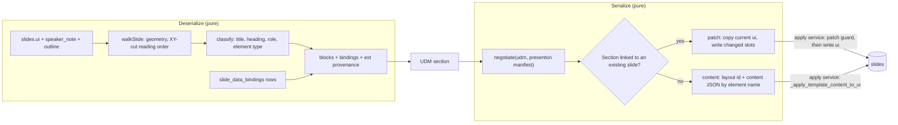

# PPT adapter (Presenton JSON)

<div class="chapter-meta" markdown>
**Reads:** `servers/fastapi/api/v1/ppt/endpoints/presentation.py`, `servers/fastapi/templates/v2/content.py`, `servers/fastapi/templates/v2/schema.py`, `servers/fastapi/templates/v2/models/elements.py`, `servers/fastapi/models/sql/slide.py`, `servers/fastapi/utils/llm_calls/generate_presentation_structure.py`, `servers/fastapi/utils/llm_calls/generate_smart_presentation.py`, `tutorial/prototypes/udm/adapters/presenton/walk.mjs`, `tutorial/prototypes/udm/adapters/presenton/from-presenton.mjs`, `tutorial/prototypes/udm/adapters/presenton/to-presenton.mjs`  ·  **Builds on:** [Unified Document Model](72-unified-document-model.md), [From template to schema to slide](../presenton/17-template-to-slide.md)  ·  **Time:** ~60 min
</div>

## What you will learn

This chapter builds `presenton.slides`, the first adapter of the generic contract: Presenton slide JSON in, a UDM out (the deserializer), and a UDM back into Presenton slides (the serializer). You will see which of the three JSON layers that hold a slide's content the adapter reads and writes, how a Template v2 `ui` tree is walked into reading order, how headings, roles and element types are detected, and how a UDM section returns to a slide in two modes: **patch** (an existing slide, slot by slot, everything unchanged left byte-identical) and **content** (a new slide, with layout selection reused from Presenton's structure step, slots filled by element name and hydration through Presenton's own `templates/v2/content.py`). The chapter ends with Smart HTML slides, what stays Presenton-only, and the file-by-file port from the prototype to production. Code is the prototype's, adapted, and every Presenton function it calls is cited by `path:line`. Nothing in this adapter is special to Tiptap: the same UDM goes to Markdown or any later module.

## Step 1: Which "Presenton JSON"

"Presenton already deals with JSON" is true, but a deck's slide content lives in three JSON layers (the [Feasibility analysis](71-feasibility.md) counts four forms, adding the outline, which the adapter reads only as `Section.summary`), and only one of them is safe to read.

| Layer | Where | Shape | Role for the adapter |
| --- | --- | --- | --- |
| `slides.content` | `servers/fastapi/models/sql/slide.py:26` | object keyed by component key, then element name, shaped by the layout's content schema (`get_template_schema`, `servers/fastapi/templates/v2/schema.py:257`) | **written** in content mode (new slides); never read, because it goes stale |
| `slides.ui` | `servers/fastapi/models/sql/slide.py:30` | the hydrated Template v2 layout tree: components, elements, positions, runs | **read** by the deserializer; **written** in patch mode |
| editor `Deck` | `adaptGeneratedTemplateV2PresentationToDeck`, `servers/nextjs/components/slide-editor/importing/template-v2-import.ts:135` | the Konva editor's view model | untouched; it keeps adapting `ui` exactly as today |

`ui` is the source of truth after generation. The canvas editor writes `ui` through `PATCH /api/v1/ppt/presentation/slide_update` (`servers/fastapi/api/v1/ppt/endpoints/presentation.py:2585`), and the chat tools edit `ui` directly, so `content` can describe text the user already changed. The deserializer therefore reads `ui`, plus `speaker_note` (`slide.py:28`) and the deck's outline. Smart-mode slides carry an HTML string in `html_content` (`slide.py:27`) instead of a `ui` tree (Step 10). Version 1 decks are refused by the frontend and need no support.

The existing "presentation adapter" the team refers to, `template-v2-import.ts`, adapts `ui` into the editor's model. It stays as it is. The UDM adapter sits next to it and converts `ui` into a target-neutral document; the two never call each other.

## Step 2: The adapter at a glance



The prototype adapter is four files and 590 lines of code: `walk.mjs` (tree walker), `from-presenton.mjs` (deserializer), `to-presenton.mjs` (serializer and validator) and `index.mjs` (manifest). Its manifest (`tutorial/prototypes/udm/adapters/presenton/index.mjs:11-22`) declares what a Template v2 slide can hold natively; everything else is degraded by the core `negotiate` before `serialize` sees it. The production manifest adds the live-data and metric capabilities that Part IX's slides target already had:

```ts title="gck/adapters/presenton-slides/src/manifest.ts (new)"
import type { AdapterManifest } from "@gck/core";

export const NS = "presenton.slides";

export function presentonManifest(catalog: LayoutSummary[]): AdapterManifest {
  return {
    id: NS, version: "1.0.0", displayName: "Presenton slides (Template v2)",
    nativeFormat: "application/vnd.presenton.slides+json",
    blocks: ["heading", "paragraph", "list", "table", "chart", "metric", "image", "diagram", "math"],
    marks: ["bold", "italic", "underline", "math"],
    chartKinds: ["bar", "horizontal_bar", "stacked_bar", "horizontal_stacked_bar", "line", "area",
                 "pie", "donut", "polar_area", "scatter", "radar", "bubble"],   // Pydantic ChartType (elements.py:76) plus bubble, which schema.py:26 and the renderer accept
    structure: { maxHeadingLevel: 2, maxListDepth: 1, groups: true, roles: true, orderPreserved: false },
    features: { notes: true, captions: true, citations: false, staticData: true,
                ids: false, extPassThrough: false, sectionTitles: true },
    media: { images: ["photo", "icon"], generatedImages: true },
    liveData: { mode: "native", tokensInText: "snapshot" },      // charts, metrics, tables refresh; text slots do not yet
    defaultRefresh: { modes: ["on_open", "manual"], beforeExport: true },
    limits: { maxBlocksPerSection: 12 },
    layoutCatalog: catalog,                                        // one LayoutSummary per layout of the deck's template
    applyModes: ["replace", "append", "patch"],
    roundTrip: "lossy",
  };
}
```

Three declarations carry most of the design:

- `orderPreserved: false`: a layout decides where blocks go, so the conformance kit compares this adapter's round trip as a multiset of blocks, not a sequence.
- `ids: false` and `extPassThrough: false`: Template v2 elements have no place for UDM ids or other adapters' bags. Ids are re-derived on every read (deterministically, see [Unified Document Model](72-unified-document-model.md), Step 7), and the adapter's own provenance lives in `ui` itself (the slot path is where the content is).
- `liveData.tokensInText: "snapshot"`: a token in a text slot is written once with an "(as of ...)" stamp until Part VIII gains text bindings (Part IX, Step 7.6). `negotiate` applies that rule generically from the manifest.

`limits.maxBlocksPerSection` is a production addition (the prototype had none); 12 is a starting value, not a measured one.

The codec is TypeScript. Code titles in this chapter use the Part IX package path `gck/adapters/presenton-slides/`; the first delivery places the same files in `servers/nextjs/lib/udm/adapters/presenton-slides/` and moves them into the package later ([Code changes in Presenton](75-presenton-code-changes.md), Step 4; [Plan and tracker](76-plan-and-tracker.md), work package F1). It runs in the browser and in the Next.js server's Node runtime, the same places the Tiptap adapter runs. FastAPI does not run the codec; it supplies inputs (slides, layouts, binding rows) and applies outputs through its existing hydrator. That split follows from the Tiptap research: Tiptap's schema check and `@tiptap/html` are JavaScript-only, so conversions between two targets must happen in TypeScript anyway.

## Step 3: Deserializer, part 1: walking the `ui` tree

A Template v2 slide is a 1280 by 720 canvas. Components have positions; elements are positioned relative to their parent; `group` children are absolutely positioned inside the group; `flex` and `grid` children usually have **no** position and are laid out by flow. The walker computes an absolute box for every content leaf and then orders leaves for reading.

```js title="tutorial/prototypes/udm/adapters/presenton/walk.mjs (excerpt, lines 29-55)"
  function node(el, path, ox, oy, group, componentId, flowPos) {
    const pos = flowPos ?? el.position ?? { x: 0, y: 0 };
    const x = ox + (pos.x ?? 0);
    const y = oy + (pos.y ?? 0);
    const w = el.size?.width ?? 0;
    const h = el.size?.height ?? 0;
    switch (el.type) {
      case "group": {
        const g = path; // innermost group = one visual region (a card)
        const kids = (el.children ?? []).map((c, i) => node(c, `${path}.children.${i}`, x, y, g, componentId));
        return unit(kids, false);
      }
      case "container": {
        const pad = typeof el.padding === "number" ? el.padding : 0;
        return unit(el.child ? [node(el.child, `${path}.child`, x + pad, y + pad, group, componentId)] : [], false);
      }
      case "flex": case "list-view": case "grid": case "grid-view": {
        const flows = flowPositions(el);
        // Flow order is visual order for row/column flow: keep index order.
        return unit((el.children ?? []).map((c, i) => node(c, `${path}.children.${i}`, x, y, group, componentId, flows[i])), true);
      }
      default: {
        if (!isContent(el)) { skip(el.decorative ? `decorative_${el.type}` : `non_content_${el.type}`); return null; }
        return { box: { x, y, w, h }, leaf: { el, path, box: { x, y, w, h }, group, componentId } };
      }
    }
  }
```

Four decisions are encoded here:

1. **What is content.** A leaf is content when its type is one of `text`, `text-list`, `table`, `chart`, `image`, `infographic` or `math` and it is not `decorative: true` (`isContent`, `walk.mjs:13-17`). That is Presenton's own rule for what becomes a schema field (`CONTENT_TYPES`, `servers/fastapi/templates/v2/schema.py:15`, and `_is_editable_element`, `schema.py:53`), plus `math`. Vectors, SVGs and containers are never content.
2. **Groups are regions.** The innermost `group` path becomes the UDM `group` of every leaf inside it, which is how a card's heading, price and bullet list stay together.
3. **Flow is approximated.** `flowPositions` (`walk.mjs:91-121`) lays out flex rows and columns (with wrap and gaps) and grid cells, using each child's size. The approximation only needs to be good enough to order leaves; flex and grid children keep their index order regardless.
4. **Reading order is a recursive XY-cut.** `xyCut` (`walk.mjs:124-142`) splits a set of boxes by horizontal whitespace bands first, then by vertical gutters, and falls back to top-then-left. It runs over components and over unordered groups, so a two-column slide reads the left column before the right one.

Every leaf keeps its `path` (for example `components.2.elements.0.children.0.children.2`). In production the path is written as an RFC 6901 pointer (`/components/2/elements/0/children/0/children/2`), the same `element_path` that Part VIII's `slide_data_bindings` rows store ([Story 1](../delivery/42-story1-dynamic-data.md)), so a slot path and a binding row can be compared directly.

!!! warning "Gotcha: the renderer knows types the Pydantic model does not"
    The HTML renderer accepts `svg`, `list-view` and `grid-view` (`servers/nextjs/lib/template-v2-json-to-html.ts:321`, `:334`, `:337`), and the hydrator writes a `math` element (`presentation.py:913`), but none of them is in the `SlideElement` union (`servers/fastapi/templates/v2/models/elements.py:624`). The walker accepts all four. Do not validate `ui` with `SlideLayout.model_validate` before deserializing; it would reject real slides.

## Step 4: Deserializer, part 2: from elements to blocks

### 4.1 Element types

| Template v2 element | UDM block | Data | Corpus count |
| --- | --- | --- | --- |
| `text` (`elements.py:203`) | `heading` or `paragraph`, possibly with a `role`; or the section title | runs to `RichText` | 3,582 elements: 354 titles, 783 headings, 2,445 paragraphs |
| `text-list` (`elements.py:265`) | `list`, `ordered` when `marker == "number"` | each item's runs to `RichText` | 35 |
| `table` (`elements.py:302`) | `table` | `static` binding: header `columns` and `rows`, cell text from runs | 7 |
| `chart` (`elements.py:361`) | `chart` with `chartType`, `title`, `axes`, `caption` from `source` | `static` binding: `categories`, `series` (or a live binding, 4.4) | 113 |
| `image` (`elements.py:240`) | `image`, `kind: "icon"` when `is_icon`, else `"photo"`; `url` from `data`, `prompt` | none | 607 |
| `infographic` (`elements.py:549`) | `diagram` with a neutral `diagramKind`, `items`, `range` | inline items; extra fields to `ext` | 51 |
| `math` (hydrated, not modeled) | `math` | `latex` | 0 in the corpus |
| decorative leaves, `vector`, `svg` | none | none | skipped: 1,644 decorative images, 718 unnamed vectors, 39 decorative texts, 15 decorative vectors |

Every content element in the corpus was represented: 3,582 of 3,582 text, 607 of 607 images, 113 charts, 51 infographics, 35 lists and 7 tables. Three text elements were empty and produced no block.

### 4.2 Marks as differences from the slot's font

Template v2 text is a list of runs, each with a `font` (`TextRun`, `elements.py:181`; `LatexTextRun`, `elements.py:193`). The UDM must not learn that a title is bold because its template made it bold, so marks are recorded only where a run differs from the element's own font:

```js title="tutorial/prototypes/udm/adapters/presenton/from-presenton.mjs (lines 29-39)"
export function runsToRichText(runs, elFont = {}) {
  return normalizeRichText((runs ?? []).map((r) => {
    if (r.type === "latex") return { text: r.latex ?? "", marks: ["math"] };
    const f = r.font ?? {};
    const marks = [];
    if (f.bold && !elFont.bold) marks.push("bold");
    if (f.italic && !elFont.italic) marks.push("italic");
    if (f.underline && !elFont.underline) marks.push("underline");
    return { text: r.text ?? "", ...(marks.length ? { marks } : {}) };
  }));
}
```

Paragraph breaks inside an element are `"\n"` in run text, which the UDM keeps as a hard line break. Run-level color and size are not marks. The corpus has 44 text elements that use a second color or size inside one element; they read correctly, but an edit to one of them flattens it to the slot's base style on the way back (Step 8). A neutral `highlight` mark would fix that ([Unified Document Model](72-unified-document-model.md), Step 11).

### 4.3 Headings, roles and the section title

Template v2 has no heading level. Heading-ness is inferred from the element `name` (snake_case and semantic in every bundled template) and from font size relative to the slide's median body size:

```js title="tutorial/prototypes/udm/adapters/presenton/from-presenton.mjs (lines 23-26 and 45-54)"
const HEADING_WORDS = ["title", "heading", "headline", "header", "hero"];
const LABEL_WORDS = ["label", "caption", "tag", "badge", "marker", "footer", "page", "pagination", "metadata", "date", "index", "category", "unit", "eyebrow", "kicker"];
const KPI_WORDS = ["metric", "value", "number", "stat", "kpi", "price", "percent", "percentage", "amount", "figure", "delta"];
const SUBTITLE_WORDS = ["subtitle", "subheading", "tagline", "subheader"];

function classifyText(leaf, stats) {
  const t = tokens(leaf.el.name);
  const size = fontSize(leaf.el);
  if (any(t, LABEL_WORDS)) return { kind: "paragraph", role: "label" };
  if (any(t, KPI_WORDS) && !any(t, HEADING_WORDS)) return { kind: "paragraph", role: "kpi" };
  if (any(t, SUBTITLE_WORDS) || (any(t, HEADING_WORDS) && any(t, ["supporting", "sub", "secondary"]))) return { kind: "paragraph", role: "subtitle" };
  if (t.has("quote")) return { kind: "paragraph", role: "takeaway" };
  if (any(t, HEADING_WORDS) || (size >= 24 && size >= stats.body * 1.4)) return { kind: "heading" };
  return { kind: "paragraph" };
}
```

The section title is the largest ungrouped heading; when a slide has none, the largest ungrouped text of at least 28 px that has no role (`from-presenton.mjs:84-88`). It is removed from the blocks and stored as `Section.title`, and its path is kept as `titleSlot` in the section's `ext`. Headings inside a group get level 2, others level 1. The section role comes from layout id tokens (`agenda`, `toc`, `closing`, `thank`, `cover`, `title_slide`; `sectionRole`, `from-presenton.mjs:56-62`), defaulting to `content`.

On the corpus this found a title for 354 of 383 slides and assigned roles label 750, kpi 600, subtitle 77 and takeaway 5. These are heuristics measured only on the 16 bundled templates; a custom template imported from a PPTX file (`convert_pptx_to_json`, `servers/fastapi/services/export_task_service.py:687`) may use names the word lists do not know. That only lowers semantic quality (a heading becomes a paragraph); it never loses content, and it does not affect the round trip, which goes by slot.

### 4.4 Data: static values and live bindings

A chart's `categories` and `series`, and a table's cell text, become `static` bindings keyed by a hash of the slide and element path (`from-presenton.mjs:127-145`). The prototype stops there. Production must also read Part VIII's `slide_data_bindings` rows, because a chart generated against Superset data is a live binding whose values in `ui` are only the last snapshot. A row matches a leaf when its `element_path` equals the leaf's pointer (or, for repeated metric grids, by `element_name` plus `element_index`):

```ts title="gck/adapters/presenton-slides/src/deserialize/bindings.ts (new)"
import type { DataBinding } from "@gck/protocol";
import type { Leaf, SlideBindingRow } from "../types";

/** A live row replaces the static snapshot the ui happens to hold. Definitions only: the value stays in the store. */
export function bindingFor(leaf: Leaf, rows: SlideBindingRow[], staticData: unknown): { binding: DataBinding; live: boolean } {
  const row = rows.find((r) => r.element_path === leaf.pointer)
    ?? rows.find((r) => r.element_name === leaf.el.name && (r.element_index ?? 0) === leaf.repeatIndex);
  if (!row) {
    return { live: false, binding: { kind: leaf.kind, source: { type: "static", origin: "imported", data: staticData }, mapping: {} } };
  }
  return {
    live: true,
    binding: {
      kind: row.kind,                          // "chart" | "metric" | "table", same names in Part VIII and the UDM
      source: row.source, mapping: row.mapping,
      ...(row.format ? { format: row.format } : {}),
    },
  };
}
```

A row of kind `metric` is bound to a `text` element, so that leaf becomes a `metric` block instead of a `kpi` paragraph, with `label` taken from the element name (`card_large_value` becomes "card large value") until a better label source is designed. The row's `snapshot`, `status` and `error` are runtime state and go to the binding store, never into the UDM.

### 4.5 Notes, outline and infographic extras

`speaker_note` becomes `Section.notes` and the slide's outline Markdown (from `presentations.outlines`, `servers/fastapi/models/sql/presentation.py:51`) becomes `Section.summary`. Infographic fields that have no neutral meaning (gantt `columns` and `rows`, matrix `criteria`, colors) are kept in `ext["presenton.slides"].data` with a `diagram_extra_to_ext` loss, so a Presenton round trip restores them and other targets ignore them (`from-presenton.mjs:166-168`).

## Step 5: Deserializer, part 3: provenance in `ext`

Every block records where it came from, in the adapter's own namespace:

```js title="tutorial/prototypes/udm/adapters/presenton/from-presenton.mjs (lines 90-106, excerpt)"
    const section = { id: secId, role: sectionRole(slide.layout), blocks: [] };
    const sext = { templateId: slide.layout_group ?? deck.templateId, layoutId: slide.layout };
    if (slide.id) sext.slideId = slide.id;
    if (titleLeaf) {
      section.title = plain(runsToRichText(titleLeaf.el.runs)).trim();
      sext.titleSlot = titleLeaf.path;
    }
    if (slide.outline) section.summary = slide.outline;
    if (slide.speaker_note) section.notes = [{ text: slide.speaker_note }];
    section.ext = { [NS]: sext };
    // ...
      const id = `blk_${hashId("b", slideKey, leaf.path)}`;
      const ext = { [NS]: { slot: leaf.path, name: el.name ?? null, element: el.type } };
```

| `ext["presenton.slides"]` key | On | Used by |
| --- | --- | --- |
| `templateId`, `layout` (prototype: `layoutId`) | section | patch mode (which layout); content mode skips layout selection when present |
| `slideId` | section | patch mode (which row in `slides`) |
| `titleSlot` | section | where `Section.title` goes back |
| `slot`, `name`, `element` | block | slot lookup, pass 1 (Step 8); content mode matches `name` against the chosen layout |
| `infographicType`, `data` | diagram block | restoring the exact infographic |
| `templateId`, `settings` (tone, verbosity, table of contents) | artifact | regeneration with the deck's own settings |

These bags reach Tiptap and come back because the Tiptap page profile stores them in `udmExt` ([Tiptap adapter](74-tiptap-adapter.md)). That is the whole reason the Presenton to Tiptap to Presenton round trip is exact for 383 of 383 layouts while the same trip through Markdown is not (Step 8).

## Step 6: Serializer: choosing a mode

`serialize` receives a UDM that `negotiate` has already reduced to the manifest. For each section it decides how the section reaches Presenton:

| Mode | When | Native output | Applied through |
| --- | --- | --- | --- |
| **patch** | the section's `ext` has a `slideId` that exists in the deck and the slide has a `ui` | the slide's `ui` with only changed slots rewritten, plus `speaker_note` and binding row changes | new apply service behind `PUT /api/v1/ppt/presentation/{id}/udm` and `POST /api/v1/ppt/presentation/{id}/slides/apply`, with the patch guard (Step 8) |
| **content** | no linked slide (a document became slides, a new section was added, or the user asked to re-layout) | `layoutId` plus content JSON keyed like `get_template_schema`, plus binding rows | the same apply service, hydrated by `_apply_template_content_to_ui` (`presentation.py:575`) |
| **smart patch** | the linked slide is a Smart HTML slide | edited `html_content` | Step 10 |

```ts title="gck/adapters/presenton-slides/src/serialize/index.ts (new)"
import type { Section, Udm } from "@gck/protocol";
import type { LossEntry, SerializeResult } from "@gck/core";
import { patchSlide } from "./patch";
import { fillContent } from "./content";
import { patchSmartSlide } from "./smart";
import type { PresentonNative, PresentonSectionExt, SerializeOptions, SlideOut } from "../types";
import { NS } from "../manifest";

/** Pure and deterministic. Layouts were chosen before this call (Step 7). */
export function serialize(udm: Udm, opts: SerializeOptions): SerializeResult<PresentonNative> {
  const loss: LossEntry[] = [];
  const slides: SlideOut[] = udm.sections.map((section, index) => {
    const pe = (section.ext?.[NS] ?? {}) as PresentonSectionExt;
    const current = pe.slideId ? opts.currentSlides?.get(pe.slideId) : undefined;
    if (current?.ui && !opts.relayout?.has(section.id)) return patchSlide(section, udm, current, loss);
    if (current?.html_content) return patchSmartSlide(section, udm, current, loss);
    const layout = opts.catalog.byId(pe.layout ?? pe.layoutId);          // set by chooseLayouts (Step 7)
    if (!layout) throw new Error(`section ${section.id} has no layout; run chooseLayouts first`);
    return fillContent(section, udm, layout, index, loss);
  });
  return { native: { templateId: udm.ext?.[NS]?.templateId ?? opts.catalog.templateId, slides }, loss };
}
```

Both modes obey the rules that Part IX found for Template v2 ([Artifact Spec and targets](../ai-component/62-artifact-spec-and-targets.md), Step 7): never leave a slot holding the template's sample content, clip to every maximum the adapter itself writes, warn on every minimum it cannot meet, never pad.

## Step 7: Layout selection, reused from the structure step

A section that came from a document has no layout. Presenton already has a step that picks one: `generate_presentation_structure` (`servers/fastapi/utils/llm_calls/generate_presentation_structure.py:157`) takes a `PresentationOutlineModel` (one Markdown string per slide, `servers/fastapi/models/presentation_outline_model.py:24`) and the template's `PresentationLayoutModel` (built by `_build_template_layout_model`, `presentation.py:410`) and returns one layout index per slide. The generation pipeline calls it at `presentation.py:2895`, or uses the template's fixed order when `layout_model.ordered` is set.

The adapter reuses that step instead of writing a second layout picker, in three stages that run **before** `serialize`, so `serialize` stays pure:

1. **Provenance.** A section with `ext["presenton.slides"].layout` keeps its layout (`I8_LAYOUT_HINT` checks it exists in the catalog).
2. **Structure step.** The remaining sections are written as an outline with the registered `markdown` adapter on the TypeScript side (one section, one Markdown string; the same registry any conversion uses), sent with the apply request, and passed to `generate_presentation_structure`. This keeps Presenton's prompt, its instructions handling and its model configuration.
3. **Capacity check, then deterministic fallback.** The structure step chooses by layout description, not by slot capacity, so its answer is checked against the hard rule from Part IX: the layout's chart and table slot counts must equal the section's chart and table blocks, or the template's sample chart shows through. A layout that fails, and every section when no LLM is configured, goes to the deterministic picker.

```python title="servers/fastapi/services/udm/layouts.py (new)"
from models.presentation_outline_model import PresentationOutlineModel, SlideOutlineModel
from utils.llm_calls.generate_presentation_structure import generate_presentation_structure


async def choose_layouts(sections: list[dict], outline_md: list[str], layout_model, capacity, fallback) -> dict[str, str]:
    """section id -> layout id. `capacity(layout_id)` returns slot counts; `fallback(section)` is the deterministic picker."""
    chosen: dict[str, str] = {}
    pending = [s for s in sections if not (s.get("ext", {}).get("presenton.slides", {}).get("layout"))]
    for s in sections:
        if s not in pending:
            chosen[s["id"]] = s["ext"]["presenton.slides"]["layout"]
    if pending and not layout_model.ordered:
        outline = PresentationOutlineModel(slides=[SlideOutlineModel(content=md) for md in outline_md])
        structure = await generate_presentation_structure(outline, layout_model)
        for s, index in zip(pending, structure.slides):
            layout = layout_model.slides[index]
            if _fits(s, capacity(layout.id)):
                chosen[s["id"]] = layout.id
    for s in pending:
        chosen.setdefault(s["id"], fallback(s))
    return chosen


def _fits(section: dict, slots: dict[str, int]) -> bool:
    need = {"chart": 0, "table": 0}
    for b in section["blocks"]:
        if b["type"] in need:
            need[b["type"]] += 1
    return slots.get("chart", 0) == need["chart"] and slots.get("table", 0) == need["table"]
```

The deterministic picker is the prototype's `chooseLayout` (`tutorial/prototypes/udm/adapters/presenton/to-presenton.mjs:43-59`): it reads every layout's own sample content as a UDM, compares block-type counts, charges 10 per missing or spare chart, table or diagram slot, 3 per missing other slot and 1 per spare one, and subtracts 2 when the section has a title and the layout does not (or the reverse). Ties keep the first layout, so the result is stable. In production it is merged with Part IX's `score` (`chooseLayout`, Part IX Step 7.2), which adds the metric-grid rule and the image-placeholder penalty.

How good is a content-only choice? The prototype measured it by throwing away the layout id and asking the picker to find the original layout again from the content: 254 of 383 (66.32%) from Markdown and 91 of 383 (23.76%) from a StarterKit-only Tiptap document. The structure step's accuracy on the same task has not been measured. This is why linked slides use patch mode and never re-choose a layout.

!!! warning "Gotcha: the structure step prompt expects one outline per slide"
    `generate_presentation_structure` builds its response model for exactly `len(presentation_outline.slides)` entries (`generate_presentation_structure.py:167-169`), and the pipeline trims the result (`presentation.py:2905`). Send only the sections that need a layout, in order, and map the indices back by position, as `choose_layouts` does. Never send linked sections; the model would be free to move them to another layout.

## Step 8: Patch mode: an existing slide, slot by slot

Patch mode is the prototype's serializer, and it is what made the round trip exact. The steps are in `udmToPresenton` (`to-presenton.mjs:66-144`).

**1. Start from the slide as it is.** Copy its `ui`, deserialize the same `ui` to get the base blocks, and index the base by slot.

!!! warning "Gotcha: the prototype patches the layout, production patches the slide"
    The prototype clones the catalog layout (`const ui = clone(layout)`, `to-presenton.mjs:76`) and compares against the layout's own content (`baseOf`, `to-presenton.mjs:37-40`). That equals the slide only because every corpus slide is a layout with its sample content. Production clones the current `slides.ui` and builds the base by deserializing that same `ui`, so "unchanged" means unchanged since the user last saved, and any manual geometry edits in the canvas editor survive.

**2. Map blocks to slots,** in four passes, each taking only free slots (`to-presenton.mjs:99-120`):

| Pass | Rule | Why |
| --- | --- | --- |
| 1 | the block's own provenance slot (`ext.slot`), if the element type still fits | exact return for every target that kept `ext` |
| 1b | a table block to a table or chart slot of exactly the same shape | a chart that Markdown turned into a table finds its chart slot again |
| 2 | the next free slot whose base block has the same type, in reading order | positional fallback for targets without `ext` |
| 3 | any compatible slot (`SLOT_TYPES`, `to-presenton.mjs:9-12`) | last resort, reported as `block_retyped` |

**3. Write only what changed.** A block whose content equals its base block (ids, `ext`, `group` and `role` ignored; static data resolved) leaves the slot untouched, byte for byte:

```js title="tutorial/prototypes/udm/adapters/presenton/to-presenton.mjs (lines 30-33 and 121-131)"
function contentKey(block, udm) {
  const { id, ext, group, role, bindingId, ...rest } = block;
  return stableStringify({ ...rest, data: staticData(udm, bindingId) ?? null });
}
// ...
    for (const b of blocks) {
      const slot = plan.get(b);
      if (!slot) { loss.push({ code: "no_slot", path: path(b), detail: `${b.type} has no free ${SLOT_TYPES[b.type]?.join("/") ?? "?"} slot in ${layout.id}`, droppedText: blockAtoms(b, udm).join(" ") || undefined }); continue; }
      const baseBlock = baseBySlot.get(slot);
      if (baseBlock && baseBlock.type !== b.type) loss.push({ code: "block_retyped", path: path(b), detail: `${b.type} placed in a ${baseBlock.type} slot` });
      if (baseBlock && contentKey(b, udm) === contentKey(baseBlock, base.udm)) { tr.unchanged.push(slot); continue; } // keep original runs/styling
      tr.written.push(slot);
      const el = resolvePath(ui, slot);
      writeBlock(el, b, udm, loss, path(b));
    }
```

A changed text slot is rewritten from the slot's first run's font, with marks applied on top of the element's own font (`runsFrom` and `writeText`, `to-presenton.mjs:146-165`); a mark the slot's style already has is reported as `mark_absorbed_by_slot_style`. Lists, tables, charts, images and diagrams write their own fields (`writeBlock`, `to-presenton.mjs:167-235`), and chart writes keep `chart_type`, title, axis titles and the `source` caption.

**4. Clear what no block claimed.** A slot that held content but received no block is blanked: text gets a single space, lists and table rows are emptied, charts lose their categories and series (`blankSlot`, `to-presenton.mjs:237-243`). Images and infographics keep their asset. A single space is deliberate: Presenton's text hydrator leaves an element untouched when the value is an empty string (`_apply_template_text_content`, `presentation.py:946-952`), so an empty string would let sample text reappear in any later hydration.

**What the corpus showed.** Presenton to UDM to tiptap.json to UDM to Presenton gave a byte-identical `ui` for 383 of 383 layouts; the unedited case is identical partly by design (unchanged blocks leave their slot alone). The real test is the scripted edit: every text, title, list item, table cell and chart series in the Tiptap document was changed, and 100% of edits landed in the right slot (3,228 texts, 354 titles, 35 lists, 7 tables, 113 charts), with 3,582 of 3,582 edited slots keeping the slot's base font. Per-run highlights were flattened in 44 of 44 elements.

Through targets that lose `ext`, passes 2 and 3 do the work, and they are weaker:

| | Markdown | Basic Tiptap (StarterKit only) |
| --- | --- | --- |
| text slots correct | 3,378 of 3,582 (94.3%) | 2,429 of 3,582 (67.81%) |
| charts | 113 of 113 | 0 of 113 |
| tables | 7 of 7 | 0 of 7 |
| images | 607 of 607 | 0 of 607 |
| infographics | 0 of 51 | 0 of 51 |

Almost every wrong text slot is in a layout where negotiation degraded a block (190 of 204 wrong slots for Markdown, all 1,153 for basic Tiptap): a chart, infographic, image or table that the target cannot show became a list or a paragraph (in Markdown, an infographic or a caption), and in passes 2 and 3 it competes with the original text for the same slots. The corpus report classifies wrong slots by layout, so this is the likely mechanism, not a per-slot measurement. The conclusion is a product rule, not a tuning task: **for a target with `features.ids: false`, documents to slides is "generate a new slide" (content mode), not "update the existing one".** The apply endpoint enforces it by refusing patch mode for sections whose blocks carry no `presenton.slides` slot.

**Persisting.** Patch output is a complete slide `ui`. It is not sent through the endpoint the canvas editor uses, `PATCH /api/v1/ppt/presentation/slide_update` (`presentation.py:2585-2617`), because that endpoint checks only that the slide belongs to the presentation and then overwrites every field except `id`, `presentation` and `index` with whatever it receives. Patch items go through the new apply service instead ([Code changes in Presenton](75-presenton-code-changes.md), Steps 3.3 and 5), which adds one guard on the server: the new `ui` may differ from the stored one only in content keys (`runs`, `items`, `columns`, `rows`, `categories`, `series`, `chart_type`, `title`, `x_axis_title`, `y_axis_title`, `source`, `data`, `prompt`, `latex`). Geometry and styling changes from a document edit are therefore impossible by construction.

```python title="servers/fastapi/services/udm/patch_guard.py (new)"
CONTENT_KEYS = {"runs", "items", "columns", "rows", "categories", "series", "chart_type", "title",
                "x_axis_title", "y_axis_title", "source", "data", "prompt", "latex"}


def assert_content_only_patch(old, new, path: str = "") -> None:
    """Raise ValueError if `new` differs from `old` anywhere except inside a content key."""
    if isinstance(old, dict) and isinstance(new, dict):
        added_or_removed = old.keys() ^ new.keys()
        if added_or_removed - CONTENT_KEYS:                # only content keys may appear or disappear
            raise ValueError(f"{path}: keys changed {sorted(added_or_removed - CONTENT_KEYS)}")
        for key in old.keys() | new.keys():
            if key in CONTENT_KEYS:
                continue
            assert_content_only_patch(old.get(key), new.get(key), f"{path}/{key}")
    elif isinstance(old, list) and isinstance(new, list):
        if len(old) != len(new):
            raise ValueError(f"{path}: length changed")
        for i, (a, b) in enumerate(zip(old, new)):
            assert_content_only_patch(a, b, f"{path}/{i}")
    elif old != new:
        raise ValueError(f"{path}: {old!r} -> {new!r}")
```

!!! warning "Gotcha: patch mode leaves `slides.content` stale"
    Patch mode writes `ui`, exactly like the canvas editor and the chat tools, and `slides.content` keeps the generation-time values. That is not harmless: `_hydrate_template_slide_ui` (`presentation.py:309-319`) applies `slide.content` over the existing `ui`, and the `/edit` and `/derive` endpoints call it (`presentation.py:3325`, `:3376`), so an edit run after a document edit can bring the old text back. The prototype does not touch `content`. Production should also write each changed slot's value into `content` under its component key and element name when both resolve (the same keys `_template_component_content_keys`, `presentation.py:538`, computes). This is recommended, not prototyped.

## Step 9: Content mode: a new slide, filled by element name

Content mode produces exactly what Presenton's own generation produces at `presentation.py:2370-2396`: a layout id and a content object, which `_apply_template_content_to_ui` turns into a `ui`. Doing it this way means repeated cards, the centering of fewer items than template children (`repeated_child_source_index`, `servers/fastapi/templates/v2/content.py:43-54`), Markdown emphasis and image fitting all behave exactly as in a generated deck.

The content object's shape comes from the layout's content schema: the top-level key is the component key (component id, deduplicated by `_template_component_content_keys`, `presentation.py:538-572`), then one property per editable element **name**, and a repeated `flex`, `grid` or `group` becomes an array of item objects (`_array_schema_for_repeated_children`, `schema.py:426`). The prototype never produced content JSON (it wrote `ui` directly and could not add or remove cards). Production adapts Part IX's `fillSection` (Step 7.3) with one new first pass, matching by element name:

```ts title="gck/adapters/presenton-slides/src/serialize/content.ts (new, excerpt)"
import { slotsOf, type Slot } from "./slots";               // Part IX 7.1, unchanged
import { md, clip, setAt } from "./text";                    // Part IX 7.3: RichText -> hydrator Markdown, clip to max
import { NS } from "../manifest";

/** Section -> {layoutId, content}. Pass 0 matches element names, then Part IX's type-and-order passes run. */
export function fillContent(section: Section, udm: Udm, layout: LayoutSummary, index: number, loss: LossEntry[]): SlideOut {
  const slots = slotsOf(layout.meta.contentSchema);
  const out: Record<string, unknown> = {};
  const used = new Set<Slot>();
  const placed = new Set<Block>();
  const lastName = (s: Slot) => s.path[s.path.length - 1];

  // Pass 0: a block that came from a Presenton slot named "card_title" goes to this layout's "card_title" slot.
  for (const b of section.blocks) {
    const name = (b.ext?.[NS] as { name?: string } | undefined)?.name;
    const slot = name && slots.find((s) => !used.has(s) && lastName(s) === name && accepts(s, b));
    if (slot) { write(out, slot, b, udm, loss); used.add(slot); placed.add(b); }
  }
  // Pass 1: groups fill repeat slots, one group per item, members matched by name then by type inside the item.
  const groups = groupBlocks(section.blocks.filter((b) => !placed.has(b)));
  for (const slot of slots.filter((s): s is Extract<Slot, { kind: "repeat" }> => s.kind === "repeat" && !used.has(s))) {
    const items = groups.splice(0, slot.maxItems).map((g) => fillItem(slot.item, g, udm, loss, placed));
    if (items.length) { setAt(out, slot.path, items); used.add(slot); }
    if (items.length && items.length < slot.minItems) loss.push({ code: "repeat_below_min", path: section.id, detail: slot.path.join(".") });
  }
  // Pass 2 and 3: Part IX fillSection for the rest (title slot first, text by budget, chart, table, list, image, metric).
  fillRemaining(section, udm, slots.filter((s) => !used.has(s)), out, loss, placed);
  // Unfilled text slots get " " so the template's sample text never shows; charts are cleared by the apply endpoint.
  for (const s of slots) if (s.kind === "text" && !used.has(s) && getAt(out, s.path) === undefined) setAt(out, s.path, " ");
  for (const b of section.blocks) if (!placed.has(b)) loss.push(noSlot(section, b, udm, layout.id));
  return { mode: "content", sectionId: section.id, index, layoutId: layout.id, content: out,
           speaker_note: section.notes ? plainText(section.notes) : "", bindings: bindingRows(section, udm, slots) };
}
```

Text crosses the hydrator as Markdown. Presenton parses only `**` and `__` (bold) and `*` and `_` (italic) (`_template_text_runs_from_markdown`, `presentation.py:1157`, and `_parse_template_markdown_text`, `:1224`), plus LaTeX tags that `parse_latex_tags` recognizes. So in content mode `underline` is dropped with a `mark_dropped` loss (patch mode keeps it, because it writes runs). Text longer than a slot's `maxLength` is clipped at a word boundary with an ellipsis and a `text_clipped` loss whose `droppedText` holds the cut, which keeps the conformance kit's "no silent text loss" check true. Patch mode never clips user text; it reports `max_length` warnings from `validateNative` instead (the scripted edit produced 2,477 such warnings because it appended 9 characters to every slot). Fitting edited text to a slot is the slide editor's decision, not the adapter's.

The `doc-to-slides` example shows the behavior on a hand-written page with no UDM attributes. The deterministic picker chose General's `title_table_description` for a section holding a paragraph, a three-item bullet list and a table. That layout has no list slot, so the list was reported, not hidden:

```json title="tutorial/prototypes/udm/examples/doc-to-slides/4-report.json"
{
  "tiptapSchemaIssues": [],
  "deserializeLoss": [],
  "chosenLayout": "title_table_description",
  "serializeLoss": [
    {
      "code": "no_slot",
      "path": "sec_0rthubp/blk_00f4iwt",
      "detail": "list has no free text-list slot in title_table_description",
      "droppedText": "Usage aligns cost with value Smaller teams can start cheaper Expansion revenue becomes automatic"
    }
  ],
  "presentonValidation": [
    { "level": "warning", "code": "max_length", "path": "slides.0.components.1.elements.0", "message": "34 > 17" }
  ]
}
```

In production the 34-character title would be clipped (content mode), and the `no_slot` loss is the cue for the UI to offer "split into two slides" or "choose another layout". When a section's blocks exceed every layout, `negotiate` already split it at `limits.maxBlocksPerSection`; splitting a long document across several slides by meaning is not covered by the prototype.

**Applying.** Both modes go through one new apply path. It is Part IX's `slides/from-content` sketch (Step 7.4) generalized to both modes, so a single request can insert new slides and patch linked ones in one commit. The sketch below shows the logic in one handler; [Code changes in Presenton](75-presenton-code-changes.md) (Steps 3.3 and 5) places it in the `apply_slide_items` service, shared by `PUT /presentation/{id}/udm` and `POST /presentation/{id}/slides/apply` in `presentation_udm.py`:

```python title="servers/fastapi/api/v1/ppt/endpoints/presentation_udm.py (new, sketch of the apply logic)"
@PRESENTATION_ROUTER.post("/{id}/slides/apply")
async def apply_udm_slides(id: uuid.UUID, body: ApplySlides, sql_session=Depends(get_async_session)):
    presentation = await sql_session.get(PresentationModel, id)          # 404 and editor checks as in update_presentation_slide
    created, touched = [], []
    for item in body.slides:                                             # item.mode: "content" | "patch"
        if item.mode == "patch":
            slide = await sql_session.get(SlideModel, item.slide_id)
            if slide is None or slide.presentation != id:
                raise HTTPException(400, f"Unknown slide {item.slide_id}")
            assert_content_only_patch(slide.ui, item.ui)                 # services/udm/patch_guard.py
            slide.ui = item.ui                                           # reassign: JSON columns are not mutation-tracked
            slide.speaker_note = item.speaker_note
            touched.append(slide)
            continue
        ui = _template_slide_ui(presentation.layout, item.layout_id)     # presentation.py:490
        if ui is None:
            raise HTTPException(400, f"Unknown layout {item.layout_id}")
        slide = SlideModel(presentation=id, layout_group=presentation.layout.get("name"), layout=item.layout_id,
                           index=item.index, content=item.content, speaker_note=item.speaker_note)
        process_slide_add_placeholder_assets(slide)                      # utils/process_slides.py:427
        slide.ui = _apply_template_content_to_ui(ui, slide.content)      # presentation.py:575 -> content.py:57
        clear_unresolved_charts(slide.ui, item.bindings)                 # Part IX 7.4: empty charts keep sample data otherwise
        sql_session.add(slide)
        created.append(slide)
    # shift the indexes of existing slides after each insertion point (as Part IX's sketch does)
    await upsert_slide_bindings(sql_session, presentation, created + touched, body)   # Part VIII rows, by element_path
    await sql_session.commit()
    # image prompts without URLs: process_slide_and_fetch_assets (utils/process_slides.py:173), then rehydrate
```

`_apply_template_content_to_ui` (`presentation.py:575-623`) deep-copies the layout, finds each component's content by key, and dispatches repeated top-level groups to `hydrate_repeated_top_level_groups` (`servers/fastapi/templates/v2/content.py:57-87`) and everything else to `_apply_template_content_to_element_list`; element values go through `_apply_template_content_value` (`presentation.py:865`), which dispatches to the text, math, image, list, table, chart and infographic writers. The adapter adds nothing to that path. `clear_unresolved_charts` is needed because `_apply_template_chart_content` copies `categories` and `series` only when they are non-empty (`presentation.py:1395-1398`).

!!! warning "Gotcha: there are two hydrators"
    The chat assistant has its own copy, `MemoryLayer._build_template_slide_ui` and `_apply_template_content_to_ui` (`servers/fastapi/services/chat/memory_layer.py:3321`, `:3382`). Content-mode slides must go through the endpoint's copy only, or the same UDM could hydrate differently depending on the entry point. Part X's code-change list moves both callers onto one function ([Code changes in Presenton](75-presenton-code-changes.md)).

## Step 10: Smart HTML slides

Smart mode stores no `ui` tree. Each slide is a complete HTML string in `slides.html_content`, normalized by `normalize_smart_slide_html` (`servers/fastapi/utils/llm_calls/generate_smart_presentation.py:417`): scripts are stripped except inline Chart.js initializers that pass the safety checks (`_sanitize_script`, `:378`), event handlers and `javascript:` URLs are removed, and the root must be a 1280 by 720 `section`. `content` holds only `{"title"}` (`presentation.py:2060-2067`). None of this was prototyped; the design below reuses the patch idea with DOM paths in place of `ui` paths.

**Deserialize.** Parse `html_content` with an HTML parser in Node (no script execution) and map elements in document order: `h1` to `h6` to headings (the first `h1` or largest heading becomes `Section.title`), `p` to paragraphs, `ul` and `ol` to lists with nesting, `table` to a static table, `img` to an image (`src`, `alt`), `blockquote` to a quote; `strong`, `em`, `u`, `s`, `code` and `a` to marks. Each block records `ext["presenton.slides"].dom` (an element path such as `section>div:2>ul:0`) and the slide's `htmlSha256`. A `canvas` with a Chart.js initializer is **not** parsed: its data is inside a script, and the adapter never evaluates scripts. It produces a `smart_chart_opaque` loss and no block, so a Smart slide's charts do not reach other targets.

**Serialize (smart patch).** If the HTML's hash still matches, rewrite only the text of elements whose blocks changed, at their DOM paths, keeping tags and classes; add or remove list items by cloning a sibling `li`, the way the hydrator clones repeated children. Structural changes the DOM path cannot express (a new table, a new chart) are not written; they produce a `smart_structure_unsupported` loss, and the UI offers Presenton's own LLM edit, `POST /api/v1/ppt/slide/edit-html` (`servers/fastapi/api/v1/ppt/endpoints/slide.py:135-170`), with an instruction built from the section's Markdown. That call is non-deterministic and is never made by `serialize`; it is a user action. The rewritten HTML must pass `normalize_smart_slide_html` again before it is saved.

Until this is built and measured, the manifest stays as above and Smart sections are handled read-only: `deserialize` works, `serialize` returns the slide unchanged with a loss entry when the section changed.

## Step 11: What stays Presenton-only

The UDM carries content and meaning; everything below stays in Presenton, in the place it already lives. "In `ext`" means kept in the adapter's bag only so that a Presenton round trip can restore it.

| Presenton data | Stays in | In the UDM |
| --- | --- | --- |
| positions, sizes, rotation, flips, z-order | `slides.ui` | no |
| fonts, colors, fills, strokes, shadows, opacity, alignment | `slides.ui`, `presentations.theme`, `presentations.fonts` | no; only marks that differ from the element font |
| decorative images, vectors, SVGs, backgrounds | `slides.ui` | no (skipped, counted) |
| flex, grid and group arrangement, gaps, padding | `slides.ui` | only as `group` and reading order |
| chart colors, legend, axis and grid flags, data labels | `slides.ui` | no; `chartType`, `title`, axis titles and `source` caption are |
| image fit, crop, focus, clip path, `icon_type` | `slides.ui` | no; `url`, `prompt` and `kind` are |
| table cell fills, borders, per-cell fonts | `slides.ui` | no; cell text is |
| infographic visual type and extra data | `slides.ui` | `diagramKind` and items; exact type and extras in `ext` |
| slot limits (`max_length`, `min_items`, ...) | the layout | no; used by `validateNative` and content mode |
| template id, layout id, slide id, slot paths | `slides.layout_group`, `slides.layout`, `slides.id` | in `ext` |
| tone, verbosity, instructions, table of contents | `presentations` columns | in artifact `ext` |
| outline per slide | `presentations.outlines` | `Section.summary` |
| speaker note | `slides.speaker_note` | `Section.notes` |
| live chart, metric and table definitions | `slide_data_bindings` | `bindings` (definitions only) |

Export is unchanged. A `.pptx` or PDF is still made by Presenton's DOM-based export from `slides.ui` (`export_presentation`, `servers/fastapi/utils/export_utils.py:43`); the "PPT serializer" in the team's diagram is this adapter plus that export, not a new PPTX writer.

## Step 12: Validation

`validateNative` checks what Presenton would accept, and reports slot limits as warnings (`validatePresenton`, `to-presenton.mjs:246-283`): known element types, `runs` arrays with string text, list items as run arrays, table rows as wide as the header, chart series as finite numbers with one value per category, plus `max_length` and `max_items` warnings. It deliberately checks less than the Pydantic `SlideElement` union (see the gotcha in Step 3). On the corpus it found no errors in any serialized slide; the only findings were the 2,477 over-length warnings from the scripted edit.

Production adds two server-side checks at the apply endpoint: `assert_content_only_patch` for patch mode (Step 8) and the layout id lookup for content mode. The conformance kit runs the adapter against the shared fixtures; the prototype passed 45 of 45 checks.

## Step 13: From prototype to production

| Prototype file | Production file | What changes |
| --- | --- | --- |
| `adapters/presenton/walk.mjs` | `gck/adapters/presenton-slides/src/walk.ts` | RFC 6901 pointers; `repeatIndex` on leaves inside repeated regions |
| `adapters/presenton/from-presenton.mjs` | `src/deserialize/index.ts`, `src/deserialize/bindings.ts`, `src/deserialize/smart.ts` | live bindings from `slide_data_bindings` (4.4); `metric` blocks; 128-bit hash ids; `layout` key; outline to `summary`; Smart HTML reader (Step 10) |
| `adapters/presenton/to-presenton.mjs` (`udmToPresenton`) | `src/serialize/patch.ts` | base is the current slide, not the layout (Step 8 gotcha); binding row changes; `content` write-back |
| (none) | `src/serialize/content.ts`, `src/serialize/slots.ts`, `src/serialize/text.ts` | content mode (Step 9), from Part IX `slotsOf`, `fillSection`, `md`, `clip`, plus pass 0 by element name |
| `chooseLayout` in `to-presenton.mjs` | `src/layouts/fallback.ts` and `servers/fastapi/services/udm/layouts.py` | merged with Part IX `score`; structure step first (Step 7) |
| `validatePresenton` | `src/validate.ts` | unchanged rules; Smart HTML re-normalization check |
| `adapters/presenton/index.mjs` | `src/index.ts`, `src/manifest.ts` | production manifest (Step 2) |
| (none) | `servers/fastapi/api/v1/ppt/endpoints/presentation_udm.py`, `servers/fastapi/services/udm/apply.py`, `servers/fastapi/services/udm/patch_guard.py` | apply routes, apply service and patch guard |

Exact insertion points in Presenton (routers, the document GET endpoint, the export branch, the chat hydrator merge, the Next.js route that hosts the registry) are listed in [Code changes in Presenton](75-presenton-code-changes.md). The work items and their order are in [Plan and tracker](76-plan-and-tracker.md).

## What you now know

- A Presenton deck has three JSON layers; the adapter reads `slides.ui` (the source of truth after edits), writes `ui` in patch mode or `content` in content mode, and never touches the editor's `Deck` adapter.
- The deserializer walks `ui` into reading order with absolute geometry and a recursive XY-cut, skips decoration, infers headings, roles and the section title from element names and font size, records marks as differences from the slot font, turns charts and tables into static bindings (or live ones from `slide_data_bindings`), and stores slot provenance in `ext["presenton.slides"]`.
- Patch mode returns a section to its slide slot by slot: provenance first, then shape, then type and order; unchanged slots stay byte-identical, unclaimed slots are blanked, and the server refuses any change outside content keys. Through Tiptap's page profile this was exact for 383 of 383 layouts and put 100% of scripted edits in the right slot.
- Content mode creates new slides the way Presenton's own pipeline does: layout from provenance, else from the structure step with a capacity check, else from a deterministic picker; slots filled by element name, then by type; hydration by `_apply_template_content_to_ui` and `templates/v2/content.py`.
- Targets that drop ids and `ext` can only place blocks by position, so documents from them become new slides, not updates.
- Smart HTML slides need a DOM-path variant of patch mode; until it is built they are read-only, and their Chart.js charts are opaque.

## Next

Continue with [Tiptap adapter (tiptap.json)](74-tiptap-adapter.md) for the second adapter of the same contract: the page profile, the one generic `dataBlock` node, the `udmAttrs` global attributes that carry ids and `ext` through the editor, and validation against the real Tiptap schema.
