# Tiptap adapter (tiptap.json)

<div class="chapter-meta" markdown>
**Reads:** `tutorial/prototypes/udm/adapters/tiptap/extensions.mjs`, `tutorial/prototypes/udm/adapters/tiptap/index.mjs`, `tutorial/prototypes/udm/adapters/tiptap/to-tiptap.mjs`, `tutorial/prototypes/udm/adapters/tiptap/from-tiptap.mjs`, `tutorial/prototypes/udm/scripts/validate.mjs`, `tutorial/prototypes/udm/examples/`, `servers/nextjs/components/slide-editor/text/TiptapInlineTextEditor.tsx`, `servers/nextjs/package.json`, `servers/nextjs/lib/template-v2-json-to-html.ts`  ·  **Builds on:** [Unified Document Model](72-unified-document-model.md), [PPT adapter (Presenton JSON)](73-ppt-adapter.md)  ·  **Time:** ~60 min
</div>

## What you will learn

This chapter is the Tiptap side of the Unified Document Model: how a UDM becomes `tiptap.json` and how a `tiptap.json` document, including one a person has edited or written from scratch, becomes a UDM again. The Tiptap adapter is the first implementation of the generic adapter contract described in [Adding any new target](77-adding-a-new-target.md); nothing in it is special-cased in the core. You will see the node and mark mapping for Tiptap v3.30.5 (the version Presenton ships), how the adapter derives its capabilities from the host editor's schema so it only emits nodes that editor has, the one custom node for charts, metrics, infographics, live tables and embeds with full Tiptap v3 extension code, stable block ids, validation with the real ProseMirror schema, the server-side conversion options, the reverse direction for edited documents, live data nodes, worked examples quoted from the prototype, and the prototype's measured results for this adapter.

Code labeled "(prototype)" is quoted from `tutorial/prototypes/udm/`, which was run on all 383 bundled Presenton layouts. Code labeled "(new)" is proposed production code; the parts of it that were executed against Tiptap 3.30.5 while writing this chapter say so, and the rest is marked unverified. Production files use the layout of [Code changes in Presenton](75-presenton-code-changes.md) (Step 4): the Tiptap codec lives in Next.js under `servers/nextjs/lib/udm/`, because that is the runtime that owns the real ProseMirror schema.

## Step 1: Where Tiptap sits

Presenton already uses Tiptap, but not as a page editor. It pins `@tiptap/core`, `@tiptap/extension-underline`, `@tiptap/pm`, `@tiptap/react` and `@tiptap/starter-kit` at 3.30.5 (`servers/nextjs/package.json:40-44`) and uses them to edit the text **inside one slide element**:

- `TiptapInlineTextEditor` turns StarterKit's block nodes off (headings, lists, blockquote, code block, horizontal rule; `servers/nextjs/components/slide-editor/text/TiptapInlineTextEditor.tsx:266-281`), so a document is always `doc > paragraph > (text | hardBreak | latexRun)*`.
- Styling travels as a custom `runStyle` mark (`TiptapInlineTextEditor.tsx:49`) and LaTeX as a custom inline atom `latexRun` (`TiptapInlineTextEditor.tsx:86`).
- `textRunsToTiptapContent` (`TiptapInlineTextEditor.tsx:751`) and `tiptapContentToTextRuns` (`TiptapInlineTextEditor.tsx:798`) convert Presenton `TextRun[]` to and from that JSON.

That is an **inline-run profile**: the same JSON format as a page, but a schema with almost nothing in it. A Tiptap page is a different **schema profile** of the same format: headings, lists, tables, images and data blocks. The adapter in this chapter is written for any profile. It is given an extension list (or a live editor), builds the schema, and derives from the schema what it can emit. The existing inline editor and its converters stay as they are: they edit styled runs inside one slot, which the UDM deliberately does not model (styling stays in the host).

```mermaid
flowchart LR
    PS["Presenton slide (slides.ui)"] -->|"presenton.slides deserialize"| U["UDM"]
    U -->|"negotiate(udm, derived manifest)"| N["UDM within the editor's capabilities"]
    N -->|"tiptap serialize"| TJ["tiptap.json"]
    TJ -->|"validateNative: getSchema, nodeFromJSON, check"| V["Valid document"]
    V --> ED["Host editor (Presenton page editor or any Tiptap app)"]
    ED -->|"getJSON() after edits"| TJ2["edited tiptap.json"]
    TJ2 -->|"tiptap deserialize"| U2["UDM (ids and ext kept)"]
    U2 -->|"presenton.slides serialize"| PS2["Same slide, edited slots rewritten"]
```



## Step 2: tiptap.json in one page

Tiptap's JSON is ProseMirror's `Node.toJSON()`, typed as `JSONContent` in `@tiptap/core`:

```ts
type JSONContent = {
  type?: string;                                   // node type, must exist in the schema
  attrs?: Record<string, any>;                     // JSON-serializable
  content?: JSONContent[];                         // children
  marks?: { type: string; attrs?: Record<string, any> }[];   // on inline nodes only
  text?: string;                                   // only on "text" nodes
};
```

Four facts shape the adapter:

1. **The root is always `{ "type": "doc", "content": [...] }`** and `doc` requires at least one block.
2. **Formatting is marks on text nodes**, not wrapper elements. An empty text node is illegal and makes `Node.fromJSON` throw.
3. **The schema decides what is valid.** A node type the schema does not know throws `Unknown node type`. An attribute it does not know is **silently dropped** on load. A `heading` with `level: 9` passes `check()` unless the attribute declares a validator.
4. **The editor's fallback for invalid content is not a partial repair.** In Tiptap 3.30.5, a JSON document containing one unknown node is replaced by an empty paragraph as a whole, with or without `enableContentCheck`; in Node without a DOM that fallback path crashes. So the adapter validates its own output before any editor sees it, and never relies on the editor to clean up.

These were observed by running 3.30.5 in Node for the Part X research, and the prototype's negative controls (Step 7) re-check them.

## Step 3: Node and mark mapping

`udmToTiptap` (`tutorial/prototypes/udm/adapters/tiptap/to-tiptap.mjs:12-35`) emits a flat sequence of top-level nodes. Sections do not become wrapper nodes, because a flat document is what a person edits in Tiptap; instead, every section starts with a **boundary node** that carries the section's identity:

| UDM | tiptap.json (page profile) | Reverse (`tiptapToUdm`) |
| --- | --- | --- |
| `title` | `heading` level 1 with `udmKind: "doc-title"` | `title`; in a document without UDM attributes, an H1 as the very first node |
| document id, provenance, meta, assets, sources, `ext` | `udmMeta.artifact` on the first node | restored from the first node |
| titled section | `heading` level 2 with `udmKind: "section"`, `udmId` (the section id), `udmMeta` `{role, level, summary}`, `udmExt` | new section; in a foreign document, every H2 (and every H1 after the first node) starts a section |
| untitled section | `horizontalRule` with `udmKind: "section"` | new untitled section; in a foreign document, every bare horizontal rule starts one |
| `Section.notes` | `blockquote` with `udmKind: "notes"` at the end of the section | `notes` of the current section |
| `heading` level 1, 2, 3 | `heading` level 3, 4, 5 | level minus 2, clamped to 1 to 3 |
| `paragraph` | `paragraph`; a `"\n"` in text becomes `hardBreak` | same; `hardBreak` becomes `"\n"` |
| `list` | `bulletList` or `orderedList` (`start: 1`) of `listItem > paragraph`, nested items as a nested `bulletList` | same; a non-list block inside a list item is flattened to text with `list_item_block_flattened` |
| `quote` | `blockquote > paragraph`, `udmKind: "quote"`, attribution in `udmMeta` | same |
| `callout` | `blockquote` with `udmKind: "callout"` and `udmMeta: {tone}` | callout with its tone |
| `divider` | `horizontalRule` with a `udmId` and no `udmKind` | divider |
| `code` | `codeBlock` with `language` | same |
| `table` with static data | `table > tableRow > tableHeader / tableCell > paragraph`; first row is the header; `udmMeta: {bindingId, origin, caption}` | table plus a static binding; no header row gives `table_no_header`, uneven rows give `table_ragged` |
| `chart`, `diagram`, `metric`, `embed`, live `table` | `dataBlock` atom (Step 5) | the block and its binding, restored from the node's attributes |
| `image` | `image` `{src, alt, title}`; `kind`, `prompt`, `caption`, `assetId` in `udmMeta` | same |
| `math` | not in the page manifest: negotiation turns it into a paragraph with a `math` mark, then the mark into `code` | paragraph with a code mark |
| block `id`, `group`, `role`, `ext` | `udmId`, `udmGroup`, `udmRole`, `udmExt` | same |
| unknown node (foreign document) | n/a | paragraph with its text and `native_node_degraded` |

Marks map one to one where Tiptap has them:

| UDM mark | Tiptap mark | Notes |
| --- | --- | --- |
| `bold`, `italic`, `underline`, `strike` | `bold`, `italic`, `underline`, `strike` | StarterKit 3 includes `underline` and `link` |
| `code` | `code` | Tiptap's `code` mark excludes every other mark. A segment that is code plus anything else keeps only `code` and reports `mark_conflict` (`to-tiptap.mjs:97-100`) |
| `link` with `href` | `link` with `attrs.href` | Tiptap fills `target`, `rel` and `class` defaults on load |
| `math` | none in the page profile | degraded to `code` by negotiation (`mark_dropped: math -> code`); adding `@tiptap/extension-mathematics` (`inlineMath`, `blockMath`) would make it native, and only the manifest derivation and the two mapping functions change |
| token segment (live number) | none in the prototype | dropped with `token_unsupported` (`to-tiptap.mjs:102`); see Step 10 |
| citation ids (`cite`) | none | not carried; the manifest declares `citations: false`, and no fixture uses citations, so this path is untested |

Two choices in the table are worth defending. Block headings start at H3 because H1 and H2 are taken by the document title and section titles; a person editing the page sees a normal outline. And callouts reuse `blockquote` with a kind attribute instead of a custom node, so an editor that lacks the UDM attributes still shows the text as a quote rather than losing it.

## Step 4: Schema negotiation with the host editor

The adapter never assumes which extensions the host has. `createTiptapAdapter` builds the schema with `getSchema(extensions)` (no DOM, no editor) and **derives the manifest from it**:

```js title="tutorial/prototypes/udm/adapters/tiptap/index.mjs (prototype, excerpt)"
export function deriveManifest(schema, id) {
  const has = (n) => Boolean(schema.nodes[n]);
  const udmAttrs = Boolean(schema.nodes.paragraph.spec.attrs?.udmId);
  const blocks = ["paragraph"];
  if (has("heading")) blocks.push("heading");
  if (has("bulletList") && has("orderedList") && has("listItem")) blocks.push("list");
  if (has("blockquote")) blocks.push("quote");
  // callout tone and a divider distinct from a section break need the UDM attrs to survive a round trip
  if (has("blockquote") && udmAttrs) blocks.push("callout");
  if (has("horizontalRule") && udmAttrs) blocks.push("divider");
  if (has("codeBlock")) blocks.push("code");
  if (has("table") && has("tableRow") && has("tableHeader") && has("tableCell")) blocks.push("table");
  if (has("image")) blocks.push("image");
  if (has("dataBlock")) blocks.push("chart", "diagram", "metric", "embed");
  return {
    id, version: VERSION, displayName: `Tiptap document (${id})`, nativeFormat: "application/vnd.tiptap+json",
    blocks,
    marks: UDM_MARKS.filter((m) => schema.marks[m]),
    ...(has("dataBlock") ? { chartKinds: ["bar", "horizontal_bar", "stacked_bar", "horizontal_stacked_bar", "line", "area", "pie", "donut", "polar_area", "scatter", "radar", "bubble"] } : {}),
    structure: { maxHeadingLevel: has("heading") ? 3 : 0, maxListDepth: 8, groups: udmAttrs, roles: udmAttrs, orderPreserved: true },
    features: { notes: udmAttrs && has("blockquote"), captions: udmAttrs, citations: false, staticData: true,
      ids: udmAttrs, extPassThrough: udmAttrs, sectionTitles: has("heading") },
    applyModes: udmAttrs ? ["replace", "insert_at_cursor", "append", "patch"] : ["replace", "insert_at_cursor", "append"],
    roundTrip: "lossy",
  };
}
```

The prototype registers the same code twice with two extension packs (`tutorial/prototypes/udm/adapters/tiptap/extensions.mjs:52-54`):

| Profile | Extensions | Derived capabilities |
| --- | --- | --- |
| `tiptap` (page) | `StarterKit`, `TableKit`, `Image`, `DataBlock`, `UdmAttrs` | every UDM block except `math`; all marks except `math`; ids, `ext` pass-through, notes, captions, groups, roles; `patch` |
| `tiptap.basic` | `StarterKit` only | paragraph, heading, list, quote, code; six marks; no ids, no `ext`, no tables, images or data blocks |

The basic profile stands in for "somebody else's Tiptap app". Nothing in the adapter knows it is basic: negotiation reads its manifest and degrades. Over the 383-layout corpus that produced `ext_dropped` 4,807 times, `block_degraded` 891, `section_role_dropped` 383, `groups_dropped` 310 and `roles_dropped` 303, while the page profile produced no loss entries at all (`tutorial/prototypes/udm/REPORT.md`). Both profiles produced a valid document for 383/383 layouts.

In production the host is a live editor, so the adapter should be built from it rather than from a list the integrator has to keep in sync:

```ts title="servers/nextjs/lib/udm/adapters/tiptap/index.ts (new, excerpt)"
import type { Editor } from "@tiptap/core";

/** Build the adapter for the editor the document will be loaded into: its schema is the capability set. */
export function createTiptapAdapterForEditor(editor: Editor, id = "tiptap") {
  const heading = editor.extensionManager.extensions.find((e) => e.name === "heading");
  const levels: number[] = heading?.options?.levels ?? [];
  // UDM heading n is emitted as H(n + 2): count the contiguous levels from H3 the editor really renders.
  let maxHeadingLevel = 0;
  while (maxHeadingLevel < 3 && levels.includes(maxHeadingLevel + 3)) maxHeadingLevel++;
  return createTiptapAdapterFromSchema(editor.schema, id, {
    maxHeadingLevel: maxHeadingLevel as 0 | 1 | 2 | 3,
    sectionTitles: levels.includes(1) && levels.includes(2),
  });
}
```

`createTiptapAdapterFromSchema(schema, id, overrides)` is the prototype's `createTiptapAdapter` (`tutorial/prototypes/udm/adapters/tiptap/index.mjs:40-52`) split so that it accepts a ready schema and lets the caller narrow the derived manifest.

!!! warning "Gotcha: an allowed heading level is not the same as a node in the schema"
    The prototype checks only that a `heading` node exists. Tiptap's `Heading` extension renders a level that is not in its `levels` option as the first allowed level (`renderHTML` in `@tiptap/extension-heading`, `heading.ts:80-81` in 3.30.5), and the attribute has no validator, so `check()` accepts it. An editor configured with `levels: [1, 2, 3]` would load an H5 block heading and display it as an H1. The production derivation above reads the `levels` option; it has not been run.

## Step 5: The data block node

Presenton slides carry charts, infographics (here called diagrams, with a neutral vocabulary: progress, gauge, timeline, process, funnel, matrix and so on) and KPI values. Part IX planned one custom Tiptap node per kind (`gckChart`, `gckMetric`, `gckDataTable`, `gckEmbed`; [Artifact Spec and targets](../ai-component/62-artifact-spec-and-targets.md), Step 8). The prototype uses **one** node instead, `dataBlock`, whose `kind` attribute is the UDM block type. Adding a sixth kind of data block later is a UDM change and a renderer, not a new schema node that every editor holding old documents must also register.

KPI values deserve a note. In Presenton slides, a KPI such as `$1 / Month` is a text element, so the Presenton adapter produces a `paragraph` with `role: "kpi"`, not a `metric` block. It reaches Tiptap as a normal paragraph with `udmRole: "kpi"` and stays editable as text. The `metric` block is for a number that comes from a binding (a Superset metric, or a static value): that is what goes into a `dataBlock`.

### 5.1 The prototype node

```js title="tutorial/prototypes/udm/adapters/tiptap/extensions.mjs (prototype, excerpt)"
/** Generic atom for data-bearing blocks (chart, diagram, metric, live table, embed). One node, not one per kind. */
export const DataBlock = Node.create({
  name: "dataBlock",
  group: "block",
  atom: true,
  selectable: true,
  draggable: true,
  addAttributes() {
    return {
      kind: { default: "chart", parseHTML: (el) => el.getAttribute("data-kind"), renderHTML: (a) => ({ "data-kind": a.kind }) },
      bindingId: str("binding-id"),
      block: json("block"),     // UDM block fields minus id/ext/group/role
      binding: json("binding"), // binding DEFINITION (static data or live source), never runtime state
    };
  },
  parseHTML: () => [{ tag: "figure[data-type=data-block]" }],
  renderHTML: ({ HTMLAttributes }) => ["figure", { "data-type": "data-block", ...HTMLAttributes }],
});
```

It is enough for the corpus run: 113 charts and 51 infographics serialize, validate, load in an editor, and come back unchanged.

### 5.2 The production node

The production node adds what the prototype skipped: attribute validators, so `node.check()` rejects a bad `kind`, a malformed binding id, or a binding that carries runtime state; a `renderHTML` with a readable caption, so `generateHTML` produces something meaningful without a node view; and `renderText`, so copying the node as text gives a summary instead of nothing.

```ts title="servers/nextjs/lib/udm/adapters/tiptap/extensions.ts (new, DataBlock excerpt)"
import { Node } from "@tiptap/core";

export const DATA_BLOCK_KINDS = ["chart", "metric", "table", "diagram", "embed"] as const;
export type DataBlockKind = (typeof DATA_BLOCK_KINDS)[number];

/** Runtime fields of a binding (Part IX). They live in the binding store, never in a document. */
const RUNTIME_FIELDS = ["snapshot", "snapshotAt", "status", "error"];

const parseJson = (v: string | null) => {
  if (!v) return null;
  try { return JSON.parse(v); } catch { return null; }
};
const isObject = (v: unknown): v is Record<string, unknown> =>
  typeof v === "object" && v !== null && !Array.isArray(v);

export function dataBlockSummary(attrs: Record<string, any>): string {
  const b = attrs.block ?? {};
  return `[${attrs.kind}: ${b.title ?? b.label ?? b.diagramKind ?? attrs.kind}]`;
}

export const DataBlock = Node.create({
  name: "dataBlock",
  group: "block",
  atom: true,
  selectable: true,
  draggable: true,
  isolating: true,

  addAttributes() {
    return {
      kind: {
        default: "chart",
        validate: (v: unknown) => {
          if (!DATA_BLOCK_KINDS.includes(v as DataBlockKind)) throw new RangeError(`dataBlock.kind "${v}" is not a UDM data block type`);
        },
        parseHTML: (el) => el.getAttribute("data-kind"),
        renderHTML: (a) => ({ "data-kind": a.kind }),
      },
      bindingId: {
        default: null,
        validate: (v: unknown) => {
          if (v !== null && !/^b_[a-z0-9_]{1,48}$/.test(String(v))) throw new RangeError(`dataBlock.bindingId "${v}"`);
        },
        parseHTML: (el) => el.getAttribute("data-binding-id"),
        renderHTML: (a) => (a.bindingId ? { "data-binding-id": a.bindingId } : {}),
      },
      block: {
        default: null,
        validate: (v: unknown) => {
          if (v !== null && !isObject(v)) throw new RangeError("dataBlock.block must be an object");
        },
        parseHTML: (el) => parseJson(el.getAttribute("data-block")),
        renderHTML: (a) => (a.block ? { "data-block": JSON.stringify(a.block) } : {}),
      },
      binding: {
        default: null,
        validate: (v: unknown) => {
          if (v === null) return;
          if (!isObject(v) || !isObject(v.source) || typeof v.source.type !== "string") {
            throw new RangeError("dataBlock.binding must be a DataBinding definition");
          }
          const runtime = RUNTIME_FIELDS.filter((k) => k in v);
          if (runtime.length) throw new RangeError(`dataBlock.binding holds runtime state (${runtime.join(", ")})`);
        },
        parseHTML: (el) => parseJson(el.getAttribute("data-binding")),
        renderHTML: (a) => (a.binding ? { "data-binding": JSON.stringify(a.binding) } : {}),
      },
    };
  },

  parseHTML() {
    return [{ tag: 'figure[data-type="data-block"]' }];
  },

  renderHTML({ node, HTMLAttributes }) {
    return ["figure", { "data-type": "data-block", ...HTMLAttributes }, ["figcaption", {}, dataBlockSummary(node.attrs)]];
  },

  renderText({ node }) {
    return dataBlockSummary(node.attrs);
  },
});
```

A JavaScript copy of this node was run against Tiptap 3.30.5 in Node with `getSchema([StarterKit, DataBlock])`: a valid metric node passed `nodeFromJSON().check()`; `kind: "infographic"`, `bindingId: "Chart 1"` and a binding with a `snapshot` field were each rejected by `check()` with the messages above; `getText` returned `[metric: Active users]`. The `parseHTML` and `renderHTML` paths need a DOM or `@tiptap/html` and were not exercised.

!!! warning "Gotcha: an attribute validator only runs in `check()`"
    ProseMirror runs attribute `validate` functions in `Node.check()` (prosemirror-model 1.25 calls `checkAttrs` there), not in `nodeFromJSON`. A document built with `nodeFromJSON` alone accepts any attribute value. The adapter's `validateNative` always calls both, and the editor runs `check()` when `enableContentCheck` is on.

### 5.3 The React node view

The node view is editor-only: it never changes the JSON, `generateHTML` output or the static renderer. It picks a renderer by `kind`, and gets its data either from the node (static data) or from a live binding resolver (Step 10). The resolver is injected through a React context, because Presenton does not read live bindings into documents yet ([Code changes in Presenton](75-presenton-code-changes.md), exception E8); until it does, the default resolver returns nothing and every data block in a Presenton document is static.

```tsx title="servers/nextjs/lib/udm/react/DataBlockView.tsx (new)"
import { createContext, useContext, type ComponentType } from "react";
import type { NodeViewProps } from "@tiptap/core";
import { NodeViewWrapper } from "@tiptap/react";
import { dataBlockSummary, type DataBlockKind } from "../adapters/tiptap/extensions";
import { DATA_BLOCK_RENDERERS } from "./renderers";

export type BlockDataStatus = "static" | "idle" | "loading" | "ok" | "stale" | "error" | "forbidden";
export interface DataBlockRendererProps {
  kind: DataBlockKind;
  block: Record<string, unknown>;     // UDM block fields: chartType, title, axes, label, diagramKind, items, range ...
  data: unknown;                      // ChartData | TableData | MetricData | null
  status: BlockDataStatus;
}
export type DataBlockRenderer = ComponentType<DataBlockRendererProps>;

/** A hook that resolves a live binding as the viewer. Default: nothing resolved. Part IX supplies useGckBinding. */
type UseLiveBinding = (bindingId: string) => { snapshot: unknown; status: Exclude<BlockDataStatus, "static"> };
export const LiveBindingContext = createContext<UseLiveBinding>(() => ({ snapshot: null, status: "idle" }));

export function DataBlockView({ node, selected }: NodeViewProps) {
  const { kind, bindingId, block, binding } = node.attrs as {
    kind: DataBlockKind; bindingId: string | null; block: Record<string, unknown> | null;
    binding: { source: { type: string; data?: unknown } } | null;
  };
  const useLiveBinding = useContext(LiveBindingContext);   // one hook per provider, so hook order never changes
  const live = useLiveBinding(bindingId ?? "");
  const isStatic = binding?.source.type === "static";
  const Renderer: DataBlockRenderer | undefined = DATA_BLOCK_RENDERERS[kind];

  return (
    <NodeViewWrapper as="figure" data-type="data-block" data-kind={kind} contentEditable={false}
      className={selected ? "udm-data-block is-selected" : "udm-data-block"}>
      {Renderer
        ? <Renderer kind={kind} block={block ?? {}} data={(isStatic ? binding!.source.data : live.snapshot) ?? null}
            status={isStatic ? "static" : live.status} />
        : <figcaption>{dataBlockSummary(node.attrs)}</figcaption>}
    </NodeViewWrapper>
  );
}
```

The editor attaches it without changing the schema, as the document editor in [Code changes in Presenton](75-presenton-code-changes.md) (Step 7.2) does: `DataBlock.extend({ addNodeView: () => ReactNodeViewRenderer(DataBlockView) })`. The node's name and attributes stay the same, so the manifest derived from the editor's schema equals the serializer's. `DATA_BLOCK_RENDERERS` (`servers/nextjs/lib/udm/react/renderers.tsx`, new) maps each kind to a component. For charts and infographics the natural renderers are the ones slides already use: the HTML renderer builds a Chart.js configuration in `chartConfig` (`servers/nextjs/lib/template-v2-json-to-html.ts:2261`) and draws each infographic type with its own function (`renderInfographic`, `template-v2-json-to-html.ts:1212`). Both are module-private today, and Part VIII Story 4 already owns the chart rendering decision, so the node view follows that choice rather than making its own. This node view has not been rendered in a browser.

!!! warning "Gotcha: every editor that opens the document must register the node"
    A document saved with `dataBlock` nodes and opened in an editor without `DataBlock` is not partially loaded: in Tiptap 3.30.5 the whole document is replaced by an empty paragraph. Read-only viewers, server-side `generateHTML` and any second editor in the product need the extension too. Load `DataBlock` where there is no React and the extended node with `DataBlockView` in the browser; both have the same schema.

### 5.4 The JSON of each kind

All of these were produced by the prototype's serializer (`to-tiptap.mjs:73-76`), from the Presenton corpus or from the shared fixtures. A line chart from the modern `title_description_chart_table` layout (`tutorial/prototypes/udm/examples/chart-and-table/3-tiptap.json`):

```json title="tutorial/prototypes/udm/examples/chart-and-table/3-tiptap.json (prototype, excerpt)"
{
  "type": "dataBlock",
  "attrs": {
    "kind": "chart",
    "bindingId": "b_0wyo7ap",
    "block": { "chartType": "line" },
    "binding": {
      "kind": "chart",
      "source": {
        "type": "static", "origin": "imported",
        "data": {
          "categories": ["2020", "2021", "2022", "2023"],
          "series": [
            { "name": "Artificial Intelligence", "values": [5, 10, 20, 28] },
            { "name": "Internet of Things", "values": [10, 20, 30, 38] },
            { "name": "Other Technology", "values": [8, 15, 22, 29] }
          ]
        }
      }
    },
    "udmId": "blk_105klqi",
    "udmExt": { "presenton.slides": { "slot": "components.2.elements.1", "name": "line_chart_area", "element": "chart" } }
  }
}
```

A progress infographic from the mosaic `hero_panel_with_progress_cards_6136` layout, part of a card (`udmGroup`), with the Presenton infographic type kept in `ext` only:

```json title="dataBlock for a progress infographic (prototype output)"
{
  "type": "dataBlock",
  "attrs": {
    "kind": "diagram", "bindingId": null, "binding": null,
    "block": { "diagramKind": "progress", "range": { "min": 0, "max": 100, "value": 96 } },
    "udmId": "blk_182jcha", "udmGroup": "grp_0wd12km",
    "udmExt": { "presenton.slides": { "slot": "components.1.elements.0.children.0.children.4",
      "name": "card_progress_bar", "element": "infographic", "infographicType": "progress_bar" } }
  }
}
```

A timeline infographic from the landmark `branded_header_centered_title_connected_timeline_3792` layout (two of its five items shown):

```json title="dataBlock for a timeline infographic (prototype output, excerpt)"
{
  "type": "dataBlock",
  "attrs": {
    "kind": "diagram", "bindingId": null, "binding": null,
    "block": { "diagramKind": "timeline", "items": [
      { "heading": "Land Acquisition", "description": "Secure the development site and complete the necessary acquisition and ownership documentation.", "focus": "01" },
      { "heading": "Concept Design & Feasibility", "description": "Develop the initial architectural concept, assess project feasibility, and establish the development strategy.", "focus": "02" }
    ] },
    "udmId": "blk_1a8o25k",
    "udmExt": { "presenton.slides": { "slot": "components.1.elements.10", "name": "process_timeline",
      "element": "infographic", "infographicType": "timeline" } }
  }
}
```

A metric and a live embed, from the `kitchen-sink` conformance fixture (`tutorial/prototypes/udm/core/fixtures.mjs:27, 40`):

```json title="dataBlock for a metric and a live embed (prototype output)"
[
  { "type": "dataBlock", "attrs": { "kind": "metric", "bindingId": "b_m", "block": { "label": "Active users" },
    "binding": { "kind": "metric", "source": { "type": "static", "origin": "imported", "data": { "value": 1234 } } },
    "udmId": "blk_metric" } },
  { "type": "dataBlock", "attrs": { "kind": "embed", "bindingId": "b_live", "block": { "title": "Live sales chart" },
    "binding": { "kind": "embed", "source": { "type": "superset_chart", "chartId": 42 } },
    "udmId": "blk_embed" } }
]
```

The live embed holds only the definition (`superset_chart`, chart 42). No number from it is ever written into the document.

## Step 6: Stable block ids

Ids are what let an edited page find its way back: the Presenton slot path rides in `udmExt` next to `udmId`, and the edit test in Step 9 depends on both surviving. The prototype adds six attributes to every top-level node type with one extension:

```js title="tutorial/prototypes/udm/adapters/tiptap/extensions.mjs (prototype, excerpt)"
export const TOP_LEVEL = ["paragraph", "heading", "bulletList", "orderedList", "blockquote", "codeBlock", "horizontalRule", "table", "image", "dataBlock"];
export const UdmAttrs = Extension.create({
  name: "udmAttrs",
  addGlobalAttributes() {
    return [{ types: TOP_LEVEL, attributes: {
      udmId: str("udm-id"), udmGroup: str("udm-group"), udmRole: str("udm-role"), udmKind: str("udm-kind"),
      udmMeta: json("udm-meta"), udmExt: json("udm-ext"),
    } }];
  },
});
```

This is the same technique as Part IX's `GckBlockIds` (`addGlobalAttributes` with a `null` default, so documents without the attributes still load), widened from one id to the six UDM fields that have no StarterKit home. Each attribute is optional; the derived manifest turns `ids`, `extPassThrough`, `groups`, `roles`, `notes`, `captions`, `callout`, `divider` and `patch` on only when `udmId` is in the schema.

!!! warning "Gotcha: splitting a paragraph duplicates its id and its slot"
    Tiptap copies a node's attributes when the user presses Enter in the middle of it. Run against 3.30.5 with the prototype's page extensions, splitting `"Hello world"` (with `udmId: "blk_a"` and a Presenton slot in `udmExt`) produced two paragraphs that both carry `blk_a` and the same slot, and the deserialized UDM failed `checkUdm` with `dup_id`. Declaring the attributes with `keepOnSplit: false` fixed only the case where Enter is pressed at the end of the paragraph; a split in the middle still copied them. The prototype's scripted edit test only appends text, so it did not catch this. The fix below was run against the same split and produced a valid UDM in which the first half keeps the id and the slot and the second half is a new block.

```ts title="servers/nextjs/lib/udm/adapters/tiptap/from-tiptap.ts (new, excerpt)"
import type { JSONContent } from "@tiptap/core";
import type { LossEntry } from "../../core/adapter";

/** A split or a paste copies udmId and udmExt. The first occurrence keeps them; later copies become new blocks. */
export function dedupeUdmIds(doc: JSONContent): { doc: JSONContent; loss: LossEntry[] } {
  const seen = new Set<string>();
  const loss: LossEntry[] = [];
  const content = (doc.content ?? []).map((n, i) => {
    const id = n.attrs?.udmId as string | undefined;
    if (!id) return n;
    if (!seen.has(id)) { seen.add(id); return n; }
    loss.push({ code: "duplicate_block_id", path: `doc/${i}`, detail: `${id}: treated as a new block` });
    return { ...n, attrs: { ...n.attrs, udmId: null, udmExt: null } };
  });
  return { doc: { ...doc, content }, loss };
}
```

`deserialize` calls it first, so the guarantee holds for documents from any editor, including ones without a plugin. In Presenton's own page editor, the `UniqueID` extension (`@tiptap/extension-unique-id`, MIT in v3) can additionally keep ids unique while the user edits: configured with `attributeName: "udmId"`, the `TOP_LEVEL` types, and a `generateID` that returns a `blk_` id, it would assign ids to blocks the user creates and repair copies on split and paste. It then replaces `udmId` in `UdmAttrs`, since both would declare the same attribute. This configuration was not installed in the prototype and is unverified; the research probe found that `UniqueID` assigns ids through a plugin transaction, which a headless server-side `Editor` did not run, so server code should use its `generateUniqueIds(doc, extensions)` helper or rely on `dedupeUdmIds`.

!!! note "Ids for blocks the user created"
    A node without `udmId` gets a deterministic id at deserialize time from its position and text (`from-tiptap.mjs:27`). That id is stable for one document version but changes when the text changes. After a reverse conversion, write the UDM back into the editor (or let `UniqueID` assign ids) so new blocks keep their ids across later saves.

## Step 7: Validation

`validateNative` is the adapter's own guarantee that a document is valid before an editor sees it:

```js title="tutorial/prototypes/udm/adapters/tiptap/index.mjs (prototype, excerpt)"
/** schema.nodeFromJSON(json).check() + no silently dropped attrs + attr range checks. */
export function validateTiptap(schema, doc) {
  const issues = [];
  let node;
  try {
    node = schema.nodeFromJSON(doc);
    node.check();
  } catch (e) {
    return [{ level: "error", code: "schema", path: "doc", message: e.message }];
  }
  const out = node.toJSON();
  (function diff(a, b, path) {
    for (const [k, v] of Object.entries(a.attrs ?? {})) {
      if (!b.attrs || !(k in b.attrs)) issues.push({ level: "error", code: "attr_dropped", path, message: `${a.type}.attrs.${k} not in schema` });
      else if (JSON.stringify(b.attrs[k]) !== JSON.stringify(v)) issues.push({ level: "error", code: "attr_changed", path, message: `${a.type}.attrs.${k}` });
    }
    if (a.type === "heading" && !(a.attrs?.level >= 1 && a.attrs?.level <= 6)) issues.push({ level: "error", code: "heading_level", path, message: String(a.attrs?.level) });
    (a.content ?? []).forEach((c, i) => diff(c, b.content?.[i] ?? {}, `${path}/${i}`));
  })(doc, out, "doc");
  return issues;
}
```

Three layers, each catching what the previous one cannot:

1. **`nodeFromJSON`** rejects unknown node and mark types and empty text nodes.
2. **`check()`** rejects invalid content (text directly in `doc`, a `listItem` that starts with a heading), invalid mark sets (a `code` mark combined with `bold`), and any attribute whose `validate` function throws.
3. **The dropped-attribute diff** compares the input with `node.toJSON()`. Tiptap drops unknown attributes silently, so without this diff a `udmExt` written for an editor that lacks `UdmAttrs` would vanish with no error, and the slot links with it.

The prototype checks the validator with seven negative controls, all rejected (`tutorial/prototypes/udm/scripts/validate.mjs:241-252`): an unknown node type, text directly in `doc`, a `listItem` starting with a heading, an attribute not in the schema, a `code` mark combined with `bold`, an empty text node, and a heading of level 9.

It then loads every generated document in a real headless editor, `new Editor({ element: null, extensions, content, enableContentCheck: true, onContentError })`, and requires that no content error fires and that `getJSON()` equals the input as the schema reads it, `nodeFromJSON(doc).toJSON()`, which adds default attribute values but, after the dropped-attribute diff, loses nothing (`validate.mjs:147-152`). Both profiles passed for 383/383 layouts.

!!! warning "Gotcha: the editor will not tell you about a dropped attribute"
    `enableContentCheck` catches what `check()` catches. It does not report an attribute the schema does not declare, because ProseMirror drops it before checking. Only a diff against the input does.

## Step 8: Server-side conversion options

Once a document is valid `tiptap.json`, Tiptap's own utilities can turn it into other things on the server. The Part X research ran each of them against 3.30.5 in plain Node 22; none is used by the prototype.

| Need | Tool | Notes |
| --- | --- | --- |
| HTML for a read-only page or a preview, from `tiptap.json` | `generateHTML(json, extensions)` from `@tiptap/html/server` | No DOM needed. Pass the same extensions as the editor (the React-free `DataBlock`): an unknown node throws. Data blocks render as their `renderHTML` output (a `figure` with a summary caption), not as charts |
| `tiptap.json` from HTML (paste, import) | `generateJSON(html, extensions)` from `@tiptap/html/server` | Uses a sandboxed `happy-dom` window (a regular dependency); script and CSS loading are disabled |
| HTML or React output with custom rendering per node, without an editor | `@tiptap/static-renderer` (`/pm/html-string`, `/pm/react`) with `nodeMapping` | Pure functions. Node views are not used, so `dataBlock` needs an explicit mapping. Peer-depends on `react` even for strings |
| Markdown from or to `tiptap.json` | `MarkdownManager` from `@tiptap/markdown` (`parse`, `serialize`) | Headless. Marked "early release" (first published as 3.7.0). A custom node without `renderMarkdown` is **silently dropped** on serialize |
| A Y.Doc for collaboration | `prosemirrorJSONToYDoc(schema, json, field)` from `@tiptap/y-tiptap` | Collaboration with content checking needs `@tiptap/extension-collaboration` 3.33.0 or newer, which is newer than Presenton's 3.30.5 |
| Run editor commands on the server | `new Editor({ element: null, ... })` | Works for valid JSON. Plugins that act through view transactions (such as `UniqueID`) did not run; invalid content crashes the fallback path without a DOM |

A static HTML render of a page with charts drawn by a mapping, for example:

```ts title="servers/nextjs/lib/udm/adapters/tiptap/render-html.ts (new, not run)"
import { renderToHTMLString } from "@tiptap/static-renderer/pm/html-string";
import { dataBlockSummary, pageExtensions } from "./extensions";   // StarterKit, TableKit, Image, DataBlock, UdmAttrs
import { staticChartTable } from "./static-chart-table";          // renders static chart data as an HTML table

export function renderPageHtml(doc: unknown): string {
  return renderToHTMLString({
    extensions: pageExtensions(),
    content: doc as any,
    options: {
      nodeMapping: {
        dataBlock: ({ node }) =>
          node.attrs.binding?.source?.type === "static" && node.attrs.kind === "chart"
            ? staticChartTable(node.attrs)
            : `<figure data-kind="${node.attrs.kind}"><figcaption>${dataBlockSummary(node.attrs)}</figcaption></figure>`,
      },
    },
  });
}
```

Two rules decide which tool to use:

- **For exports from the UDM, use a UDM adapter, not a Tiptap converter.** Markdown, HTML and email exports should come from adapters that read the UDM directly (the prototype's Markdown adapter is one; see [Adding any new target](77-adding-a-new-target.md)). They then do not depend on an editor schema, and negotiation reports what they lose. Tiptap's converters are for content that already is `tiptap.json`: a page a person edited, rendered for a reader.
- **Run them where Node runs.** In Presenton's Next.js app that is a route handler or server action in the Node runtime, not the Edge runtime. The FastAPI side cannot call these libraries; if Python needs a page, it produces the UDM and the TypeScript side serializes it.

## Step 9: The reverse direction, including edited documents

`tiptapToUdm` (`tutorial/prototypes/udm/adapters/tiptap/from-tiptap.mjs:8-105`) walks the top-level nodes once and handles two kinds of input with the same code:

- **Documents this adapter wrote.** `udmKind`, `udmId`, `udmMeta` and `udmExt` restore section boundaries, ids, roles, groups, callout tones, notes, the document's metadata and every `ext` bag. Table cells are read back into a static binding under the original binding id from `udmMeta`; data blocks restore their block fields and binding definition from their attributes.
- **Documents nobody annotated.** A page written by hand, or by another Tiptap app. H1 as the first node becomes the title, H1 and H2 start sections, a bare horizontal rule starts an untitled section, H3 to H6 become block headings, unknown nodes become paragraphs with `native_node_degraded`, unknown marks are dropped with `native_mark_dropped`, and non-text inline nodes (a mention, for example) become their text with `inline_node_degraded`.

Edited documents are the first kind with changes. The prototype's edit test applies a scripted edit to every generated `tiptap.json` (append ` [edited]` to every heading, paragraph, list item and table cell; change every static chart's categories and values; `validate.mjs` `editTiptap`), converts back to the UDM, then into the **same** Presenton layout, and checks each slot:

| Edited content | Landed in the right slot |
| --- | --- |
| Text elements | 3,228/3,228 |
| Section titles | 354/354 |
| Lists | 35/35 |
| Tables | 7/7 |
| Charts | 113/113 |
| Edited slots keeping the slot's base font (family, size, color) | 3,582/3,582 |
| Edited elements keeping a second color or size inside one element | 0/44 |

Edits land because each block still carries its Presenton slot in `udmExt`, and the Presenton adapter writes a block to its provenance slot first ([PPT adapter (Presenton JSON)](73-ppt-adapter.md)). Unchanged blocks leave their slots byte-identical, which is what gives a document edit patch semantics on the slide.

The 44 flattened elements are the one systematic loss. Some template text elements mix two colors or sizes inside one element (for example a headline with one highlighted word). The UDM records only marks that differ from the element's base font (bold, italic, underline), so after an edit the Presenton adapter rewrites the element with the slot's first-run font, and the second color is gone. A neutral `highlight` mark in the UDM would close this; it is a UDM change for all adapters, not a Tiptap change.

!!! warning "Gotcha: an edited slot can outgrow its box"
    Template slots have `max_length` limits. The scripted edit adds 9 characters to every slot, and 2,477 edited slots then exceeded their limit; the Presenton adapter's `validateNative` reports each as a warning. Fitting text to a slot (shortening, choosing another layout) is the slide side's job, not the Tiptap adapter's. Even the unedited simple card example carries one such warning, because the template's own sample text `$1 / Month` (10 characters) is longer than its slot's limit of 9.

## Step 10: Live data nodes

Part VIII and Part IX make one rule non-negotiable: a document stores **binding definitions**, never numbers presented as current; values are resolved as the viewer and held in a binding store ([Story 1: Dynamic data and refresh](../delivery/42-story1-dynamic-data.md), [Artifact Spec and targets](../ai-component/62-artifact-spec-and-targets.md) Steps 2 and 8). The data block follows it by construction:

| Binding source | What is in `dataBlock.attrs.binding` | Where the node view gets values | Refresh |
| --- | --- | --- | --- |
| `static` (imported Presenton chart, a table typed by hand) | the data itself, `source.data` | the node | n/a: editing the chart edits the attribute, and the edit goes back to the slide (113/113 charts in the edit test) |
| live (`superset_chart`, `superset_dataset`, `superset_metric`) | the definition only: source, mapping, format, refresh policy | the hook in `LiveBindingContext`: Part IX's `useGckBinding(bindingId)`, inside a `GckBindingsProvider` built from the document's definitions | Part IX refresh controller: on open, manual, interval, filter change; as the viewer |

The production `validate` on `binding` (Step 5.2) rejects `snapshot`, `snapshotAt`, `status` and `error`, so a document that accidentally captured runtime state fails `check()` instead of saving someone's numbers into a shared page. A saved page becomes live exactly as Part IX describes for its Tiptap target: the host collects the definitions from the document, wraps the editor in `GckBindingsProvider`, and every data block's view re-renders when a `binding.resolved` event lands, without changing the ProseMirror document.

What the prototype does not cover, and what is therefore design only:

- **Bindings that start on a slide.** Part VIII stores a slide's bindings as `slide_data_bindings` rows keyed by an RFC 6901 `element_path` into `slides.ui`. The Presenton adapter would read those rows on `deserialize` and put the definitions into the UDM's `bindings`; the Tiptap adapter then needs no change, since a live binding is just another `binding` value. Not built: until it is, a live chart reaches the UDM as `static` with its last snapshot, and the loss report says so ([Code changes in Presenton](75-presenton-code-changes.md), exception E8).
- **Live numbers inside text.** A token segment (Part IX: a number in prose that is a reference to a binding field) is dropped today with `token_unsupported`. The design is an inline atom, `udmToken`, with `attrs: { bindingId, field, format }` and no text, whose view calls `useGckToken`. It mirrors Part IX's `gckToken` and needs `"token"` support declared in the manifest. Not built.
- **Frozen outputs.** When a page is exported (HTML, Markdown, PDF), live blocks are written from the current snapshot with a "Data as of" stamp and a link to the live page, following the Part IX rule for frozen outputs. That is the job of the export adapter, not of the Tiptap adapter.

## Step 11: Worked examples

The prototype writes three examples into `tutorial/prototypes/udm/examples/` with `npm run examples`.

### 11.1 A card slide to a page and back

`simple-cards-with-list/` is the dynamic `center_title_cards_4771` layout: a title, a subtitle and a card with a heading, a price and a bullet list. In the UDM the card is a group of three blocks (`grp_0ty4yu0`), the price has `role: "kpi"`, and each block carries its slot. The Tiptap document starts with the section boundary, which also carries the document metadata because it is the first node:

```json title="tutorial/prototypes/udm/examples/simple-cards-with-list/3-tiptap.json (prototype, excerpt)"
{
  "type": "doc",
  "content": [
    { "type": "heading",
      "attrs": { "level": 2, "udmKind": "section", "udmId": "sec_0gpf83k",
        "udmMeta": { "role": "content", "artifact": { "id": "art_1acm3z3",
          "provenance": { "origin": "imported", "importedFrom": { "adapter": "presenton.slides", "adapterVersion": "0.1.0" } },
          "ext": { "presenton.slides": { "templateId": "dynamic" } } } },
        "udmExt": { "presenton.slides": { "templateId": "dynamic", "layoutId": "center_title_cards_4771",
          "titleSlot": "components.1.elements.0" } } },
      "content": [{ "type": "text", "text": "LOREM IPSUM DOLOR C" }] },
    { "type": "heading",
      "attrs": { "level": 4, "udmId": "blk_07lloaf", "udmGroup": "grp_0ty4yu0",
        "udmExt": { "presenton.slides": { "slot": "components.2.elements.0.children.0.children.1",
          "name": "card_heading_text", "element": "text" } } },
      "content": [{ "type": "text", "text": "Heading" }] },
    { "type": "paragraph",
      "attrs": { "udmId": "blk_07vl9ze", "udmGroup": "grp_0ty4yu0", "udmRole": "kpi",
        "udmExt": { "presenton.slides": { "slot": "components.2.elements.0.children.0.children.2",
          "name": "card_large_value", "element": "text" } } },
      "content": [{ "type": "text", "text": "$1 / Month" }] }
  ]
}
```

The card heading is a UDM heading of level 2, so it is emitted as H4. The unedited round trip back to Presenton (`6-roundtrip-check.json`) reports `uiByteIdentical: true` with 5 slots unchanged. The example's edit replaces the subtitle with "Edited in the document: **traction doubled** this year." and `8-edit-result.json` shows exactly one slot rewritten, `components.1.elements.1` (`supporting_header_text`), into three runs with `bold: false`, `true`, `false`, and 4 slots unchanged.

### 11.2 A chart and a table

`chart-and-table/` is the modern `title_description_chart_table` layout: a line chart with three series, a paragraph and a table. The Tiptap document is four nodes: the section heading, the `dataBlock` shown in Step 5.4, a paragraph and a `table` whose `udmMeta` keeps the binding id:

```json title="tutorial/prototypes/udm/examples/chart-and-table/3-tiptap.json (prototype, excerpt)"
{ "type": "table",
  "attrs": { "udmMeta": { "bindingId": "b_0r9wjod", "origin": "imported" }, "udmId": "blk_1ywpq37",
    "udmExt": { "presenton.slides": { "slot": "components.4.elements.0", "name": "two_column_table", "element": "table" } } },
  "content": [
    { "type": "tableRow", "content": [
      { "type": "tableHeader", "content": [{ "type": "paragraph", "content": [{ "type": "text", "text": "Metric" }] }] },
      { "type": "tableHeader", "content": [{ "type": "paragraph", "content": [{ "type": "text", "text": "Value" }] }] } ] },
    { "type": "tableRow", "content": [
      { "type": "tableCell", "content": [{ "type": "paragraph", "content": [{ "type": "text", "text": "Users" }] }] },
      { "type": "tableCell", "content": [{ "type": "paragraph", "content": [{ "type": "text", "text": "10K+" }] }] } ] }
  ] }
```

The example's edit doubles the first series of the chart (`[5, 10, 20, 28]` to `[10, 20, 40, 56]`) and rewrites the paragraph. `8-edit-result.json` lists two slots written (`line_chart_area` and `intro_paragraph`), two unchanged, no losses and no validation issues. The same UDM sent to Markdown turns the chart into a GFM table, and the loss report says `chart -> table`.

### 11.3 A page nobody annotated, to a slide

`doc-to-slides/1-tiptap-page.json` is a hand-written page with no UDM attributes: an H2 "Why we are moving to usage pricing", a paragraph, a three-item bullet list and a three-column pricing table. `deserialize` produced a valid UDM (`2-udm.json`) with no loss: one section, a paragraph, a list and a table with a static binding of origin `"user"`. The Presenton adapter then chose the `general` layout `title_table_description` by slot capacity and reported, in `4-report.json`:

- `no_slot` for the list: "list has no free text-list slot in title_table_description", with the three items in `droppedText`;
- a `max_length` warning for the title: 34 characters in a 17-character slot.

This is the behavior to expect for any document without slot links: the reverse direction is "generate a slide", not "update a slide", and every piece that did not fit is named.

## Step 12: Results for this adapter

From `tutorial/prototypes/udm/REPORT.md` (Node 22.22.0, Tiptap 3.30.5, 383 layouts from 16 templates):

| Check | `tiptap` (page) | `tiptap.basic` |
| --- | --- | --- |
| Valid output: `getSchema`, `nodeFromJSON().check()`, dropped-attribute diff | 383/383 | 383/383 |
| Loads in a headless editor with `enableContentCheck: true`, `getJSON()` unchanged | 383/383 | 383/383 |
| Text atoms surviving UDM to `tiptap.json` to UDM | 5,211/5,211 | 5,211/5,211 |
| Presenton to UDM to Tiptap to UDM to Presenton, slide byte-identical | 383/383 | 118/383 (30.81%) |
| Text slots correct after the round trip | 3,582/3,582 | 2,429/3,582 (67.81%) |
| Charts, tables, images, infographics back in their slots | 113/113, 7/7, 607/607, 51/51 | 0/113, 0/7, 0/607, 0/51 |
| Loss entries over the corpus | none | `ext_dropped` 4,807, `block_degraded` 891, `section_role_dropped` 383, `groups_dropped` 310, `roles_dropped` 303 |
| Conformance kit | 45/45 | 45/45 |
| Validator negative controls rejected | 7/7 | n/a |

Timing per layout on the prototype machine, page profile: negotiation 0.038 ms, UDM to `tiptap.json` 0.019 ms, validation 0.039 ms, loading in a headless editor 0.6 ms, `tiptap.json` to UDM 0.02 ms, and the edited document back into the Presenton slide 0.274 ms. Conversion cost is negligible next to rendering.

The adapter is 349 non-blank, non-comment lines across four files. What it does not cover yet: math (needs `@tiptap/extension-mathematics`), live tokens in text, citations, the heading-levels derivation, duplicate ids after a split (fixed above, not yet in the prototype), and pagination of a long page into several slides, which is the slide side's job.

## What you now know

- The Tiptap adapter is one implementation of the generic contract: a manifest derived from the host editor's schema, a pure `serialize` and `deserialize`, and a `validateNative` that uses ProseMirror's own checks. Presenton's existing inline-run editor is a different schema profile of the same format and stays unchanged.
- The mapping is flat: sections start at an H2 or a horizontal rule that carries their identity, block headings are H3 to H5, standard content uses StarterKit, TableKit and Image nodes, and six global `udm*` attributes carry ids, groups, roles, kinds, metadata and `ext`.
- One `dataBlock` atom holds charts, diagrams (infographics), metrics, live tables and embeds. In production it validates its attributes, refuses runtime binding state, renders a readable fallback, and draws itself through a React node view whose renderers the host supplies.
- Validation is `nodeFromJSON`, then `check()`, then a dropped-attribute diff, because Tiptap drops unknown attributes silently and replaces a whole document that has one unknown node.
- Edited pages go back to the right slide slot for 100% of text, titles, lists, tables and charts in the prototype; second colors inside one element are flattened (44 cases), and splitting a paragraph needs the duplicate-id pass this chapter adds.
- Server-side, `@tiptap/html`, the static renderer, `@tiptap/markdown` and `@tiptap/y-tiptap` are for content that already is `tiptap.json`; exports from the UDM go through their own adapters.

## Next

Continue with [Adding any new target](77-adding-a-new-target.md) to see the contract, registry, negotiation, extension fields and conformance kit this adapter is built on, and how the next module (Markdown in the prototype; a dashboard, a Word file or a wiki page later) is added without touching the core.
