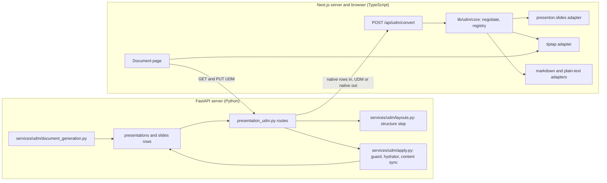
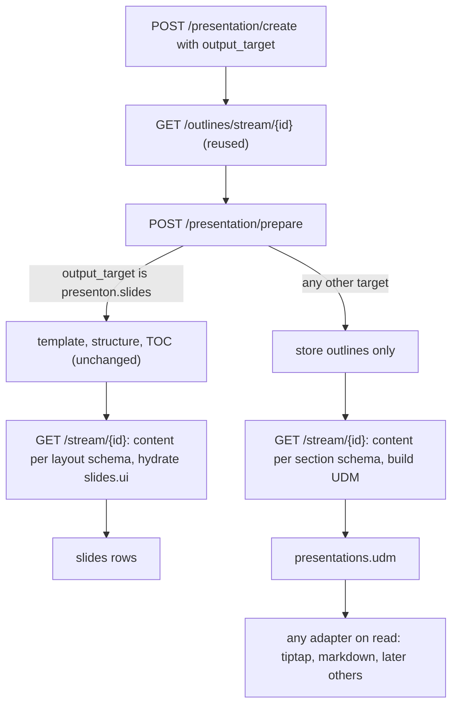

# Code changes in Presenton

<div class="chapter-meta" markdown>
**Reads:** `servers/fastapi/api/v1/ppt/endpoints/presentation.py`, `servers/fastapi/api/v1/ppt/router.py`, `servers/fastapi/models/sql/presentation.py`, `servers/fastapi/models/presentation_with_slides.py`, `servers/fastapi/utils/llm_calls/generate_slide_content.py`, `servers/fastapi/migrations.py`, `servers/fastapi/api/v1/ppt/endpoints/slide.py`, `servers/nextjs/app/(presentation-generator)/presentation/components/PresentationHeader.tsx`, `tutorial/prototypes/udm/`  ·  **Builds on:** [PPT adapter (Presenton JSON)](73-ppt-adapter.md), [Tiptap adapter (tiptap.json)](74-tiptap-adapter.md)  ·  **Time:** ~60 min
</div>

This chapter is the change list. It names every file in the Presenton repository that the Unified Document Model (UDM) work adds or touches, the existing function and line each change hooks into, what changes there, and the code for the new modules. You will learn why every codec runs in TypeScript while FastAPI keeps the database, the hydrator and the LLM steps, how six new routes plug into the existing `/api/v1/ppt` router without growing the 3,393-line `presentation.py` route table, how a "page" output target reuses the outline step and the slide content choke point while skipping layout selection, which tests and fixtures move over from the prototype, and where the work needs more than an adapter. The framing is the same as in the rest of Part X: the UDM plus one adapter contract is the product, and Presenton slides and Tiptap pages are the first two adapters.

Line numbers refer to the Presenton checkout read on 11 November 2026. New code is marked "(new)" in its block title; none of it is merged, and only the prototype in `tutorial/prototypes/udm/` has run. Statements that depend on behavior not run here say "(unverified)".

## Step 1: Start from the rule and its exceptions

The team's direction was "only the adapter layer should change". The [feasibility analysis](71-feasibility.md) showed that this holds for the conversion itself: the prototype converts all 383 bundled layouts to a valid UDM, every Tiptap document passes the real Tiptap schema check, and an edit made in `tiptap.json` lands back in the right slide slot for every text, title, list, table and chart. What the rule does not cover is the host glue: an endpoint has to expose the conversion, a menu has to offer it, a write has to be applied safely to the database, and a generation run that should produce a page instead of slides has to be told so. This chapter keeps that glue thin and target-neutral, so that the user's second requirement also holds: "today it is for Tiptap, tomorrow it might be for other modules".

The change list therefore has three layers, and only the middle one grows when a new target arrives.

| Layer | What it contains | Changes when a new target is added? |
| --- | --- | --- |
| UDM core | Types, validation, `negotiate`, registry, conformance kit (TypeScript); Pydantic models and a registry client (Python) | No. The prototype froze its core with file hashes (`tutorial/prototypes/udm/core.lock.json`) and then wrote the plain-text adapter without touching it |
| Adapters | `presenton.slides`, `tiptap`, `tiptap.basic`, `markdown`, `plain-text`, all TypeScript | Yes: one new adapter, registered in one setup file |
| Host glue | Endpoints, apply service, migration, generation branch, export menu, document page | No. Endpoints and the export menu are driven by the registry list, never by a target name |



## Step 2: Decide where each piece lives

Production Presenton has two servers. The rule this chapter adopts, consistent with [PPT adapter (Presenton JSON)](73-ppt-adapter.md) (Step 2) and the runtime risk in the [feasibility analysis](71-feasibility.md): **every codec runs in TypeScript, once; FastAPI supplies inputs and applies outputs.**

| Piece | Lives in | Why |
| --- | --- | --- |
| UDM core: types, `negotiate`, registry, conformance kit | `servers/nextjs/lib/udm/core/` (new) | One implementation of negotiation, so a preview, an export and an edit of the same document can never degrade differently. Python has no copy of `negotiate` |
| All adapters, including `presenton.slides` | `servers/nextjs/lib/udm/adapters/` (new) | Tiptap's schema check is JavaScript-only: the adapter validates its own output with `getSchema(extensions)` and `nodeFromJSON(doc).check()` because Tiptap silently drops attributes it does not know (`tutorial/prototypes/udm/adapters/tiptap/index.mjs:47-74`). Any conversion that involves Tiptap therefore runs in TypeScript, and putting the Presenton codec next to it makes slides to Tiptap one in-process call |
| Pydantic UDM models and a registry client | `servers/fastapi/udm/` (new) | FastAPI validates every UDM that enters the database and calls the TypeScript registry; it never converts formats itself |
| Apply, guard, content sync, layout choice, page generation | `servers/fastapi/services/udm/` (new) | Only Python owns the database transaction, the Template v2 hydrator `_apply_template_content_to_ui` (`servers/fastapi/api/v1/ppt/endpoints/presentation.py:575`) and the LLM structure step `generate_presentation_structure` (`servers/fastapi/utils/llm_calls/generate_presentation_structure.py:157`) |
| Cross-language fixtures | `servers/fastapi/tests/fixtures/udm/` (new) | Node tests write some of them and Python tests read them (Step 8). Tests are not part of either Docker image |

Three alternatives were considered and rejected.

1. **Codecs in Python.** Porting the prototype's serializers is easy, but validating Tiptap output is not: without the real ProseMirror schema the server could emit a document the editor rejects or silently changes. Two of the prototype's seven negative controls (`tutorial/prototypes/udm/REPORT.md`) only the real schema catches: an attribute the schema does not declare, which Tiptap drops without an error, and a `code` mark combined with `bold`. A Python codec for slides plus a TypeScript codec for Tiptap would also need two copies of `negotiate` kept identical by golden files, which [Adding any new target](77-adding-a-new-target.md) treats as a cost to accept only when the engine really needs it.
2. **A Node subprocess runner, as for PPTX export.** A third bundled Node runner, next to the export and LiteParse runners, would need its own Docker stage and duplicate code that Next.js already loads.
3. **A shared top-level package now.** It is the end state, and Part IX already plans it ([Artifact Spec and targets](../ai-component/62-artifact-spec-and-targets.md); 73 uses the package paths `gck/adapters/presenton-slides/`). Today the repository root has no workspace tooling (`package.json` has no `workspaces` field), and the Next.js Docker stage copies only `servers/nextjs` (`Dockerfile:42-46`). `lib/udm/` is written with no imports from the rest of the Next.js app, so moving it into the Part IX packages later is a file move ([Plan and tracker](76-plan-and-tracker.md), work package F1).

!!! note "Why FastAPI calling Next.js is acceptable"
    FastAPI already depends on the Next.js server for every PPTX and PDF export: `_build_presentation_export_url` points the export runner at `NEXT_PUBLIC_URL/pdf-maker` (`servers/fastapi/utils/export_utils.py:27-40`). The UDM path reuses that dependency through one stateless route, `POST /api/udm/convert`. The cost is that UDM conversions fail when Next.js is down, exactly as exports do today.

## Step 3: Add the Python side

```text title="servers/fastapi/udm/ and servers/fastapi/services/udm/ (new)"
udm/
  __init__.py              UDM_REGISTRY, NATIVE_TARGET
  models.py                Pydantic mirror of lib/udm/core/udm.ts (validation at the API boundary)
  registry.py              AdapterRegistry: remote adapters in Next.js; room for local server-side ones
  ids.py                   hash_id: the 128-bit deterministic ids of 72, Step 7 (the prototype used 32-bit FNV-1a)
  rich_text.py             markdown_inline_to_rich_text, runs_to_markdown
  section_schema.py        target-neutral section schema for the page output target (Step 6)
services/udm/
  layouts.py               choose_layouts: structure step plus capacity check (73, Step 7)
  patch_guard.py           assert_content_only_patch (73, Step 8)
  content_sync.py          write changed slots back into slides.content (exception E3)
  apply.py                 apply_slide_items: one transaction for patch and content items
  document_generation.py   section_from_content, stream_document (Step 6)
```

### 3.1 Models

The models validate a UDM before it is stored or applied; Python never turns one into a target format. Wire names stay camelCase to match the TypeScript side.

```python title="servers/fastapi/udm/models.py (new, abridged)"
"""UDM 1.3: the "udm/1.3" profile of gck.artifact/1. Mirror of lib/udm/core/udm.ts.

Nothing in this module names a target. Target data lives only in `ext[<adapter id>]`.
"""
from __future__ import annotations

import re
from typing import Annotated, Any, Literal, Optional, Union

from pydantic import BaseModel, ConfigDict, Field, field_validator, model_validator

NAMESPACE_RE = re.compile(r"^[a-z][a-z0-9-]*(\.[a-z0-9-]+)*$")
BINDING_RE = re.compile(r"^b_[a-z0-9_]{1,48}$")
Mark = Literal["bold", "italic", "underline", "strike", "code", "link", "math"]


class _Strict(BaseModel):
    model_config = ConfigDict(extra="forbid")  # strict on write, as Part IX requires


class TextSegment(_Strict):
    text: str
    marks: Optional[list[Mark]] = None
    href: Optional[str] = None
    token: Optional[dict[str, str]] = None  # {bindingId, field, format?}
    cite: Optional[list[str]] = None


RichText = list[TextSegment]


class _Block(_Strict):
    id: str
    role: Optional[Literal["subtitle", "takeaway", "kpi", "caption", "citation", "label"]] = None
    group: Optional[str] = None
    ext: Optional[dict[str, Any]] = None

    @field_validator("ext")
    @classmethod
    def _namespaced(cls, ext):
        for namespace in ext or {}:
            if not NAMESPACE_RE.match(namespace):
                raise ValueError(f"ext namespace {namespace!r} is not an adapter id")
        return ext


class Heading(_Block):   type: Literal["heading"]; level: Literal[1, 2, 3]; text: RichText
class Paragraph(_Block): type: Literal["paragraph"]; text: RichText
class Chart(_Block):
    type: Literal["chart"]; bindingId: str; chartType: str  # ChartKind enum, 12 values
    title: Optional[str] = None; axes: Optional[dict[str, str]] = None; caption: Optional[RichText] = None
# ListBlock, Callout, Quote, Divider, Code, Math, Metric, Table, Image, Diagram, Embed:
# one class each, same pattern, fields exactly as in udm.ts.

Block = Annotated[Union[Heading, Paragraph, Chart], Field(discriminator="type")]  # all 14 in full


class Section(_Strict):
    id: str
    blocks: list[Block]
    role: Optional[Literal["title", "agenda", "content", "summary", "closing", "appendix"]] = None
    level: Optional[Literal[1, 2, 3]] = None
    title: Optional[str] = None
    summary: Optional[str] = None
    notes: Optional[RichText] = None
    ext: Optional[dict[str, Any]] = None


class Udm(_Strict):
    version: Literal["gck.artifact/1"]
    profile: Literal["udm/1.3"]
    id: str
    provenance: dict[str, Any]          # Provenance model: origin generated|imported|edited, ...
    sections: list[Section]
    bindings: dict[str, dict[str, Any]]  # DataBinding model: kind + source (static or live)
    title: Optional[str] = None
    language: Optional[str] = None
    plannedFor: Optional[str] = None
    meta: Optional[dict[str, Any]] = None
    assets: Optional[dict[str, dict[str, Any]]] = None
    sources: Optional[list[dict[str, Any]]] = None
    ext: Optional[dict[str, Any]] = None

    @model_validator(mode="after")
    def _references(self):
        if bad := [k for k in self.bindings if not BINDING_RE.match(k)]:
            raise ValueError(f"binding keys must match {BINDING_RE.pattern}: {bad}")
        ids: set[str] = set()
        for section in self.sections:
            for block in section.blocks:
                if block.id in ids:
                    raise ValueError(f"duplicate block id {block.id}")
                ids.add(block.id)
                if getattr(block, "bindingId", None) not in (None, *self.bindings):
                    raise ValueError(f"unknown bindingId {block.bindingId}")
        return self
```

The block above is abridged; the full module declares all 14 block classes, `DataBinding` (a `static` source must carry `origin` and `data`), `Provenance` and nested list items. The reference check repeats a subset of the TypeScript `checkUdm` (`tutorial/prototypes/udm/core/udm-runtime.mjs:147`). Both run against the same fixtures (Step 8); TypeScript is the reference.

### 3.2 Registry

The Python registry has the same shape as the TypeScript one and the prototype's `core/adapter.ts` contract. In the first delivery it holds no local adapter: every id resolves to the Next.js registry, which it asks for manifests the first time. Local registration stays available for server-side materializers that never run in a browser (a scheduled email, a DOCX export; see [Adding any new target](77-adding-a-new-target.md)).

```python title="servers/fastapi/udm/registry.py (new)"
from __future__ import annotations

from typing import Any, Callable, Optional

import httpx


class AdapterRegistry:
    """Local adapters run in-process. Every other id is resolved against the Next.js registry."""

    def __init__(self, remote_base_url: Callable[[], str], timeout: float = 30.0):
        self._local: dict[str, Any] = {}  # local adapters: the core/adapter.ts contract in Python
        self._remote: Optional[dict[str, dict]] = None  # id -> manifest, cached per process
        self._remote_base_url = remote_base_url
        self._timeout = timeout

    def register(self, adapter: Any) -> None:
        self._local[adapter.manifest["id"]] = adapter  # manifest checks as in core/registry.mjs:7-18

    async def manifests(self, cookie_header: Optional[str] = None) -> list[dict]:
        remote = await self._remote_manifests(cookie_header)
        return [a.manifest for a in self._local.values()] + list(remote.values())

    async def convert(self, *, target: str, udm: Optional[dict] = None,
                      source: Optional[dict] = None, opts: Optional[dict] = None,
                      cookie_header: Optional[str] = None) -> dict:
        """UDM or {format, native} in; {"udm", "loss"} when target == "udm", else native, loss, manifest."""
        if target != "udm" and target not in await self._remote_manifests(cookie_header):
            raise KeyError(target)
        body = {"target": target, "udm": udm, "source": source, "opts": opts or {}}
        async with httpx.AsyncClient(timeout=self._timeout) as client:
            response = await client.post(f"{self._remote_base_url()}/api/udm/convert",
                                         json=body, headers=_cookie(cookie_header))
        if response.status_code == 422:
            raise ValueError(response.json().get("detail"))
        response.raise_for_status()
        return response.json()

    async def _remote_manifests(self, cookie_header) -> dict[str, dict]:
        if self._remote is None:
            async with httpx.AsyncClient(timeout=self._timeout) as client:
                response = await client.get(f"{self._remote_base_url()}/api/udm/adapters",
                                            headers=_cookie(cookie_header))
            response.raise_for_status()
            self._remote = {m["id"]: m for m in response.json()["adapters"]}
        return self._remote


def _cookie(cookie_header: Optional[str]) -> dict[str, str]:
    return {"Cookie": cookie_header} if cookie_header else {}
```

```python title="servers/fastapi/udm/__init__.py (new)"
from udm.registry import AdapterRegistry
from utils.export_utils import _get_next_public_url

# The host's own storage format. This constant belongs to Presenton (the host), not to the core:
# slide rows are the source of truth for this target, presentations.udm for every other one.
NATIVE_TARGET = "presenton.slides"

UDM_REGISTRY = AdapterRegistry(remote_base_url=_get_next_public_url)
```

Importing the private `_get_next_public_url` from `servers/fastapi/utils/export_utils.py:18-19` is deliberate: it is the URL the export runner already uses to reach Next.js, so any base-path fix for exports applies here too. A follow-up can rename it to a public helper. `httpx` is already a dependency (`servers/fastapi/pyproject.toml:26`). The routes map a `ValueError` from `convert` to 422 and an `httpx` connection error to 503.

### 3.3 Apply, guard, content sync and layout choice

These four modules are where Python does what only Python can. Two of them are specified in [PPT adapter (Presenton JSON)](73-ppt-adapter.md) and are only placed here: `services/udm/layouts.py` (73, Step 7) runs `generate_presentation_structure` for sections that have no layout and keeps a choice only if the layout's chart and table slot counts match the section; `services/udm/patch_guard.py` (73, Step 8) refuses a patched `ui` that differs from the stored one anywhere outside content keys (`runs`, `items`, `columns`, `rows`, `categories`, `series`, `chart_type`, `title`, axis titles, `source`, `data`, `prompt`, `latex`).

`apply.py` is 73's apply endpoint sketch (Step 9) turned into a service, so that two routes can share it: the server-orchestrated `PUT /presentation/{id}/udm` and the lower-level `POST /presentation/{id}/slides/apply` for clients that serialized on their own.

```python title="servers/fastapi/services/udm/apply.py (new)"
from fastapi import HTTPException

from api.v1.ppt.endpoints.presentation import _apply_template_content_to_ui, _template_slide_ui
from models.sql.slide import SlideModel
from services.udm.content_sync import sync_written_slots
from services.udm.patch_guard import assert_content_only_patch
from utils.process_slides import process_slide_add_placeholder_assets


async def apply_slide_items(session, presentation, items: list[dict]) -> dict:
    """Apply serializer output (73, Step 6): patch items rewrite ui slots, content items create slides.

    One commit. Returns per-slide traces and the slots that content sync could not map.
    """
    report = {"patched": [], "created": [], "content_unsynced": []}
    for item in items:
        if item["mode"] == "patch":
            slide = await session.get(SlideModel, item["slideId"])
            if slide is None or slide.presentation != presentation.id:
                raise HTTPException(400, f"Unknown slide {item['slideId']}")
            try:
                assert_content_only_patch(slide.ui, item["ui"])
            except ValueError as exc:
                raise HTTPException(422, f"Patch touches non-content fields: {exc}") from exc
            unsynced = sync_written_slots(slide, item["ui"], item["trace"]["written"])
            slide.ui = item["ui"]                   # reassign: JSON columns are not mutation-tracked
            slide.speaker_note = item.get("speaker_note", slide.speaker_note)
            session.add(slide)
            report["patched"].append({"slideId": str(slide.id), "written": item["trace"]["written"]})
            report["content_unsynced"] += unsynced
        elif item["mode"] == "content":
            ui = _template_slide_ui(presentation.layout, item["layoutId"])   # presentation.py:490
            if ui is None:
                raise HTTPException(400, f"Unknown layout {item['layoutId']}")
            slide = SlideModel(presentation=presentation.id, layout_group=presentation.layout.get("name"),
                               layout=item["layoutId"], index=item["index"], content=item["content"],
                               speaker_note=item.get("speaker_note", ""))
            process_slide_add_placeholder_assets(slide)                         # utils/process_slides.py:427
            slide.ui = _apply_template_content_to_ui(ui, slide.content)         # presentation.py:575
            clear_unresolved_charts(slide.ui, item.get("bindings", []))         # Part IX 7.4 rule
            session.add(slide)
            report["created"].append({"index": item["index"], "layoutId": item["layoutId"]})
        else:
            raise HTTPException(400, f"Unknown mode {item['mode']!r}")
    # Index shifting for inserted slides and Part VIII binding rows: 73, Step 9 sketch.
    await session.commit()
    return report
```

`clear_unresolved_charts` comes from Part IX's slides sketch; it is needed because `_apply_template_chart_content` copies categories and series only when they are non-empty (73, Step 9). Importing `_apply_template_content_to_ui` and `_template_slide_ui` from the endpoint module is how 73's sketch calls them too. It works because `presentation.py` does not import `services/udm/apply.py`; if it ever needs to, the two helpers move to a module of their own.

`content_sync.py` closes the gap that 73 flags as a gotcha in Step 8 and this chapter lists as exception E3: patch mode writes `ui`, but several paths read `slides.content`.

```python title="servers/fastapi/services/udm/content_sync.py (new)"
from api.v1.ppt.endpoints.presentation import _template_component_content_keys
from udm.rich_text import runs_to_markdown


def sync_written_slots(slide, new_ui: dict, written: list[str]) -> list[str]:
    """Write each rewritten slot's value into slide.content[component_key][element_name].

    Slot paths look like "components.2.elements.1" (prototype walk.mjs). Returns the slots that could
    not be mapped (slots inside repeated groups, unnamed elements); they are reported, and a later
    content-driven hydration can bring their old text back.
    """
    components = new_ui.get("components") or []
    keys = _template_component_content_keys(components)          # presentation.py:538-572
    content = dict(slide.content or {})
    unsynced = []
    for slot in written:
        parts = slot.split(".")
        if len(parts) != 4 or parts[0] != "components" or parts[2] != "elements":
            unsynced.append(slot)
            continue
        component_index, element_index = int(parts[1]), int(parts[3])
        element = components[component_index]["elements"][element_index]
        name = element.get("name")
        if not name or component_index >= len(keys):
            unsynced.append(slot)
            continue
        component_content = dict(content.get(keys[component_index]) or {})
        component_content[name] = _content_value(element)
        content[keys[component_index]] = component_content
    slide.content = content                                      # reassign for JSON change tracking
    return unsynced


def _content_value(element: dict):
    kind = element.get("type")
    if kind == "text":
        return runs_to_markdown(element.get("runs") or [])       # the hydrator parses ** and * back
    if kind == "text-list":
        return [runs_to_markdown(item) for item in element.get("items") or []]
    # table, chart, image, infographic: the shape get_template_schema derives for the type
    return _structured_value(kind, element)
```

The shapes written back follow the content schema that `get_template_schema` derives for each element type (`servers/fastapi/templates/v2/schema.py:361-423`). Two of them are unverified against the hydrator: the table shape and the chart keys. The content-sync test in Step 8 checks every corpus layout by hydrating the synced `content` and comparing the result with the patched `ui`; whatever shape passes that test is the one that ships.

## Step 4: Add the TypeScript package `servers/nextjs/lib/udm/`

```text title="servers/nextjs/lib/udm/ (new)"
lib/udm/
  core/
    udm.ts            from tutorial/prototypes/udm/core/udm.ts (unchanged)
    adapter.ts        from core/adapter.ts (unchanged)
    runtime.ts        from core/udm-runtime.mjs, typed (checkUdm, hashId, rich text helpers)
    negotiate.ts      from core/negotiate.mjs, typed
    registry.ts       from core/registry.mjs, typed
    conformance.ts    from core/conformance.mjs (tests only)
  adapters/
    presenton-slides/ walk, deserialize, serialize (patch and content), layouts/fallback, validate,
                      manifest; 73, Step 13 maps every prototype file to its production file
    tiptap/           extensions, to-tiptap, from-tiptap, index (74)
    markdown.ts
    plaintext.ts
  registry-setup.ts   server registry: names every adapter
  registry-browser.ts browser registry: registers tiptap only, keeps the bundle small
  react/
    DataBlockView.tsx node view for dataBlock in the editor (74; Step 7.2 here)
```

Nothing under `lib/udm/core/` or `lib/udm/adapters/` imports from `@/components`, `@/store` or `@/app`, which a test enforces.

**Dependencies.** `servers/nextjs/package.json:40-44` already pins `@tiptap/core`, `@tiptap/pm`, `@tiptap/react` and `@tiptap/starter-kit` at 3.30.5, the version the prototype used. Two packages are added at the same pin: `@tiptap/extension-table` and `@tiptap/extension-image`. `marked` is present as `^15.0.11` (`servers/nextjs/package.json:54`), while the prototype's Markdown adapter was measured with `marked` 17.0.5. Whether its escaping and flanking-rule workarounds behave the same on 15 is unverified; the conformance kit decides on the first run, and the fallback is to pin 17.0.5.

**The existing inline Tiptap bridge is not reused.** `TiptapInlineTextEditor` (`servers/nextjs/components/slide-editor/text/TiptapInlineTextEditor.tsx`) edits one text element inside the slide canvas. Its extension list turns off headings, lists, blockquote, code blocks and horizontal rules (`:266-281`) and carries Presenton font properties in a custom `runStyle` mark (`:49`). The page editor needs the opposite: block structure and no fonts. The two coexist. Its converters at `:751` and `:798` remain the proof that run-level fidelity is possible, and `runStyle` is the natural carrier if the generic `highlight` mark (exception E6) is added later.

```ts title="servers/nextjs/lib/udm/registry-setup.ts (new)"
import { createRegistry } from "./core/registry";
import { createPresentonSlidesAdapter } from "./adapters/presenton-slides";
import { createTiptapAdapter } from "./adapters/tiptap";
import { basicExtensions, pageExtensions } from "./adapters/tiptap/extensions";
import { markdownAdapter } from "./adapters/markdown";
import { plainTextAdapter } from "./adapters/plaintext";

// The server registry. A new module registers here; registry-browser.ts only if it has an in-browser editor.
export const udmRegistry = createRegistry();
udmRegistry.register(createPresentonSlidesAdapter(), ["slides"]);
udmRegistry.register(createTiptapAdapter({ id: "tiptap", extensions: pageExtensions() }), ["tiptap-doc"]);
udmRegistry.register(createTiptapAdapter({ id: "tiptap.basic", extensions: basicExtensions() }));
udmRegistry.register(markdownAdapter);
udmRegistry.register(plainTextAdapter, ["text"]);
```

The `slides`, `tiptap-doc` and `text` aliases keep Part IX's legacy target ids working (the fourth, `superset-dashboard`, arrives with its adapter) ([Unified Document Model](72-unified-document-model.md)).

The Presenton adapter needs context that a pure function cannot fetch: the current slides (the patch base, 73 Step 8), the template's layouts (content mode, 73 Step 9), and the layouts already chosen by the structure step. FastAPI passes them as `opts`. The adapter never reads the database.

Two route handlers expose the registry to FastAPI and to the browser. Both are pure: they read no database and hold no secrets.

```ts title="servers/nextjs/app/api/udm/convert/route.ts (new)"
import { NextRequest, NextResponse } from "next/server";
import { udmRegistry } from "@/lib/udm/registry-setup";
import { checkUdm } from "@/lib/udm/core/runtime";

export const runtime = "nodejs";
// A deck's slides plus its template's layouts: bundled templates are up to 2.3 MB each.
const MAX_BODY_BYTES = 16 * 1024 * 1024;

type Body = { target?: string; udm?: unknown; source?: { format: string; native: unknown }; opts?: object };

export async function POST(request: NextRequest) {
  const raw = await request.text();
  if (raw.length > MAX_BODY_BYTES) return NextResponse.json({ detail: "Body too large" }, { status: 413 });
  let body: Body;
  try {
    body = JSON.parse(raw);
  } catch {
    return NextResponse.json({ detail: "Invalid JSON" }, { status: 400 });
  }
  if (!body.target) return NextResponse.json({ detail: "target required" }, { status: 400 });

  try {
    const loss = [];
    let udm = body.udm;
    if (body.source) {                                  // native in: deserialize with the source adapter
      const from = udmRegistry.get(body.source.format);
      if (from.validateNative(body.source.native, body.opts).some((i) => i.level === "error"))
        return NextResponse.json({ detail: "invalid source document" }, { status: 422 });
      const result = from.deserialize!(body.source.native, body.opts);
      udm = result.udm;
      loss.push(...result.loss);
    }
    const problems = checkUdm(udm);
    if (problems.length) return NextResponse.json({ detail: problems }, { status: 422 });
    if (body.target === "udm") return NextResponse.json({ udm, loss });

    const to = udmRegistry.get(body.target);
    const out = udmRegistry.convert(udm as never, body.target, body.opts);  // negotiate, then serialize
    const issues = to.validateNative(out.native, body.opts);
    if (issues.some((i) => i.level === "error")) {
      return NextResponse.json({ detail: issues }, { status: 500 });        // adapter bug: never ship it
    }
    return NextResponse.json({ native: out.native, trace: out.trace, loss: [...loss, ...out.loss],
                               issues, manifest: to.manifest });
  } catch (error) {
    return NextResponse.json({ detail: String(error) }, { status: 404 });
  }
}
```

```ts title="servers/nextjs/app/api/udm/adapters/route.ts (new)"
import { NextResponse } from "next/server";
import { udmRegistry } from "@/lib/udm/registry-setup";

export const runtime = "nodejs";

export async function GET() {
  return NextResponse.json({ adapters: udmRegistry.list() });
}
```

The prototype's `registry.convert` returns `{ native, loss, negotiated }` (`tutorial/prototypes/udm/core/registry.mjs:41-46`); the typed version also passes the serializer's optional `trace` through, because the apply service needs the list of written slots.

!!! warning "Gotcha"
    `proxy.ts` forwards `/api/v1` and `/api/v2` to FastAPI (`servers/nextjs/proxy.ts:25-32`); other `/api/*` paths are Next.js route handlers. Whether `proxy.ts` puts the session check in front of `/api/udm/*` was not verified. The routes leak nothing but accept large bodies, so they must sit behind the same check as the other Next.js API routes; FastAPI forwards the caller's cookie (Step 5) so that the check passes.

## Step 5: Add the endpoints and wire them into the router

All new routes go into one new module, `servers/fastapi/api/v1/ppt/endpoints/presentation_udm.py`, instead of the existing `presentation.py`. That file has 3,393 lines and is edited by several Part VIII stories at the same time; a separate module keeps merge conflicts out of the way.

| Method and path | Purpose | Response |
| --- | --- | --- |
| `GET /api/v1/ppt/udm/adapters` | List every registered adapter manifest | `{ adapters: AdapterManifest[] }` |
| `GET /api/v1/ppt/presentation/{id}/udm` | A deck (or a stored document) as a UDM | `{ udm, loss }` |
| `GET /api/v1/ppt/presentation/{id}/export?format=<adapter id>&download=<bool>` | Any registered target's native output; `download=true` returns the raw file with `Content-Disposition` | `{ format, native, loss }` or the file |
| `POST /api/v1/ppt/presentation/from-udm` | Create a new deck from a UDM or from any target's native document (content mode for every section) | `{ presentation: PresentationWithSlides, loss }` |
| `PUT /api/v1/ppt/presentation/{id}/udm` | Apply an edited UDM to a deck (patch for linked sections, content for new ones) or replace a stored document | `{ loss, patched, created, content_unsynced }` |
| `POST /api/v1/ppt/presentation/{id}/slides/apply` | Apply serializer output directly (73, Step 9) | same report |

`PUT` and `from-udm` were not in the original request. `PUT` is what makes the edit round trip usable from the document page, and `from-udm` is the "document to slides" direction.

```python title="servers/fastapi/api/v1/ppt/endpoints/presentation_udm.py (new)"
import json
import mimetypes
import uuid
from typing import Optional

from fastapi import APIRouter, Body, Depends, HTTPException, Query, Request
from fastapi.responses import Response
from pydantic import BaseModel
from sqlalchemy.ext.asyncio import AsyncSession
from sqlmodel import select

from api.v1.ppt.endpoints.presentation import build_export_cookie_header
from models.sql.presentation import PresentationModel, PresentationVersion
from models.sql.slide import SlideModel
from services.database import get_async_session
from services.udm.apply import apply_slide_items
from services.udm.layouts import choose_layouts_for
from udm import NATIVE_TARGET, UDM_REGISTRY
from udm.models import NAMESPACE_RE, Udm

UDM_ROUTER = APIRouter(prefix="/udm", tags=["UDM"])
PRESENTATION_UDM_ROUTER = APIRouter(prefix="/presentation", tags=["Presentation", "UDM"])


async def _load(id: uuid.UUID, session: AsyncSession):
    presentation = await session.get(PresentationModel, id)
    if not presentation:
        raise HTTPException(404, "Presentation not found")
    slides = list(await session.scalars(
        select(SlideModel).where(SlideModel.presentation == id).order_by(SlideModel.index)))
    return presentation, slides


def native_deck(presentation: PresentationModel, slides: list[SlideModel]) -> dict:
    """Presenton's native shape for the presenton.slides adapter (73, Step 3)."""
    outlines = (presentation.outlines or {}).get("slides") or []
    use_outlines = len(outlines) == len(slides)  # TOC insertion can shift indexes; skip if unsure
    return {
        "templateId": (presentation.layout or {}).get("template_id"),
        "slides": [{
            "id": str(slide.id), "layout_group": slide.layout_group, "layout": slide.layout,
            "ui": slide.ui, "html_content": slide.html_content, "speaker_note": slide.speaker_note,
            **({"outline": outlines[i].get("content")} if use_outlines else {}),
        } for i, slide in enumerate(slides)],
        # Part VIII slide_data_bindings rows join here once they exist (exception E8).
    }


def _guard(presentation: PresentationModel) -> None:
    if presentation.version == PresentationVersion.V1_STANDARD:
        raise HTTPException(422, "v1 presentations are not supported")


async def presentation_udm(presentation, slides, cookie_header) -> dict:
    if presentation.output_target != NATIVE_TARGET:
        if not presentation.udm:
            raise HTTPException(409, "Document has not been generated yet")
        return {"udm": presentation.udm, "loss": []}
    _guard(presentation)
    source = {"format": NATIVE_TARGET, "native": native_deck(presentation, slides)}
    return await UDM_REGISTRY.convert(target="udm", source=source, cookie_header=cookie_header)


@UDM_ROUTER.get("/adapters")
async def list_udm_adapters(request: Request):
    return {"adapters": await UDM_REGISTRY.manifests(build_export_cookie_header(request))}


@PRESENTATION_UDM_ROUTER.get("/{id}/udm")
async def get_presentation_udm(id: uuid.UUID, request: Request,
                               session: AsyncSession = Depends(get_async_session)):
    presentation, slides = await _load(id, session)
    return await presentation_udm(presentation, slides, build_export_cookie_header(request))


@PRESENTATION_UDM_ROUTER.get("/{id}/export")
async def export_presentation_as(
    id: uuid.UUID,
    request: Request,
    format: str = Query(..., pattern=NAMESPACE_RE.pattern),
    download: bool = False,
    session: AsyncSession = Depends(get_async_session),
):
    cookie = build_export_cookie_header(request)
    presentation, slides = await _load(id, session)
    if presentation.output_target == NATIVE_TARGET:
        _guard(presentation)   # one call: slides -> UDM -> target, all in TypeScript
        call = {"source": {"format": NATIVE_TARGET, "native": native_deck(presentation, slides)}}
    else:
        call = {"udm": (await presentation_udm(presentation, slides, cookie))["udm"]}
    try:
        result = await UDM_REGISTRY.convert(target=format, cookie_header=cookie, **call)
    except KeyError:
        raise HTTPException(404, f"No adapter registered for {format!r}")
    if not download:
        return {"format": format, "native": result["native"], "loss": result["loss"]}
    native, media_type = result["native"], result["manifest"]["nativeFormat"]
    body = native if isinstance(native, str) else json.dumps(native, ensure_ascii=False)
    extension = mimetypes.guess_extension(media_type) or (".txt" if isinstance(native, str) else ".json")
    filename = f"{(presentation.title or str(presentation.id))[:80]}.{format}{extension}"
    return Response(content=body, media_type=media_type,
                    headers={"Content-Disposition": f'attachment; filename="{filename}"',
                             "X-UDM-Loss-Count": str(len(result["loss"]))})


@PRESENTATION_UDM_ROUTER.put("/{id}/udm")
async def apply_presentation_udm(
    id: uuid.UUID, request: Request,
    udm: dict = Body(..., embed=True),
    if_unmodified_since: Optional[str] = Body(None, embed=True),
    session: AsyncSession = Depends(get_async_session),
):
    cookie = build_export_cookie_header(request)
    presentation, slides = await _load(id, session)
    if if_unmodified_since and presentation.updated_at.isoformat() > if_unmodified_since:
        raise HTTPException(409, "The presentation changed since it was loaded")
    validated = Udm.model_validate(udm).model_dump(exclude_none=True)
    if presentation.output_target != NATIVE_TARGET:
        presentation.udm = validated
        session.add(presentation)
        await session.commit()
        return {"loss": [], "patched": [], "created": [], "content_unsynced": []}
    _guard(presentation)
    chosen = await choose_layouts_for(validated, presentation, slides)      # 73, Step 7
    result = await UDM_REGISTRY.convert(
        target=NATIVE_TARGET, udm=validated, cookie_header=cookie,
        opts={"currentSlides": native_deck(presentation, slides)["slides"],
              "layouts": (presentation.layout or {}).get("layouts") or [],
              "chosenLayouts": chosen,
              "templateId": (presentation.layout or {}).get("template_id")},
    )
    report = await apply_slide_items(session, presentation, result["native"]["slides"])
    return {"loss": result["loss"], **report}
```

`POST /from-udm` creates the row first and then runs the same path with no current slides, so every section goes through content mode:

```python title="servers/fastapi/api/v1/ppt/endpoints/presentation_udm.py (new, continued)"
class FromUdmRequest(BaseModel):
    udm: Optional[dict] = None
    source: Optional[dict] = None          # {"format": "tiptap", "native": <tiptap.json>}
    template: str = "general"
    title: Optional[str] = None


@PRESENTATION_UDM_ROUTER.post("/from-udm")
async def create_presentation_from_udm(
    request: Request, body: FromUdmRequest, session: AsyncSession = Depends(get_async_session),
):
    # 1. A UDM: body.udm, or UDM_REGISTRY.convert(target="udm", source=body.source).
    # 2. Udm.model_validate for shapes and references -> 422 on failure.
    # 3. layout_payload, _, fonts, theme = await _resolve_generation_layout(body.template, session)
    #    (presentation.py:262-307), then a PresentationModel(version=V2_STANDARD,
    #    output_target=NATIVE_TARGET, layout=layout_payload, fonts=fonts, theme=theme,
    #    title=body.title or udm.title, content="", n_slides=len(udm.sections), language="").
    # 4. chosen = await choose_layouts_for(udm, presentation, slides=[]), then
    #    UDM_REGISTRY.convert(target=NATIVE_TARGET, ...) with currentSlides=[] -> content items.
    # 5. apply_slide_items(...), then fetch image assets as the generate path does
    #    (process_slide_and_fetch_assets, utils/process_slides.py:173) and rehydrate.
    # 6. Return {"presentation": PresentationWithSlides(...), "loss": loss}.
    ...


@PRESENTATION_UDM_ROUTER.post("/{id}/slides/apply")
async def apply_slides(id: uuid.UUID, items: list[dict] = Body(..., embed=True),
                       session: AsyncSession = Depends(get_async_session)):
    presentation, _ = await _load(id, session)
    _guard(presentation)
    return await apply_slide_items(session, presentation, items)
```

`choose_layouts_for` wraps 73's `choose_layouts`: sections with no linked slide and no layout in `ext["presenton.slides"]` are rendered as Markdown through the registry and sent to the structure step; sections it cannot place go to the adapter's deterministic picker. An edit of linked slides never calls the LLM.

!!! warning "Gotcha: patch only for linked sections"
    73 sets a product rule from the prototype's numbers: through targets that drop ids and `ext`, text lands in the right slot only 94.3% (Markdown) or 67.81% (StarterKit-only Tiptap) of the time. The serializer therefore patches only sections whose blocks still carry `ext["presenton.slides"].slot`. A document that comes back without them is applied in content mode, as new slides, never as an update of the slides it came from.

**Wiring.** Two lines in `servers/fastapi/api/v1/ppt/router.py`:

```python title="servers/fastapi/api/v1/ppt/router.py (changed)"
from api.v1.ppt.endpoints.presentation import PRESENTATION_ROUTER
from api.v1.ppt.endpoints.presentation_udm import PRESENTATION_UDM_ROUTER, UDM_ROUTER  # new

API_V1_PPT_ROUTER.include_router(PRESENTATION_ROUTER)
API_V1_PPT_ROUTER.include_router(PRESENTATION_UDM_ROUTER)  # new, after PRESENTATION_ROUTER
API_V1_PPT_ROUTER.include_router(UDM_ROUTER)               # new
```

The existing import is at `router.py:19` and the existing include at `router.py:37`; the prefix `/api/v1/ppt` comes from `router.py:22`.

!!! warning "Gotcha: route matching"
    `PRESENTATION_ROUTER` declares `GET /{id}` with `id: uuid.UUID` (`presentation.py:1551`) and `POST /{id}/export` (`presentation.py:1642`). The new `GET /{id}/udm`, `PUT /{id}/udm`, `GET /{id}/export` and `POST /{id}/slides/apply` have a second path segment or a different method, so none of them shadows or is shadowed by an existing route. `POST /from-udm` has one segment, and the existing router has no single-segment `POST /{id}`, so it is also safe. Keep it that way: a future `POST /{id}` in `PRESENTATION_ROUTER` would capture `from-udm` and fail UUID validation with a 422.

**Ownership.** The new handlers use `get_async_session`, so they inherit the owner scoping that `servers/fastapi/services/database.py:67-99` applies to ORM selects, the same way `get_presentation` does (`presentation.py:1551-1569`). When Part VIII Story 2 adds `require_presentation_access` to every endpoint (subtask 2.4), these routes are on its list.

**The existing export stays.** `POST /presentation/{id}/export` (`presentation.py:1642-1678`) keeps `export_as: Literal["pptx", "pdf"]` (`:1646`) and the DOM runner. PPTX and PDF are renderings of `slides.ui`, not adapters of the UDM, and they keep their pixel-exact path. The new `GET /{id}/export` is the adapter path.

## Step 6: Add a "page" output target to generation

A generation run in the UI goes `/create`, then the outline stream, then `/prepare`, then `/stream/{id}`. That flow changes first; the one-shot `/generate` API follows in work package D6 of the [plan](76-plan-and-tracker.md).

| Step | Code | Page target |
| --- | --- | --- |
| Create row | `create_presentation`, `presentation.py:1681-1781` | Reused, plus a new `output_target` body field |
| Outline | `stream_outlines`, `servers/fastapi/api/v1/ppt/endpoints/outlines.py:84` | Reused unchanged: one Markdown outline per unit, target-agnostic |
| Template and layout | `_resolve_prepare_layout`, `presentation.py:1448-1470`, called at `:1862` | Skipped |
| Structure (layout per slide) | `generate_presentation_structure`, called in `/prepare` from `:1873` | Skipped |
| Table of contents layouts | `presentation.py:1891-1906` | Skipped |
| Content | `get_slide_content_from_type_and_outline`, `servers/fastapi/utils/llm_calls/generate_slide_content.py:229-276` | **Reused** with a target-neutral section schema in place of a layout's `json_schema` |
| Hydration into `ui` | `_apply_template_content_to_ui`, `presentation.py:575`; `_template_slide_ui`, `:490` | Skipped; replaced by `section_from_content` (new, deterministic) |
| Assets | `process_slide_and_fetch_assets`, `servers/fastapi/utils/process_slides.py:173` | Skipped in the first release (no image blocks in the section schema) |
| Persist | `presentation.py:2496-2502` | `presentations.udm` instead of slide rows |
| Export | `export_presentation`, `servers/fastapi/utils/export_utils.py:43-75` | Not needed; any adapter serializes on read |



The design choice that keeps this generic: **generation writes a full UDM and never targets a format**. `output_target` only tells the host which view opens the result (the Tiptap document page today). Negotiation to a target's capabilities happens on read, through the same `convert` call as an export. A new target therefore needs no generation change at all. Constraining generation to a manifest, as Part IX's `build_response_schema` does, is a later optimization.

### 6.1 Request flag, column and migration

`create_presentation` gains one parameter next to `generation_mode` (`presentation.py:1693`) and a `request` parameter to forward the cookie; the row construction at `:1745-1760` stores the value.

```python title="servers/fastapi/api/v1/ppt/endpoints/presentation.py (changed, create_presentation)"
async def create_presentation(
    request: Request,                                               # new: forwards the cookie
    content: Annotated[str, Body()],
    ...
    generation_mode: Annotated[Literal["standard", "smart"], Body()] = "standard",
    community_design_ids: Annotated[Optional[List[int]], Body()] = None,
    output_target: Annotated[str, Body()] = NATIVE_TARGET,          # new
    sql_session: AsyncSession = Depends(get_async_session),
):
    ...
    if output_target != NATIVE_TARGET:                              # new
        if generation_mode == "smart":
            raise HTTPException(400, "Smart mode produces slides only")
        known = await UDM_REGISTRY.manifests(build_export_cookie_header(request))
        if output_target not in {m["id"] for m in known}:
            raise HTTPException(400, f"Unknown output target {output_target!r}")
    ...
    presentation = PresentationModel(
        ...,
        generation_mode=generation_mode,
        output_target=output_target,                                # new
        community_design_ids=normalized_community_ids or None,
    )
```

`GeneratePresentationRequest` (`servers/fastapi/models/generate_presentation_request.py:8-46`) gains the same field with the same default, for the one-shot API.

```python title="servers/fastapi/models/sql/presentation.py (changed)"
    generation_mode: Literal["standard", "smart"] = Field(
        sa_column=Column(String, nullable=False, default="standard"),
        default="standard",
    )
    output_target: str = Field(                                     # new: an adapter id
        sa_column=Column(String, nullable=False, default="presenton.slides"),
        default="presenton.slides",
    )
    udm: Optional[dict] = Field(sa_column=Column(JSON), default=None)  # new: document targets only
```

The fields go after `generation_mode` (`servers/fastapi/models/sql/presentation.py:75-78`). `get_new_presentation` (`:83-106`), which `POST /{id}/duplicate` uses, must copy both: `output_target=self.output_target, udm=copy.deepcopy(self.udm)`. Forgetting this would duplicate a document as an empty slides deck.

**One source of truth per row.** For `output_target == "presenton.slides"` the slide rows are the truth and `udm` stays `NULL`; the UDM is derived on read. For any other target, `udm` is the truth and there are no slide rows. The response model gains `output_target: str = "presenton.slides"` (`servers/fastapi/models/presentation_with_slides.py:10-27`). `_presentation_response_data` dumps the model with only `layout` and `structure` excluded (`presentation.py:343-344`); it must also exclude `udm`, because a document can be large and `GET /{id}/udm` serves it.

```python title="servers/fastapi/alembic/versions/b4d6f8a0c2e4_add_output_target_and_udm.py (new)"
"""add output target and udm columns to presentations

Revision ID: b4d6f8a0c2e4
Revises: 026c0ba8b35c
"""

from collections.abc import Sequence

from alembic import op
import sqlalchemy as sa


revision: str = "b4d6f8a0c2e4"
down_revision: str | None = "026c0ba8b35c"
branch_labels: str | Sequence[str] | None = None
depends_on: str | Sequence[str] | None = None


def upgrade() -> None:
    inspector = sa.inspect(op.get_bind())
    if "presentations" not in inspector.get_table_names():
        return
    columns = {column["name"] for column in inspector.get_columns("presentations")}
    with op.batch_alter_table("presentations") as batch_op:
        if "output_target" not in columns:
            batch_op.add_column(sa.Column("output_target", sa.String(), nullable=False,
                                          server_default="presenton.slides"))
        if "udm" not in columns:
            batch_op.add_column(sa.Column("udm", sa.JSON(), nullable=True))


def downgrade() -> None:
    inspector = sa.inspect(op.get_bind())
    if "presentations" not in inspector.get_table_names():
        return
    columns = {column["name"] for column in inspector.get_columns("presentations")}
    with op.batch_alter_table("presentations") as batch_op:
        if "udm" in columns:
            batch_op.drop_column("udm")
        if "output_target" in columns:
            batch_op.drop_column("output_target")
```

The migration copies the defensive pattern of `f3a7c1d9e5b2_add_smart_generation_fields.py`, which added `generation_mode` the same way, and chains after the current head `026c0ba8b35c`. `servers/fastapi/migrations.py:36-37` gets `REVISION_OUTPUT_TARGET_UDM = "b4d6f8a0c2e4"` and `REVISION_HEAD = REVISION_OUTPUT_TARGET_UDM`; `tests/unit/test_migrations.py` asserts against `migrations.REVISION_HEAD` and follows automatically. The revision id is a placeholder: if Part VIII's Postgres work (Story 2, subtask 2.1) or binding table (Story 1, subtask 1.2) lands first, `down_revision` must point at their head instead.

### 6.2 `/prepare` and `/stream/{id}` branches

`prepare_presentation` requires a template today (`layout: Annotated[str, Body()]`, `presentation.py:1844`). For a page target the parameter becomes optional, and the function returns right after building the outline model (`:1860`):

```python title="servers/fastapi/api/v1/ppt/endpoints/presentation.py (changed, prepare_presentation)"
    layout: Annotated[Optional[str], Body()] = None,                # was required
    ...
    presentation_outline_model = PresentationOutlineModel(slides=outlines)

    if presentation.output_target != NATIVE_TARGET:                 # new: page targets
        presentation.outlines = presentation_outline_model.model_dump(mode="json")
        presentation.title = title or presentation.title
        presentation.language = ""
        sql_session.add(presentation)
        await sql_session.commit()
        return PresentationPrepareResponse(presentation_id=presentation.id)

    if not layout:                                                  # new: keep today's contract
        raise HTTPException(status_code=400, detail="Template id is required")
```

`stream_presentation` already branches once for Smart mode (`presentation.py:2288-2289`) before it rejects a row without a structure (`:2290-2294`). The page branch goes next to it:

```python title="servers/fastapi/api/v1/ppt/endpoints/presentation.py (changed, stream_presentation)"
    if presentation.generation_mode == "smart":
        return await stream_smart_presentation(presentation, sql_session)
    if presentation.output_target != NATIVE_TARGET:                 # new
        return await stream_document(presentation, sql_session)
    if not presentation.structure:
```

### 6.3 The section schema and `stream_document`

The content step is schema-driven: `get_slide_content_from_type_and_outline` takes any `SlideLayoutModel` (`id`, `name`, `description`, `json_schema`; `servers/fastapi/templates/presentation_layout.py:11-15`) and asks the LLM for JSON that matches its schema. `_prepare_response_schema` (`generate_slide_content.py:203-226`) strips asset-only fields and adds a `__speaker_note__` field, which maps onto `Section.notes`. The page target therefore needs no new LLM call, only a new schema. The schema is flat (no `anyOf`), because the call runs `JSONSchemaResponse(..., strict=True)` against several providers and a flat object is the shape the current layout schemas already exercise. Whether every configured provider accepts it is unverified (work package D5).

```python title="servers/fastapi/udm/section_schema.py (new)"
from templates.presentation_layout import SlideLayoutModel

BLOCK_TYPES_GENERATED = ["heading", "paragraph", "list", "callout", "quote"]

SECTION_SCHEMA = {
    "type": "object",
    "properties": {
        "title": {"type": "string", "minLength": 3, "maxLength": 120,
                  "description": "Section heading"},
        "blocks": {
            "type": "array", "minItems": 1, "maxItems": 12,
            "items": {
                "type": "object",
                "properties": {
                    "type": {"type": "string", "enum": BLOCK_TYPES_GENERATED},
                    "text": {"type": "string", "maxLength": 1200,
                             "description": "Markdown emphasis allowed; empty for lists"},
                    "items": {"type": "array", "maxItems": 12,
                              "items": {"type": "string", "maxLength": 300}},
                    "ordered": {"type": "boolean"},
                    "tone": {"type": "string", "enum": ["info", "warning", "success"]},
                },
                "required": ["type", "text", "items", "ordered", "tone"],
                "additionalProperties": False,
            },
        },
    },
    "required": ["title", "blocks"],
    "additionalProperties": False,
}

SECTION_LAYOUT = SlideLayoutModel(
    id="udm-section", name="Section", description="One section of a document",
    json_schema=SECTION_SCHEMA,
)
```

The first release generates text blocks only. Tables and charts in a generated page would put LLM-written numbers into `static` bindings, which Part IX's invariants reserve for imported or user data. Data blocks arrive through conversion from slides (where they are `static` with `origin: "imported"`) or, later, through live bindings ([Story 1: Dynamic data and refresh](../delivery/42-story1-dynamic-data.md)).

```python title="servers/fastapi/services/udm/document_generation.py (new)"
import json
import logging
import uuid

from fastapi.responses import StreamingResponse

from models.sse_response import SSECompleteResponse, SSEResponse
from udm.ids import hash_id
from udm.models import Udm
from udm.rich_text import markdown_inline_to_rich_text
from udm.section_schema import SECTION_LAYOUT
from utils.llm_calls.generate_slide_content import get_slide_content_from_type_and_outline
from utils.sse import safe_sse_stream

logger = logging.getLogger(__name__)


def section_from_content(content: dict, index: int, presentation_id: uuid.UUID) -> dict:
    """Deterministic: LLM content dict -> UDM Section. No LLM, no clock, no randomness."""
    sec_id = f"sec_{hash_id(str(presentation_id), str(index))}"
    blocks = []
    for n, raw in enumerate(content.get("blocks") or []):
        block_id = f"blk_{hash_id(sec_id, str(n))}"
        kind = raw.get("type")
        if kind == "list":
            blocks.append({"id": block_id, "type": "list", "ordered": bool(raw.get("ordered")),
                           "items": [markdown_inline_to_rich_text(i) for i in raw.get("items") or []]})
        elif kind == "heading":
            blocks.append({"id": block_id, "type": "heading", "level": 1,
                           "text": markdown_inline_to_rich_text(raw.get("text", ""))})
        elif kind == "callout":
            blocks.append({"id": block_id, "type": "callout", "tone": raw.get("tone") or "info",
                           "text": markdown_inline_to_rich_text(raw.get("text", ""))})
        elif kind in ("paragraph", "quote") and raw.get("text"):
            blocks.append({"id": block_id, "type": kind,
                           "text": markdown_inline_to_rich_text(raw["text"])})
    section = {"id": sec_id, "title": content.get("title") or None, "blocks": blocks}
    if content.get("__speaker_note__"):
        section["notes"] = [{"text": content["__speaker_note__"]}]
    return section


async def stream_document(presentation, sql_session):
    outline = presentation.get_presentation_outline()

    async def inner():
        sections = []
        for i, unit in enumerate(outline.slides):
            content = await get_slide_content_from_type_and_outline(
                SECTION_LAYOUT, unit, presentation.language, presentation.tone,
                presentation.verbosity, presentation.instructions, slide_number=i + 1,
            )
            section = section_from_content(content, i, presentation.id)
            sections.append(section)
            yield SSEResponse(event="response", data=json.dumps(
                {"type": "section", "index": i, "section": section})).to_string()
        udm = Udm.model_validate({
            "version": "gck.artifact/1", "profile": "udm/1.3",
            "id": f"art_{hash_id(str(presentation.id))}",   # artifact form: 26 Crockford base32 characters (72, Step 7)
            "title": presentation.title,
            "language": presentation.language or None,
            "provenance": {"origin": "generated"}, "plannedFor": presentation.output_target,
            "sections": sections, "bindings": {},
        })
        presentation.udm = udm.model_dump(exclude_none=True)
        sql_session.add(presentation)
        await sql_session.commit()
        yield SSECompleteResponse(key="udm", value=presentation.udm).to_string()

    return StreamingResponse(
        safe_sse_stream(inner(), logger=logger, error_detail="Failed to generate the document."),
        media_type="text/event-stream",
    )
```

This sketch generates sections one by one for readability; the production version batches the calls with `asyncio.gather`, as `generate_presentation_handler` does in batches of 10 (`presentation.py:2985-3005`). The `safe_sse_stream` call mirrors the one at the end of `stream_presentation` (`presentation.py:2516-2525`), which also passes `on_error` to roll the session back; its `logger` and `error_detail` arguments are keyword-only (`servers/fastapi/utils/sse.py:10-17`). `markdown_inline_to_rich_text` is a small new helper: the slide path has its own Markdown-emphasis parser (`_parse_template_markdown_text`, `presentation.py:1224`) that writes Template v2 runs, so it is not reusable as is.

!!! note "Prompt wording"
    The system prompt says "Make slide as concise as possible" and similar (`generate_slide_content.py:126-137`), and the user prompt carries a "Slide Number" section (`:152-155`). Section content still validates against the schema with this wording. A `unit_noun` parameter ("slide" or "section") is a small, target-neutral change scheduled with the provider tests (work package D5); it is not required for correctness.

## Step 7: Change the frontend

### 7.1 Export menu

The request named `PresentationActions` for the export menu item. Reading the code shows the menu is not there: `PresentationActions.tsx` (2,485 lines) holds the insert palette and action side panel (`textItems` at `:234`, `chartTypeItems` at `:289`) and has no export code. The export menu is `ExportOptions` in `servers/nextjs/app/(presentation-generator)/presentation/components/PresentationHeader.tsx:469-500`, with the PDF and PPTX buttons calling `handleExportPdf` (`:308`) and `handleExportPptx` (`:226`) and the download helper at `:426`. The change goes there.

The new entries come from `GET /api/v1/ppt/udm/adapters`, so a new adapter shows up in the menu without a frontend change. `presenton.slides` is filtered out because it is the deck itself.

```tsx title="servers/nextjs/app/(presentation-generator)/presentation/components/PresentationHeader.tsx (changed)"
const [udmTargets, setUdmTargets] = useState<{ id: string; displayName: string }[]>([]);
useEffect(() => {
  UdmApi.listAdapters()
    .then((adapters) => setUdmTargets(adapters.filter((a) => a.id !== "presenton.slides")))
    .catch(() => setUdmTargets([])); // the PDF and PPTX entries never depend on this call
}, []);

const handleExportUdm = async (format: string) => {
  if (isStreaming) return;
  const toastId = notify.loading("Exporting", "Converting your presentation.");
  try {
    const { blob, filename, lossCount } = await UdmApi.exportPresentation(presentation_id, format);
    downloadBlob(blob, filename);
    notify.success("Export complete",
      lossCount ? `${lossCount} items could not be represented in this format.` : "Done.",
      { id: toastId });
  } catch (error) {
    notify.error("Export failed", "Please try again.", { id: toastId });
  }
};

// inside ExportOptions, after the PPTX button:
{udmTargets.map((target) => (
  <Button key={target.id} variant="ghost" onClick={() => { handleExportUdm(target.id); setOpen(false); }}
    className="w-full flex px-0 justify-start text-xs text-black hover:bg-transparent">
    {target.displayName}
    <ArrowUpRight className="w-3.5 h-3.5" />
  </Button>
))}
```

`UdmApi` (new, `services/api/udm.ts`) follows `DashboardApi.getPresentation` (`services/api/dashboard.ts:70-88`). `downloadBlob` sits next to `downloadLink` (`PresentationHeader.tsx:426`) because the adapter path returns content, not a file path. The header also gets an "Edit as document" item that opens `/document?id=<presentation id>`.

### 7.2 Document page

```text title="servers/nextjs/app/(presentation-generator)/document/ (new)"
document/
  page.tsx                  reads ?id=, renders DocumentPage
  components/
    DocumentPage.tsx        loads the UDM, owns save state, shows the loss panel
    DocumentEditor.tsx      useEditor({ extensions: pageExtensions() }) with DataBlockView
    LossPanel.tsx           "What changed for this format": negotiation and serializer losses
  hooks/
    useDocumentStreaming.ts SSE consumer for GET /stream/{id} on page targets ("section" events)
```

```tsx title="servers/nextjs/app/(presentation-generator)/document/components/DocumentEditor.tsx (new)"
"use client";
import { EditorContent, ReactNodeViewRenderer, useEditor } from "@tiptap/react";
import { useMemo } from "react";
import { DataBlock, pageExtensions } from "@/lib/udm/adapters/tiptap/extensions";
import { udmRegistry } from "@/lib/udm/registry-browser";
import { DataBlockView } from "@/lib/udm/react/DataBlockView";
import type { Udm } from "@/lib/udm/core/udm";

export function DocumentEditor({ udm, onChange }: { udm: Udm; onChange: (next: Udm) => void }) {
  const tiptap = udmRegistry.get("tiptap");
  const initial = useMemo(() => udmRegistry.convert(udm, "tiptap"), [udm]);
  const extensions = useMemo(
    () => pageExtensions().map((ext) =>
      ext.name === DataBlock.name ? DataBlock.extend({ addNodeView: () => ReactNodeViewRenderer(DataBlockView) }) : ext),
    [],
  );
  const editor = useEditor({
    extensions,
    content: initial.native,
    enableContentCheck: true,
    immediatelyRender: false,
    onUpdate: ({ editor }) => onChange(tiptap.deserialize!(editor.getJSON()).udm),
  });
  return <EditorContent editor={editor} />;
}
```

In the browser, the document page needs only the Tiptap adapter; the Presenton adapter runs on the Next.js server when FastAPI calls the convert route. A browser bundle that imported `registry-setup.ts` would pull in every adapter, so the page imports `registry-browser.ts`, which registers `tiptap` alone. `DocumentPage` debounces `onChange` and saves with `PUT /presentation/{id}/udm`, sending the `updated_at` it loaded as `if_unmodified_since`. For a slides deck this patches the slots that changed; for a document row it stores the UDM. Replacing the `dataBlock` node view only adds rendering; the node's name, attributes and `atom: true` are unchanged, so the manifest derived from the extension list equals the serializer's. That rests on `deriveManifest` reading only the schema (`tutorial/prototypes/udm/adapters/tiptap/index.mjs:13-40`); a unit test pins it.

`DataBlockView` and its renderers are specified in [Tiptap adapter (tiptap.json)](74-tiptap-adapter.md). Charts follow Part VIII Story 4, subtask 4.1 ("Chart rendering decision") rather than making a separate choice.

### 7.3 Choosing the output target and routing to it

| File and line | Change |
| --- | --- |
| `servers/nextjs/app/(presentation-generator)/services/api/presentation-generation.ts:82-110` (`createPresentation`) | New optional `output_target?: string` parameter, sent in the body |
| `servers/nextjs/app/(presentation-generator)/upload/components/UploadPage.tsx:486`, `:549` | Pass the selected output target in both `createPresentation` calls; add a "Slides or Document" selector next to the generation mode selector; disable Smart mode when Document is chosen |
| `UploadPage.tsx:309-316` (`getGenerationDestination`) | Unchanged: slides and documents both go through the outline page |
| `servers/nextjs/app/(presentation-generator)/outline/hooks/usePresentationGeneration.ts:107-123` | For a page target, call `presentationPrepare` without `layout` and navigate to `/document?id=...&stream=true` instead of `/presentation?...` |
| `servers/nextjs/app/(presentation-generator)/services/api/dashboard.ts:10-16` (`PresentationResponse`) | Add `output_target?: string` |
| `servers/nextjs/app/(presentation-generator)/(dashboard)/dashboard/components/PresentationCard.tsx:52-55`, `:74` | Route document rows to `/document?id=` and show a "Document" badge |
| `servers/nextjs/app/(presentation-generator)/presentation/hooks/usePresentationData.ts:33-41` | Next to the v1 guard: a document row opened on `/presentation` redirects to `/document` |

The outline page hides its template picker for a page target; that is its only change.

## Step 8: Add tests and move the fixtures over

The prototype's value is its measurements, so its checks become CI tests. Conversion tests run in Node, where the codecs are. Python tests cover validation, the apply path, the endpoints and generation, and a contract test proves that Python accepts every UDM the TypeScript side produces.

**Fixtures** (`servers/fastapi/tests/fixtures/udm/`, new):

| File | Source |
| --- | --- |
| `fixtures.json` | `tutorial/prototypes/udm/core/fixtures.mjs`, exported as JSON (every block type and mark, nested lists, groups, notes, static and live bindings, non-Latin text, edge cases) |
| `examples/simple-cards-with-list/`, `examples/chart-and-table/`, `examples/doc-to-slides/` | `tutorial/prototypes/udm/examples/`, copied as is |
| `negative-tiptap/*.json` | The seven known-bad Tiptap documents behind the negative controls in `REPORT.md` |
| `corpus-udm/*.json` | Written by the Node corpus test in CI (one UDM per bundled layout), read by the Python contract test; not committed |

**Node** (`servers/nextjs/tests/`, new files; `npm test` runs `node --test`, `servers/nextjs/package.json:11`). The existing tests bundle TypeScript modules with `esbuild` before importing them (`tests/template-v2-renderer-fields.test.mjs:1-20`), and the UDM tests do the same.

| Test file | What it asserts |
| --- | --- |
| `udm-conformance.test.mjs` | Checks C0 to C11 for `presenton.slides`, `tiptap`, `tiptap.basic`, `markdown` (45 of 45 each) and `plain-text` (29 of 29) |
| `udm-presenton-corpus.test.mjs` | Port of `tutorial/prototypes/udm/scripts/validate.mjs` over `templates/*/template.json` (383 layouts today): valid UDM, 100% of content elements captured, valid native output for every target, byte-identical `ui` on an unedited round trip through `tiptap`, 100% of scripted edits in the right slot, base font kept |
| `udm-presenton-patch.test.mjs` | Patch base is the current slide (73, Step 8 gotcha): edit one block of a slide whose geometry was changed in the canvas; only that slot changes and the geometry survives |
| `udm-presenton-content.test.mjs` | Content mode on the `doc-to-slides` example: chosen layout, `no_slot` loss for the list, title clipped with a `text_clipped` loss (73, Step 9) |
| `udm-tiptap-schema.test.mjs` | Real schema check and headless `Editor` load with `enableContentCheck: true` for every corpus document; seven of seven negative controls rejected; the manifest is unchanged when `DataBlockView` replaces the node view |
| `udm-convert-route.test.mjs` | The route handler: 413 on large bodies, 422 on invalid input, 404 on unknown targets, `target: "udm"` returns a UDM |
| `udm-isolation.test.mjs` | No file under `lib/udm/core` or `lib/udm/adapters` imports from `@/components`, `@/store` or `@/app` |

**Python** (`servers/fastapi/tests/unit/`, new files; `pytest`, configured at `servers/fastapi/pyproject.toml:72-73`):

| Test file | What it asserts |
| --- | --- |
| `test_udm_models.py` | Every fixture validates; every negative fixture fails on the expected field; `ext` keys must be adapter ids; `hash_id` equals the TypeScript ids in the fixtures |
| `test_udm_contract.py` | Every file in `corpus-udm/` validates with the Pydantic models (skipped locally when the Node step has not run) |
| `test_udm_patch_guard.py` | Geometry, style and key changes are refused; content-key changes pass |
| `test_udm_content_sync.py` | For every corpus layout: patch every slot, sync `content`, hydrate the synced `content` with `_apply_template_content_to_ui`, compare with the patched `ui`; unsynced slots are counted and reported |
| `test_udm_apply.py` | `apply_slide_items` with `FakeAsyncSession` (`servers/fastapi/tests/conftest.py:8`): one commit, patch and content items, 400 on foreign slides and unknown layouts |
| `test_presentation_udm_api.py` | The six routes with a fake registry (an `httpx` mock transport): 404 for unknown formats, 422 for v1 decks, 409 on a stale `PUT`, document rows read and written from `presentations.udm` |
| `test_udm_document_generation.py` | `section_from_content` is deterministic; `stream_document` with a stubbed LLM stores a valid UDM; the `/prepare` page branch skips layout resolution |
| `test_migrations.py` (existing) | Upgrades to the new head on SQLite (follows `REVISION_HEAD`) |

A Cypress component test next to `PresentationActions.cy.tsx` covers the export menu entries, and an end-to-end test edits a paragraph on the document page and checks, through `GET /presentation/{id}`, that only that slot changed.

## Step 9: Know what does not change, and the honest exceptions

These parts of Presenton are untouched by the change list.

| Untouched | Why it can stay as is |
| --- | --- |
| Slide generation for slides targets | The adapter only reads its result |
| The Template v2 hydrator (`_apply_template_content_to_ui`, `presentation.py:575`; `servers/fastapi/templates/v2/content.py`) | Content mode calls it exactly as generation does; patch mode does not need it |
| The canvas editor, `template-v2-import.ts`, `PATCH /slide_update` | They keep editing `slides.ui`, which the UDM path reads |
| PPTX and PDF export | Renderings of `ui`, not adapters of the UDM |
| Template import (`convert_pptx_to_json`) | Unrelated to documents |

The exceptions, where more than an adapter is needed, are listed with the reason for each.

| # | Exception | Reason | Where |
| --- | --- | --- | --- |
| E1 | A migration with two new columns | A document row needs somewhere to keep its truth (`udm`) and the host needs to know which view opens it (`output_target`). Neither column is named after a target | Step 6.1 |
| E2 | A generation branch in `/prepare` and `/stream/{id}` plus a neutral section schema | A page has no template, so layout and structure cannot run. The change is one-time and target-agnostic: after it a new target still needs only an adapter, because generation writes a full UDM and negotiation happens on read | Steps 6.2 and 6.3 |
| E3 | Writing changed slots back into `slides.content` | Patch mode writes `ui`, but three paths start from `content`: the AI slide edit (`servers/fastapi/api/v1/ppt/endpoints/slide.py:81-113`) and `_hydrate_template_slide_ui` (`presentation.py:309-319`) as called by `/edit` and `/derive` (`presentation.py:3325`, `:3376`). Without the sync, a later AI edit brings the old text back. Chat tool edits already have this staleness today | Step 3.3 |
| E4 | A patch base taken from the stored slide, and a server-side patch guard | The prototype compares against template sample content (`to-presenton.mjs:74-79`); a document edit must never change geometry or style | 73, Step 8; Step 3.3 |
| E5 | Host routes, an apply service, a menu, a document page | Glue, but generic: the menu lists the registry, the routes take an adapter id, and the document page is the Tiptap adapter's host | Steps 5 and 7 |
| E6 | A second color or size inside one text element is flattened on edit (44 elements in the corpus) | The UDM has no mark for it. A neutral `highlight` mark is a core minor bump, not a Presenton change | Plan, E5 |
| E7 | One hydrator | The chat memory layer has its own `_apply_template_content_to_ui` with a `theme` argument (`servers/fastapi/services/chat/memory_layer.py:3381-3389`). Content-mode slides use the endpoint's copy only (73, Step 9). Making chat call the same function is a refactor of its own, because the two copies were not compared line by line (unverified) | Plan, E6 |
| E8 | Live data | Part VIII's `slide_data_bindings` rows are not read yet. Until they are, a live chart reaches the UDM as `static` with its last snapshot, and the loss report says so | Plan, F2 |
| E9 | Long documents to slides | One section becomes one slide; splitting a long section across slides by meaning is not in the prototype | Plan, E3 |
| E10 | FastAPI depends on Next.js for every UDM conversion | The codecs run in TypeScript. This is the coupling exports already have, and it fails the same way | Step 2 |
| E11 | Smart-mode decks | Their slides are HTML strings. 73 (Step 10) designs a read-only DOM-path reader; until it is built, the native shape passes `html_content` and the adapter reports Smart slides as losses | 73, Step 10 |

!!! warning "Gotcha: autosave races"
    The canvas editor saves through `PATCH /presentation/slide_update` (`presentation.py:2585-2617`), which overwrites the whole slide row. If a deck is open on `/presentation` and `/document` at the same time, the later save wins. `PUT /{id}/udm` takes `if_unmodified_since` and returns 409 when the row moved; the canvas path checks nothing today, so the document page warns when the deck is also open elsewhere. This is a known limitation, not something the UDM can fix.

## Step 10: Review the summary of files

| File | Status | Change |
| --- | --- | --- |
| `servers/fastapi/udm/__init__.py` | New | `UDM_REGISTRY`, `NATIVE_TARGET` |
| `servers/fastapi/udm/models.py` | New | Pydantic UDM 1.3 with reference checks |
| `servers/fastapi/udm/registry.py` | New | `AdapterRegistry`: remote adapters in Next.js, local ones possible |
| `servers/fastapi/udm/ids.py`, `servers/fastapi/udm/rich_text.py` | New | Deterministic 128-bit ids (72, Step 7); Markdown emphasis to and from rich text and runs |
| `servers/fastapi/udm/section_schema.py` | New | Page section schema, `SECTION_LAYOUT` |
| `servers/fastapi/services/udm/layouts.py` | New | Structure step for sections without a layout (73, Step 7) |
| `servers/fastapi/services/udm/patch_guard.py` | New | Content-only patch check (73, Step 8) |
| `servers/fastapi/services/udm/content_sync.py` | New | `slides.content` write-back |
| `servers/fastapi/services/udm/apply.py` | New | `apply_slide_items` |
| `servers/fastapi/services/udm/document_generation.py` | New | `section_from_content`, `stream_document` |
| `servers/fastapi/api/v1/ppt/endpoints/presentation_udm.py` | New | Six routes |
| `servers/fastapi/alembic/versions/b4d6f8a0c2e4_add_output_target_and_udm.py` | New | Two columns |
| `servers/fastapi/api/v1/ppt/router.py` | Changed | Import at `:19`, includes after `:37` |
| `servers/fastapi/api/v1/ppt/endpoints/presentation.py` | Changed | `create_presentation` flag (`:1693`, `:1745`), `prepare_presentation` branch (`:1844`, after `:1860`), `stream_presentation` branch (`:2288`), `_presentation_response_data` excludes `udm` (`:344`) |
| `servers/fastapi/models/sql/presentation.py` | Changed | `output_target`, `udm` after `:78`; `get_new_presentation` (`:83-106`) copies them |
| `servers/fastapi/models/presentation_with_slides.py` | Changed | `output_target` field |
| `servers/fastapi/models/generate_presentation_request.py` | Changed | `output_target` field (one-shot API) |
| `servers/fastapi/migrations.py` | Changed | New revision constant, `REVISION_HEAD` (`:36-37`) |
| `servers/fastapi/utils/llm_calls/generate_slide_content.py` | Changed later (D5) | Optional `unit_noun` in prompts (`:126-155`) |
| `servers/fastapi/tests/fixtures/udm/**` | New | Shared fixtures, examples, negative controls |
| `servers/fastapi/tests/unit/test_udm_*.py`, `test_presentation_udm_api.py` | New | Seven new test files |
| `servers/nextjs/lib/udm/**` | New | TypeScript core; `presenton.slides`, Tiptap, Markdown and plain-text adapters; registry setup; `DataBlockView` |
| `servers/nextjs/app/api/udm/convert/route.ts` | New | Stateless convert route |
| `servers/nextjs/app/api/udm/adapters/route.ts` | New | Manifest list |
| `servers/nextjs/app/(presentation-generator)/document/**` | New | Document page, editor, loss panel, streaming hook |
| `servers/nextjs/app/(presentation-generator)/services/api/udm.ts` | New | `UdmApi` client |
| `servers/nextjs/app/(presentation-generator)/presentation/components/PresentationHeader.tsx` | Changed | Registry-driven entries in `ExportOptions` (`:469-500`), "Edit as document" |
| `servers/nextjs/app/(presentation-generator)/services/api/presentation-generation.ts` | Changed | `output_target` in `createPresentation` (`:82-110`) |
| `servers/nextjs/app/(presentation-generator)/upload/components/UploadPage.tsx` | Changed | Output selector, flag in both create calls (`:486`, `:549`) |
| `servers/nextjs/app/(presentation-generator)/outline/hooks/usePresentationGeneration.ts` | Changed | Page target prepare and navigation (`:107-123`) |
| `servers/nextjs/app/(presentation-generator)/services/api/dashboard.ts` | Changed | `output_target` in `PresentationResponse` (`:10-16`) |
| `servers/nextjs/app/(presentation-generator)/(dashboard)/dashboard/components/PresentationCard.tsx` | Changed | Routing and badge (`:52-55`, `:74`) |
| `servers/nextjs/app/(presentation-generator)/presentation/hooks/usePresentationData.ts` | Changed | Redirect document rows (`:33-41`) |
| `servers/nextjs/package.json` | Changed | `@tiptap/extension-table` and `@tiptap/extension-image` at 3.30.5 |
| `servers/nextjs/tests/udm-*.test.mjs` | New | Seven test files |

In total: about 45 new files and 13 changed files. Only `presentation.py`, the SQL model and the migration chain touch the generation engine or the database, and none of them names a target other than the host's own `presenton.slides`.

## What you now know

- Every codec, including the Presenton one, runs in TypeScript under `servers/nextjs/lib/udm/`, because Tiptap's schema is JavaScript and a single implementation of `negotiate` cannot drift. FastAPI validates UDMs, chooses layouts with its structure step, applies writes through a guard and the existing hydrator, and generates pages.
- Adapters are named only in `servers/nextjs/lib/udm/registry-setup.ts` (and, for the browser editor, `registry-browser.ts`); the Python registry discovers them from Next.js, and `servers/fastapi/udm/__init__.py` is where a future server-side adapter would register. Everything else, including the export menu, reads the registry.
- Six routes in one new module, wired by two lines in `router.py`, cover reading, exporting, creating from and writing back a UDM.
- A page output target reuses the outline and content steps with a neutral section schema and stores a UDM in `presentations.udm`.
- More than an adapter is needed in eleven named places, most importantly the migration, the generation branch, the `slides.content` write-back and the patch guard.

## Next

[Plan and tracker](76-plan-and-tracker.md) turns this change list into work packages with effort, dependencies and acceptance criteria, and fits them around the AI Slides release plan (Part VIII) and the Generative Content Kit roadmap (Part IX).
