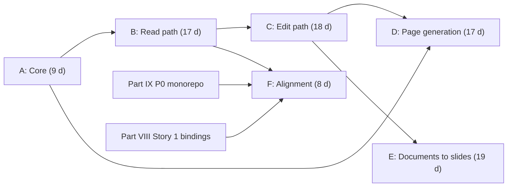

# Plan and tracker

**Reads:** `tutorial/prototypes/udm/REPORT.md`, `tutorial/prototypes/udm/README.md`, `servers/fastapi/api/v1/ppt/endpoints/presentation.py`, `servers/nextjs/app/(presentation-generator)/presentation/components/PresentationHeader.tsx`  ·  **Builds on:** [Code changes in Presenton](75-presenton-code-changes.md)  ·  **Time:** ~25 min

This chapter turns the change list from [Code changes in Presenton](75-presenton-code-changes.md) into a delivery plan. You will learn the six phases and 29 work packages, their effort in person-days and their dependencies, the acceptance criteria for each one (most are the prototype's measured numbers, now enforced in CI), how the plan fits next to the AI Slides delivery plan (Part VIII), what it replaces or reorders in the Generative Content Kit roadmap (Part IX), and which risks need watching. Owners are left blank on purpose; the team assigns them.

The plan keeps the framing of the rest of Part X. The deliverable is the Unified Document Model (UDM) plus one adapter contract, a registry, capability negotiation and a conformance kit. Presenton slides and Tiptap pages are the first two adapters. Markdown and plain text ship with them because they cost little and prove that the contract holds for a third and a fourth target.

## Step 1: Understand the planning assumptions

| Assumption | Value |
| --- | --- |
| Effort unit | Ideal person-days (`d`) of focused work, including tests and review, the same unit as Parts VIII and IX |
| Capacity | 4 focus-days per person per week |
| Team | 1 TypeScript engineer and 1 Python engineer, with QA support of about half a person from phase B |
| Areas | "TS" is code in `servers/nextjs` (the UDM core, every adapter, routes, UI); "Python" is code in `servers/fastapi` (models, apply, endpoints, generation) |
| Basis of estimates | The prototype in `tutorial/prototypes/udm/`: core 761 lines, Presenton adapter 590, Tiptap 349, Markdown 181, plain text 33 (non-blank, non-comment lines, from `REPORT.md`). Moving prototype code into typed production modules is estimated low; work the prototype did not cover (content mode, pagination, page generation, the document page) is estimated higher |
| Release vehicle | Behind feature flags, one per user-visible milestone (M1 to M4); flag names are a team decision |
| Start | After the AI Slides pilot (Part VIII, last train R11 on Fri 5 Feb 2027), unless the team chooses another option in Step 6 |
| Status | Every work package starts as "Not started" |

## Step 2: Read the phase plan

| Phase | Name | Goal | Work packages | Effort | Milestone at exit |
| --- | --- | --- | --- | --- | --- |
| A | Core | UDM core in TypeScript; models and a registry client in Python; shared fixtures | 3 | 9 d | none (internal) |
| B | Read path | Any v2 deck exported to any registered target | 6 | 17 d | M1: "Export to Tiptap or Markdown" |
| C | Edit path | A deck opened and edited as a document, edits patched back into the right slots | 5 | 18 d | M2: "Edit as document" |
| D | Page generation | Generate a document instead of slides from the same prompt and outline | 6 | 17 d | M3: "Generate a document" |
| E | Documents to slides | Any document becomes a new deck; one hydrator; the highlight gap closed | 6 | 19 d | M4: "Document to slides" |
| F | Alignment | Move the code into Part IX's packages, read Part VIII's live bindings, docs | 3 | 8 d | M5: "On the kit" |
| | **Total** | | **29** | **88 d** | |

| Area | Effort | Share |
| --- | --- | --- |
| TS | 46 d | 52% |
| Python | 27 d | 31% |
| QA | 9 d | 10% |
| TS and Python together | 5 d | 6% |
| Docs | 1 d | 1% |

The TypeScript share is larger because every codec runs there. The Python engineer can take TypeScript packages that need no React (the Markdown and plain-text adapters in B2, pagination in E3), which moves about 8 d and evens out the two queues.

The critical path to M2 (phases A to C) runs A1, B1, B3, B4, C2, C3 and C5: 23 d of strictly sequential work, about 6 weeks at 4 focus-days a week (C1 runs in parallel with B3 and B4 and is one day shorter). Through phase E the longest dependency chain is A1, B1, B3, B4, C2, C3 and D4, 25 d, so phases A to E are bound by capacity rather than by dependencies. Phases A to C fit in about 6 weeks with the assumed team, and phases A to E in about 10 to 11 weeks.

## Step 3: Track the work packages

### Phase A: Core

| ID | Work package | Area | Effort | Depends on | Owner | Acceptance criteria | Status |
| --- | --- | --- | --- | --- | --- | --- | --- |
| A1 | TypeScript core in `servers/nextjs/lib/udm/core/` (types, runtime, `negotiate`, registry, conformance) moved from the prototype; esbuild-based `node --test` harness; isolation test | TS | 3 d | - | | Strict type check passes; the isolation test proves that nothing under `lib/udm/core` or `lib/udm/adapters` imports `@/components`, `@/store` or `@/app` | Not started |
| A2 | Python `servers/fastapi/udm/`: Pydantic models with reference checks, registry client, 128-bit deterministic `hash_id` (72, Step 7), rich text helpers | Python | 3 d | - | | Every shared fixture validates; every negative fixture fails on the expected field; `ext` keys that are not adapter ids are rejected; `hash_id` equals the TypeScript ids | Not started |
| A3 | Shared fixtures in `servers/fastapi/tests/fixtures/udm/` (fixtures exported to JSON, the prototype's `examples/`, the seven Tiptap negative controls); UDM JSON Schema generated from `udm.ts`; contract test | QA | 3 d | A1, A2 | | Pydantic, the JSON Schema and TypeScript `checkUdm` accept and reject exactly the same fixture set; CI fails on any disagreement | Not started |

### Phase B: Read path

| ID | Work package | Area | Effort | Depends on | Owner | Acceptance criteria | Status |
| --- | --- | --- | --- | --- | --- | --- | --- |
| B1 | `presenton.slides` deserialize in TypeScript: geometry walk, XY-cut reading order, heading and role inference, static bindings for charts and tables; native shape with slide ids; Smart slides reported as losses | TS | 4 d | A1 | | Over all 383 bundled layouts: 383/383 valid UDMs; 100% of content elements captured (3,582 text, 607 images, 113 charts, 51 infographics, 35 lists, 7 tables); conformance 45/45 | Not started |
| B2 | `tiptap`, `tiptap.basic`, `markdown` and `plain-text` adapters; `@tiptap/extension-table` and `@tiptap/extension-image` added at 3.30.5 | TS | 4 d | A1 | | Conformance 45/45 for `tiptap`, `tiptap.basic` and `markdown`, 29/29 for `plain-text`; 7/7 negative controls rejected; the Markdown result on `marked` 15 recorded, with a decision to keep 15 or pin 17.0.5 | Not started |
| B3 | Next.js routes `POST /api/udm/convert` and `GET /api/udm/adapters`; session check confirmed in `proxy.ts`; 16 MB body cap | TS | 2 d | B1, B2 | | Route tests: 413 on large bodies, 422 on invalid input, 404 on unknown targets; an unauthenticated call is rejected, or the reason it is allowed is written down | Not started |
| B4 | FastAPI routes `GET /presentation/{id}/udm`, `GET /presentation/{id}/export?format=`, `GET /udm/adapters` in `presentation_udm.py`; `native_deck`; cookie forwarding; 422 for v1 decks; 503 when Next.js is unreachable; router wiring | Python | 3 d | A2, B3 | | API tests green with a mocked registry; on a running stack, `export?format=tiptap` for the three example decks returns documents that pass the B2 validator; unknown format returns 404; PPTX and PDF export tests unchanged; conversion latency for a 20-slide deck measured and recorded | Not started |
| B5 | Export menu entries driven by the adapter list in `PresentationHeader.tsx` `ExportOptions`; `UdmApi` client; download of returned content; analytics with the adapter id | TS | 2 d | B4 | | Cypress: one entry per listed adapter except `presenton.slides`; PDF and PPTX entries still work when the adapter list call fails | Not started |
| B6 | Cross-runtime corpus job in CI: the Node corpus test writes one UDM per layout, the Python contract test validates them all | QA | 2 d | B1, A3 | | 383/383 UDMs accepted by Pydantic; valid native output for every target on every layout; text atoms preserved 5,211/5,211 for `tiptap`, `tiptap.basic` and `markdown`, as in `REPORT.md` | Not started |

### Phase C: Edit path

| ID | Work package | Area | Effort | Depends on | Owner | Acceptance criteria | Status |
| --- | --- | --- | --- | --- | --- | --- | --- |
| C1 | `presenton.slides` patch mode in TypeScript: base is the current slide, four mapping passes, unclaimed slots blanked, `validateNative`, `trace.written` | TS | 4 d | B1 | | Unedited round trip through `tiptap` byte-identical 383/383; scripted edit lands in the right slot for 100% of text (3,228), titles (354), lists (35), tables (7) and charts (113); base font kept 3,582/3,582; a patch on a slide whose geometry the user changed keeps that geometry | Not started |
| C2 | Python apply: `apply_slide_items`, `patch_guard`, `content_sync`, `PUT /presentation/{id}/udm` with `if_unmodified_since`, `POST /presentation/{id}/slides/apply` | Python | 4 d | C1, B4 | | Only slots in `trace.written` change; a patch touching geometry is refused with 422; 409 when the row moved; synced `content` hydrates to the patched `ui` on the corpus, with the number of unsynced slots recorded; an AI slide edit after a document edit keeps the new text | Not started |
| C3 | Document page `/document?id=`: `registry-browser.ts`, `DocumentPage`, `DocumentEditor`, `LossPanel`, debounced save; "Edit as document" in the deck header | TS | 5 d | B2, C2 | | Any v2 deck opens as a document; an edit survives reload; the slide view shows the edit in the right slot; the loss panel lists every negotiation and serializer loss | Not started |
| C4 | `DataBlockView` node view for charts, diagrams and metrics (read-only), following Part VIII subtask 4.1's chart rendering decision | TS | 3 d | C3 | | All 113 corpus charts render; the manifest derived with the node view equals the serializer's (unit test) | Not started |
| C5 | End-to-end tests for the edit round trip and the concurrent-edit warning | QA | 2 d | C3 | | Green on the three example decks; a deck open on `/presentation` and `/document` shows the warning | Not started |

### Phase D: Page generation

| ID | Work package | Area | Effort | Depends on | Owner | Acceptance criteria | Status |
| --- | --- | --- | --- | --- | --- | --- | --- |
| D1 | Migration `b4d6f8a0c2e4` (`output_target`, `udm`), SQL model, `get_new_presentation` copy, response model field, `udm` excluded from `GET /{id}`, `REVISION_HEAD` | Python | 2 d | - | | `test_migrations.py` green on SQLite, and on Postgres once Part VIII subtask 2.1 has landed; duplicate keeps both columns; `GET /presentation/{id}` has no `udm` key | Not started |
| D2 | `output_target` on `/create` with validation against the registry; `/prepare` branch without a template | Python | 2 d | D1, B4 | | Unknown target returns 400; Smart mode with a document target returns 400; existing slides tests unchanged | Not started |
| D3 | `section_schema.py`, `section_from_content`, `stream_document`, the `/stream/{id}` branch, batching as in `generate_presentation_handler` | Python | 5 d | D2, A2 | | With a stubbed LLM: a UDM that Pydantic accepts, deterministic ids, one SSE `section` event per outline unit, the final event carries the stored UDM | Not started |
| D4 | Output selector on the upload page, outline routing, `useDocumentStreaming`, dashboard routing and badge, redirect in `usePresentationData` | TS | 4 d | D3, C3 | | Prompt to outline to document works end to end; the dashboard opens document rows in `/document` | Not started |
| D5 | Provider matrix for the section schema under strict JSON schema mode; optional `unit_noun` in the content prompts | QA | 2 d | D3 | | Pass or fail recorded per configured provider; a non-strict fallback exists for any provider that fails | Not started |
| D6 | One-shot API: `output_target` on `GeneratePresentationRequest` for `/generate` and `/generate/async` | Python | 2 d | D3 | | API test: a document is generated without the UI and the response returns its edit path | Not started |

### Phase E: Documents to slides

| ID | Work package | Area | Effort | Depends on | Owner | Acceptance criteria | Status |
| --- | --- | --- | --- | --- | --- | --- | --- |
| E1 | `presenton.slides` content mode in TypeScript: element-name pass, Part IX `fillSection` passes, clip and never pad, single-space blanks, deterministic fallback picker | TS | 4 d | C1 | | On the `doc-to-slides` example: the prototype's chosen layout, one `no_slot` loss for the list, the title clipped with a `text_clipped` loss; conformance unchanged | Not started |
| E2 | Python `services/udm/layouts.py` (structure step with capacity check) and `POST /presentation/from-udm`: row creation, content items through the hydrator, `clear_unresolved_charts`, asset fetch and rehydration | Python | 3 d | E1, C2 | | A Tiptap page becomes a deck that opens in the canvas editor with no template sample text or sample chart data visible; imports from targets without ids never use patch mode | Not started |
| E3 | Pagination: split a long section across several slides by layout capacity (not in the prototype) | TS | 4 d | E1 | | A 30-block fixture becomes several slides with no text lost except reported losses; output is deterministic | Not started |
| E4 | "Convert to slides" on the document page: template picker, loss review, open the new deck | TS | 3 d | E2, C3 | | End-to-end test from a hand-written document to an opened deck | Not started |
| E5 | Generic `highlight` mark in the core (a minor, target-neutral bump) and in the Presenton and Tiptap adapters; Pydantic model updated | TS and Python | 2 d | C1 | | Per-run highlights kept on edit for 44/44 corpus elements (0/44 today) | Not started |
| E6 | One hydrator: the chat memory layer calls the endpoint's `_apply_template_content_to_ui`, extended with its `theme` argument | Python | 3 d | E2 | | For every corpus layout and its sample content, the chat path and the endpoint path produce the same `ui`; chat tests unchanged | Not started |

### Phase F: Alignment

| ID | Work package | Area | Effort | Depends on | Owner | Acceptance criteria | Status |
| --- | --- | --- | --- | --- | --- | --- | --- |
| F1 | Move `lib/udm` into Part IX's packages (`@gck/protocol` 1.3, `@gck/core`, `gck/adapters/presenton-slides`, the Tiptap, Markdown and text targets); Presenton consumes the packages | TS | 4 d | Part IX 0.1, 0.2; B2, C1 | | Presenton builds against the packages; both conformance suites unchanged | Not started |
| F2 | Live bindings: `native_deck` joins Part VIII's `slide_data_bindings` rows; the adapter maps them to UDM bindings (definitions only) and back | TS and Python | 3 d | Part VIII 1.2; C2 | | A live chart round-trips as a live binding; no snapshot number appears in Tiptap output for a live binding | Not started |
| F3 | Docs: README, the appendix endpoint index, these Part X pages updated to what shipped | Docs | 1 d | B4 | | The endpoint index lists the six new routes | Not started |

## Step 4: Fit the plan next to Part VIII

The AI Slides delivery plan schedules 9 stories and 129 d over trains R1 (Fri 13 Nov 2026) to R11 (Fri 5 Feb 2027), with named owners. No Part VIII story depends on Part X, and Part X must not take capacity from that plan's critical path. Five touchpoints need care.

| Part VIII item | Touchpoint | What Part X does |
| --- | --- | --- |
| Story 1, subtask 1.2: `slide_data_bindings` model and migration | Both add an Alembic revision after `026c0ba8b35c` | D1's `down_revision` points at whatever head exists when D1 starts; F2 reads the binding rows ([Story 1: Dynamic data and refresh](../delivery/42-story1-dynamic-data.md)) |
| Story 2, subtask 2.1: Postgres schema; subtask 2.4: `require_presentation_access` on every endpoint | The migration must run on Postgres; the six new routes need the access check | D1 tests on Postgres once 2.1 lands; B4, C2 and E2 adopt the access dependency once 2.4 lands |
| Story 4, subtask 4.1: chart rendering decision | The document page renders charts too | C4 follows that decision instead of making its own |
| Story 5, subtask 5.3: Next.js `basePath` `/ai-slides` and prefix fixes, including the export route | The `/document` route, the `/api/udm/*` routes, and the URL FastAPI uses to reach Next.js | Every new path goes through the same prefix helpers; the registry client reuses the export runner's base URL, so it should inherit 5.3's fix (verify when 5.3 lands) |
| Stories 1 and 3 edit `presentation.py` | Merge conflicts in a 3,393-line file | Part X keeps its edits there to the create flag, two branches and one excluded field; every new route lives in `presentation_udm.py` |

Story 7 (the presentation planner) produces the outline that a page run also uses. Nothing in Part X changes the outline, so the planner serves both targets without extra work.

## Step 5: Fit the plan next to Part IX

Part IX plans 44 work packages and 210 d in phases P0 to P4, starting "after the AI Slides pilot is stable, or in parallel". Part X pulls three of its pieces forward into Presenton, makes them generic, and leaves Part IX to absorb them later.

| Part IX item | Effect of Part X | Change to the Part IX estimate (estimate) |
| --- | --- | --- |
| 0.2 `@gck/protocol` | Ships protocol 1.3, the UDM profile: open target ids with legacy aliases, `ext` namespaces, section role, summary and notes, nested list items, the `static` source, `provenance.origin`. The types already exist in `lib/udm/core/udm.ts` | +2 d |
| 0.3 schema contract test | A3 already provides the Pydantic and JSON Schema contract test for the UDM | Reuse |
| 0.5 `@gck/core` | Takes `negotiate`, the registry and the conformance kit from `lib/udm/core` (F1) | Reuse |
| 1.2 manifest-driven schema assembly | Must read capabilities from the manifest only: no per-target tables keyed by target name and no `if manifest.id == "slides"` branch, or the "new module needs only an adapter" promise breaks | Requirement, no effort change |
| 1.4 `@gck/target-text` | The Markdown and plain-text adapters exist (B2); HTML output remains | 3 d to 1 d |
| 2.1 `@gck/target-tiptap` | **Replaced** by B2 and C4: one generic `dataBlock` node and one global-attribute extension instead of one node per data kind. The inline `gckToken` node for live tokens is still needed and moves to 2.5 | 8 d to 0 d |
| 2.2 `GckGenerate` extension | Unchanged in scope; its patch apply uses the UDM ids that `udmAttrs` keeps | None |
| 4.1 `@gck/target-slides` | **Replaced** by the `presenton.slides` adapter (B1, C1, E1), which already has both directions; Part IX's slides target had no reverse direction. It moves to `gck/adapters/presenton-slides` in F1 | 6 d to 0 d |
| 4.6 slides binding rows | F2 maps the same rows into UDM bindings | Shared work, counted once |

In net terms, Part X costs 88 d and removes about 14 d from Part IX (8 d for 2.1, 6 d for 4.1 and 2 d from 1.4, less the 2 d added to 0.2), all of these being estimates. The larger gain is ordering: the riskiest question in Part IX's Tiptap and slides phases, whether a slide survives a trip through a document editor, is already answered by the prototype and is closed in Presenton by the end of phase C.

!!! warning "Gotcha"
    Part X builds `lib/udm` before Part IX's monorepo exists. If Part IX starts first, skip F1 and build A1, B1, B2, C1 and E1 directly in the Part IX packages; the work package contents do not change, only where the files land. Do not build both.

## Step 6: Put the phases on release trains

Part VIII's trains are weekly, every Friday. Assuming the same cadence continues after R11, these are indicative windows for the recommended option, which starts after the pilot.

| Phase | Trains | Release dates (indicative) | Ships |
| --- | --- | --- | --- |
| A | R12 | Fri 12 Feb 2027 | Internal only |
| B | R12 to R14 | Fri 12 Feb to Fri 26 Feb 2027 | M1 behind a flag |
| C | R14 to R17 | Fri 26 Feb to Fri 19 Mar 2027 | M2 behind a flag |
| D | R17 to R19 | Fri 19 Mar to Fri 2 Apr 2027 | M3 behind a flag |
| E | R19 to R22 | Fri 2 Apr to Fri 23 Apr 2027 | M4 behind a flag |
| Buffer | R23 to R24 | Fri 30 Apr to Fri 7 May 2027 | Hardening |
| F | With Part IX P0 (F1) and after Part VIII 1.2 (F2) | Not fixed | M5 |

Three options were weighed.

| Option | What happens | Trade-off |
| --- | --- | --- |
| 1. After the pilot (recommended) | Phases A to E from R12 with a TypeScript and a Python engineer | No risk to Part VIII; M2 lands about six weeks after the start |
| 2. In parallel with one added engineer | A, B and C run during Part VIII with a new engineer and help from the existing frontend team | M2 around R7 to R8 if started at R1 (estimate, allowing for the holiday break); costs onboarding time and frontend capacity in Stories 4 to 6 |
| 3. Core only during the pilot | Only phase A runs during Part VIII, as filler work | No user-visible value until B; low risk, because A changes no runtime behavior |

## Step 7: Watch the risks

| # | Risk | Likelihood | Impact | Mitigation | Owner |
| --- | --- | --- | --- | --- | --- |
| R1 | The Python models and the TypeScript types drift apart | Medium | High: a UDM the editor saves is refused by the server, or the reverse | A3 contract test on fixtures and B6 on the whole corpus; CI blocks merges on any disagreement. There is no Python `negotiate` to drift | |
| R2 | `slides.content` goes stale after a document edit and an AI slide edit reverts it | High without C2 | High | `content_sync` in C2 and its corpus test; unsynced slots reported in the apply response | |
| R3 | A configured LLM provider rejects the section schema in strict mode | Medium | Medium | D5 provider matrix; flat schema with no `anyOf`; non-strict fallback | |
| R4 | Documents fit slides badly: over-length text and missed layouts | High | Medium | The prototype's edits put 2,477 slots over `max_length`, and Markdown re-identified the layout for only 66.32% of slides. Content mode clips with reported losses, the structure step chooses first, the user picks the template, and imports from targets without ids always create new slides | |
| R5 | A Tiptap upgrade changes the schema and attributes are dropped silently | Low | High | Versions pinned at 3.30.5; the adapter validates its own output; conformance and negative controls run on every upgrade | |
| R6 | FastAPI cannot reach Next.js, and every UDM route fails | Medium | High | Timeouts and a clear 503; the same dependency already exists for PPTX and PDF export; consider adding Next.js reachability to Part VIII's readiness checks (subtask 2.6) | |
| R7 | Convert calls are large: a deck call carries its template's layouts, and bundled templates reach 2.3 MB | Medium | Low | Send only the deck's template; 16 MB cap; latency measured in B4 | |
| R8 | `marked` 15 behaves differently from the 17.0.5 the prototype measured | Medium | Low | B2 decides with the conformance kit; pin 17.0.5 if needed | |
| R9 | The canvas editor and the document page overwrite each other | Medium | Medium | `if_unmodified_since` on `PUT`, a warning on the document page (C5); the canvas save path stays unchanged | |
| R10 | Merge conflicts with Part VIII in `presentation.py` | High | Low | New routes in their own module; about 40 changed lines in `presentation.py` | |
| R11 | Scope grows into Smart mode, live tokens or collaborative editing | Medium | High | Explicitly out of scope (Step 8) | |
| R12 | The plan competes with Part VIII owners for time | High in option 2 | High | Option 1 by default; option 3 for early progress without risk | |

## Step 8: Record what is out of scope and what needs a decision

Out of scope for this plan, each with the reason:

- **Writing to Smart-mode HTML slides.** 73 designs a DOM-path reader and writer; until it is built and measured, Smart decks are reported as losses.
- **Live-data tokens inside text.** Part VIII's bindings cover charts, tables and metrics; tokens in prose belong to Part IX's run protocol.
- **Collaborative editing of documents.** The document page is single-user, with the conflict check from C2.
- **Images in generated pages.** The first section schema has text blocks only; image prompts need the asset pipeline and a placement rule (a later work package, not estimated).
- **Python measurements of the prototype's findings.** The prototype ran in Node only. Because every codec stays in TypeScript, its numbers carry over; the acceptance criteria re-measure them in CI.

Decisions the team needs to take before phase B starts:

1. Accept that every codec runs in TypeScript and that FastAPI orchestrates and applies, as in 73 and 75.
2. Accept that document rows store a UDM, not `tiptap.json`, so that any adapter can open them.
3. Accept text-only generated pages until live bindings are available.
4. Confirm that Part IX's `@gck/target-slides` is replaced by the `presenton.slides` adapter (Step 5).
5. Name the feature flags and decide who can turn them on in staging.

## What you now know

- The work is six phases and 29 work packages, 88 d in total, with a critical path to M2 of 23 d through the core, the slides reader, the convert route, the FastAPI read routes, the apply service and the document page.
- Most acceptance criteria are the prototype's own measurements: 383/383 valid documents, 100% of content captured, byte-identical round trips, 100% of scripted edits in the right slot, 45/45 conformance checks.
- Part X stays off Part VIII's critical path and shares five touchpoints with it: bindings, Postgres and access checks, chart rendering, the base path, and `presentation.py`.
- Part X replaces Part IX's Tiptap and slides target work packages, shrinks its text target and adds protocol 1.3 to its first package, for a net saving of about 14 d there.
- The highest risks are model drift between the two runtimes, stale `slides.content`, Next.js availability for conversions and the quality of documents turned into slides; each has a mitigation and a work package that tests it.

## Next

Go back to the [Part X overview](index.md) for the summary of the final approach, or read [Adding any new target](77-adding-a-new-target.md) for the checklist that the next module, whether a Superset dashboard, DOCX, Confluence, Notion or email, follows with no change to the UDM core or the generation engine.
