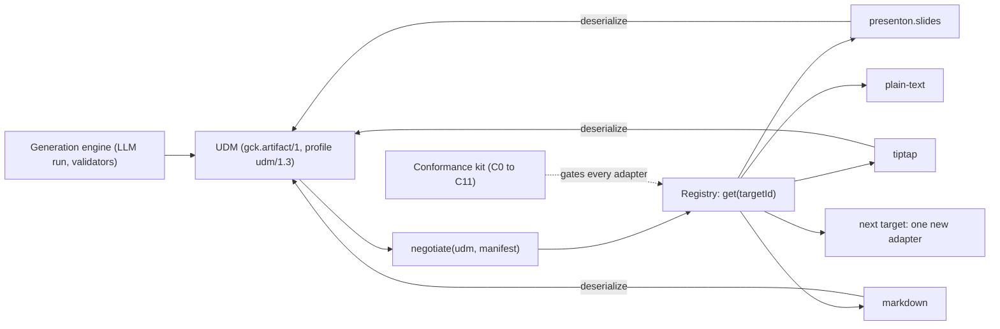
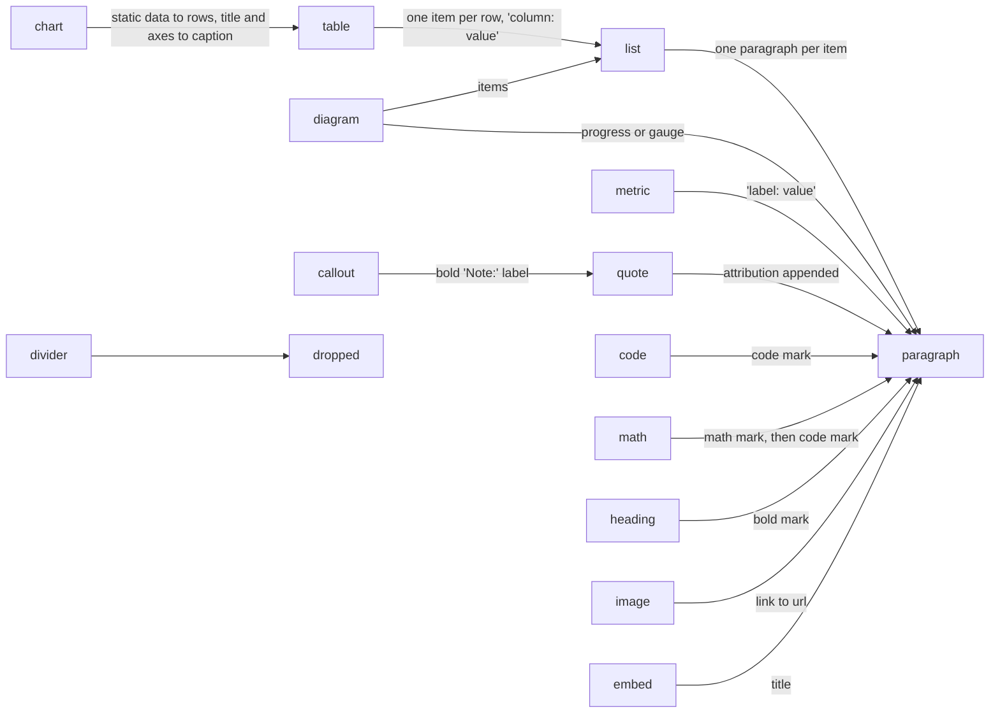

# Adding any new target

<div class="chapter-meta" markdown>
**Reads:** `tutorial/prototypes/udm/core/adapter.ts`, `tutorial/prototypes/udm/core/registry.mjs`, `tutorial/prototypes/udm/core/negotiate.mjs`, `tutorial/prototypes/udm/core/conformance.mjs`, `tutorial/prototypes/udm/core/fixtures.mjs`, `tutorial/prototypes/udm/adapters/markdown.mjs`, `tutorial/prototypes/udm/adapters/plaintext.mjs`, `tutorial/prototypes/udm/scripts/setup.mjs`, `tutorial/prototypes/udm/REPORT.md`  ·  **Builds on:** [Unified Document Model](72-unified-document-model.md), [Tiptap adapter (tiptap.json)](74-tiptap-adapter.md)  ·  **Time:** ~45 min
</div>

## What you will learn

Today the request is Tiptap. Tomorrow it might be a Superset dashboard, a Word file, a Confluence page or an email. This chapter shows that each of those is **one new adapter and nothing else**. You will read the generic adapter contract in TypeScript and Python, the registry that plugs adapters in, the capability negotiation that degrades any UDM to what a target can hold, the rules for namespaced extension fields, and the shared conformance kit every adapter must pass. Then you will follow a step-by-step recipe, study the prototype's Markdown adapter as a worked example with its measured results, read short design sketches for four more targets, and finish with a checklist that proves a new target needed no change to the UDM core or the generation engine.

Presenton slides ([PPT adapter (Presenton JSON)](73-ppt-adapter.md)) and Tiptap pages ([Tiptap adapter (tiptap.json)](74-tiptap-adapter.md)) are the first two adapters. Nothing in this chapter is specific to either of them.

Code labeled "(prototype)" is quoted from the runnable prototype in `tutorial/prototypes/udm/`, which was run against all 383 bundled Presenton layouts (`npm ci && npm run all`). Code labeled "(new)" is proposed production code that the prototype did not run. Anything not measured is marked as unverified. Paths under `gck/` and `gck_engine/` are the Part IX package layout used in [Unified Document Model](72-unified-document-model.md); the first delivery inside Presenton places the same code under `servers/nextjs/lib/udm/` and `servers/fastapi/udm/` ([Code changes in Presenton](75-presenton-code-changes.md), Steps 3 and 4).

## Step 1: The rule, and how it is enforced

The rule has two halves:

1. **The core never names a target.** The UDM types, the adapter contract, the registry, negotiation and the conformance kit contain no `if (target === "...")`, no table keyed by target name and no import of an adapter.
2. **An adapter never changes the core.** It declares what it can hold (its manifest), converts in both directions, validates its own output with its host's rules, and stores anything only it needs under its own namespace in `ext`.



The prototype checks both halves mechanically, not by review:

| Claim | How it is checked | Result (`tutorial/prototypes/udm/REPORT.md`) |
| --- | --- | --- |
| The core names no target in code | `tutorial/prototypes/udm/scripts/validate.mjs:273-274` strips comments from every core file and searches it for `presenton`, `tiptap`, `markdown`, `prosemirror` and `plaintext` | "Core files naming a target in code: none" |
| A new adapter needs no core change | `core.lock.json` holds sha256 hashes of every core file, taken after the Markdown adapter and before the plain-text adapter; `validate` recomputes them | "Core files changed after the freeze: none" |
| Only one file knows which adapters exist | `tutorial/prototypes/udm/scripts/setup.mjs:27-35` is the only file that imports adapters | by construction |
| The Markdown adapter is written only against the contract | `validate` lists its imports | `marked` and `../core/udm-runtime.mjs` only |

!!! note "The core was not frozen from day one"
    While the first three adapters (Presenton, Tiptap, Markdown) were being built, the conformance kit and the 383-layout corpus forced five changes in the core. None of them names a target: a negotiation rule that drops section `role` and `level` when a target cannot hold them, whitespace canonicalization at bold and italic edges (`tutorial/prototypes/udm/core/udm-runtime.mjs:45-56`), keeping a chart's title and axes as the caption when a chart degrades to a table (`tutorial/prototypes/udm/core/negotiate.mjs:24-26`), the `structure.orderPreserved` flag, and an optional `trace` on serialize results. The freeze was taken after those settled. Plan for the same with the first production adapters: each core change must be target-neutral, or it does not go in.

## Step 2: The adapter contract in TypeScript

The whole contract is 69 lines. This is the part every adapter author reads:

```ts title="tutorial/prototypes/udm/core/adapter.ts (prototype, excerpt)"
export interface LossEntry {
  /** Stable code, e.g. "block_degraded", "mark_dropped", "chart_kind_fallback", "no_slot". */
  code: string;
  /** Where: "sec_x", "sec_x/blk_y", "sec_x/blk_y/items/2". */
  path: string;
  detail?: string;
  /** Text that left the document because of this entry (lets conformance prove "no silent text loss"). */
  droppedText?: string;
}

export interface Issue { level: "error" | "warning"; code: string; path: string; message: string }

export interface AdapterManifest {
  id: string;                 // ^[a-z][a-z0-9-]*(\.[a-z0-9-]+)*$, also the ext namespace
  version: string;
  displayName: string;
  nativeFormat: string;       // media type of Native
  blocks: BlockType[];
  marks: Mark[];
  chartKinds?: ChartKind[];
  structure: {
    maxHeadingLevel: 0 | 1 | 2 | 3; maxListDepth: number; groups: boolean; roles: boolean;
    orderPreserved: boolean;  // false for layout-driven targets (slides place blocks in the layout's reading order)
  };
  features: {
    notes: boolean; captions: boolean; citations: boolean; staticData: boolean;
    ids: boolean;             // block ids survive serialize -> deserialize
    extPassThrough: boolean;  // foreign ext namespaces survive serialize -> deserialize
    sectionTitles: boolean;
  };
  limits?: { maxSections?: number; maxBlocksPerSection?: number; maxCharsPerBlock?: number };
  applyModes: ("replace" | "insert_at_cursor" | "append" | "patch")[];
  roundTrip: "lossless" | "lossy" | "write-only";
}

export interface SerializeResult<Native> {
  native: Native;
  loss: LossEntry[];
  /** Optional adapter diagnostics (e.g. which native slots were written). Never needed for correctness. */
  trace?: Record<string, unknown>;
}
export interface DeserializeResult { udm: Udm; loss: LossEntry[] }

export interface Adapter<Native = unknown, Opts = Record<string, unknown>> {
  manifest: AdapterManifest;
  /** Pure, deterministic, no I/O. Input is already negotiated against `manifest`. */
  serialize(udm: Udm, opts?: Opts): SerializeResult<Native>;
  /** Pure. Required unless roundTrip == "write-only". */
  deserialize?(native: Native, opts?: Opts): DeserializeResult;
  /** The host's own rules (ProseMirror schema check, Template v2 shape, Markdown re-parse). */
  validateNative(native: Native, opts?: Opts): Issue[];
}
```

Four members, and each has one job:

| Member | Job | Rules |
| --- | --- | --- |
| `manifest` | Says what this target can hold | Validated at registration (`checkManifest`, Step 4). Prefer deriving it from the host (the Tiptap adapter derives it from the editor schema, `tutorial/prototypes/udm/adapters/tiptap/index.mjs:13-38`) over writing it by hand |
| `serialize` | UDM to native | Pure and deterministic: no I/O, no clock, no randomness. Its input has already been negotiated, so it never sees a block type its manifest does not list. It reports anything it still could not express as a `LossEntry` |
| `deserialize` | Native to UDM | Pure. Required unless `roundTrip` is `"write-only"`. Must accept native documents the adapter did not write (a hand-written page, a file from another tool) and degrade unknown native content to paragraphs with a loss entry |
| `validateNative` | Checks the output against the host's own rules | Uses the host's real validator where one exists (the Tiptap adapter runs `schema.nodeFromJSON(doc).check()`; see [Tiptap adapter (tiptap.json)](74-tiptap-adapter.md) Step 7). Errors fail the conversion; warnings (such as a slot's `max_length`) are surfaced to the user |

Talking to a live host and fetching data are deliberately **not** in the pure contract. As in Part IX ([Artifact Spec and targets](../ai-component/62-artifact-spec-and-targets.md), Step 5), host binding is an optional second layer that calls the pure functions, and live values reach a host through the binding store at render time. That is what makes the pure layer testable without a browser, a server or an LLM.

The production contract keeps these signatures and adds the optional host layer in its own file, so the pure contract never changes for it:

```ts title="gck/packages/protocol/src/host.ts (new)"
import type { Adapter as PureAdapter, AdapterManifest, LossEntry } from "./adapter";
import type { Udm, UdmDiff } from "./udm";

export interface HostApi { id: string; capability<T>(name: string): T | undefined }
export interface ApplyResult { mode: ApplyMode; warnings: LossEntry[] }
export type ApplyMode = AdapterManifest["applyModes"][number];

/** Optional, host-bound layer. Never imported by the engine or by the pure layer. */
export interface HostBinding<Native> {
  fromHost?(host: HostApi): Promise<Native>;                       // read selection or document, then deserialize
  apply?(native: Native, host: HostApi, mode: ApplyMode): Promise<ApplyResult>;
  applyPatch?(native: Native, diff: UdmDiff, udm: Udm, host: HostApi): Promise<ApplyResult>;
}

export type HostAdapter<Native = unknown, Opts = Record<string, unknown>> =
  PureAdapter<Native, Opts> & HostBinding<Native>;
```

`UdmDiff` is the one diff type for edit runs. It replaces the two names Part IX used for the same thing (`ArtifactDiff` and `BlockDiff`); see [Unified Document Model](72-unified-document-model.md).

## Step 3: The same contract in Python

The engine (FastAPI) needs the contract too, for two reasons. It builds each run's LLM response schema from the target's manifest, and some targets are written on the server by Python code that never runs in a browser (a scheduled email, a DOCX export). The Python mirror holds the same fields with the same JSON names, so a manifest serialized by either side validates on the other.

```python title="gck_engine/adapters/base.py (new)"
from __future__ import annotations

from typing import Any, Generic, Literal, Protocol, TypeVar, runtime_checkable

from pydantic import BaseModel, ConfigDict
from pydantic.alias_generators import to_camel

from gck_engine.spec.udm import Udm  # the UDM Pydantic models, protocol 1.3


class _Wire(BaseModel):
    """camelCase on the wire, snake_case in Python, unknown fields rejected (strict on write)."""
    model_config = ConfigDict(extra="forbid", alias_generator=to_camel, populate_by_name=True, frozen=True)


class LossEntry(_Wire):
    code: str
    path: str
    detail: str | None = None
    dropped_text: str | None = None


class Issue(_Wire):
    level: Literal["error", "warning"]
    code: str
    path: str
    message: str


class Structure(_Wire):
    max_heading_level: Literal[0, 1, 2, 3]
    max_list_depth: int
    groups: bool
    roles: bool
    order_preserved: bool


class Features(_Wire):
    notes: bool
    captions: bool
    citations: bool
    static_data: bool
    ids: bool
    ext_pass_through: bool
    section_titles: bool


class Limits(_Wire):
    max_sections: int | None = None
    max_blocks_per_section: int | None = None
    max_chars_per_block: int | None = None


class AdapterManifest(_Wire):
    id: str
    version: str
    display_name: str
    native_format: str
    blocks: list[str]
    marks: list[str]
    chart_kinds: list[str] | None = None
    structure: Structure
    features: Features
    limits: Limits | None = None
    apply_modes: list[Literal["replace", "insert_at_cursor", "append", "patch"]]
    round_trip: Literal["lossless", "lossy", "write-only"]


NativeT = TypeVar("NativeT")


class SerializeResult(_Wire, Generic[NativeT]):
    native: NativeT
    loss: list[LossEntry]
    trace: dict[str, Any] | None = None


class DeserializeResult(_Wire):
    udm: Udm
    loss: list[LossEntry]


@runtime_checkable
class Adapter(Protocol):
    manifest: AdapterManifest

    def serialize(self, udm: Udm, opts: dict[str, Any] | None = None) -> SerializeResult[Any]:
        """Pure and deterministic; the input is already negotiated against self.manifest."""
        ...

    def validate_native(self, native: Any, opts: dict[str, Any] | None = None) -> list[Issue]:
        ...


@runtime_checkable
class ReversibleAdapter(Adapter, Protocol):
    def deserialize(self, native: Any, opts: dict[str, Any] | None = None) -> DeserializeResult:
        ...
```

Two Protocols instead of one optional method keep the "required unless write-only" rule checkable with `isinstance(adapter, ReversibleAdapter)` at registration.

!!! warning "Gotcha: one negotiation, two languages"
    Negotiation must give the same result in the browser and in the engine, or a preview and an export of the same document will differ. The prototype implements negotiation once, in JavaScript (`tutorial/prototypes/udm/core/negotiate.mjs`). If the engine needs its own copy (`gck_engine/adapters/negotiate.py`, new), treat the TypeScript one as the reference: generate golden files of `negotiate(fixture, manifest)` for every shared fixture and every registered manifest, and make the Python port pass them byte for byte in CI. This is the same discipline Part IX uses for its JSON Schema and Pydantic mirrors. The Python port has not been written or measured.

## Step 4: The registry

A registry maps an id (or an alias) to an adapter, refuses invalid adapters at registration (`checkManifest`, `tutorial/prototypes/udm/core/registry.mjs:7-18`), and offers one `convert` call that always negotiates before it serializes:

```js title="tutorial/prototypes/udm/core/registry.mjs (prototype, excerpt)"
export function createRegistry() {
  const adapters = new Map();
  const aliases = new Map();
  const get = (id) => {
    const a = adapters.get(aliases.get(id) ?? id);
    if (!a) throw new Error(`no adapter registered for "${id}"`);
    return a;
  };
  return {
    register(adapter, alias = []) {
      const problems = checkManifest(adapter.manifest);
      if (problems.length) throw new Error(`invalid manifest ${adapter.manifest?.id}: ${problems.join("; ")}`);
      if (typeof adapter.serialize !== "function" || typeof adapter.validateNative !== "function") throw new Error("serialize and validateNative required");
      if (adapter.manifest.roundTrip !== "write-only" && typeof adapter.deserialize !== "function") throw new Error("deserialize required");
      if (adapters.has(adapter.manifest.id)) throw new Error(`duplicate adapter ${adapter.manifest.id}`);
      adapters.set(adapter.manifest.id, adapter);
      for (const a of alias) aliases.set(a, adapter.manifest.id);
    },
    get,
    list: () => [...adapters.values()].map((a) => a.manifest),
    convert(udm, targetId, opts) {
      const adapter = get(targetId);
      const n = negotiate(udm, adapter.manifest);
      const s = adapter.serialize(n.udm, opts);
      return { native: s.native, loss: [...n.loss, ...s.loss], negotiated: n.udm };
    },
  };
}
```

Three details matter:

- **`paragraph` is mandatory** (`tutorial/prototypes/udm/core/registry.mjs:14`). It is the last step of every fallback chain, so a manifest without it could leave negotiation with nowhere to put text.
- **The manifest may only use the core vocabularies** (`BLOCK_TYPES`, `MARKS`, `CHART_KINDS` in `tutorial/prototypes/udm/core/udm-runtime.mjs:5-9`). A target cannot invent a block type; it can only choose which existing ones it supports. A genuinely new concept is a UDM change (Step 11).
- **Aliases keep old ids working.** Part IX used the closed union `"slides" | "tiptap-doc" | "superset-dashboard" | "text"` as target ids. The UDM makes ids open strings in the namespace form, and the old names are registered as aliases:

```js title="tutorial/prototypes/udm/scripts/setup.mjs (prototype, excerpt)"
export function setupRegistry(layouts = loadTemplates()) {
  const registry = createRegistry();
  registry.register(createPresentonAdapter({ layouts, defaultTemplateId: "general" }), ["slides"]);
  registry.register(createTiptapAdapter({ id: "tiptap" }), ["tiptap-doc"]);
  registry.register(createTiptapAdapter({ id: "tiptap.basic", extensions: basicExtensions() }));
  registry.register(markdownAdapter, ["md"]);
  registry.register(plainTextAdapter, ["text"]);
  return { registry, layouts };
}
```

The Python registry mirrors it; the Presenton version (`servers/fastapi/udm/registry.py`, [Code changes in Presenton](75-presenton-code-changes.md) Step 3.2) also resolves remote adapters whose codec runs in Next.js, such as Tiptap. To remove even the one wiring line from the change set of a new target, the engine can discover adapters through package entry points, so installing a package registers its adapter:

```python title="gck_engine/adapters/discovery.py (new)"
from importlib.metadata import entry_points


def load_entry_points(registry, group: str = "gck.adapters") -> None:
    """Each entry point is a factory returning (adapter, aliases)."""
    for ep in sorted(entry_points(group=group), key=lambda e: e.name):  # sorted: deterministic order and errors
        adapter, aliases = ep.load()()
        registry.register(adapter, tuple(aliases))
```

## Step 5: Capability negotiation and the degradation chain

Negotiation is the reason a new adapter can be small. Every target receives a UDM that contains only what its manifest says it can hold, and every change made on the way is reported. The adapter never decides on its own how to degrade a chart or a callout; the core does, in one fixed order, the same way for every target:

| Rule | Applies when the manifest says | What happens | Loss codes |
| --- | --- | --- | --- |
| 1. Extensions | `features.extPassThrough: false` | Foreign `ext` namespaces are removed; the target keeps only its own | `ext_dropped` |
| 2. Annotations | `features.notes: false` | `Section.notes` and `Section.summary` are removed, their text recorded | `notes_dropped`, `summary_dropped` |
| 3. Section titles | `features.sectionTitles: false` | The title becomes a leading heading block | `section_title_to_block` |
| 4. Blocks | block type not in `blocks` | The block follows its fallback chain until supported | `block_degraded`, `block_dropped`, `text_reduced` |
| 5. Chart kinds | `chartType` not in `chartKinds` | Fixed chain to the nearest kind; none left means rule 4 | `chart_kind_fallback` |
| 6. Marks | mark not in `marks` | `math` falls back to `code`; others are dropped (a link keeps its text, the href is recorded) | `mark_dropped` |
| 7. Nesting | above `maxHeadingLevel` or `maxListDepth` | Heading levels clamped, deep lists flattened | `heading_clamped`, `list_flattened` |
| 8. Structure | `structure.groups`, `structure.roles`, `features.captions` false | `group`, block `role`, section `role` and `level` removed; a caption becomes a paragraph after its block | `groups_dropped`, `roles_dropped`, `section_role_dropped`, `caption_to_paragraph`, `caption_dropped` |
| 9. Limits | `limits` set | Text clipped to `maxCharsPerBlock`; sections split at `maxBlocksPerSection`; content is never padded | `text_clipped`, `section_split` |

The block fallback chains (`tutorial/prototypes/udm/core/negotiate.mjs:15-65`) form a graph that always ends at `paragraph` or at nothing:



Chart kinds have their own chain (`tutorial/prototypes/udm/core/negotiate.mjs:7-10`): `horizontal_stacked_bar` to `stacked_bar` to `bar`; `horizontal_bar` to `bar`; `donut` and `polar_area` to `pie`; `radar` to `bar`; `scatter` to `line`; `bubble` to `scatter`; `area` to `line`; `pie` and `line` to `bar`. When no kind is left, the chart degrades as a block (rule 4).

Three properties make this safe to share across all targets:

- **Deterministic.** Same UDM and manifest, same output, byte for byte (conformance check C4). Generated ids in degraded blocks are derived from the original id (`blk_x_cap`, `blk_x_1`), never random.
- **Complete.** Every piece of text either survives or appears in a loss entry's `droppedText` (check C3). That is the difference between "lossy and reported" and "lossy and silent".
- **Target-blind.** Rules read only the manifest. That is why the prototype's `tiptap.basic` profile (vanilla StarterKit) and the plain-text adapter needed no code for degrading charts, tables or images: negotiation had already done it.

A real example from the prototype corpus, the modern `title_description_chart_table` layout sent to Markdown (`tutorial/prototypes/udm/examples/chart-and-table/5-loss.json`):

```json title="tutorial/prototypes/udm/examples/chart-and-table/5-loss.json (prototype, excerpt)"
{
  "markdown": [
    { "code": "ext_dropped", "path": "sec_1yup3o7", "detail": "presenton.slides" },
    { "code": "block_degraded", "path": "sec_1yup3o7/blk_105klqi", "detail": "chart -> table" },
    { "code": "section_role_dropped", "path": "sec_1yup3o7", "detail": "content" }
  ]
}
```

The line chart arrives at the Markdown adapter as a table, which it already knows how to write. The same slide sent to the Tiptap page profile has an empty loss list, because that profile can hold everything the slide contains.

!!! warning "Gotcha: negotiation is not a place for target names"
    The temptation, when a target degrades badly, is to add a special case to `negotiate`. Do not. Either the target's manifest is wrong (declare less, let the chain run), or the adapter's `serialize` should handle the case and report its own `LossEntry`, or the rule is genuinely target-neutral and goes into the core for everyone, with a fixture that exercises it. All five core changes the prototype needed were of the third kind.

## Step 6: Namespaced extension fields

Some information matters only to one target: the Presenton slot path an element came from, the layout id, a Notion block id, a dashboard component id. It cannot go into the UDM's core fields (they must stay target-neutral) and it must not be thrown away (or an edit cannot find its way back). It goes into `ext`:

```ts title="tutorial/prototypes/udm/core/udm.ts (prototype, excerpt)"
/** Namespace = an adapter id, e.g. "presenton.slides", "tiptap". */
export type Namespace = string; // ^[a-z][a-z0-9-]*(\.[a-z0-9-]+)*$
export type Ext = Record<Namespace, JsonValue>;
```

`Udm.ext`, `Section.ext` and every block's `ext` may hold one bag per namespace. The rules:

1. **The namespace is the adapter id.** An adapter writes only `ext[manifest.id]`. Check C11 fails an adapter whose `deserialize` writes a namespace that was not already in its input.
2. **Foreign namespaces pass through or are reported.** An adapter that declares `features.extPassThrough: true` must carry every other namespace through `serialize` and `deserialize` unchanged (C11 compares them). An adapter that cannot (Markdown, plain text, a StarterKit-only editor) declares `false`, and negotiation removes the foreign bags before `serialize` with an `ext_dropped` entry.
3. **Nothing in `ext` may change meaning.** Removing every `ext` bag must leave a valid UDM that renders the same content. Content always lives in core fields.
4. **The engine never interprets `ext`, and the LLM never writes it.** `ext` is excluded from the response schema of a run; on an edit run the engine copies it from the base document. The one engine access is `I8_LAYOUT_HINT`, an opaque check that `ext[manifest.id].layout` is in the same manifest's `layoutCatalog` ([Unified Document Model](72-unified-document-model.md), Step 5).
5. **Bags stay small** (proposed: 4 KB per block, 64 KB per document), so `ext` cannot turn into a second document. The prototype does not enforce a size cap; this is unverified.

What a Presenton bag looks like on a block, taken from the prototype example (`tutorial/prototypes/udm/examples/simple-cards-with-list/2-udm.json`):

```json title="tutorial/prototypes/udm/examples/simple-cards-with-list/2-udm.json (prototype, excerpt)"
{
  "id": "blk_07vl9ze",
  "group": "grp_0ty4yu0",
  "role": "kpi",
  "type": "paragraph",
  "text": [{ "text": "$1 / Month" }],
  "ext": {
    "presenton.slides": {
      "slot": "components.2.elements.0.children.0.children.2",
      "name": "card_large_value",
      "element": "text"
    }
  }
}
```

The measured effect of rule 2 is the strongest argument for carrying `ext` wherever a target can. When the Presenton bags survive (the Tiptap page profile stores them in a node attribute), a document edited in Tiptap returns to the right Presenton slot for 100% of 3,582 text slots. When they do not survive, the Presenton adapter must place blocks back by position, and fidelity drops:

| Target, back into the same Presenton layout | Text slots correct | Layout found again from content alone |
| --- | --- | --- |
| `tiptap` (ext kept) | 3,582/3,582 (100%) | not needed |
| `markdown` (ext dropped) | 3,378/3,582 (94.3%) | 254/383 (66.32%) |
| `tiptap.basic` (ext dropped) | 2,429/3,582 (67.81%) | 91/383 (23.76%) |

Almost every wrong slot is in a layout where negotiation degraded something: 190 of the 204 wrong slots for Markdown and all 1,153 for basic Tiptap (`tutorial/prototypes/udm/REPORT.md`). For Markdown the degraded pieces are infographics (to lists or paragraphs), charts (to tables) and captions (to paragraphs); for basic Tiptap they are also images (to link paragraphs) and tables (to lists). On the way back, a degraded block competes with the original text for the same slots. The report classifies by layout, not by slot, so this mechanism is the likely cause rather than a per-slot measurement. The design consequence for every new target: **if it cannot carry ids and `ext`, treat the reverse direction as "generate a new slide or page", not "update the existing one"**, and say so in its manifest by leaving `"patch"` out of `applyModes`.

## Step 7: The conformance test kit

Every adapter runs the same checks on the same fixtures. Passing them is the definition of "done" for a new target:

| Check | What it verifies | Runs for |
| --- | --- | --- |
| C0 | The manifest is valid (`checkManifest`) | every adapter, once |
| C1 | The fixture is a valid UDM | every fixture |
| C2 | The negotiated UDM is valid and uses only blocks the manifest lists | every fixture |
| C3 | Negotiation is complete: every text atom is still present or in a `droppedText` | every fixture |
| C4 | Negotiation is deterministic | every fixture |
| C5 | `serialize` is deterministic and does not mutate its input | every fixture |
| C6 | `validateNative` reports no errors on the output | every fixture |
| C7 | Every loss entry has a string `code` and `path` | every fixture |
| C8 | The deserialized UDM is valid and neutral | reversible adapters |
| C9 | The round trip loses no text silently | reversible adapters |
| C10 | The round trip equals the negotiated input apart from declared losses; ids compared when `features.ids`, order when `structure.orderPreserved` | reversible adapters |
| C11 | `ext` passes through (when declared) and stays isolated | reversible adapters |

With four fixtures, a reversible adapter runs 1 + 4 x 11 = 45 checks and a write-only adapter 1 + 4 x 7 = 29. The fixtures (`tutorial/prototypes/udm/core/fixtures.mjs:9-69`) are target-neutral and deliberately hostile:

| Fixture | What it contains |
| --- | --- |
| `minimal` | One section, one paragraph |
| `kitchen-sink` | Every block type and every mark, a link whose URL has `&` and parentheses, a three-level nested list, an ordered list, notes and a summary, a group of three blocks forming a card, block roles, static chart, table and metric bindings, a live `superset_chart` embed, and `ext` bags under a foreign namespace (`acme.crm`) on the document, a section and a block |
| `non-latin` | Hindi, Bengali and Arabic text, including bold inside Devanagari and an emoji |
| `edge` | An empty section, an untitled section, a line break inside a paragraph, a paragraph that starts like a numbered list and is full of Markdown metacharacters (asterisk, underscore, brackets, angle brackets, hash, pipe, tilde, backslash, backtick), a level-3 heading, a 1,200-character paragraph, a `bubble` chart and a table of empty cells |

The kit itself is target-blind (`tutorial/prototypes/udm/core/conformance.mjs:50-124`). C3 builds the set of text atoms in the negotiated UDM plus every `droppedText`, and fails if any atom of the input is in neither. C4 and C5 run negotiation and `serialize` twice on clones and compare the results byte for byte with sorted keys, and C5 also checks that the input was not mutated. C3 and C9 compare "text atoms": every human-readable string a block carries, including table cells, chart category and series names, diagram item text and image alt text (`tutorial/prototypes/udm/core/udm-runtime.mjs:89-115`). C10 compares a content projection per block, so a round trip that changes a mark, a list depth, a chart kind or a data value fails even when the text survives.

Results for the five adapters in the prototype (`npm run conformance`):

| Adapter | Checks passed |
| --- | --- |
| `presenton.slides` | 45/45 |
| `tiptap` | 45/45 |
| `tiptap.basic` | 45/45 |
| `markdown` | 45/45 |
| `plain-text` (write-only) | 29/29 |

!!! warning "Gotcha: the kit is necessary, not sufficient"
    Fixtures prove that an adapter follows the contract. They do not prove that real documents of its host convert well. Every adapter that has a reverse direction also needs a corpus run on real native documents, as the prototype does with 383 Presenton layouts (`tutorial/prototypes/udm/scripts/validate.mjs`). For Markdown the corpus found what the fixtures did not: CommonMark flanking rules, adjacent lists merging, and line breaks inside titles (Step 9).

## Step 8: Recipe for adding a module

Follow these steps in order. Each produces something you can check.

1. **Pick the id.** Lowercase, dot-separated, matching `^[a-z][a-z0-9-]*(\.[a-z0-9-]+)*$` (`tutorial/prototypes/udm/core/udm-runtime.mjs:12`). The id is also the `ext` namespace, so pick the name of the host, not of a feature: `superset.dashboard`, `docx`, `notion`, `confluence`, `email`. Variants of one host with different capabilities get a suffix (`tiptap.basic`).
2. **Write the manifest from the host's real capabilities.** List only blocks and marks the native format can express **and read back**. If capabilities vary per instance (an editor's schema, a workspace's enabled macros), derive the manifest from the instance, as `deriveManifest(schema, id)` does for Tiptap. Set `roundTrip` honestly.
3. **Write `serialize`.** Walk sections and blocks; emit native content; push a `LossEntry` for anything the native format cannot express even after negotiation (for example `image_meta_dropped` in Markdown). Do not degrade blocks yourself: negotiation already did. Do not read the clock, generate random ids or fetch anything.
4. **Write `validateNative` with the host's own validator.** Use the strictest check the host offers: a schema check, a re-parse, an official SDK validator. If the host silently drops data (Tiptap drops unknown attributes), add a check that detects the drop.
5. **Write `deserialize`, or declare write-only.** Accept documents the adapter did not write; unknown native content becomes a paragraph plus a `native_node_degraded` loss. Generate ids deterministically (`hashId` in `tutorial/prototypes/udm/core/udm-runtime.mjs:19-26`) and record `provenance: { origin: "imported", importedFrom: { adapter, adapterVersion } }`.
6. **Put target-only data in `ext[manifest.id]`.** Ids the host assigns, layout choices, native style names. Nothing else.
7. **Register it.** One line in the registry wiring (or an entry point in Python). Add an alias only if an older id must keep working.
8. **Run the conformance kit until it is green.** Expect C3 and C10 to find real bugs in escaping and whitespace.
9. **Run a corpus.** At minimum the 383-layout Presenton corpus, plus real native documents from the host if there is a reverse direction.
10. **Commit golden examples** (input UDM, native output, loss report) so changes to the adapter show up in review as diffs.
11. **Add the host layer only if needed.** `apply` and `applyPatch` for interactive hosts; `"patch"` in `applyModes` only when ids survive the round trip.
12. **Document the losses.** List the loss codes the corpus produced in the adapter's README; the UI shows the same entries to the user.

What you should not have touched at the end: anything under the UDM core, the negotiation rules, the conformance kit, the fixtures, the engine's run pipeline, or any other adapter. Step 11 turns that into a checklist.

## Step 9: Worked example: the Markdown adapter

The Markdown adapter was the first one written **only against the contract**, after the Presenton and Tiptap adapters existed. It is 181 non-blank, non-comment lines in one file and imports two things: `marked` (17.0.5, for parsing) and the shared UDM helpers.

### 9.1 The manifest

```js title="tutorial/prototypes/udm/adapters/markdown.mjs (prototype, excerpt)"
export const manifest = {
  id: "markdown", version: "0.1.0", displayName: "Markdown (GFM)", nativeFormat: "text/markdown",
  blocks: ["heading", "paragraph", "list", "quote", "divider", "code", "table", "image"],
  marks: ["bold", "italic", "strike", "code", "link"],
  structure: { maxHeadingLevel: 3, maxListDepth: 8, groups: false, roles: false, orderPreserved: true },
  features: { notes: false, captions: false, citations: false, staticData: true, ids: false, extPassThrough: false, sectionTitles: true },
  applyModes: ["replace", "append"],
  roundTrip: "lossy",
};
```

Each `false` is a decision with a consequence. No `chart`, `diagram`, `metric` or `embed`, so negotiation turns charts into GFM tables and diagrams into lists before `serialize` runs. No `underline`, because GitHub-flavored Markdown has no underline syntax. No `ids` and no `extPassThrough`, because plain Markdown has nowhere to put them that survives a round trip through other tools. No `"patch"`, because without ids an edit cannot be applied in place.

### 9.2 Serialize

The serializer maps UDM sections to `##` headings (or a `---` break for an untitled section), block headings 1 to 3 to `###` to `#####`, and each block to its GFM form. The interesting code is all about making sure the output parses back to the same thing:

- **Escaping.** Every Markdown metacharacter in text is escaped (`tutorial/prototypes/udm/adapters/markdown.mjs:20`), and line starts that would turn into a list item, a numbered item or a setext underline are escaped too (`markdown.mjs:22`). The `edge` fixture's `1. not a list * _x_ [y] <z> # | ~ \` paragraph exists to catch this.
- **Flanking rules.** CommonMark does not treat `**` as bold when the delimiter touches punctuation on the wrong side, so `**Presenter:**Lorem` is not bold. Where the emphasized text starts or ends with punctuation, the adapter writes `<strong>`, `<em>` or `<del>` instead (`markdown.mjs:35-37`), and the parser maps those tags back to marks (`markdown.mjs:105-112`).
- **Adjacent lists.** Two consecutive lists merge into one in Markdown. The adapter writes an empty HTML comment between them (`markdown.mjs:93`) and the parser skips it (`markdown.mjs:155`).
- **Code spans.** A code span is fenced with one more backtick than the longest run inside it (`markdown.mjs:28-29`).

What it produced for the simple card slide (`tutorial/prototypes/udm/examples/simple-cards-with-list/4-markdown.md`):

```markdown title="tutorial/prototypes/udm/examples/simple-cards-with-list/4-markdown.md (prototype)"
## LOREM IPSUM DOLOR C

Lorem ipsum dolor sit amet, consectetur adipiscing elit, sed do eiusmod tempor incididunt ut labore et

#### Heading

$1 / Month

- Lorem ipsum dolor sit amet, consectetur
- Ncididunt ut labore et dolore
- Adipiscing elit, sed do eiusmod tempor
- Ncididunt ut labore et dolore
```

The card's grouping, the `kpi` and `subtitle` roles and the Presenton slot paths did not survive, and the loss report says so (`groups_dropped`, `roles_dropped`, `ext_dropped`).

### 9.3 Deserialize and validate

`deserialize` lexes with `marked` in GFM mode, with autolinking turned off so a bare URL stays text (`markdown.mjs:102-103`). An H1 before any section becomes the document title; H1 and H2 start sections; H3 and deeper become block headings; `---` starts an untitled section while `***` is a divider; a paragraph that is a single image becomes an image block; a GFM table becomes a table block with a static binding whose `origin` is `"imported"`. Anything else becomes a paragraph with a `native_node_degraded` loss (`markdown.mjs:142-195`).

`validateNative` checks that the output is a string that `marked` can lex (`markdown.mjs:198-203`). That is a weak check on its own. The real test for Markdown is the round trip: conformance checks C9 and C10 and the corpus run re-parse the output and compare it with what went in.

### 9.4 Measured results

| Check | Result |
| --- | --- |
| Conformance kit | 45/45 |
| UDM to Markdown valid, 383 layouts | 383/383 |
| Text atoms surviving UDM to Markdown to UDM | 5,211/5,211 |
| Back into the same Presenton layout: text slots | 3,378/3,582 (94.3%) |
| Charts, tables, images back into their slots | 113/113, 7/7, 607/607 |
| Infographics back into their slots | 0/51 (they became lists or paragraphs) |
| Whole slide byte-identical after the round trip | 278/383 (72.58%) |
| Original layout found again from content alone | 254/383 (66.32%) |
| Negotiation losses over the corpus | `ext_dropped` 4,807, `section_role_dropped` 383, `groups_dropped` 310, `roles_dropped` 303, `block_degraded` 164, `caption_to_paragraph` 29, `mark_dropped` 1 |
| Serializer losses over the corpus | `image_meta_dropped` 607 (image kind and prompt), `line_break_in_title` 39 |
| Time per layout | 0.044 ms negotiate, 0.028 ms serialize, 0.063 ms deserialize |
| Lines of code | 181 |

Charts come back into their chart slots because the Presenton adapter matches a returning table to a chart slot by shape (a chart that a target turned into a table finds its chart slot again); that logic lives in the Presenton adapter, not in the core and not in the Markdown adapter.

### 9.5 The freeze proof: plain text

The plain-text adapter (`tutorial/prototypes/udm/adapters/plaintext.mjs`, 33 lines) was written **after** `core.lock.json` was taken. It is write-only (an email body, an SMS digest, a text-to-speech script), declares no marks and six block types, and relies entirely on negotiation for everything else:

```js title="tutorial/prototypes/udm/adapters/plaintext.mjs (prototype, excerpt)"
export const manifest = {
  id: "plain-text", version: "0.1.0", displayName: "Plain text", nativeFormat: "text/plain",
  blocks: ["heading", "paragraph", "list", "quote", "divider", "code"],
  marks: [],
  structure: { maxHeadingLevel: 3, maxListDepth: 3, groups: false, roles: false, orderPreserved: true },
  features: { notes: false, captions: false, citations: false, staticData: true, ids: false, extPassThrough: false, sectionTitles: true },
  applyModes: ["replace"],
  roundTrip: "write-only",
};
```

It passes 29/29 conformance checks, keeps 5,211/5,211 text atoms from the corpus in its output, and no core file hash changed. That is the claim of this chapter, measured once.

## Step 10: Design sketches for the next targets

None of these adapters exists. Each sketch lists what its manifest would declare, what negotiation would degrade, and where its target-only data would live. Library and API details are from their public documentation and have not been exercised in this project; treat them as unverified until each adapter's corpus run.

### 10.1 Superset dashboard (`superset.dashboard`)

Part IX designed this target in detail ([Artifact Spec and targets](../ai-component/62-artifact-spec-and-targets.md), Step 9). Under the UDM it becomes an adapter like any other.

| Manifest field | Value | Why |
| --- | --- | --- |
| `nativeFormat` | `application/vnd.superset.dashboard+json` | `position_json` plus `json_metadata` |
| `blocks` | `heading`, `paragraph`, `list`, `quote`, `code`, `table`, `image`, `divider`, `chart`, `metric`, `embed` | `HEADER`, `MARKDOWN` (text, lists, quotes, code, static tables, images), `DIVIDER`, `CHART` components |
| `marks` | `bold`, `italic`, `strike`, `code`, `link` | Markdown component |
| `structure` | `maxHeadingLevel: 3`, `groups: true` (a `ROW`), `roles: false`, `orderPreserved: true` | grid order is reading order |
| `features` | `notes: false`, `sectionTitles: true` (a `TAB` or `HEADER`), `ids: false`, `extPassThrough: false` | component meta has no free field for UDM ids (unverified) |
| `applyModes` | `append`, `replace` | Part IX: `patch` falls back to `replace` |
| `roundTrip` | `lossy` | reverse reads the layout tree and saved charts |

Degradations: `diagram` and `callout` follow the core chains (list, quote). The important adapter-local rule is about data: a `chart` or `metric` with a **live** Superset binding becomes a `CHART` component; a chart with **static** data (an imported Presenton chart) cannot become a Superset chart without a dataset, so the adapter writes it as a Markdown table and reports `static_chart_as_table`. Today's negotiation has no rule keyed on `features.staticData`; if a second target needs the same treatment, that is a candidate target-neutral rule for the core (Step 11). Target-only data: `ext["superset.dashboard"] = { tabId, componentIds }` on sections and blocks, so a later `replace` keeps tab ids, as Part IX requires.

### 10.2 Word document (`docx`)

| Manifest field | Value | Why |
| --- | --- | --- |
| `nativeFormat` | `application/vnd.openxmlformats-officedocument.wordprocessingml.document` | |
| `blocks` | `heading`, `paragraph`, `list`, `quote`, `code`, `table`, `image`, `divider` | built-in heading, list, quote styles; tables; inline pictures |
| `marks` | `bold`, `italic`, `underline`, `strike`, `code`, `link` | run properties and hyperlinks; `code` as a monospace character style |
| `structure` | `maxHeadingLevel: 3`, `maxListDepth: 8`, `groups: false`, `roles: false`, `orderPreserved: true` | |
| `features` | `notes: false` (or `true` if notes are written as comments; a decision), `captions: true`, `ids: true` only if block ids are kept as bookmarks (unverified), `extPassThrough: false` | |
| `applyModes` | `replace` | a file, not a live host |
| `roundTrip` | `lossy` or `write-only` for the first version | |

Degradations: charts become tables (the chain), unless the chosen writer library supports native Word charts, in which case `chart` and `chartKinds` are added to the manifest and nothing else changes; callouts become quotes with a bold label; diagrams become lists. Writing could use the `docx` npm package on the Node side or `python-docx` in the engine; reading would need a parser that preserves heading styles. Both choices are unverified. Live data: a `.docx` file is a frozen output, so every data block is written from its current snapshot with a "Data as of" stamp, following the Part IX live-data rules.

### 10.3 Confluence and Notion (`confluence`, `notion`)

These two are close: both are block-structured wikis with an API, native callouts, code blocks, tables and stable server-side block ids. They are two adapters with two manifests.

| Manifest field | `notion` | `confluence` |
| --- | --- | --- |
| `nativeFormat` | Notion block objects (JSON) | Confluence storage format (XHTML with macros) |
| `blocks` | `heading`, `paragraph`, `list`, `quote`, `callout`, `divider`, `code`, `math`, `table`, `image`, `embed` | `heading`, `paragraph`, `list`, `quote`, `callout`, `divider`, `code`, `table`, `image` |
| `marks` | `bold`, `italic`, `underline`, `strike`, `code`, `link`, `math` | `bold`, `italic`, `underline`, `strike`, `code`, `link` |
| `structure.maxHeadingLevel` | 3 (Notion has three heading levels) | 3 (UDM headings start below section titles) |
| `features.ids` | `true`: Notion returns block ids, kept in `ext["notion"].blockId` | `true` if macro or anchor ids are kept in `ext["confluence"]` (unverified) |
| `applyModes` | `append`, `replace`, `patch` (update a block by id) | `replace`, `append` |
| `roundTrip` | `lossy` | `lossy` |

Degradations: `chart` and `diagram` become tables and lists through the chains; callout tones map to the host's own callout types (Confluence info, note, warning, success panels; a Notion callout with an icon), so callouts keep their tone in these targets rather than degrading to quotes. API request limits belong in `limits` or in batching inside `apply`; check the current API reference for the numbers. Live data: frozen snapshot with a "Data as of" stamp and a link to the live version, unless the host can embed a live Superset chart (an `embed` block), which is a host capability the adapter derives at construction.

### 10.4 Email and HTML (`email`, `html`)

HTML is a separate adapter from Tiptap even though Tiptap can produce HTML: an HTML adapter consumes the UDM directly, so it does not depend on an editor schema, and it can produce markup for consumers that never load Tiptap (a public share page, a static export).

| Manifest field | `html` | `email` |
| --- | --- | --- |
| `nativeFormat` | `text/html` | `text/html` (sanitized email profile) |
| `blocks` | every block type except `chart`, `diagram`, `metric`, `embed` in the static profile; all of them when a chart renderer is bundled | `paragraph`, `list`, `quote`, `divider`, `table` |
| `marks` | all seven, `math` only with a math renderer | `bold`, `italic`, `underline`, `strike`, `link` |
| `structure.maxHeadingLevel` | 3 | 0 (headings become bold paragraphs) |
| `features` | `notes: false`, `captions: true`, `ids: true` via `data-udm-id` attributes, `extPassThrough: true` via a `data-udm-ext` attribute (both unverified) | all `false` |
| `roundTrip` | `lossy` | `write-only` |

The email row follows the Part IX finding that the report-email sanitizer's allowed tags include no headings and no images ([Artifact Spec and targets](../ai-component/62-artifact-spec-and-targets.md), Step 10): declaring `maxHeadingLevel: 0` and leaving `heading` and `image` out of `blocks` lets negotiation produce bold paragraphs and link paragraphs, and the adapter writes no special code for it. Charts become tables with a "Data as of" stamp and a link to the live document; Part IX rules out screenshots of charts.

### 10.5 What the sketches have in common

Each needs a new manifest and its own `serialize` and `deserialize`; none needs a new UDM field. The only possible core addition is a rule for static data written against `features.staticData`, usable by any target.

## Step 11: Checklist: proving no core change was needed

Run this before merging a new adapter. Every line has a mechanical check.

| # | Check | How |
| --- | --- | --- |
| 1 | No core file changed | The core hashes still match `core.lock.json` (the corpus run prints "Core files changed after the freeze: none"), or `git diff --stat` shows nothing under the core package |
| 2 | No core file names the new target | Add the new target's name to the scan in `tutorial/prototypes/udm/scripts/validate.mjs:274`; the corpus run still reports "Core files naming a target in code: none" |
| 3 | The manifest uses only existing vocabulary | `checkManifest` passes at registration (C0) |
| 4 | The adapter imports only the shared helpers and its own libraries | List its imports; for the prototype Markdown adapter: `marked` and `../core/udm-runtime.mjs` |
| 5 | Target-only data lives only in `ext[manifest.id]` | C11 passes; a grep of the adapter for writes to other namespaces finds none |
| 6 | All conformance checks pass | 45/45 (reversible) or 29/29 (write-only) on the shared fixtures |
| 7 | The corpus runs clean | Native output valid for 383/383 layouts; text atoms surviving 100% |
| 8 | The engine did not change | No new branch on the target id in the run pipeline; the run's response schema is built from the manifest alone |
| 9 | No other adapter changed | `git diff` touches only the new adapter's folder and the registration line (or no registration line with entry points) |
| 10 | Losses are documented | The loss codes the corpus produced are listed in the adapter's README |

When check 1 cannot pass, stop and decide which of two cases you are in:

- **The UDM lacks a concept.** The prototype found one: a second color or size inside one text element is flattened when the element is edited (44 of 3,582 elements), because the UDM has no neutral `highlight` mark. Adding it is a UDM change: a new mark in the vocabulary, a minor protocol bump, a fixture that uses it, and every adapter re-running the kit (those that do not support it get a `mark_dropped` entry automatically). It is made once, for all targets, never inside one adapter.
- **Negotiation lacks a target-neutral rule.** Like the five rules the prototype needed. The test is simple: can the rule be written using only manifest fields? If yes, it belongs in the core with a fixture. If it needs the target's name, it belongs in the adapter.

## What you now know

- A new target is one adapter: a manifest, a pure `serialize`, a `validateNative` that uses the host's own validator, and a pure `deserialize` unless it is write-only. The same contract exists in TypeScript and Python, and an optional host layer handles live editors.
- The registry validates manifests against the core vocabularies, requires `paragraph`, keeps old target ids as aliases, and always negotiates before it serializes. In Python, entry points can remove even the registration line.
- Negotiation applies nine fixed rules from the manifest alone, degrades blocks, chart kinds and marks along fixed chains that end at `paragraph`, and records every loss with the text that left the document.
- `ext[adapter-id]` is the only home for target-only data. Keeping it through a target is what makes edits find their way back (100% of text slots through Tiptap, 94.3% through Markdown, 67.81% through a StarterKit-only editor).
- The conformance kit (C0 to C11, four hostile fixtures) gated five prototype adapters; all passed, and the plain-text adapter, written after the core freeze, changed no core file.
- Superset dashboards, DOCX, Notion, Confluence, HTML and email each fit the contract with a manifest and two functions; the only possible core addition among them is one target-neutral rule for static data.

## Next

Continue with [Code changes in Presenton](75-presenton-code-changes.md) for the exact files and functions in Presenton where the registry, the first two adapters and the new endpoints plug in, and then [Plan and tracker](76-plan-and-tracker.md) for the order in which to build them.
