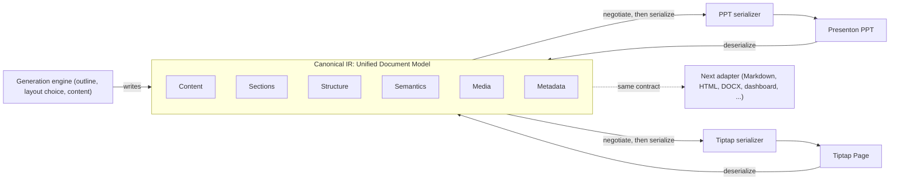

# Part X · Final approach

**Reads:** `servers/fastapi/models/sql/slide.py`, `servers/fastapi/api/v1/ppt/endpoints/presentation.py`, `servers/nextjs/components/slide-editor/text/TiptapInlineTextEditor.tsx`, `tutorial/prototypes/udm/core/udm.ts`, `tutorial/prototypes/udm/core/adapter.ts`, `tutorial/prototypes/udm/REPORT.md`  ·  **Builds on:** [Artifact Spec and targets](../ai-component/62-artifact-spec-and-targets.md), [From template to schema to slide](../presenton/17-template-to-slide.md), [Story 1: Dynamic data](../delivery/42-story1-dynamic-data.md)  ·  **Time:** ~10 min

What you will learn: the one decision Part X makes, the picture behind it, how it relates to Parts VII, VIII and IX, what a working prototype measured on all 383 bundled Presenton layouts, and the order in which to read the rest of this part. The team's direction was to use JSON as the base format and add an adaptor that converts to `tiptap.json`, changing only the adapter layer, with Presenton PPT and a Tiptap page both mapping to one Canonical IR. The follow-up requirement shapes everything below: "Today it is for Tiptap, tomorrow it might be for other modules, so the solution should be generic."

## Step 1: The decision in one paragraph

Presenton slides and Tiptap pages meet in one target-agnostic **Unified Document Model (UDM)**. The UDM is not a third format: it is the Part IX Artifact Spec (`gck.artifact/1`) shipped as protocol 1.3, a "UDM profile" in which nothing names a target. Every module is one **adapter** that implements the same contract: a capability manifest, a pure `serialize` (UDM to native), a pure `deserialize` (native to UDM), `validateNative` (the host's own rules), and optional host apply and patch. A core `negotiate()` function degrades a UDM deterministically to what a manifest supports and reports every loss; a registry makes adapters plug-ins; and one shared conformance kit gates every adapter. Presenton PPT (`presenton.slides`) and Tiptap (`tiptap`) are the first two adapters. Markdown, HTML, a Superset dashboard, DOCX, Confluence, Notion or email each need a new adapter only, never a change to the UDM core or the generation engine. Target-specific data, such as a Presenton slot path or layout id, lives only in a namespaced `ext["<adapter-id>"]` field that the core never interprets (negotiation may only drop foreign bags). Geometry, styling and theme never enter the UDM; they stay in the host.

## Step 2: The picture

This is the team's diagram, redrawn with the generation engine added. The six facets in the middle are views over UDM fields, not separate objects.

The "PPT serializer" and "Tiptap serializer" boxes are the `serialize` halves of the two adapters. The arrows into the IR are their `deserialize` halves. In the prototype, the Presenton adapter reads and writes the Template v2 tree stored in `slides.ui` (`servers/fastapi/models/sql/slide.py:30`), and the Tiptap adapter reads and writes ProseMirror JSON checked against a real Tiptap 3.30.5 schema, the version Presenton already ships (`servers/nextjs/package.json:40-44`).

## Step 3: What is final, compared with earlier parts

Part X replaces nothing in Parts VII and VIII. It tightens Part IX so that the "new module needs only an adapter" promise is true.

| Topic | Earlier part | Final in Part X |
| --- | --- | --- |
| Data rule | Part VII and Part IX: numbers come from data bindings, never from the model | Unchanged. The UDM carries binding definitions. Imported numbers (an existing deck's chart) use a `static` binding source |
| AI Slides delivery | Part VIII: Presenton embedded in an iframe, `slide_data_bindings` rows, refresh on open and before export | Unchanged. Part VIII's `element_path` (an RFC 6901 pointer into `slides.ui`) is the same location the PPT adapter records as its slot |
| Intermediate representation | Part IX: Artifact Spec v1, protocol 1.0 to 1.2, closed `TargetId` union | Same spec as protocol 1.3 "UDM profile": open adapter ids, optional neutral fields for the six facets, `ext` namespaces |
| Adapter contract | Part IX: `TargetAdapter` with `toNative` and a host-bound `fromHost` | `serialize`, `deserialize`, `validateNative` on every adapter, host apply and patch optional |
| Fallbacks | Part IX: each adapter degrades unsupported content its own way | One core `negotiate(udm, manifest)` with fixed, ordered rules and a loss report |
| Slides direction | Part IX slides target writes per-layout `content`, no reverse direction | `presenton.slides` deserializes from `slides.ui` and serializes back by patching slots |
| Tiptap nodes | Part IX: one atom per data kind (`gckChart`, `gckMetric`, `gckDataTable`, `gckEmbed`) plus `GckBlockIds` | One generic `dataBlock` atom plus one `udmAttrs` global-attribute extension; the manifest is derived from the editor schema |
| Testing | Part IX: per-adapter golden files and round-trip tests | One shared conformance kit (checks C0 to C11) that every adapter must pass |

Part X is the final, consolidated decision. Where it and Part IX differ, Part X wins: the right-hand column above supersedes Part IX's closed `TargetId` union, its per-adapter fallbacks, its one-node-per-kind Tiptap design (work package 2.1) and its write-only slides target (work package 4.1). [Plan and tracker](76-plan-and-tracker.md) (Step 5) lists the Part IX work packages this replaces or reorders. Part VIII's stories, trains and owners are untouched; Part X schedules itself after the pilot and shares five touchpoints with it ([Plan and tracker](76-plan-and-tracker.md), Step 4).

## Step 4: The feasibility verdict

**Feasible.** "Presenton is JSON and Tiptap is JSON" holds, but it is not enough by itself: the two are schema-bound JSON with different shapes (slot-keyed, positioned slides versus an ordered flow tree), so the conversion has to go through the UDM with each adapter's rules in hand. A runnable prototype in `tutorial/prototypes/udm/` proves it on every bundled layout. It reads the bundled templates and touches no Presenton server code. `npm ci && npm run all` rebuilds every number below into `tutorial/prototypes/udm/REPORT.md`.

| Check (383 layouts from 16 templates) | Result |
| --- | --- |
| Presenton to UDM gives a valid UDM | 383/383 |
| Content elements captured in the UDM | 100% of 3,582 text, 607 images, 113 charts, 51 infographics, 35 lists, 7 tables |
| UDM to `tiptap.json` passes the real Tiptap schema check and the dropped-attribute check | 383/383 |
| Same documents load in a headless Tiptap editor with content checking on | 383/383 |
| Presenton to UDM to Tiptap to UDM to Presenton, slide identical to the original | 383/383 |
| Scripted edit of every text, title, list, table and chart in the Tiptap document, landing in the right slot | 100% (3,228 text, 354 titles, 35 lists, 7 tables, 113 charts) |
| Edited text keeping a second color or size inside one element | 0/44 (all flattened, reported) |
| Conformance kit | 45/45 for Presenton, Tiptap, basic Tiptap and Markdown; 29/29 for plain text |
| Core files changed after the core was frozen, while the plain-text adapter was added | none |

Three limits matter for planning. First, targets that cannot carry block ids and `ext` (Markdown, a StarterKit-only editor) fall back to placing blocks by position, so documents going back to slides through them should be treated as "generate a new slide", not "update this slide". Second, the prototype does not cover live-data tokens, Smart-mode HTML slides, the Python side, or splitting a long document across several slides. Third, the corpus is each layout's own sample content, so the "unchanged slot stays identical" result was measured against the layout template, not against real edited decks. [Feasibility analysis](71-feasibility.md) has the full numbers, failure categories and per-scenario verdicts.

!!! warning "Gotcha"
    Tiptap silently drops attributes it does not know, and an unknown node makes the editor replace the whole document with one empty paragraph. Every adapter therefore validates its own output; no adapter relies on the host to clean up.

## Step 5: Reading order

1. [Feasibility analysis](71-feasibility.md): Presenton's JSON forms against Tiptap JSON, the element mapping, lossiness in both directions, the prototype's method and results, and a verdict per scenario.
2. [Unified Document Model](72-unified-document-model.md): the protocol 1.3 types, the six facets, `ext` rules, negotiation and the conformance kit.
3. [PPT adapter (Presenton JSON)](73-ppt-adapter.md): `presenton.slides`, from `slides.ui` to the UDM and back.
4. [Tiptap adapter (tiptap.json)](74-tiptap-adapter.md): the page profile, `dataBlock`, `udmAttrs`, the derived manifest and validation.
5. [Adding any new target](77-adding-a-new-target.md): what a new module has to write, using the Markdown and plain-text adapters as worked examples.
6. [Code changes in Presenton](75-presenton-code-changes.md): exactly where in Presenton the adapter layer plugs in.
7. [Plan and tracker](76-plan-and-tracker.md): phases, work items and exit criteria.

## What you now know

- The decision: one target-agnostic UDM (the Artifact Spec, protocol 1.3) plus one adapter contract, a registry, deterministic negotiation and a shared conformance kit.
- Presenton PPT and Tiptap are the first two adapters; any later module is one more adapter.
- How Part X relates to Parts VII, VIII and IX, and what it changes in Part IX.
- The prototype's headline numbers and the three limits that shape the plan.

## Next

Read the [Feasibility analysis](71-feasibility.md).
