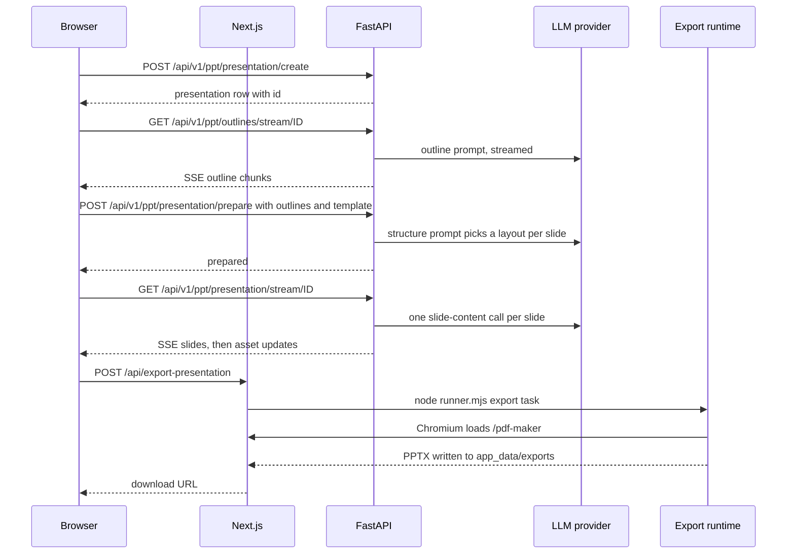

# What Presenton is

<div class="chapter-meta" markdown>
**Reads:** `README.md`, `VISION.md`, `docs/presentation-generation-modes.md`, `docs/template-v2.md`, `servers/fastapi/utils/get_env.py`, `servers/fastapi/mcp_server.py`, `servers/fastapi/api/v1/ppt/endpoints/presentation.py`, `servers/fastapi/constants/llm.py`  ·  **Builds on:** [Part I landing](index.md)  ·  **Time:** ~25 min
</div>

This chapter describes Presenton as a product, but every claim is pinned to the code that implements it. You will learn what goes in (prompts, documents, PPTX designs), the two generation modes and how `PRESENTATION_GENERATION_MODE` gates them, what ships as templates, how editing and export work, which model providers are supported, and which deployment shapes exist. The chapter ends with a 30,000-foot walk through one Standard generation, naming the function at each step, and a vocabulary table used by the rest of the book.

## Step 1: The one-paragraph summary

Presenton is an open-source (Apache 2.0) AI presentation generator. A user gives it a prompt, optionally with reference documents, chooses a design, and gets back a deck that is fully editable in the browser and exportable as an editable PPTX or a PDF. It runs self-hosted as a Docker web app or as an Electron desktop app, it exposes the same generation as a REST API and as an MCP server, and it lets you bring your own text and image model providers, including local ones such as Ollama and LM Studio (`README.md:40-46`).

`VISION.md` frames the project as "an open source document engine, not a closed design platform", and the code reflects that: almost every behavior is configurable through environment variables or a Settings page, and nothing requires a hosted service except the optional Community gallery and the optional Presenton Cloud provider (`README.md:356-369`, `README.md:563-582`).

The rest of this chapter goes through the product surface one feature at a time.

## Step 2: What goes in

Presenton accepts three kinds of input. Each maps to concrete endpoints.

| Input | How the user supplies it | Where it enters the backend |
| --- | --- | --- |
| A prompt | Text box on the upload page, or `content` in the API body | `POST /api/v1/ppt/presentation/create` (`servers/fastapi/api/v1/ppt/endpoints/presentation.py:1681`) or `POST /api/v1/ppt/presentation/generate` (`presentation.py:3169`) |
| Pre-written slides | `slides_markdown`, one Markdown string per slide (API only) | `GeneratePresentationRequest.slides_markdown` (`servers/fastapi/models/generate_presentation_request.py:10`); skips outline generation (`presentation.py:2710-2711`, `presentation.py:2836-2844`, see [Standard generation pipeline](08-standard-pipeline.md)) |
| Reference documents | File picker on the upload page, or `files` in the API body | `POST /api/v1/ppt/files/upload` (`servers/fastapi/api/v1/ppt/endpoints/files.py:79`) stores files in a temp directory and returns their paths; `DocumentsLoader` (`servers/fastapi/services/documents_loader.py:163`) extracts text |
| Your own PowerPoint design | Custom template wizard | The template endpoints under `/api/v1/ppt/template` (`servers/fastapi/api/v1/ppt/endpoints/template.py:96`), which convert a PPTX into a Template v2 design (see [Custom templates from PPTX](18-custom-templates.md)) |

The one-shot API accepts any combination of `content`, `slides_markdown` and `files`, but at least one must be non-empty. The check lives in `check_if_api_request_is_valid` (`presentation.py:2620`):

```python title="servers/fastapi/api/v1/ppt/endpoints/presentation.py (excerpt)"
    # Making sure either content, slides markdown or files is provided
    if not (request.content or request.slides_markdown or request.files):
        raise HTTPException(
            status_code=400,
            detail="Either content or slides markdown or files is required to generate presentation",
        )

    if request.n_slides is not None and request.n_slides <= 0:
        raise HTTPException(
            status_code=400,
            detail="Number of slides must be greater than 0",
        )

    if request.n_slides is not None and request.n_slides > MAX_NUMBER_OF_SLIDES:
        raise HTTPException(
            status_code=400,
            detail=f"Number of slides cannot be greater than {MAX_NUMBER_OF_SLIDES}",
        )
```

`MAX_NUMBER_OF_SLIDES` is 50 (`servers/fastapi/constants/presentation.py:4`). Each outline is capped at `MAX_OUTLINE_CONTENT_WORDS` words, read from the `MAX_OUTLINE_WORDS` environment variable and 100 by default (`constants/presentation.py:5-23`).

!!! warning "Gotcha"
    `content` is declared as a required field (`content: str = Field(...)`, `servers/fastapi/models/generate_presentation_request.py:9`). A body that omits `content` entirely fails Pydantic validation with HTTP 422 before the check above runs, even if `slides_markdown` is present. Send `"content": ""` when you only want to supply `slides_markdown` or `files`.

Generation can be tuned with `tone` (`default`, `casual`, `professional`, `funny`, `educational`, `sales_pitch`, from `servers/fastapi/enums/tone.py`), `verbosity` (`concise`, `standard`, `text-heavy`, from `servers/fastapi/enums/verbosity.py`), `language`, `instructions`, `include_title_slide`, `include_table_of_contents` and `web_search`.

!!! warning "Gotcha"
    The README says `language` defaults to `"English"` (`README.md:814`). The code says otherwise: `language` is `Optional[str]` with default `None` and the description "If omitted, model auto-detects language" (`servers/fastapi/models/generate_presentation_request.py:25-28`). Pass the language explicitly if you need a deterministic result.

## Step 3: The two generation modes

Presenton has two different generation engines that share the same database, editor and export path.

| | Standard | Smart |
| --- | --- | --- |
| Layouts | Fixed layouts from a Template v2 design; the LLM only fills schema fields | Adaptive HTML slides written by the LLM for the content |
| Outline review | Yes: outlines stream to an outline page where the user edits them and picks a template | No: generation streams straight into the editor |
| Templates | Built-in and custom templates | Not used (no template workflow) |
| Stored slide | `SlideModel.content` (JSON) plus `SlideModel.ui` (layout tree) | `SlideModel.html_content`, with `layout_group` and `layout` set to `"smart-html"` (`presentation.py:2062-2066`) |
| One-shot API | `POST /api/v1/ppt/presentation/generate` and `/generate/async` | `POST /api/v2/ppt/presentation/generate/smart` and `/generate/smart/async` (`servers/fastapi/api/v2/ppt/endpoints/presentation.py:229`, `servers/fastapi/api/v2/ppt/endpoints/presentation.py:264`) |
| Covered in | [Standard generation pipeline](08-standard-pipeline.md) | [Smart mode](13-smart-mode.md) |

In the browser both modes start from the same upload page. `UploadPage.tsx` creates the presentation row with `generation_mode` set, then routes to `/outline` for Standard or straight to `/presentation` for Smart (`servers/nextjs/app/(presentation-generator)/upload/components/UploadPage.tsx:517-525`). On the server, `stream_presentation` checks the stored mode and hands Smart presentations to a separate streamer:

```python title="servers/fastapi/api/v1/ppt/endpoints/presentation.py (excerpt)"
@PRESENTATION_ROUTER.get("/stream/{id}", response_model=PresentationWithSlides)
async def stream_presentation(
    id: uuid.UUID, sql_session: AsyncSession = Depends(get_async_session)
):
    presentation = await sql_session.get(PresentationModel, id)
    if not presentation:
        raise HTTPException(status_code=404, detail="Presentation not found")
    if presentation.generation_mode == "smart":
        return await stream_smart_presentation(presentation, sql_session)
    if not presentation.structure:
        raise HTTPException(
            status_code=400,
            detail="Presentation not prepared for stream",
        )
```

### 3.1 `PRESENTATION_GENERATION_MODE`

An operator chooses which modes users see with one environment variable. FastAPI parses it like this:

```python title="servers/fastapi/utils/get_env.py (excerpt)"
def get_presentation_generation_mode() -> PresentationGenerationMode:
    """Return the enabled generation mode, matching the web UI's fallback."""
    value = (os.getenv("PRESENTATION_GENERATION_MODE") or "").strip().lower()
    if value in {"standard", "smart", "both"}:
        return value
    return "both"
```

Next.js has a twin, `normalizePresentationGenerationMode` (`servers/nextjs/utils/presentationGenerationMode.ts:7-21`), with the same fallback to `"both"`. The effect of each value:

| Value | Web UI | MCP tools exposed |
| --- | --- | --- |
| `both` (default, and any unknown value) | Mode selector shown; Standard is selected first (`getInitialGenerationMode`, `presentationGenerationMode.ts:30-34`) | Standard, template-generation, Smart and shared tools |
| `standard` | Selector hidden, always Standard; template pages available | Standard, template-generation and shared tools |
| `smart` | Selector hidden, always Smart; `/templates`, `/custom-template` and `/template-preview` redirect to `/dashboard` (for example `servers/nextjs/app/(presentation-generator)/(dashboard)/templates/page.tsx:7-14`) | Smart tools plus the shared tools |

The "shared" tools are file upload (`/api/v1/ppt/files/mcp-upload`) and async task status (`/api/v1/async-tasks/status/{id}`), which every mode needs (`servers/fastapi/mcp_server.py:88-99`). The MCP side is implemented by choosing which OpenAPI routes become tools:

```python title="servers/fastapi/mcp_server.py (excerpt)"
def get_mcp_route_maps(
    generation_mode: PresentationGenerationMode,
) -> list[RouteMap]:
    """Expose only workflows enabled by PRESENTATION_GENERATION_MODE."""
    route_maps: list[RouteMap] = []
    if generation_mode in {"both", "standard"}:
        route_maps.extend(MCP_STANDARD_ROUTE_MAPS)
        route_maps.extend(MCP_TEMPLATE_ROUTE_MAPS)
    if generation_mode in {"both", "smart"}:
        route_maps.extend(MCP_SMART_ROUTE_MAPS)
    route_maps.extend(MCP_SHARED_ROUTE_MAPS)
    route_maps.append(RouteMap(mcp_type=MCPType.EXCLUDE))
    return route_maps
```

!!! warning "Gotcha"
    `PRESENTATION_GENERATION_MODE` is a UI and MCP filter, not an access control. The REST endpoints for both modes stay mounted regardless of the value (`servers/fastapi/api/main.py:68-74`), and `docs/presentation-generation-modes.md` says so explicitly. If you need to forbid a mode, you must add a check in the endpoints.

!!! warning "Gotcha"
    The variable is read from the process environment of both servers at request time. In Docker both inherit it from the container, but if you run Next.js and FastAPI separately you must set the same value in both, and restart both after changing it.

## Step 4: Templates

A template is a Template v2 design: a JSON document of slide layouts on a 1280 by 720 canvas, each layout made of components, each component made of typed elements. Elements marked `decorative: true` are fixed artwork; the rest become fields in a JSON schema the LLM fills (`docs/template-v2.md:116-117`). [Template v2 format](16-template-v2-format.md) covers the format.

Sixteen built-in designs live in the top-level `templates/` directory, one folder each with a `template.json` and a `static/` folder of fonts and images. At startup, `import_default_templates_on_startup` (`servers/fastapi/templates/default_templates.py:22`) upserts each one into the `TemplateV2` table with `is_default=True` and copies its static assets into `app_data/templates/<id>/static` (`default_templates.py:295-301`). Layout counts at this snapshot, counted from each `template.json`:

| Template | Layouts | Template | Layouts |
| --- | ---: | --- | ---: |
| civic | 29 | modern | 10 |
| dynamic | 32 | momentum | 28 |
| editorial | 24 | mosaic | 34 |
| executive | 32 | nova | 28 |
| general | 12 | pulse | 28 |
| horizon | 28 | signal | 24 |
| landmark | 27 | standard | 11 |
| verdant | 27 | swift | 9 |

That is 383 layouts in total. The API default is `general` (`generate_presentation_request.py:29-31`).

Custom templates are created from an uploaded PPTX: the export runtime converts the deck to raw element JSON, a vision-capable model certifies each slide into components and editable fields, and the result is stored as a private `TemplateV2` row (`docs/template-v2.md:7-14`). See [Custom templates from PPTX](18-custom-templates.md).

## Step 5: Editing

After generation the user lands in the editor at `/presentation?id=...`. Three editing paths exist:

1. **Direct manipulation.** Template v2 slides render on a Konva canvas (`servers/nextjs/components/slide-editor/surface/TemplateV2KonvaSlide.tsx`) with drag, resize, alignment guides, and inline rich-text editing through Tiptap (`servers/nextjs/components/slide-editor/text/TiptapInlineTextEditor.tsx`). Changes flow into Redux and are saved with `PATCH /api/v1/ppt/presentation/update` or `PATCH /api/v1/ppt/presentation/slide_update` (`presentation.py:2527`, `presentation.py:2585`). See [Slide editor](22-slide-editor.md).
2. **AI slide edit.** The user types an instruction for one slide. Standard slides go to `POST /api/v1/ppt/slide/edit` (`servers/fastapi/api/v1/ppt/endpoints/slide.py:38`), Smart slides to `POST /api/v1/ppt/slide/edit-html` (`slide.py:135`).
3. **Chat assistant.** A conversational panel backed by `POST /api/v1/ppt/chat/message` and `POST /api/v1/ppt/chat/message/stream` (`servers/fastapi/api/v1/ppt/endpoints/chat.py:105`, `chat.py:124`), with tools and memory implemented under `servers/fastapi/services/chat/`. See [Editing and chat assistant](14-editing-and-chat.md).

## Step 6: Export

The deck exports as an editable PPTX or as a PDF. Both formats are produced the same way: a Node process runs `presentation-export/runner.mjs`, which calls `runTask` from the `@presenton/export-core` package (`scripts/run-presentation-export.mjs:3`, `scripts/run-presentation-export.mjs:116-119`). That package drives headless Chromium against the `/pdf-maker?id=...` page of the Next.js app and writes the file into `app_data/exports`. The package version is pinned by `"presentationExportVersion": "v1.0.51"` in the root `package.json` and installed by `scripts/sync-presentation-export.cjs`. [PPTX and PDF export](24-export-pipeline.md) covers the details.

## Step 7: Model providers

### 7.1 Text LLM providers

`LLM` selects the text provider. The accepted values are the members of `LLMProvider` (`servers/fastapi/enums/llm_provider.py:4-20`). Defaults come from `servers/fastapi/constants/llm.py` and are applied in `get_model` (`servers/fastapi/utils/llm_provider.py:126-175`):

| `LLM` | Default model when the `*_MODEL` variable is unset |
| --- | --- |
| `openai` | `gpt-4.1` |
| `deepseek` | `deepseek-chat` |
| `google` | `models/gemini-2.5-flash` |
| `vertex` | `gemini-2.5-flash` |
| `azure` | `AZURE_OPENAI_MODEL`, then `AZURE_OPENAI_DEPLOYMENT`, then `gpt-4.1` |
| `bedrock` | `us.anthropic.claude-3-5-haiku-20241022-v1:0` |
| `openrouter` | `openai/gpt-4o` |
| `fireworks` | `accounts/fireworks/models/llama-v3p1-8b-instruct` |
| `together` | `openai/gpt-oss-20b` |
| `cerebras` | `llama-3.3-70b` |
| `anthropic` | `claude-sonnet-4-20250514` |
| `litellm` | `gpt-4.1` |
| `lmstudio` | `openai/gpt-oss-20b` |
| `ollama` | none (`OLLAMA_MODEL` must be set) |
| `custom` | none (`CUSTOM_MODEL` must be set; any OpenAI-compatible endpoint) |
| `codex` | `gpt-5.6-luna` unless `CODEX_MODEL` is one of the supported Codex models (`constants/llm.py:18-27`) |

Two more provider paths exist outside that enum. `LLM=presenton` selects the optional Presenton Cloud provider, in which case `maybe_proxy_presenton_cloud_request` forwards generation requests to the hosted API instead of calling a model locally (`servers/fastapi/services/presenton_cloud_proxy.py:407-460`). And `codex` uses an OAuth sign-in with a ChatGPT account, which is why the Compose services publish host port 1455 for its callback (`docker-compose.yml:11-12`).

!!! warning "Gotcha"
    The README's provider table lists `models/gemini-2.0-flash` as the Google default and `claude-3-5-sonnet-20241022` as the Anthropic default (`README.md:392`, `README.md:426`). The code defaults are `models/gemini-2.5-flash` and `claude-sonnet-4-20250514` (`constants/llm.py:6`, `constants/llm.py:14`). When in doubt, trust `constants/llm.py`.

An unset or unknown `LLM` fails at the first LLM call, not at startup, with HTTP 500 and the detail `"Invalid LLM provider. Please select one of: ..."` (`utils/llm_provider.py:47-58`). This is deliberate: the lifespan docstring says provider availability is checked when used, so account setup still works on an unconfigured instance (`servers/fastapi/api/lifespan.py:46-53`).

Provider configuration chapters: [Configuration and LLM providers](06-configuration-and-providers.md) for text, [Images, icons, web search](12-images-icons-search.md) for images and search.

### 7.2 Image providers

`IMAGE_PROVIDER` selects how `__image_prompt__` fields become pictures. Values come from `ImageProvider` (`servers/fastapi/enums/image_provider.py:4-13`):

| `IMAGE_PROVIDER` | Kind | Credentials |
| --- | --- | --- |
| `pexels` | Stock search | `PEXELS_API_KEY` |
| `pixabay` | Stock search | `PIXABAY_API_KEY` |
| `gemini_flash` | Generation (Google) | `GOOGLE_API_KEY` |
| `nanobanana_pro` | Generation (Google) | `GOOGLE_API_KEY` |
| `gpt-image-2` | Generation (OpenAI) | `OPENAI_API_KEY`, quality from `GPT_IMAGE_2_QUALITY` |
| `gpt-image-1.5` | Generation (OpenAI) | `OPENAI_API_KEY`, quality from `GPT_IMAGE_1_5_QUALITY` |
| `comfyui` | Self-hosted generation | `COMFYUI_URL`, `COMFYUI_WORKFLOW` |
| `open_webui` | Self-hosted generation | `OPEN_WEBUI_IMAGE_URL`, `OPEN_WEBUI_IMAGE_API_KEY` |
| `openai_compatible` | Any `/v1/images/*` gateway | `OPENAI_COMPAT_IMAGE_BASE_URL`, `_API_KEY`, `_MODEL` |

The dispatcher is `ImageGenerationService.generate_image` (`servers/fastapi/services/image_generation_service.py:187`). Image generation can be turned off with `DISABLE_IMAGE_GENERATION`. Icons are not generated: `__icon_query__` fields are matched against a bundled FastEmbed vector index of Phosphor icons (`servers/fastapi/services/icon_finder_service.py:26-28`, data in `servers/fastapi/assets/icons-vectorstore.json`).

### 7.3 Web search

Optional web grounding uses either the provider's native search (OpenAI, Google, Anthropic) or an external provider. `WebSearchProvider` lists `auto`, `native`, `searxng`, `tavily`, `exa`, `brave` and `serper` (`servers/fastapi/enums/web_search_provider.py`), although the README notes that Brave and Serper are hidden until tested (`README.md:451`).

## Step 8: Deployment shapes

| Shape | What runs | Entry point | Chapter |
| --- | --- | --- | --- |
| Docker web app | nginx, FastAPI, MCP, Next.js, optional Ollama in one container | `CMD ["node", "/app/start.js"]` (`Dockerfile:153`), image `ghcr.io/presenton/presenton` | [Runtime topology](03-runtime-topology.md), [Docker build and deployment](26-docker-and-deployment.md) |
| Electron desktop app | FastAPI and Next.js on loopback ports chosen at launch, inside a desktop window; no nginx, no MCP | `electron/app/main.ts` | [Electron desktop app](27-electron.md) |
| REST API | The same FastAPI routes, called with an `sk-presenton-...` API key | `POST /api/v1/ppt/presentation/generate` and friends | [REST API, async tasks, webhooks, MCP](15-api-async-mcp.md) |
| MCP server | A FastMCP Streamable HTTP server at `/mcp` whose tools are generated from the OpenAPI document | `servers/fastapi/mcp_server.py` | [REST API, async tasks, webhooks, MCP](15-api-async-mcp.md) |

The MCP tool names are fixed by a mapping from OpenAPI operation IDs (`mcp_server.py:101-111`): `start_standard_presentation`, `start_smart_presentation`, `list_templates`, `upload_template_assets`, `start_template_generation`, `upload_files` and `get_job_status`. Generation tools all return an async task ID that the client polls with `get_job_status`.

!!! warning "Gotcha"
    External REST and MCP access are server features. In Electron, `PRESENTON_ELECTRON=true` makes `mcp_server.py` exit immediately (`mcp_server.py:319-321`, `mcp_server.py:419-424`), and both HTTP servers reject any request that does not carry the per-launch desktop credential (`servers/fastapi/api/v1/auth/desktop.py:25-48`).

## Step 9: Multi-user workspaces

Presenton keeps a `user` table and scopes every owned row to a user. The first account created through `/api/v1/auth/setup` becomes the primary administrator (`servers/fastapi/api/v1/auth/router.py:110-152`); administrators create, reset and delete other accounts and issue API keys under `/api/v1/admin` (`servers/fastapi/api/v1/admin/router.py:41`).

Isolation is enforced in three places:

1. **Request context.** `SessionAuthMiddleware` resolves the caller from the `presenton_session` cookie or a bearer API key and stores the user ID in a context variable (`servers/fastapi/api/middlewares.py:94-128`).
2. **Database.** SQLAlchemy event hooks add `owner_id == <current user>` to every ORM `SELECT` on owned models and stamp `owner_id` on new rows (`servers/fastapi/services/database.py:66-108`). Built-in templates stay visible to everyone because the template filter also admits rows with `owner_id IS NULL AND is_default` (`database.py:86-94`).
3. **Files.** Generated files go to per-user folders such as `app_data/images/users/<user-id>/` (`servers/fastapi/utils/asset_directory_utils.py:23-30`), and `/app_data/...` URLs are authorized per path segment (`servers/fastapi/api/v1/auth/assets.py:106-123`).

The Electron app runs auth-disabled and single-user. [Auth and multi-user](25-auth-and-multiuser.md) covers all of this in depth.

## Step 10: One generation, prompt to PPTX, at 30,000 feet

Here is one Standard generation from the browser, with the module and function that does the work at each step. Each later chapter zooms into one or more of these steps.



1. **Collect the request.** The upload page (`servers/nextjs/app/(presentation-generator)/upload/components/UploadPage.tsx`) gathers prompt, slide count, language, tone, verbosity and toggles. If files were attached it first calls `PresentationGenerationApi.uploadDoc` (`POST /api/v1/ppt/files/upload`). It then calls `PresentationGenerationApi.createPresentation` (`servers/nextjs/app/(presentation-generator)/services/api/presentation-generation.ts:82`). Details: [User journey](21-user-journey.md).
2. **Create the row.** `create_presentation` (`servers/fastapi/api/v1/ppt/endpoints/presentation.py:1682`) validates the inputs and inserts a `PresentationModel` row with `generation_mode="standard"`. Nothing has been generated yet. Details: [Data model](07-data-model.md), [Standard generation pipeline](08-standard-pipeline.md).
3. **Stream the outline.** The outline page hook `useOutlineStreaming` opens `GET /api/v1/ppt/outlines/stream/{id}` (`servers/nextjs/app/(presentation-generator)/outline/hooks/useOutlineStreaming.ts:108`). `stream_outlines` (`servers/fastapi/api/v1/ppt/endpoints/outlines.py:85`) loads any documents, then iterates `generate_ppt_outline` (`servers/fastapi/utils/llm_calls/generate_presentation_outlines.py:252`), forwarding LLM chunks as server-sent events through `safe_sse_stream` (`servers/fastapi/utils/sse.py:10`). Details: [Prompts and schemas](09-prompts-and-schemas.md), [Streaming (SSE)](10-streaming.md), [Document ingestion](11-document-ingestion.md).
4. **Review and prepare.** The user edits outlines and picks a template. `usePresentationGeneration` calls `presentationPrepare` with `{presentation_id, outlines, layout: <template id>}` (`servers/nextjs/app/(presentation-generator)/outline/hooks/usePresentationGeneration.ts:107-111`). `prepare_presentation` (`presentation.py:1841`) loads the template and converts it to per-layout JSON schemas through `get_template_schema` (`servers/fastapi/templates/v2/schema.py:257`, called from `presentation.py:416`), then asks the LLM to pick a layout index for each outline with `generate_presentation_structure` (`servers/fastapi/utils/llm_calls/generate_presentation_structure.py:157`) and stores the result as `presentation.structure`. Details: [From template to schema to slide](17-template-to-slide.md).
5. **Stream the slides.** The editor opens with `stream=true`, and `usePresentationStreaming` calls `GET /api/v1/ppt/presentation/stream/{id}` (`servers/nextjs/app/(presentation-generator)/presentation/hooks/usePresentationStreaming.ts:301`). For each slide, `stream_presentation` calls `get_slide_content_from_type_and_outline` (`presentation.py:2370`, defined in `servers/fastapi/utils/llm_calls/generate_slide_content.py:229`) to produce JSON that matches the chosen layout's schema, emits the slide immediately with placeholder assets, and starts `process_slide_and_fetch_assets` (`presentation.py:2404`, defined in `servers/fastapi/utils/process_slides.py:173`) to resolve `__image_prompt__` through the image provider and `__icon_query__` through the icon index. Finished assets are pushed as further events. Details: [Standard generation pipeline](08-standard-pipeline.md), [Images, icons, web search](12-images-icons-search.md).
6. **Edit.** The Konva editor renders each slide's `ui` tree and saves edits back through the update endpoints. Details: [Slide editor](22-slide-editor.md).
7. **Export.** Clicking "Export as PPTX" runs `fetch("/api/export-presentation", ...)` (`servers/nextjs/app/(presentation-generator)/presentation/components/PresentationHeader.tsx:256`). The Next.js route handler (`servers/nextjs/app/api/export-presentation/route.ts:90`) calls `runBundledPresentationExport` (`servers/nextjs/lib/run-bundled-presentation-export.ts:138`), which writes an `export_task.json` and spawns `node runner.mjs <task>`. `@presenton/export-core` loads `/pdf-maker?id=...` in Chromium, builds an editable PPTX, and writes it under `app_data/exports`. The route moves the file into `app_data/exports/users/<user-id>/` and returns `/api/export-presentation/file?name=...`, which the browser downloads. Details: [PPTX and PDF export](24-export-pipeline.md).

The one-shot API (`POST /api/v1/ppt/presentation/generate`) runs the same steps server-side inside `generate_presentation_handler` (`presentation.py:2684`): outlines, layout selection, slide content in batches of 10 with `asyncio.gather` (`presentation.py:2984-3006`), asset tasks, one commit that saves the presentation, slides and image assets together (`presentation.py:3087-3091`; the other commits in the handler only update the async task status row), then `export_presentation` (`servers/fastapi/utils/export_utils.py:43`) instead of the Next.js route.

!!! warning "Gotcha"
    The UI and the API export through different code paths that share the runtime. The browser path goes through the Next.js route and `lib/run-bundled-presentation-export.ts`; the API path goes through `ExportTaskService.export_from_url` in FastAPI (`servers/fastapi/services/export_task_service.py:422`). A fix to one does not automatically apply to the other.

## Core vocabulary

These terms are used with exactly these meanings in the rest of the book.

| Term | Meaning | Where it lives |
| --- | --- | --- |
| Presentation | One deck: the prompt, settings, outlines, chosen layout payload, structure, theme and fonts | `PresentationModel` (`servers/fastapi/models/sql/presentation.py`) |
| Outline | Audience-facing Markdown for one slide, at most `MAX_OUTLINE_WORDS` words | `SlideOutlineModel.content` (`servers/fastapi/models/presentation_outline_model.py:8-21`); stored in `presentation.outlines` |
| Structure | The list of layout indexes, one per slide | `PresentationStructureModel.slides: List[int]` (`servers/fastapi/models/presentation_structure_model.py:5-6`); stored in `presentation.structure` |
| Layout | One slide design inside a template: an ID, a description and a list of components | `SlideLayout` (`servers/fastapi/templates/v2/models/layouts.py:98`); at generation time a `SlideLayoutModel` with a `json_schema` (`presentation.py:450-456`) |
| Slide content | The JSON the LLM returns for one slide, conforming to the layout's schema, including fields such as `__speaker_note__`, `__image_prompt__` and `__icon_query__` | `SlideModel.content` (`servers/fastapi/models/sql/slide.py:26`) |
| Template v2 | A complete design: layouts, merged components, theme, fonts and assets | `TemplateV2` table (`servers/fastapi/models/sql/template_v2.py:16`); built-ins in `templates/<name>/template.json` |
| Component | A positioned group of elements with an ID and description, the unit the certification passes reason about | `Component` (`templates/v2/models/layouts.py:54-58`) |
| Element | A typed visual primitive: text, image, container, text list, table, vector, chart, infographic and others | `servers/fastapi/templates/v2/models/elements.py` |
| Decorative flag | `decorative: bool` on an element; `false` turns the element into an LLM-filled schema field, `true` keeps it fixed | for example `Text.decorative` (`elements.py:218`) |
| Smart slide | A slide produced in Smart mode: sanitized HTML in `html_content`, with `layout_group` and `layout` set to `"smart-html"` | `presentation.py:2062-2066`; prompts in `servers/fastapi/utils/llm_calls/generate_smart_presentation.py` |
| Export runtime | The `presentation-export/` directory: `runner.mjs` plus `node_modules/@presenton/export-core`, driven by headless Chromium | installed by `scripts/sync-presentation-export.cjs`; checked by `ExportTaskService._ensure_runtime_ready` (`export_task_service.py:202-220`) |
| app_data | The persistent data root named by `APP_DATA_DIRECTORY` (`/app_data` in Docker): database, `userConfig.json`, images, uploads, fonts, templates, exports, memory | created by `start.js:93-103`; layout in [Runtime topology](03-runtime-topology.md) |

## What you now know

- Presenton turns a prompt, documents or pre-written Markdown into an editable deck, using either Standard (template layouts plus outline review) or Smart (adaptive HTML) generation.
- `PRESENTATION_GENERATION_MODE` (`both`, `standard`, `smart`) filters the UI and the MCP tools but does not restrict the REST API.
- Sixteen built-in Template v2 designs with 383 layouts are imported at startup; custom designs come from PPTX files.
- Text and image providers are pluggable through `LLM` and `IMAGE_PROVIDER`; defaults live in `constants/llm.py`, and misconfiguration surfaces only when a model is first called.
- The same backend serves the Docker web app, the Electron app, the REST API and the MCP server, with per-user isolation enforced in middleware, SQL event hooks and file paths.
- A Standard generation is create, outline stream, prepare, slide stream, edit, export, and each step has a named function you can open.

## Next

Continue with the [Repository tour](02-repository-tour.md) to see where each of these pieces lives on disk.
