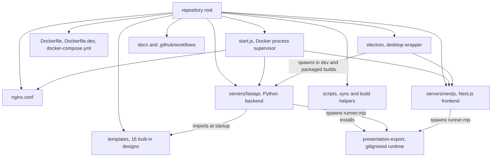

# Repository tour

<div class="chapter-meta" markdown>
**Reads:** `start.js`, `Dockerfile`, `docker-compose.yml`, `nginx.conf`, `package.json`, `servers/fastapi/pyproject.toml`, `servers/nextjs/package.json`, `electron/package.json`, `.github/workflows/README.md`  ·  **Builds on:** [What Presenton is](01-what-is-presenton.md)  ·  **Time:** ~30 min
</div>

This chapter walks the repository directory by directory and names the two to five files in each place that you will actually open. It also records verified size statistics for the snapshot, the full technology stack with exact versions, and a "where do I look for X?" index you can come back to whenever you need to find code. Treat it as a map; the later chapters are the guided walks.

## Step 1: Snapshot facts

Everything in this book refers to one commit. You can re-derive every number below with the commands in the collapsible block.

| Fact | Value |
| --- | --- |
| Commit | `571461f969beb1daa52cc68c5aaa9ba019530a35`, dated 2026-11-01 |
| Commits on that line | 2,952 |
| App version | `0.9.12-beta` (root `package.json:3`, `electron/package.json:4`) |
| Export runtime pin | `v1.0.51` (root `package.json:4`) |
| Python files in `servers/fastapi`, excluding `tests/` | 233 files, 58,185 lines |
| Python test code in `servers/fastapi/tests` | 114 `test_*.py` files, 31,899 lines in all `.py` files |
| Alembic migrations | 24 files in `servers/fastapi/alembic/versions` |
| TypeScript in `servers/nextjs` (`app`, `components`, `lib`, `store`, `utils`, `types`) | about 113,900 lines |
| Built-in templates | 16, with 383 layouts in total |

??? example "Commands that reproduce these numbers"
    ```bash
    cd presenton-os
    git rev-list --count 571461f
    cd servers/fastapi
    find . -name '*.py' -not -path './tests/*' -not -path './.venv/*' | wc -l
    find . -name '*.py' -not -path './tests/*' -not -path './.venv/*' | xargs cat | wc -l
    find tests -name 'test_*.py' | wc -l
    ls alembic/versions | grep -c '\.py$'
    cd ../..
    for d in templates/*/; do
      python3 -c "import json,sys; d=json.load(open('$d/template.json')); print('$d', len(d['layouts']))"
    done
    ```

The FastAPI line count breaks down as `api` 10,204, `services` 17,559 (of which `services/chat` is 11,201), `templates` 14,283, `utils` 11,598 (of which `utils/llm_calls` is 2,255), `alembic` 1,801, `models` 1,222, `constants` 521, `enums` 84 and `scripts` 75, plus the top-level modules.

The largest single Python files are `servers/fastapi/templates/v2/certified_generation.py` (4,633 lines, PPTX template certification), `servers/fastapi/services/chat/memory_layer.py` (4,131) and `servers/fastapi/api/v1/ppt/endpoints/presentation.py` (3,393).

## Step 2: The root of the repository



| File | What it is |
| --- | --- |
| `start.js` (738 lines) | The container entry point (`CMD ["node", "/app/start.js"]`, `Dockerfile:153`). Creates `app_data` directories, verifies the export runtime, writes `userConfig.json` from environment variables, starts nginx, then spawns FastAPI, the MCP server, Next.js and optionally Ollama. [Runtime topology](03-runtime-topology.md) walks it line by line. |
| `Dockerfile` (153 lines) | Four stages: `fastapi-builder` (Python 3.11 venv via `uv`, spaCy model, FastEmbed cache warm-up), `nextjs-builder` (`npm ci`, `next build`), `assets-builder` (LiteParse dependencies and `sync-presentation-export.cjs --force`), and `runtime` (Debian trixie with pinned Chromium, nginx, Noto fonts, Tesseract, Node 22). See [Docker build and deployment](26-docker-and-deployment.md). |
| `Dockerfile.dev` (93 lines) | A single-stage development image that installs the same system packages, installs Python dependencies into the system interpreter, and runs `node /app/start.js --dev` (`Dockerfile.dev:93`). It expects the repository to be bind-mounted at `/app`. |
| `docker-compose.yml` (534 lines) | Four services: `production`, `production-gpu`, `development`, `development-gpu`, plus three named volumes for the development services. Each service forwards about 110 environment variables. See [Running it locally](04-running-locally.md). |
| `nginx.conf` (213 lines) | The only external listener (port 80). Routes `/` to Next.js, `/api/v1/` and `/api/v2/` to FastAPI, `/mcp` to the MCP server, and serves `/app_data/...` and `/static/` from disk. Copied to `/etc/nginx/nginx.conf` by `Dockerfile:150`. |
| `layouts.json` (247 KB) | A Template v2 layout sample: `{"layouts": {"layouts": [...]}}` with 14 layouts (IDs such as `business_proposal_cover_layout`), each with `id`, `description` and `components`. Its image URLs point at `http://127.0.0.1:8000/app_data/pptx-to-json/...`, so it is the output of a PPTX conversion. No code at this snapshot references the file by name. |
| `package.json` (26 lines) | Root Node project: version `0.9.12-beta`, `presentationExportVersion` `v1.0.51`, dependencies `@llamaindex/liteparse` and `sharp`, and the scripts `sync:presentation-export`, `check:presentation-export`, `convert:template`, `convert:presentation-template` and `test`. |
| `package-lock.json` | Lock file for the root project; also fingerprinted by `scripts/sync-document-dependencies.cjs` to decide whether the LiteParse runtime must be reinstalled. |
| `test-local.sh` (83 lines) | Runs the same three check groups as the `test-all.yml` workflow: repository tooling, the FastAPI pytest suite, and Next.js tests, lint, build and Cypress component tests. |
| `test_server.py` (78 lines) | Not a test. A stub of the remote version-check endpoint the Electron app polls (`GET /versions`), listening on port 8765 by default (`test_server.py:59-63`). |
| `NOTICE` (1.27 MB) | Third-party license notices, regenerated by `scripts/rebuild_notice_all.py`. |
| `README.md`, `VISION.md`, `CONTRIBUTING.md`, `CODE_OF_CONDUCT.md`, `LICENSE` | Product documentation, mission statement, contribution rules and Apache 2.0 license. |
| `.dockerignore`, `.gitignore` | Build context exclusions; note that `presentation-export/`, `app_data` and `.env` files are ignored by git. |
| `.do/deploy.template.yaml` | DigitalOcean App Platform spec that runs `ghcr.io/presenton/presenton:latest` on port 80. |
| `readme_assets/` | Images and video used by the README. |

!!! warning "Gotcha"
    `CONTRIBUTING.md` says contributions outside `electron/` "may not be accepted at this time". That is a policy statement about upstream pull requests, not a technical boundary: the Electron app runs the shared `servers/fastapi` and `servers/nextjs` code, so most behavior you might want to change lives outside `electron/`.

## Step 3: `servers/fastapi`, the backend

The backend is one Python package named `presenton-backend` (`servers/fastapi/pyproject.toml:6`) with `requires-python = ">=3.11,<3.12"`. Setuptools packages `api`, `enums`, `models`, `services`, `constants`, `utils` and `templates` (`pyproject.toml:48-58`). The server is always started with the working directory set to `servers/fastapi`, because `get_resource_path` resolves bundled assets relative to `os.getcwd()` (`servers/fastapi/utils/path_helpers.py:15-17`).

### 3.1 Top-level modules

| File | Role |
| --- | --- |
| `server.py` | 29-line launcher: parses `--port` (required), `--reload` (`"true"` or not) and `--log-level`, then runs `uvicorn.run("api.main:app", host="127.0.0.1", ...)` (`server.py:21-29`). |
| `mcp_server.py` | 480 lines. Builds a FastMCP server from `openai_spec.json` and serves it with the Streamable HTTP transport on `127.0.0.1:8001` (`mcp_server.py:457-466`). |
| `migrations.py` | 329 lines. Runs Alembic on startup when `MIGRATE_DATABASE_ON_STARTUP` is `"true"` or `"True"` (`migrations.py:42-45`), with special handling for databases created before Alembic was introduced. |
| `openai_spec.json` | A static OpenAPI document (despite the name, it has nothing to do with OpenAI) consumed by the MCP server. Regenerate it with `scripts/generate_openapi_spec.py`. |
| `server.spec` | PyInstaller spec used by `npm run build:fastapi` in `electron/` to freeze the backend for desktop builds. |
| `alembic.ini` | Alembic configuration; scripts live in `alembic/`. |
| `uv.lock`, `pyproject.toml` | Dependency pins. |

### 3.2 `api/`

The HTTP layer. `api/main.py` creates the app and mounts seven routers (`api/main.py:68-74`), mounts `/app_data/<root>` and `/static` file servers (`api/main.py:77-86`), and adds CORS, `UserConfigEnvUpdateMiddleware` and `SessionAuthMiddleware` (`api/main.py:94-103`). `api/lifespan.py` runs migrations, admin bootstrap and template import at startup.

| Path | Prefix | Key files |
| --- | --- | --- |
| `api/v1/ppt/` | `/api/v1/ppt` | `endpoints/presentation.py` (create, prepare, stream, generate, export), `endpoints/outlines.py`, `endpoints/slide.py`, `endpoints/template.py`, `endpoints/chat.py`, `endpoints/files.py`, `endpoints/images.py`, `endpoints/icons.py`, `endpoints/fonts.py`, plus provider helpers (`openai.py`, `google.py`, `anthropic.py`, `ollama.py`, `openrouter.py`, `codex_auth.py`) |
| `api/v1/auth/` | `/api/v1/auth` | `router.py` (status, verify, setup, login, logout), `principal.py`, `users.py`, `assets.py`, `bootstrap.py`, `desktop.py`, `presenton_oauth.py` |
| `api/v1/admin/` | `/api/v1/admin` | `router.py` (API keys, users, provider settings) |
| `api/v1/async_tasks/` | `/api/v1/async-tasks` | `router.py` (task status polling) |
| `api/v1/webhook/` | `/api/v1/webhook` | `router.py` (subscribe, unsubscribe) |
| `api/v1/mock/` | `/api/v1/mock` | `router.py` (sample webhook payloads) |
| `api/v2/ppt/` | `/api/v2/ppt` | `endpoints/presentation.py` (Smart `/generate/smart` and `/generate/smart/async`) |
| `api/middlewares.py` | (all) | `SessionAuthMiddleware`, `UserConfigEnvUpdateMiddleware` |

### 3.3 `models/` and `models/sql/`

`models/` holds Pydantic request and response models: `generate_presentation_request.py`, `presentation_outline_model.py`, `presentation_structure_model.py`, `presentation_layout.py`, `sse_response.py`, `user_config.py` and others. `models/sql/` holds 15 table modules: 13 SQLModel tables plus `user.py` and `presenton_cloud_provider.py`, which use a plain SQLAlchemy `DeclarativeBase` (`models/sql/user.py:12-19`) so they work with fastapi-users. They include `presentation.py`, `slide.py`, `template_v2.py`, `user.py`, `api_key.py`, `async_task.py`, `provider_settings.py`, `image_asset.py`, `chat_history_message.py` and `webhook_subscription.py`. See [Data model](07-data-model.md).

### 3.4 `services/`

Stateful or I/O-heavy components.

- `database.py`: engine, `async_session_maker`, owner-scoping event hooks (`services/database.py:66-108`), `create_db_and_tables`.
- `export_task_service.py`: spawns the Node export runtime with a 300-second timeout (`services/export_task_service.py:122`).
- `image_generation_service.py`: one method per image provider (`services/image_generation_service.py:132`).
- `icon_finder_service.py`: FastEmbed vector search over Phosphor icons.
- `documents_loader.py` and `liteparse_service.py`: document text extraction.
- `chat/`: the assistant (`service.py`, `tools.py`, `memory_layer.py`, `prompts.py`).
- Also: `api_keys.py`, `async_tasks.py`, `webhook_service.py`, `provider_settings.py`, `mem0_presentation_memory_service.py`, `presenton_cloud_proxy.py`, `concurrent_service.py`, `temp_file_service.py`.

### 3.5 `utils/` and `utils/llm_calls/`

Pure helpers and configuration readers. The ones you will open most:

- `get_env.py`: one getter per environment variable.
- `user_config.py`: merges `userConfig.json` into the environment.
- `llm_config.py` and `llm_provider.py`: build LLM client configurations and resolve model names.
- `process_slides.py`: resolves `__image_prompt__` and `__icon_query__` into URLs.
- `sse.py`: `safe_sse_stream`.
- `export_utils.py`: `export_presentation`.
- `asset_directory_utils.py`: per-user directories and path resolution.
- `web_search.py`: grounding.

`utils/llm_calls/` holds one module per LLM task: `generate_presentation_outlines.py`, `generate_presentation_structure.py`, `generate_slide_content.py`, `generate_smart_presentation.py`, `edit_slide.py`, `edit_slide_html.py`, `select_slide_type_on_edit.py` and `generate_web_search_query.py`. Prompts live inside these modules. See [Prompts and schemas](09-prompts-and-schemas.md).

### 3.6 `templates/` and `templates/v2/`

!!! warning "Gotcha"
    There are two directories named `templates`. The top-level `templates/` holds the 16 design folders (data). `servers/fastapi/templates/` is a Python package (code) that loads, previews and converts templates. The production Compose service bind-mounts the code package read-only from the host (`docker-compose.yml:15`), which replaces the image's copy of that Python code; it does not affect the design folders.

The Python package contains `default_templates.py` (imports the built-in designs at startup), `pptx_font_utils.py` (font catalog; the Docker build asserts it is non-empty, `Dockerfile:22`), `fonts_and_slides_preview.py`, `presentation_layout.py`, `preview.py` and `assets/fonts.json`. Its `v2/` subpackage is the Template v2 engine:

- `schema.py`: turns layouts into JSON schemas (`get_template_schema`, `templates/v2/schema.py:257`).
- `generation.py` and `certified_generation.py`: the PPTX-to-template pipeline.
- `theme.py`: theme roles.
- `content.py` and `tools.py`: content helpers.
- `models/layouts.py` and `models/elements.py`: the Pydantic models of layouts, components and elements.

See [Template v2 format](16-template-v2-format.md).

### 3.7 `enums/`, `constants/`

`enums/` has eight small enums: `LLMProvider`, `ImageProvider`, `WebSearchProvider`, `Tone`, `Verbosity`, `AsyncTaskStatus`, `WebhookEvent` and `LLMCallType`. `constants/` has `llm.py` (default models), `presentation.py` (`MAX_NUMBER_OF_SLIDES = 50`, outline word limit, default template order), `documents.py` (accepted upload types) and `supported_ollama_models.py`.

### 3.8 `alembic/`

`alembic/env.py`, `script.py.mako` and 24 revision files under `alembic/versions/`, from `00b3c27a13bc_init.py` to the head `026c0ba8b35c_add_async_task_payload_and_unified_api_.py` (`REVISION_HEAD`, `migrations.py:36-37`). See [Data model](07-data-model.md).

### 3.9 `tests/`

114 `test_*.py` files: 95 in `tests/unit`, 6 in `tests/integration`, 1 each in `tests/regression` and `tests/edge_cases`, the rest at the top level, plus `conftest.py` and shared `mocks/`. `pyproject.toml:72-73` sets `testpaths = ["tests"]`. See [CI, tests, security](28-ci-tests-security.md).

### 3.10 `static/`, `assets/`, `scripts/`

- `static/` is served at `/static/`: `icons/` (Phosphor icons in six weights, `bold`, `duotone`, `fill`, `light`, `regular`, `thin`, with 1,512 SVGs in `bold` alone, plus `placeholder.svg`), `images/` (`placeholder.jpg`, `replaceable_template_image.png`) and `vendor/` (Chart.js 4.5.1, chartjs-plugin-datalabels 2.2.0 and the Tailwind browser runtime 4.3.3, each with its license).
- `assets/` holds `icons.json` (9,072 icon entries with tags) and `icons-vectorstore.json`, the prebuilt embedding index loaded by `IconFinderService`.
- `scripts/` has `generate_openapi_spec.py` (rewrites `openai_spec.json` from `app.openapi()`) and `warm_fastembed_cache.py` (downloads FastEmbed weights during the Docker build).

## Step 4: `servers/nextjs`, the frontend

A Next.js 16.4.1 app with `output: "standalone"` and `distDir: ".next-build"` (`servers/nextjs/next.config.mjs:8-11`). Its request middleware is `proxy.ts` at the project root, which Next.js 16 runs for every request matched by `config.matcher` (`proxy.ts:174-176`).

### 4.1 `app/` and its route groups

| Route group or folder | URLs | What it holds |
| --- | --- | --- |
| `app/page.tsx` | `/` | Shows `AuthGate` (setup or sign in) or the home screen (`app/page.tsx:7-26`) |
| `app/(presentation-generator)/upload` | `/upload` | Prompt, settings, document upload, mode selector |
| `app/(presentation-generator)/outline` | `/outline` | Outline streaming, editing and template selection |
| `app/(presentation-generator)/presentation` | `/presentation` | The editor and its streaming hooks |
| `app/(presentation-generator)/documents-preview` | `/documents-preview` | Review extracted document content before generation |
| `app/(presentation-generator)/custom-template` | `/custom-template` | PPTX to Template v2 wizard |
| `app/(presentation-generator)/template-preview` | `/template-preview` | Preview a template's layouts |
| `app/(presentation-generator)/(dashboard)/...` | `/dashboard`, `/templates`, `/community`, `/settings`, `/admin` | Dashboard shell pages |
| `app/(export)/pdf-maker` | `/pdf-maker` | The page the export runtime renders |
| `app/api/...` | `/api/export-presentation`, `/api/export-presentation/file`, `/api/export-presentation-data/[id]`, `/api/user-config`, `/api/runtime-config`, `/api/has-required-key`, `/api/read-file`, `/api/upload-image`, `/api/update-svg`, `/api/telemetry-status`, `/api/github-stars` | Next.js route handlers (Node runtime) |

The `(presentation-generator)` layout calls `requireAppSession()` before rendering any child (`app/(presentation-generator)/layout.tsx:6-13`), which redirects to `/` when there is no session.

### 4.2 The other folders

- `components/`: shared React components.
    - `slide-editor/` (about 48,000 lines) is the Konva-based Template v2 editor, with its own `README.md`.
    - `Auth/` holds `AuthGate.tsx` and `LogoutButton.tsx`.
    - `OnBoarding/` holds the onboarding steps.
    - `ui/` holds Radix-based primitives.
    - `runtime/` holds the Tailwind browser runtime used for Smart slides.
    - Provider configuration forms such as `LLMSelection.tsx` and `OpenAIConfig.tsx` sit at the top level.
- `lib/`: server-side helpers.
    - `run-bundled-presentation-export.ts` spawns the export runtime.
    - `template-v2-json-to-html.ts` (4,145 lines) renders layouts to HTML.
    - `desktop-auth.ts` holds the Electron guard.
    - `fastapi-internal.ts` resolves the FastAPI URL.
    - Also `server-auth-role.ts` and `runtime-provider-config.ts`.
- `store/`: Redux Toolkit. `store.ts` combines four slices: `presentationGeneration`, `pptGenUpload`, `userConfig` and `undoRedo` (`store/store.ts:7-14`).
- `utils/`: browser and server utilities.
    - `api.ts` provides `getApiUrl` and the same-origin rule.
    - `serverAuth.ts` provides `getServerAuthStatus` and `requireAppSession`.
    - `auth.ts` provides `isAuthDisabled`.
    - Also `presentationGenerationMode.ts` and `providerConstants.ts`.
- `types/`: `global.d.ts` (the `window.env` and `window.electron` shapes) and `llm_config.ts`.
- `tests/`: 27 `node --test` files (`*.test.mjs`) run by `npm test` (`"test": "node --test"`).
- `cypress/`: component-test support (`support/`), fixtures and security specs (`security/`). Seven `*.cy.tsx` component specs live next to the components they test.

See [Next.js architecture](20-nextjs-architecture.md).

## Step 5: `templates/`, the built-in designs

Each of the 16 folders contains `template.json` and `static/` (fonts and images referenced by relative paths such as `static/Montserrat Bold.ttf`). The top-level keys of every `template.json` are `id`, `name`, `description`, `thumbnail`, `merged_components`, `layouts`, `fonts` and `theme`, and most also have `icon_type` (for example `civic` uses `regular`, `standard` uses `bold`). `fonts` maps a family name either to a bundled file (civic) or to a Google Fonts CSS URL (general, standard).

| Template | Layouts | Template | Layouts |
| --- | ---: | --- | ---: |
| civic | 29 | modern | 10 |
| dynamic | 32 | momentum | 28 |
| editorial | 24 | mosaic | 34 |
| executive | 32 | nova | 28 |
| general | 12 | pulse | 28 |
| horizon | 28 | signal | 24 |
| landmark | 27 | standard | 11 |
| verdant | 27 | swift | 9 |

`constants/presentation.py:25-56` discovers these folders and orders them `momentum`, `dynamic`, `executive`, `general`, `modern`, `standard`, `swift`, then the rest alphabetically. `templates/default_templates.py:58-59` resolves the folder as three levels above the Python package, so in Docker it is `/app/templates` (`Dockerfile:131`).

## Step 6: `electron/`, the desktop wrapper

- `app/main.ts` (547 lines) is the main process: finds two free ports, generates a per-launch desktop token, starts FastAPI and Next.js, and opens the window.
- `app/utils/servers.ts` spawns the servers; in development it runs `uv run python server.py --port <n> --reload true` and `npm run dev -- -H 127.0.0.1 -p <n>` (`electron/app/utils/servers.ts:137-139`, `servers.ts:207-211`).
- `app/utils/desktop-auth.ts` holds the desktop credential.
- `app/ipc/export_handlers.ts` handles exports over IPC.
- `app/preloads/` holds the preload scripts.
- `resources/document-extraction/liteparse_runner.mjs` is the LiteParse runner shared with Docker (`Dockerfile:65`).
- `scripts/` holds build helpers: `sync-export-runtime.cjs`, `prepare-export-chromium.cjs`, `build-nextjs-resources.cjs`, `copy-templates.cjs` and others.
- `build.js` is the electron-builder driver.
- `version.json` is the release message and download links.
- `package.json` pins Electron 42.11.16 and electron-builder 26.15.0 and defines `setup:env`, `dev`, `build:all` and `dist`.

See [Electron desktop app](27-electron.md).

## Step 7: `scripts/`, shared Node helpers

| File | Purpose |
| --- | --- |
| `sync-presentation-export.cjs` | Downloads `presenton-export-core-opensource-<version>.tgz` from the `presenton/presenton-export` GitHub releases and installs it into `presentation-export/` (`scripts/sync-presentation-export.cjs:32-33`, `scripts/sync-presentation-export.cjs:170-172`). Flags: `--force`, `--check-only`, `--allow-version-override`. |
| `run-presentation-export.mjs` | Copied to `presentation-export/runner.mjs`. Reads a task JSON, calls `runTask` from `@presenton/export-core`, fixes permissions, writes `<task>.response.json`. |
| `export-permissions.cjs` | `finalizeExportPermissions`: gives export artifacts the nginx group and strips world access. |
| `sync-document-dependencies.cjs` | Installs and fingerprints the LiteParse runtime in `document-extraction-liteparse/`. |
| `user-config-env.cjs` | `buildUserConfigFromEnv`, used by `start.js` to write `userConfig.json`. |
| `presenton-terminal-banner.mjs`, `presenton-ascii.txt` | The startup banner. |
| `run-node-script.mjs` | `fork` wrapper used by `start.js`. |
| `convert-template.mjs`, `convert-presentation-template.mjs` | Convert template or presentation JSON into the packaged template format. |
| `rebuild_notice_all.py` | Regenerates `NOTICE`. |
| `*.test.mjs`, `glob-security-checks.cjs` | Tests run by root `npm test`. |

## Step 8: `docs/` and `.github/workflows/`

`docs/` contains `presentation-generation-modes.md`, `template-v2.md`, `amazon-bedrock.md`, `multi-docker-build.md` (manual multi-architecture image release), `presenton-resource-usage.md` (a k6 load-test report of the five-call Standard workflow) and `macos/dev/*` (signing and notarization guides).

`.github/workflows/` contains:

- `test-all.yml`: three jobs, `test-repository-tools`, `test-fastapi` and `test-nextjs`, on push and pull request to `main`.
- `codeql.yml`: CodeQL for Python, JavaScript/TypeScript and Actions.
- `export-runtime-regressions.yml`: repository tools on a matrix of operating systems.
- `docker-release.yml`: multi-architecture image on release.
- `electron-linux-ubuntu22.yml`: test release build.
- `sync-releaes-to-r2.yml`: uploads release assets to R2. The misspelling is in the file name.
- `docs-pages.yml`: publishes this tutorial. It is not part of upstream Presenton.

`.github/workflows/README.md` documents how to run each group locally. See [CI, tests, security](28-ci-tests-security.md).

## Step 9: The technology stack

Versions are the specifiers in the manifest; where the lock file resolves a range, the locked version is given in parentheses.

| Layer | Component | Version | Source |
| --- | --- | --- | --- |
| Backend runtime | CPython | 3.11 (`>=3.11,<3.12`) | `servers/fastapi/pyproject.toml:11`, base image `python:3.11-slim-trixie` (`Dockerfile:3`, `Dockerfile:73`) |
| Web framework | FastAPI, with `[standard]` extras | `>=0.116.1` (0.136.0) | `pyproject.toml:20`, `uv.lock` |
| ASGI server | Uvicorn | (0.45.0) | via `fastapi[standard]`, `uv.lock` |
| Validation | Pydantic | (2.13.3) | `uv.lock` |
| ORM | SQLModel / SQLAlchemy | `>=0.0.24` (0.0.38) / (2.0.49) | `pyproject.toml:34`, `uv.lock` |
| Migrations | Alembic | `>=1.14.0` (1.18.4) | `pyproject.toml:13` |
| Database drivers | aiosqlite, asyncpg, aiomysql, psycopg[binary] | `>=0.21.0`, `>=0.30.0`, `>=0.2.0`, `>=3.2.0` | `pyproject.toml:14-33` |
| Accounts | fastapi-users[sqlalchemy] | `>=14.0.1` (15.0.5) | `pyproject.toml:21` |
| Crypto | cryptography (Fernet for API key escrow) | `>=50.0.0` | `pyproject.toml:18` |
| LLM abstraction | llmai | `==0.3.15` | `pyproject.toml:35` |
| Provider SDKs | openai, google-genai | `>=1.98.0` (2.32.0), `>=1.28.0` (1.73.1) | `pyproject.toml:25-29` |
| MCP | fastmcp | `>=4.1.2,<5` (4.1.2) | `pyproject.toml:23` |
| Memory | mem0ai[nlp] | `>=2.0.18` | `pyproject.toml:27` |
| Embeddings | fastembed-vectorstore | `>=0.5.2` (0.5.3) | `pyproject.toml:22` |
| Office and PDF | python-pptx, pdfplumber, pillow, fonttools | `>=1.0.2`, `>=0.11.7`, `>=13.0.0`, `>=4.55.0` | `pyproject.toml:30-38` |
| NLP | spaCy model `en_core_web_sm` | 3.8.0 | `Dockerfile:25-27` |
| Frontend framework | Next.js | 16.4.1 | `servers/nextjs/package.json` |
| UI runtime | React, React DOM | 19.2.6 | `servers/nextjs/package.json` |
| State | Redux Toolkit, react-redux | `^2.2.8`, `^9.1.2` | `servers/nextjs/package.json` |
| Rich text | Tiptap (core, react, pm, starter-kit, underline) | 3.30.5 | `servers/nextjs/package.json` |
| Canvas | Konva, react-konva | `^10.3.0`, `^19.2.4` | `servers/nextjs/package.json` |
| Styling | Tailwind CSS (build), Radix UI primitives | `^3.4.1` | `servers/nextjs/package.json` |
| Charts, math, Markdown | recharts, katex, marked, dompurify | `^2.15.4`, `^0.18.2`, `^15.0.11`, `^3.4.17` | `servers/nextjs/package.json` |
| Frontend tooling | TypeScript, ESLint, Cypress | `^5`, `^9`, `^15.18.1` | `servers/nextjs/package.json` |
| Node runtime | Node.js | 22 (`node:22-bookworm-slim` builders, NodeSource `setup_22.x` at runtime) | `Dockerfile:36`, `Dockerfile:113-114` |
| Document parsing | @llamaindex/liteparse, sharp | `^1.5.2`, `^0.35.5` | root `package.json:15-18` |
| Export | @presenton/export-core | v1.0.51 (sharp overridden to 0.35.5, KaTeX to 0.18.10) | root `package.json:4`, `scripts/sync-presentation-export.cjs:308` |
| Headless browser | Chromium | `149.0.7827.196-1~deb13u1` from Debian snapshot `20260625T180000Z`, held with `apt-mark hold` | `Dockerfile:78-79`, `Dockerfile:109-112` |
| Reverse proxy | nginx | Debian trixie package (unpinned) | `Dockerfile:97` |
| OCR | Tesseract (`tesseract-ocr`, `tesseract-ocr-eng`) | Debian package, optional via `INSTALL_TESSERACT` | `Dockerfile:77`, `Dockerfile:105` |
| Desktop | Electron, electron-builder | 42.11.16, 26.15.0 | `electron/package.json:94-95` |

## Step 10: Where do I look for X?

| I want to... | Look here |
| --- | --- |
| Change the outline prompt | `get_system_prompt` and `get_user_prompt` in `servers/fastapi/utils/llm_calls/generate_presentation_outlines.py:67`, `:187` |
| Change how a layout is picked per slide | `servers/fastapi/utils/llm_calls/generate_presentation_structure.py:108` (`get_messages`), `:157` (`generate_presentation_structure`) |
| Change the slide content prompt | `get_system_prompt` in `servers/fastapi/utils/llm_calls/generate_slide_content.py:113`; call site `get_slide_content_from_type_and_outline` at `:229` |
| Change Smart mode prompts or HTML sanitization | `servers/fastapi/utils/llm_calls/generate_smart_presentation.py` (`SMART_DECK_SYSTEM_PROMPT` at `:63`) |
| Follow the Standard pipeline endpoints | `servers/fastapi/api/v1/ppt/endpoints/presentation.py`: `create_presentation` `:1682`, `prepare_presentation` `:1841`, `stream_presentation` `:2282` |
| Follow the one-shot generate API | `generate_presentation_handler` at `presentation.py:2684`; `/generate` `:3169`; `/generate/async` `:3240` |
| See the SSE helpers | `safe_sse_stream` in `servers/fastapi/utils/sse.py:10`; event models in `servers/fastapi/models/sse_response.py` |
| See the outline SSE endpoint | `stream_outlines` in `servers/fastapi/api/v1/ppt/endpoints/outlines.py:85` |
| Find the PPTX export entry (API path) | `export_presentation` in `servers/fastapi/utils/export_utils.py:43`, then `ExportTaskService.export_from_url` in `servers/fastapi/services/export_task_service.py:422` |
| Find the PPTX export entry (UI path) | `POST` in `servers/nextjs/app/api/export-presentation/route.ts:92`, then `runBundledPresentationExport` in `servers/nextjs/lib/run-bundled-presentation-export.ts:138` |
| See what the export runtime does with a task | `scripts/run-presentation-export.mjs` (installed as `presentation-export/runner.mjs`) |
| Change the page Chromium renders for export | `servers/nextjs/app/(export)/pdf-maker/page.tsx` and its `PdfMakerPage` |
| Change the template schema builder | `get_template_schema` in `servers/fastapi/templates/v2/schema.py:257`; used by `_build_template_layout_model` in `presentation.py:410` |
| Change how generated content is written into a layout | `_template_slide_ui` and `_apply_template_content_to_ui` in `presentation.py:490`, `:575` |
| Change the Template v2 data model | `servers/fastapi/templates/v2/models/layouts.py`, `servers/fastapi/templates/v2/models/elements.py` |
| Change how built-in templates are imported | `import_default_templates_on_startup` in `servers/fastapi/templates/default_templates.py:22` |
| Change PPTX-to-template certification | `servers/fastapi/templates/v2/certified_generation.py`, endpoints in `servers/fastapi/api/v1/ppt/endpoints/template.py` |
| Change theme handling | `servers/fastapi/templates/v2/theme.py`; frontend `servers/nextjs/lib/template-theme.ts` |
| Change auth middleware | `SessionAuthMiddleware` in `servers/fastapi/api/middlewares.py:29` |
| Change login, setup, or cookie settings | `servers/fastapi/api/v1/auth/router.py`; constants in `servers/fastapi/api/v1/auth/config.py:11-12` |
| Change API key format or verification | `servers/fastapi/services/api_keys.py` (`issue_api_key` `:79`, `verify_api_key` `:107`) |
| Change who may read `/app_data` files | `is_app_data_path_authorized` in `servers/fastapi/api/v1/auth/assets.py:78`; nginx `auth_request` blocks in `nginx.conf:133-211` |
| Change nginx routes, body limits or timeouts | `nginx.conf` |
| Change process startup order or readiness | `start.js` (`main` at `:720`, `startServers` at `:499`) |
| Change how env vars become `userConfig.json` | `scripts/user-config-env.cjs` and `setupUserConfigFromEnv` in `start.js:490` |
| Change provider configuration precedence | `servers/fastapi/utils/user_config.py:378` and `servers/fastapi/services/provider_settings.py:103` |
| Add or change an LLM provider | `servers/fastapi/enums/llm_provider.py`, `servers/fastapi/utils/llm_config.py`, `servers/fastapi/utils/llm_provider.py`, defaults in `servers/fastapi/constants/llm.py` |
| Add or change an image provider | `servers/fastapi/enums/image_provider.py`, `servers/fastapi/services/image_generation_service.py` |
| Change icon search | `servers/fastapi/services/icon_finder_service.py`; endpoint `servers/fastapi/api/v1/ppt/endpoints/icons.py:10` |
| Change asset resolution for slides | `process_slide_and_fetch_assets` in `servers/fastapi/utils/process_slides.py:173` |
| Change web search grounding | `servers/fastapi/utils/web_search.py` |
| Change document parsing | `servers/fastapi/services/documents_loader.py:163`, `servers/fastapi/services/liteparse_service.py` |
| Change the chat assistant | `servers/fastapi/services/chat/` (`service.py`, `tools.py`, `prompts.py`), endpoints in `servers/fastapi/api/v1/ppt/endpoints/chat.py` |
| Change MCP tools | `servers/fastapi/mcp_server.py` (`MCP_*_ROUTE_MAPS` `:54-99`, `MCP_TOOL_NAMES` `:101`) and regenerate `openai_spec.json` |
| Change async task tracking | `servers/fastapi/models/sql/async_task.py`, `servers/fastapi/api/v1/async_tasks/router.py` |
| Change webhooks | `servers/fastapi/services/webhook_service.py`, `servers/fastapi/api/v1/webhook/router.py` |
| Change database tables | `servers/fastapi/models/sql/`, then add a revision under `servers/fastapi/alembic/versions/` and update `REVISION_HEAD` and the schema-inference helpers in `servers/fastapi/migrations.py` |
| Change the Redux store | `servers/nextjs/store/store.ts`, `servers/nextjs/store/slices/presentationGeneration.ts` |
| Change editor text editing | `servers/nextjs/components/slide-editor/text/TiptapInlineTextEditor.tsx`, `template-v2-text-editing.ts` in the same folder |
| Change the editor canvas | `servers/nextjs/components/slide-editor/surface/TemplateV2KonvaSlide.tsx` |
| Change how the browser reaches FastAPI | `getApiUrl` in `servers/nextjs/utils/api.ts:122`; `proxy.ts` for server-side routing |
| Change the setup and sign-in screen | `servers/nextjs/components/Auth/AuthGate.tsx` |
| Change Electron startup | `electron/app/main.ts`, `electron/app/utils/servers.ts` |

## What you now know

- The repository is three applications (`servers/fastapi`, `servers/nextjs`, `electron`) plus shared data (`templates/`), shared Node helpers (`scripts/`) and container plumbing (`start.js`, Dockerfiles, Compose, nginx).
- The backend is about 58,000 lines of non-test Python across seven packages, with 24 Alembic migrations and a 114-file test suite.
- `servers/fastapi/templates` is code and `templates/` is data, and the two are easy to confuse.
- The export runtime is not in git; it is installed into `presentation-export/` by `scripts/sync-presentation-export.cjs`.
- Exact versions: Python 3.11, FastAPI 0.136, Next.js 16.4.1, React 19.2.6, export-core v1.0.51, Chromium 149, Electron 42.
- The "where do I look" table maps more than 40 common changes to files and line numbers.

## Next

Now that you know where things are, see how they run together in [Runtime topology](03-runtime-topology.md).
