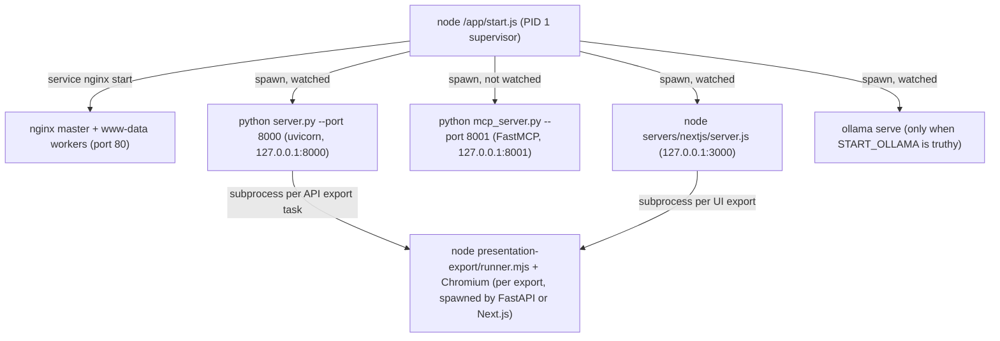
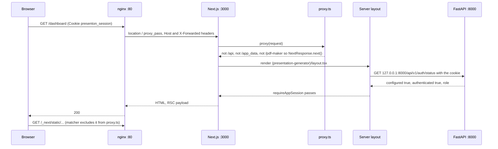
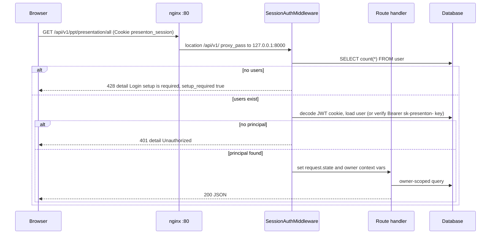
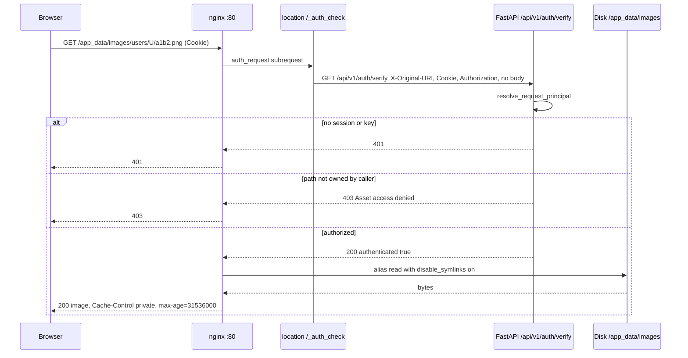
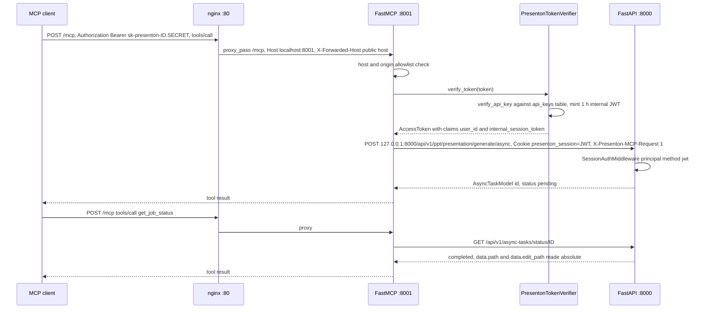

# Runtime topology

<div class="chapter-meta" markdown>
**Reads:** `start.js`, `nginx.conf`, `servers/fastapi/server.py`, `servers/fastapi/api/main.py`, `servers/fastapi/api/middlewares.py`, `servers/fastapi/api/v1/auth/router.py`, `servers/fastapi/api/v1/auth/assets.py`, `servers/fastapi/mcp_server.py`, `servers/nextjs/proxy.ts`, `scripts/export-permissions.cjs`, `electron/app/main.ts`  ·  **Builds on:** [Repository tour](02-repository-tour.md)  ·  **Time:** ~35 min
</div>

## What you will learn

This chapter is about what is running once a Presenton container has started, not how the image is built (that is [Docker build and deployment](26-docker-and-deployment.md)). You will follow `start.js` from its first line to the point where it parks forever, learn exactly which process listens on which port and how readiness and shutdown work, map every directory under `app_data` to the code that writes it, read every nginx `location` block, and trace four representative requests end to end: a page load, an authenticated API call, a protected image fetch, and an MCP tool call.

## Step 1: The process tree at a glance

In the production image the container command is `CMD ["node", "/app/start.js"]` (`Dockerfile:153`). The development image runs `CMD ["node", "/app/start.js", "--dev"]` (`Dockerfile.dev:93`). `start.js` is a small supervisor: it prepares the filesystem, starts nginx as a system service, and spawns four kinds of children.



| Process | Bind address | Started at | Watched by `start.js`? | Logs |
| --- | --- | --- | --- | --- |
| nginx | `0.0.0.0:80` (`listen 80`, `nginx.conf:26`) | `start.js:696-718` | No (only the `service` command's exit code) | `/var/log/nginx/error.log` (`nginx.conf:4`) |
| FastAPI (uvicorn) | `127.0.0.1:8000` (`servers/fastapi/server.py:21-28`) | `start.js:521-536`, `601-606` | Yes | forwarded to container stdout/stderr |
| MCP server (FastMCP) | `127.0.0.1:8001` (`servers/fastapi/mcp_server.py:457-465`) | `start.js:608-620` | No | discarded (`stdio: "ignore"`) |
| Next.js | `127.0.0.1:3000` | `start.js:538-566`, `622-627` | Yes | forwarded |
| Ollama (optional) | Ollama's default | `start.js:661-670` | Yes (no restart) | inherited |

Only port 80 is meant to be reachable from outside the container. FastAPI hard-codes `host = "127.0.0.1"` (`servers/fastapi/server.py:21`), Next.js is told `-H 127.0.0.1` or `HOSTNAME=127.0.0.1`, and FastMCP runs on `host="127.0.0.1"`. The Compose files also publish `1455:1455` for the Codex OAuth callback (`docker-compose.yml:12`), which is unrelated to the four servers above.

## Step 2: What happens before `main()` runs

`start.js` does real work at module load time, before `main()` is called.

### 2.1 umask and required environment

`process.umask(0o022)` (`start.js:28`) makes every file and directory created by the supervisor and its children default to group/other read but not write. Then:

```javascript title="start.js (excerpt)"
const fastapiPort = 8000;
const nextjsPort = 3000;
const appmcpPort = 8001;

const appDataDirectory = process.env.APP_DATA_DIRECTORY;
if (!appDataDirectory) {
  throw new Error("APP_DATA_DIRECTORY is required");
}
```

The ports are constants (`start.js:46-48`); there is no environment variable to change them. Both Dockerfiles set `APP_DATA_DIRECTORY=/app_data` and `TEMP_DIRECTORY=/tmp/presenton` (`Dockerfile:82-83`, `Dockerfile.dev:10-11`).

### 2.2 Creating the `app_data` skeleton

`ensureAppDataDirectories()` runs at `start.js:103`. It creates the data root and seven asset directories with mode `0755`, then tightens the three directories that hold export output:

```javascript title="start.js (excerpt)"
const appDataDirectoryMode = 0o755;
const userConfigPath = join(appDataDirectory, "userConfig.json");
const userConfigBackupPath = `${userConfigPath}.bak`;
const userDataDir = dirname(userConfigPath);
const appDataStaticDirectories = [
  "exports",
  "images",
  "uploads",
  "fonts",
  "templates",
  "pptx-to-html",
  "pptx-to-json",
].map((name) => join(appDataDirectory, name));
// ...
const ensureAppDataDirectories = () => {
  ensureReadableDirectory(userDataDir);
  for (const dirPath of appDataStaticDirectories) {
    ensureReadableDirectory(dirPath);
  }
  for (const name of ["exports", "pptx-to-html", "pptx-to-json"]) {
    ensureReadableExportFiles(join(appDataDirectory, name));
  }
};
```

`chmodBestEffort` (`start.js:73-82`) swallows `EPERM` and `EACCES`, so a volume owned by another UID (the comment mentions Kubernetes/OpenShift PVCs) does not crash startup. Immediately afterwards `userConfig.json` and `userConfig.json.bak` are forced to `0600` if they exist (`start.js:104-106`).

`ensureReadableExportFiles` calls `finalizeExportPermissions(dirPath, [appDataDirectory], { recursive: true, legacy: true })` from `scripts/export-permissions.cjs:37-64`. When the process runs as root it looks up the `www-data` (or `nginx`) group in `/etc/group` (`scripts/export-permissions.cjs:4-16`), `chown`s each path to that group, sets files to `0640`, and for directories in legacy mode keeps the existing mode but strips the "other" bits (`stat.mode & 0o7770`, `scripts/export-permissions.cjs:27-30`). It walks upward from the export directory to the boundary root (`app_data` itself), so `app_data`, `exports`, `pptx-to-html` and `pptx-to-json` end up group-readable by the nginx worker user but not world-readable.

!!! warning "Gotcha"
    nginx runs its workers as `user www-data` (`nginx.conf:1`) and serves `/app_data/...` straight from disk with `alias`. If you change the nginx user, or run the container as a non-root UID without a `www-data` group, exported files may become unreadable to nginx and downloads fail with 403/404 from nginx even though FastAPI produced the file. The export runtime calls the same helper after each export (`scripts/run-presentation-export.mjs:123`, `servers/fastapi/services/export_task_service.py:269-280`).

### 2.3 Environment variables `start.js` sets for its children

```javascript title="start.js (excerpt)"
process.env.USER_CONFIG_PATH = userConfigPath;
// Let Next.js middleware reach FastAPI over the loopback interface inside the
// container without having to bounce through nginx (the host-facing port is
// not reachable from inside the Next.js process).
if (!process.env.FAST_API_INTERNAL_URL) {
  process.env.FAST_API_INTERNAL_URL = `http://127.0.0.1:${fastapiPort}`;
}
```

| Variable | Value | Consumers |
| --- | --- | --- |
| `USER_CONFIG_PATH` | `/app_data/userConfig.json` | FastAPI `utils/get_env.py:63-64` (provider settings, auth secret), Next.js `lib/fastapi-internal.ts:27`, user-config route handlers |
| `FAST_API_INTERNAL_URL` | `http://127.0.0.1:8000` unless already set | Next.js `proxy.ts:10-23`, `utils/serverAuth.ts:17-30`, `lib/fastapi-internal.ts:3-13` |
| `HOSTNAME`, `PORT` | `127.0.0.1`, `3000` | only for the standalone Next.js server (`start.js:557-562`) |

Every child is spawned with `env: process.env`, so all container environment variables (provider keys, `PRESENTATION_GENERATION_MODE`, `DATABASE_URL` and the rest) reach FastAPI, MCP and Next.js unchanged.

## Step 3: `main()` in order

```javascript title="start.js (excerpt)"
const main = async () => {
  await ensurePresentationExportRuntime();
  await ensureOllamaRuntime();

  if (isDev) {
    await setupNodeModules();
    await ensurePresentationExportNodeDependencies();
  }

  setupUserConfigFromEnv();

  syncNginxConfigForDev();

  const nginxReadyPromise = startNginx();
  startServers(nginxReadyPromise);
  await nginxReadyPromise;
};
```

### 3.1 `ensurePresentationExportRuntime()` (`start.js:444-466`)

Skipped when `ENSURE_PRESENTATION_EXPORT_RUNTIME === "false"` or when `scripts/sync-presentation-export.cjs` is absent. Otherwise it runs `node scripts/sync-presentation-export.cjs --check-only`. The check (`scripts/sync-presentation-export.cjs:253-286`, `359-366`) verifies that `presentation-export/runner.mjs`, `node_modules/@presenton/export-core/package.json` and `presenton-export-version.json` exist, that the installed version equals `presentationExportVersion` in the root `package.json` (`v1.0.51` at this snapshot), that the sharp native runtime is valid, and that `export-permissions.cjs` was copied in.

- Production: a failed check throws `presentation-export runtime is missing in this container image. Rebuild the image so the runtime package is installed.` (`start.js:457-461`). Because `main()` is not awaited with a catch, the unhandled rejection terminates Node and the container exits.
- Development: it warns and runs the same script with `--force`, which downloads `presenton-export-core-opensource-<version>.tgz` from GitHub releases (`scripts/sync-presentation-export.cjs:32-33`, `382-394`).

### 3.2 `ensureOllamaRuntime()` (`start.js:433-442`)

If `START_OLLAMA` is truthy (anything except empty, `0`, `false`, `no`, `off`, `start.js:418-426`) and neither `/usr/bin/ollama` nor `/usr/local/bin/ollama` exists, it runs `curl -fsSL https://ollama.com/install.sh | sh`. The production image sets `START_OLLAMA=false` (`Dockerfile:91`).

### 3.3 Dev-only steps

With `--dev` (or `-d`, `start.js:43`): `npm ci` inside `servers/nextjs` (`start.js:171-195`), then `scripts/sync-document-dependencies.cjs` (`start.js:225-227`), which installs the LiteParse document-extraction dependencies.

### 3.4 `setupUserConfigFromEnv()` (`start.js:490-497`)

```javascript title="start.js (excerpt)"
const setupUserConfigFromEnv = () => {
  const existingConfig = readUserConfig();
  const envConfig = readUserConfigEnv(process.env);
  if (Object.keys(existingConfig).length > 0 && Object.keys(envConfig).length === 0) {
    return;
  }
  writeUserConfig(buildUserConfigFromEnv(existingConfig, process.env));
};
```

`readUserConfig()` falls back to `userConfig.json.bak` when the main file is missing or corrupt (`start.js:126-127`). `readUserConfigEnv` picks only the keys in `USER_CONFIG_ENV_KEYS` (`scripts/user-config-env.cjs:20-116`), ignoring empty strings. `buildUserConfigFromEnv` merges env over the existing file, converts boolean-like and integer values, and picks a default `IMAGE_PROVIDER` when none is given (`scripts/user-config-env.cjs:186-222`). `writeUserConfig` is crash-safe: it copies the current file to `.bak`, writes a unique temp file opened with `wx` and mode `0600`, `fsync`s it, then `rename`s it over the target (`start.js:140-168`). The details of the merge and how FastAPI consumes it belong to [Configuration and LLM providers](06-configuration-and-providers.md).

!!! warning "Gotcha"
    On the first FastAPI startup, `migrate_provider_settings_from_file` copies `userConfig.json` into a `ProviderSettings` database row. On every later startup the database row is mirrored back over the file, keeping only `AUTH_*` keys from the file (`servers/fastapi/services/provider_settings.py:85-127`). So editing provider variables in `docker-compose.yml` after the first boot does not reliably change the active provider: `start.js` writes them, then FastAPI's lifespan replaces them with the stored settings. Change providers in the Settings UI instead.

### 3.5 `syncNginxConfigForDev()` (`start.js:468-479`)

In dev only, copies the bind-mounted `/app/nginx.conf` to `/etc/nginx/nginx.conf`, so nginx changes in your working tree take effect on container restart without rebuilding.

### 3.6 `startNginx()` (`start.js:696-718`)

Runs `service nginx start`. The init script daemonizes nginx and exits; the promise resolves `true` on exit code 0 and `false` otherwise. It never rejects.

!!! warning "Gotcha"
    nginx is not in the supervisor's managed set. If nginx fails to start, `start.js` only logs `Nginx failed to start with exit code: ...` and keeps running FastAPI and Next.js, so the container looks healthy while port 80 refuses connections. If nginx dies later, nothing notices.

### 3.7 `startServers()` (`start.js:499-693`)

Spawn order: FastAPI, MCP, Next.js, then optional Ollama. Command lines:

| Child | Command | Working dir |
| --- | --- | --- |
| FastAPI | `python server.py --port 8000 --reload false` (`true` in dev) | `servers/fastapi` |
| MCP | `python mcp_server.py --port 8001` | `servers/fastapi` |
| Next.js, production | `node servers/nextjs/server.js` with `HOSTNAME=127.0.0.1 PORT=3000` (only if `server.js` exists, `start.js:539`) | `servers/nextjs` |
| Next.js, dev or no standalone build | `node node_modules/next/dist/bin/next dev --webpack -H 127.0.0.1 -p 3000` (or `start` instead of `dev --webpack`) | `servers/nextjs` |
| Ollama | `ollama serve` | `/` |

`server.py` simply parses `--port`, `--reload` and `--log-level` (default `info`) and calls `uvicorn.run("api.main:app", host="127.0.0.1", ...)` (`servers/fastapi/server.py:6-28`). Everything about the FastAPI app itself (lifespan, migrations, admin bootstrap, routers, middleware) is in [FastAPI app and startup](05-fastapi-startup.md).

## Step 4: Readiness, restarts and shutdown

### 4.1 Readiness

```javascript title="start.js (excerpt)"
const nextjsReadyPromise = waitForProcessOutputLine("Next.js", nextjsProcess, [
  /Ready in\s+\d+/i,
  /started server on/i,
]);
const fastApiReadyPromise = isDev
  ? waitForProcessOutputLine("FastAPI", fastApiProcess, [
      /Application startup complete\./i,
    ])
  : waitForProcessHttp(
      "FastAPI",
      fastApiProcess,
      fastapiPort,
      "/api/v1/auth/status"
    );
```

- Next.js readiness (both modes) is a regex match on any stdout or stderr line (`start.js:269-330`).
- FastAPI readiness in production is an HTTP probe: `GET http://127.0.0.1:8000/api/v1/auth/status`, 1 second per attempt, retried every 250 ms, giving up after 60 seconds (`start.js:332-416`). Any HTTP response counts as ready, whatever its status code (`start.js:373-376`). `/api/v1/auth/status` is listed in `SessionAuthMiddleware._PUBLIC_AUTH_PATHS` (`servers/fastapi/api/middlewares.py:30-36`), so it answers before any admin exists.
- In dev, FastAPI readiness is uvicorn's `Application startup complete.` line, which appears only after the lifespan (migrations, template import) finishes.

`Promise.all([fastApi, nextjs, nginx])` gates only the startup banner (`start.js:681-690`). On failure it logs `Skipping startup banner: ...`. Readiness never kills anything.

In production `forwardProcessOutput(..., { suppressStartupUrls: true })` hides lines such as `Uvicorn running on http://127.0.0.1:8000` (`start.js:229-234`, `644-656`) so users are not misled into opening internal loopback ports; the banner prints the public URL instead.

### 4.2 Child exit and restart

```javascript title="start.js (excerpt)"
childProcess.on("exit", (code, signal) => {
  managedProcesses.delete(childProcess);
  if (isShuttingDown) {
    return;
  }

  const exitCode = typeof code === "number" ? code : signal ? 1 : 0;
  if (isDev && exitCode === 0 && restart) {
    console.warn(`${name} exited cleanly; restarting it for development.`);
    setTimeout(() => {
      if (!isShuttingDown) {
        restart();
      }
    }, 1000);
    return;
  }
  // ...
  shutdown(exitCode);
});
```

| Situation | Behavior |
| --- | --- |
| Production, FastAPI/Next.js/Ollama exits (any code) | `shutdown(exitCode)`: kill every managed child, `process.exit(exitCode)`; the container stops |
| Dev, FastAPI or Next.js exits with code 0 | restart after 1 s; the new child gets `stdio: ["ignore", "inherit", "inherit"]` (`start.js:602-605`, `623-626`) |
| Dev, non-zero exit or killed by a signal | same as production: whole container exits |
| Ollama exits (any mode) | no restart function is passed (`start.js:670`), so `shutdown` |
| MCP server exits | nothing happens; the process is not watched |
| `SIGINT` / `SIGTERM` to Node | `shutdown(0)` (`start.js:518-519`) |

!!! warning "Gotcha"
    The MCP server is spawned with `stdio: "ignore"` and no exit watcher (`start.js:608-620`). If `mcp_server.py` crashes on startup (for example because `openai_spec.json` is missing or malformed), `/mcp` returns nginx 502 forever and there are no logs anywhere. Run `python mcp_server.py --port 8001` by hand inside the container to see its `DEBUG:` and `ERROR:` output.

After `startServers` returns its spawn work it awaits a never-resolving promise (`start.js:692`), which keeps the Node event loop alive.

## Step 5: The `app_data` directory

`APP_DATA_DIRECTORY` (`/app_data` in Docker, a bind mount `./app_data:/app_data` in every Compose service) is the only persistent state.

| Path | Mode | Written by | Read by |
| --- | --- | --- | --- |
| `userConfig.json` | `0600` | `start.js:140-168`; FastAPI `api/v1/auth/config.py:32-47` (auth secret, admin hash), `services/provider_settings.py:85-100` (mirror) | FastAPI, Next.js route handlers |
| `userConfig.json.bak` | `0600` | `start.js:129-138` | `start.js:126-127` fallback |
| `fastapi.db` | default umask | SQLite default when `DATABASE_URL` is empty (`servers/fastapi/utils/db_utils.py:57-60`) | FastAPI, MCP server |
| `exports/` and `exports/users/<user-id>/` | `0750`-style dirs, `0640` files, group `www-data` | export runtime writes to `exports/` (`scripts/run-presentation-export.mjs:47-51`), FastAPI moves into the owner folder (`servers/fastapi/services/export_task_service.py:773-805`) | nginx `/app_data/exports/` |
| `images/users/<user-id>/` | `0755` | generated and fetched slide images (`servers/fastapi/utils/asset_directory_utils.py:23-30`, `227-228`) | nginx `/app_data/images/` |
| `uploads/users/<user-id>/` | `0755` | uploaded documents and files (`asset_directory_utils.py:233-234`); editor image uploads from the Next.js route `servers/nextjs/app/api/upload-image/route.ts:46-48` | nginx, document ingestion |
| `fonts/` | `0755` | font uploads (`servers/fastapi/utils/font_uploads.py:68-72`) | nginx, public |
| `templates/<template-id>/static/` | `0755` | bundled template assets copied on startup (`servers/fastapi/templates/default_templates.py:295-307`) | nginx, public |
| `pptx-to-html/`, `pptx-to-json/` (`users/<user-id>/<session>/`) | like `exports/` | PPTX conversion artifacts for custom templates (`export_task_service.py:807-845`) | nginx with auth |
| `mem0/` (`qdrant/`, `history.db`) | default | chat memory (`servers/fastapi/services/mem0_oss_memory.py:94-102`, `MEM0_DIR` in Compose) | FastAPI |
| `preview_slide/<n>/` | default | template-generation previews (`servers/fastapi/templates/v2/tools.py:84-91`) | FastAPI |
| `assets/` | default | created by `IconFinderService` through `get_writable_path("assets")` as a fallback location for the icon vector store; normally empty because the bundled `servers/fastapi/assets/icons-vectorstore.json` is used (`servers/fastapi/services/icon_finder_service.py:53-58`) | FastAPI |

Per-user subfolders come from `_owned_directory` (`asset_directory_utils.py:23-30`): when a request has an owner (set by the auth middleware), files go under `<root>/users/<owner_id>/`. Files left in the root by pre-multi-user versions are "legacy" and only the admin may read them (`servers/fastapi/api/v1/auth/assets.py:106-123`).

!!! info "Why `0600` for userConfig.json"
    The file holds provider API keys, the JWT signing secret `AUTH_SECRET_KEY` (`servers/fastapi/api/v1/auth/config.py:71-81`) and a recovery copy of the admin password hash. The app-data mounts in nginx and FastAPI deliberately expose only the seven asset roots (`servers/fastapi/api/main.py:80-82`), never the root itself, so `userConfig.json` and `fastapi.db` have no HTTP path at all.

`TEMP_DIRECTORY` (`/tmp/presenton`) is not persistent; the export service puts per-owner work folders there (`servers/fastapi/services/export_task_service.py:164-171`).

## Step 6: The nginx routing table

`nginx.conf` has one `server` on port 80. Global settings: `worker_connections 1024`, `client_max_body_size 100M` (`nginx.conf:7`, `13`), and two `map`s that keep `X-Forwarded-Proto`/`X-Forwarded-Host` from an outer proxy, falling back to `$scheme` and `$http_host` (`nginx.conf:16-23`).

| Location | Upstream / target | Auth | Body limit | Timeouts | Notes |
| --- | --- | --- | --- | --- | --- |
| `/` (`:29`) | `http://localhost:3000` (Next.js) | none at nginx; Next.js layouts and `proxy.ts` | 100M | read 30m, connect 30m | WebSocket `Upgrade`/`Connection` headers (Next dev HMR); `Host $http_host` keeps the port |
| `/api/v1/` (`:45`) | `http://localhost:8000` (path kept) | FastAPI `SessionAuthMiddleware` | 110M | read/send/connect 30m | `error_page 413 = @request_entity_too_large` |
| `/api/v2/` (`:59`) | `http://localhost:8000` | FastAPI | 100M (inherited) | 30m | no custom 413 body |
| `@request_entity_too_large` (`:71`) | returns 413 | n/a | n/a | n/a | body `{"detail":"File size must be less than 100MB."}` |
| `/mcp/` and `/mcp` (`:77`, `:94`) | `http://localhost:8001/mcp/` and `/mcp` | bearer API key checked inside FastMCP | 145M | read/connect 30m | forces `Host: localhost:8001`, forwards public host in `X-Forwarded-Host` |
| `/docs` (`:110`) | `http://localhost:8000/docs` | FastAPI (protected path) | 100M | 30m | uses `$host` and `$scheme`, not the forwarded maps |
| `/openapi.json` (`:120`) | `http://localhost:8000/openapi.json` | FastAPI (protected path) | 100M | 30m | same as `/docs` |
| `= /_auth_check` (`:133`) | `http://localhost:8000/api/v1/auth/verify` | `internal` only | body dropped | defaults | sends `X-Original-URI`, `Cookie`, `Authorization` |
| `/static/` (`:153`) | `alias /app/servers/fastapi/static/` | none | n/a | n/a | `expires 1y`, `Cache-Control: public, immutable` |
| `/app_data/images/`, `exports/`, `uploads/`, `pptx-to-html/`, `pptx-to-json/` | `alias /app_data/<root>/` | `auth_request /_auth_check` | n/a | n/a | `disable_symlinks on`, `Cache-Control: private, max-age=31536000` |
| `/app_data/fonts/`, `/app_data/templates/` | `alias` | none | n/a | n/a | same caching; matches `SHARED_APP_DATA_ROOTS` (`assets.py:17`) |

nginx picks the longest matching prefix, so `/api/v1/...` never reaches Next.js and `/app_data/images/...` never reaches FastAPI in Docker. There is no location for `/redoc`; it falls to `/` and Next.js answers 404.

### 6.1 The `/static/` path-traversal comment

```nginx title="nginx.conf (excerpt)"
    # Bundled UI static assets (logos, fonts packaged with the app) are safe to
    # serve unauthenticated; they contain no user data. The trailing slash on
    # the location pattern is required: with a bare `/static`, a request like
    # `/static../server.py` matches this block and `alias` rewrites it to
    # `/app/servers/fastapi/static/../server.py`, which nginx resolves to
    # `/app/servers/fastapi/server.py` — unauthenticated arbitrary read of any
    # file under /app the worker can stat. `/static/` constrains the match so
    # the only path that lands here is one that actually started with the
    # separator.
    location /static/ {
      alias /app/servers/fastapi/static/;
```

This is the classic nginx "alias traversal" misconfiguration: with `location /static` plus `alias .../static/`, nginx substitutes the matched prefix and the rest of the URI (`../server.py`) is appended verbatim. Ending both the location and the alias with `/` closes it.

!!! warning "Gotcha"
    When you add a new `alias` location (for example a new asset root), always end both the `location` prefix and the `alias` path with a slash, keep `disable_symlinks on` for user-writable roots, and add the root to `PRIVATE_APP_DATA_ROOTS` or `SHARED_APP_DATA_ROOTS` in `servers/fastapi/api/v1/auth/assets.py:10-17`. Otherwise `/_auth_check` returns 403 for every file in it, because `_namespace_authorized` rejects unknown roots (`assets.py:111-112`).

## Step 7: Sequence (a), a browser page load

Take `GET /dashboard` with a valid session cookie.



1. nginx matches `location /` and forwards to `localhost:3000` (`nginx.conf:29-43`).
2. `proxy.ts` runs for every path except `_next/static` and `favicon.ico` (`servers/nextjs/proxy.ts:174-176`). For page paths it first runs `desktopRequestDenied` (a no-op unless `PRESENTON_ELECTRON=true`, `servers/nextjs/lib/desktop-auth.ts:14-15`), then returns `NextResponse.next()` (`proxy.ts:103-105`).
3. The `(presentation-generator)` layout calls `requireAppSession()` (`servers/nextjs/app/(presentation-generator)/layout.tsx:6-7`), which fetches `${FAST_API_INTERNAL_URL}/api/v1/auth/status` with the incoming cookie (`servers/nextjs/utils/serverAuth.ts:37-58`). It redirects to `/` when FastAPI is unreachable or no admin exists, and to `/?reason=unauthorized` when not signed in (`serverAuth.ts:93-107`).
4. The response to `/api/v1/auth/status` looks like this (`servers/fastapi/api/v1/auth/router.py:71-78`):

```json
{"configured": true, "authenticated": true, "username": "admin",
 "user_id": "6f1c2d8e-...", "role": "admin"}
```

Page-level guarding is covered in [Settings, onboarding, auth UI](23-settings-and-auth-ui.md).

## Step 8: Sequence (b), an authenticated API call

Browser code builds FastAPI URLs with `getApiUrl()`, which in the Docker web runtime returns a same-origin relative path such as `/api/v1/ppt/presentation/all` (`servers/nextjs/utils/api.ts:123-141`, `resolveBackendPathForRuntime` at `api.ts:88-98`). So the request goes to nginx, not to Next.js.



The middleware stack, outermost first, is: the `static_icon_fallback_middleware` function middleware, `SessionAuthMiddleware`, `UserConfigEnvUpdateMiddleware`, then `CORSMiddleware` (Starlette runs the last-added middleware first, `servers/fastapi/api/main.py:94-118`). `SessionAuthMiddleware.dispatch` (`servers/fastapi/api/middlewares.py:55-152`) does, in order:

1. Desktop guard (`desktop_request_denied`), then the auth-disabled branch for Electron.
2. Pass through `OPTIONS`, public auth paths, and paths that do not require auth (`_requires_auth`, `middlewares.py:44-53`: everything under `/api/`, `/app_data/` except fonts and templates, plus `/docs`, `/openapi.json`, `/redoc`).
3. 428 when the `user` table is empty (`middlewares.py:83-94`).
4. `resolve_request_principal` (`servers/fastapi/api/v1/auth/principal.py:22-57`): cookie JWT first, then `Authorization: Bearer <token>` checked as an API key. Failure gives 401.
5. Admin-only paths (`/api/v1/admin/`, Codex auth, font POST/DELETE, model listings, `/api/v1/ppt/images/test`) require a browser JWT from an admin, otherwise 403 `Admin browser session required` (`middlewares.py:100-119`).
6. Store the principal on `request.state`, mint an internal JWT for API-key callers (used later by the exporter), set owner context variables, and call the route.

### 8.1 How `proxy.ts` behaves for `/api` paths

In Docker, `/api/v1/*` and `/api/v2/*` never reach Next.js because nginx routes them first. Next.js's own route handlers do reach it: `servers/nextjs/app/api/` contains `export-presentation`, `export-presentation-data/[id]`, `read-file`, `runtime-config`, `telemetry-status`, `update-svg`, `upload-image`, `user-config`, `has-required-key` and `github-stars`. For those, `proxy.ts:138-171` applies:

| Condition | Result |
| --- | --- |
| `DISABLE_AUTH` truthy | pass through (`continueRequest`) |
| `OPTIONS`, or path is `/api/v1/auth/*`, `/api/telemetry-status`, `/api/update-svg`, `/api/export-presentation-data/*` | pass through |
| `Authorization: Bearer sk-presenton-...` | if FastAPI path, rewrite to FastAPI, else 403 `API keys are only accepted by the Presenton API` |
| cookie valid per `GET {FAST_API_INTERNAL_URL}/api/v1/auth/status` | pass through |
| no admin configured | 428 `{"detail":"Login setup is required","setup_required":true}` |
| otherwise | 401 `{"detail":"Unauthorized"}` |

`continueRequest` rewrites `/api/v1` and `/api/v2` paths to the FastAPI base URL and lets other paths fall to the Next.js handler (`proxy.ts:51-55`). The rewrite branch matters when Next.js is reached without nginx (local `next dev` and Electron). `getAuthStatus` treats any fetch failure as `{configured: true, authenticated: false}` (`proxy.ts:65-85`), so a down FastAPI produces 401, not 428.

!!! warning "Gotcha"
    API keys are rejected by Next.js route handlers on purpose (`proxy.ts:146-156`). A script that calls `/api/export-presentation` with `Authorization: Bearer sk-presenton-...` gets 403. Use the FastAPI endpoints such as `POST /api/v1/ppt/presentation/{id}/export` instead; see [REST API, async tasks, webhooks, MCP](15-api-async-mcp.md).

## Step 9: Sequence (c), a protected image under `/app_data/images`

Generated images are stored as files and referenced in slide JSON by URL, for example `/app_data/images/users/6f1c.../a1b2.png`. In Docker the filesystem path and the URL path coincide because `APP_DATA_DIRECTORY` is `/app_data`.



`verify_session` (`servers/fastapi/api/v1/auth/router.py:81-107`) is public at the middleware level (it is in `_PUBLIC_AUTH_PATHS`) and does its own check. It calls `is_app_data_path_authorized(original_uri, ...)` (`servers/fastapi/api/v1/auth/assets.py:78-103`), which:

1. Decodes the path up to 8 times until stable, failing closed on deeper nesting, and rejects NUL bytes, backslashes, empty, `.` and `..` segments (`assets.py:47-75`).
2. Allows `fonts` and `templates` for everyone; for the five private roots requires `users/<caller-id>/<file>` (at least three segments) or, for legacy root-level files, an admin (`assets.py:106-123`).
3. Re-checks the canonical `realpath` target relative to the root, so a symlink cannot alias another user's folder (`assets.py:89-103`).

!!! warning "Gotcha"
    nginx `auth_request` treats only 2xx as allow and 401/403 as deny; any other status from `/api/v1/auth/verify` (for example a 500 while the database is locked) becomes a 500 to the browser. Broken images during heavy SQLite contention usually come from this subrequest, not from the file itself.

Outside Docker, the same URL is served by FastAPI's own `_OwnerScopedStaticFiles` mounts (`servers/fastapi/api/v1/auth/assets.py:20-44`, mounted in `servers/fastapi/api/main.py:77-82`), with `SessionAuthMiddleware` returning 404 `Asset not found` for unauthorized paths (`middlewares.py:138-148`). The response code for "not yours" therefore differs: 403 behind nginx, 404 without it.

## Step 10: Sequence (d), an MCP client call to `/mcp`

`mcp_server.py` builds a FastMCP server from the checked-in OpenAPI spec `servers/fastapi/openai_spec.json` and exposes only a short allowlist of routes as tools (`servers/fastapi/mcp_server.py:54-125`). It proxies each tool call to FastAPI over HTTP.



Key code points:

- nginx forces `Host: localhost:8001` because FastMCP's DNS-rebinding guard only accepts `localhost`, `127.0.0.1` and `::1` (`servers/fastapi/mcp_server.py:41`, `nginx.conf:85-87`). The browser-visible host travels in `X-Forwarded-Host`. Allowed `Origin`s are local origins plus `PRESENTON_PUBLIC_URL` when set (`mcp_server.py:128-140`).
- nginx deliberately does not use `/_auth_check` for `/mcp` (comment at `nginx.conf:79-81`): the asset ownership check would reject the non-asset path.
- `PresentonTokenVerifier.verify_token` accepts only tokens starting with `sk-presenton-` (`mcp_server.py:285-316`). Browser cookies are never accepted as MCP credentials.
- In normal operation `attach_request_auth_header` never forwards the long-lived API key to FastAPI (the only bearer fallback is for auth-disabled development and old tests, per its docstring). It sends the minted internal session as `Cookie: presenton_session=...`, adds `X-Presenton-MCP-Request: 1`, and copies `X-Forwarded-Host`/`X-Forwarded-Proto` (`mcp_server.py:365-414`). That header makes FastAPI turn `path`, `edit_path` and `preview_url` into absolute URLs (`servers/fastapi/utils/mcp_public_urls.py:9-52`).
- The internal JWT lives for one hour (`MCP_INTERNAL_SESSION_TTL_SECONDS`, `mcp_server.py:39`) because the same session is reused by the exporter at the end of a long generation. Upstream reads time out after 600 s, connects after 15 s (`mcp_server.py:31-34`).
- Which tools exist depends on `PRESENTATION_GENERATION_MODE` (`get_mcp_route_maps`, `mcp_server.py:113-125`). The full tool list and naming are in [REST API, async tasks, webhooks, MCP](15-api-async-mcp.md).

!!! warning "Gotcha"
    The MCP server reads the database directly (`async_session_maker` for API-key verification) but serves everything else by calling FastAPI at the hard-coded `http://127.0.0.1:8000` (`MCP_API_BASE_URL`, `mcp_server.py:31`). It must run in the same network namespace as FastAPI, with the same `DATABASE_URL` and `USER_CONFIG_PATH`; splitting them into separate containers needs code changes.

## Step 11: One more hop, the export runtime calling back into the app

When FastAPI exports a deck, `export_presentation` builds a URL `"{NEXT_PUBLIC_URL or http://127.0.0.1}/pdf-maker?id=..."` and hands it to the export runtime (`servers/fastapi/utils/export_utils.py:18-40`). In Docker `NEXT_PUBLIC_URL` is not set, so headless Chromium loads `http://127.0.0.1/pdf-maker`, which is nginx on port 80, then `location /`, then Next.js. The caller's cookie travels two ways: the task's `cookieHeader` is installed as browser cookies for the page origin by the runner (`scripts/run-presentation-export.mjs:43-56`), and it is also appended as a `#exportCookie=...` URL fragment that `PdfMakerPage` reads (`export_utils.py:35-36`, `servers/nextjs/app/(export)/pdf-maker/PdfMakerPage.tsx:146-152`). The browser export path built by Next.js additionally sets an `exportSession` query parameter (`servers/nextjs/lib/run-bundled-presentation-export.ts:162-165`), which `proxy.ts:114-136` converts into a `presenton_session` cookie before redirecting to the clean URL. The whole export path is the subject of [PPTX and PDF export](24-export-pipeline.md).

!!! warning "Gotcha"
    Because the exporter goes through nginx on `127.0.0.1:80` from inside the container, an nginx that failed to start (Step 3.6) breaks exports even if you were reaching the UI some other way, and a custom nginx config that drops `location /` or binds a different port breaks every PPTX/PDF download.

## Step 12: Electron, the same code without nginx

The desktop app runs the same FastAPI and Next.js with a different topology. Details are in [Electron desktop app](27-electron.md); the contrasts that matter here:

| Concern | Docker | Electron |
| --- | --- | --- |
| Reverse proxy | nginx on port 80 | none |
| Ports | fixed 8000, 3000, 8001 | first two free ports scanning upward from 40000 (`findUnusedPorts`, `electron/app/utils/index.ts:39-65`, called at `electron/app/main.ts:468-470`) |
| How the browser reaches FastAPI | same origin through nginx | `NEXT_PUBLIC_FAST_API=http://127.0.0.1:<port>` set by `setupEnv` (`electron/app/utils/index.ts:5-22`), plus `proxy.ts` rewriting `/app_data` and `/static` (`proxy.ts:107-112`) and `/api/v1`, `/api/v2` (`continueRequest`, `proxy.ts:51-55`) to FastAPI at request time |
| Auth | enabled; admin account required | `DISABLE_AUTH` defaults to `"true"` unless `ELECTRON_DISABLE_AUTH`/`DISABLE_AUTH` says otherwise (`electron/app/main.ts:150-160`, `455-459`); FastAPI and Next.js short-circuit to an "electron" admin |
| Request guard | none beyond auth | desktop token cookie or header plus exact host and origin checks (`servers/nextjs/lib/desktop-auth.ts:14-44`) |
| MCP | port 8001 behind `/mcp` | disabled when `PRESENTON_ELECTRON` is truthy (`mcp_server.py:319-321`) |
| CORS | `*` fallback (same origin anyway) | exact `NEXT_PUBLIC_URL` origin with credentials (`servers/fastapi/api/main.py:92-100`) |

## What you now know

- `start.js` validates the export runtime, optionally installs Ollama, writes `userConfig.json` atomically from the environment, starts nginx as a daemon, then spawns FastAPI (8000), the MCP server (8001) and Next.js (3000), all bound to loopback.
- Readiness is an HTTP probe of `/api/v1/auth/status` for FastAPI in production and log-line regexes otherwise; it only gates the banner. Any watched child exit stops the container, except clean exits in dev, which restart; nginx and MCP are not watched.
- `app_data` holds `userConfig.json` (0600), the SQLite database, and seven asset roots with per-user `users/<id>/` folders; export roots are group-owned by `www-data` with no world bits.
- nginx routes `/api/v1`, `/api/v2`, `/docs` and `/openapi.json` to FastAPI, `/mcp` to FastMCP, serves `/static/` and `/app_data/*` from disk, and protects five private asset roots with an `auth_request` to `/api/v1/auth/verify`.
- `proxy.ts` guards Next.js's own `/api` handlers, rejects API keys there, and performs the rewrites that replace nginx in Electron.

## Next

With the topology in mind, get a copy running yourself in [Running it locally](04-running-locally.md).
