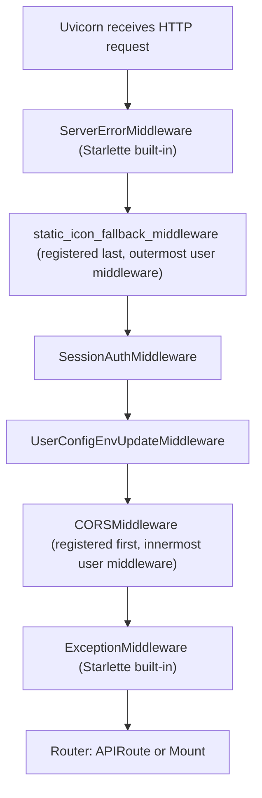
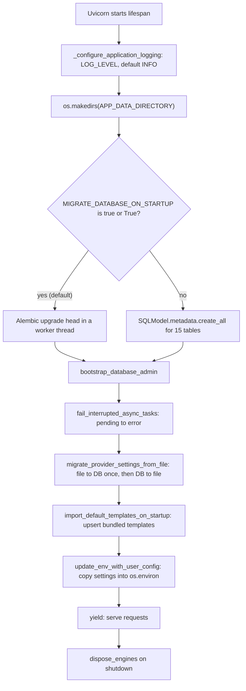
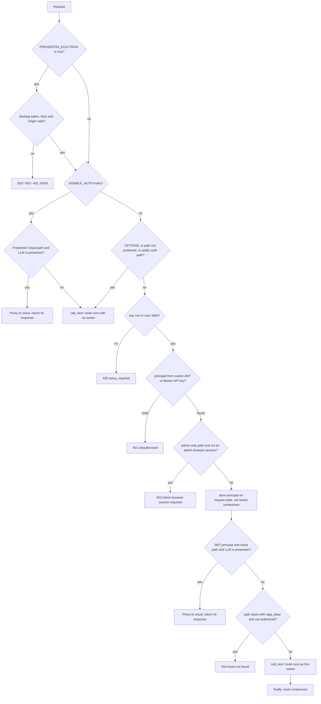

# FastAPI app and startup

<div class="chapter-meta" markdown>
**Reads:** `servers/fastapi/server.py`, `servers/fastapi/api/main.py`, `servers/fastapi/api/lifespan.py`, `servers/fastapi/api/middlewares.py`, `servers/fastapi/api/v1/auth/context.py`, `servers/fastapi/api/v1/auth/assets.py`, `servers/fastapi/services/database.py`  ·  **Builds on:** [Running it locally](04-running-locally.md)  ·  **Time:** ~35 min
</div>

This chapter follows the FastAPI process from `python server.py` to the first request it serves. You will see every router and its full URL prefix, the `/app_data` and `/static` mounts, the CORS rule, the middleware stack in the order it really executes, each lifespan step, and the `SessionAuthMiddleware` decision tree. It ends with the request-scoped owner context that makes multi-user isolation automatic, and a worked example of adding an endpoint the way the codebase expects.

All paths below are relative to the repository root. Unless stated otherwise, `servers/fastapi/` is the Python package root and the working directory of the process.

## Step 1: The process entry point (`server.py`)

The whole backend is started by a 29-line script, `servers/fastapi/server.py`. It parses three flags and hands a module path string to Uvicorn.

| Flag | Type | Default | Effect |
|---|---|---|---|
| `--port` | `int` | required | TCP port (`server.py:7`) |
| `--reload` | `str` | `"false"` | Only the exact string `"true"` enables Uvicorn auto-reload (`server.py:11`, `server.py:20`) |
| `--log-level` | `str` | `"info"` | Passed to `uvicorn.run(log_level=...)` (`server.py:13`) |

The bind host is hard-coded:

```python title="servers/fastapi/server.py (excerpt)"
    args = parser.parse_args()
    reload = args.reload == "true"
    host = "127.0.0.1"

    uvicorn.run(
        "api.main:app",
        host=host,
        port=args.port,
        log_level=args.log_level,
        reload=reload,
    )
```

FastAPI therefore only listens on loopback. In Docker, nginx is the public face and proxies `/api/v1/`, `/api/v2/`, `/docs` and `/openapi.json` to `localhost:8000` (`nginx.conf:45`, `nginx.conf:59`, `nginx.conf:110`). Two launchers call this script:

- `start.js` spawns `python server.py --port 8000 --reload <isDev>` with `cwd` set to `servers/fastapi` (`start.js:521`, `start.js:532`, with `fastapiDir` defined at `start.js:33`).
- Electron runs either `uv run python server.py --port <port> --reload true` in development or a PyInstaller binary with `--port <port>` (`electron/app/utils/servers.ts:139`, `electron/app/utils/servers.ts:143`). See [Electron desktop app](27-electron.md).

!!! warning "Gotcha"
    `server.py` imports `from api.main import app` at line 3, before `uvicorn.run` receives the string `"api.main:app"`. With `--reload true`, the Uvicorn supervisor process has therefore already executed all of `api/main.py` (Sentry init, directory creation, mounts) even though only the reloaded child serves requests. The lifespan (Step 8) runs only in the serving process.

The working directory matters. `utils/path_helpers.py:15` resolves bundled read-only assets with `os.path.join(os.getcwd(), relative_path)`, so `static/` and `assets/` are found only when the process starts inside `servers/fastapi`.

## Step 2: Import-time work in `api/main.py`

Everything in `api/main.py` runs when the module is imported, before any request and before the lifespan.

### 2.1 A sandbox-safe MIME table

`init_sandbox_safe_mimetypes()` is the first statement (`api/main.py:29`). It re-initializes the stdlib `mimetypes` table with `files=[]`, so Python never reads OS databases such as `/etc/apache2/mime.types`, then registers 15 explicit types (`utils/mime_types.py:4`). The docstring explains why: macOS App Store sandboxed builds can be denied access to those files, and Starlette's `FileResponse` calls `mimetypes.guess_type` lazily (`utils/mime_types.py:23`).

| Extension | Media type |
|---|---|
| `.avif`, `.gif`, `.jpeg`/`.jpg`, `.png`, `.svg`, `.webp` | image types (`.svg` is `image/svg+xml`) |
| `.otf`, `.ttf`, `.woff`, `.woff2` | `font/otf`, `font/ttf`, `font/woff`, `font/woff2` |
| `.pdf`, `.docx`, `.pptx`, `.xlsx` | `application/pdf` and the three OOXML types |

### 2.2 Optional Sentry

`_maybe_init_sentry()` runs at `api/main.py:63`, still at import time.

```python title="servers/fastapi/api/main.py (excerpt)"
    traces_sample_rate = get_sentry_traces_sample_rate_env()
    send_default_pii = get_sentry_send_default_pii_env()
    try:
        parsed_sample_rate = (
            float(traces_sample_rate) if traces_sample_rate is not None else 1.0
        )
    except ValueError:
        parsed_sample_rate = 1.0

    parsed_send_default_pii = (
        send_default_pii.lower() == "true" if send_default_pii is not None else True
    )

    sentry_sdk.init(
        dsn=sentry_dsn,
        send_default_pii=parsed_send_default_pii,
        traces_sample_rate=parsed_sample_rate,
    )
```

| Env var | Getter | Default when unset |
|---|---|---|
| `SENTRY_DSN` | `get_sentry_dsn_env` (`utils/get_env.py:457`) | No Sentry at all |
| `SENTRY_TRACES_SAMPLE_RATE` | `get_sentry_traces_sample_rate_env` (`utils/get_env.py:461`) | `1.0`; also `1.0` if not parseable as float |
| `SENTRY_SEND_DEFAULT_PII` | `get_sentry_send_default_pii_env` (`utils/get_env.py:465`) | `True`; any value other than `true` (case-insensitive) means `False` |

If `sentry_sdk` cannot be imported, the function returns silently (`api/main.py:37`), because the SDK is optional in some build targets.

!!! warning "Gotcha"
    Setting only `SENTRY_DSN` gives you 100 percent trace sampling and `send_default_pii=True`. Set both companion variables explicitly in any deployment that handles real user data.

### 2.3 Creating the application

```python title="servers/fastapi/api/main.py (excerpt)"
app = FastAPI(lifespan=app_lifespan)
```

There are no global exception handlers, no custom OpenAPI configuration and no root path. The only startup hook is the `app_lifespan` async context manager covered in Step 8.

## Step 3: Registering routers

Seven top-level routers are included in this order (`api/main.py:68` to `api/main.py:74`):

```python title="servers/fastapi/api/main.py (excerpt)"
app.include_router(API_V1_PPT_ROUTER)
app.include_router(API_V1_WEBHOOK_ROUTER)
app.include_router(API_V1_MOCK_ROUTER)
app.include_router(API_V1_AUTH_ROUTER)
app.include_router(API_V1_ADMIN_ROUTER)
app.include_router(API_V1_ASYNC_TASKS_ROUTER)
app.include_router(API_V2_ROUTER)
```

Two of them are aggregators: `API_V1_PPT_ROUTER = APIRouter(prefix="/api/v1/ppt")` includes 17 feature routers (`api/v1/ppt/router.py:22` to `api/v1/ppt/router.py:40`), and `API_V2_ROUTER = APIRouter(prefix="/api/v2")` nests `/ppt` and then `/presentation` (`api/v2/router.py:6`, `api/v2/ppt/router.py:6`, `api/v2/ppt/endpoints/presentation.py:35`). `API_V1_AUTH_ROUTER` nests the Presenton Cloud device-login router under `/presenton` (`api/v1/auth/router.py:28`). The backend declares 101 route decorators in total.

| Full prefix | Router constant and definition | Endpoints (method and path suffix) |
|---|---|---|
| `/api/v1/ppt/files` | `FILES_ROUTER` `api/v1/ppt/endpoints/files.py:16` | POST `/upload`, POST `/mcp-upload`, POST `/decompose`, POST `/update` |
| `/api/v1/ppt/fonts` | `FONTS_ROUTER` `api/v1/ppt/endpoints/fonts.py:18` | POST `/upload`, GET `/list`, GET `/uploaded`, DELETE `/delete/{filename}` |
| `/api/v1/ppt/outlines` | `OUTLINES_ROUTER` `api/v1/ppt/endpoints/outlines.py:40` | GET `/{id}`, PUT `/{id}`, GET `/stream/{id}` |
| `/api/v1/ppt/slide` | `SLIDE_ROUTER` `api/v1/ppt/endpoints/slide.py:30` | POST `/edit`, POST `/edit-html` |
| `/api/v1/ppt/images` | `IMAGES_ROUTER` `api/v1/ppt/endpoints/images.py:31` | POST `/test`, GET `/search`, GET `/generate`, GET `/generated`, POST `/upload`, GET `/uploaded`, DELETE `/{id}` |
| `/api/v1/ppt/icons` | `ICONS_ROUTER` `api/v1/ppt/endpoints/icons.py:7` | GET `/search` |
| `/api/v1/ppt/ollama` | `OLLAMA_ROUTER` `api/v1/ppt/endpoints/ollama.py:13` | GET `/models/supported`, GET `/models/available`, GET `/models/library`, POST `/models/pull` |
| `/api/v1/ppt/openai` | `OPENAI_ROUTER` `api/v1/ppt/endpoints/openai.py:9` | POST `/models/available` |
| `/api/v1/ppt/openrouter` | `OPENROUTER_ROUTER` `api/v1/ppt/endpoints/openrouter.py:11` | POST `/providers/available` |
| `/api/v1/ppt/anthropic` | `ANTHROPIC_ROUTER` `api/v1/ppt/endpoints/anthropic.py:9` | POST `/models/available` |
| `/api/v1/ppt/google` | `GOOGLE_ROUTER` `api/v1/ppt/endpoints/google.py:6` | POST `/models/available` |
| `/api/v1/ppt/generation` | `GENERATION_ROUTER` `api/v1/ppt/endpoints/generation.py:7` | POST `/defaults` |
| `/api/v1/ppt/codex/auth` | `CODEX_AUTH_ROUTER` `api/v1/ppt/endpoints/codex_auth.py:48` | POST `/initiate`, GET `/status/{session_id}`, POST `/exchange`, POST `/refresh`, GET `/status`, POST `/logout` |
| `/api/v1/ppt/presentation` | `PRESENTATION_ROUTER` `api/v1/ppt/endpoints/presentation.py:136` | GET `/all`, GET `/{id}`, DELETE `/{id}`, POST `/{id}/duplicate`, POST `/{id}/regenerate`, POST `/{id}/export`, POST `/create`, POST `/create/blank`, POST `/prepare`, GET `/stream/{id}`, PATCH `/update`, PATCH `/slide_update`, POST `/generate`, POST `/generate/async`, GET `/status/{id}`, POST `/edit`, POST `/derive` |
| `/api/v1/ppt/chat` | `CHAT_ROUTER` `api/v1/ppt/endpoints/chat.py:28` | GET `/conversations`, GET `/history`, DELETE `/conversation`, POST `/message`, POST `/message/stream` |
| `/api/v1/ppt/template` | `TEMPLATE_ROUTER` `api/v1/ppt/endpoints/template.py:96` | GET `/all`, POST `/fonts-upload-and-slides-preview`, POST `/mcp-upload`, POST `/init`, POST `/async`, POST `/async/{task_id}/retry`, POST `/layouts/generate`, POST `/layouts/create`, POST `/generate-blocks`, PATCH `/{template_id}/layouts`, PATCH `/{template_id}`, GET `/{template_id}/theme`, GET `/{template_id}`, DELETE `/{template_id}` |
| `/api/v1/ppt/community/presentations` | `COMMUNITY_ROUTER` `api/v1/ppt/endpoints/community.py:11` | GET `` (empty suffix), GET `/{community_id}` |
| `/api/v1/webhook` | `API_V1_WEBHOOK_ROUTER` `api/v1/webhook/router.py:10` | POST `/subscribe` (201), DELETE `/unsubscribe` (204) |
| `/api/v1/mock` | `API_V1_MOCK_ROUTER` `api/v1/mock/router.py:9` | GET `/presentation-generation-completed`, GET `/presentation-generation-failed` |
| `/api/v1/auth` | `API_V1_AUTH_ROUTER` `api/v1/auth/router.py:27` | GET `/status`, GET `/verify`, POST `/setup`, POST `/login`, POST `/logout` |
| `/api/v1/auth/presenton` | `PRESENTON_OAUTH_ROUTER` `api/v1/auth/presenton_oauth.py:29` | GET `/status`, POST `/logout`, POST `/device/start`, POST `/device/poll` |
| `/api/v1/admin` | `API_V1_ADMIN_ROUTER` `api/v1/admin/router.py:41` | GET/POST `/api-keys`, GET `/api-keys/{api_key_id}/token`, POST `/api-keys/{api_key_id}/revoke`, GET/PUT `/provider-settings`, GET/POST `/users`, PUT `/users/{user_id}/password`, DELETE `/users/{user_id}` |
| `/api/v1/async-tasks` | `API_V1_ASYNC_TASKS_ROUTER` `api/v1/async_tasks/router.py:14` | GET `` (list), GET `/status/{id}` |
| `/api/v2/ppt/presentation` | `PRESENTATION_V2_ROUTER` `api/v2/ppt/endpoints/presentation.py:35` | POST `/generate/smart`, POST `/generate/smart/async` |

Request and response shapes for each endpoint live in the feature chapters and in the [Endpoint index](../appendix-endpoints.md).

!!! warning "Gotcha"
    Declaration order inside a router is part of the routing logic. `GET /presentation/all` is declared at `presentation.py:1499`, before `GET /presentation/{id}` at `presentation.py:1551`; `GET /template/all` (`template.py:1113`) precedes `GET /template/{template_id}` (`template.py:2122`). Starlette matches routes in order, so a new literal path such as `/presentation/recent` must be declared above the `/{id}` route or it will be captured by it (and, because `id` is typed `uuid.UUID`, rejected with 422).

## Step 4: Mounting `/app_data` and `/static`

### 4.1 Per-root `app_data` mounts

```python title="servers/fastapi/api/main.py (excerpt)"
app_data_dir = get_app_data_directory_env()
if app_data_dir:
    os.makedirs(app_data_dir, exist_ok=True)
    # Configuration, databases, logs and Chromium state are private even when
    # account login is disabled. Only browser assets have HTTP mounts.
    mount_app_data_assets(app, app_data_dir)
```

`APP_DATA_DIRECTORY` holds `userConfig.json`, the SQLite database `fastapi.db`, logs and browser state. The directory itself is never mounted. Instead `mount_app_data_assets` (`api/v1/auth/assets.py:39`) mounts seven subdirectories, each with its own `StaticFiles` instance, in sorted order:

| Mount path | Root class | Visibility |
|---|---|---|
| `/app_data/exports` | private (`PRIVATE_APP_DATA_ROOTS`, `assets.py:10`) | owner, or legacy files for admin |
| `/app_data/fonts` | shared (`SHARED_APP_DATA_ROOTS`, `assets.py:17`) | anyone (no login needed) |
| `/app_data/images` | private | owner |
| `/app_data/pptx-to-html` | private | owner |
| `/app_data/pptx-to-json` | private | owner |
| `/app_data/templates` | shared | anyone (no login needed) |
| `/app_data/uploads` | private | owner |

Each mount is an `_OwnerScopedStaticFiles` (`assets.py:20`). Its `lookup_path` override authorizes the exact file `StaticFiles` resolved, after symlinks, against the current owner:

```python title="servers/fastapi/api/v1/auth/assets.py (excerpt)"
    def lookup_path(self, path: str):
        full_path, file_stat = super().lookup_path(path)
        owner_id = get_current_owner_id()
        if full_path and owner_id is not None:
            # Authorize the exact file StaticFiles will serve. Repeated URL
            # decoding at a proxy must not select a different filesystem alias.
            root = os.path.realpath(self.directory)
            relative = os.path.relpath(full_path, root)
            parts = (self.asset_root, *relative.split(os.sep))
            if not _namespace_authorized(parts, user_id=owner_id, is_admin=get_current_owner_is_admin()):
                return "", None
        return full_path, file_stat
```

The namespace rule in `_namespace_authorized` (`assets.py:106`) is: shared roots always pass; under a private root, a path of the form `<root>/users/<uuid>/<file>` passes only when `<uuid>` equals the caller's user id; any other path under a private root is a pre-multi-user "legacy" file and passes only for an admin. Files are written to these per-user folders by `_owned_directory` (`utils/asset_directory_utils.py:23`), which appends `users/<owner_id>` whenever an owner is in context.

In Docker, nginx serves the same directories itself and protects the private ones with `auth_request /_auth_check`, which calls `/api/v1/auth/verify` with an `X-Original-URI` header (`nginx.conf:133`, `nginx.conf:159`, `api/v1/auth/router.py:96`). The FastAPI mounts are what Electron and bare development use.

### 4.2 The `/static` mount

```python title="servers/fastapi/api/main.py (excerpt)"
static_dir = get_resource_path("static")
if os.path.isdir(static_dir):
    app.mount("/static", StaticFiles(directory=static_dir), name="static")
```

`servers/fastapi/static/` contains `icons/` (one folder per Phosphor weight: `bold`, `duotone`, `fill`, `light`, `regular`, `thin`, plus `placeholder.svg`), `images/` and `vendor/`. This mount is plain `StaticFiles`, has no owner check, and `/static/` is not an auth-protected path (Step 9).

## Step 5: CORS

```python title="servers/fastapi/api/main.py (excerpt)"
next_public_origin = (os.getenv("NEXT_PUBLIC_URL") or "").strip().rstrip("/")
origins = [next_public_origin] if next_public_origin else ["*"]
app.add_middleware(
    CORSMiddleware,
    allow_origins=origins,
    allow_credentials=True,
    allow_methods=["*"],
    allow_headers=["*"],
)
```

The comment above it (`api/main.py:88`) gives the three cases:

| Deployment | `NEXT_PUBLIC_URL` | Effective `allow_origins` |
|---|---|---|
| Electron (Next.js and FastAPI on separate loopback ports) | the Next.js origin, for example `http://127.0.0.1:40001` | that exact origin, so credentialed requests are standards-compliant |
| Docker (single origin behind nginx) | usually unset | `["*"]`, which does not matter because the browser never makes cross-origin calls |
| Standalone FastAPI development | unset | `["*"]` |

A trailing slash is stripped, so `http://localhost:3000/` and `http://localhost:3000` behave the same.

## Step 6: The middleware stack and its real execution order

Four middlewares are registered, in this source order:

1. `CORSMiddleware` (`api/main.py:94`)
2. `UserConfigEnvUpdateMiddleware` (`api/main.py:102`)
3. `SessionAuthMiddleware` (`api/main.py:103`)
4. `static_icon_fallback_middleware`, registered with the `@app.middleware("http")` decorator (`api/main.py:106`), which internally calls `add_middleware` with a `BaseHTTPMiddleware`

Starlette's `add_middleware` inserts each new middleware at the front of `app.user_middleware`, and the stack is built so that the first list entry is the outermost wrapper. The last registered middleware therefore sees the request first. The unit tests build their apps in the same relative order (`tests/unit/test_desktop_security.py:69`). The Starlette source is not vendored in this repository, so this ordering rule was not re-read against the locked `starlette` 1.6.0 (`servers/fastapi/uv.lock:2842`); it is the documented Starlette behavior.



| Layer | Request phase | Response phase |
|---|---|---|
| `static_icon_fallback_middleware` | passes through | swaps a 404 on `/static/icons/...` for `placeholder.svg` |
| `SessionAuthMiddleware` | desktop guard, authentication, authorization, owner context, cloud proxy, `/app_data` check | resets the owner contextvars in `finally` |
| `UserConfigEnvUpdateMiddleware` | calls `update_env_with_user_config()` (`api/middlewares.py:23`) | nothing |
| `CORSMiddleware` | answers preflight `OPTIONS` | adds CORS headers |

!!! warning "Gotcha"
    `CORSMiddleware` is the innermost user middleware. Any response that `SessionAuthMiddleware` produces itself (the 401, 403, 404, 428 and 503 JSON bodies below) never passes through it and carries no `Access-Control-Allow-Origin` header. In a cross-origin setup such as Electron, a browser reports such a rejection as a CORS failure rather than exposing the status code to JavaScript. Successful responses from routes do pass through CORS.

!!! warning "Gotcha"
    `UserConfigEnvUpdateMiddleware` sits inside the auth layer, so it runs only for requests that the auth layer lets through. It re-reads `userConfig.json` from disk on every such request. That is how a settings change made by one worker becomes visible to the next request without a restart; the precedence rules are in [Configuration and LLM providers](06-configuration-and-providers.md).

## Step 7: The static icon 404 fallback

```python title="servers/fastapi/api/main.py (excerpt)"
@app.middleware("http")
async def static_icon_fallback_middleware(request: Request, call_next):
    """Serve placeholder when icon paths are missing (e.g. renamed Phosphor icons)."""
    response = await call_next(request)
    if response.status_code != 404:
        return response
    path = request.url.path
    if not path.startswith("/static/icons/"):
        return response
    placeholder = get_resource_path("static/icons/placeholder.svg")
    if not os.path.isfile(placeholder):
        return response
    return FileResponse(placeholder, media_type="image/svg+xml")
```

Saved slides reference icons by URL (for example `/static/icons/bold/acorn-bold.svg`). When an icon set upgrade renames a file, old decks would otherwise render broken images. The fallback keeps the status at 200 and returns the placeholder SVG. It only touches 404s under `/static/icons/`; every other 404 is returned unchanged. Icon selection itself is covered in [Images, icons, web search](12-images-icons-search.md).

## Step 8: The lifespan, step by step

`app_lifespan` (`api/lifespan.py:44`) runs once in the serving process before the first request is accepted, and once on shutdown.

```python title="servers/fastapi/api/lifespan.py (excerpt)"
    _configure_application_logging()
    os.makedirs(get_app_data_directory_env(), exist_ok=True)
    await migrate_database_on_startup()
    await create_db_and_tables()
    await bootstrap_database_admin()
    async with async_session_maker() as session:
        # BackgroundTasks are process-local and cannot resume after a restart.
        # Resolve their persisted rows before accepting polling requests.
        await fail_interrupted_async_tasks(session)
        await migrate_provider_settings_from_file(session)
    await import_default_templates_on_startup()
    update_env_with_user_config()
    yield
    # Shutdown: release all database connections to prevent stale/leaked pools.
    await dispose_engines()
```



### 8.1 Logging

`_configure_application_logging` (`api/lifespan.py:19`) reads `LOG_LEVEL` (default `INFO`; unknown names fall back to `INFO`) and sets the root logger level. If the root logger has no handlers, it walks from the `uvicorn.error` logger up its propagation chain and attaches the handlers it finds to the root logger, so application `logging` calls appear in the same stream as Uvicorn's. Only if none are found does it call `logging.basicConfig`.

### 8.2 The app data directory

`os.makedirs(get_app_data_directory_env(), exist_ok=True)` (`api/lifespan.py:55`).

!!! warning "Gotcha"
    `api/main.py` guards its mounts with `if app_data_dir:`, but the lifespan does not. If `APP_DATA_DIRECTORY` is unset, `os.makedirs(None)` raises `TypeError` and the server never starts. `start.js` refuses to start without it as well (`start.js:50`), and the default template import in 8.8 raises `RuntimeError` without it (`templates/default_templates.py:299`). Treat it as required.

### 8.3 Migrations: `migrate_database_on_startup`

When `MIGRATE_DATABASE_ON_STARTUP` is `"true"` or `"True"` (the default is `"true"`, `utils/get_env.py:453`), `migrations.py:40` runs Alembic `upgrade head` in a thread via `asyncio.to_thread`, after repairing unknown revisions and stamping unversioned legacy databases. The full algorithm and the revision list are in [Data model](07-data-model.md).

### 8.4 `create_db_and_tables`

The inverse switch: only when migrations are disabled does `services/database.py:117` call `SQLModel.metadata.create_all` for an explicit list of 15 tables. With migrations on (the default) this function does nothing.

!!! warning "Gotcha"
    Both checks compare against the literal strings `"true"` and `"True"`. `MIGRATE_DATABASE_ON_STARTUP=1` or `yes` disables migrations and switches to `create_all`, which never alters existing tables. An upgraded deployment then runs new code against an old schema.

### 8.5 `bootstrap_database_admin`

`api/v1/auth/bootstrap.py:43` guarantees one primary administrator. It looks for any user with `is_superuser = True`. If one exists, it sets `admin_slot = "primary"` and, when `RESET_AUTH` or `AUTH_OVERRIDE_FROM_ENV` is truthy (startup aborts with `RuntimeError` if either is set without `AUTH_PASSWORD`), replaces the username and password from `AUTH_USERNAME`/`AUTH_PASSWORD`, bumps `auth_version` (invalidating every JWT) and deletes all API keys. If users exist but none is a superuser, startup fails with `RuntimeError("User accounts exist but no bootstrap administrator is configured")`. If no user exists, it migrates the legacy single-user credentials from `userConfig.json` or creates the admin from `AUTH_USERNAME`/`AUTH_PASSWORD`; with neither, it leaves the database empty so the first request gets HTTP 428 (Step 9). Finally `_backfill_legacy_ownership` (`bootstrap.py:128`) assigns every row with `owner_id IS NULL` in seven owned tables to that admin, plus custom (`is_default = False`) templates. The full account model is in [Auth and multi-user](25-auth-and-multiuser.md).

### 8.6 `fail_interrupted_async_tasks`

Background jobs run as FastAPI `BackgroundTasks` inside the process, so they cannot survive a restart. `services/async_tasks.py:22` selects every `async_tasks` row whose status is `pending` and rewrites it:

```json
{
  "status": "error",
  "message": "Background task interrupted by server restart",
  "error": {
    "status_code": 503,
    "detail": "The server restarted before this background task completed. Please start a new job."
  }
}
```

The error body is the constant `INTERRUPTED_TASK_ERROR` (`services/async_tasks.py:13`). Because no owner is in context at startup, the owner filter of Step 10 does not apply and every user's tasks are covered. Polling clients therefore get a terminal state instead of waiting forever ([REST API, async tasks, webhooks, MCP](15-api-async-mcp.md)).

### 8.7 `migrate_provider_settings_from_file`

`services/provider_settings.py:103` reconciles provider settings between the `provider_settings` table (one row, `id = 1`) and `userConfig.json`. On the very first boot it imports the file into the database; on every later boot it mirrors the database back over the file. This is the single most important precedence rule in configuration and is explained in [Configuration and LLM providers](06-configuration-and-providers.md).

### 8.8 `import_default_templates_on_startup`

`templates/default_templates.py:22` scans the repository-level `templates/` directory (resolved as `parents[3]` of the module, `default_templates.py:58`) for subfolders containing `template.json`. At this snapshot there are 16: `civic`, `dynamic`, `editorial`, `executive`, `general`, `horizon`, `landmark`, `modern`, `momentum`, `mosaic`, `nova`, `pulse`, `signal`, `standard`, `swift`, `verdant`. For each one it:

1. Loads `template.json`, rewrites every string starting with `static/` to `/app_data/templates/<id>/static/...` (`default_templates.py:257`), validates `layouts` and `merged_components`, and builds a `TemplateV2` row with `is_default=True` (`default_templates.py:113`).
2. Deletes `APP_DATA_DIRECTORY/templates/<id>/static` and copies the bundled `static/` folder over it (`default_templates.py:295`), so renamed assets never linger after an upgrade.
3. Inserts the row, or overwrites name, description, layouts, components, theme and assets of the existing row, and commits.

Afterwards `_remove_stale_default_templates` (`default_templates.py:154`) deletes any `is_default` row whose id was not imported and removes its asset folder. The template format itself is in [Template v2 format](16-template-v2-format.md).

!!! warning "Gotcha"
    Bundled templates are authoritative and rewritten on every boot. Editing a default template through the API or directly in the database is silently reverted by the next restart. Make changes in `templates/<name>/template.json` instead, or copy the template to a custom one.

### 8.9 `update_env_with_user_config`

The last step (`utils/user_config.py:378`) copies the merged configuration into `os.environ`, where every provider getter reads it. The same function then runs per request through `UserConfigEnvUpdateMiddleware`.

### 8.10 Shutdown

After `yield`, `dispose_engines()` (`services/database.py:145`) calls `sql_engine.dispose()` to close every pooled connection.

## Step 9: `SessionAuthMiddleware` as a decision tree

`SessionAuthMiddleware.dispatch` (`api/middlewares.py:55`) decides, for every request, whether it may proceed and as whom. This section follows its control flow; the account, password, JWT and API-key mechanics are in [Auth and multi-user](25-auth-and-multiuser.md).



### 9.1 Desktop guard

`desktop_request_denied(request)` (`api/v1/auth/desktop.py:25`) is a no-op unless `PRESENTON_ELECTRON == "true"`. In Electron it requires a `PRESENTON_DESKTOP_TOKEN` of at least 32 characters and a non-empty `PRESENTON_DESKTOP_ORIGINS` (otherwise 503 `{"detail": "Desktop session unavailable"}`), checks the raw `Host` header and any `Origin` header against those origins (403 `{"detail": "Forbidden desktop origin"}`; forwarded headers are deliberately ignored to defeat DNS rebinding), lets CORS preflights through, and finally compares the `x-presenton-desktop-token` header or `presenton_desktop_session` cookie with `hmac.compare_digest` (401 on mismatch).

### 9.2 Auth-disabled path

With `DISABLE_AUTH` truthy (`1`, `true`, `yes`, `on`, via `_is_truthy`, `utils/get_env.py:11`), which is how Electron runs, the middleware only offers the request to the Presenton Cloud proxy with `allow_unowned=True` and otherwise calls the route directly. No owner is set, so rows are written with `owner_id = NULL` and reads are not filtered.

### 9.3 Which paths need authentication

```python title="servers/fastapi/api/middlewares.py (excerpt)"
    def _requires_auth(self, path: str) -> bool:
        if any(path.startswith(prefix) for prefix in self._PUBLIC_AUTH_PREFIXES):
            return False
        if path.startswith("/api/"):
            return True
        if any(path.startswith(prefix) for prefix in self._PUBLIC_APP_DATA_PREFIXES):
            return False
        if path.startswith("/app_data/"):
            return True
        return path in self._PROTECTED_NON_API_PATHS
```

| Path | Needs auth |
|---|---|
| `/api/v1/auth/status`, `/verify`, `/setup`, `/login`, `/logout` (`_PUBLIC_AUTH_PATHS`, `middlewares.py:30`) | no |
| any other `/api/...` (including `/api/v1/auth/presenton/...`, because `_PUBLIC_AUTH_PREFIXES` is empty) | yes |
| `/app_data/fonts/...`, `/app_data/templates/...` | no |
| any other `/app_data/...` | yes |
| `/docs`, `/openapi.json`, `/redoc` | yes |
| everything else, including `/static/...` | no |

`OPTIONS` requests always pass, so CORS preflights reach `CORSMiddleware`.

### 9.4 First-run setup: HTTP 428

For protected paths the middleware opens its own `AsyncSession` and runs `SELECT count(*) FROM user`. Zero rows means no administrator has been created yet:

```http
HTTP/1.1 428 Precondition Required
content-type: application/json

{"detail": "Login setup is required", "setup_required": true}
```

The Next.js app uses this to route to the setup screen ([Settings, onboarding, auth UI](23-settings-and-auth-ui.md)).

### 9.5 Principal resolution and 401

`resolve_request_principal` (`api/v1/auth/principal.py:22`) tries, in order, the `presenton_session` cookie (a JWT read by `VersionedJWTStrategy`, which also checks that the token's `av` claim equals the user's current `auth_version`, `api/v1/auth/users.py:136`) and then an `Authorization: Bearer <api key>` header verified by `services/api_keys.py`. It returns a frozen `AuthPrincipal(user_id, username, is_admin, method)` where `method` is `"jwt"` or `"api_key"`. Neither present, or a bad key, yields `401 {"detail": "Unauthorized"}`.

### 9.6 Admin-only paths

```python title="servers/fastapi/api/middlewares.py (excerpt)"
            admin_only = (
                path.startswith("/api/v1/admin/")
                or path.startswith("/api/v1/ppt/codex/auth/")
                or (
                    path.startswith("/api/v1/ppt/fonts/")
                    and request.method in {"POST", "DELETE"}
                )
                or path in {
                    "/api/v1/ppt/ollama/models/pull",
                    "/api/v1/ppt/ollama/models/available",
                    "/api/v1/ppt/openai/models/available",
                    "/api/v1/ppt/images/test",
                    "/api/v1/ppt/openrouter/providers/available",
                }
            )
            if admin_only and (principal.method != "jwt" or not principal.is_admin):
                return JSONResponse(
                    status_code=403,
                    content={"detail": "Admin browser session required"},
                )
```

These are the endpoints that change global state (users, API keys, provider settings, the global ChatGPT token, shared fonts) or that make the server fetch an arbitrary URL supplied by the caller (OpenAI-compatible and Ollama model discovery, image provider tests).

!!! warning "Gotcha"
    The check requires `principal.method == "jwt"`. An API key that belongs to the administrator still cannot reach these paths, by design: API keys are for automation, and settings changes require a browser session. Note also that `/api/v1/ppt/anthropic/models/available` and `/api/v1/ppt/google/models/available` are not in the list; they call fixed vendor hosts with the caller's key, so any signed-in user may use them.

### 9.7 Request state and the internal session token

```python title="servers/fastapi/api/middlewares.py (excerpt)"
            request.state.auth_principal = principal
            request.state.current_user = user
            request.state.auth_username = principal.username
            if principal.method == "api_key" and user is not None:
                request.state.internal_session_token = (
                    await get_jwt_strategy().write_token(user)
                )
```

For API-key callers the middleware mints a short-term browser-style JWT for the same user. Some routes later need to make the server call itself as that user, most importantly the export pipeline, which opens the presentation in a headless browser. `build_export_cookie_header` (`api/v1/ppt/endpoints/presentation.py:1473`) prefers the incoming `Cookie` header and otherwise turns `internal_session_token` into `presenton_session=<jwt>`. See [PPTX and PDF export](24-export-pipeline.md).

### 9.8 Owner contextvars, cloud proxy and asset check

```python title="servers/fastapi/api/middlewares.py (excerpt)"
            context_token = set_current_owner_id(principal.user_id)
            admin_context_token = set_current_owner_is_admin(principal.is_admin)
            try:
                if principal.method == "jwt":
                    cloud_response = await maybe_proxy_presenton_cloud_request(
                        request,
                        session,
                        user,
                    )
                    if cloud_response is not None:
                        return cloud_response
                if path.startswith(
                    "/app_data/"
                ) and not is_app_data_path_authorized(
                    path,
                    user_id=principal.user_id,
                    is_admin=principal.is_admin,
                ):
                    return JSONResponse(
                        status_code=404,
                        content={"detail": "Asset not found"},
                    )
                return await call_next(request)
            finally:
                reset_current_owner_is_admin(admin_context_token)
                reset_current_owner_id(context_token)
```

- **Presenton Cloud proxy.** For browser sessions, `maybe_proxy_presenton_cloud_request` (`services/presenton_cloud_proxy.py:407`) forwards a fixed set of generation, editing, chat and asset paths to Presenton Cloud when the saved provider is `LLM = "presenton"`, then mirrors results into the local database. It is described in [Configuration and LLM providers](06-configuration-and-providers.md).
- **`/app_data` authorization.** `is_app_data_path_authorized` (`assets.py:78`) decodes the URL path up to 8 times (failing closed beyond that), rejects NUL bytes, backslashes and `.`/`..` segments, applies the namespace rule from Step 4, and then re-applies it to the `realpath` of the target so a symlink cannot alias another user's file. A refusal returns 404, not 403, so the response does not reveal that the file exists.

## Step 10: Request-scoped owner context

### 10.1 Two contextvars

`api/v1/auth/context.py` defines the entire mechanism in 34 lines:

```python title="servers/fastapi/api/v1/auth/context.py (excerpt)"
_CURRENT_OWNER_ID: ContextVar[uuid.UUID | None] = ContextVar(
    "presenton_current_owner_id", default=None
)
_CURRENT_OWNER_IS_ADMIN: ContextVar[bool] = ContextVar(
    "presenton_current_owner_is_admin", default=False
)
```

`ContextVar` values are per asyncio task context, so concurrent requests each see their own owner. The middleware sets them before `call_next` and resets them with the saved tokens in `finally`.

### 10.2 What reads them

| Consumer | Effect |
|---|---|
| `_scope_owned_selects`, a `do_orm_execute` listener on every `Session` (`services/database.py:67`) | adds `with_loader_criteria(model, owner_id == current)` for seven tables, and "own or shared default" for `TemplateV2`, to every ORM `SELECT` |
| `_stamp_new_owned_rows`, a `before_flush` listener (`services/database.py:100`) | sets `owner_id = current owner` on every new owned object before INSERT |
| `owner_id` fields with `default_factory=get_current_owner_id` in eight SQL models (for example `models/sql/presentation.py:25`) | fills `owner_id` the moment the Python object is constructed |
| `_owned_directory` (`utils/asset_directory_utils.py:23`) | writes files under `<root>/users/<owner_id>/` |
| `_OwnerScopedStaticFiles.lookup_path` (`assets.py:25`) | refuses other users' files |
| `authenticated_internal_request_headers` (`api/v1/auth/internal.py:10`) | mints a JWT cookie for server-to-server calls on behalf of the owner |

```python title="servers/fastapi/services/database.py (excerpt)"
@event.listens_for(Session, "do_orm_execute")
def _scope_owned_selects(execute_state) -> None:
    """Apply tenant criteria to every ORM SELECT performed during a request."""
    owner_id = get_current_owner_id()
    if (
        owner_id is None
        or not execute_state.is_select
        or execute_state.execution_options.get("skip_owner_scope")
    ):
        return

    statement = execute_state.statement
    for model in _STRICT_OWNER_MODELS:
        statement = statement.options(
            with_loader_criteria(
                model,
                lambda row: row.owner_id == owner_id,
                include_aliases=True,
            )
        )
```

### 10.3 Why the models default `owner_id` from the context

The models declare `owner_id` with `default_factory=get_current_owner_id` and `exclude=True`. The default factory captures the owner at construction time, so any route can write `PresentationModel(...)` without threading a user id through every helper. `exclude=True` keeps `owner_id` out of every serialized API response. The `before_flush` listener then acts as the authoritative stamp: it overwrites `owner_id` on new objects even when a value was supplied, which matters for objects deserialized from request bodies, such as the `slides: List[SlideModel]` accepted by `PATCH /api/v1/ppt/presentation/update` (`presentation.py:2532`). A client that put another user's id in that JSON would have it replaced before INSERT.

The net effect is that an endpoint written with no knowledge of users is automatically tenant-safe for reads and inserts. Asking for another user's presentation id simply returns `None` from `session.get`, which the route turns into its normal 404.

!!! warning "Gotcha"
    The automatic filter applies only to ORM `SELECT`s (`execute_state.is_select`). Bulk `UPDATE` and `DELETE` statements are not rewritten, which is why the code adds explicit owner predicates to them, for example `delete(SlideModel).where(SlideModel.presentation == presentation.id, SlideModel.owner_id == get_current_owner_id())` (`presentation.py:2568`) and the chat history deletes in `services/chat/sql_chat_history.py:134`. Any new bulk statement must do the same.

!!! warning "Gotcha"
    Background work does not rely on inherited context. Every `BackgroundTasks` entry point receives the owner id explicitly and sets it again, for example `_run_generate_presentation_task` calls `set_current_owner_id(owner_id)` and `set_current_owner_is_admin(False)` and resets both in `finally` (`presentation.py:3198`). Startup code such as Step 8.6 runs with no owner, so its queries see every tenant's rows. The escape hatch for a deliberate cross-tenant query is the execution option `skip_owner_scope`.

## Step 11: Worked example: adding a router and endpoint the Presenton way

Suppose you want `GET /api/v1/ppt/summary/{presentation_id}` returning a presentation's title and slide count. The following code is illustrative and is not in the repository.

**1. Create the router module** next to the others, with a short prefix and a tag:

```python title="servers/fastapi/api/v1/ppt/endpoints/summary.py (new, illustrative)"
import uuid

from fastapi import APIRouter, Depends, HTTPException
from sqlalchemy import func
from sqlalchemy.ext.asyncio import AsyncSession
from sqlmodel import select

from models.sql.presentation import PresentationModel
from models.sql.slide import SlideModel
from services.database import get_async_session

SUMMARY_ROUTER = APIRouter(prefix="/summary", tags=["Summary"])


@SUMMARY_ROUTER.get("/{presentation_id}")
async def get_summary(
    presentation_id: uuid.UUID,
    sql_session: AsyncSession = Depends(get_async_session),
):
    presentation = await sql_session.get(PresentationModel, presentation_id)
    if not presentation:
        raise HTTPException(status_code=404, detail="Presentation not found")
    slide_count = await sql_session.scalar(
        select(func.count()).select_from(SlideModel).where(
            SlideModel.presentation == presentation_id
        )
    )
    return {"id": str(presentation.id), "title": presentation.title, "slides": slide_count}
```

**2. Register it** in `api/v1/ppt/router.py` with `API_V1_PPT_ROUTER.include_router(SUMMARY_ROUTER)`. The full path becomes `/api/v1/ppt/summary/{presentation_id}`. Nothing in `api/main.py` changes.

**3. Inherit security for free.** Because the path starts with `/api/`, `SessionAuthMiddleware` requires a session cookie or API key. Because `session.get` is an ORM select, `_scope_owned_selects` limits it to the caller's rows; another user's id returns 404. The `count()` query selects from `SlideModel` through the ORM, so the loader criteria apply there too.

**4. Decide on admin access.** If the endpoint changes global state, either add the path to the `admin_only` expression in `api/middlewares.py:100` or depend on `require_browser_admin_principal` (`api/v1/auth/principal.py:67`) inside the route.

**5. If you add a table**, follow the existing pattern: give the model an `owner_id` field with `default_factory=get_current_owner_id`, `exclude=True` and `ForeignKey("user.id", ondelete="CASCADE")`; add the class to `_STRICT_OWNER_MODELS` (`services/database.py:56`) and to the `create_all` list (`services/database.py:124`); import it in `alembic/env.py`; write an Alembic revision whose `down_revision` is the current head `026c0ba8b35c`; and update `REVISION_HEAD` plus `_infer_revision_from_schema` in `migrations.py`. [Data model](07-data-model.md) explains each of these pieces.

**6. If it must work with Presenton Cloud selected**, decide whether the path belongs in one of the `CLOUD_*` path sets in `services/presenton_cloud_proxy.py:42`. Paths that are not listed are always served locally.

**7. If it is long-running**, create an `AsyncTaskModel` row, schedule a `BackgroundTasks` function, and pass `get_current_owner_id()` into it so the task can call `set_current_owner_id` itself, as `generate_presentation_async` does (`presentation.py:3241`). Step 8.6 will then fail it cleanly if the server restarts.

## What you now know

- `server.py` binds Uvicorn to `127.0.0.1` with three flags, and `api/main.py` does real work at import time: MIME table, optional Sentry, routers, seven `/app_data` mounts, `/static`, CORS and middleware.
- The 101 routes hang off seven top-level routers; `/api/v1/ppt` aggregates 17 feature routers and `/api/v2/ppt/presentation` holds the Smart generation API.
- Middleware executes in reverse registration order: icon fallback, then session auth, then the per-request config reload, then CORS, so auth rejections carry no CORS headers.
- The lifespan migrates or creates the schema, bootstraps the admin, fails orphaned tasks, reconciles provider settings, re-imports 16 bundled templates and loads configuration into `os.environ`.
- `SessionAuthMiddleware` handles the Electron guard, auth-disabled mode, public paths, 428 setup, JWT or API-key principals, the admin-only list, the cloud proxy and `/app_data` authorization.
- Two contextvars plus two SQLAlchemy session listeners make every ORM read and insert owner-scoped without the route code mentioning users.

## Next

Continue with [Configuration and LLM providers](06-configuration-and-providers.md) to see what `update_env_with_user_config` actually loads and how a provider name becomes an LLM client.
