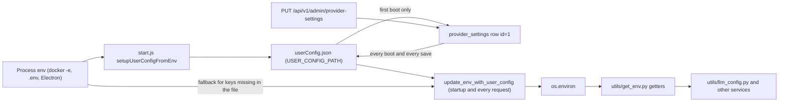
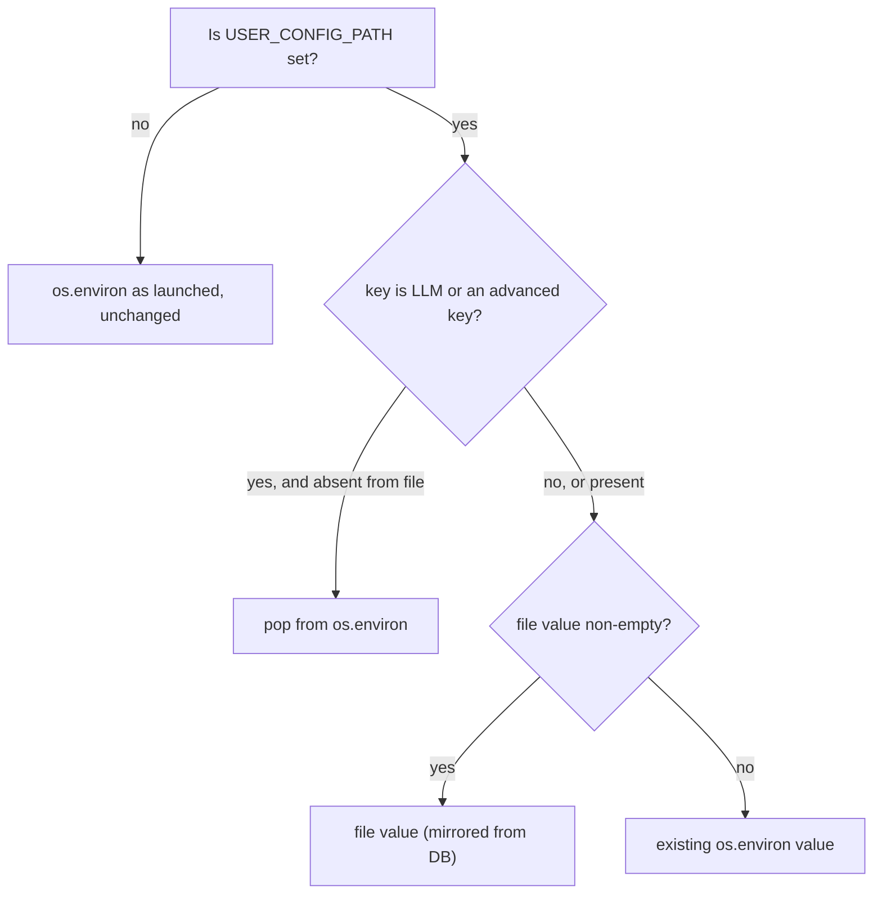
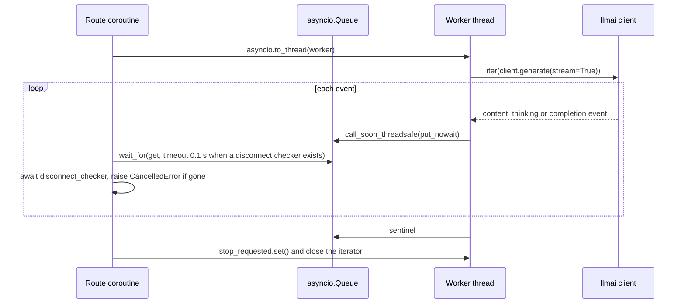
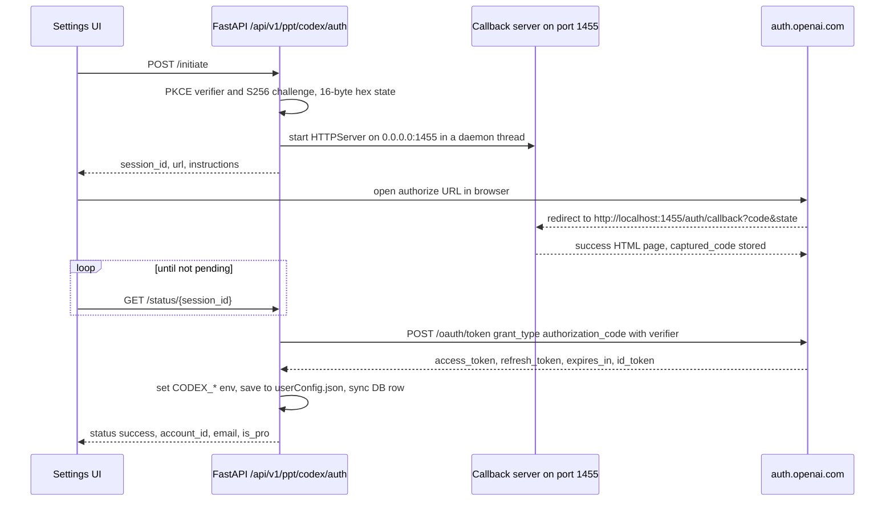

# Configuration and LLM providers

<div class="chapter-meta" markdown>
**Reads:** `servers/fastapi/utils/get_env.py`, `servers/fastapi/utils/user_config.py`, `servers/fastapi/utils/user_config_store.py`, `servers/fastapi/models/user_config.py`, `servers/fastapi/services/provider_settings.py`, `servers/fastapi/utils/llm_config.py`, `servers/fastapi/utils/llm_provider.py`, `servers/fastapi/utils/llm_utils.py`, `servers/fastapi/api/v1/ppt/endpoints/codex_auth.py`, `servers/fastapi/services/presenton_cloud_proxy.py`, `scripts/user-config-env.cjs`  ·  **Builds on:** [FastAPI app and startup](05-fastapi-startup.md)  ·  **Time:** ~45 min
</div>

Presenton keeps provider configuration in three places at once: process environment variables, a JSON file called `userConfig.json`, and a single database row. This chapter shows exactly which one wins and when, lists every environment getter, and then follows a provider name such as `anthropic` all the way to an `llmai` client making a streamed, schema-validated call. It also covers model discovery, Ollama pulls, the ChatGPT (Codex) OAuth sign-in, error normalization, and the Presenton Cloud proxy that replaces local generation when the `presenton` provider is selected.

## Step 1: Three places a setting can live



- **Environment variables** are what operators set. Every Python reader goes through `utils/get_env.py`.
- **`userConfig.json`** is a compatibility file. The Next.js server reads it for non-admin users (`servers/nextjs/lib/runtime-provider-config.ts:24`), the legacy auth secret lives in it, and `update_env_with_user_config` loads it into `os.environ`.
- **`provider_settings`** (one row, `id = 1`) is the source of truth for the settings UI since revision `d0a2b4c6e8f1`.

The rest of the chapter explains each arrow.

## Step 2: The environment variable inventory

`utils/get_env.py` contains 111 functions: 110 public getters plus the private helper `_is_truthy`. All but a few getters are one-line `os.getenv` wrappers that return the raw string or `None`. The exceptions with logic are noted in the tables. Setters with the same names live in `utils/set_env.py` (94 functions) and write `os.environ[...]` directly.

### 2.1 Runtime, paths and deployment

| Getter (`utils/get_env.py`) | Env var | Notes |
|---|---|---|
| `get_database_url_env` | `DATABASE_URL` | Default SQLite path is built elsewhere ([Data model](07-data-model.md)) |
| `get_app_data_directory_env` | `APP_DATA_DIRECTORY` | Effectively required (see chapter 5) |
| `get_temp_directory_env` | `TEMP_DIRECTORY` | Callers default to `/tmp/presenton` |
| `get_user_config_path_env` | `USER_CONFIG_PATH` | Set by `start.js` to `APP_DATA_DIRECTORY/userConfig.json` (`start.js:56`, `start.js:481`) |
| `get_fastapi_public_base_url` | `NEXT_PUBLIC_FAST_API` | Trailing `/` stripped; `None` if empty. Makes asset URLs absolute in split-origin setups |
| `get_presenton_public_url` | `PRESENTON_PUBLIC_URL` | Returned only if it starts with `http://` or `https://` |
| `get_presentation_generation_mode` | `PRESENTATION_GENERATION_MODE` | `standard`, `smart` or `both`; anything else is `both` |
| `is_community_enabled` | `PRESENTON_COMMUNITY_ENABLED` | Empty means enabled; `0`, `false`, `no`, `off` disable |
| `get_migrate_database_on_startup_env` | `MIGRATE_DATABASE_ON_STARTUP` | Default `"true"` |
| `get_sentry_dsn_env`, `get_sentry_traces_sample_rate_env`, `get_sentry_send_default_pii_env` | `SENTRY_DSN`, `SENTRY_TRACES_SAMPLE_RATE`, `SENTRY_SEND_DEFAULT_PII` | Parsed in `api/main.py` |

### 2.2 Auth and desktop

| Getter | Env var | Notes |
|---|---|---|
| `get_disable_auth_env`, `is_disable_auth_enabled` | `DISABLE_AUTH` | `is_...` uses `_is_truthy`: `1`, `true`, `yes`, `on` |
| `is_presenton_electron_desktop` | `PRESENTON_ELECTRON` | `_is_truthy` |
| `get_presenton_oauth_issuer` | none | Returns the constant `https://api.presenton.ai` (`get_env.py:7`) |
| `get_presenton_oauth_client_id` | none | Returns the constant `ptc_presenton_open_source` (`get_env.py:8`) |

### 2.3 Text provider selection and credentials

| Provider | Env vars (each has a `get_<name>_env` getter) |
|---|---|
| selection | `LLM` |
| OpenAI | `OPENAI_API_KEY`, `OPENAI_MODEL` |
| DeepSeek | `DEEPSEEK_API_KEY`, `DEEPSEEK_MODEL`, `DEEPSEEK_BASE_URL` |
| Google AI | `GOOGLE_API_KEY`, `GOOGLE_MODEL` |
| Vertex AI | `VERTEX_API_KEY`, `VERTEX_MODEL`, `VERTEX_PROJECT`, `VERTEX_LOCATION`, `VERTEX_BASE_URL` |
| Azure OpenAI | `AZURE_OPENAI_API_KEY`, `AZURE_OPENAI_MODEL`, `AZURE_OPENAI_ENDPOINT`, `AZURE_OPENAI_BASE_URL`, `AZURE_OPENAI_API_VERSION`, `AZURE_OPENAI_DEPLOYMENT` |
| Amazon Bedrock | `BEDROCK_REGION`, `BEDROCK_API_KEY`, `BEDROCK_AWS_ACCESS_KEY_ID`, `BEDROCK_AWS_SECRET_ACCESS_KEY`, `BEDROCK_AWS_SESSION_TOKEN`, `BEDROCK_PROFILE_NAME`, `BEDROCK_MODEL` |
| OpenRouter | `OPENROUTER_API_KEY`, `OPENROUTER_MODEL`, `OPENROUTER_BASE_URL`, `OPENROUTER_PROVIDER_ORDER`, `OPENROUTER_ALLOW_FALLBACKS`, `OPENROUTER_REQUIRE_PARAMETERS`, `OPENROUTER_DATA_COLLECTION`, `OPENROUTER_ZDR` |
| Fireworks | `FIREWORKS_API_KEY`, `FIREWORKS_MODEL`, `FIREWORKS_BASE_URL` |
| Together | `TOGETHER_API_KEY`, `TOGETHER_MODEL`, `TOGETHER_BASE_URL` |
| Cerebras | `CEREBRAS_API_KEY`, `CEREBRAS_MODEL`, `CEREBRAS_BASE_URL` |
| Anthropic | `ANTHROPIC_API_KEY`, `ANTHROPIC_MODEL` |
| LiteLLM | `LITELLM_BASE_URL`, `LITELLM_API_KEY`, `LITELLM_MODEL` |
| LM Studio | `LMSTUDIO_BASE_URL`, `LMSTUDIO_API_KEY`, `LMSTUDIO_MODEL` |
| Ollama | `OLLAMA_URL`, `OLLAMA_MODEL` |
| Custom OpenAI-compatible | `CUSTOM_LLM_URL`, `CUSTOM_LLM_API_KEY`, `CUSTOM_MODEL` |
| ChatGPT (Codex OAuth) | `CODEX_MODEL`, `CODEX_ACCESS_TOKEN`, `CODEX_REFRESH_TOKEN`, `CODEX_TOKEN_EXPIRES`, `CODEX_ACCOUNT_ID`, `CODEX_USERNAME`, `CODEX_EMAIL`, `CODEX_IS_PRO` |

### 2.4 Generation and reasoning

| Getter | Env var | Accepted values (validated in `models/user_config.py` and `utils/llm_config.py`) |
|---|---|---|
| `get_llm_generation_profile_env` | `LLM_GENERATION_PROFILE` | `fast`, `balanced` (default), `deep`, `model_max` |
| `get_llm_max_output_tokens_env` | `LLM_MAX_OUTPUT_TOKENS` | integer greater than 0 |
| `get_llm_reasoning_mode_env` | `LLM_REASONING_MODE` | `auto`, `enabled`, `disabled` |
| `get_llm_reasoning_effort_env` | `LLM_REASONING_EFFORT` | `default`, `none`, `minimal`, `low`, `medium`, `high`, `xhigh`, `max` |
| `get_llm_reasoning_budget_tokens_env` | `LLM_REASONING_BUDGET_TOKENS` | integer, 0 or more |
| `get_disable_thinking_env` | `DISABLE_THINKING` | legacy boolean |
| `get_extended_reasoning_env` | `EXTENDED_REASONING` | legacy boolean |

### 2.5 Images and web search

| Getter | Env var | Notes |
|---|---|---|
| `get_image_provider_env` | `IMAGE_PROVIDER` | `pexels`, `pixabay`, `gemini_flash`, `nanobanana_pro`, `gpt-image-2`, `gpt-image-1.5`, `comfyui`, `open_webui`, `openai_compatible` (`enums/image_provider.py`) |
| `get_disable_image_generation_env` | `DISABLE_IMAGE_GENERATION` | |
| `is_parallel_image_generation_enabled` | `ENABLE_PARALLEL_IMAGE_GENERATION` | Defaults to `"true"`; `_is_truthy` |
| `get_pexels_api_key_env`, `get_pixabay_api_key_env` | `PEXELS_API_KEY`, `PIXABAY_API_KEY` | |
| `get_comfyui_url_env`, `get_comfyui_workflow_env` | `COMFYUI_URL`, `COMFYUI_WORKFLOW` | |
| `get_gpt_image_2_quality_env` | `GPT_IMAGE_2_QUALITY` | If unset and `IMAGE_PROVIDER=dall-e-3`, derives `high` from `DALL_E_3_QUALITY=hd`, else `medium` (`get_env.py:406`) |
| `get_gpt_image_1_5_quality_env` | `GPT_IMAGE_1_5_QUALITY` | |
| `get_open_webui_image_url_env`, `get_open_webui_image_api_key_env` | `OPEN_WEBUI_IMAGE_URL`, `OPEN_WEBUI_IMAGE_API_KEY` | |
| `get_openai_compat_image_base_url_env`, `..._api_key_env`, `..._model_env` | `OPENAI_COMPAT_IMAGE_BASE_URL`, `OPENAI_COMPAT_IMAGE_API_KEY`, `OPENAI_COMPAT_IMAGE_MODEL` | |
| `get_web_grounding_env` | `WEB_GROUNDING` | |
| `get_web_search_provider_env` | `WEB_SEARCH_PROVIDER` | `auto`, `native`, `searxng`, `tavily`, `exa`, `brave`, `serper` |
| `get_web_search_max_results_env` | `WEB_SEARCH_MAX_RESULTS` | |
| `get_searxng_base_url_env`, `get_tavily_api_key_env`, `get_exa_api_key_env`, `get_brave_search_api_key_env`, `get_serper_api_key_env` | `SEARXNG_BASE_URL`, `TAVILY_API_KEY`, `EXA_API_KEY`, `BRAVE_SEARCH_API_KEY`, `SERPER_API_KEY` | |

How these are used is the subject of [Images, icons, web search](12-images-icons-search.md).

### 2.6 Variables read outside `get_env.py`

A few modules call `os.getenv` directly. The ones relevant to this part of the system are: `LOG_LEVEL` (`api/lifespan.py:21`), `NEXT_PUBLIC_URL` (CORS, `api/main.py:92`), `PRESENTON_DESKTOP_TOKEN` and `PRESENTON_DESKTOP_ORIGINS` (`api/v1/auth/desktop.py`), `AUTH_USERNAME`, `AUTH_PASSWORD`, `RESET_AUTH`, `AUTH_OVERRIDE_FROM_ENV` (`api/v1/auth/bootstrap.py:49`), the pool settings `DB_POOL_SIZE`, `DB_MAX_OVERFLOW`, `DB_POOL_TIMEOUT`, `DB_POOL_RECYCLE`, `DB_POOL_PRE_PING` (`utils/db_utils.py:34`), and `MAX_OUTLINE_WORDS` (default 100, `constants/presentation.py:8`). Memory (`MEM0_*`), document parsing (`LITEPARSE_*`) and chat (`CHAT_MAX_STORED_TURNS`) variables belong to their own chapters.

!!! warning "Gotcha"
    Booleans are parsed two different ways. `_is_truthy` (`get_env.py:11`) accepts `1`, `true`, `yes`, `on`. `parse_bool_or_none` (`utils/parsers.py:1`), used for `DISABLE_THINKING`, `EXTENDED_REASONING`, `WEB_GROUNDING`, `DISABLE_IMAGE_GENERATION` and the OpenRouter flags, accepts only the word `true` in any case. `DISABLE_THINKING=1` is therefore `False` if it reaches Python unchanged. Through `start.js` it is normalized to a JSON boolean first (Step 3.4), which hides the difference in Docker.

## Step 3: `userConfig.json`

### 3.1 The schema: `UserConfig`

`models/user_config.py:5` is a Pydantic model with one optional field per configurable key (92 fields). Most are `Optional[str]`; the typed ones are:

| Field | Type |
|---|---|
| `OPENROUTER_PROVIDER_ORDER` | `list[str]`, default `[]` |
| `OPENROUTER_ALLOW_FALLBACKS`, `OPENROUTER_REQUIRE_PARAMETERS`, `OPENROUTER_ZDR`, `DISABLE_IMAGE_GENERATION`, `DISABLE_THINKING`, `EXTENDED_REASONING`, `WEB_GROUNDING`, `CODEX_IS_PRO` | `Optional[bool]` |
| `OPENROUTER_DATA_COLLECTION` | `Literal["allow", "deny"]` |
| `LLM_GENERATION_PROFILE` | `Literal["fast", "balanced", "deep", "model_max"]` |
| `LLM_MAX_OUTPUT_TOKENS` | `int`, `gt=0` |
| `LLM_REASONING_MODE` | `Literal["auto", "enabled", "disabled"]` |
| `LLM_REASONING_EFFORT` | `Literal["default", "none", "minimal", "low", "medium", "high", "xhigh", "max"]` |
| `LLM_REASONING_BUDGET_TOKENS` | `int`, `ge=0` |

A `model_validator(mode="before")` rewrites the retired `IMAGE_PROVIDER = "dall-e-3"` to `gpt-image-2` and derives `GPT_IMAGE_2_QUALITY` (`models/user_config.py:6`). Unknown keys are ignored by Pydantic's default `extra` behavior. The `AUTH_USERNAME`, `AUTH_PASSWORD_HASH` and `AUTH_SECRET_KEY` keys that also live in the file are not part of this model; they are read by `api/v1/auth/config.py`.

### 3.2 Safe concurrent storage: `user_config_store.py`

Several processes touch the file: `start.js`, FastAPI, the Next.js server and, in Electron, the desktop shell. `utils/user_config_store.py` makes every write atomic and serialized.

| Mechanism | Detail |
|---|---|
| Lock | `userConfig.json.lock` created with `O_CREAT | O_EXCL`, containing `{"pid", "createdAt"}`; retried every 50 ms for up to `LOCK_TIMEOUT_SECONDS = 5.0`; a lock older than `LOCK_STALE_SECONDS = 30.0` is deleted (`user_config_store.py:11`, `user_config_store.py:109`) |
| Atomic write | JSON written to `userConfig.json.<pid>.<ms>.<uuid>.tmp` with mode `0600`, `fsync`, then `os.replace` (`user_config_store.py:173`) |
| Backup | before each write the valid primary is copied to `userConfig.json.bak` (after the write the backup is only created if it does not exist yet); reads fall back to it when the primary is missing or invalid JSON (`user_config_store.py:89`, `user_config_store.py:154`) |
| Permissions | every read `chmod`s both files to `0600` (`user_config_store.py:25`) |
| Retries | `EACCES`, `EBUSY`, `EPERM` retried up to 6 times with linear backoff (`user_config_store.py:48`) |
| Read errors | `read_user_config_file` never raises; it returns `{}` (`user_config_store.py:202`) |

Writers use `update_user_config_file(path, update)`, which reads the snapshot under the lock, applies the `update(dict) -> dict` callback, and writes the result.

### 3.3 Docker bootstrap: `start.js` and `scripts/user-config-env.cjs`

Before spawning FastAPI, `start.js` runs `setupUserConfigFromEnv` (`start.js:490`):

```javascript title="start.js (excerpt)"
const setupUserConfigFromEnv = () => {
  const existingConfig = readUserConfig();
  const envConfig = readUserConfigEnv(process.env);
  if (Object.keys(existingConfig).length > 0 && Object.keys(envConfig).length === 0) {
    return;
  }
  writeUserConfig(buildUserConfigFromEnv(existingConfig, process.env));
};
```

`buildUserConfigFromEnv` (`scripts/user-config-env.cjs:232`) does four things in order:

1. `sanitizeExistingConfig` drops `LLM` from the existing file if it is not one of the 16 values in `VALID_LLM_PROVIDERS` (`user-config-env.cjs:1`).
2. `readUserConfigEnv` copies every non-empty env var whose name is in `USER_CONFIG_ENV_KEYS` (95 names, `user-config-env.cjs:20`) over the existing values. Besides the `UserConfig` fields, the list includes `USE_CUSTOM_URL`, `DISABLE_ANONYMOUS_TRACKING` and `DALL_E_3_QUALITY`.
3. `normalizeConfigTypes` turns the nine `BOOLEAN_CONFIG_KEYS` into JSON booleans (accepting `1/true/yes/on` and `0/false/no/off`), parses `LLM_MAX_OUTPUT_TOKENS` and `LLM_REASONING_BUDGET_TOKENS` as integers, and splits `OPENROUTER_PROVIDER_ORDER` on commas.
4. `normalizeImageConfig` migrates `dall-e-3`, deletes `DALL_E_3_QUALITY`, and, if neither `IMAGE_PROVIDER` nor `DISABLE_IMAGE_GENERATION` is set, picks an image provider in this priority: `openai_compatible` (all three settings present), `open_webui`, `comfyui`, `pexels`, `pixabay`, `gpt-image-1.5` with quality `medium` (when `LLM=openai` and a key exists), `gemini_flash` (when `LLM=google` and a key exists), otherwise `DISABLE_IMAGE_GENERATION = true`.

For example, starting a fresh container with `LLM=openai OPENAI_API_KEY=sk-test OPENAI_MODEL=gpt-4.1 DISABLE_THINKING=1 OPENROUTER_PROVIDER_ORDER="groq, together"` produces:

```json title="APP_DATA_DIRECTORY/userConfig.json (derived from the code above)"
{"LLM":"openai","OPENAI_API_KEY":"sk-test","OPENAI_MODEL":"gpt-4.1","OPENROUTER_PROVIDER_ORDER":["groq","together"],"DISABLE_THINKING":true,"IMAGE_PROVIDER":"gpt-image-1.5","GPT_IMAGE_1_5_QUALITY":"medium"}
```

## Step 4: Database-stored provider settings

### 4.1 The table and its service

`ProviderSettings` (`models/sql/provider_settings.py:10`) has three columns: `id` (integer, always `1`), `config` (JSON, not null) and `updated_at`. `services/provider_settings.py` wraps it:

| Function | Behavior |
|---|---|
| `sanitize_provider_settings` (`:52`) | Removes every key starting with `AUTH_`. Credentials never enter the table |
| `migrate_provider_settings_from_file` (`:103`) | Startup. No row: create it from the sanitized file. Row exists: re-sanitize it if needed. Either way, `_mirror_to_legacy_file` the row back to the file |
| `get_provider_settings` (`:130`) | Returns the sanitized row, creating it from the file on first use |
| `save_provider_settings` (`:137`) | Applies `merge_provider_settings(existing, incoming)`, commits, mirrors to the file |
| `_mirror_to_legacy_file` (`:85`) | Replaces the file contents with the DB config, preserving any `AUTH_*` keys already in the file |
| `sync_legacy_file_to_provider_settings` (`:158`) | Synchronous reverse sync (new sync engine, upsert of row 1), used only after Codex token writes |

`merge_provider_settings` (`:61`) encodes the patch semantics the settings UI relies on:

| Rule | Keys | Effect |
|---|---|---|
| Plain patch | everything else | incoming values overwrite existing ones; omitted keys are kept |
| OAuth-managed | `CODEX_ACCESS_TOKEN`, `CODEX_REFRESH_TOKEN`, `CODEX_TOKEN_EXPIRES`, `CODEX_ACCOUNT_ID`, `CODEX_USERNAME`, `CODEX_EMAIL`, `CODEX_IS_PRO`, `PRESENTON_CONNECTED`, `PRESENTON_EMAIL` | the incoming value is always discarded; the existing value (or absence) wins |
| Empty does not clear | `OPEN_WEBUI_IMAGE_URL`, `OPEN_WEBUI_IMAGE_API_KEY`, `CODEX_MODEL` | an empty incoming value keeps the existing one |
| Empty resets | the 12 `OPTIONAL_ADVANCED_FIELDS` (`LLM_*` overrides, `DISABLE_THINKING`, `EXTENDED_REASONING`, five `OPENROUTER_*` routing keys) | `None`, `""` or `[]` removes the key |

### 4.2 The admin endpoints

`GET /api/v1/admin/provider-settings` and `PUT /api/v1/admin/provider-settings` (`api/v1/admin/router.py:144`, `api/v1/admin/router.py:158`) require an admin browser session (or `DISABLE_AUTH`). A save request from the settings UI looks like this:

```http
PUT /api/v1/admin/provider-settings
content-type: application/json
cookie: presenton_session=<jwt>

{"LLM": "anthropic", "ANTHROPIC_API_KEY": "sk-ant-...", "ANTHROPIC_MODEL": "claude-sonnet-4-20250514",
 "LLM_MAX_OUTPUT_TOKENS": "", "IMAGE_PROVIDER": "pexels", "PEXELS_API_KEY": "..."}
```

The handler calls `save_provider_settings` and then `update_env_with_user_config()`, so the new provider is live for the next request. The response is the merged config. `GET` returns the same dict plus two computed keys, `PRESENTON_CONNECTED` (whether a non-expired Presenton Cloud token is stored) and `PRESENTON_EMAIL`. The Next.js route `app/api/user-config/route.ts` forwards admins to these endpoints and serves non-admins a filtered view of `userConfig.json`; see [Settings, onboarding, auth UI](23-settings-and-auth-ui.md).

## Step 5: Precedence, and the per-request refresh

### 5.1 `get_user_config`: file first, environment second

`get_user_config` (`utils/user_config.py:197`) reads the file and builds a `UserConfig` where each field is `file value or env value`:

```python title="servers/fastapi/utils/user_config.py (excerpt)"
    return UserConfig(
        LLM=existing_config.LLM or get_llm_provider_env(),
        OPENAI_API_KEY=existing_config.OPENAI_API_KEY or get_openai_api_key_env(),
        OPENAI_MODEL=existing_config.OPENAI_MODEL or get_openai_model_env(),
        # ...
        OLLAMA_URL=(
            existing_config.OLLAMA_URL
            if "OLLAMA_URL" in existing_config_data
            else get_ollama_url_env()
        ),
```

The booleans and `LLM_REASONING_BUDGET_TOKENS` use `is not None` checks instead of `or`, so a saved `false` or `0` is respected. `OLLAMA_URL` is the only string key where presence, not truthiness, decides, which allows clearing it to an empty string.

### 5.2 `update_env_with_user_config`: copy into `os.environ`

`update_env_with_user_config` (`utils/user_config.py:378`) runs at the end of startup, inside `PUT /provider-settings`, after Presenton Cloud logout, and on every request that `SessionAuthMiddleware` lets through (including public paths and auth-disabled mode) via `UserConfigEnvUpdateMiddleware`.

```python title="servers/fastapi/utils/user_config.py (excerpt)"
def update_env_with_user_config():
    user_config_path = get_user_config_path_env()
    if user_config_path:
        persisted = read_user_config_file(user_config_path)
        if not persisted.get("LLM"):
            os.environ.pop("LLM", None)
        for key in (
            "LLM_GENERATION_PROFILE",
            "LLM_MAX_OUTPUT_TOKENS",
            # ...
            "OPENROUTER_ZDR",
        ):
            if key not in persisted:
                os.environ.pop(key, None)
    user_config = get_user_config()
    if user_config.LLM:
        set_llm_provider_env(user_config.LLM)
```

After the pops, every field of the merged `UserConfig` is written back to `os.environ` with an `if value:` guard (or `is not None` for booleans and integers).

### 5.3 The resulting rules

| Situation | Winner |
|---|---|
| First boot, empty database | `start.js` merges env over the file; FastAPI imports the file into `provider_settings` |
| Any later boot | `provider_settings` is mirrored over the file, discarding whatever `start.js` just merged into it |
| Key present and non-empty in the database | database value |
| Key absent or empty in the database | the process environment variable, if any |
| `LLM` or one of the 12 advanced keys absent from the database | removed from `os.environ`; the environment variable is ignored |



!!! warning "Gotcha"
    After the first boot, changing a Docker environment variable for a key the settings UI has already saved has no effect: the database row wins at every boot. Change it in the UI, or remove the key from the row. For `LLM` and the advanced generation keys it is stricter: an env value is actively removed when the saved settings lack that key.

!!! warning "Gotcha"
    Clearing a secret in the UI does not unset it until restart. Saving `"OPENAI_API_KEY": ""` stores an empty string; `get_user_config` then falls back to `os.environ`, which still holds the old key written by the previous `update_env_with_user_config`, and the empty value is never written back. Only `OLLAMA_URL`, `LLM` and the advanced keys have explicit clearing paths.

!!! warning "Gotcha"
    `get_user_config` builds `UserConfig(**file_contents)` inside a bare `try`/`except` (`utils/user_config.py:202`). If a single key fails validation, for example `"LLM_REASONING_MODE": "on"` or `"LLM_MAX_OUTPUT_TOKENS": 0` written by hand, the whole file is ignored, only `Error while loading user config` is printed, and every key falls back to the process environment. Validate hand edits against `models/user_config.py`.

!!! warning "Gotcha"
    `os.environ` is process-global. Provider settings are therefore global to the deployment, shared by every user, and only admins may change them. A per-user provider would need a different design, not a new key.

## Step 6: From provider name to an `llmai` client

Presenton does not call vendor SDKs directly for text generation. It depends on `llmai==0.3.15` (`servers/fastapi/pyproject.toml:35`), a provider-abstraction package from PyPI. Its source is not installed anywhere in this environment (no `site-packages/llmai` was found), so the interface described below is inferred from how Presenton calls it and from Presenton's unit tests, and is not verified against `llmai`'s own code.

### 6.1 Resolving the provider and model

`get_llm_provider()` (`utils/llm_provider.py:47`) converts `LLM` into the `LLMProvider` enum (`enums/llm_provider.py`, 16 members) and raises HTTP 500 with the list of valid names for anything else. `get_model()` (`utils/llm_provider.py:126`) returns the configured model or a default from `constants/llm.py`:

| `LLM` | Model env | Default model |
|---|---|---|
| `openai` | `OPENAI_MODEL` | `gpt-4.1` |
| `deepseek` | `DEEPSEEK_MODEL` | `deepseek-chat` |
| `google` | `GOOGLE_MODEL` | `models/gemini-2.5-flash` |
| `vertex` | `VERTEX_MODEL` | `gemini-2.5-flash` |
| `azure` | `AZURE_OPENAI_MODEL`, then `AZURE_OPENAI_DEPLOYMENT` | `gpt-4.1` |
| `bedrock` | `BEDROCK_MODEL` | `us.anthropic.claude-3-5-haiku-20241022-v1:0` |
| `openrouter` | `OPENROUTER_MODEL` | `openai/gpt-4o` |
| `fireworks` | `FIREWORKS_MODEL` | `accounts/fireworks/models/llama-v3p1-8b-instruct` |
| `together` | `TOGETHER_MODEL` | `openai/gpt-oss-20b` |
| `cerebras` | `CEREBRAS_MODEL` | `llama-3.3-70b` |
| `anthropic` | `ANTHROPIC_MODEL` | `claude-sonnet-4-20250514` |
| `litellm` | `LITELLM_MODEL` | `gpt-4.1` |
| `lmstudio` | `LMSTUDIO_MODEL` | `openai/gpt-oss-20b` |
| `ollama` | `OLLAMA_MODEL` | none (returns `None`) |
| `custom` | `CUSTOM_MODEL` | none (returns `None`) |
| `codex` | `CODEX_MODEL`, only if in `SUPPORTED_CODEX_MODELS` | `gpt-5.6-luna` |

`SUPPORTED_CODEX_MODELS` is `gpt-5.6-sol`, `gpt-5.6-terra`, `gpt-5.6-luna`, `gpt-5.5`, `gpt-5.4`, `gpt-5.4-mini`, `gpt-5.3-codex-spark` (`constants/llm.py:17`).

### 6.2 Building the client configuration

`_get_llm_config` (`utils/llm_config.py:247`) is a single `match` on the provider. Missing required values raise HTTP 400 with a specific message such as `"Anthropic API Key is not set"`.

| `LLM` | `llmai` config class | Base URL passed | Auth | Notes |
|---|---|---|---|---|
| `openai` | `OpenAIClientConfig` | none (library default) | `OPENAI_API_KEY` | `api_type` is `COMPLETIONS`, or `RESPONSES` when the caller asks (native web search, Smart mode) |
| `deepseek` | `DeepSeekClientConfig` | `DEEPSEEK_BASE_URL` or none | `DEEPSEEK_API_KEY` | |
| `google` | `GoogleClientConfig` | none | `GOOGLE_API_KEY` | |
| `vertex` | `VertexAIClientConfig` | `VERTEX_BASE_URL` or none | `VERTEX_API_KEY`, or `VERTEX_PROJECT` with optional `VERTEX_LOCATION` | both styles at once is a 400 "ambiguous" error |
| `azure` | `AzureOpenAIClientConfig` | `AZURE_OPENAI_ENDPOINT` and/or `AZURE_OPENAI_BASE_URL` (one required) | `AZURE_OPENAI_API_KEY` plus `AZURE_OPENAI_API_VERSION` | always `api_type=RESPONSES`; optional `deployment` |
| `bedrock` | `BedrockClientConfig` | `region` = `BEDROCK_REGION` or `us-east-1` | `BEDROCK_API_KEY`, or access key id plus secret (optional session token, profile) | |
| `openrouter` | `OpenRouterClientConfig` | `OPENROUTER_BASE_URL` or none | `OPENROUTER_API_KEY` | routing flags go in `extra_body` (6.3) |
| `fireworks` | `FireworksClientConfig` | `FIREWORKS_BASE_URL` or none | `FIREWORKS_API_KEY` | |
| `together` | `TogetherAIClientConfig` | `TOGETHER_BASE_URL` or none | `TOGETHER_API_KEY` | |
| `cerebras` | `CerebrasClientConfig` | `CEREBRAS_BASE_URL` or none | `CEREBRAS_API_KEY` | |
| `anthropic` | `AnthropicClientConfig` | none | `ANTHROPIC_API_KEY` | |
| `litellm` | `LiteLLMClientConfig` | `LITELLM_BASE_URL`, required, normalized to end in `/v1` | `LITELLM_API_KEY` optional | |
| `lmstudio` | `LMStudioClientConfig` | `LMSTUDIO_BASE_URL` or none | `LMSTUDIO_API_KEY` optional | |
| `ollama` | `OpenAIClientConfig` | `(OLLAMA_URL or http://localhost:11434) + "/v1"` | literal `"ollama"` | Ollama's OpenAI-compatible endpoint |
| `custom` | `OpenAIClientConfig` | `CUSTOM_LLM_URL`, required | `CUSTOM_LLM_API_KEY` or literal `"null"` | |
| `codex` | `ChatGPTClientConfig` | none | OAuth `access_token` plus `account_id` | refreshed on demand (Step 12) |

`get_llm_config(use_openai_responses_api=False)` (`utils/llm_config.py:483`) then attaches the generation defaults from Step 8 as `config.generation`. Every LLM call site follows the same three lines, for example `utils/llm_calls/generate_presentation_structure.py:165`:

```python title="servers/fastapi/utils/llm_calls/generate_presentation_structure.py (excerpt)"
    client = get_client(config=get_llm_config())
    model = get_model()
    response_model = get_presentation_structure_model_with_n_slides(
        len(presentation_outline.slides)
    )
```

!!! warning "Gotcha"
    `get_model()` returns `None` for `ollama` and `custom` when no model is configured, and that `None` is passed straight to the client. Configure `OLLAMA_MODEL` or `CUSTOM_MODEL`. The validator `check_llm_and_image_provider_api_or_model_availability` (`utils/model_availability.py:93`) would catch this, including checking that the Ollama model is pulled, but at this snapshot it is called only from unit tests, not from any request path.

### 6.3 Provider-specific request bodies

`get_extra_body(uses_tool_choice=False)` (`utils/llm_config.py:489`) adds vendor fields that are not part of the common interface:

| Provider | Condition | `extra_body` |
|---|---|---|
| `deepseek` | legacy `DISABLE_THINKING` (without explicit reasoning settings), or the call uses tools or a response schema | `{"thinking": {"type": "disabled"}}` |
| `custom` | legacy `DISABLE_THINKING` | `{"enable_thinking": false}` |
| `openrouter` | any routing key set | `{"provider": {"order": [...], "allow_fallbacks": ..., "require_parameters": ..., "data_collection": "allow" or "deny", "zdr": ...}}` |

## Step 7: Calling the model: structured outputs and streaming

### 7.1 The common keyword arguments

`get_generate_kwargs` (`utils/llm_utils.py:110`) builds the dict passed to `client.generate(...)`: `model`, `messages` (llmai `SystemMessage`/`UserMessage`/`AssistantMessage` objects), `stream`, and optionally `max_tokens`, `tools`, `response_format`, `reasoning` and `extra_body`.

### 7.2 Structured outputs with `JSONSchemaResponse`

Every schema-constrained call wraps a Pydantic model's JSON schema:

```python title="servers/fastapi/utils/llm_calls/generate_presentation_structure.py (excerpt)"
        structure_schema = prepare_schema_for_validation(
            response_model.model_json_schema(),
            strict=False,
        )
        response_format = JSONSchemaResponse(
            name="response",
            json_schema=structure_schema,
            strict=False,
        )
```

`generate_structured_with_schema_retries` (`utils/llm_utils.py:310`) then runs two nested loops:

- **Parse loop**: up to 3 attempts, sleeping 0.5 s and then 1.0 s between them, until the stream yields something that parses into a dict. Parsing uses `extract_structured_content` (`utils/llm_utils.py:414`), which accepts a dict, a Pydantic object, or text parsed leniently with `dirtyjson`. If all three fail: HTTP 400 `"LLM did not return any content"`.
- **Validation loop** (only with `validate_schema=True`): up to `validate_schema_max_loop_count` (default 4) rounds. Each failing round appends a `UserMessage` listing at most 10 JSON Schema errors and the previous JSON truncated to 6,000 characters, ending with "Return corrected JSON only" (`utils/llm_utils.py:276`). After the last round the last response is returned with a warning, not an error.

!!! warning "Gotcha"
    Structured generation always streams, even when nobody consumes the chunks. The comment at `utils/llm_utils.py:75` explains the reason: without an explicit `max_tokens`, the Anthropic SDK refuses a non-streaming request whose estimated duration exceeds ten minutes and raises before sending anything. That only affected background generation, which made it look like a provider bug. Keep new structured calls on `_generate_structured_content`.

### 7.3 The streaming bridge

`llmai`'s `client.generate(...)` is consumed as a synchronous iterator. `stream_generate_events` (`utils/llm_utils.py:458`) runs it in a worker thread via `asyncio.to_thread` and hands each event to the event loop through an `asyncio.Queue`:



The events Presenton handles are those with `type == "content"` and a `chunk` string, `type == "thinking"` (or `ResponseStreamThinkingChunk`), and the final `ResponseStreamCompletionChunk` (`type == "completion"`) carrying `content`, `tool_calls`, `usage` and `finish_reason`. When the HTTP client disconnects, the bridge stops pulling, closes the provider stream and raises `CancelledError`, so a closed browser tab stops token spend. `build_text_generation_metrics` (`utils/llm_utils.py:191`) turns usage into input, output and thinking token counts, estimating at four characters per token when the provider omits usage. How these chunks become SSE events for the browser is covered in [Streaming (SSE)](10-streaming.md).

## Step 8: Generation profiles, output tokens and reasoning

### 8.1 `get_generation_defaults`

```python title="servers/fastapi/utils/llm_config.py (excerpt)"
def get_generation_defaults() -> GenerationDefaults:
    profile_value = (get_llm_generation_profile_env() or "balanced").strip()
    try:
        profile = GenerationProfile(profile_value)
    except ValueError as error:
        raise HTTPException(
            status_code=400,
            detail=f"Invalid LLM_GENERATION_PROFILE: {profile_value}",
        ) from error

    reasoning = ReasoningConfig()
    mode = (get_llm_reasoning_mode_env() or "").strip().lower()
    effort = (get_llm_reasoning_effort_env() or "").strip().lower()
    budget = _optional_int(get_llm_reasoning_budget_tokens_env())
```

| Input | Mapping to `llmai` |
|---|---|
| `LLM_GENERATION_PROFILE` | `GenerationProfile(value)`, default `balanced`; invalid value is HTTP 400 |
| `LLM_REASONING_MODE` | `enabled` sets `reasoning.enabled = True`; `disabled` sets `False`; empty or `auto` leaves it unset |
| `LLM_REASONING_EFFORT` | `ReasoningEffortValue(value)` unless empty or `default` |
| `LLM_REASONING_BUDGET_TOKENS` | `reasoning.budget_tokens`; negative is HTTP 400 |
| `DISABLE_THINKING` (legacy) | only when none of the three reasoning keys is set: `reasoning.enabled = False` |
| `EXTENDED_REASONING` (legacy) | same condition: `enabled = True`, `effort = HIGH` |
| `LLM_MAX_OUTPUT_TOKENS` | `GenerationDefaults.max_output_tokens`; zero or negative is HTTP 400 |

How a profile becomes a concrete `max_tokens` value happens inside `llmai` (`prepare_generation` with the model's capabilities). Presenton's own test pins the observable behavior: with a model whose metadata reports 16,384 output tokens, both `balanced` and `model_max` resolve to 16,384; for an unknown model, `balanced` resolves to 8,192 and `model_max` to 32,768 (`tests/unit/test_generation_defaults.py:21`, `tests/unit/test_generation_defaults.py:34`).

### 8.2 `POST /api/v1/ppt/generation/defaults`

The Advanced text-provider settings panel (`servers/nextjs/components/AdvancedTextProviderSettings.tsx:214`) asks the backend what those numbers would be for a given provider and model before anything is saved:

```http
POST /api/v1/ppt/generation/defaults
content-type: application/json

{"provider": "custom", "model": ""}
```

```json
{"default_max_output_tokens": 8192, "model_max_output_tokens": 32768}
```

`resolve_generation_token_defaults` (`api/v1/ppt/endpoints/generation.py:27`) maps Presenton names to `llmai` names first (`PROVIDER_ALIASES`: `codex` to `chatgpt`, `custom` and `ollama` to `openai`, `together` to `togetherai`), substitutes `unknown-model` for an empty model, calls `get_model_capabilities`, and runs `prepare_generation` once with `BALANCED` and once with `MODEL_MAX`. The request model limits `provider` to 40 and `model` to 300 characters.

### 8.3 Smart mode reasoning

Smart mode decides reasoning per model: `get_smart_reasoning_config` (`utils/llm_calls/generate_smart_presentation.py:705`) returns no reasoning config when legacy `DISABLE_THINKING` is on (and no explicit reasoning keys are set). Otherwise it asks `llmai.supports_thinking(model, provider=...)`; if explicit `LLM_REASONING_*` settings exist it defers to them, and if the model supports thinking it enables reasoning, with effort `LOW` for `openai` and `azure` and no effort override for other providers. See [Smart mode](13-smart-mode.md).

## Step 9: Error normalization

Every LLM call site wraps failures in `handle_llm_client_exceptions` (`utils/llm_client_error_handler.py:35`), which always returns an `HTTPException`:

| Exception | Status returned | Detail |
|---|---|---|
| `HTTPException` | unchanged | unchanged, except 401/403 with `codex` (below) |
| `llmai.shared.errors.BaseError` | its `status_code` | `safe_llm_provider_error_detail(status_code, message)` |
| `openai.APIError` | its `status_code`, or 500 | `openai_error_detail(e, operation="API request")` |
| `google.genai.errors.APIError` | always 500 | safe detail prefixed `Google API error:` |
| anything else | 500 | safe detail of `LLM API error: <e>` |

With `LLM=codex`, a 401 or 403 becomes HTTP 401 with the header `X-Presenton-Auth-Action: codex-reauth` and a detail starting with `CHATGPT_AUTH_REQUIRED:`, which the UI uses to prompt a new sign-in.

`utils/provider_error_messages.py` keeps raw provider payloads out of the UI. `safe_llm_provider_error_detail` (`provider_error_messages.py:159`) works only from the status code and the message text:

1. It returns `"Invalid API key. Please verify your API key and try again."` when the status is 401 or the message matches one of the `_INVALID_API_KEY_PATTERNS` (`provider_error_messages.py:16`): "invalid api key", "incorrect api key", "api key is invalid", "no api key", or the word "authentication".
2. An empty message becomes `"The AI provider returned an error. Please try again."`.
3. A message that looks like a raw payload (starts with `{` or `[`, contains `{'error'`, `"error"`, `Error code:`, or `http` in any case) goes through `safe_provider_error_detail("AI provider", "API request", ...)` (`provider_error_messages.py:104`). That returns, in order of checks: the invalid-key message, a safety-system message for `moderation_blocked`, a quota message for code `insufficient_quota`, an access message for 403, `"AI provider API request is temporarily rate limited. Please wait and try again."` for 429, a "model is not available" message when the text mentions a model that is not found or not accessible, and otherwise `"AI provider API request failed. Please try again."`.
4. Any other (plain, human-readable) message passes through unchanged.

!!! warning "Gotcha"
    Because any message containing the word "authentication" is reported as an invalid API key, a provider error such as "authentication service unavailable" surfaces in the UI as a bad-key message. Check the server log (`handle_llm_client_exceptions` always prints the traceback) before rotating keys.

## Step 10: Model discovery endpoints

The settings UI validates keys and lists models through these routes (the admin-only ones are enforced by `SessionAuthMiddleware`, see chapter 5):

| Route | Body | Upstream call | Admin only |
|---|---|---|---|
| `POST /api/v1/ppt/openai/models/available` | `{"url", "api_key"}` | `GET <url>/models` with the OpenAI SDK; `api.together.ai` and `api.together.xyz` hosts use raw `aiohttp` | yes |
| `POST /api/v1/ppt/anthropic/models/available` | `{"api_key"}` | `GET https://api.anthropic.com/v1/models?limit=50` with `anthropic-version: 2023-06-01` | no |
| `POST /api/v1/ppt/google/models/available` | `{"api_key"}` | `genai.Client(api_key).models.list(page_size=50)` | no |
| `POST /api/v1/ppt/openrouter/providers/available` | `{"model", "api_key", "base_url"}` | `GET <root>/models/<author>/<slug>/endpoints`, falling back to `GET <root>/providers` | yes |
| `GET /api/v1/ppt/ollama/models/available?ollama_url=` | none | `GET <ollama>/api/tags` (10 s timeout) | yes |
| `GET /api/v1/ppt/ollama/models/supported` | none | merges the 54 tested models with pulled ones | no |
| `GET /api/v1/ppt/ollama/models/library` | none | the static tested list | no |

A typical exchange:

```http
POST /api/v1/ppt/openai/models/available
content-type: application/json

{"url": "http://litellm:4000", "api_key": ""}
```

```json
["gpt-4.1", "claude-sonnet-4", "llama3.1:8b"]
```

The base URL is validated and normalized to end in `/v1` (`utils/available_models.py:96`, `utils/available_models.py:120`); a blank key becomes the placeholder `"EMPTY"` because local proxies often have no auth but the SDK rejects an empty key; redirects are refused. Failures raise `ModelAvailabilityError` (`utils/available_models.py:16`), whose HTTP status is 400 for any upstream 4xx and 500 otherwise, with a safe message from Step 9. The OpenRouter route accepts only the default root `https://openrouter.ai/api/v1` or the server-configured `OPENROUTER_BASE_URL`, and builds the outbound URL from server configuration, never from the request (`api/v1/ppt/endpoints/openrouter.py:47`). Its response is a sorted list of `{"value", "label", "available", "context_length", "max_completion_tokens", "supported_parameters"}`.

!!! warning "Gotcha"
    `GET /ollama/models/available` with an `ollama_url` override additionally requires an `Origin` or `Referer` from a trusted origin (the request's own origin, `PRESENTON_PUBLIC_URL`, `NEXT_PUBLIC_URL`, `NEXT_PUBLIC_FAST_API`, or `PRESENTON_DESKTOP_ORIGINS`), or `Sec-Fetch-Site: same-origin` (`api/v1/ppt/endpoints/ollama.py:27`). The comment explains that `SameSite=Lax` cookies ride along on cross-site top-level GET navigations, so an admin cookie alone does not prove intent.

## Step 11: Ollama model pulls

`POST /api/v1/ppt/ollama/models/pull?model_name=llama3.2:3b&ollama_url=` first calls `list_available_ollama_models` to fail fast with 503 ("Could not connect to Ollama at ... use host.docker.internal instead of localhost") if Ollama is unreachable, then returns a `text/event-stream` produced by `pull_ollama_model` (`utils/ollama.py:174`). That generator posts `{"name": ..., "stream": true, "insecure": false}` to `<ollama>/api/pull` with no timeout and translates Ollama's NDJSON lines into SSE frames:

```text
event: response
data: {"type": "progress", "status": "pulling 74701a8c35f6", "total": 2019377376, "completed": 403875475, "progress": 20.0}

event: response
data: {"type": "status", "status": "verifying sha256 digest"}

event: response
data: {"type": "complete", "status": "success", "model": "llama3.2:3b"}
```

Ollama errors become `event: error` with `{"detail": ...}`. The URL normalizer `_get_ollama_url` (`utils/ollama.py:46`) defaults to `http://localhost:11434`, adds `http://` when the scheme is missing, rejects control characters, backslashes, `%`, `?`, `#` and dot segments, and refuses redirects. The tested catalog is `SUPPORTED_OLLAMA_MODELS` in `constants/supported_ollama_models.py:314` (Llama 3.x, Gemma, DeepSeek, Qwen, gpt-oss, Gemma 4 and Qwen 3.5 families). The `ollamapullstatus` table exists in the schema but no code reads or writes it at this snapshot.

## Step 12: ChatGPT (Codex) OAuth sign-in

The `codex` provider uses a ChatGPT subscription instead of an API key. `utils/oauth/openai_codex.py` is a Python port of an existing TypeScript implementation (its docstring names `pi-mono-main/packages/ai/src/utils/oauth/openai-codex.ts`); PKCE helpers live in `utils/oauth/pkce.py`.



Concrete values from `utils/oauth/openai_codex.py:22`: `CLIENT_ID = "app_EMoamEEZ73f0CkXaXp7hrann"`, authorize URL `https://auth.openai.com/oauth/authorize`, token URL `https://auth.openai.com/oauth/token`, redirect URI `http://localhost:1455/auth/callback`, scope `openid profile email offline_access`. The authorize URL also carries `id_token_add_organizations=true`, `codex_cli_simplified_flow=true` and `originator=pi` (`openai_codex.py:357`).

| Endpoint (`/api/v1/ppt/codex/auth`) | Behavior |
|---|---|
| `POST /initiate` | Creates the flow, starts the callback server, stores `{verifier, state, server, server_started}` in the module-level dict `_sessions` under a new UUID. If port 1455 cannot be bound, the instructions tell the user to paste the redirect URL into `/exchange` |
| `GET /status/{session_id}` | Non-blocking peek at the captured code. `{"status": "pending"}` until a code arrives; then exchanges it, closes the server, drops the session, stores tokens and returns `success` or `failed` |
| `POST /exchange` | Manual fallback. Body `{"session_id", "code"}` where `code` may be a bare code, `code#state`, a query string, or the full redirect URL. A mismatching state is a 400 "possible CSRF" here |
| `POST /refresh` | Refresh-token grant; 401 with the re-auth header on failure |
| `GET /status` | `not_authenticated`, `expired` or `authenticated` with profile fields decoded from the JWT |
| `POST /logout` | Blanks all `CODEX_*` env vars including `CODEX_MODEL` and persists the cleared values |

**Token storage.** `_store_token` (`codex_auth.py:113`) writes the access token, refresh token, expiry (Unix milliseconds) and profile (account id from the `https://api.openai.com/auth` claim `chatgpt_account_id`, email, name, and `is_pro = plan_type != "free"`) into `os.environ`, then `save_codex_tokens_to_user_config` (`utils/user_config.py:589`) merges them into `userConfig.json` and calls `sync_legacy_file_to_provider_settings` to copy the file into the database row. Because the Codex fields are OAuth-managed in `merge_provider_settings`, a later settings save cannot overwrite them.

**Refresh on use.** `_get_codex_access_token` (`utils/llm_config.py:108`) runs inside `_get_llm_config` for every Codex call. When the stored expiry is within 60 seconds, it synchronously posts the refresh grant, updates env, file and database, and continues; with no refresh token or a failed refresh it raises 401 with the `X-Presenton-Auth-Action: codex-reauth` header.

!!! warning "Gotcha"
    The OAuth sessions dictionary and the callback server live in process memory. With more than one FastAPI worker, `/initiate` and `/status/{id}` can land on different processes and return 404 "Session not found or already consumed". The callback server binds `0.0.0.0:1455`, and in Docker the port must be published (`docker-compose.yml:12` maps `1455:1455`) because OpenAI redirects the user's browser straight to `localhost:1455`. The callback handler treats a state mismatch only as a logged warning (`openai_codex.py:410`); the strict state check exists only in `/exchange`.

## Step 13: The Presenton Cloud provider proxy

Selecting `LLM = "presenton"` sends generation to Presenton's hosted service instead of a local model. Note that `presenton` is not a member of `LLMProvider`: local generation code would reject it with HTTP 500. It works because the requests never reach that code.

**Connecting.** An admin runs the OAuth 2.0 device flow through `/api/v1/auth/presenton/device/start` and `/device/poll` against the issuer `https://api.presenton.ai` (`api/v1/auth/presenton_oauth.py:164`, `presenton_oauth.py:217`). On success `store_presenton_credentials` (`services/presenton_cloud.py:84`) upserts the single `presenton_cloud_provider` row with the subject, email, expiry (default 30 days when the token response omits `expires_in`) and the access token encrypted with Fernet. The Fernet key is `SHA-256("presenton-oauth-credentials-v1:" + AUTH_SECRET_KEY)` (`services/presenton_cloud.py:28`), where the secret comes from `get_or_create_auth_secret` (`api/v1/auth/config.py:71`), the `AUTH_SECRET_KEY` stored in `userConfig.json` and generated on first use. Rotating `AUTH_SECRET_KEY` makes the stored token undecryptable and the admin must reconnect. There is no refresh token; `has_cloud_credentials` simply requires a non-expired token.

**Proxying.** `maybe_proxy_presenton_cloud_request` (`services/presenton_cloud_proxy.py:407`) runs inside `SessionAuthMiddleware` for browser sessions (and for the auth-disabled desktop with `allow_unowned=True`). It returns `None`, meaning "serve locally", unless all of these hold: the path is in one of the cloud path sets, the method is allowed (community paths are GET only), and the database setting `LLM` is `presenton`. If `LLM` is `presenton` but no valid token is stored, it returns 503 `"Presenton is selected but the global provider is not connected"`. Two smaller rules sit in front of that: community paths return 404 `community_disabled` when `PRESENTON_COMMUNITY_ENABLED` is off, and a request carrying `presenton_cloud_only=true` while `LLM` is not `presenton` gets 409 `"Presenton cloud templates were requested but Presenton is not selected"` (`presenton_cloud_proxy.py:440`).

| Path set (`presenton_cloud_proxy.py:42`) | Paths |
|---|---|
| Generation | `/api/v1/ppt/files/upload`, `/files/decompose`, `/presentation/create`, `/presentation/prepare` |
| Edit | `/api/v1/ppt/slide/edit`, `/presentation/update`, `/presentation/slide_update` |
| Smart | `/api/v2/ppt/presentation/generate-html/init`, `/api/v2/ppt/presentation/update` |
| Prefixes | `/api/v1/async-tasks`, `/api/v1/ppt/outlines/`, `/api/v1/ppt/presentation/stream/`, `/api/v1/ppt/template/`, `/api/v1/ppt/community/presentations`, `/api/v1/ppt/chat/`, `/api/v2/ppt/presentation/stream/` |
| Private assets | `/app_data/images/`, `/exports/`, `/uploads/`, `/pptx-to-html/`, `/pptx-to-json/` (only files under `users/<cloud subject>/`) |

Upstream URLs are `<issuer><path>`, with rewrites: `/api/v1/async-tasks` to `/api/v3/async-task`, `/api/v1/ppt/chat/` to `/api/v3/chat/`, community to `/api/v3/community/presentations`, and for Smart presentations `create` to `/api/v2/ppt/presentation/generate-html/init`, `stream` to the v2 stream, and `update` to a v2 `PUT` with a reshaped body. `slide_update` is emulated by fetching the cloud presentation, replacing one slide, and sending a full update (`presenton_cloud_proxy.py:363`). Request headers `authorization`, `cookie`, `host`, `content-length`, `x-presenton-desktop-token` and hop-by-hop headers are dropped and replaced with `Authorization: Bearer <cloud token>`; `set-cookie` is never passed back. The upstream client uses a 15-minute timeout and no redirects (`services/presenton_cloud.py:163`).

**Local mirroring.** Create and edit responses are buffered, and successful ones are written into the local database by `persist_cloud_presentation_created` and `persist_cloud_presentation_complete` (`services/presenton_cloud_persistence.py:43`, `services/presenton_cloud_persistence.py:116`), always as `v2-standard` rows owned by the calling user, refusing to overwrite another user's row with the same id. Streams are passed through chunk by chunk while an SSE parser watches for `{"type": "complete"}` frames and mirrors the finished presentation. The dashboard, exports and editor therefore keep working against local rows.

!!! warning "Gotcha"
    API-key requests are never proxied (the middleware only calls the proxy when `principal.method == "jwt"`). With `LLM = "presenton"`, a script using an API key hits the local generation code, which cannot resolve `presenton` as a provider and fails. Also note that `scripts/user-config-env.cjs` does not list `presenton` in `VALID_LLM_PROVIDERS` and strips it from `userConfig.json` when env-based setup runs; the value survives only because the lifespan mirrors the database row back over the file.

## What you now know

- Every Python config read goes through `utils/get_env.py`; `os.environ` is refreshed from `userConfig.json` at startup and on every request that passes the auth middleware.
- After the first boot the `provider_settings` row is the source of truth, mirrored to `userConfig.json`; environment variables only fill keys the row does not have.
- `_get_llm_config` maps 16 provider names onto `llmai` config classes with specific base URLs, auth and defaults, and `get_generation_defaults` attaches the profile, output-token cap and reasoning settings.
- Structured calls always stream, retry parsing three times and can feed schema errors back to the model up to four rounds; a thread-and-queue bridge makes the synchronous `llmai` iterator cancellable.
- Provider errors are normalized into safe messages, and Codex auth failures carry an explicit re-auth header.
- Model discovery, Ollama pulls, the port-1455 Codex OAuth flow and the Presenton Cloud proxy are all ordinary routes behind the admin rules from chapter 5.

## Next

Continue with [Data model](07-data-model.md) to see every table these settings, tasks and presentations are stored in.
