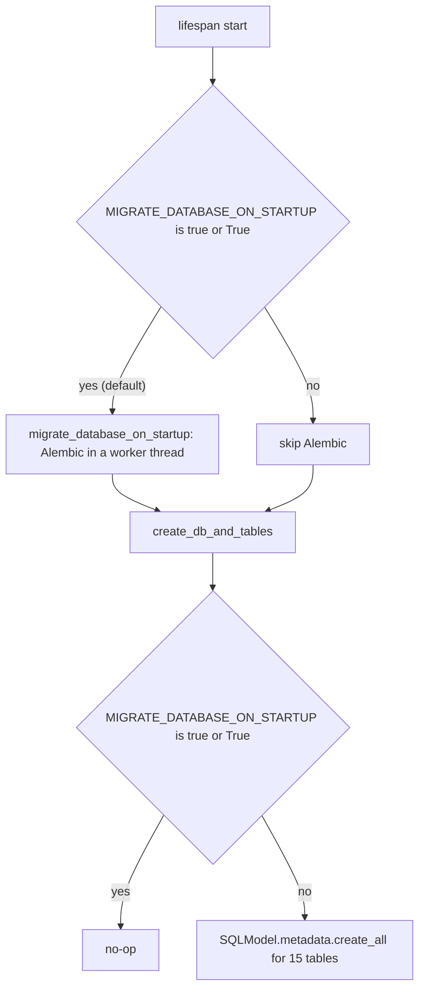
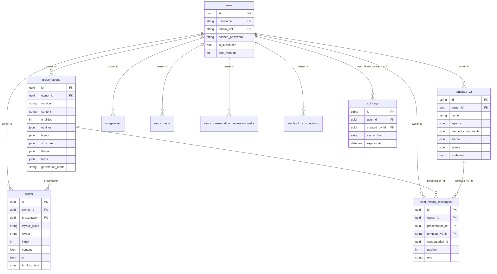

# Data model

<div class="chapter-meta" markdown>
**Reads:** `servers/fastapi/services/database.py`, `servers/fastapi/utils/db_utils.py`, `servers/fastapi/migrations.py`, `servers/fastapi/alembic/env.py`, `servers/fastapi/alembic/versions/*.py`, `servers/fastapi/models/sql/*.py`  ·  **Builds on:** [FastAPI app and startup](05-fastapi-startup.md)  ·  **Time:** ~35 min
</div>

This chapter is the reference for everything Presenton keeps in its relational database. You will see how `DATABASE_URL` becomes an async SQLAlchemy engine, how the startup migration runner copes with old and half-migrated databases, the full Alembic revision chain, and then every table and every column of the 15 SQL models, with realistic JSON values taken from the code that writes them. It ends with ownership isolation, how presentations and slides are duplicated, and what the `v1-standard` / `v2-standard` version flag really means.

## Step 1: Pick the database URL and the async driver

Every database connection in the FastAPI process starts from one function, `get_database_url_and_connect_args()` (`servers/fastapi/utils/db_utils.py:57`). It runs once at import time of `services/database.py` (`servers/fastapi/services/database.py:34`), so the URL is fixed for the lifetime of the process.

### 1.1 The default: SQLite under the app data directory

```python title="servers/fastapi/utils/db_utils.py (excerpt)"
def get_database_url_and_connect_args() -> tuple[str, dict]:
    database_url = get_database_url_env() or "sqlite:///" + os.path.join(
        get_app_data_directory_env() or "/tmp/presenton", "fastapi.db"
    )

    _ensure_sqlite_parent_dir(database_url)

    if database_url.startswith("sqlite://"):
        database_url = database_url.replace("sqlite://", "sqlite+aiosqlite://", 1)
    elif database_url.startswith("postgresql://"):
        database_url = database_url.replace("postgresql://", "postgresql+asyncpg://", 1)
    elif database_url.startswith("mysql://"):
        database_url = database_url.replace("mysql://", "mysql+aiomysql://", 1)
    else:
        database_url = database_url
```

The resolution order is:

1. `DATABASE_URL` (`get_database_url_env`, `servers/fastapi/utils/get_env.py:40`) if it is set and non-empty.
2. Otherwise `sqlite:///<APP_DATA_DIRECTORY>/fastapi.db` (`get_app_data_directory_env`, `servers/fastapi/utils/get_env.py:44`). In Docker, `APP_DATA_DIRECTORY=/app_data` (`Dockerfile:82`), so the file is `/app_data/fastapi.db`.
3. If `APP_DATA_DIRECTORY` is unset too, `/tmp/presenton/fastapi.db`.

`_ensure_sqlite_parent_dir` (`servers/fastapi/utils/db_utils.py:7`) creates the parent folder of a SQLite file with `os.makedirs(..., exist_ok=True)`, and strips the leading slash of Windows paths such as `/C:/...` before doing so.

### 1.2 Driver rewriting

The runtime engine is async, so plain scheme prefixes are rewritten to async dialects:

| Scheme in `DATABASE_URL` | Runtime URL (async) | Alembic URL (sync, `to_sync_sqlalchemy_url`) |
|---|---|---|
| `sqlite://` | `sqlite+aiosqlite://` | `sqlite://` |
| `postgresql://` | `postgresql+asyncpg://` | `postgresql+psycopg://` (psycopg 3) |
| `mysql://` | `mysql+aiomysql://` | `mysql+pymysql://` |
| anything else (for example `postgresql+asyncpg://...` already) | unchanged | `postgresql+asyncpg://` and `mysql+aiomysql://` are also mapped; other schemes pass through |

`to_sync_sqlalchemy_url` lives at `servers/fastapi/utils/db_utils.py:103`. Its docstring explains the choice of sync drivers: psycopg2 is not installed when asyncpg is the runtime driver, and PyMySQL is already pulled in by aiomysql.

!!! warning "Gotcha"
    `postgres://` (the short form some hosting platforms emit) is not in the rewrite list. It passes through unchanged and SQLAlchemy will not find an async driver for it. Use `postgresql://` in `DATABASE_URL`.

### 1.3 Connect arguments and the query string

After the rewrite, the function builds `connect_args`:

- SQLite gets `check_same_thread=False` (`servers/fastapi/utils/db_utils.py:74`).
- For `postgresql+asyncpg`, a query parameter `sslmode` with any value other than `disable` produces `connect_args["ssl"] = ssl.create_default_context()` (`servers/fastapi/utils/db_utils.py:84`).
- Then the entire query string is dropped from the URL (`servers/fastapi/utils/db_utils.py:88`), because asyncpg does not accept libpq-style parameters. Any parse failure is swallowed (`except Exception: pass`).

So `postgresql://u:p@db:5432/presenton?sslmode=require` becomes the URL `postgresql+asyncpg://u:p@db:5432/presenton` plus `{"ssl": <SSLContext>}`.

!!! warning "Gotcha"
    Every query parameter is discarded, not only `sslmode`. Options such as `application_name` or `options=-csearch_path=...` in `DATABASE_URL` silently have no effect at runtime. Alembic gets the same stripped URL because `migrations.py` calls the same function first (`servers/fastapi/migrations.py:59`).

## Step 2: Create the engine, the session factory and the listeners

`servers/fastapi/services/database.py` is a module with side effects. Importing it builds the engine:

```python title="servers/fastapi/services/database.py (excerpt)"
database_url, connect_args = get_database_url_and_connect_args()

# Apply connection-pool settings for server-class databases (PostgreSQL, MySQL).
# SQLite uses a file-lock model and ignores pool configuration, so we skip it.
_pool_kwargs = get_pool_kwargs() if "sqlite" not in database_url else {}

sql_engine: AsyncEngine = create_async_engine(
    database_url, connect_args=connect_args, **_pool_kwargs
)


if "sqlite" in database_url:
    @event.listens_for(sql_engine.sync_engine, "connect")
    def _enable_sqlite_foreign_keys(dbapi_connection, _connection_record) -> None:
        cursor = dbapi_connection.cursor()
        cursor.execute("PRAGMA foreign_keys=ON")
        cursor.close()


async_session_maker = async_sessionmaker(sql_engine, expire_on_commit=False)
```

### 2.1 Pool settings

`get_pool_kwargs` (`servers/fastapi/utils/db_utils.py:34`) reads five optional environment variables. Non-integer values fall back to the default through `_int_env` (`servers/fastapi/utils/db_utils.py:23`).

| Variable | SQLAlchemy argument | Default |
|---|---|---|
| `DB_POOL_SIZE` | `pool_size` | `5` |
| `DB_MAX_OVERFLOW` | `max_overflow` | `10` |
| `DB_POOL_TIMEOUT` | `pool_timeout` (seconds) | `30` |
| `DB_POOL_RECYCLE` | `pool_recycle` (seconds) | `1800` |
| `DB_POOL_PRE_PING` | `pool_pre_ping` | `true` (anything except `false`, `0`, `no`) |

These are not read through `utils/get_env.py`, so they do not appear in the environment getter inventory of [Configuration and LLM providers](06-configuration-and-providers.md). They apply only when the URL does not contain the substring `sqlite`.

### 2.2 SQLite foreign keys

SQLite ignores foreign keys unless `PRAGMA foreign_keys=ON` is issued on every connection. The `connect` listener does exactly that (`servers/fastapi/services/database.py:45`). Without it, none of the `ondelete="CASCADE"` clauses in the models would fire on the default database.

### 2.3 Sessions

`async_session_maker` uses `expire_on_commit=False` (`servers/fastapi/services/database.py:53`), so ORM objects stay readable after `commit()`. Routes receive a session through the dependency `get_async_session` (`servers/fastapi/services/database.py:111`), which opens one `AsyncSession` per request. Background jobs and startup code open their own with `async with async_session_maker() as session`.

### 2.4 Two global ORM listeners

The module also registers `_scope_owned_selects` on `do_orm_execute` and `_stamp_new_owned_rows` on `before_flush` (`servers/fastapi/services/database.py:67` and `:100`). They are covered in Step 6 below and in depth in [FastAPI app and startup](05-fastapi-startup.md).

## Step 3: Migrate or create the schema at startup

The lifespan runs two functions back to back (`servers/fastapi/api/lifespan.py:56` and `:57`):



`MIGRATE_DATABASE_ON_STARTUP` defaults to `"true"` (`servers/fastapi/utils/get_env.py:453`); `docker-compose.yml` sets it to `true` and Electron sets it to `"True"` (`electron/app/main.ts:374`). Only those two spellings count; `1` or `yes` disable migrations.

### 3.1 The create_all path

When migrations are off, `create_db_and_tables` (`servers/fastapi/services/database.py:117`) calls `SQLModel.metadata.create_all` with an explicit list of 15 tables: presentations, slides, key-value, template v2, chat history, image assets, font uploads, webhook subscriptions, async tasks, legacy async generation tasks, Ollama pull status, user, API keys, provider settings and the Presenton Cloud provider. `create_all` creates missing tables only.

!!! warning "Gotcha"
    With `MIGRATE_DATABASE_ON_STARTUP=false`, an existing table never gets new columns. Upgrading a deployment that runs with migrations disabled leaves, for example, `presentations` without `generation_mode`, and the first query fails. Either keep migrations on or run `alembic upgrade head` yourself.

### 3.2 The Alembic path

`migrate_database_on_startup` (`servers/fastapi/migrations.py:40`) runs `_run_migrations` through `asyncio.to_thread`, because Alembic is synchronous. It prints `Migrations run successfully` or `Error running migrations: ...` and re-raises, so a failed migration aborts startup.

`_run_migrations` (`servers/fastapi/migrations.py:52`) does four things in order:

1. Builds an Alembic `Config` in code, with `script_location` pointing at `servers/fastapi/alembic` and `sqlalchemy.url` set to the sync URL from Step 1. `alembic.ini` is not read on this path.
2. `_repair_orphan_alembic_revision` (`servers/fastapi/migrations.py:79`): if `alembic_version.version_num` names a revision that no longer exists in `alembic/versions` (an old image, a removed branch), it infers the real schema level from the live tables and overwrites `version_num`.
3. `_stamp_legacy_database_if_needed` (`servers/fastapi/migrations.py:264`): if the database has application tables but no row in `alembic_version` (a database created by `create_all`, or by a pre-Alembic release), it infers the revision from the schema and runs `command.stamp`.
4. `command.upgrade(config, "head")`. If that throws and the database is still "unversioned but populated", it stamps and upgrades once more as a safety net (`servers/fastapi/migrations.py:68`).

"Populated" means at least one of 17 known table names exists, including legacy ones such as `templates`, `presentation_layout_codes`, `template_create_infos` and `access_tokens` (`servers/fastapi/migrations.py:294`).

### 3.3 Inferring a revision from the schema

`_infer_revision_from_schema` (`servers/fastapi/migrations.py:117`) is a best-effort decision ladder that walks from the newest feature down. Rows are tested top to bottom and the first match wins; the first five rows all require that `provider_settings` and `user` exist and that every owned table present has `owner_id`:

| Evidence in the live schema | Inferred revision |
|---|---|
| `template_v2.theme` exists | `e4c7a9b2d6f1` |
| else `presenton_cloud_provider` exists | `c6e8f1a3b5d7` |
| else `presentations.generation_mode` exists | `f3a7c1d9e5b2` |
| else `user.admin_slot` exists | `e1b3c5d7f9a2` |
| else | `d0a2b4c6e8f1` |
| `user` exists and ownership is ready | `c9f1a2b3d4e5` |
| `template_v2` exists | one of `a7d4c9e2f1b3`, `4b7c9d0e1f2a`, `3f2a1b4c5d6e`, `5d7e9a1b2c3f`, `2c8f4a1b9d7e`, `9b2d1c4e5f6a`, `8a6c4d2e1f30`, `6e4a1b2c3d5f` or `c7b70d0f31b1`, depending on `font_uploads`, string ids, `is_default`, `slides.ui`, `presentations.fonts`, `chat_history_messages.template_v2_id` and `presentations.version` |
| `async_tasks` exists | `a7d4c9e2f1b3` |
| `chat_history_messages` exists | `c7b70d0f31b1` |
| `template_create_infos` exists | `95b5127e93cd` |
| `presentations.theme` exists | `82abdbc476a7` |
| none of the above | `00b3c27a13bc` |

The string-id test `_is_uuid_storage_column` (`servers/fastapi/migrations.py:253`) treats a column as UUID storage when its reflected type class is `uuid` or its rendered type is `uuid` or `char(32)`. That is how SQLAlchemy stores `Uuid` on SQLite and MySQL.

!!! warning "Gotcha"
    The inference never returns the head `026c0ba8b35c`. A database that already has `api_keys` but no `alembic_version` row is stamped at `e4c7a9b2d6f1`, and `upgrade` then re-runs `026c0ba8b35c`, whose `op.create_table("api_keys", ...)` is not guarded by an existence check (it guards only the `access_tokens` drop and the `async_tasks.payload` column). The most likely way to get there is a deployment that ran with `MIGRATE_DATABASE_ON_STARTUP=false` (so `create_all` created `api_keys`) and is then switched to migrations. The retry in `_run_migrations` does not help, because after stamping the database is no longer unversioned. This was found by reading the code, not by running it.

### 3.4 alembic.ini and env.py

`servers/fastapi/alembic.ini` exists for command-line use (`alembic revision --autogenerate`). Its `sqlalchemy.url = sqlite:///placeholder` (`servers/fastapi/alembic.ini:7`) is a sentinel. `alembic/env.py` recognises it in `_get_url` (`servers/fastapi/alembic/env.py:46`) and falls back to `get_database_url_and_connect_args()` converted with `to_sync_sqlalchemy_url`, so the CLI uses the same `DATABASE_URL` / `APP_DATA_DIRECTORY` logic as the app.

`env.py` imports all 15 model modules (`servers/fastapi/alembic/env.py:15` to `:33`) so that `SQLModel.metadata` is complete before autogenerate compares it. Online migrations use `pool.NullPool` and `compare_type=True` (`servers/fastapi/alembic/env.py:80` to `:89`). `User` and `PresentonCloudProvider` are plain SQLAlchemy declarative classes, but `UserBase.metadata = SQLModel.metadata` (`servers/fastapi/models/sql/user.py:13`) puts them in the same metadata object.

## Step 4: Read the revision chain

There are 24 revisions in one linear chain (each `down_revision` points at exactly one parent). Most later revisions are idempotent: they inspect the schema and only add what is missing, which is what makes the stamping strategy of Step 3 safe.

| # | Revision | File | What it does |
|---|---|---|---|
| 1 | `00b3c27a13bc` | `00b3c27a13bc_init.py` | Baseline: creates `async_presentation_generation_tasks`, `imageasset`, `keyvaluesqlmodel`, `ollamapullstatus`, `presentation_layout_codes`, `presentations`, `templates`, `webhook_subscriptions`, `slides` |
| 2 | `f42ad4074449` | `f42ad4074449_add_theme_column_to_presentations.py` | Adds `presentations.theme` (JSON) if missing |
| 3 | `82abdbc476a7` | `82abdbc476a7_add_theme_column_to_presentations.py` | Empty (`pass`); a duplicate autogenerate kept for chain continuity |
| 4 | `95b5127e93cd` | `95b5127e93cd_template_create_info.py` | Creates legacy `template_create_infos` (fonts, pptx_url, slide_htmls, slide_image_urls) |
| 5 | `c7b70d0f31b1` | `c7b70d0f31b1_added_chat_history_messages_table.py` | Creates `chat_history_messages` with three indexes, `presentation_id` NOT NULL |
| 6 | `6e4a1b2c3d5f` | `6e4a1b2c3d5f_add_template_v2_and_presentation_version.py` | Creates `template_v2` (or adds missing columns and drops obsolete `cluster_candidates`, `clusters`); adds `presentations.version`, backfills `v1-standard`, makes it NOT NULL |
| 7 | `7f5b2c3d4e6a` | `7f5b2c3d4e6a_add_slide_ui.py` | Adds `slides.ui` (JSON) |
| 8 | `8a6c4d2e1f30` | `8a6c4d2e1f30_add_merged_components_to_template_v2.py` | Adds `template_v2.merged_components` |
| 9 | `9b2d1c4e5f6a` | `9b2d1c4e5f6a_add_fonts_column_to_presentations.py` | Adds `presentations.fonts` |
| 10 | `1d9a4c7b8e2f` | `1d9a4c7b8e2f_add_template_v2_chat_scope.py` | Makes `chat_history_messages.presentation_id` nullable; adds `template_v2_id` with FK `fk_chat_history_messages_template_v2_id_template_v2` (CASCADE) and an index |
| 11 | `2c8f4a1b9d7e` | `2c8f4a1b9d7e_make_template_v2_layouts_nullable.py` | Makes `template_v2.layouts` nullable (needed for the two-phase custom template flow) |
| 12 | `5d7e9a1b2c3f` | `5d7e9a1b2c3f_add_font_uploads.py` | Creates `font_uploads` with an index on `normalized_family_name` |
| 13 | `3f2a1b4c5d6e` | `3f2a1b4c5d6e_template_v2_ids_to_strings.py` | Converts `template_v2.id` and `chat_history_messages.template_v2_id` from UUID to string; on SQLite re-inserts dashes into 32-char hex ids; recreates the FK and index |
| 14 | `4b7c9d0e1f2a` | `4b7c9d0e1f2a_add_is_default_to_template_v2.py` | Adds `template_v2.is_default` NOT NULL, `server_default=false` |
| 15 | `a7d4c9e2f1b3` | `a7d4c9e2f1b3_add_async_tasks.py` | Creates `async_tasks` with indexes on `type` and `status` |
| 16 | `b8e2f4a7c9d1` | `b8e2f4a7c9d1_normalize_async_task_statuses.py` | `UPDATE async_tasks SET status = 'pending' WHERE status = 'processing'`; downgrade is a no-op |
| 17 | `c9f1a2b3d4e5` | `c9f1a2b3d4e5_multi_user_auth_and_ownership.py` | Creates `user` and `access_tokens`; adds `owner_id` (UUID, nullable, indexed, FK to `user.id` CASCADE) to 11 tables |
| 18 | `d0a2b4c6e8f1` | `d0a2b4c6e8f1_username_only_provider_settings.py` | Creates `provider_settings`; drops `user.email` and its index if present |
| 19 | `e1b3c5d7f9a2` | `e1b3c5d7f9a2_primary_admin_slot.py` | Adds `user.admin_slot`, sets `"primary"` on the first superuser, creates unique index `uq_user_admin_slot` |
| 20 | `f3a7c1d9e5b2` | `f3a7c1d9e5b2_add_smart_generation_fields.py` | Adds `presentations.generation_mode` (NOT NULL, `server_default="standard"`) and `community_design_ids` (JSON) |
| 21 | `c6e8f1a3b5d7` | `c6e8f1a3b5d7_add_global_presenton_cloud_provider.py` | Creates `presenton_cloud_provider` |
| 22 | `d2f4a6b8c0e1` | `d2f4a6b8c0e1_backfill_smart_presentation_mode.py` | Sets `generation_mode = 'smart'` on presentations that have any slide with non-blank `html_content`; downgrade is a no-op |
| 23 | `e4c7a9b2d6f1` | `e4c7a9b2d6f1_add_theme_to_template_v2.py` | Adds `template_v2.theme` (JSON) |
| 24 | `026c0ba8b35c` | `026c0ba8b35c_add_async_task_payload_and_unified_api_.py` | Creates `api_keys` with four indexes; drops `access_tokens`; adds `async_tasks.payload` (JSON). Current head (`REVISION_HEAD`, `servers/fastapi/migrations.py:37`) |

The ownership migration lists its owned tables explicitly (`servers/fastapi/alembic/versions/c9f1a2b3d4e5_multi_user_auth_and_ownership.py:18`), and each gets an index `ix_<table>_owner_id` and an FK `fk_<table>_owner_id_user`:

```python title="servers/fastapi/alembic/versions/c9f1a2b3d4e5_multi_user_auth_and_ownership.py (excerpt)"
    for table in OWNED_TABLES:
        if table not in existing_tables:
            continue
        columns = {column["name"] for column in inspector.get_columns(table)}
        if "owner_id" in columns:
            continue
        with op.batch_alter_table(table) as batch:
            batch.add_column(sa.Column("owner_id", sa.Uuid(), nullable=True))
            batch.create_index(f"ix_{table}_owner_id", ["owner_id"])
            batch.create_foreign_key(
                f"fk_{table}_owner_id_user",
                "user",
                ["owner_id"],
                ["id"],
                ondelete="CASCADE",
            )
```

!!! warning "Gotcha"
    A database that came up through Alembic and one that came up through `create_all` are not identical. The migrated one still contains the legacy tables `templates`, `presentation_layout_codes` and `template_create_infos` (no model maps them any more, but no migration drops them), and some details follow the migrations rather than the models: the ownership foreign keys are named `fk_<table>_owner_id_user` only in migrated databases (the models declare them unnamed), and `presentations.generation_mode` and `template_v2.is_default` have server defaults (`'standard'`, `false`) only when added by a migration (the models set Python-side defaults). When you autogenerate a new revision, review the diff for such noise.

### 4.1 Adding a migration

The codebase convention, visible in every revision from 5 onwards, is:

1. Write the revision by hand (or autogenerate and then edit) with `down_revision` set to the current head, `026c0ba8b35c`.
2. Guard every operation with `_has_table` / `_has_column` / `_has_index` helpers built on `sa.inspect(op.get_bind())`.
3. Use `op.batch_alter_table` for anything that alters an existing column, because SQLite cannot `ALTER COLUMN` in place.
4. Add a `REVISION_...` constant in `migrations.py`, move `REVISION_HEAD` to it, and teach `_infer_revision_from_schema` how to recognise your schema change. The test file `servers/fastapi/tests/unit/test_migrations.py` has one test per such step, for example `test_upgrade_from_template_v2_theme_adds_unified_keys_and_task_payload` (line 882).

## Step 5: Walk every table

The ER diagram below shows the current model tables and their foreign keys. Legacy tables that only exist in migrated databases are omitted.



Tables with no relationships at all: `provider_settings`, `presenton_cloud_provider`, `font_uploads`, `keyvaluesqlmodel`, `ollamapullstatus`.

A note on types used below. `AutoString` is SQLModel's `VARCHAR` without a length. `Uuid` is SQLAlchemy's portable UUID type: native `UUID` on PostgreSQL, `CHAR(32)` hex elsewhere. `JSON` is native JSON on PostgreSQL and MySQL and `TEXT` holding serialized JSON on SQLite. Columns declared through a SQLModel `Field` without `sa_column` are NOT NULL unless the type is `Optional`.

### 5.1 `presentations` (`PresentationModel`)

Defined in `servers/fastapi/models/sql/presentation.py:21`.

| Column | Type | Null | Default | Notes |
|---|---|---|---|---|
| `id` | `Uuid` | PK | `uuid4()` | |
| `owner_id` | `Uuid` | yes | `get_current_owner_id()` | FK `user.id` `ON DELETE CASCADE`, indexed, excluded from API output |
| `version` | non-native enum (`VARCHAR` + CHECK) | no | none, must be set | `v1-standard` or `v2-standard`, constraint name `presentation_version` |
| `content` | `AutoString` | no | none | The user prompt; `""` for blank decks |
| `n_slides` | `Integer` | no | none | Requested count; `0` means "auto" (`presentation.py:1742` comment) |
| `language` | `AutoString` | no | none | Reset to `""` by `/prepare` (`presentation.py:1917`) |
| `title` | `AutoString` | yes | `None` | |
| `file_paths` | `JSON` | yes | `None` | List of resolved temp upload paths |
| `outlines` | `JSON` | yes | `None` | `PresentationOutlineModel` dump |
| `created_at` | `DateTime(tz)` | no | `datetime.now(timezone.utc)` | |
| `updated_at` | `DateTime(tz)` | no | UTC now | `onupdate` UTC now |
| `layout` | `JSON` | yes | `None` | Copied template layouts plus metadata |
| `structure` | `JSON` | yes | `None` | `PresentationStructureModel` dump |
| `instructions` | `String` | yes | `None` | |
| `tone` | `String` | yes | `None` | Enum value, e.g. `default` |
| `verbosity` | `String` | yes | `None` | Enum value, e.g. `standard` |
| `include_table_of_contents` | `Boolean` | yes (DB) | `False` | |
| `include_title_slide` | `Boolean` | yes (DB) | `True` | |
| `web_search` | `Boolean` | yes (DB) | `False` | |
| `theme` | `JSON` | yes | `None` | |
| `fonts` | `JSON` | yes | `None` | Map font family to CSS URL |
| `generation_mode` | `String` | no | `"standard"` | `standard` or `smart`; Python type is `Literal`, DB has no CHECK |
| `community_design_ids` | `JSON` | yes | `None` | List of ints, Smart mode only |

No relationships are declared on the model; slides are always loaded by an explicit `select(SlideModel).where(SlideModel.presentation == id)`.

The JSON columns, as the code writes them:

=== "outlines"

    Written by `/prepare` as `presentation_outline_model.model_dump(mode="json")` (`servers/fastapi/api/v1/ppt/endpoints/presentation.py:1912`) by `PUT /api/v1/ppt/outlines/{id}` (`servers/fastapi/api/v1/ppt/endpoints/outlines.py:69`) and by the outline stream (`outlines.py:248`). The model is `{"slides": [{"content": str}]}` with at most 50 slides (`servers/fastapi/models/presentation_outline_model.py:24`).

    ```json
    {
      "slides": [
        {"content": "# Q3 Revenue Review\nA look at growth drivers, risks and the plan for Q4."},
        {"content": "## Revenue by region\n- EMEA up 18%\n- APAC flat\n- Americas up 9%"},
        {"content": "## Next steps\n1. Expand EMEA sales team\n2. Launch APAC partner program"}
      ]
    }
    ```

=== "structure"

    One layout index per slide, into `layout["layouts"]` (`servers/fastapi/models/presentation_structure_model.py:5`). Written with `set_structure` (`servers/fastapi/models/sql/presentation.py:124`).

    ```json
    {"slides": [0, 4, 7]}
    ```

=== "layout"

    A deep copy of the template's `layouts` column with four keys added by `_copy_template_layout_payload` (`servers/fastapi/api/v1/ppt/endpoints/presentation.py:232`): `icon_type`, `icon_weight`, `name` (the template id) and `template_id`. Abbreviated, for the bundled `general` template:

    ```json
    {
      "layouts": [
        {
          "id": "title_intro",
          "description": "A clean split presentation layout with a large rounded image card ...",
          "components": [
            {
              "id": "right_text_panel",
              "description": "Right aligned content panel ...",
              "position": {"x": 672, "y": 163},
              "elements": [
                {"type": "text", "name": "headline_text", "decorative": false,
                 "position": {"x": 0, "y": 0}, "size": {"width": 530, "height": 120},
                 "runs": [{"text": "Product Overview"}], "max_length": 25, "min_length": 8}
              ]
            }
          ]
        }
      ],
      "icon_type": "bold",
      "icon_weight": "bold",
      "name": "general",
      "template_id": "general"
    }
    ```

    The element vocabulary is the subject of [Template v2 format](16-template-v2-format.md).

=== "theme"

    `template_theme_for_presentation` (`servers/fastapi/templates/v2/theme.py:405`) wraps the template's theme:

    ```json
    {
      "name": "General Theme",
      "description": "General template best for simple presentations, great spacing and clean layout.",
      "data": {
        "colors": {"primary": "#3B82F6", "background": "#9333EA", "card": "#FFFFFF",
                   "primary_text": "#111827", "graph_0": "#EF4444"},
        "fonts": {"textFont": {"name": "Poppins",
                  "url": "https://fonts.googleapis.com/css2?family=Poppins:wght@100..900&display=swap"}}
      },
      "source": "template",
      "template_id": "general"
    }
    ```

=== "fonts"

    `_coerce_presentation_font_map` (`servers/fastapi/api/v1/ppt/endpoints/presentation.py:322`) keeps only non-empty string pairs from `template.assets["fonts"]`:

    ```json
    {"Poppins": "https://fonts.googleapis.com/css2?family=Poppins:ital,wght@0,400;0,700;1,400&display=swap"}
    ```

=== "file_paths / community_design_ids"

    ```json
    ["/app_data/uploads/users/7b0c.../q3-report.pdf"]
    ```

    ```json
    [101, 245]
    ```

    `file_paths` are validated by `TEMP_FILE_SERVICE.resolve_existing_temp_paths` before storage (`presentation.py:1737`); the path shown is illustrative. Community ids are only accepted in Smart mode (`presentation.py:1722`).

!!! warning "Gotcha"
    `layout` and `structure` are excluded from the presentation API responses by `_presentation_response_data` (`servers/fastapi/api/v1/ppt/endpoints/presentation.py:343`), which also adds two computed fields that are not columns: `type` (`smart` or `standard`) and `can_regenerate`. Do not look for these in the table.

### 5.2 `slides` (`SlideModel`)

Defined in `servers/fastapi/models/sql/slide.py:9`.

| Column | Type | Null | Default | Notes |
|---|---|---|---|---|
| `id` | `Uuid` | PK | `uuid4()` | |
| `owner_id` | `Uuid` | yes | current owner | FK `user.id` CASCADE, indexed |
| `presentation` | `Uuid` | yes (DB) | none | FK `presentations.id` `ON DELETE CASCADE`, indexed. Note the name: not `presentation_id` |
| `layout_group` | `AutoString` | no | none | Template id, `blank`, or `smart-html` |
| `layout` | `AutoString` | no | none | Layout id inside the group, `__blank_slide__`, or `smart-html` |
| `index` | `Integer` | no | none | 0-based position |
| `content` | `JSON` | yes (DB) | none | Generated content keyed by component |
| `html_content` | `AutoString` | yes | `None` | Full HTML of a Smart-mode slide |
| `speaker_note` | `AutoString` | yes | `None` | |
| `properties` | `JSON` | yes | none | See below |
| `ui` | `JSON` | yes | `None` | Hydrated layout used for rendering and export |

The three kinds of slide rows look like this:

=== "Template (standard) slide"

    Created during streaming at `servers/fastapi/api/v1/ppt/endpoints/presentation.py:2383`. `content` is the LLM output for the layout's JSON schema: one key per component (deduplicated with `_0`, `_1` suffixes when ids repeat, `presentation.py:538`), each holding values keyed by element `name`, plus the runtime field `__speaker_note__`. Image elements carry `image_prompt` and a URL that starts as the placeholder `/static/images/placeholder.jpg` (`servers/fastapi/utils/process_slides.py:427`) and is replaced when the image is ready.

    ```json
    {
      "layout_group": "general",
      "layout": "title_intro",
      "index": 0,
      "speaker_note": "Open with the headline number and set up the regional story.",
      "content": {
        "right_text_panel": {
          "headline_text": "Q3 Revenue Review",
          "body_text": "Growth drivers, risks and the plan for Q4."
        },
        "image_showcase_card": {
          "main_visual": {
            "image_prompt": "modern office team reviewing charts on a large screen",
            "image_url": "/app_data/images/users/7b0c.../3f1e9c.png"
          }
        },
        "__speaker_note__": "Open with the headline number and set up the regional story."
      },
      "ui": {"id": "title_intro", "description": "...", "components": ["... deep copy of the layout with runs replaced by content ..."]},
      "html_content": null,
      "properties": null
    }
    ```

    `ui` starts as a deep copy of the matching layout (`_template_slide_ui`, `presentation.py:490`) and is then hydrated with `content` by `_apply_template_content_to_ui` (`presentation.py:575`). How schema, content and `ui` relate is the topic of [From template to schema to slide](17-template-to-slide.md).

=== "Smart slide"

    Created by `emit_slide` during Smart generation (`servers/fastapi/api/v1/ppt/endpoints/presentation.py:2060`):

    ```json
    {
      "layout_group": "smart-html",
      "layout": "smart-html",
      "index": 2,
      "content": {"title": "Revenue by region"},
      "html_content": "<div class=\"slide\" style=\"width:1280px;height:720px\">...</div>",
      "speaker_note": "",
      "ui": null
    }
    ```

    See [Smart mode](13-smart-mode.md).

=== "Blank slide"

    Created by `POST /api/v1/ppt/presentation/create/blank` (`presentation.py:1813`) with `content={}`, `speaker_note=""` and `ui` set to `BLANK_PRESENTATION_SLIDE_UI` (`presentation.py:141`): `{"id": "__blank_slide__", "description": "Empty slide.", "background": "#FFFFFF", "components": [], "elements": [ one full-canvas white polygon 1280x720 ]}`.

`properties` is not written by any generation code path at this snapshot. Only the Presenton Cloud persistence copies it from a cloud payload (`servers/fastapi/services/presenton_cloud_persistence.py:212`), `get_new_slide` copies it, and the editor reads `properties[imageIdx].initialFocusPoint` and `.initialObjectFit` when it is present (`servers/nextjs/app/(presentation-generator)/components/ImageEditor.tsx:88`). The shape the editor expects is therefore `{"0": {"initialObjectFit": "cover", "initialFocusPoint": {"x": 50, "y": 50}}}`, but the save path `saveImageProperties` (`ImageEditor.tsx:212`) only passes the values to an optional `onFocusPointClick` callback, under a `TODO: Save to Redux store if needed` comment.

!!! warning "Gotcha"
    Nothing in the database enforces unique or contiguous `index` values per presentation: there is only a plain index on `presentation`. `PATCH /api/v1/ppt/presentation/update` replaces the whole slide set by deleting all owned slides of the presentation and inserting the client's list (`servers/fastapi/api/v1/ppt/endpoints/presentation.py:2560` to `:2571`), so the client is the authority on ordering. `GET /presentation/all` joins on `SlideModel.index == 0` for its preview (`presentation.py:1518`), so a deck with no slide at index 0 disappears from that listing when `include_slides=true`.

### 5.3 `template_v2` (`TemplateV2`)

Defined in `servers/fastapi/models/sql/template_v2.py:16`.

| Column | Type | Null | Default | Notes |
|---|---|---|---|---|
| `id` | `AutoString` | PK | `str(uuid4())` | String, not UUID, since revision 13. Bundled templates use their directory id, e.g. `general` |
| `owner_id` | `Uuid` | yes | current owner | FK `user.id` CASCADE. `NULL` for bundled templates |
| `name` | `AutoString` | no | none | |
| `description` | `AutoString` | yes | `None` | |
| `raw_layouts` | `JSON` | yes | `None` | Custom templates only: PPTX converted to `{"layouts": [{"id", "description", "elements"}]}` (`RawSlideLayouts`) |
| `components` | `JSON` | yes | `None` | Read from a bundled `template.json` if present; no other writer at this snapshot |
| `merged_components` | `JSON` | yes | `None` | `{"components": [{"id", "description", "variants": [Component, ...]}]}` |
| `layouts` | `JSON` | yes | `None` | `{"layouts": [{"id", "description", "components": [...]}]}`, at least one layout when present |
| `theme` | `JSON` | yes | `None` | `{"colors": {...}, "fonts": {"textFont": {...}}}` |
| `assets` | `JSON` | yes | `None` | Fonts, icon type, image list, generation options |
| `is_default` | `Boolean` | no | `False` | `server_default=false` in the migration |
| `created_at` | `DateTime(tz)` | no | UTC now | |
| `updated_at` | `DateTime(tz)` | no | UTC now | `onupdate` |

`assets` differs by origin. A bundled template gets it from `_build_assets` (`servers/fastapi/templates/default_templates.py:218`):

```json
{
  "template_id": "general",
  "icon_type": "bold",
  "icon_weight": "bold",
  "fonts": {"Poppins": "https://fonts.googleapis.com/css2?family=Poppins:ital,wght@0,400;0,700;1,400&display=swap"},
  "images": ["/static/images/replaceable_template_image.png",
             "/app_data/templates/general/static/image2-ec1c92dee7a3.png", "... 18 entries in total ..."],
  "thumbnail": "/app_data/templates/general/static/thumbnail.png"
}
```

`images` is every `data` value of an element with `"type": "image"` found in the layouts and merged components (`_collect_image_urls`, `default_templates.py:267`), with relative `static/...` paths already rewritten to `/app_data/templates/<id>/static/...`.

A custom template created with `POST /api/v1/ppt/template/init` (`servers/fastapi/api/v1/ppt/endpoints/template.py:1272`) gets `pptx_url`, `icon_type` and `icon_weight` (same value), `fonts`, `slide_image_urls`, `images` collected from the raw layouts, an empty `layout_indexes` list and, only when the request explicitly set it, `generation_options` (`{"text_growth": true, "visual_replacement": true, "flexible_grouping": true}` by default, `templates/v2/models/layouts.py:34`; `_explicit_template_generation_options`, `template.py:558`). At that point `layouts` is `NULL`, which is why revision 11 made it nullable. The full custom template lifecycle is in [Custom templates from PPTX](18-custom-templates.md).

!!! warning "Gotcha"
    Bundled templates are re-imported at every startup by `import_default_templates_on_startup` (`servers/fastapi/templates/default_templates.py:22`): existing rows are overwritten field by field, and any `is_default = True` row whose id is no longer on disk is deleted together with its static files. Editing a bundled template in the database is pointless; edit `templates/<name>/template.json`.

### 5.4 `chat_history_messages` (`ChatHistoryMessageModel`)

Defined in `servers/fastapi/models/sql/chat_history_message.py:12`.

| Column | Type | Null | Default | Notes |
|---|---|---|---|---|
| `id` | `Uuid` | PK | `uuid4()` | |
| `owner_id` | `Uuid` | yes | current owner | FK `user.id` CASCADE |
| `presentation_id` | `Uuid` | yes | `None` | FK `presentations.id` CASCADE, indexed |
| `template_v2_id` | `String` | yes | `None` | FK `template_v2.id` CASCADE, indexed |
| `conversation_id` | `Uuid` | no | none | Indexed |
| `position` | `Integer` | no | none | Indexed; `ge=1` validated in Python only |
| `role` | `AutoString` | no | none | `user` or `assistant` |
| `content` | `Text` | no | none | |
| `created_at` | `DateTime(tz)` | no | UTC now | |
| `tool_calls` | `JSON` | yes | `None` | List of tool names |

A thread belongs to exactly one resource: a presentation or a template. That rule lives in `_resource_filter` (`servers/fastapi/services/chat/sql_chat_history.py:53`), which raises `ValueError` unless exactly one id is given; the database itself would accept both or neither. One turn written by `append_turn` (`sql_chat_history.py:194`) is two rows with consecutive positions:

```json
[
  {"conversation_id": "5d1c...", "presentation_id": "a8f2...", "template_v2_id": null,
   "position": 7, "role": "user", "content": "Make slide 3 more concise", "tool_calls": null},
  {"conversation_id": "5d1c...", "presentation_id": "a8f2...", "template_v2_id": null,
   "position": 8, "role": "assistant", "content": "I shortened slide 3 to three bullets.",
   "tool_calls": ["getSlideAtIndex", "updateSlide"]}
]
```

The assistant row is stamped one microsecond after the user row so ordering by `created_at` is stable. Tool names come from the chat tool registry, for example `getSlideAtIndex` and `updateSlide`; see [Editing and chat assistant](14-editing-and-chat.md).

### 5.5 `async_tasks` (`AsyncTaskModel`)

Defined in `servers/fastapi/models/sql/async_task.py:16`. This is the table behind every `.../async` endpoint and the polling API.

| Column | Type | Null | Default | Notes |
|---|---|---|---|---|
| `id` | `AutoString` | PK | `"task-" + token_hex(32)` | 69 characters |
| `owner_id` | `Uuid` | yes | current owner | FK `user.id` CASCADE |
| `type` | `AutoString` | no | none | Indexed, e.g. `presentation.generate` (`presentation.py:137`) |
| `status` | `String` | no | none | Indexed; `pending`, `completed` or `error` (`servers/fastapi/enums/async_task_status.py:4`) |
| `message` | `AutoString` | yes | `None` | Human-readable progress |
| `error` | `JSON` | yes | `None` | `APIErrorModel` dump |
| `data` | `JSON` | yes | `None` | Progress and result |
| `payload` | `JSON` | yes | `None` | The original request, for resumable jobs; excluded from API output |
| `created_at` | `DateTime(tz)` | no | UTC now | |
| `updated_at` | `DateTime(tz)` | no | UTC now | `onupdate` |

There is no `processing` status: revision 16 rewrote old `processing` rows to `pending`. The field serializer at `async_task.py:58` returns the plain string whether the attribute holds the enum or a raw string from the database.

Lifecycle of a presentation generation task, from `presentation.py:3250`, `:3113` and `:3158`:

=== "queued"

    ```json
    {"id": "task-9f2c...", "type": "presentation.generate", "status": "pending",
     "message": "Queued for generation",
     "data": {"created_slides": 0, "remaining_slides": 8,
              "presentation_id": "a8f2b0d4-3c7e-4b8e-9f51-2f0d8c1e6a77"},
     "error": null}
    ```

=== "completed"

    ```json
    {"status": "completed", "message": "Presentation generation completed",
     "data": {"created_slides": 8, "remaining_slides": 0,
              "presentation_id": "a8f2b0d4-3c7e-4b8e-9f51-2f0d8c1e6a77",
              "path": "<export path, illustrative>",
              "edit_path": "/presentation?id=a8f2b0d4-3c7e-4b8e-9f51-2f0d8c1e6a77"},
     "error": null}
    ```

=== "error"

    ```json
    {"status": "error", "message": "Presentation generation failed",
     "error": {"status_code": 500, "detail": "Presentation generation failed"}}
    ```

=== "template task payload"

    `POST /api/v1/ppt/template/async` (`servers/fastapi/api/v1/ppt/endpoints/template.py:1569`) stores the request (minus `generation_options` unless explicitly set) in `payload` and a per-layout progress map built by `_template_task_progress_data` (`template.py:396`) in `data`. Values illustrative:

    ```json
    {"type": "template.create",
     "payload": {"pptx_url": "/app_data/uploads/users/7b0c.../brand.pptx",
                 "slide_image_urls": ["...slide-1.png", "...slide-2.png"], "fonts": {},
                 "name": "Brand", "description": null, "icon_type": "bold"},
     "data": {"async_task_id": "task-...", "template_v2_id": "1c9e...", "attempt": 1,
              "created_layouts": 0, "remaining_layouts": 2,
              "slide_layout_statuses": [{"index": 0, "status": "pending"},
                                        {"index": 1, "status": "pending"}],
              "name": "Brand", "thumbnail": "..."}}
    ```

    `"template.create"` is `ASYNC_TASK_TYPE_TEMPLATE_CREATE` (`template.py:100`). The polling API that reads these rows is covered in [REST API, async tasks, webhooks, MCP](15-api-async-mcp.md).

!!! warning "Gotcha"
    The column is timezone-aware, but the background runner assigns `async_status.updated_at = datetime.now()` (`presentation.py:3128`), a naive local time. On PostgreSQL a naive value written into `timestamptz` is interpreted in the session time zone, and on SQLite it is stored without an offset next to UTC values written by the default. Compare `updated_at` values across rows with care.

At startup, `fail_interrupted_async_tasks` turns every still-`pending` task into `error`, so a crash never leaves pollers waiting forever ([FastAPI app and startup](05-fastapi-startup.md)).

### 5.6 `async_presentation_generation_tasks` (legacy)

Defined in `servers/fastapi/models/sql/async_presentation_generation_status.py:11`: `id` (`"task-" + token_hex(32)`), `owner_id`, `status` (string, NOT NULL), `message`, `error` (JSON), `created_at` and `updated_at` (`datetime.now`, naive), `data` (JSON). It predates `async_tasks`. At this snapshot the only code that touches it outside schema management is the ownership backfill in `servers/fastapi/api/v1/auth/bootstrap.py:133`. New code should use `async_tasks`.

### 5.7 `imageasset` (`ImageAsset`)

The table name is SQLModel's default, the lowercased class name. Defined in `servers/fastapi/models/sql/image_asset.py:12`.

| Column | Type | Null | Default | Notes |
|---|---|---|---|---|
| `id` | `Uuid` | PK | `uuid4()` | |
| `owner_id` | `Uuid` | yes | current owner | FK `user.id` CASCADE |
| `created_at` | `DateTime(tz)` | no | UTC now | |
| `is_uploaded` | `Boolean` | no | `False` | `True` for user uploads |
| `path` | `AutoString` | no | none | Absolute filesystem path |
| `extras` | `JSON` | yes | `None` | Generation metadata |

Two kinds of rows exist. Uploads (`servers/fastapi/api/v1/ppt/endpoints/images.py:327`) store `ImageAsset(path=image_path, is_uploaded=True)` with no extras; the path is `<APP_DATA_DIRECTORY>/images/users/<owner_id>/<uuid>.<ext>` because `get_images_directory` uses `_owned_directory` (`servers/fastapi/utils/asset_directory_utils.py:23`). Generated images are built by `ImageGenerationService.generate_image` (`servers/fastapi/services/image_generation_service.py:225`) and persisted by its callers: slide generation (`presentation.py:2500`, `presentation.py:3090`), slide editing (`slide.py:122`), `GET /api/v1/ppt/images/generate` (`images.py:280`) and the chat memory layer (`services/chat/memory_layer.py:708`). Their `extras` look like this (values illustrative):

```json
{"prompt": "modern office team reviewing charts on a large screen",
 "theme_prompt": "clean corporate style, blue and purple palette",
 "target_width": 512,
 "target_height": 320}
```

Generated images are returned as an `ImageAsset` object only when the provider wrote a local file; URLs from remote providers are returned as plain strings and never stored here. See [Images, icons, web search](12-images-icons-search.md).

### 5.8 `font_uploads` (`FontUpload`)

Defined in `servers/fastapi/models/sql/font_upload.py:11`. No `owner_id`: uploaded fonts are global.

| Column | Type | Null | Notes |
|---|---|---|---|
| `id` | `Uuid` | PK | `uuid4()` |
| `created_at` | `DateTime(tz)` | no | UTC now |
| `filename` | `AutoString` | no | Original file name |
| `path` | `AutoString` | no | Path on disk |
| `normalized_family_name` | `AutoString` | no | Indexed lookup key |
| `family_name`, `subfamily_name`, `full_name`, `postscript_name`, `format` | `String` | yes | From the font's name table |
| `weight_class`, `width_class` | `Integer` | yes | OS/2 values |
| `size_bytes` | `Integer` | no | |
| `extras` | `JSON` | yes | Remaining non-null `FontDetail` fields |

`_font_detail_to_extras` (`servers/fastapi/utils/font_uploads.py:210`) dumps a `FontDetail` (`servers/fastapi/templates/pptx_font_utils.py:39`), removes the fields that already have columns, and drops `None` values, so `extras` looks like `{"unique_id": "...", "version": "Version 1.002", "manufacturer": "...", "license": "..."}`. Fonts are covered in [Themes and fonts](19-themes-and-fonts.md).

### 5.9 `webhook_subscriptions` (`WebhookSubscription`)

Defined in `servers/fastapi/models/sql/webhook_subscription.py:12`: `id` (`"webhook-" + token_hex(32)`), `owner_id`, `created_at` (tz, UTC now via `default_factory`), `url` (NOT NULL), `secret` (nullable, stored as given), `event` (NOT NULL, indexed). Events are `presentation.generation.completed` and `presentation.generation.failed` (`servers/fastapi/enums/webhook_event.py:4`). A row is written by `POST /api/v1/webhook/subscribe` (`servers/fastapi/api/v1/webhook/router.py:30`).

!!! warning "Gotcha"
    `secret` is stored in plain text (API keys are hashed and Fernet-encrypted, and the Presenton Cloud token is Fernet-encrypted). It is not used for signing: `WebhookService` sends it verbatim as `Authorization: Bearer <secret>` (`servers/fastapi/services/webhook_service.py:42`). Anyone with database read access can therefore send requests that subscribers will accept as coming from Presenton.

### 5.10 `user` (`User`)

A plain SQLAlchemy 2.0 declarative model sharing SQLModel's metadata (`servers/fastapi/models/sql/user.py:16`).

| Column | Type | Null | Default | Notes |
|---|---|---|---|---|
| `id` | `Uuid` | PK | `uuid4` | |
| `username` | `String(128)` | no | none | Unique index `ix_user_username` |
| `admin_slot` | `String(32)` | yes | `None` | Unique; `"primary"` on the single primary administrator |
| `hashed_password` | `String(1024)` | no | none | |
| `is_active` | `Boolean` | no | `True` | `server_default true` |
| `is_superuser` | `Boolean` | no | `False` | `server_default false` |
| `is_verified` | `Boolean` | no | `True` | `server_default true` |
| `created_at` | `DateTime(tz)` | yes | UTC now | |
| `auth_version` | `Integer` | no | `1` | Bumped to invalidate every issued JWT |

The unique `admin_slot` is a database-level trick: since `NULL`s do not collide in a unique index, any number of users can have `NULL`, but only one can hold `"primary"`. Account semantics are in [Auth and multi-user](25-auth-and-multiuser.md).

### 5.11 `api_keys` (`ApiKey`)

Defined in `servers/fastapi/models/sql/api_key.py:12`.

| Column | Type | Null | Default | Notes |
|---|---|---|---|---|
| `id` | `AutoString(64)` | PK | `token_hex(8)` | 16 hex characters, also embedded in the key |
| `secret_hash` | `String(512)` | no | none | Password hash of the secret part |
| `token_encrypted` | `String(1024)` | yes | `None` | Fernet-encrypted full key, excluded from output |
| `user_id` | `Uuid` | no | none | FK `user.id` CASCADE, indexed: the principal |
| `created_by_id` | `Uuid` | no | none | FK `user.id` CASCADE, indexed: the admin who minted it |
| `label` | `AutoString(120)` | no | `"API client"` | |
| `created_at` | `DateTime(tz)` | no | UTC now | |
| `expires_at` | `DateTime(tz)` | no | none | Indexed |
| `last_used_at` | `DateTime(tz)` | yes | `None` | |
| `revoked_at` | `DateTime(tz)` | yes | `None` | Indexed |

The issued key has the form `sk-presenton-<id>.<secret>` (`servers/fastapi/services/api_keys.py:19` and `:35`), where the secret is `secrets.token_urlsafe(40)` (`api_keys.py:89`).

### 5.12 `provider_settings` (`ProviderSettings`)

A singleton (`id = 1`, `PROVIDER_SETTINGS_ID`, `servers/fastapi/services/provider_settings.py:16`) with `config` (JSON, NOT NULL, default `{}`) and `updated_at` (tz). `config` is a flat map of the same keys as `userConfig.json`, minus every key starting with `AUTH_` (`sanitize_provider_settings`, `provider_settings.py:52`):

```json
{
  "LLM": "anthropic",
  "ANTHROPIC_API_KEY": "sk-ant-...",
  "ANTHROPIC_MODEL": "claude-sonnet-4-5",
  "IMAGE_PROVIDER": "pexels",
  "PEXELS_API_KEY": "...",
  "LLM_GENERATION_PROFILE": "balanced",
  "WEB_GROUNDING": false
}
```

The values above are illustrative; which keys exist, how they merge with the environment and the file, and why API keys here are stored as given are explained in [Configuration and LLM providers](06-configuration-and-providers.md).

### 5.13 `presenton_cloud_provider` (`PresentonCloudProvider`)

Also a plain SQLAlchemy model (`servers/fastapi/models/sql/presenton_cloud_provider.py:10`) and a singleton with `id = 1` (`GLOBAL_PROVIDER_ID`, `servers/fastapi/services/presenton_cloud.py:18`): `issuer` (`String(512)`), `subject` (`String(255)`), `email` (`String(320)`), all NOT NULL; `access_token_encrypted` (`Text`, nullable, Fernet); `token_expires_at` (tz, nullable, set to now plus `expires_in` seconds); `created_at` and `updated_at` (tz, `onupdate`). Written with `SELECT ... FOR UPDATE` in `store_presenton_credentials` (`presenton_cloud.py:84`).

### 5.14 `keyvaluesqlmodel` and `ollamapullstatus` (dormant)

`KeyValueSqlModel` (`servers/fastapi/models/sql/key_value.py:5`) has `id` (UUID), `key` (indexed string) and `value` (JSON). `OllamaPullStatus` (`servers/fastapi/models/sql/ollama_pull_status.py:6`) has `id` (string PK), `last_updated` (naive `DateTime`, default `datetime.now`) and `status` (JSON). Both are created and migrated, but a search of the FastAPI sources finds no reader or writer outside `services/database.py` and `alembic/env.py`. Ollama pull progress is streamed directly to the client instead ([Configuration and LLM providers](06-configuration-and-providers.md)). No realistic value can be shown because the code never writes one.

## Step 6: Understand ownership and isolation

Eight models carry `owner_id`: presentations, slides, chat history, image assets, async tasks, the legacy async generation tasks, webhook subscriptions and `template_v2`. All declare it identically:

```python title="servers/fastapi/models/sql/slide.py (excerpt)"
    owner_id: Optional[uuid.UUID] = Field(
        default_factory=get_current_owner_id,
        exclude=True,
        sa_column=Column(
            ForeignKey("user.id", ondelete="CASCADE"), nullable=True, index=True
        ),
    )
```

The rules that follow from this, and from the two listeners in `services/database.py`:

| Rule | Where |
|---|---|
| Deleting a user deletes all of their rows (FK `ON DELETE CASCADE`) | every `owner_id` column |
| Deleting a presentation deletes its slides and its chat messages | `slides.presentation`, `chat_history_messages.presentation_id` |
| Deleting a template deletes its template-scoped chat messages | `chat_history_messages.template_v2_id` |
| Every ORM `SELECT` in a request with an owner gets `owner_id = :owner` for the seven strict models | `_scope_owned_selects`, `services/database.py:67` |
| `template_v2` is visible when `owner_id = :owner` or (`owner_id IS NULL` and `is_default`) | `services/database.py:87` |
| New owned rows are stamped with the current owner before INSERT, overriding any supplied value | `_stamp_new_owned_rows`, `services/database.py:100` |
| Bulk `UPDATE`/`DELETE` are not filtered, so code adds `owner_id == get_current_owner_id()` itself | e.g. `presentation.py:3328` |
| `owner_id` never appears in JSON responses (`exclude=True`) | all eight models |
| `NULL` owner rows exist when auth is disabled (Electron) or for bundled templates | see chapter 5 |

The test `servers/fastapi/tests/unit/test_owner_isolation.py:14` demonstrates the template rule with three rows: a shared default (`owner_id=None, is_default=True`), an unowned private template (`owner_id=None, is_default=False`) and the second user's private template. Querying as the first user, only the shared default is visible.

`_backfill_legacy_ownership` (`servers/fastapi/api/v1/auth/bootstrap.py:128`) assigns all `owner_id IS NULL` rows to the bootstrap administrator when a single-user install is upgraded, except bundled templates, which stay shared. The mechanics of the contextvars, background tasks and the `skip_owner_scope` escape hatch are explained step by step in [FastAPI app and startup](05-fastapi-startup.md); the account model behind them is in [Auth and multi-user](25-auth-and-multiuser.md).

!!! warning "Gotcha"
    `font_uploads`, `provider_settings`, `presenton_cloud_provider`, `keyvaluesqlmodel` and `ollamapullstatus` have no owner and are shared by every user. That is intended for provider settings (admin-only routes) and for fonts, but keep it in mind before storing anything user-specific in a new global table.

## Step 7: Duplicate presentations and slides

Two model methods copy rows. They do not touch the database; the caller adds and commits the new objects.

```python title="servers/fastapi/models/sql/slide.py (excerpt)"
    def get_new_slide(self, presentation: uuid.UUID, content: Optional[dict] = None):
        return SlideModel(
            id=uuid.uuid4(),
            owner_id=self.owner_id,
            presentation=presentation,
            layout_group=self.layout_group,
            layout=self.layout,
            index=self.index,
            speaker_note=self.speaker_note,
            content=copy.deepcopy(content or self.content),
            html_content=self.html_content,
            properties=copy.deepcopy(self.properties),
            ui=copy.deepcopy(self.ui),
        )
```

`PresentationModel.get_new_presentation` (`servers/fastapi/models/sql/presentation.py:83`) does the same for a presentation: a fresh `uuid4()` id, every scalar column copied, every JSON column (`file_paths`, `outlines`, `layout`, `structure`, `theme`, `fonts`, `community_design_ids`) deep-copied, and `created_at` / `updated_at` left to their defaults so the copy is "new". Deep copies matter because SQLAlchemy JSON columns hold mutable Python dicts; sharing one dict between two ORM objects would make an edit to one silently change the other.

Note what `get_new_slide` does with its `content` override: `content or self.content` means an empty dict `{}` passed as the override falls back to the original content. Also note that both copies carry `owner_id` from the source row, but `_stamp_new_owned_rows` overwrites it with the current request's owner on flush whenever an owner is in context.

The callers:

| Endpoint | Function | What it does |
|---|---|---|
| `POST /api/v1/ppt/presentation/{id}/duplicate` | `duplicate_presentation`, `presentation.py:1585` | New presentation, title suffixed with ` (Copy)` when it has one, one new slide per old slide in index order |
| `POST /api/v1/ppt/presentation/derive` | `derive_presentation_from_existing_one`, `presentation.py:3353` | New presentation; slides whose `index` appears in the request get `deep_update(old_content, new_content)`; every slide's `ui` is re-hydrated; then exported |
| `POST /api/v1/ppt/presentation/edit` | `edit_presentation_with_new_content`, `presentation.py:3302` | Same presentation; only the edited slides are replaced by new rows with new ids, and the old rows are deleted with an owner predicate; then exported |

A worked duplicate, with values from the earlier examples:

```text
before                                        after POST /presentation/a8f2.../duplicate
presentations                                 presentations
  a8f2... "Q3 Revenue Review"  owner 7b0c...    a8f2... "Q3 Revenue Review"        owner 7b0c...
                                                c41d... "Q3 Revenue Review (Copy)" owner 7b0c...
slides                                        slides
  11aa... presentation a8f2... index 0          11aa... a8f2... index 0
  22bb... presentation a8f2... index 1          22bb... a8f2... index 1
                                                e93f... c41d... index 0   (content deep-copied)
                                                5c07... c41d... index 1
```

!!! warning "Gotcha"
    `/edit` gives the edited slides new primary keys. Anything that cached a slide id (an open editor tab, an external integration) points at a deleted row afterwards. Chat history is keyed by presentation, not by slide, so it survives.

!!! warning "Gotcha"
    `get_new_presentation` copies `owner_id`, but chat history, image asset rows and async tasks are not copied. A duplicated deck shares the image files of the original (the URLs inside `content` are copied verbatim), so deleting files belonging to one deck can break the other.

## Step 8: PresentationVersion: v1-standard versus v2-standard

```python title="servers/fastapi/models/sql/presentation.py (excerpt)"
class PresentationVersion(str, Enum):
    V1_STANDARD = "v1-standard"
    V2_STANDARD = "v2-standard"
```

The column is stored as a non-native enum, that is a string column plus a CHECK constraint named `presentation_version` (`native_enum=False, create_constraint=True`, `presentation.py:36` to `:41`), so adding a third value later requires a migration that recreates the constraint.

What the two values mean at this snapshot:

- **`v1-standard`** is only ever written by migration `6e4a1b2c3d5f`, which backfills it into every pre-existing presentation (`servers/fastapi/alembic/versions/6e4a1b2c3d5f_add_template_v2_and_presentation_version.py:22` and `:90`). These are decks generated with the old React layout templates, before Template v2 existed. Their `layout` column holds the old `PresentationLayoutModel` shape (`{"name", "ordered", "icon_type", "icon_weight", "slides": [{"id", "description", "json_schema"}]}`, `servers/fastapi/templates/presentation_layout.py:18`) instead of `{"layouts": [...]}`, and their slides have no `ui`.
- **`v2-standard`** is what every current code path writes: `/create` (`presentation.py:1747`), `/create/blank` (`presentation.py:1804`), the one-shot generator (`presentation.py:2944`) and Presenton Cloud persistence (`servers/fastapi/services/presenton_cloud_persistence.py:83` and `:156`). Smart-mode decks are also `v2-standard`; the Smart/standard distinction is `generation_mode`, a separate column.

The backend treats both the same way except for listing: `GET /api/v1/ppt/presentation/all?version=...` filters on it (`presentation.py:1499`). The difference is enforced in the frontend:

| Place | Behaviour for `v1-standard` |
|---|---|
| Dashboard (`DashboardPage.tsx:427`) | Fetches `v2-standard` with first-slide previews and `v1-standard` with `includeSlides: false`, keeping legacy decks in a separate list |
| Presentation card (`PresentationCard.tsx:52`) | Marks the deck unsupported and shows "This deck was created in an older Presenton version. Downgrade to a compatible version to open it." |
| Editor loader (`usePresentationData.ts:33`) | Shows the same warning and redirects to `/dashboard` |

(All three paths are under `servers/nextjs/app/(presentation-generator)/`.) So `v1-standard` decks are kept, listed and deletable, but cannot be opened or edited in this version.

!!! warning "Gotcha"
    `PresentationModel.get_layout()` (`presentation.py:113`) parses `layout` as the old `PresentationLayoutModel`. Calling it on a `v2-standard` deck fails validation because there is no `slides` key. Current code checks `_is_template_layout_payload` first (`presentation.py:483`, used by `_get_presentation_stream_layout` at `:1434`); do the same in new code.

## What you now know

- The database is SQLite at `<APP_DATA_DIRECTORY>/fastapi.db` unless `DATABASE_URL` is set; URLs are rewritten to aiosqlite, asyncpg or aiomysql at runtime and to sync drivers for Alembic, and the query string is dropped.
- Startup runs Alembic by default, repairing unknown revisions and stamping unversioned databases by inspecting the live schema; with migrations disabled, `create_all` only creates missing tables.
- The 24 revisions form one linear chain ending at `026c0ba8b35c`, and most are idempotent; migrated databases still carry three legacy tables.
- There are 15 model tables; presentations and slides hold the deck, `template_v2` holds templates, `async_tasks` tracks background jobs, and singleton rows hold provider and Presenton Cloud settings.
- Eight models are owner-scoped through `owner_id` defaults, a SELECT listener, a flush listener and FK cascades, while bulk statements must add owner predicates themselves.
- Duplication deep-copies JSON columns into new rows, and `v1-standard` marks pre-Template-v2 decks that the frontend refuses to open.

## Next

Continue with [Standard generation pipeline](08-standard-pipeline.md) to watch these rows being created and filled during a real generation run.
