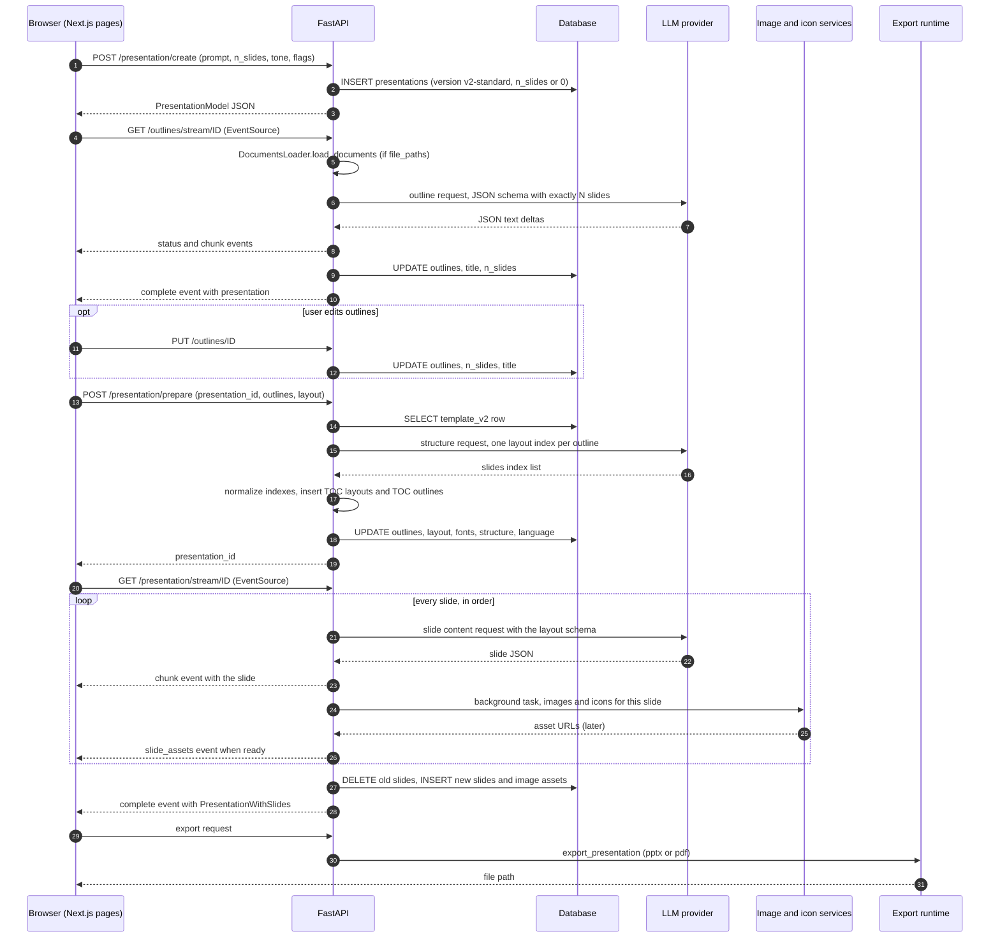
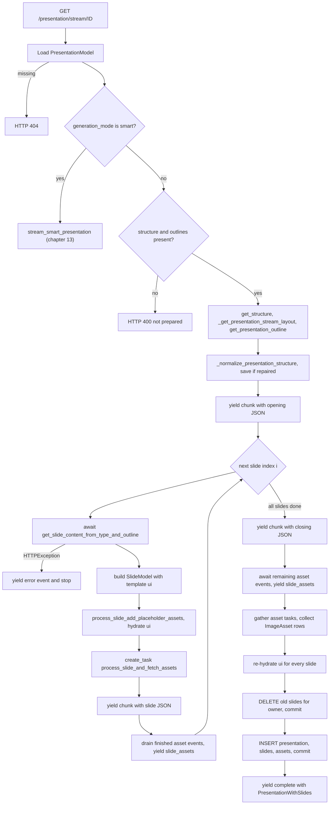

# Standard generation pipeline

<div class="chapter-meta" markdown>
**Reads:** `servers/fastapi/api/v1/ppt/endpoints/presentation.py`, `servers/fastapi/api/v1/ppt/endpoints/outlines.py`, `servers/fastapi/utils/outline_utils.py`, `servers/fastapi/utils/process_slides.py`, `servers/fastapi/templates/presentation_layout.py`  ·  **Builds on:** [Data model](07-data-model.md)  ·  **Time:** ~45 min
</div>

This chapter follows one Standard-mode deck from the moment the web UI submits a prompt to the moment slides are saved and exported. You will see the exact four HTTP calls the browser makes, every function they run in order, the database columns each call writes, how slide counts and tables of contents are enforced, and why slide text is generated one slide at a time in the web UI path but ten at a time in the one-shot API. The chapter ends with the one-shot `POST /api/v1/ppt/presentation/generate` endpoint, including its asynchronous variant and the `slides_markdown` shortcut.

## The pipeline at a glance

All routes below are mounted under `/api/v1/ppt` (`servers/fastapi/api/v1/ppt/router.py:22`); the presentation router adds `/presentation` (`servers/fastapi/api/v1/ppt/endpoints/presentation.py:136`) and the outline router adds `/outlines` (`servers/fastapi/api/v1/ppt/endpoints/outlines.py:40`).

| Order | Method and path | Handler | Response | Writes to `presentations` |
|---|---|---|---|---|
| 1 | `POST /api/v1/ppt/presentation/create` | `create_presentation` (`presentation.py:1681`) | JSON `PresentationModel` | new row: prompt, settings, `version`, `n_slides` |
| 2 | `GET /api/v1/ppt/outlines/stream/{id}` | `stream_outlines` (`outlines.py:84`) | `text/event-stream` | `outlines`, `title`, `n_slides` (auto mode) |
| 2b (optional) | `PUT /api/v1/ppt/outlines/{id}` | `update_outline` (`outlines.py:59`) | JSON outline | `outlines`, `n_slides`, `title` |
| 3 | `POST /api/v1/ppt/presentation/prepare` | `prepare_presentation` (`presentation.py:1840`) | `{"presentation_id": ...}` | `outlines` (with TOC), `title`, `language=""`, `layout`, `fonts`, `structure` |
| 4 | `GET /api/v1/ppt/presentation/stream/{id}` | `stream_presentation` (`presentation.py:2281`) | `text/event-stream` | replaces all `slides` rows, adds `ImageAsset` rows (`servers/fastapi/models/sql/image_asset.py:12`) |
| 5 | `POST /api/v1/ppt/presentation/{id}/export` (or the editor's export) | `export_existing_presentation` (`presentation.py:1642`) | `{"presentation_id", "path", "edit_path"}` | none |

The one-shot path collapses steps 1 to 5 into `POST /api/v1/ppt/presentation/generate` (`presentation.py:3169`) and `POST /api/v1/ppt/presentation/generate/async` (`presentation.py:3240`), covered in Step 6.



## Step 1: Create the presentation row

The upload page calls `PresentationGenerationApi.createPresentation` (`servers/nextjs/app/(presentation-generator)/services/api/presentation-generation.ts:82`), which posts JSON to `/api/v1/ppt/presentation/create`. The handler declares each field as its own `Body()` parameter, so FastAPI reads them from one JSON object.

| Field | Type | Default | Server-side validation |
|---|---|---|---|
| `content` | `str` | required | none (Smart mode requires prompt, files or community refs) |
| `n_slides` | `int` or `null` | `null` | `>= 1`, `<= MAX_NUMBER_OF_SLIDES` (50) (`presentation.py:1698-1708`) |
| `language` | `str` or `null` | `null` | stripped, stored as `""` when missing (`presentation.py:1736`) |
| `file_paths` | `list[str]` or `null` | `null` | each path must resolve inside the temp directory and exist (`presentation.py:1737-1741`) |
| `tone` | `Tone` enum | `default` | one of `default`, `casual`, `professional`, `funny`, `educational`, `sales_pitch` (`servers/fastapi/enums/tone.py:4-10`) |
| `verbosity` | `Verbosity` enum | `standard` | one of `concise`, `standard`, `text-heavy` (`servers/fastapi/enums/verbosity.py:4-7`) |
| `instructions` | `str` or `null` | `null` | none |
| `include_table_of_contents` | `bool` | `false` | if true and `n_slides < 3`, 400 (`presentation.py:1710-1714`) |
| `include_title_slide` | `bool` | `true` | none |
| `web_search` | `bool` | `false` | none |
| `generation_mode` | `"standard"` or `"smart"` | `"standard"` | Smart checks at `presentation.py:1716-1733` |
| `community_design_ids` | `list[int]` or `null` | `null` | Smart only, and only if community is enabled |

A typical body from the upload page (values illustrative, keys from `presentation-generation.ts:116-136`):

```json
{
  "content": "Quarterly business review for a mid-size SaaS company",
  "version": "v2-standard",
  "n_slides": 8,
  "file_paths": [],
  "language": "English",
  "tone": "professional",
  "verbosity": "standard",
  "instructions": null,
  "include_table_of_contents": false,
  "include_title_slide": true,
  "web_search": false,
  "generation_mode": "standard"
}
```

The row is built and committed immediately:

```python title="servers/fastapi/api/v1/ppt/endpoints/presentation.py (excerpt)"
    # DB schema stores an int; 0 is used as internal marker for auto slide count.
    n_slides_to_store = n_slides if n_slides is not None else 0

    presentation = PresentationModel(
        id=presentation_id,
        version=PresentationVersion.V2_STANDARD,
        content=content,
        n_slides=n_slides_to_store,
        language=language_to_store,
        file_paths=validated_file_paths,
        tone=tone.value,
        verbosity=verbosity.value,
        instructions=instructions,
        include_table_of_contents=include_table_of_contents,
        include_title_slide=include_title_slide,
        web_search=web_search,
        generation_mode=generation_mode,
        community_design_ids=normalized_community_ids or None,
    )

    sql_session.add(presentation)
    await sql_session.commit()
```

After the commit it logs which web search route is active (`presentation.py:1765-1778`) and returns the row as JSON. At this point `outlines`, `layout`, `structure`, `title`, `fonts` and `theme` are all `null`, and the `slides` table has no rows for this id.

!!! warning "Gotcha"
    The browser sends a `version` field, but `create_presentation` has no `version` parameter. The value is ignored and every new row is written with `PresentationVersion.V2_STANDARD` (`presentation.py:1747`). The enum's other value, `v1-standard` (`servers/fastapi/models/sql/presentation.py:17`), only marks rows migrated from older databases; the web UI refuses to open such decks (`servers/nextjs/app/(presentation-generator)/presentation/hooks/usePresentationData.ts:33-41`).

!!! warning "Gotcha"
    `n_slides = 0` in the database means "let the model decide". Every later step checks `presentation.n_slides > 0` before treating it as a target (`outlines.py:133`, `presentation.py:1895`). If you change the column to nullable, update those checks too.

## Step 2: Stream and persist the outline

The outline page opens an `EventSource` on `/api/v1/ppt/outlines/stream/{id}` (`servers/nextjs/app/(presentation-generator)/outline/hooks/useOutlineStreaming.ts:107-109`). The handler loads the row (404 if missing), logs the web search routing, creates a fresh temp directory with `TEMP_FILE_SERVICE.create_temp_dir()` (`outlines.py:110`) and returns a `StreamingResponse` wrapping `inner()` in `safe_sse_stream` (`outlines.py:268-276`). Event shapes are documented in [Streaming (SSE)](10-streaming.md); here we follow the logic.

### 2.1 Disconnect check and first status

`inner()` returns immediately if the client is already gone (`outlines.py:113-114`), then yields the status `"Preparing your presentation outline"` (`outlines.py:116-118`).

### 2.2 Extract attached documents

If `presentation.file_paths` is set, a `DocumentsLoader` parses every file and the texts are joined with blank lines into `additional_context` (`outlines.py:120-129`). In the web UI the paths are already the `.txt` files produced by `/files/decompose`, so this step usually just reads text. The full ingestion story, including LiteParse and OCR, is in [Document ingestion](11-document-ingestion.md).

### 2.3 Decide how many outlines to request

```python title="servers/fastapi/api/v1/ppt/endpoints/outlines.py (excerpt)"
        if presentation.n_slides > 0:
            n_slides_to_generate = get_no_of_outlines_to_generate_for_n_slides(
                n_slides=presentation.n_slides,
                toc=presentation.include_table_of_contents,
                title_slide=presentation.include_title_slide,
            )
        else:
            n_slides_to_generate = None
```

`get_no_of_outlines_to_generate_for_n_slides` (`servers/fastapi/utils/outline_utils.py:68-81`) reserves room for table-of-contents slides that `/prepare` will insert later. With TOC enabled it computes `n_toc_1 = ceil((n - 1 if title else n) / 10)`, then `n_toc_2 = ceil((n - n_toc_1) / 10)`, and returns `n - n_toc_2`. Without TOC it returns `n`.

| Requested `n_slides` | Title slide | TOC | Outlines requested from the LLM | TOC slides added in Step 3 | Final slide count |
|---|---|---|---|---|---|
| 8 | yes | no | 8 | 0 | 8 |
| 10 | yes | yes | 9 | 1 | 10 |
| 25 | yes | yes | 22 | 3 | 25 |
| 0 (auto) | any | any | model decides, max 50 | see Step 3 | outlines plus TOC |

### 2.4 Build the prompt and record it

`get_outline_messages(...)` builds the system and user messages (`outlines.py:142-152`). The text of those two messages, plus the extracted document text, is stored through `MEM0_PRESENTATION_MEMORY_SERVICE.store_generation_context(...)` (`outlines.py:153-168`) so the chat assistant can recall it later ([Editing and chat assistant](14-editing-and-chat.md)). The prompts themselves are dissected in [Prompts and schemas](09-prompts-and-schemas.md).

### 2.5 Call the model

`generate_ppt_outline(...)` (`servers/fastapi/utils/llm_calls/generate_presentation_outlines.py:252`) is an async generator. It:

1. Picks the response model: `get_presentation_outline_model_with_n_slides(n_slides)` when a count is known, else `PresentationOutlineModel` (`generate_presentation_outlines.py:267-271`).
2. Chooses a web search route when `web_search` is true: a hosted `WebSearchTool` for models with native search, or an external provider whose results are appended to `additional_context` after an LLM-generated query (`generate_presentation_outlines.py:273-353`). Details are in [Images, icons, web search](12-images-icons-search.md).
3. Streams the structured response through `stream_generate_events` and yields every text delta (`generate_presentation_outlines.py:372-403`). If the provider only returns a final completion object, the serialized JSON is yielded once.
4. On any exception, yields (not raises) the `HTTPException` produced by `handle_llm_client_exceptions(e)` (`generate_presentation_outlines.py:404-405`).

The endpoint loop (`outlines.py:170-205`) forwards statuses as status events, turns a yielded `HTTPException` into an error event and stops, and forwards text deltas as `chunk` events while accumulating them in `presentation_outlines_text`. `await asyncio.sleep(0)` after each item (`outlines.py:185`) yields control to the event loop so the frame is flushed promptly.

### 2.6 Parse, normalize and enforce the count

The accumulated text is parsed with `dirtyjson.loads`, which tolerates trailing commas and similar damage (`outlines.py:207-216`). A parse failure yields the error `"Failed to generate presentation outlines. Please try again. <exception text>"`. The dict then passes through `normalize_outline_payload(payload, MAX_NUMBER_OF_SLIDES)` (`servers/fastapi/utils/outline_limits.py:37-68`), which:

- unwraps a `slides` value that is a JSON string (some providers implement structured output with tool calls and return the array as a string),
- keeps at most 50 slides,
- trims each slide's `content` to `MAX_OUTLINE_CONTENT_WORDS` words (default 100).

```python title="servers/fastapi/api/v1/ppt/endpoints/outlines.py (excerpt)"
        # Only undershooting is fatal. Overshooting is trimmed just below --
        # the slice was already here, unreachable for that case because this
        # check rejected the request first.
        if (
            n_slides_to_generate is not None
            and len(presentation_outlines.slides) < n_slides_to_generate
        ):
            yield SSEErrorResponse(
                detail=(
                    "Failed to generate presentation outlines with requested "
                    "number of slides. Please try again."
                )
            ).to_string()
            return

        if n_slides_to_generate is not None:
            presentation_outlines.slides = presentation_outlines.slides[
                :n_slides_to_generate
            ]

        if presentation.n_slides <= 0:
            presentation.n_slides = len(presentation_outlines.slides)
```

### 2.7 Persist and complete

The handler writes `presentation.outlines = presentation_outlines.model_dump()` and a title from `get_presentation_title_from_presentation_outline` (`outlines.py:248-254`), stores the outlines in memory (`outlines.py:256-259`) and yields a `complete` event whose `presentation` key is the whole row (`outlines.py:261-263`).

The stored `outlines` JSON looks like this:

```json
{
  "slides": [
    {"content": "## Q3 Business Review\n\nPresented by the Finance team\n\n- Revenue, retention and pipeline highlights"},
    {"content": "## Revenue Growth\n\n| Quarter | Revenue ($M) |\n|---|---|\n| Q1 | 4.1 |\n| Q2 | 4.6 |\n| Q3 | 5.2 |"}
  ]
}
```

!!! warning "Gotcha"
    The "title" is not generated separately. `get_presentation_title_from_presentation_outline` (`outline_utils.py:19-41`) takes the first 100 characters of the first outline, strips an optional `## Page N` prefix, removes `#`, `/` and `\`, and replaces newlines with spaces. A first outline that starts with a long heading plus bullets produces a title that includes bullet text. The outline prompt compensates by requiring "First slide title must be the same as the presentation title."

### 2.8 Optional outline edits

Between streaming and preparing, the outline page can read and replace the outline: `GET /api/v1/ppt/outlines/{id}` returns `{"slides": []}` when nothing is stored (`outlines.py:44-56`), and `PUT /api/v1/ppt/outlines/{id}` overwrites `outlines`, sets `n_slides = len(outline.slides)` and recomputes the title (`outlines.py:59-81`). The outline page PUTs the current outlines before it sends a message to the outline chat assistant and GETs them again after the assistant changes them (`servers/nextjs/app/(presentation-generator)/outline/components/OutlinePage.tsx:343-363`). Manual edits in the outline editor live in Redux and reach the server through the `/prepare` body, so a PUT is not required for generation.

## Step 3: Prepare the structure

When the user picks a template and clicks generate, `usePresentationGeneration` posts the outline list and the template id (`servers/nextjs/app/(presentation-generator)/outline/hooks/usePresentationGeneration.ts:107-111`):

```json
{
  "presentation_id": "8f0c3a52-6c1e-4f6b-9a2e-2b0a5f7d1c11",
  "outlines": [{"content": "## Q3 Business Review ..."}, {"content": "## Revenue Growth ..."}],
  "layout": "3b6f0f0e-1c0a-4c1b-9a77-5a0f4f9d2e10"
}
```

The client trims outlines with `limitOutlines` (50 slides, 100 words each) before sending (`presentation-generation.ts:226-234`). The handler signature also accepts an optional `title` (`presentation.py:1845`), which the web UI does not send.

### 3.1 Validate

`prepare_presentation` rejects an empty list (400 `"Outlines are required"`), more than 50 outlines, and an unknown presentation id (`presentation.py:1848-1858`). The outlines are wrapped in `PresentationOutlineModel(slides=outlines)` (`presentation.py:1860`).

### 3.2 Load the layout from the template

`_resolve_prepare_layout(layout, sql_session)` (`presentation.py:1448-1470`) is the bridge from a template row to the model the LLM sees:

1. `_extract_template_id` strips whitespace and an optional `custom-` prefix (`presentation.py:200-209`). An empty id is a 400.
2. `sql_session.get(TemplateV2, template_id)`; a missing row is a 404 `"Template layout not found"`.
3. `_copy_template_layout_payload(template)` deep-copies `template.layouts` and stamps `icon_type`, `icon_weight`, `name` and `template_id` onto it (`presentation.py:232-247`). This dict is what will be saved in `presentations.layout`.
4. `_build_template_structure_layout` calls `_build_template_layout_model` (`presentation.py:410-470`), which runs `get_template_schema(layout_payload)` from `servers/fastapi/templates/v2/schema.py:257` and turns each generated layout into a `SlideLayoutModel(id, name, description, json_schema)`. The result is a `PresentationLayoutModel` with `ordered=False`.
5. Template fonts come from `template.assets["fonts"]` via `_extract_template_fonts_from_assets` (`presentation.py:337-340`).

How a template's components become that JSON schema is the subject of [From template to schema to slide](17-template-to-slide.md); the template format itself is in [Template v2 format](16-template-v2-format.md).

`PresentationLayoutModel` and `SlideLayoutModel` live in `servers/fastapi/templates/presentation_layout.py:11-62` (re-exported by `servers/fastapi/models/presentation_layout.py`). Its `to_string()` (`presentation_layout.py:49-62`) renders the layout list that the structure prompt receives; with two illustrative layouts it produces:

```text
## Presentation Layout

### Slide Layout: 0
- Name: intro-hero
- Description: Title slide with a large headline and subtitle

### Slide Layout: 1
- Name: bullets-with-icons
- Description: Three bullet cards with icons
```

### 3.3 Choose a layout per outline

```python title="servers/fastapi/api/v1/ppt/endpoints/presentation.py (excerpt)"
    if structure_layout.ordered:
        presentation_structure = structure_layout.to_presentation_structure()
    else:
        presentation_structure: PresentationStructureModel = (
            await generate_presentation_structure(
                presentation_outline=presentation_outline_model,
                presentation_layout=structure_layout,
                instructions=presentation.instructions,
                source_content=presentation.content,
            )
        )
```

Because `_build_template_layout_model` always sets `ordered=False` (`presentation.py:467`), the LLM branch always runs for Template V2 layouts. `generate_presentation_structure` (`servers/fastapi/utils/llm_calls/generate_presentation_structure.py:157-211`) returns `PresentationStructureModel(slides=[...])`, a list of layout indexes, one per outline. Its prompt and dynamic response model are covered in [Prompts and schemas](09-prompts-and-schemas.md).

### 3.4 Repair the index list

Structured output can still return too few indexes or out-of-range ones. `_normalize_presentation_structure` fixes both before anything is persisted:

```python title="servers/fastapi/api/v1/ppt/endpoints/presentation.py (excerpt)"
    normalized = list(structure.slides[:outline_count])
    while len(normalized) < outline_count:
        normalized.append(random.randrange(layout_count))

    structure.slides = [
        layout_index
        if 0 <= layout_index < layout_count
        else random.randrange(layout_count)
        for layout_index in normalized
    ]
    return structure
```

Extra indexes are dropped, missing ones are filled with a random layout, and negative or too-large ones are replaced with a random valid index (`presentation.py:384-407`). The test `test_prepare_presentation_normalizes_incomplete_and_invalid_layout_indexes` (`servers/fastapi/tests/integration/test_presentation_generation_flow.py:891`) pins this behavior.

### 3.5 Insert table-of-contents slides

If `include_table_of_contents` is set (`presentation.py:1891-1909`):

1. `get_no_of_toc_required_for_n_outlines(n_outlines, title_slide, target_total_slides)` (`outline_utils.py:52-65`) computes how many TOC slides are needed. When the row has a positive `n_slides`, it is used as the target total, so the TOC count matches what Step 2 reserved.
2. `select_toc_or_list_slide_layout_index(structure_layout)` (`servers/fastapi/utils/ppt_utils.py:59-82`) searches each layout's id, name, description and schema title with case-insensitive word-boundary regexes, first for TOC patterns (`table of contents`, `table-of-contents`, `agenda`, `contents`, `outline`, `index`, `toc`) and then for list patterns (`bullet list`, `bulleted list`, `bullet`/`bullets`, `numbered list`, `ordered list`, `unordered list`, `list`). Patterns are tried in that priority order, and for each pattern the first matching layout wins (`ppt_utils.py:34-56`). It returns `-1` if nothing matches.
3. `_insert_toc_layouts` inserts that layout index `n_toc_slides` times at position 1 (after the title slide) or 0 (`presentation.py:361-372`).
4. `get_presentation_outline_model_with_toc` (`outline_utils.py:84-137`) splits the non-title outlines into `n_toc_slides` contiguous, near-equal sections and inserts one TOC outline per section. Each line carries the final page number, computed as `outlines_before_toc + total_toc_slides + global_outline_index + 1`.

For a title slide plus one TOC slide, the inserted outline reads:

```text
## Table of Contents

- Page number: 3, Title: Revenue Growth
- Page number: 4, Title: Customer Retention
- Page number: 5, Title: Pipeline and Outlook
```

Titles come from `_extract_outline_title`: the first Markdown heading, else the first sentence, else the first non-empty line, else `"Slide"` (`outline_utils.py:164-181`).

!!! warning "Gotcha"
    If the template has no layout whose id, name, description or schema title matches a TOC or list pattern, `toc_slide_layout_index` is `-1` and no TOC slide is inserted (`presentation.py:367-368`, `presentation.py:1904`). Step 2 already asked the LLM for fewer outlines to leave room for the TOC, so the final deck is shorter than the requested `n_slides`. Name or describe at least one layout with "agenda" or "list" if you rely on TOC.

!!! warning "Gotcha"
    In auto mode with TOC enabled, nothing re-checks the total after insertion. Step 2 stores `n_slides = len(outlines)` (up to 50), and Step 3 then adds TOC slides on top of that, so a 50-outline auto deck becomes 55 slides. `MAX_NUMBER_OF_SLIDES` is checked against `len(outlines)` before the insertion (`presentation.py:1850`).

### 3.6 Persist the prepared row

```python title="servers/fastapi/api/v1/ppt/endpoints/presentation.py (excerpt)"
    sql_session.add(presentation)
    presentation.outlines = presentation_outline_model.model_dump(mode="json")
    presentation.title = title or presentation.title
    # Final slide generation should follow the reviewed outline text. The
    # original upload language can be stale after outline-page chat edits such
    # as "convert these to Chinese".
    presentation.language = ""
    presentation.layout = layout_payload
    presentation.fonts = template_fonts
    presentation.set_structure(presentation_structure)
    await sql_session.commit()
```

The outlines are stored again in memory (`presentation.py:1923-1926`) and the response is `{"presentation_id": "<uuid>"}`. The browser then navigates to `/presentation?id=<id>&stream=true&type=standard` (`usePresentationGeneration.ts:121-123`).

!!! warning "Gotcha"
    `/prepare` sets `language = ""`, so every slide in the web UI path is generated with the slide-content prompt's auto-detect instruction ("auto-detect from the slide content and use the same language as the slide content"). The language you picked on the upload page only affects outline generation and OCR. The one-shot API (Step 6) keeps the requested language for slides.

!!! info "What `/prepare` does not do"
    It does not write `theme`. The one-shot handler stores `template_theme_for_presentation(...)` in `theme` (`presentation.py:2958`); the web UI path leaves it `null` here. Theme handling is covered in [Themes and fonts](19-themes-and-fonts.md).

## Step 4: Stream the slides

The presentation page opens an `EventSource` on `/api/v1/ppt/presentation/stream/{id}` (`servers/nextjs/app/(presentation-generator)/presentation/hooks/usePresentationStreaming.ts:300-302`). For a Standard deck (`type=standard`) it does not fetch the row first: `preloadPresentationData` is true only for `editor=v2` or `type=smart` (`servers/nextjs/app/(presentation-generator)/presentation/components/PresentationPage.tsx:188-189`). Instead, when the first Template V2 slide chunk arrives and the store has no template layout yet, the hook forces one `GET /api/v1/ppt/presentation/{id}` so the editor learns the layout (`usePresentationStreaming.ts:223-263`, `usePresentationStreaming.ts:472-478`). The flowchart below is the internal logic of `stream_presentation` (`presentation.py:2281-2524`).



### 4.1 Preconditions and layout loading (v1 and v2 branches)

Smart rows branch off immediately to `stream_smart_presentation` (`presentation.py:2288-2289`, see [Smart mode](13-smart-mode.md)). Standard rows must have both `structure` and `outlines` (400 `"Presentation not prepared for stream"` or `"Outlines can not be empty"`, `presentation.py:2290-2299`). Then three objects are rebuilt from JSON columns inside a `try` that maps any failure to 400 `"Presentation has invalid generated data"` (`presentation.py:2301-2309`):

- `structure = presentation.get_structure()` (a `PresentationStructureModel`),
- `layout = _get_presentation_stream_layout(presentation)`,
- `outline = presentation.get_presentation_outline()`.

The layout loader is where the two data formats diverge:

```python title="servers/fastapi/api/v1/ppt/endpoints/presentation.py (excerpt)"
def _get_presentation_stream_layout(
    presentation: PresentationModel,
) -> PresentationLayoutModel:
    if _is_template_layout_payload(presentation.layout):
        layout_name = str(presentation.layout.get("name") or "template")
        return _build_template_layout_model(
            presentation.layout,
            layout_name=layout_name,
        )

    return presentation.get_layout()
```

| `presentations.layout` shape | Detected by | Layout model built by | Notes |
|---|---|---|---|
| Template V2 payload: dict with a `layouts` list (written by `/prepare` and `/generate`) | `_is_template_layout_payload` (`presentation.py:483-487`) | `_build_template_layout_model`, schemas regenerated from components on every stream | `layout.name` is the template id, so `slides.layout_group` becomes the template id |
| Legacy payload: a serialized `PresentationLayoutModel` (`name`, `ordered`, `slides[{id, name, description, json_schema}]`) | fallback | `presentation.get_layout()` = `PresentationLayoutModel(**self.layout)` (`models/sql/presentation.py:113-114`) | schemas are stored, not regenerated |

The `PresentationVersion` column (`v1-standard` or `v2-standard`) is not consulted here. The branch is decided by the JSON shape of `layout`. In this snapshot every new row is `v2-standard` with a Template V2 payload, so the first branch is the live one.

The layout must contain at least one slide (400 otherwise, `presentation.py:2311-2312`). The structure is re-normalized against the current outline and layout counts and, if anything changed, the repaired structure is saved with a warning log before streaming starts (`presentation.py:2313-2329`). An `ImageGenerationService` is created for the images directory (`presentation.py:2331`).

### 4.2 The per-slide loop: sequential content generation

`inner()` first computes `image_urls_for_slides = get_images_for_slides_from_outline(outline.slides)` (`presentation.py:2335`). That helper extracts `http(s)` URLs ending in `.jpg`, `.jpeg`, `.png` or `.webp` from each outline's Markdown, de-duplicated in order (`outline_utils.py:13-16`, `outline_utils.py:184-205`). It then yields an opening chunk `'{ "slides": [ '` and walks the structure:

```python title="servers/fastapi/api/v1/ppt/endpoints/presentation.py (excerpt)"
        for i, slide_layout_index in enumerate(structure.slides):
            slide_layout = layout.slides[slide_layout_index]

            try:
                slide_content = await get_slide_content_from_type_and_outline(
                    slide_layout,
                    outline.slides[i],
                    presentation.language,
                    presentation.tone,
                    presentation.verbosity,
                    presentation.instructions,
                    slide_number=i + 1,
                )
            except HTTPException as e:
                yield SSEErrorResponse(detail=e.detail).to_string()
                return

            slide = SlideModel(
                presentation=id,
                layout_group=layout.name,
                layout=slide_layout.id,
                index=i,
                speaker_note=slide_content.get("__speaker_note__", ""),
                content=slide_content,
                ui=_template_slide_ui(presentation.layout, slide_layout.id),
            )
```

Each LLM call is awaited before the next begins, so in the web UI path slide text is generated strictly in order, one call at a time. Only asset fetching runs concurrently with the next slide's LLM call. `concurrent_service` is not used in this loop.

What `get_slide_content_from_type_and_outline` does (`servers/fastapi/utils/llm_calls/generate_slide_content.py:229-275`):

1. `_prepare_response_schema(slide_layout.json_schema)` removes `__image_url__` and `__icon_url__`, returns `None` if no content properties remain, forces `type: object`, adds a required `__speaker_note__` string (100 to 500 characters) and makes sure every array has `items` (`generate_slide_content.py:203-226`).
2. If the schema is `None` (a decorative-only layout), it returns `{}` without calling the LLM.
3. Otherwise it calls `generate_structured_with_schema_retries(...)` with the schema as both `response_format` and validation schema.

### 4.3 How slide JSON is validated and repaired

`generate_structured_with_schema_retries` (`servers/fastapi/utils/llm_utils.py:310-389`) is the only validation layer between the model and the database:

- Inner loop: up to 3 attempts to obtain any parseable JSON object, sleeping 0.5 s then 1.0 s between attempts (`llm_utils.py:332-351`). JSON text is parsed with `dirtyjson` (`llm_utils.py:414-435`). If all fail: 400 `"LLM did not return any content"`.
- Outer loop: up to 4 validation rounds (`validate_schema_max_loop_count=4`). Each round validates against the JSON schema with `jsonschema`; on errors it appends a user message listing up to 10 errors and the previous JSON (truncated to 6,000 characters) and asks for corrected JSON (`llm_utils.py:276-307`, `llm_utils.py:362-387`).
- After the last round it logs `"Validation error after max fixes, returning last response"` and returns the invalid content anyway (`llm_utils.py:372-377`).

So in the worst case one slide costs 12 provider calls, and a slide can still be stored with schema violations. The template hydrator is defensive about that: `_apply_template_content_to_ui` and the per-type helpers ignore values of the wrong type and keep the template's original element (`presentation.py:575-623`, `presentation.py:865-881`). The prompt-level details are in [Prompts and schemas](09-prompts-and-schemas.md).

### 4.4 Placeholders, UI hydration and image sizing

Right after the `SlideModel` is built (`presentation.py:2394-2399`):

1. `process_slide_add_placeholder_assets(slide)` walks `slide.content` for any dict containing `__image_prompt__`, `image_prompt` or `prompt` and sets its URL to `/static/images/placeholder.jpg`, and for `__icon_query__`, `icon_query` or `query` sets `/static/icons/placeholder.svg` (`servers/fastapi/utils/process_slides.py:22-23`, `process_slides.py:427-453`). Template slides get `image_url` and `icon_url`; legacy slides get `__image_url__` and `__icon_url__` (`process_slides.py:102-127`).
2. `slide.ui = _apply_template_content_to_ui(slide.ui, slide.content)` writes the generated text, lists, tables, charts and placeholder images into a deep copy of the template layout JSON (`presentation.py:575-623`). `slide.ui` starts as a copy of the matching template layout from `_template_slide_ui` (`presentation.py:490-500`).
3. `image_target_sizes_from_template(...)` hydrates a throwaway copy of the layout with unique marker URLs to learn the width and height of each image box, keyed by JSON path, so the image generator can request a matching aspect ratio (`process_slides.py:35-99`). Any error returns `{}`, because sizing is optional.

### 4.5 Asset hydration in the background

```python title="servers/fastapi/api/v1/ppt/endpoints/presentation.py (excerpt)"
            # This will mutate slide - start task immediately so it runs in parallel with next slide LLM generation
            asset_warnings_by_slide[i] = []
            asset_task = asyncio.create_task(
                process_slide_and_fetch_assets(
                    image_generation_service,
                    slide,
                    outline_image_urls=(
                        image_urls_for_slides[i]
                        if i < len(image_urls_for_slides)
                        else None
                    ),
                    icon_weight=icon_weight,
                    allow_image_fallback=True,
                    image_warnings=asset_warnings_by_slide[i],
                    image_target_sizes=image_target_sizes,
                )
            )
            async_assets_generation_tasks.append(asset_task)
            asyncio.create_task(notify_slide_assets_ready(i, asset_task))
```

`process_slide_and_fetch_assets` (`process_slides.py:173-288`) collects every image prompt and icon query in the slide content. For image slot `k`, if the outline contained a usable image URL at position `k`, that URL is used directly; otherwise it calls `image_generation_service.generate_image(ImagePrompt(...))`. Icons go to `ICON_FINDER_SERVICE.search_icons(query, weight=...)`. All calls run in one `asyncio.gather(..., return_exceptions=True)` because `allow_image_fallback=True`. A failed image becomes `/static/images/placeholder.jpg` plus a warning `{"status_code", "detail", "code"}`; a failed icon search raises; an empty icon result falls back to the placeholder icon. Generated files come back as `ImageAsset` rows that are saved with the slides. Providers, icon search and the fallback logic are explained in [Images, icons, web search](12-images-icons-search.md).

`notify_slide_assets_ready` (`presentation.py:2341-2357`) awaits the task, logs and records a warning `{"type": "asset_generation_failed", "message": "Some slide assets could not be generated."}` if it raised, and always pushes the slide index onto `asset_events`.

After yielding the slide's `chunk` event (`presentation.py:2421-2424`), the loop drains every index already on `asset_events` with `get_nowait()`, re-hydrates that slide's `ui` and yields a `slide_assets` event with the updated slide and its warnings (`presentation.py:2426-2446`).

!!! warning "Gotcha"
    The browser only toasts warnings that have a string `detail` (`usePresentationStreaming.ts:537-553`). Image-provider failures carry `detail`; the `asset_generation_failed` warning produced when the whole asset task raises (for example an icon search error) has only `type` and `message`, so it reaches the client silently.

### 4.6 Closing the stream and persisting

After the last slide the loop yields a closing chunk `' ] }'`, then blocks on `asset_events.get()` until every slide has produced its `slide_assets` event (`presentation.py:2448-2470`). It gathers all asset tasks with `return_exceptions=True`, logs and skips failures, and flattens the `ImageAsset` lists (`presentation.py:2472-2484`). Every slide's `ui` is hydrated one final time (`presentation.py:2486-2487`). Persistence is deliberately late:

```python title="servers/fastapi/api/v1/ppt/endpoints/presentation.py (excerpt)"
        # Moved this here to make sure new slides are generated before deleting the old ones
        await sql_session.execute(
            delete(SlideModel).where(
                SlideModel.presentation == id,
                SlideModel.owner_id == get_current_owner_id(),
            )
        )
        await sql_session.commit()

        sql_session.add(presentation)
        sql_session.add_all(slides)
        sql_session.add_all(generated_assets)
        await sql_session.commit()
```

The final event is `complete` with `PresentationWithSlides` built from `_presentation_response_data(presentation)` plus the slides (`presentation.py:2503-2511`). `_presentation_response_data` drops `layout` and `structure` and adds `type` and `can_regenerate` (`presentation.py:343-358`).

### 4.7 Errors and client disconnects

| Situation | What happens | Database effect |
|---|---|---|
| Slide content call raises `HTTPException` (provider error, empty output) | `error` event with the exception's `detail`, generator returns (`presentation.py:2379-2381`) | nothing written; old slides untouched |
| Any other exception inside `inner()` | `safe_sse_stream` rolls back the session and emits `error` with `"Failed to generate presentation slides. Please try again."` (`presentation.py:2516-2524`, `servers/fastapi/utils/sse.py:24-38`) | rollback; old slides untouched |
| Client closes the EventSource | when the ASGI server cancels the response generator, `safe_sse_stream` catches `asyncio.CancelledError`, logs it and returns (`sse.py:21-23`) | nothing written |
| Client reconnects (the hook retries up to 3 times) | a new request starts generation from slide 1 | only the last successful run's slides are kept |

!!! warning "Gotcha"
    Standard streaming has no checkpoints. All slide rows are written in one transaction at the very end, so a dropped connection after slide 19 of 20 loses all 19 LLM calls, and the hook's retry (`usePresentationStreaming.ts:198-221`) pays for them again. Smart mode, by contrast, checkpoints each slide (see [Smart mode](13-smart-mode.md)).

!!! warning "Gotcha"
    `stream_presentation` takes no `Request`, so the slide-content calls get no `disconnect_checker`. Cancellation relies on the ASGI server cancelling the response generator. Asset tasks were started with `asyncio.create_task` and nothing in `inner()` cancels them, so image generation already in flight keeps running after a disconnect; its `ImageAsset` rows are never saved because the final commit is never reached.

## Step 5: Export

Generation does not export in the web UI path. The editor exports on demand (see [PPTX and PDF export](24-export-pipeline.md)). For API clients and retries, `POST /api/v1/ppt/presentation/{id}/export` with body `{"export_as": "pptx"}` or `"pdf"` calls the same `export_presentation(presentation_id, title, export_as, cookie_header=...)` helper used by the one-shot endpoints and returns `{"presentation_id", "path", "edit_path": "/presentation?id=<id>"}` (`presentation.py:1642-1678`). `build_export_cookie_header` forwards the caller's cookies, or a desktop or internal session cookie, so the export browser can load the authenticated presentation page (`presentation.py:1473-1496`).

## Step 6: The one-shot path (`/generate` and `/generate/async`)

The one-shot endpoints run outline, structure, content, assets, save and export inside a single handler, `generate_presentation_handler` (`presentation.py:2684-3166`). They are the REST API documented for integrators in [REST API, async tasks, webhooks, MCP](15-api-async-mcp.md).

### 6.1 Request body

`GeneratePresentationRequest` (`servers/fastapi/models/generate_presentation_request.py:8-46`):

| Field | Type | Default |
|---|---|---|
| `content` | `str` | required (may be empty) |
| `slides_markdown` | `list[str]` or `null` | `null` |
| `instructions` | `str` or `null` | `null` |
| `tone` | `Tone` | `default` |
| `verbosity` | `Verbosity` | `standard` |
| `web_search` | `bool` | `false` |
| `n_slides` | `int` or `null` | `null` (auto) |
| `language` | `str` or `null` | `null` (auto) |
| `template` | `str` | `"general"` |
| `include_table_of_contents` | `bool` | `false` |
| `include_title_slide` | `bool` | `true` |
| `files` | `list[str]` or `null` | `null` (paths from `/files/upload`) |
| `export_as` | `"pptx"` or `"pdf"` | `"pptx"` |
| `trigger_webhook` | `bool` | `false` |

```json
{
  "content": "Introduce our new onboarding program to department heads",
  "n_slides": 10,
  "language": "English",
  "template": "general",
  "include_table_of_contents": true,
  "export_as": "pdf"
}
```

!!! warning "Gotcha"
    `trigger_webhook` is declared but never read. The handler always schedules `WebhookService.send_webhook` for `PRESENTATION_GENERATION_COMPLETED` or `PRESENTATION_GENERATION_FAILED` (`presentation.py:3133-3138`, `presentation.py:3150-3155`); delivery depends only on whether a subscription exists for that event (`servers/fastapi/services/webhook_service.py:12-21`).

### 6.2 Validation

`check_if_api_request_is_valid` (`presentation.py:2620-2681`) allocates the presentation UUID and rejects: no `content`, `slides_markdown` or `files`; `n_slides <= 0` or `> 50`; more than 50 `slides_markdown` entries; TOC with `n_slides < 3`. It then resolves `template`: a TemplateV2 id (optionally `custom-` prefixed) is accepted and normalized to the row id; a bundled public name such as `general` is accepted if `resolve_default_template_id` finds `templates/<name>/template.json` (`servers/fastapi/templates/default_templates.py:62-87`); anything else is 400 `"Template not found. Please use a valid template."`.

### 6.3 The handler, in order

1. Disconnect hook: when called from the sync route, `request_http.is_disconnected` becomes the `disconnect_checker`, and `raise_if_client_disconnected()` raises `asyncio.CancelledError` (`presentation.py:2693-2705`).
2. `slides_markdown` shortcut: if present, `n_slides` is overwritten with its length (`presentation.py:2710-2717`).
3. Without `slides_markdown`: update async status to `"Generating presentation outlines"`; load `files` with `DocumentsLoader(...).load_documents()` (no temp dir, parsed now) and join into `additional_context`; reduce the outline count for TOC only when `n_slides` is given; build and record the prompt; consume `generate_ppt_outline(...)` (no SSE, just concatenation); parse with `dirtyjson`, normalize, fail on too few outlines, trim extras (`presentation.py:2719-2834`).
4. With `slides_markdown`: each string becomes one `SlideOutlineModel(content=...)` and no LLM outline call is made (`presentation.py:2836-2853`).
5. Async status `"Selecting layout for each slide"`; `_resolve_generation_layout(request.template, ...)` returns the layout payload, layout model, template fonts and template theme (`presentation.py:262-306`). Unlike `/prepare`, it accepts bundled names and returns 503 if a bundled template has not been imported yet.
6. Structure: `generate_presentation_structure(..., using_slides_markdown=..., disconnect_checker=...)` (`presentation.py:2891-2903`), then a lighter clamp than `/prepare` (`presentation.py:2905-2912`).
7. TOC: only when `include_table_of_contents` and not `slides_markdown` (`presentation.py:2914-2935`).
8. Build the `PresentationModel` in memory with `outlines`, `layout`, `structure`, `fonts`, `theme`, the requested `language` and a title from the first outline (`presentation.py:2942-2959`). It is not committed yet.
9. Generate slide content concurrently in batches of 10 (below).
10. Await all asset tasks with plain `asyncio.gather` (`presentation.py:3073`), log image warnings, run `_hydrate_template_slide_ui` on every slide (`presentation.py:3084-3085`).
11. Save presentation, slides and assets in one commit (`presentation.py:3088-3091`).
12. Export with `export_presentation(...)` and build `PresentationPathAndEditPath` (`presentation.py:3098-3109`).
13. Async status `completed` with `path` and `edit_path` in `data` (`presentation.py:3111-3130`), then the success webhook.

### 6.4 Batched, concurrent slide content

```python title="servers/fastapi/api/v1/ppt/endpoints/presentation.py (excerpt)"
        # Schedule slide content generation and asset fetching in batches of 10
        batch_size = 10
        for start in range(0, len(slide_layouts), batch_size):
            await raise_if_client_disconnected()
            end = min(start + batch_size, len(slide_layouts))

            print(f"Generating slides from {start} to {end}")

            # Generate contents for this batch concurrently
            content_tasks = [
                get_slide_content_from_type_and_outline(
                    slide_layouts[i],
                    presentation_outlines.slides[i],
                    language_to_use,
                    request.tone.value,
                    request.verbosity.value,
                    request.instructions,
                    slide_number=i + 1,
                    disconnect_checker=disconnect_checker,
                )
                for i in range(start, end)
            ]
            batch_contents: List[dict] = await asyncio.gather(*content_tasks)
```

Up to 10 slide-content LLM calls run at once; the next batch starts only when the whole batch has returned. After each batch, the async task's `created_slides` and `remaining_slides` are updated, and asset tasks for the batch are started immediately so they overlap with the next batch's LLM calls (`presentation.py:3025-3059`). Outline image URLs are honored only in `slides_markdown` mode (`presentation.py:3035-3040`).

### 6.5 Concurrency summary

| Work | Web UI stream (`/presentation/stream`) | One-shot (`/generate`) |
|---|---|---|
| Slide content LLM calls | one at a time, in order | `asyncio.gather` in batches of 10 |
| Image and icon fetching | one `asyncio.create_task` per slide, overlaps later LLM calls | one task per slide, started after each batch |
| Asset failure policy | per-slide task failure is logged and skipped | final `asyncio.gather` without `return_exceptions`, so a raised icon error fails the request |
| `CONCURRENT_SERVICE` | not used | only to fire webhooks in the background (`servers/fastapi/services/concurrent_service.py:10-28`) |
| Disconnect checks | none passed to LLM calls | before outline, inside LLM streams, before each batch |

Each LLM call runs its blocking provider iterator in a worker thread via `asyncio.to_thread` inside `stream_generate_events` (`llm_utils.py:503`), so a batch of 10 occupies 10 threads of the default executor. See [Streaming (SSE)](10-streaming.md).

### 6.6 The `slides_markdown` shortcut

With `slides_markdown`, you supply the outline yourself:

```json
{
  "content": "",
  "slides_markdown": [
    "# Welcome\nKickoff for the 2027 roadmap",
    "## Milestones\n- Q1 beta\n- Q2 GA\n"
  ],
  "template": "general"
}
```

The outline LLM call, the TOC step and `n_slides` are all skipped or overridden. The structure call uses the slides-markdown prompt variant, which embeds every layout's full JSON schema and rules such as "If content contains table, then select either table layout or graph layout" (`generate_presentation_structure.py:16-63`). Image URLs found in each slide's Markdown are fed to `process_slide_and_fetch_assets` as `outline_image_urls`, so the first image slot of the second slide above uses `https://example.com/team.png` instead of generating an image.

### 6.7 Async variant and polling

`POST /api/v1/ppt/presentation/generate/async` validates the same way, inserts an `AsyncTaskModel` (`type: "presentation.generate"`, `status: "pending"`, `message: "Queued for generation"`) and schedules `_run_generate_presentation_task` with FastAPI `BackgroundTasks` (`presentation.py:3240-3279`). The background task re-establishes the owner context, opens its own session and calls the same handler with `async_status` set and no `request_http`, so it has no disconnect checker (`presentation.py:3198-3237`).

```json
{
  "id": "task-4f3c...e9",
  "type": "presentation.generate",
  "status": "pending",
  "message": "Queued for generation",
  "error": null,
  "data": {"created_slides": 0, "remaining_slides": 10, "presentation_id": "0b6d..."},
  "created_at": "<timestamp>",
  "updated_at": "<timestamp>"
}
```

`GET /api/v1/ppt/presentation/status/{id}` returns the row, with `data` links made absolute for MCP callers (`presentation.py:3282-3298`). Messages progress through `"Starting presentation generation"`, `"Generating presentation outlines"`, `"Selecting layout for each slide"`, `"Generating slides"`, `"Fetching assets for slides"`, `"Exporting presentation"` and `"Presentation generation completed"`. In practice a poller never sees `"Exporting presentation"`: the handler sets it and calls `sql_session.add` but does not commit (`presentation.py:3093-3096`), so it is first written together with `"Presentation generation completed"`. On success `data` gains `path` and `edit_path`; on failure `status` becomes `"error"` and `error` holds `{"status_code", "detail"}` from `APIErrorModel` (`presentation.py:3157-3163`, `servers/fastapi/models/api_error_model.py:5-13`).

The sync route returns `PresentationPathAndEditPath` (`servers/fastapi/models/presentation_and_path.py:5-11`):

```json
{
  "presentation_id": "0b6d1c7e-6a3f-4d8e-9a51-2a1c9f0e7b33",
  "path": "<path returned by the export runtime>",
  "edit_path": "/presentation?id=0b6d1c7e-6a3f-4d8e-9a51-2a1c9f0e7b33"
}
```

`path` is whatever `EXPORT_TASK_SERVICE.export_from_url` reports (`servers/fastapi/utils/export_utils.py:43-73`, see [PPTX and PDF export](24-export-pipeline.md)). When the request carries the header `X-Presenton-MCP-Request: 1`, `absolute_mcp_result_links` turns host-relative `path` and `edit_path` values into absolute URLs (`presentation.py:3185-3190`, `servers/fastapi/utils/mcp_public_urls.py:13-52`); other callers get them unchanged.

!!! warning "Gotcha"
    The one-shot structure clamp is weaker than `/prepare`'s. It slices the list to the outline count and replaces indexes `>= total_slide_layouts`, but it neither pads a short list nor replaces negative indexes (`presentation.py:2905-2912`). Validation retries usually prevent a short list, but `generate_structured_with_schema_retries` returns the last response even when it still fails validation. A short list then raises `IndexError` (reported as 500 `"Presentation generation failed"`), and a negative index silently selects a layout from the end of the list. If you touch this code, reuse `_normalize_presentation_structure`.

!!! warning "Gotcha"
    A client disconnect raises `asyncio.CancelledError`, which is a `BaseException`. It skips the handler's `except Exception` block (`presentation.py:3142`), so no failure webhook fires and nothing is saved. Interrupted exports are what `POST /presentation/{id}/export` exists to retry.

### 6.8 Web UI flow versus one-shot, side by side

| Concern | Web UI (create, stream outlines, prepare, stream slides) | One-shot `/generate` |
|---|---|---|
| Template id | must be a TemplateV2 row id (`_resolve_prepare_layout`) | row id or bundled name (`_resolve_generation_layout`) |
| Documents | decomposed to `.txt` before `/create`, read at outline time | original uploads parsed during the request |
| Slide language | cleared to `""` by `/prepare`, auto-detected per slide | requested `language` kept |
| `theme` column | not set | set from the template |
| Human review of outlines | yes | no |
| Export | separate call | part of the request |
| Persistence | at the end of the slide stream | at the end, before export |

## What you now know

- The web UI drives Standard mode with four calls: `POST /presentation/create`, `GET /outlines/stream/{id}`, `POST /presentation/prepare` and `GET /presentation/stream/{id}`, and each writes specific columns of the same `presentations` row.
- Slide counts are enforced in layers: a dynamic outline schema with exactly N items, a hard failure on too few outlines, trimming of extras, a dynamic structure schema, and `_normalize_presentation_structure`.
- Table-of-contents slides are reserved before outline generation and inserted by `/prepare`, and they silently disappear if no template layout looks like an agenda or list.
- The stream endpoint generates slide text sequentially, starts asset fetching in background tasks, streams `chunk` and `slide_assets` events, and writes all slides in one transaction at the end.
- The v1 versus v2 branch is decided by the shape of `presentations.layout`, not by the `version` column.
- `POST /presentation/generate` runs the same building blocks in one request, generates slide content ten at a time, supports `slides_markdown`, exports at the end, and has an async variant backed by `async_tasks` rows.

## Next

Continue with [Prompts and schemas](09-prompts-and-schemas.md) to read the exact prompts and the JSON schema transformations behind every LLM call in this pipeline.
