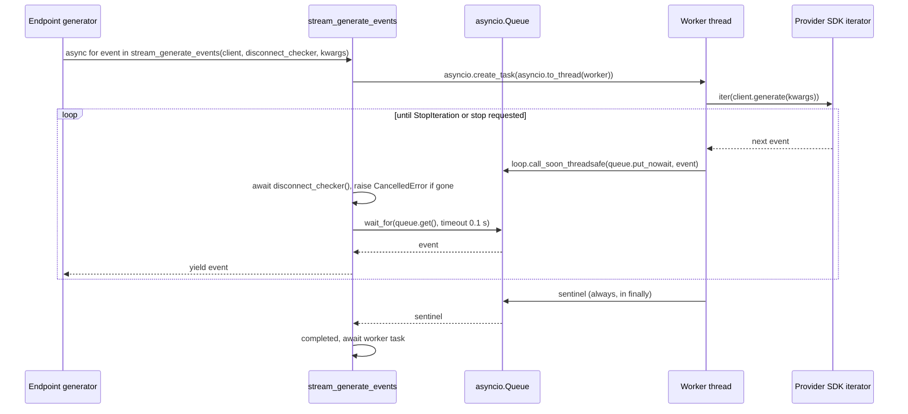

# Streaming (SSE)

<div class="chapter-meta" markdown>
**Reads:** `servers/fastapi/utils/sse.py`, `servers/fastapi/models/sse_response.py`, `servers/fastapi/utils/llm_utils.py`, `servers/fastapi/api/v1/ppt/endpoints/outlines.py`, `servers/fastapi/api/v2/ppt/endpoints/presentation.py`, `servers/nextjs/app/(presentation-generator)/outline/hooks/useOutlineStreaming.ts`, `servers/nextjs/app/(presentation-generator)/presentation/hooks/usePresentationStreaming.ts`, `nginx.conf`  ·  **Builds on:** [Standard generation pipeline](08-standard-pipeline.md)  ·  **Time:** ~35 min
</div>

Presenton shows outlines and slides while they are being generated by streaming server-sent events (SSE) from FastAPI to the browser. This chapter covers the whole path: how a blocking provider SDK is turned into an async generator, how frames are formatted, every event type and payload for outline, Standard and Smart streams, how errors and client disconnects are handled, what the bundled nginx does and does not do for long-lived streams, how the v2 Smart API consumes the same stream inside the server, and how the browser hooks read it.

## Where SSE is used

| Endpoint | Generator | Wrapped in `safe_sse_stream` | Covered |
|---|---|---|---|
| `GET /api/v1/ppt/outlines/stream/{id}` | `stream_outlines.inner` (`servers/fastapi/api/v1/ppt/endpoints/outlines.py:112-263`) | yes (`outlines.py:268-276`) | here |
| `GET /api/v1/ppt/presentation/stream/{id}`, Standard | `stream_presentation.inner` (`servers/fastapi/api/v1/ppt/endpoints/presentation.py:2333-2511`) | yes (`presentation.py:2516-2524`) | here |
| `GET /api/v1/ppt/presentation/stream/{id}`, Smart | `stream_smart_presentation.inner` (`presentation.py:1938-2241`) | yes, with error metadata (`presentation.py:2269-2278`) | here and [Smart mode](13-smart-mode.md) |
| `POST /api/v1/ppt/chat/message/stream` | `chat_message_stream.inner` (`servers/fastapi/api/v1/ppt/endpoints/chat.py:124-165`) | no, catches `HTTPException` itself | [Editing and chat assistant](14-editing-and-chat.md) |
| `POST /api/v1/ppt/ollama/models/pull` | `pull_ollama_model` (`servers/fastapi/utils/ollama.py:174`) | no, emits its own `event: error` frames | [Configuration and LLM providers](06-configuration-and-providers.md) |

All of them return `StreamingResponse(..., media_type="text/event-stream")` and set no other headers.

## Step 1: The wire format

Every frame is produced by `SSEResponse.to_string()`:

```python title="servers/fastapi/models/sse_response.py (excerpt)"
class SSEResponse(BaseModel):
    event: str
    data: str

    def to_string(self):
        return f"event: {self.event}\ndata: {self.data}\n\n"
```

The generation endpoints always use the event name `response` and put a JSON object with a `type` discriminator in `data`. Helper classes build the common shapes:

| Helper | `data` JSON | Defined at |
|---|---|---|
| `SSEStatusResponse(status)` | `{"type": "status", "status": "..."}` | `sse_response.py:14-20` |
| `SSETraceResponse(trace)` | `{"type": "trace", "trace": {...}}` (chat only) | `sse_response.py:23-29` |
| `SSEErrorResponse(detail, ...)` | `{"type": "error", "detail": "...", ...optional metadata}` | `sse_response.py:32-45` |
| `SSECompleteResponse(key, value)` | `{"type": "complete", "<key>": value}` | `sse_response.py:48-56` |
| raw `SSEResponse(event="response", data=json.dumps({...}))` | `chunk`, `slide_assets`, `fonts`, `slide_html`, `generation_metrics` | in the endpoints |

`json.dumps` is called with default arguments, so `data` is always a single line. That matters: the SSE format allows multi-line data only with repeated `data:` prefixes, and the v2 server-side consumer in Step 9 parses line by line.

A real outline frame on the wire:

```text
event: response
data: {"type": "status", "status": "Preparing your presentation outline"}

```

`SSEErrorResponse.to_string()` uses `model_dump(exclude_none=True)`, so metadata fields appear only when set (`sse_response.py:41-45`). The optional fields are `source`, `status_code`, `error_type`, `retryable`, `completed_slides` and `total_slides` (`sse_response.py:32-39`).

## Step 2: `safe_sse_stream`, the error boundary

Once a streaming response has started, FastAPI can no longer send an HTTP error status. `safe_sse_stream` converts late failures into a final error frame instead of a truncated stream:

```python title="servers/fastapi/utils/sse.py (excerpt)"
    try:
        async for chunk in stream:
            yield chunk
    except asyncio.CancelledError:
        logger.info("SSE stream cancelled by client")
        return
    except Exception as exc:
        logger.exception("SSE stream failed after response started")
        if on_error:
            try:
                await on_error()
            except Exception:
                logger.exception("SSE stream error cleanup failed")
        detail = exc.detail if isinstance(exc, HTTPException) else error_detail
        metadata: dict[str, object] = {}
        if error_metadata:
            try:
                metadata = await error_metadata(exc)
            except Exception:
                logger.exception("SSE stream error metadata lookup failed")
        yield SSEErrorResponse(detail=str(detail), **metadata).to_string()
```

- `asyncio.CancelledError` ends the stream silently. Note that `return` inside the `except` swallows the cancellation instead of re-raising it.
- Any other exception runs `on_error` (every caller passes a function that rolls back the request's SQL session), then emits one error frame. An `HTTPException` keeps its own `detail`; anything else gets the caller's generic `error_detail`. The HTTP status code of the exception is not sent unless `error_metadata` adds it.
- Smart streams pass `smart_error_metadata`, which opens a separate session to count saved slides and reports `retryable` as true for 408, 429 and any status of 500 or more (`presentation.py:2246-2267`).

Tests: `test_safe_sse_stream_converts_late_exception_to_error_frame` and `test_safe_sse_stream_includes_structured_progress_metadata` (`servers/fastapi/tests/unit/test_small_surfaces_coverage.py:186-249`).

!!! warning "Gotcha"
    Errors raised before `StreamingResponse` is returned are ordinary HTTP errors, not SSE frames. For example `stream_presentation` raises 404 for an unknown id and 400 for "Presentation not prepared for stream" before streaming (`presentation.py:2285-2312`). A browser `EventSource` cannot read the body of a non-200 response; it only fires `onerror`, so the user sees the hook's generic "Failed to connect to the server" message after the retries are exhausted.

## Step 3: From a blocking SDK to an async generator

The `llmai` client's `generate(**kwargs)` returns a synchronous iterator. `stream_generate_events` (`servers/fastapi/utils/llm_utils.py:458-535`) runs that iterator on a worker thread and hands events back to the event loop through an `asyncio.Queue`.



Details that matter when you modify it:

1. **Worker.** `worker()` loops on `next(events)` until `StopIteration` or until `stop_requested` (a `threading.Event`) is set. Exceptions are enqueued as values, unless a stop was requested. In `finally`, if a stop was requested the iterator's `close()` is called (closing the provider stream), and a sentinel is always enqueued (`llm_utils.py:475-501`).
2. **Thread-safe handoff.** `enqueue` uses `loop.call_soon_threadsafe(queue.put_nowait, item)` and ignores `RuntimeError` from a closed loop (`llm_utils.py:469-473`).
3. **Consumer loop.** Each iteration first awaits `_raise_if_client_disconnected(disconnect_checker)`, which raises `asyncio.CancelledError` when the checker returns true (`llm_utils.py:61-65`). The queue wait uses `CLIENT_DISCONNECT_POLL_SECONDS = 0.1` as a timeout only when a checker is present (`llm_utils.py:27`, `llm_utils.py:509-518`), so a silent provider does not stop disconnect polling. An exception item is re-raised, the sentinel ends the loop.
4. **Cleanup.** `finally` sets `stop_requested`. If the worker already finished, it is awaited; otherwise a done-callback retrieves its exception later so asyncio does not log "exception was never retrieved" (`llm_utils.py:528-535`).

`DisconnectChecker` is simply `Callable[[], Awaitable[bool]]` (`llm_utils.py:28`). Endpoints pass `request.is_disconnected`.

!!! warning "Gotcha"
    The worker thread can only notice `stop_requested` between provider events. If the provider is silent (for example a reasoning model thinking before its first token), the thread stays blocked in `next(events)` and the upstream HTTP connection stays open until the next event arrives, even though the endpoint has already stopped. Each concurrent LLM call also holds one thread of the default executor used by `asyncio.to_thread`.

Structured calls reuse the same bridge: `_generate_structured_content` always passes `stream=True` and collects either the final `ResponseStreamCompletionChunk` content or the concatenated text (`llm_utils.py:68-107`). Tests: `servers/fastapi/tests/unit/test_llm_utils_disconnect.py:69-206`, including `test_disconnect_cancels_generation_without_retrying`.

## Step 4: Outline stream events

`GET /api/v1/ppt/outlines/stream/{id}` emits these frames, in this order:

| Order | `type` | Payload | Source |
|---|---|---|---|
| 1 | `status` | `"Preparing your presentation outline"` | `outlines.py:116-118` |
| 2 (external web search only) | `status` | `"Analyzing your topic for web research"`, then `"Searching with <Provider>: <query>"`, then `"Web research complete"` | `generate_presentation_outlines.py:313-349` |
| 3 | `status` | `"Searching with model-native web search and drafting outlines"` or `"Drafting your presentation outline"` | `generate_presentation_outlines.py:355-361` |
| 4..n | `chunk` | `{"type": "chunk", "chunk": "<raw JSON text delta from the model>"}` | `outlines.py:200-205` |
| last (success) | `complete` | `{"type": "complete", "presentation": <PresentationModel as JSON>}` | `outlines.py:261-263` |
| last (failure) | `error` | `{"type": "error", "detail": "..."}` | see Step 6 |

Provider display names in the search status come from `_web_search_provider_display_name`: SearXNG, Tavily, Exa, Brave, Serper, or "model-native web search" (`generate_presentation_outlines.py:56-64`). Status messages are only produced because the endpoint passes `emit_statuses=True` (`outlines.py:181`); the one-shot API does not.

### How partial outline JSON is streamed

The model is asked for structured JSON (`{"slides": [{"content": "..."}]}`), and the server forwards the provider's text deltas unchanged, without trying to split them into slides. The chunk boundaries are wherever the provider cut its stream. An illustrative transcript:

```text
event: response
data: {"type": "status", "status": "Preparing your presentation outline"}

event: response
data: {"type": "status", "status": "Drafting your presentation outline"}

event: response
data: {"type": "chunk", "chunk": "{\"slides\": [{\"content\": \"## Q3 Business"}

event: response
data: {"type": "chunk", "chunk": " Review\\n\\nPresented by the Finance team\"}, {\"content\": \"## Revenue"}

event: response
data: {"type": "complete", "presentation": {"id": "8f0c3a52-...", "version": "v2-standard", "n_slides": 8, "outlines": {"slides": [{"content": "## Q3 Business Review\n\nPresented by the Finance team"}]}, "generation_mode": "standard"}}
```

(The `complete` payload is abridged; it is the full row from `presentation.model_dump(mode="json")`, minus the excluded `owner_id`.) Because each delta is itself JSON text, its quotes and escapes are escaped a second time by `json.dumps`. The server also concatenates the deltas and parses the result with `dirtyjson` only after the stream ends (`outlines.py:207-216`). If the provider produced no content deltas and only a final completion object, the whole JSON is sent as one chunk (`generate_presentation_outlines.py:398-403`).

## Step 5: Presentation stream events (Standard)

| Order | `type` | Payload | Source |
|---|---|---|---|
| 1 | `chunk` | `"{ \"slides\": [ "` (opening text) | `presentation.py:2360-2363` |
| per slide | `chunk` | the slide as compact JSON (`slide.model_dump_json()`) | `presentation.py:2421-2424` |
| interleaved | `slide_assets` | `{"type": "slide_assets", "slide_index": i, "slide": {...}, "warnings": [...]}` | `presentation.py:2426-2446`, `presentation.py:2453-2470` |
| after last slide | `chunk` | `" ] }"` (closing text) | `presentation.py:2448-2451` |
| remaining | `slide_assets` | one per slide whose assets were not yet reported | `presentation.py:2453-2470` |
| last (success) | `complete` | `{"type": "complete", "presentation": <PresentationWithSlides>}` | `presentation.py:2503-2511` |
| last (failure) | `error` | `{"type": "error", "detail": "..."}` | `presentation.py:2379-2381` or `safe_sse_stream` |

Exactly one `slide_assets` frame is sent per slide, either right after a later slide's `chunk` (if the assets finished while the next LLM call was running) or after the closing chunk. A slide frame looks like this (abridged; field order follows `SlideModel`, `servers/fastapi/models/sql/slide.py:9-30`, and `owner_id` is excluded):

```text
event: response
data: {"type": "chunk", "chunk": "{\"id\":\"5c1e...\",\"presentation\":\"8f0c...\",\"layout_group\":\"3b6f...\",\"layout\":\"intro-hero\",\"index\":0,\"content\":{\"hero\":{\"headline\":\"Q3 Business Review\"},\"__speaker_note__\":\"...\"},\"html_content\":null,\"speaker_note\":\"...\",\"properties\":null,\"ui\":{...}}"}

event: response
data: {"type": "slide_assets", "slide_index": 0, "slide": {"id": "5c1e...", "index": 0, "content": {"hero": {"headline": "Q3 Business Review"}, "hero_image": {"image_prompt": "...", "image_url": "/app_data/images/..."}}, "ui": {...}}, "warnings": []}
```

Warning objects are either image-provider warnings `{"status_code": 502, "detail": "...", "code": null}` from `image_generation_warning` (`servers/fastapi/utils/image_generation_error.py:75-86`) or `{"type": "asset_generation_failed", "message": "Some slide assets could not be generated."}` when the whole asset task raised (`presentation.py:2350-2355`).

!!! warning "Gotcha"
    The `chunk` frames concatenate to `{ "slides": [ {slide0}{slide1} ] }`: there is no comma between slides, so the accumulated text is not valid JSON. The browser copes because it parses each slide chunk on its own and runs `jsonrepair` over the accumulation (`usePresentationStreaming.ts:454-510`). If you write a new client, parse each slide chunk individually rather than the concatenation.

## Step 6: Smart stream events

Smart presentations stream through the same URL but a different generator, `stream_smart_presentation` ([Smart mode](13-smart-mode.md) covers generation itself).

| `type` | Payload | Source |
|---|---|---|
| `fonts` | `{"type": "fonts", "fonts": {"Inter": "/vendor/fonts/..."}}` | `presentation.py:1950-1955`, `presentation.py:2035-2038` |
| `slide_html` | `{"type": "slide_html", "index": i, "slide_id": "...", "html": "<html...>", "slide": {...}}` | `presentation.py:1957-1968`, `presentation.py:2176-2187` |
| `status` | for example `"Preparing Smart presentation"`, `"Reading source documents"`, `"Searching the web"`, `"Designing the complete presentation"`, `"Retrying from slide 4 with saved progress"` | `presentation.py:1987-2049`, `presentation.py:2120-2126` |
| `generation_metrics` | `{"type": "generation_metrics", "model", "input_tokens", "output_tokens", "total_tokens", "tokens_per_second", "duration_seconds", "estimated", "thinking_tokens", "thinking_tokens_estimated", "supports_thinking"}` | `presentation.py:2162-2172`, `llm_utils.py:46-58` |
| `complete` | `{"type": "complete", "presentation": <PresentationWithSlides>}` | `presentation.py:2238-2241` |
| `error` | detail plus `source: "generation"`, `status_code`, `error_type`, `retryable`, `completed_slides`, `total_slides` | `presentation.py:2246-2267` |

On reconnect, already checkpointed slides are replayed as `slide_html` frames first, so a Smart stream can resume (`presentation.py:1941-1985`).

## Step 7: Error frames, all of them

| Where | `detail` | Extra fields |
|---|---|---|
| Outline: LLM call failed (yielded `HTTPException`) | provider-specific text from `handle_llm_client_exceptions` | none |
| Outline: accumulated text is not JSON | `"Failed to generate presentation outlines. Please try again. <exception text>"` | none |
| Outline: too few outlines | `"Failed to generate presentation outlines with requested number of slides. Please try again."` | none |
| Outline: any other exception | `"Failed to generate presentation outlines. Please try again."` | none |
| Standard slides: slide content `HTTPException` | its `detail`, for example `"LLM did not return any content"` | none |
| Standard slides: any other exception | `"Failed to generate presentation slides. Please try again."` | none |
| Smart | exception detail or `"Failed to generate the Smart presentation. Please try again."` | `source`, `status_code`, `error_type`, `retryable`, `completed_slides`, `total_slides` |

When the configured provider is the ChatGPT (Codex) login and the provider returns 401 or 403, the detail is prefixed with `CHATGPT_AUTH_REQUIRED:` (`servers/fastapi/utils/llm_client_error_handler.py:13-32`). Both hooks check for that prefix and open the re-login flow instead of retrying (`useOutlineStreaming.ts:211-219`, `usePresentationStreaming.ts:645-656`).

## Step 8: Client disconnects

| Endpoint | Disconnect detection in Presenton code | What stops | What is persisted |
|---|---|---|---|
| Outline stream | `request.is_disconnected()` once before the first frame (`outlines.py:113-114`) and as `disconnect_checker` for the outline LLM call and the web query call (`outlines.py:182`, `generate_presentation_outlines.py:319-325`) | `stream_generate_events` raises `CancelledError` within about 0.1 s, `generate_ppt_outline` does not catch it (it only catches `Exception`), `safe_sse_stream` logs and returns | nothing; outlines are written only after a complete parse |
| Standard slide stream | none (the endpoint takes no `Request`) | relies on the ASGI server cancelling the generator; background asset tasks are not cancelled | nothing; slides are written only at the end |
| Smart stream | none; `finally` cancels the generation task if the generator exits early (`presentation.py:2189-2192`) | the Smart generation task | every slide already checkpointed |
| `POST /presentation/generate` (sync) | `request_http.is_disconnected` checked before work, inside each LLM stream and before each batch (`presentation.py:2693-2705`) | the handler raises `CancelledError` | nothing |
| `/generate/async`, v2 Smart routes (sync and async) | none in code | nothing in Presenton code; the async variants keep running as background tasks after the client leaves | `/generate/async`: everything at the end; v2 Smart: every checkpointed slide |

!!! info "Not verified here"
    Whether Starlette 1.6.0 (the version pinned in `servers/fastapi/uv.lock`) cancels a running `StreamingResponse` generator on `http.disconnect`, and how the two `BaseHTTPMiddleware` subclasses registered in `servers/fastapi/api/main.py:102-103` affect `request.is_disconnected()`, depends on framework internals that are not part of this repository. Test disconnect behavior against the deployed versions if you depend on it.

## Step 9: Keepalive, proxies and nginx

No Presenton SSE endpoint sends keepalive comments or heartbeat frames. Between two frames the connection is idle for as long as the work takes: in a Standard slide stream that is one full slide-content call, which can include up to 12 provider requests when parsing and validation retries kick in ([Prompts and schemas](09-prompts-and-schemas.md)).

The Docker image routes browser traffic through nginx (`nginx.conf`):

| Setting | `/api/v1/` location | `/api/v2/` location |
|---|---|---|
| Upstream | `http://localhost:8000` | `http://localhost:8000` |
| `proxy_read_timeout` | `30m` | `30m` |
| `proxy_send_timeout` | `30m` | `30m` |
| `proxy_connect_timeout` | `30m` | `30m` |
| `client_max_body_size` | `110M` (413 handler returns JSON) | server default `100M` from the `http` block |
| `proxy_buffering` | not set | not set |
| `proxy_http_version` | not set | not set |

(`nginx.conf:45-69`.) The 30-minute read timeout is what keeps silent gaps from killing a stream. FastAPI sends no `X-Accel-Buffering` header and no `Cache-Control` header for these responses, and the config does not turn off `proxy_buffering`, so nginx's default response buffering applies to these locations.

If events arrive in bursts or only at the end behind your proxy, the usual fixes (not present in this snapshot) are:

- disable proxy buffering for the stream paths (`proxy_buffering off;` in nginx, or have the endpoint send `X-Accel-Buffering: no`),
- raise idle and read timeouts on every hop (load balancers often default to 60 seconds) above the longest expected gap, or add a periodic SSE comment line such as `: keepalive` from the generator,
- exclude `text/event-stream` from response compression.

In the Electron app there is no nginx; the renderer talks to FastAPI on a loopback port ([Electron desktop app](27-electron.md)).

## Step 10: Consuming the stream inside the server (v2 Smart routes)

`POST /api/v2/ppt/presentation/generate/smart` and its `/async` variant do not reimplement Smart generation. They call `stream_smart_presentation` and read the `StreamingResponse` body in process:

```python title="servers/fastapi/api/v2/ppt/endpoints/presentation.py (excerpt)"
    async for chunk in stream_response.body_iterator:
        text = chunk.decode("utf-8") if isinstance(chunk, bytes) else str(chunk)
        for line in text.splitlines():
            if not line.startswith("data: "):
                continue
            try:
                event = json.loads(line[6:])
            except json.JSONDecodeError:
                continue
            event_type = event.get("type")
            if event_type == "slide_html":
                created_slides = max(
                    created_slides,
                    int(event.get("index", 0)) + 1,
                )
                if task_id:
                    await _update_smart_task_progress(
                        task_id,
                        presentation_id=presentation.id,
                        created_slides=created_slides,
                        total_slides=total_slides,
                        message="Generating Smart presentation slides",
                    )
            elif event_type == "complete":
                completed = True
            elif event_type == "error":
                stream_error = str(event.get("detail") or "Smart generation failed")
```

(`servers/fastapi/api/v2/ppt/endpoints/presentation.py:101-127`.) For each `slide_html` frame, `_update_smart_task_progress` opens its own session, sets `message` and `data = {"created_slides", "remaining_slides", "presentation_id"}` on the `AsyncTaskModel` and commits (`servers/fastapi/api/v2/ppt/endpoints/presentation.py:43-63`). After the loop, a missing `complete` raises 500 with the last error detail or `"Smart generation did not complete"` (`servers/fastapi/api/v2/ppt/endpoints/presentation.py:129-133`). Otherwise the session is rolled back to see checkpointed rows, the deck is exported, and the async task is marked `completed` with `path`, `edit_path` and `export_as` (`servers/fastapi/api/v2/ppt/endpoints/presentation.py:135-201`). Polling and webhooks for these tasks are covered in [REST API, async tasks, webhooks, MCP](15-api-async-mcp.md).

!!! warning "Gotcha"
    This consumer relies on each frame's `data` being one JSON line. If you ever pretty-print SSE payloads (for example `json.dumps(..., indent=2)`), the v2 Smart API silently stops counting progress and fails with "Smart generation did not complete", because no `complete` line parses.

## Step 11: How the browser consumes the streams

Both hooks use the browser's native `EventSource`, which can only issue a `GET` and cannot set custom headers (that is why the stream endpoints are `GET` routes keyed by the id in the path). Both listen for the `response` event name:

| Behavior | `useOutlineStreaming` | `usePresentationStreaming` |
|---|---|---|
| URL | `/api/v1/ppt/outlines/stream/{id}` (`useOutlineStreaming.ts:107-109`) | `/api/v1/ppt/presentation/stream/{id}` (`usePresentationStreaming.ts:300-302`) |
| Starts when | the hook is enabled, there is a presentation id and no outlines in the store (`useOutlineStreaming.ts:52-55`) | the page URL has `stream=...` (`usePresentationStreaming.ts:133-136`); it preloads `GET /presentation/{id}` first only for `type=smart` or `editor=v2` pages, and otherwise fetches it once when the first Template V2 slide chunk arrives (`usePresentationStreaming.ts:223-263`, `usePresentationStreaming.ts:472-478`) |
| `status` | sets the status line | not handled |
| `chunk` | appends to a buffer, parses with `jsonrepair`, dispatches `setOutlines`, tracks which outline index changed to highlight it (`useOutlineStreaming.ts:133-174`) | parses the chunk as one slide and merges it; also `jsonrepair`s the buffer (`usePresentationStreaming.ts:454-510`) |
| `slide_assets` | not applicable | merges the updated slide, toasts each new warning `detail` once (`usePresentationStreaming.ts:512-555`) |
| `fonts`, `slide_html`, `generation_metrics` | not applicable | Smart handling (`usePresentationStreaming.ts:316-452`) |
| `complete` | stores `data.presentation.outlines.slides`, closes | stores `data.presentation`, closes, removes `stream` from the URL (`usePresentationStreaming.ts:557-620`) |
| `closing` | handled | handled |
| `error` | retries, then toasts | retries unless `retryable === false`, then shows progress-aware message |
| Retries | `MAX_STREAM_RETRIES = 3`, delay `1000 ms * attempt` (1 s, 2 s, 3 s) | same constants (`usePresentationStreaming.ts:27-28`) |

!!! warning "Gotcha"
    A retry opens a brand-new request, and for outline and Standard slide streams the server starts over from scratch, paying for every LLM call again. Only Smart streams resume from checkpoints. The `closing` event type handled by both hooks is not emitted by any FastAPI endpoint in this snapshot.

The page-level flow around these hooks (upload, outline review, template choice, editor) is described in [User journey](21-user-journey.md).

## What you now know

- Every Presenton generation stream is `event: response` frames whose single-line JSON `data` carries a `type`: `status`, `chunk`, `slide_assets`, `fonts`, `slide_html`, `generation_metrics`, `complete` or `error`.
- `stream_generate_events` bridges a blocking provider iterator to async code with a worker thread, a queue and a 0.1-second disconnect poll, and `safe_sse_stream` turns late failures into one error frame after rolling back the session.
- Outline streams forward raw JSON deltas that the browser repairs incrementally; slide streams send one JSON object per slide plus asynchronous `slide_assets` updates, with no commas between slides.
- Only the outline stream and the sync one-shot API check for disconnects in code; Standard streams persist nothing until the end, while Smart streams checkpoint and resume.
- There are no keepalives; the bundled nginx relies on 30-minute timeouts and does not disable buffering.
- The v2 Smart API consumes the same SSE stream in process to update async task progress.

## Next

Continue with [Document ingestion](11-document-ingestion.md) to see how uploaded files become the `Context:` section of the outline prompt.
