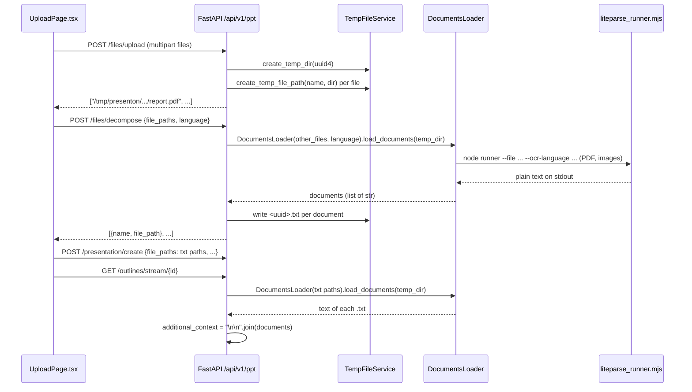
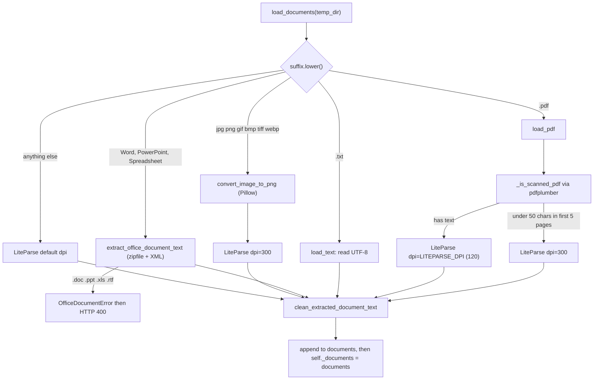

# Document ingestion

<div class="chapter-meta" markdown>
**Reads:** `servers/fastapi/api/v1/ppt/endpoints/files.py`, `servers/fastapi/services/temp_file_service.py`, `servers/fastapi/services/documents_loader.py`, `servers/fastapi/services/liteparse_service.py`, `electron/resources/document-extraction/liteparse_runner.mjs`, `servers/fastapi/services/office_document_service.py`, `servers/fastapi/services/document_conversion_service.py`, `servers/fastapi/utils/ocr_language.py`, `servers/fastapi/services/score_based_chunker.py`, `scripts/sync-document-dependencies.cjs`  ·  **Builds on:** [Streaming (SSE)](10-streaming.md)  ·  **Time:** ~40 min
</div>

This chapter follows an uploaded file from the browser's `FormData` to the `Context:` line of the outline prompt. You will see the three file endpoints and their limits, the per-owner temp directory that holds every upload, how `DocumentsLoader` dispatches each extension to a backend (pure-Python OOXML/ODF readers, Pillow image normalization, and the Node-based LiteParse runner with Tesseract OCR), how the extracted text is cleaned, and how it is concatenated into `additional_context`. It closes with the score-based chunker (and the fact that nothing calls it), and the supply-chain checks that pin the parser's Node dependencies.

## The big picture

Document ingestion in the web UI is a two-request dance that happens before the presentation row even exists. The upload page first sends the raw files, then asks the server to "decompose" them into plain `.txt` files, and only then calls `/presentation/create` with the paths of those `.txt` files. When the outline stream later runs, it reads the `.txt` files back and pastes their content into the prompt.



The browser side lives in `servers/nextjs/app/(presentation-generator)/upload/components/UploadPage.tsx:444-530` (`handleDocumentProcessing`) and the two API helpers `uploadDoc` and `decomposeDocuments` in `servers/nextjs/app/(presentation-generator)/services/api/presentation-generation.ts:32-80`.

## Step 1: Upload the raw files

### 1.1 The router and its three endpoints

`FILES_ROUTER = APIRouter(prefix="/files", tags=["Files"])` (`servers/fastapi/api/v1/ppt/endpoints/files.py:16`) is mounted under `API_V1_PPT_ROUTER = APIRouter(prefix="/api/v1/ppt")` (`servers/fastapi/api/v1/ppt/router.py:22-24`). The full set of file routes is:

| Method and path | Handler | Body | Response |
|---|---|---|---|
| `POST /api/v1/ppt/files/upload` | `upload_files` (`files.py:79-100`) | multipart, field `files` (repeatable) | `List[str]` of absolute temp paths |
| `POST /api/v1/ppt/files/mcp-upload` | `upload_files_for_mcp` (`files.py:103-130`) | JSON `{"files": [{"filename", "content_base64"}]}` | `{"file_paths": [...]}` |
| `POST /api/v1/ppt/files/decompose` | `decompose_files` (`files.py:133-173`) | JSON `{"file_paths": [...], "language": "..."}` | `List[DecomposedFileInfo]` |
| `POST /api/v1/ppt/files/update` | `update_files` (`files.py:176-184`) | multipart `file_path` + `file` | `{"message": "File updated successfully"}` |

### 1.2 What the browser sends

`uploadDoc` appends every `File` object under the same key `files` and posts it with `getHeaderForFormData()` (`presentation-generation.ts:32-55`):

```ts title="servers/nextjs/app/(presentation-generator)/services/api/presentation-generation.ts (excerpt)"
  static async uploadDoc(documents: File[]) {
    const formData = new FormData();

    documents.forEach((document) => {
      formData.append("files", document);
    });

    try {
      const response = await fetch(
        getApiUrl(`/api/v1/ppt/files/upload`),
        {
          method: "POST",
          headers: getHeaderForFormData(),
          body: formData,
          cache: "no-cache",
        }
      );
```

### 1.3 What the server does

```python title="servers/fastapi/api/v1/ppt/endpoints/files.py (excerpt)"
@FILES_ROUTER.post("/upload", response_model=List[str])
async def upload_files(files: Optional[List[UploadFile]]):
    if not files:
        raise HTTPException(400, "Documents are required")

    temp_dir = TEMP_FILE_SERVICE.create_temp_dir(str(uuid.uuid4()))

    validate_files(files, True, True, 100, UPLOAD_ACCEPTED_FILE_TYPES)

    temp_files: List[str] = []
    if files:
        for each_file in files:
            temp_path = TEMP_FILE_SERVICE.create_temp_file_path(
                each_file.filename, temp_dir
            )
            with open(temp_path, "wb") as f:
                content = await each_file.read()
                f.write(content)

            temp_files.append(temp_path)

    return temp_files
```

In order:

1. An empty list is rejected with `400 "Documents are required"` (`files.py:81-82`).
2. A fresh directory named by a UUID4 is created inside the owner's temp root (`files.py:84`, Step 2 explains the root).
3. `validate_files(files, nullable=True, multiple=True, max_size=100, accepted_types=UPLOAD_ACCEPTED_FILE_TYPES)` (`files.py:86`) checks every file (`servers/fastapi/utils/validators.py:23-48`): if `max_size * 1024 * 1024 < file.size` it raises `400 "File '<name>' exceeded max upload size of 100 MB"`, otherwise if the type is not accepted it raises `400 "File '<name>' not accepted. Accepted types: [...]"`.
4. Each file is written whole (`await each_file.read()`) to `create_temp_file_path(each_file.filename, temp_dir)` and the absolute path is appended to the response.

A typical response:

```json
[
  "/tmp/presenton/3f0c9a3e-5f3c-4c1b-9c9a-6f1f2a0b7d11/quarterly-report.pdf",
  "/tmp/presenton/3f0c9a3e-5f3c-4c1b-9c9a-6f1f2a0b7d11/notes.txt"
]
```

When authentication is enabled and an owner is bound to the request, an extra `<owner_id>/` segment appears after the base directory (Step 2).

### 1.4 Accepted types

`UPLOAD_ACCEPTED_FILE_TYPES` is the union of MIME types and extensions (`servers/fastapi/constants/documents.py:65-80`). The comment at `documents.py:78-79` explains why both are kept: "some clients upload legacy office files with generic content-type values". `_is_accepted_file_type` (`validators.py:8-20`) accepts a file if its lower-cased `content_type` is in the MIME set, or else if its lower-cased suffix is in the extension set.

| Family | Extensions (`constants/documents.py`) | MIME types |
|---|---|---|
| PDF | `.pdf` (line 1) | `application/pdf` |
| Text | `.txt` (line 2) | `text/plain`, `text/markdown` |
| Word | `.doc .docx .docm .odt .rtf` (line 4) | `application/msword`, OOXML wordprocessing, macro-enabled, ODF text, `application/rtf`, `text/rtf` |
| PowerPoint | `.ppt .pptx .pptm .odp` (line 5) | `application/vnd.ms-powerpoint`, OOXML presentation, macro-enabled, ODF presentation |
| Spreadsheet | `.xls .xlsx .xlsm .ods .csv .tsv` (line 6) | Excel, OOXML sheet, macro-enabled, ODF sheet, `text/csv`, `application/csv`, `text/tab-separated-values`, `text/tsv` |
| Image | `.jpg .jpeg .png .gif .bmp .tiff .tif .webp` (lines 8-22) | `image/jpeg png gif bmp tiff webp` |

`SVG_EXTENSIONS = [".svg"]` is defined (`documents.py:14`) but is not part of `IMAGE_EXTENSIONS` nor of the accepted list, so SVG uploads are rejected.

!!! warning "Gotcha"
    The size limit is per file, not per request: `validate_files` loops over files and compares each `file.size` against 100 MB. There is no cap on the number of files in the multipart route. In front of FastAPI, the bundled nginx sets `client_max_body_size 110M` for `location /api/v1/` (`nginx.conf:45-46`), so in the Docker image the whole multipart body is effectively capped at 110 MB.

!!! warning "Gotcha"
    `create_temp_dir` runs before `validate_files` (`files.py:84-86`). A rejected upload therefore leaves an empty UUID directory behind. It is harmless, but it means the temp root accumulates directories until the next restart (Step 2.4).

!!! warning "Gotcha"
    All files from one request share one directory and keep their sanitized basenames. Two files with the same name in one request (for example `slides.pdf` from two folders) map to the same path, the second overwrites the first, and the response lists the same path twice.

### 1.5 The MCP variant

MCP clients cannot send multipart bodies, so `/files/mcp-upload` accepts base64 (`files.py:24-60`). Limits are explicit:

| Limit | Value | Source |
|---|---|---|
| Combined decoded size | `MCP_FILES_UPLOAD_MAX_TOTAL_BYTES = 100 * 1024 * 1024` | `files.py:18` |
| Combined base64 characters | `4 * ((100 MiB + 2) // 3) + 4 * 32` | `files.py:19-21` |
| Files per request | 1 to 32 | `files.py:37-43` |
| Filename length | 1 to 255 | `files.py:25` |

`_decode_mcp_file` uses `base64.b64decode(..., validate=True)` and returns `400 "Invalid base64 content for '<name>'"` on bad input, or `413` if one file alone exceeds 100 MiB (`files.py:63-76`). The handler accumulates a running total and raises `413 "Combined file upload exceeds 100 MiB"` (`files.py:111-120`), then wraps each payload in a Starlette `UploadFile(file=BytesIO(content), filename=..., size=len(content))` and calls the same `upload_files` function (`files.py:122-130`). That reuse means MCP uploads get the same validation and storage, with one difference: the `UploadFile` is built without headers, so its `content_type` is `None` and `_is_accepted_file_type` can only accept the file by its extension. A file named without a recognized suffix is rejected even if its bytes are a valid PDF. The MCP tool contract built around this endpoint is covered in [REST API, async tasks, webhooks, MCP](15-api-async-mcp.md).

## Step 2: Where files live (TempFileService)

Every path that ingestion touches goes through the singleton `TEMP_FILE_SERVICE = TempFileService()` (`servers/fastapi/services/temp_file_service.py:191`).

### 2.1 The base directory

```python title="servers/fastapi/services/temp_file_service.py (excerpt)"
class TempFileService:

    def __init__(self):
        self.base_dir = get_temp_directory_env() or "/tmp/presenton"
        self.cleanup_base_dir()
        os.makedirs(self.base_dir, exist_ok=True)
```

`get_temp_directory_env()` returns `os.getenv("TEMP_DIRECTORY")` (`servers/fastapi/utils/get_env.py:59-60`). The Docker images set `TEMP_DIRECTORY=/tmp/presenton` (`Dockerfile:83`, `Dockerfile.dev:11`); Electron passes its own `tempDir` (`electron/app/main.ts:372`).

### 2.2 Per-owner subdirectories

`_owner_base_dir_realpath()` (`temp_file_service.py:21-33`) reads `get_current_owner_id()` from a context variable (`servers/fastapi/api/v1/auth/context.py:13-14`). With no owner (auth disabled, or an internal call) the root is the base dir; otherwise it is `<base>/<owner_id>`, created on demand. Every other method resolves against that owner root, so one user cannot read or reference another user's uploads by path. How the owner gets bound to the request is in [Auth and multi-user](25-auth-and-multiuser.md).

### 2.3 Path checks

| Method | What it guarantees | Lines |
|---|---|---|
| `sanitize_upload_filename(name)` | Converts `\` to `/`, keeps only `os.path.basename`, strips, rejects empty, `.` and `..` with `400 "Invalid filename"` | `temp_file_service.py:43-48` |
| `resolve_temp_path(path, must_exist)` | `realpath(abspath(path))` must equal the owner root or start with `root + os.sep`; otherwise `400 "File path must stay within the temp directory"`; `404 "File not found"` if `must_exist` and missing | `temp_file_service.py:50-72` |
| `resolve_existing_temp_paths(paths)` | Applies `resolve_temp_path(..., must_exist=True)` to each path; empty input returns `[]` | `temp_file_service.py:74-79` |
| `create_dir_in_dir` / `create_temp_dir` | Directory name is sanitized (or a UUID4), realpath must stay inside the root | `temp_file_service.py:81-94` |
| `create_temp_file_path(name, dir)` | Sanitizes the name, checks both the directory and the final realpath | `temp_file_service.py:96-115` |

Because `realpath` resolves symlinks before the prefix check, a symlink inside the temp dir that points outside it is rejected. `servers/fastapi/tests/unit/test_temp_file_service_security.py` covers the safe basename (line 17), paths outside the root (line 30), symlink escape (line 43), a symlinked parent of the managed dir (line 60), and the must-exist rule (line 80).

### 2.4 Lifetime

`cleanup_base_dir()` runs in the constructor (`temp_file_service.py:15`, `187-188`), and the constructor runs when the module is first imported. Nothing else in the API calls `cleanup_temp_dir` (a repository-wide search finds only the definitions in `temp_file_service.py:160-188`). Uploaded files, decomposed `.txt` files and converted PNGs therefore stay on disk until the FastAPI process restarts, and are all deleted at that moment.

!!! warning "Gotcha"
    `presentation.file_paths` stores absolute temp paths in the database (`servers/fastapi/models/sql/presentation.py:50`). If FastAPI restarts between `/presentation/create` and `/outlines/stream/{id}`, the startup cleanup deletes those files and the stream's `DocumentsLoader` constructor raises `HTTPException(404, "File not found")` from `resolve_existing_temp_paths`. Because the loader is built inside the stream generator (`outlines.py:121-126`), the browser does not get an HTTP 404: `safe_sse_stream` turns it into an SSE `error` frame with `detail` "File not found" ([Streaming (SSE)](10-streaming.md)). Uploads are not durable inputs; they are a short-lived working set.

### 2.5 `/files/update`

`update_files` (`files.py:176-184`) validates one file with `validate_files(file, False, False, 100, ...)` and calls `update_temp_file_from_upload(file_path, file)` (`temp_file_service.py:142-158`), which overwrites an existing path inside the owner root. No component in `servers/nextjs` calls `/files/update` in this snapshot (a search for `files/update` under `servers/nextjs` returns nothing).

## Step 3: Decompose the uploads into text

### 3.1 The request

After the upload returns, `handleDocumentProcessing` immediately posts the paths plus the language selected in the UI (`UploadPage.tsx:460-472`, `presentation-generation.ts:57-80`):

```json
{
  "file_paths": [
    "/tmp/presenton/3f0c9a3e-.../quarterly-report.pdf",
    "/tmp/presenton/3f0c9a3e-.../notes.txt"
  ],
  "language": "German (Deutsch)"
}
```

The upload page refuses to process documents while the language is `Auto` (`UploadPage.tsx:384-388`): "Please choose a language before processing uploaded documents." That is because the language drives the OCR model (Step 6).

### 3.2 The handler

```python title="servers/fastapi/api/v1/ppt/endpoints/files.py (excerpt)"
    temp_dir = TEMP_FILE_SERVICE.create_temp_dir(str(uuid.uuid4()))
    resolved_file_paths = TEMP_FILE_SERVICE.resolve_existing_temp_paths(file_paths)

    txt_files = []
    other_files = []
    for file_path in resolved_file_paths:
        if file_path.endswith(".txt"):
            txt_files.append(file_path)
        else:
            other_files.append(file_path)

    documents_loader = DocumentsLoader(file_paths=other_files, presentation_language=language)
    await documents_loader.load_documents(temp_dir)
    parsed_documents = documents_loader.documents

    response = []
    for index, parsed_doc in enumerate(parsed_documents):
        file_path = TEMP_FILE_SERVICE.create_temp_file_path(
            f"{uuid.uuid4()}.txt", temp_dir
        )
        parsed_doc = parsed_doc.replace("<br>", "\n")
        with open(file_path, "w", encoding="utf-8") as text_file:
            text_file.write(parsed_doc)
```

Step by step (`files.py:133-173`):

1. A new UUID temp directory is created for the outputs (`files.py:138`).
2. Every input path is resolved and must exist inside the owner root (`files.py:139`).
3. Paths ending in lowercase `.txt` are passed through untouched; everything else goes to `DocumentsLoader` (`files.py:141-151`).
4. Each extracted document has `<br>` replaced with newlines and is written as UTF-8 to `<temp_dir>/<uuid4>.txt` (`files.py:153-160`).
5. The response pairs the original basename with the new `.txt` path, using `models/decomposed_file_info.py:4-6` (`name: str`, `file_path: str`). Pass-through `.txt` files are appended at the end with their original path (`files.py:167-171`).

```json
[
  {"name": "quarterly-report.pdf", "file_path": "/tmp/presenton/9b1e.../5d2c7f0e-....txt"},
  {"name": "notes.txt", "file_path": "/tmp/presenton/3f0c9a3e-.../notes.txt"}
]
```

!!! warning "Gotcha"
    The response is not in upload order: parsed documents come first, `.txt` files last. Code that zips the response with the original upload list by index will mismatch names. Use the `name` field.

!!! warning "Gotcha"
    The `.txt` split uses a case-sensitive `endswith(".txt")`. `NOTES.TXT` goes through `DocumentsLoader`, where the suffix is lower-cased and it is read as text anyway, then rewritten to a new UUID file. The result is the same text, just copied.

### 3.3 From decompose to create

`getDocumentPaths` (`UploadPage.tsx:131-144`) flattens the responses and keeps every `file_path` string. Those `.txt` paths, not the original uploads, become `file_paths` in `POST /presentation/create` (`UploadPage.tsx:486-503`). `create_presentation` runs them through `resolve_existing_temp_paths` again and stores them on the row (`servers/fastapi/api/v1/ppt/endpoints/presentation.py:1737-1751`). The rest of create is covered in [Standard generation pipeline](08-standard-pipeline.md).

## Step 4: The DocumentsLoader dispatcher

`DocumentsLoader` (`servers/fastapi/services/documents_loader.py:163-357`) is the single entry point for text extraction. Its constructor does four things (`documents_loader.py:166-182`):

- re-validates every path with `TEMP_FILE_SERVICE.resolve_existing_temp_paths` (so a caller can never smuggle in a path outside the owner root);
- maps the presentation language to an OCR code with `presentation_language_to_ocr_code` (Step 6);
- builds a `LiteParseService(timeout_seconds=DECOMPOSE_TIMEOUT_SECONDS)` with `DECOMPOSE_TIMEOUT_SECONDS = 600` (`documents_loader.py:164`);
- builds a `DocumentConversionService` and an optional fallback `DocumentServiceCls`.

The fallback is imported in a `try` block from `services.lightweight_document_service` (`documents_loader.py:31-35`). That module does not exist in this snapshot, so `DocumentServiceCls` is `None` and the fallback branch in `_parse_with_liteparse` never runs.

### 4.1 Extension routing

```python title="servers/fastapi/services/documents_loader.py (excerpt)"
            if extension in PDF_EXTENSIONS:
                document, imgs = await self.load_pdf(
                    file_path, load_text, load_images, temp_dir
                )
            elif extension in TEXT_EXTENSIONS:
                document = await self.load_text(file_path)
            elif extension in OFFICE_EXTENSIONS:
                document = await asyncio.to_thread(
                    self.load_office_document,
                    file_path,
                )
            elif extension in IMAGE_EXTENSIONS:
                document = await asyncio.to_thread(
                    self.load_image,
                    file_path,
                    temp_dir,
                )
            else:
                document = await asyncio.to_thread(self._parse_with_liteparse, file_path)

            document = clean_extracted_document_text(document)
            documents.append(document)
            images.append(imgs)
```



Files are processed sequentially in a `for` loop (`documents_loader.py:203-241`); blocking work is pushed to threads with `asyncio.to_thread`, so the event loop stays responsive but there is no parallelism across files. A missing file raises `404 "File <path> not found"` (`documents_loader.py:204-207`).

!!! warning "Gotcha"
    `text/markdown` is an accepted MIME type, but `.md` is not in any extension list. A Markdown upload therefore passes validation (by MIME) and lands in the `else` branch, which sends it to LiteParse. Whether LiteParse handles `.md` is not verified here; if it does not, the user sees a 500. Rename to `.txt` to get the direct UTF-8 path.

### 4.2 Text files

`load_text` opens the file with `encoding="utf-8"` and reads it in a thread (`documents_loader.py:284-286`). There is no `errors=` argument, so a `.txt` that is not valid UTF-8 (for example Latin-1 with accented characters) raises `UnicodeDecodeError`. Where that surfaces depends on the path. In the web UI flow, `/files/decompose` passes uploaded `.txt` files through without reading them, so the error appears later, inside the outline stream, as an SSE `error` frame with the generic "Failed to generate presentation outlines. Please try again." ([Streaming (SSE)](10-streaming.md)). In the one-shot API, which parses `request.files` inside the request, it is a plain 500. Note the asymmetry with `.csv` and `.tsv`, which the office reader opens with `errors="replace"`.

## Step 5: PDFs, images and LiteParse

### 5.1 Scanned PDF detection (pdfplumber)

pdfplumber is used for two things only: detecting scanned PDFs and rendering page images. `_is_scanned_pdf` (`documents_loader.py:271-282`) opens the PDF, sums `len(page.extract_text().strip())` over the first `sample_pages=5` pages, and returns `True` when the total is below `threshold=50`. Any exception returns `False` (treat as a normal PDF). `load_pdf` (`documents_loader.py:246-269`) then calls LiteParse with `dpi=300` for scanned files and `dpi=None` (meaning "use the service default") otherwise.

`get_page_images_from_pdf` renders every page at `resolution=150` to `page_<n>.png` (`documents_loader.py:342-351`), but only when `load_images=True`, and no production caller passes that flag. Tests in `servers/fastapi/tests/unit/test_documents_loader.py:129-165` pin the scanned-detection behavior, including the threshold edge case and the "corrupt PDF is not scanned" rule.

### 5.2 Images (Pillow)

`load_image` (`documents_loader.py:295-310`) first normalizes the image with `DocumentConversionService.convert_image_to_png` and then OCRs the PNG with LiteParse at `dpi=300`. If a `temp_dir` was given, the PNG goes there; otherwise into a `tempfile.TemporaryDirectory(prefix="image-convert-")` that is deleted afterwards.

```python title="servers/fastapi/services/document_conversion_service.py (excerpt)"
            with Image.open(file_path) as image:
                image.seek(0)
                converted = ImageOps.exif_transpose(image)

                if converted.mode in ("RGBA", "LA") or (
                    converted.mode == "P" and "transparency" in converted.info
                ):
                    rgba = converted.convert("RGBA")
                    background = Image.new("RGB", rgba.size, (255, 255, 255))
                    background.paste(rgba, mask=rgba.getchannel("A"))
                    converted = background
                elif converted.mode != "RGB":
                    converted = converted.convert("RGB")

                converted.save(output_path, format="PNG")
```

The conversion takes the first frame (`seek(0)`, so only the first frame of a GIF or multi-page TIFF), applies EXIF orientation, flattens transparency onto white, and forces RGB (`servers/fastapi/services/document_conversion_service.py:39-89`). Output names avoid collisions: `<stem>.png`, or `<stem>-converted.png` if that would overwrite the input, or `<stem>-1.png`, `<stem>-2.png` and so on (`document_conversion_service.py:18-37`). Pillow `OSError` and `UnidentifiedImageError` become `DocumentConversionError`. The `timeout_seconds` argument is accepted and immediately discarded (`del timeout_seconds`, line 45).

!!! warning "Gotcha"
    `load_image` calls `convert_image_to_png` directly, outside `_parse_with_liteparse` (`documents_loader.py:295-310`). So although `_parse_with_liteparse` lists `DocumentConversionError` among the exceptions it maps to a friendly `HTTPException(500, "Failed to parse document ...")`, a corrupt or unreadable image never reaches that handler: the `DocumentConversionError` escapes `load_documents` and `/files/decompose` answers with FastAPI's generic 500 "Internal Server Error".

### 5.3 Office documents: no external converter

The scope question "which external tools convert office files?" has a short answer in this snapshot: none. `extract_office_document_text` (`servers/fastapi/services/office_document_service.py:144-171`) is pure Python on top of `zipfile` and `xml.etree.ElementTree`:

| Extension | Reader | What it extracts | Lines |
|---|---|---|---|
| `.csv .tsv` | `open(..., errors="replace")` | The raw file | `office_document_service.py:146-148` |
| `.docx .docm` | `_extract_docx` | `word/document.xml`, every `<w:p>`, its `<w:t>` nodes joined by spaces, paragraphs joined by `\n` | `47-56` |
| `.pptx .pptm` | `_extract_pptx` | `ppt/slides/slideN.xml` in natural numeric order, all `<a:t>` text per slide, slides joined by blank lines | `59-69` |
| `.xlsx .xlsm` | `_extract_xlsx` | `xl/worksheets/sheetN.xml` rows as tab-separated values, resolving shared strings and inline strings | `83-131` |
| `.odt .odp .ods` | `_extract_odf` | `content.xml`, every `p` and `h` element's text | `134-141` |
| `.doc .ppt .xls .rtf` | none | Raises `OfficeDocumentError` | `150-154` |

`_natural_key` (`office_document_service.py:20-24`) splits names on digit runs so `slide10.xml` sorts after `slide9.xml`; `servers/fastapi/tests/unit/test_office_document_service.py:17` tests exactly that. Tag matching uses `_local_name` (strip the `{namespace}` prefix, line 27-28), so any element whose local name is `t` counts as text regardless of namespace.

`DocumentsLoader.load_office_document` turns `OfficeDocumentError` into `HTTPException(400, detail=str(exc))` (`documents_loader.py:288-293`).

!!! warning "Gotcha"
    Legacy binary formats (`.doc`, `.ppt`, `.xls`) and `.rtf` pass the upload validation (`constants/documents.py:4-6`) and then fail at decompose with `400` and the message ".doc files require an external office conversion engine; save the document in a modern OOXML or OpenDocument format first" (`office_document_service.py:150-154`). The upload succeeds, only the second request fails. `test_rejects_legacy_binary_office_formats` (`servers/fastapi/tests/unit/test_office_document_service.py:48`) asserts this.

!!! warning "Gotcha"
    Office extraction is text-only. Speaker notes (`ppt/notesSlides/`), charts, embedded images, headers and footers are not read, and spreadsheet formulas yield their cached `<v>` value, not the formula. Numbers are kept as raw strings, so dates in XLSX appear as serial numbers. Empty cells are skipped rather than emitted as empty fields (`office_document_service.py:125-128`), so columns shift left in sparse rows. In `.docx`, each `<w:t>` run is stripped and runs are joined with spaces (`office_document_service.py:38-56`), so a word that Word split across two formatting runs comes out with a space inside it.

## Step 6: The LiteParse runner and OCR

### 6.1 Language to Tesseract code

`presentation_language_to_ocr_code` (`servers/fastapi/utils/ocr_language.py:113-126`) maps the exact UI label (for example `"German (Deutsch)"`) to an ISO 639-3 Tesseract code (`"deu"`) using an 89-entry table (`ocr_language.py:15-106`) whose keys must match the `LanguageType` values in the upload UI (comment at `ocr_language.py:5-7`). Lookup order: `None` or blank returns `"eng"`; exact key; case-insensitive key; unknown returns `"eng"`. A final regex guard `^[a-zA-Z0-9_,+]+$` (`ocr_language.py:110`) ensures that nothing odd reaches the command line. Two notable entries: Chinese maps to `chi_sim` / `chi_tra`, and Tahitian deliberately maps to `eng` because there is "No dedicated Tahitian traineddata in default Tesseract bundles" (`ocr_language.py:103-104`). `servers/fastapi/tests/unit/test_small_surfaces_coverage.py:405-425` covers resolution and the bad-language fallback.

### 6.2 LiteParseService configuration

`LiteParseService.__init__` (`servers/fastapi/services/liteparse_service.py:67-80`) reads its configuration from the environment:

| Variable | Default | Clamp / meaning | Source |
|---|---|---|---|
| `LITEPARSE_NODE_BINARY` | `node` | Node executable; Electron sets it to its own `process.execPath` with `ELECTRON_RUN_AS_NODE=1` (`electron/app/main.ts:378-382`) | `liteparse_service.py:70` |
| `LITEPARSE_DPI` | `120` (`_DEFAULT_DPI`) | int clamped to 72..600 | `liteparse_service.py:21`, `71` |
| `LITEPARSE_NUM_WORKERS` | `max(os.cpu_count() - 2, 1)` | int clamped to 1..64; docker-compose sets `${LITEPARSE_NUM_WORKERS:-1}` (`docker-compose.yml:119`) | `liteparse_service.py:22`, `72-77` |
| `LITEPARSE_RUNNER_PATH` | first existing candidate from `_resolve_runner_path` | path to `liteparse_runner.mjs` | `liteparse_service.py:78`, `144-195` |
| `LITEPARSE_RUNNER_OUTPUT` | empty (plain) | `json` selects the legacy one-JSON-line bridge | `liteparse_service.py:244-247` |
| `LITEPARSE_OCR_SERVER_URL` | unset | passed as `--ocr-server-url` (HTTP OCR instead of local Tesseract) | `liteparse_service.py:291-293` |
| `LITEPARSE_TESSDATA_PATH` | unset | passed as `--tessdata-path` | `liteparse_service.py:294-296` |
| `IMAGEMAGICK_BINARY`, `MAGICK_HOME` | unset | their directories are prepended to the child `PATH` | `liteparse_service.py:82-120` |

`_env_int` (`liteparse_service.py:48-64`) logs a warning and falls back to the default for non-integers, and clamps out-of-range values; `servers/fastapi/tests/test_liteparse_service.py:17-117` checks the defaults (`--dpi 120`, `--python-bridge plain`), env overrides, clamping, and the JSON bridge switch.

The runner is searched in this order (`liteparse_service.py:148-191`): `/app/document-extraction-liteparse/liteparse_runner.mjs` (the Docker runtime copy), `<cwd>/../../resources/document-extraction/`, a path relative to the service file, a PyInstaller layout `<cwd>/../../app/resources/...`, and finally `<cwd>/../../electron/resources/document-extraction/`. The npm project root, the directory whose `node_modules/@llamaindex/liteparse` exists, is found the same way (`liteparse_service.py:122-142`).

### 6.3 Readiness check on every parse

`parse()` begins with `check_runtime_ready()` (`liteparse_service.py:197-242`, `271-273`), which:

1. checks the runner file exists;
2. runs `node --version` (10 s timeout);
3. checks `node_modules/@llamaindex/liteparse` exists under the project root;
4. runs `node --input-type=module -e "import '@llamaindex/liteparse'"` (20 s timeout), because the package "is ESM-only; require.resolve() fails" (comment at line 223).

Any failure raises `LiteParseError(reason)`.

!!! warning "Gotcha"
    The readiness check is not cached: every PDF or image spawns two extra Node processes before the real parse. On a slow disk or under Electron, that is noticeable per file. If you profile ingestion, this is the first easy win.

### 6.4 The command line

```python title="servers/fastapi/services/liteparse_service.py (excerpt)"
        command = [
            self.node_binary,
            self.runner_path,
            "--file",
            file_path,
            "--ocr-enabled",
            "true" if ocr_enabled else "false",
            "--ocr-language",
            ocr_language,
            "--dpi",
            str(effective_dpi),
            "--num-workers",
            str(self.num_workers),
        ]
```

`DocumentsLoader._parse_with_liteparse` always passes `ocr_enabled=True` and the mapped language (`documents_loader.py:312-320`). The command is a list (no shell), so file names with spaces or quotes are safe. Then `--ocr-server-url`, `--tessdata-path` and `--python-bridge plain|json` are appended (`liteparse_service.py:291-299`).

### 6.5 Inside `liteparse_runner.mjs`

The runner (`electron/resources/document-extraction/liteparse_runner.mjs`) is a small CLI around `new LiteParse(config).parse(resolvedPath, true)` from `@llamaindex/liteparse` (line 13, 125-126):

- `--file` is required and must exist, otherwise exit code 2 (`liteparse_runner.mjs:68-76`).
- `--ocr-enabled` accepts `1/true/yes/on` and `0/false/no/off`, default true (lines 21-27, 78).
- `--dpi` defaults to 150 inside the runner and is clamped 72..600; `--num-workers` defaults to `cpus - 2` clamped 1..64 (lines 79-85). Python always passes both, so the runner defaults only apply to manual runs.
- The OCR language is `LITEPARSE_OCR_LANGUAGE` env first, then `--ocr-language`, then `eng`; commas become `+` (so `deu,eng` becomes `deu+eng`) (lines 36-45, 87-92).
- `--ocr-server-url` falls back to `LITEPARSE_OCR_SERVER_URL`; `--tessdata-path` falls back to `LITEPARSE_TESSDATA_PATH` then `TESSDATA_PREFIX` (lines 97-108).
- Plain bridge: writes the raw `result.text` to stdout and exits 0; on error writes the stack and message to stderr and exits 1 (lines 129-132, 150-156).
- JSON bridge: one line `{"ok": true, "filePath", "text", "pageCount", "ocr": {"engine": "tesseract" | "http", ...}}`, or `{"ok": false, "filePath", "error"}` with exit 1 (lines 134-146, 160-167).

!!! warning "Gotcha"
    `LITEPARSE_OCR_LANGUAGE` in the environment overrides the language that Python computed from the UI (`liteparse_runner.mjs:88-91`). If you set it globally (for example to `eng`), choosing German in the UI has no OCR effect.

!!! warning "Gotcha"
    The production Dockerfile installs only `tesseract-ocr tesseract-ocr-eng`, and only when `INSTALL_TESSERACT=true` (the default, `Dockerfile:77`, `105`). The language mapping can ask for `deu`, `jpn` and so on, but whether that traineddata is available depends on how LiteParse resolves Tesseract data (local data, `LITEPARSE_TESSDATA_PATH`, or an OCR server). That resolution happens inside `@llamaindex/liteparse` and is not verified in this chapter.

### 6.6 Running the process and reading output

In the default plain mode, `_run_plain_bridge_to_text` (`liteparse_service.py:413-463`) streams stdout into a `NamedTemporaryFile(prefix="liteparse-stdout-")` instead of a pipe, so large PDFs do not have to fit in a pipe buffer, and drains stderr in a daemon thread into a `BoundedTextBuffer` that keeps only the last 8192 characters (`servers/fastapi/utils/runtime_limits.py:39-60`). It waits up to `timeout_seconds` (600 from `DocumentsLoader`); on timeout it kills the child and raises `LiteParseError("LiteParse timed out after 600 seconds")`. The stdout file is read back with `errors="replace"` and always unlinked. A non-zero exit becomes `LiteParseError` carrying the return code and 600-character snippets of stderr and stdout (`liteparse_service.py:345-351`). Success returns `{"ok": True, "text": stdout.lstrip("\ufeff"), "filePath": ..., "pageCount": 0}`.

In JSON mode, `subprocess.run(..., capture_output=True, timeout=...)` is used and `_decode_runner_output` takes the last stdout line that parses as a JSON object, tolerating stray log lines (`liteparse_service.py:387-411`).

!!! warning "Gotcha"
    In JSON mode the timeout surfaces as `subprocess.TimeoutExpired`, which is not one of the exceptions `_parse_with_liteparse` catches (`LiteParseError`, `DocumentConversionError`, `OfficeDocumentError`, `documents_loader.py:321`). It escapes as an unhandled 500 rather than the friendly "Failed to parse document" message. The default plain mode converts timeouts into `LiteParseError` and does not have this problem.

### 6.7 Failure mapping

`_parse_with_liteparse` logs the failure, tries the (absent) fallback parser, and raises `HTTPException(500, "Failed to parse document <basename>: <error>")` (`documents_loader.py:321-340`). Because files are processed in one loop, one bad file fails the whole decompose request; there is no partial result.

## Step 7: Cleaning the extracted text

Every document, whatever its backend, goes through `clean_extracted_document_text` (`documents_loader.py:146-160`, called at line 239). It exists because older runner versions, or the JSON bridge, could leave the whole JSON line in the stored text. The function runs up to 4 passes of `_clean_extracted_one_pass`, which:

1. Up to 3 times, calls `_unwrap_liteparse_json_line_if_stored` (`documents_loader.py:40-59`): if the text (left-stripped) parses as a JSON object with `ok is True`, a `filePath` key and a string `text`, return just `text`.
2. If the text still starts with `{`, calls `_try_extract_liteparse_text_value_from_malformed_json` (`documents_loader.py:116-129`): it only proceeds if the first 10,000 characters contain both `ok` and `filePath`, finds the first `"text": "` with the regex `"text"\s*:\s*"` and decodes the JSON string by hand with `_json_unescape_quoted_value` (`documents_loader.py:65-113`), which handles `\" \\ \/ \b \f \n \r \t \uXXXX` and returns what it has if the closing quote is missing (truncated output).

The passes stop as soon as a pass changes nothing. Ordinary document text that does not start with `{` is returned unchanged. Tests: `servers/fastapi/tests/test_documents_loader_unwrap.py:9-50` and `servers/fastapi/tests/unit/test_documents_loader.py:18-40`, including nested payloads and truncated JSON.

!!! warning "Gotcha"
    A real document whose text starts with a JSON object containing `"ok": true`, `"filePath"` and `"text"` would be unwrapped too. This is unlikely, but if you ingest JSON exports of LiteParse results, expect them to be reduced to their `text` field.

## Step 8: From documents to `additional_context`

### 8.1 Standard outline stream

When the outline stream starts (`GET /api/v1/ppt/outlines/stream/{id}`, `servers/fastapi/api/v1/ppt/endpoints/outlines.py:84`), it creates a temp dir (line 110) and, if the row has `file_paths`, loads them again:

```python title="servers/fastapi/api/v1/ppt/endpoints/outlines.py (excerpt)"
        additional_context = ""
        if presentation.file_paths:
            documents_loader = DocumentsLoader(
                file_paths=presentation.file_paths,
                presentation_language=presentation.language,
            )
            await documents_loader.load_documents(temp_dir)
            documents = documents_loader.documents
            if documents:
                additional_context = "\n\n".join(documents)
```

In the web UI flow these paths are the decomposed `.txt` files, so this second load is just `load_text` per file: the expensive parsing happened once, in decompose. The concatenation is a plain `"\n\n".join(...)` with no headers and no file names, so the LLM sees one undifferentiated block (`outlines.py:120-129`).

`additional_context` is then passed to `get_outline_messages` (for memory capture, `outlines.py:142-168`, stored as `extracted_document_text`) and to `generate_ppt_outline` (`outlines.py:170-183`). Inside, if external web search is active, search results are appended to the same string with another `"\n\n"` (`servers/fastapi/utils/llm_calls/generate_presentation_outlines.py:350-353`). The final user prompt ends with:

```python title="servers/fastapi/utils/llm_calls/generate_presentation_outlines.py (excerpt)"
        f"Today's Date: {datetime.now().strftime('%Y-%m-%d')}\n"
        f"Content: {content or ''}\n"
        "Instructions (apply as constraints; never quote as slide content): "
        f"{instructions or ''}\n"
        f"Context: {additional_context or 'None'}\n"
```

(`generate_presentation_outlines.py:210-214`). The system prompt tells the model to "Generate flow based on user **content** and use **context** just for reference" (`generate_presentation_outlines.py:129`), and the user prompt says conflicting language or slide-count requests inside Context are ignored (line 209). These rules are discussed in [Prompts and schemas](09-prompts-and-schemas.md).

!!! warning "Gotcha"
    The Standard path never truncates `additional_context`. A 300-page PDF becomes one enormous `Context:` line, and the request can exceed the model's context window, failing at the provider. Smart mode, by contrast, caps its source context at 90,000 characters (`servers/fastapi/api/v1/ppt/endpoints/presentation.py:2023-2025`). If you add a limit to Standard mode, do it in `outlines.py` right after the join so both memory capture and generation see the same text.

### 8.2 Other callers of DocumentsLoader

| Caller | How it loads | Lines |
|---|---|---|
| One-shot `POST /presentation/generate` (sync and async) | `DocumentsLoader(file_paths=request.files, presentation_language=request.language).load_documents()` with no temp dir, skipped entirely when `slides_markdown` is given | `presentation.py:2732-2740` |
| Smart mode stream | Emits status "Reading source documents", joins non-empty documents with web search context, truncates to 90,000 chars | `presentation.py:2000-2025` |
| v2 Smart API | Passes `request.files` to `create_presentation` as `file_paths` | `servers/fastapi/api/v2/ppt/endpoints/presentation.py:66-80` |
| Chat attachments | Loads attachments into a fresh temp dir for the chat context | `servers/fastapi/services/chat/service.py:599-604` |
| Chat memory layer | Loads presentation files one at a time | `servers/fastapi/services/chat/memory_layer.py:576-599` |

For API callers, the files in `request.files` are usually the raw uploads (from `/files/upload` or `/files/mcp-upload`), not decomposed `.txt` files, so the full parse happens inside the generation request. See [REST API, async tasks, webhooks, MCP](15-api-async-mcp.md), [Smart mode](13-smart-mode.md) and [Editing and chat assistant](14-editing-and-chat.md).

When Presenton Cloud proxying is active, `/api/v1/ppt/files/upload` and `/api/v1/ppt/files/decompose` are part of `CLOUD_GENERATION_PATHS` (`servers/fastapi/services/presenton_cloud_proxy.py:42-49`) and are forwarded rather than handled locally; that mechanism is out of scope here.

## Step 9: The documents-preview page

The App Router still contains a `/documents-preview` route (`servers/nextjs/app/(presentation-generator)/documents-preview/page.tsx`, component `documents-preview/components/DocumentPreviewPage.tsx`). It reads `config` and `files` (the decompose responses) from Redux, fetches each `.txt` through `window.electron.readFile` in Electron or `POST /api/read-file` in the browser (`DocumentPreviewPage.tsx:95-105`), renders the selected document, and offers a create button that calls `createPresentation` with the `.txt` paths and navigates to `/outline` (`DocumentPreviewPage.tsx:141-191`). `/api/read-file` requires an authenticated session and uses `readReadableLocalFile` with the user's id and admin flag (`servers/nextjs/app/api/read-file/route.ts:8-33`).

In this snapshot the upload page does not navigate there: `handleDocumentProcessing` calls create directly and pushes `/outline?id=...` (or the Smart presentation URL) (`UploadPage.tsx:309-316`, `527-529`). The only other reference is the header's path list (`servers/nextjs/app/(presentation-generator)/(dashboard)/dashboard/components/Header.tsx:13`, `26`). The full journey through the UI is in [User journey](21-user-journey.md).

## Step 10: The score-based chunker

`servers/fastapi/services/score_based_chunker.py` implements a heading-based splitter that returns `DocumentChunk` objects (`servers/fastapi/models/document_chunk.py:6-13`: `heading`, `content`, `heading_index`, `score`, plus `to_slide_outline()` which builds a `SlideOutlineModel` with `content=f"{heading}\n{content}"`). Its intended use is clearly "one chunk per slide outline". In this snapshot, however, no module outside the file imports `ScoreBasedChunker`; a search for it across `servers/fastapi` matches only its own file. It is dormant code, documented here because the scope asks for it and because it is the obvious hook if you want per-slide grounding.

### 10.1 The algorithm

1. `extract_headings(text)` (`score_based_chunker.py:9-18`): every line that, after `strip()`, starts with `#` is a heading. That includes `#hashtag` lines and lines like `#1 priority`.
2. `score_headings(headings)` (`score_based_chunker.py:20-47`), with `level = number of leading #`:
    - levels 1 to 3: `10 - (level - 1) * 2`, so 10, 8, 6;
    - level 4 and deeper: `4 - (level - 4) * 0.5`, so 4, 3.5, 3, and so on;
    - the first heading gets `+5`;
    - every later heading gets a "distance bonus" `min(5.0, (i - last_heading_index) * 0.5)`. Since `last_heading_index` is updated on every iteration, the distance is always 1, so the bonus is always exactly `0.5`.
3. `get_chunks_from_headings(text, headings, scores, top_k)` (`score_based_chunker.py:49-153`):
    - keep headings with `score > 0` (only absurdly deep runs of `#` reach a score of 0 or less, for example a non-first heading with 13 or more `#`, and are dropped);
    - if at most `top_k` remain, select all of them in document order;
    - otherwise group indices by `round(score)` and walk groups from the highest score down. A group that fits is taken whole. If it does not fit and 1 slot remains, take the middle index; if 2 remain, take the first and last; otherwise take `remaining` evenly spaced indices with `step = (len - 1) / (remaining - 1)`. Selected indices are sorted back into document order;
    - map each heading to the first line number where the stripped line equals it (duplicate headings map to successive occurrences);
    - each chunk's content runs from the line after its heading to the line of the next selected heading (or the end of the text), stripped.
4. `get_n_chunks(text, n)` (`score_based_chunker.py:155-163`) runs the three steps in threads and raises `ValueError("Only X chunks found, requested n")` if fewer than `n` chunks result.

### 10.2 Worked example

Input headings, in order: `# Intro`, `## Background`, `## Method`, `### Details`, `#### Note`, with `top_k = 3`.

| i | Heading | Base | First | Distance | Score | `round(score)` |
|---|---|---|---|---|---|---|
| 0 | `# Intro` | 10 | +5 | 0 | 15.0 | 15 |
| 1 | `## Background` | 8 | 0 | +0.5 | 8.5 | 8 |
| 2 | `## Method` | 8 | 0 | +0.5 | 8.5 | 8 |
| 3 | `### Details` | 6 | 0 | +0.5 | 6.5 | 6 |
| 4 | `#### Note` | 4 | 0 | +0.5 | 4.5 | 4 |

Five candidates exceed `top_k`, so grouping kicks in: group 15 gives `[0]` (2 slots left), group 8 gives `[1, 2]`, which fits exactly. Selected: `[0, 1, 2]`. The third chunk, `## Method`, runs to the end of the text and therefore swallows `### Details` and `#### Note` as content.

!!! warning "Gotcha"
    Python's `round()` uses banker's rounding: `round(8.5) == 8` and `round(6.5) == 6`, but `round(7.5) == 8`. Grouping is therefore not "nearest integer, halves up". Combined with the constant 0.5 distance bonus, every non-first heading at levels 1 to 3, and at even levels from 4 on (4.5, 3.5, ...), lands on a `.5` score, while odd levels from 5 on land on whole numbers (level 5 scores 4.0, the same group as level 4's 4.5). This rounding rule therefore decides which levels share a group. Keep that in mind before wiring the chunker into production.

!!! warning "Gotcha"
    The chunker only understands Markdown headings. Text from `office_document_service.py` and from the LiteParse plain bridge usually contains no `#` lines at all, in which case `get_n_chunks` raises `ValueError` for any `n > 0`.

## Step 11: Supply-chain and security checks for the parser

The parser runs untrusted files through a Node dependency tree, so the repository pins and tests it.

### 11.1 Pinned dependencies

The root `package.json` depends on `@llamaindex/liteparse ^1.5.2` and `sharp ^0.35.5`, with overrides forcing LiteParse's own `sharp` and `zod ^4.6.6` (`package.json:16-25`).

### 11.2 `scripts/sync-document-dependencies.cjs`

`syncDocumentDependencies()` (`scripts/sync-document-dependencies.cjs:24-57`) guarantees that the installed parser matches the reviewed lockfile:

1. Compute a SHA-256 fingerprint over `package-lock.json` bytes, the manifest's `dependencies` and `overrides`, and `platform:arch:node ABI` (lines 35-37).
2. Mirror `package.json`, `package-lock.json` and `liteparse_runner.mjs` into `<root>/document-extraction-liteparse` (lines 38-42), the same directory the Docker image uses at `/app/document-extraction-liteparse`.
3. For the root and the runtime directory, skip work only if the marker `node_modules/.presenton-document-lock.sha256` equals the fingerprint, the critical packages (`@llamaindex/liteparse`, `sharp`, `zod`, `axios`, `form-data`, `follow-redirects`, line 6) have exactly the lockfile versions, and `await import('@llamaindex/liteparse'); await import('sharp');` succeeds (lines 9-22, 44-48).
4. Otherwise delete the marker, run `npm ci --include=optional --omit=dev --prefer-offline --no-fund --no-audit`, re-verify, and throw "Document dependencies do not match the reviewed lockfile" if verification still fails; only then write the marker (lines 49-54).

`start.js` runs it at container start only in development mode: `ensurePresentationExportNodeDependencies` (`start.js:225-227`) is called inside `if (isDev)` in `main` (`start.js:723-726`). `Dockerfile.dev:53-55` also runs it at build. The production `Dockerfile` installs the runtime directly with `npm --prefix /app/document-extraction-liteparse ci --omit=dev` (`Dockerfile:61-65`). Tests in `scripts/sync-document-dependencies.test.mjs` cover replacing an old volume and reusing the locked result (line 29), repairing a downgraded package even with a current marker (line 44), and making sure a failed install cannot leave a trusted marker (line 54).

### 11.3 `scripts/document-parser-security.test.mjs`

This test resolves `follow-redirects` exactly as LiteParse would reach it (LiteParse, then its `axios`, then `follow-redirects`, lines 7-10), which is the HTTP stack used for an OCR server. It starts a source server on `127.0.0.1` that answers `302` to a destination on `localhost` (a different origin), sends a request with array-form headers containing `Authorization: Bearer test-canary` and `Cookie: canary=test`, and asserts that the source saw both headers and the destination saw neither (lines 12-53). In other words, a malicious or misconfigured OCR server cannot redirect Presenton into leaking credentials to another host. Both scripts run in the root `npm test` (`package.json:8`). CI wiring is covered in [CI, tests, security](28-ci-tests-security.md).

### 11.4 Server-side safety summary

| Risk | Mitigation | Where |
|---|---|---|
| Path traversal in filenames | basename-only sanitization, `.`/`..` rejected | `temp_file_service.py:43-48` |
| Reading other users' files by path | per-owner root plus realpath prefix check on every path, re-checked in `DocumentsLoader` | `temp_file_service.py:21-79`, `documents_loader.py:171` |
| Symlink escape | `os.path.realpath` before the prefix check | `temp_file_service.py:55-67` |
| Shell injection via file names | subprocess argument lists, no shell | `liteparse_service.py:277-299` |
| OCR language injection | regex guard on the OCR code | `ocr_language.py:110`, `124-125` |
| Runaway parser | 600 s timeout and kill, bounded stderr buffer | `liteparse_service.py:438-446`, `runtime_limits.py:39-60` |
| Malformed XML in office files | parse errors become `OfficeDocumentError` (400); no hardening beyond the standard-library `ElementTree` parser (`defusedxml` is not used) | `office_document_service.py:31-35` |
| Credential leak via OCR redirects | `follow-redirects` version pinned and tested | `scripts/document-parser-security.test.mjs` |

!!! warning "Gotcha"
    There is no per-request limit on decompressed size or page count. A small zip-bomb style `.docx`, or a PDF with thousands of pages, is bounded only by the 600-second timeout (for LiteParse) or by memory (for the pure-Python office readers, which call `archive.read(member)` into memory). If you expose Presenton publicly, put limits in front of `/files/decompose`.

## What you now know

- The web UI uploads raw files to `/files/upload`, decomposes them into UTF-8 `.txt` files with `/files/decompose`, and stores only the `.txt` paths on the presentation row; the outline stream rereads them.
- Every path lives under `TEMP_DIRECTORY` (default `/tmp/presenton`), optionally under a per-owner subdirectory, is validated with realpath prefix checks, and is wiped when FastAPI restarts.
- `DocumentsLoader` routes by extension: UTF-8 read for `.txt`, pure-Python zip/XML readers for modern office formats (legacy `.doc/.ppt/.xls/.rtf` are rejected), Pillow normalization plus LiteParse OCR at 300 dpi for images, and LiteParse for PDFs with a pdfplumber scanned-PDF check that raises the DPI from 120 to 300.
- LiteParse is a Node subprocess (`liteparse_runner.mjs`) configured by `LITEPARSE_*` variables, with a 600-second timeout, the OCR language mapped from the UI label, and a cleaning pass that strips leftover JSON wrappers.
- The extracted texts are joined with blank lines into `additional_context`, untruncated in Standard mode (90,000 characters in Smart mode), and appear as the `Context:` line of the outline prompt.
- `ScoreBasedChunker` exists but is not wired in; the parser's Node dependencies are pinned by a fingerprinted sync script and a redirect-credential test.

## Next

Continue with [Images, icons, web search](12-images-icons-search.md) to see how the generated slides get their pictures, icons and web research context.
