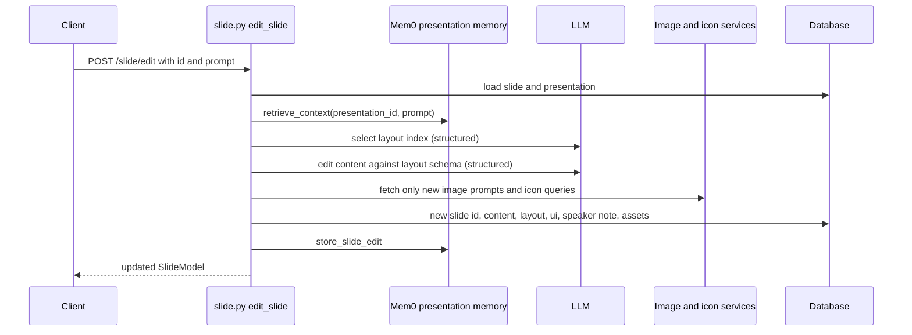
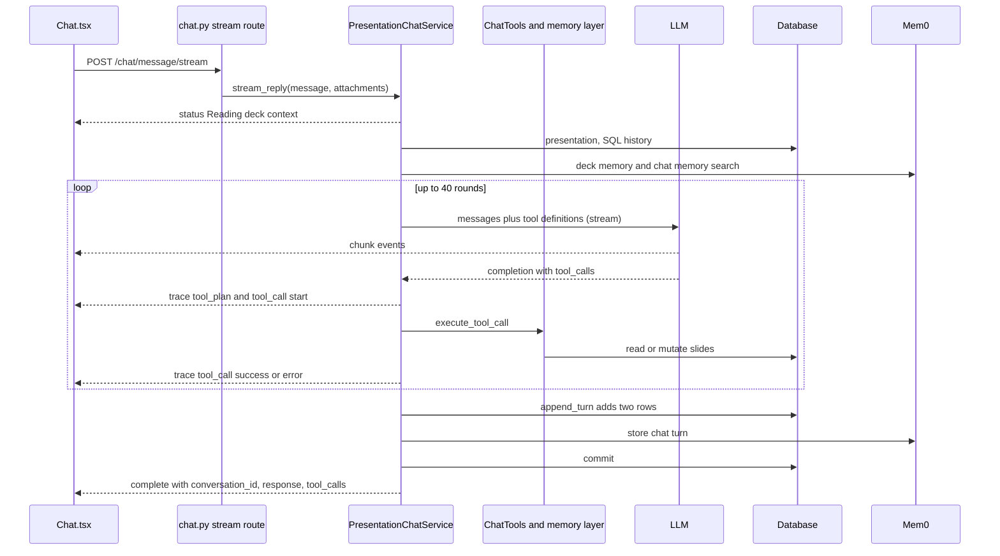

# Editing and chat assistant

<div class="chapter-meta" markdown>
**Reads:** `servers/fastapi/api/v1/ppt/endpoints/slide.py`, `servers/fastapi/utils/llm_calls/edit_slide.py`, `servers/fastapi/utils/llm_calls/select_slide_type_on_edit.py`, `servers/fastapi/utils/llm_calls/edit_slide_html.py`, `servers/fastapi/utils/process_slides.py`, `servers/fastapi/api/v1/ppt/endpoints/chat.py`, `servers/fastapi/services/chat/`, `servers/fastapi/services/mem0_oss_memory.py`, `servers/fastapi/services/mem0_presentation_memory_service.py`, `servers/nextjs/app/(presentation-generator)/presentation/components/Chat.tsx`  ·  **Builds on:** [Smart mode](13-smart-mode.md), [Prompts and schemas](09-prompts-and-schemas.md)  ·  **Time:** ~45 min
</div>

Presenton has two ways to change a slide with AI after it exists. The older one is a pair of single-shot endpoints, `POST /slide/edit` for JSON (template) slides and `POST /slide/edit-html` for HTML slides, which run one or two LLM calls and overwrite the row. The newer one is a tool-calling chat assistant that runs up to 40 rounds of tool calls against the live database, streams its progress over SSE, keeps conversation threads in SQL, and recalls background facts from a local Mem0 vector store. This chapter walks through both, request by request, then follows the chat assistant's tools down to the rows they mutate and the memory they write.

## Two editing surfaces

| Surface | Route | Slide kinds | LLM calls | Used by the web UI in this snapshot |
| --- | --- | --- | --- | --- |
| Prompt edit | `POST /api/v1/ppt/slide/edit` | JSON content slides (template v2 or legacy layouts) | Layout selection, then structured content edit | No (API and Presenton Cloud proxy only) |
| HTML prompt edit | `POST /api/v1/ppt/slide/edit-html` | Any slide with HTML | One free-text call | No (API only) |
| Chat assistant | `POST /api/v1/ppt/chat/message[/stream]` | Standard and smart decks, with different tool sets | Up to 40 tool rounds, plus an optional final synthesis call | Yes (`Chat.tsx`) |

A search of `servers/nextjs` finds no caller of `/slide/edit` or `/slide/edit-html`; the only in-repo references are `servers/fastapi/services/presenton_cloud_proxy.py:52` and the tests. The endpoints are still part of the public API and the generated `servers/fastapi/openai_spec.json`. Both routers are mounted under `/api/v1/ppt` (`servers/fastapi/api/v1/ppt/router.py:22-40`).

## Step 1: Edit a JSON slide with POST /slide/edit

### 1.1 Request and response

```http
POST /api/v1/ppt/slide/edit
Content-Type: application/json

{"id": "6a1f0c7e-1b0a-4a1e-9a55-3d0d6a9e2c11", "prompt": "Make the headline punchier and add a solar icon"}
```

Both fields are required body parameters (`servers/fastapi/api/v1/ppt/endpoints/slide.py:38-43`). The response is the updated `SlideModel` (`id`, `presentation`, `layout_group`, `layout`, `index`, `content`, `html_content`, `speaker_note`, `properties`, `ui`) with a new `id`. Unknown slide or presentation IDs return 404 "Slide not found" / "Presentation not found" (`servers/fastapi/api/v1/ppt/endpoints/slide.py:44-49`).

The handler runs these sub-steps in order (`servers/fastapi/api/v1/ppt/endpoints/slide.py:51-132`):



### 1.2 Retrieve memory

`MEM0_PRESENTATION_MEMORY_SERVICE.retrieve_context(presentation.id, prompt)` returns up to 6,000 characters of related memories for this deck, or `""` when Mem0 is unavailable (Step 8). The string is injected into both LLM prompts.

### 1.3 Decide whether the layout changes

`_get_presentation_stream_layout(presentation)` (`servers/fastapi/api/v1/ppt/endpoints/presentation.py:1435`) builds a `PresentationLayoutModel` from the stored template payload (or the legacy layout). Then `get_slide_layout_from_prompt` (`servers/fastapi/utils/llm_calls/select_slide_type_on_edit.py:50`) looks up the slide's current layout position with `layout.get_slide_layout_index(slide.layout)` (404 "Slide layout X not found" if it is not in the deck's layout, `servers/fastapi/templates/presentation_layout.py:36-42`) and asks the model for one integer. The system prompt contains `layout.to_string()` (for each layout: its index, name and description, no schemas, `servers/fastapi/templates/presentation_layout.py:49-62`), the memory block, and these notes:

```python title="servers/fastapi/utils/llm_calls/select_slide_type_on_edit.py (excerpt)"
                # Notes
                - Do not select different slide layout than current unless absolutely necessary as per user prompt. 
                - If user prompt is not clear, select the layout that is most relevant to the slide data.
                - If user prompt is not clear, select the layout that is most relevant to the slide data.
                **Go through all notes and steps and make sure they are followed, including mentioned constraints**
```

The user message lists the prompt, the current slide data and the current layout index. The response schema is `SlideLayoutIndex` (`{"index": int}`, `servers/fastapi/models/slide_layout_index.py:4`), and the function returns `layout.slides[index]` (`servers/fastapi/utils/llm_calls/select_slide_type_on_edit.py:88-89`).

!!! warning "Gotcha"
    The returned index is not range-checked. An out-of-range value raises `IndexError`, which `handle_llm_client_exceptions` turns into an HTTP 500, and a negative value silently selects a layout from the end of the list because Python indexing allows it. If you modify this call, clamp the index or add `ge`/`lt` constraints to the schema.

!!! warning "Gotcha"
    Calling `/slide/edit` on a smart slide fails. A smart presentation has `layout = None`, so `presentation.get_layout()` executes `PresentationLayoutModel(**self.layout)` (`servers/fastapi/models/sql/presentation.py:113-114`) and raises a `TypeError` outside any handler, which surfaces as a 500. Smart slides must go through `/slide/edit-html` or the chat assistant.

### 1.4 Rewrite the content against the layout's schema

`get_edited_slide_content` (`servers/fastapi/utils/llm_calls/edit_slide.py:110`) derives the response schema from the selected layout:

```python title="servers/fastapi/utils/llm_calls/edit_slide.py (excerpt)"
    response_schema = remove_fields_from_schema(
        slide_layout.json_schema, ["__image_url__", "__icon_url__"]
    )
    response_schema = add_field_in_schema(
        response_schema,
        {
            "__speaker_note__": {
                "type": "string",
                "minLength": 100,
                "maxLength": 500,
                "description": "Speaker note for the slide",
            }
        },
        True,
    )
    response_schema = ensure_array_schemas_have_items(response_schema)
```

So the model never writes asset URLs, and it must write a required speaker note of 100 to 500 characters. The system prompt (`servers/fastapi/utils/llm_calls/edit_slide.py:30-68`) adds the deck's instructions, tone and verbosity when present, and these rules: answer in the language given in the input, "Do not change **Image prompts** and **Icon queries** if not asked for in prompt", generate them only if asked, speaker notes as plain non-Markdown text, plus the retrieved memory with the instruction to use it "only if it is relevant". The user prompt (`servers/fastapi/utils/llm_calls/edit_slide.py:71-88`) fixes the icon query and image prompt language to English, adds the current date and time, the slide content language (`auto-detect` for empty or `auto` values), the edit prompt, and the current `slide.content`. The call is `generate_structured_with_schema_retries(..., validate_schema=True)`, the same structured-output helper described in [chapter 9](09-prompts-and-schemas.md).

!!! warning "Gotcha"
    Both edit prompts interpolate Python dictionaries with f-strings (`{slide_data}`), so the model sees Python `repr` output (single quotes, `True`, `None`), not JSON. The edit path also keeps the generated `__speaker_note__` key inside `slide.content` after copying it to `slide.speaker_note` (`servers/fastapi/api/v1/ppt/endpoints/slide.py:113`, `:121`).

### 1.5 Reuse or regenerate assets

`process_old_and_new_slides_and_fetch_assets` (`servers/fastapi/utils/process_slides.py:291`) compares the old and new content and only pays for assets that actually changed. It finds every dictionary that carries a prompt or query under these keys (`servers/fastapi/utils/process_slides.py:22-24`):

| Asset | Prompt keys (first non-empty wins) | URL key written (legacy / template v2) |
| --- | --- | --- |
| Image | `__image_prompt__`, `image_prompt`, `prompt` | `__image_url__` / `image_url` |
| Icon | `__icon_query__`, `icon_query`, `query` | `__icon_url__` / `icon_url` |

The handler chooses the template v2 key style when the presentation has a template layout payload or the slide has a `ui` dict (`servers/fastapi/api/v1/ppt/endpoints/slide.py:84-87`). The reuse rule is exact-match:

```python title="servers/fastapi/utils/process_slides.py (excerpt)"
    old_image_urls = {
        (prompt, (old_image_target_sizes or {}).get(_path_key(path))): image_url
        for path, asset, prompt in old_image_assets
        if (
            image_url := _get_asset_url(
                asset,
                "image",
                template=use_template_asset_fields,
            )
        )
    }
    # ...
    for path, new_image, image_prompt in new_image_assets:
        target_size = (new_image_target_sizes or {}).get(_path_key(path))
        image_key = (image_prompt, target_size)
        if image_key in old_image_urls:
            _set_asset_url(
                new_image,
                "image",
                old_image_urls[image_key],
                template=use_template_asset_fields,
            )
            continue
```

An image is reused only if the same prompt existed before and its target box size is the same. Target sizes come from `image_target_sizes_from_template` (`servers/fastapi/utils/process_slides.py:35-99`), which tags each image slot with a unique `https://presenton.invalid/image-slot/{nonce}/{i}` URL, hydrates the layout, and reads back each tagged image element's `size`, so a prompt moved into a differently sized box is regenerated at the new size. Icons are reused by query string alone. Everything else is fetched concurrently with `ImageGenerationService.generate_image(ImagePrompt(prompt, target_width, target_height))` and `ICON_FINDER_SERVICE.search_icons(query, weight=icon_weight)`. With `allow_image_fallback=True` (the edit endpoint's setting), a failed image becomes `/static/images/placeholder.jpg` plus a warning that is only logged; an icon search with no result becomes `/static/icons/placeholder.svg`. Newly generated `ImageAsset` rows are returned and added to the session. Image generation itself is covered in [chapter 12](12-images-icons-search.md).

### 1.6 Persist

The handler then (`servers/fastapi/api/v1/ppt/endpoints/slide.py:109-130`):

1. Assigns `slide.id = uuid.uuid4()` ("Always assign a new unique id to the slide"). The integration test asserts that afterwards exactly one slide row exists and it has the new ID (`servers/fastapi/tests/integration/test_slide_edit_api.py:155-185`).
2. Sets `content`; when the layout changed and the deck uses a template payload, rebuilds `ui` from the new layout with `_template_slide_ui`; sets `layout`; re-hydrates `ui` from content (`_hydrate_template_slide_ui`); copies the speaker note.
3. Adds the new assets and commits.
4. Calls `store_slide_edit(presentation_id, slide_index, edit_prompt, edited_slide_content)`.

Because every step before the commit only touches memory objects, a failing LLM call leaves the saved slide untouched (`test_failed_ai_edit_leaves_saved_slide_unchanged`, `servers/fastapi/tests/integration/test_slide_edit_api.py:244`). How template content becomes `ui` is the subject of [chapter 17](17-template-to-slide.md).

## Step 2: Edit HTML with POST /slide/edit-html

```http
POST /api/v1/ppt/slide/edit-html
Content-Type: application/json

{"id": "6a1f0c7e-...", "prompt": "Turn the three bullets into cards", "html": null}
```

`html` is optional; when omitted the stored `html_content` is edited, and if neither exists the response is 400 "No HTML to edit" (`servers/fastapi/api/v1/ppt/endpoints/slide.py:135-152`). The handler retrieves memory, calls `get_edited_slide_html(prompt, html, memory_context)`, assigns a new slide ID (the comment says this "is to ensure that the nextjs can track slide updates"), stores the result in `html_content`, commits, and records a `store_slide_edit` with the HTML as content (`servers/fastapi/api/v1/ppt/endpoints/slide.py:154-180`).

The LLM call (`servers/fastapi/utils/llm_calls/edit_slide_html.py:61-85`) is a single non-streaming `client.generate` in a worker thread. The system prompt is a generic "expert HTML slide editor" brief: preserve structure, classes and IDs, keep styling unless asked, "Ensure modifications work across different screen sizes", preserve `<style>` and `<script>` tags. The user prompt contains the edit request, the memory block and the HTML in a fenced block. The reply is cut down to the span from the first `<` to the last `>`:

```python title="servers/fastapi/utils/llm_calls/edit_slide_html.py (excerpt)"
def extract_html_from_response(response_text: str) -> Optional[str]:
    start_index = response_text.find("<")
    end_index = response_text.rfind(">")

    if start_index != -1 and end_index != -1 and end_index > start_index:
        return response_text[start_index : end_index + 1]

    return None
```

If no tag is found the original HTML is returned unchanged.

!!! warning "Gotcha"
    `/slide/edit-html` predates smart mode and does not apply any of its rules. The result is never passed through `normalize_smart_slide_html`, so it can contain scripts without `new Chart(`, event handlers, `<style>` tags, scrolling containers or a root that is not a 1280x720 `<section>`, and its prompt even mentions forms and responsive design. For smart slides, the chat assistant's `saveSlide` (Step 5) is the validated path.

## Step 3: The chat API surface

`CHAT_ROUTER` (`servers/fastapi/api/v1/ppt/endpoints/chat.py:28`) exposes five routes:

| Method and path | Input | Output |
| --- | --- | --- |
| `GET /api/v1/ppt/chat/conversations` | query `presentation_id` | `[{conversation_id, updated_at, last_message_preview}]`, newest first (`servers/fastapi/api/v1/ppt/endpoints/chat.py:31`) |
| `GET /api/v1/ppt/chat/history` | query `presentation_id`, `conversation_id` | `{presentation_id, conversation_id, messages: [{role, content, created_at}]}` (`servers/fastapi/api/v1/ppt/endpoints/chat.py:49`) |
| `DELETE /api/v1/ppt/chat/conversation` | query `presentation_id`, `conversation_id` | 204 (`servers/fastapi/api/v1/ppt/endpoints/chat.py:91`) |
| `POST /api/v1/ppt/chat/message` | `ChatMessageRequest` | `ChatMessageResponse` (`servers/fastapi/api/v1/ppt/endpoints/chat.py:105`) |
| `POST /api/v1/ppt/chat/message/stream` | `ChatMessageRequest` | `text/event-stream` (`servers/fastapi/api/v1/ppt/endpoints/chat.py:124`) |

The Pydantic models (`servers/fastapi/models/chat.py`) all set `extra="forbid"`:

| Model | Fields and limits |
| --- | --- |
| `ChatMessageRequest` | `presentation_id: UUID`; `presentation_type: "standard" or "smart"` (default `standard`); `message: str` 1 to 8,000 chars; `conversation_id: UUID or null`; `attachments: list[ChatAttachment]`, at most 8 |
| `ChatAttachment` | `type: "document"`; `name` 1 to 255 chars; `file_path` 1 to 4,000 chars; `mime_type` up to 255 or null |
| `ChatMessageResponse` | `conversation_id: UUID`; `response: str`; `tool_calls: list[str]` (tool names in call order) |

A smart-deck request from the editor looks like this (message abbreviated; Step 9 shows how the frontend builds it):

```json
{
  "presentation_id": "9a1e6f1c-3a7b-4d0e-8f5d-2b2f1c7a9e10",
  "presentation_type": "smart",
  "message": "UI context: the user is editing a Smart HTML presentation. ...\nUI context: the currently selected slide is slide 3 (zero-based index 2).\nUser message: Make this chart a line chart",
  "conversation_id": "1d2c3b4a-5e6f-4a7b-8c9d-0e1f2a3b4c5d",
  "attachments": []
}
```

The stream endpoint wraps `PresentationChatService.stream_reply` and maps its `(event_type, value)` pairs to SSE frames (`servers/fastapi/api/v1/ppt/endpoints/chat.py:136-165`):

| Frame `type` | Payload | Emitted when |
| --- | --- | --- |
| `status` | `status`: "Reading deck context", "Finalizing response" or "Saving chat" | Start of turn, tool-limit path, before persisting |
| `chunk` | `chunk`: text delta | Every content delta from the model |
| `trace` | `trace`: an object with `kind` `model_note`, `tool_plan`, `tool_call` or `limit` | Reasoning summary, planned tools, each tool start and finish, tool-limit notice |
| `complete` | `chat`: `{conversation_id, response, tool_calls}` | After the turn is saved |
| `error` | `detail` | Only for an `HTTPException` raised while streaming |

A pair of `tool_call` traces for a smart save:

```text
event: response
data: {"type": "trace", "trace": {"kind": "tool_call", "round": 2, "tool": "saveSlide", "status": "start", "message": "Saving the slide", "slide_index": 2, "slide_number": 3}}

event: response
data: {"type": "trace", "trace": {"kind": "tool_call", "round": 2, "tool": "saveSlide", "status": "success", "message": "Smart slide at index 2 was replaced.", "slide_index": 2, "slide_number": 3}}

```

The `slide_index` fields come from `_tool_focus_from_arguments` and `_tool_focus_from_result` (`servers/fastapi/services/chat/service.py:632-754`), which read `index`, `resolved_index`, `componentId`, `elementPath` and several spellings of target index lists, for a fixed set of slide-editing tools.

!!! warning "Gotcha"
    The stream endpoint only catches `HTTPException`. Validation errors raised inside the turn (wrong `presentation_type`, missing presentation, LLM errors converted by `handle_llm_client_exceptions`) arrive as `error` frames, but any other exception (for example a database error while persisting) ends the stream without a `complete` frame, and the browser reports "Chat stream ended before completion" (`servers/nextjs/app/(presentation-generator)/services/api/chat.ts:318`).

## Step 4: One chat turn, step by step



### 4.1 Construct the service

`PresentationChatService.__init__` (`servers/fastapi/services/chat/service.py:74-94`) creates three collaborators: a `ChatConversationStore` (SQL history plus Mem0 chat memory), a `PresentationContextStore` (an alias of `PresentationChatMemoryLayer` from `servers/fastapi/services/chat/memory_layer.py:103`, `servers/fastapi/services/chat/presentation_context_store.py:1-3`) bound to the presentation and its type, and `ChatTools(memory, mode=chat_mode)`. The `chat_mode` parameter defaults to `"presentation"` and no route passes anything else; `ChatTools` stores it but never reads it (`servers/fastapi/services/chat/tools.py:91`).

### 4.2 Prepare the context

`stream_reply` (`servers/fastapi/services/chat/service.py:114`) first calls `self._tools.set_turn_context(user_message)` (which resets the per-turn list of generated assets), yields "Reading deck context", then `_prepare_turn_context` (`servers/fastapi/services/chat/service.py:275-351`):

1. Reject an empty message (400), a missing presentation (404), and a `presentation_type` that differs from the stored `generation_mode` (400 "Presentation type does not match the stored generation mode.").
2. Build attachment context (4.3).
3. Use the given `conversation_id` or create `uuid4()`; load the thread's history (Step 7) and convert rows to `UserMessage`/`AssistantMessage`, stripping any stored "UI context" prefix.
4. Build a memory query from the user message without its UI context prefix, plus attachment names, and run two searches: `self._memory.retrieve_context(query)` (deck scope) and `retrieve_semantic_context(...)` (this conversation's scope).
5. If attachments were parsed, store their text in deck memory as `[document_extracted_text]`.
6. Assemble `[SystemMessage(build_system_prompt(...)), *history, UserMessage(model_user_message)]`.

`build_system_prompt` (`servers/fastapi/services/chat/prompts.py:227`) picks `SMART_CHAT_AI_ASSISTANT_SYSTEM_PROMPT` for smart decks and `CHAT_AI_ASSISTANT_SYSTEM_PROMPT` otherwise, then appends "Deck memory (background only; may be partial or stale):" and "Chat memory (earlier messages in this conversation):" blocks when non-empty. The smart prompt is the shorter of the two:

```python title="servers/fastapi/services/chat/prompts.py (excerpt)"
# Required workflow
1. Use getSmartPresentationContext for deck-wide, visual-style, new-slide, or
   multi-slide requests.
2. Before editing an existing slide, call getSlideAtIndex with
   includeFullContent=true and treat the returned html as authoritative.
3. Call saveSlide with one complete replacement HTML fragment. Never pass a
   diff, Markdown, fenced code, JSON slide content, or plain text.
4. Treat the edit as complete only when saveSlide returns saved=true. Repair
   validation errors and retry when possible.
```

It goes on to restate the smart HTML rules from [chapter 13](13-smart-mode.md) (root section classes, no scrolling or clipping, decoration-only positioning, complete Chart.js canvas plus script, no CDN scripts), `replaceOldSlideAtIndex=true` for edits and `false` for inserts, and a cap of 50 slides (`servers/fastapi/services/chat/prompts.py:168-224`). The standard prompt (`servers/fastapi/services/chat/prompts.py:10-166`) is a long protocol: 1-based slide numbers versus 0-based tool indexes, inspect with `getSlideAtIndex` before visible edits, prefer reusable template blocks over primitives (mandatory `getAvailableBlocks` before new tables and charts), vector and infographic rules, chart and table data-preservation rules, asset rules (generate first, reuse URLs exactly), outline tools limited to 50 slides and `MAX_OUTLINE_CONTENT_WORDS` words (default 100, `MAX_OUTLINE_WORDS` env, `servers/fastapi/constants/presentation.py:5-23`), and a one- or two-sentence final reply.

### 4.3 Attachments

Documents attached in the chat composer have already been uploaded; the request carries their temp paths. `_should_parse_attachments` (`servers/fastapi/services/chat/service.py:516-531`) decides whether to read them: always if the user text is empty or matches `DOCUMENT_CONTENT_INTENT_PATTERN` (words like read, extract, summarize, chart, table, create, generate, "based on", "use the attached document"); never if it only matches `DIRECT_FILE_PLACEMENT_PATTERN` (place, put, insert, attach, display, show, move, resize, position, replace, add); otherwise yes. When the files are not parsed, the model only gets a "UI context: the user attached document file(s), but this request appears to place or reference the file..." note followed by `Document N: name` lines. When parsing, `DocumentsLoader` loads every file and each document is trimmed to `min(3000, remaining)` characters out of a 6,000-character total (`MAX_CHAT_ATTACHMENT_FILE_CHARS`, `MAX_CHAT_ATTACHMENT_CONTEXT_CHARS`, `servers/fastapi/services/chat/service.py:46-47`). The resulting "UI context: the user attached parsed document(s)..." block is inserted just before the `User message:` line (`_compose_user_message_for_model`, `servers/fastapi/services/chat/service.py:534-552`). The persisted user message is the stripped text plus "Attached files: a.pdf, b.docx" (`servers/fastapi/services/chat/service.py:555-567`).

### 4.4 The tool loop

The loop runs at most `MAX_TOOL_ROUNDS = 40` rounds (`servers/fastapi/services/chat/service.py:45`, `:134`). Each round streams the model with `tools=build_chat_llm_tools(self._tools.get_tool_definitions())`; `build_chat_llm_tools` returns the function tools unchanged, and its docstring notes that web search is intentionally not offered to chat (`servers/fastapi/services/chat/llm_tools.py:4-9`). Content deltas are yielded immediately as `chunk` events; reasoning deltas are collected and, after the round, summarized into one `model_note` trace (whitespace-collapsed, capped at 600 characters, `servers/fastapi/services/chat/service.py:455-465`).

```python title="servers/fastapi/services/chat/service.py (excerpt)"
            completion_tool_calls = list(
                getattr(completion_chunk, "tool_calls", []) or []
            )
            if completion_tool_calls:
                tool_names = [tool_call.name for tool_call in completion_tool_calls]
                called_tools.extend(tool_names)
                # ...
                messages = self._append_sanitized_assistant_tool_turn(
                    messages,
                    content=getattr(completion_chunk, "content", None),
                    tool_calls=completion_tool_calls,
                )

                last_tool_results = []
                for tool_call in completion_tool_calls:
                    # ...
                    tool_result = await self._tools.execute_tool_call(tool_call)
                    # ...
                    tool_response_content = json.dumps(tool_result, ensure_ascii=False)
                    messages.append(
                        ToolResponseMessage(
                            id=tool_call.id,
                            content=[TextContentPart(text=tool_response_content)],
                        )
                    )
                continue
```

Tool calls in one round run sequentially, in the order the model listed them. A round with no tool calls ends the loop: its streamed text (or the completion's text, or "I could not generate a response for that request.") is the final answer. If all 40 rounds call tools, the service emits a `limit` trace and the "Finalizing response" status, makes one more call without tools (`_try_final_response_without_tools`, `servers/fastapi/services/chat/service.py:433-452`), and if that fails falls back to the `message` of the last successful tool result or a generic "I completed several tool operations..." sentence (`servers/fastapi/services/chat/service.py:814-830`).

The non-streaming `POST /chat/message` runs the same loop through `_run_llm_with_tools` (`servers/fastapi/services/chat/service.py:376-431`) with blocking `client.generate` calls in a worker thread and no traces.

### 4.5 Execute a tool call

`ChatTools.execute_tool_call` (`servers/fastapi/services/chat/tools.py:454-526`) is the single dispatcher. It returns a JSON-serializable envelope that is fed back to the model verbatim:

```python title="servers/fastapi/services/chat/tools.py (excerpt)"
        parsed_args: dict[str, Any] | None = None
        repair_notes: list[str] = []
        try:
            parsed_args = self._parse_args(tool_call.arguments)
            parsed_args, repair_notes = self._repair_tool_args(
                tool_call.name,
                parsed_args,
            )
            LOGGER.info("Executing chat tool %s", tool_call.name)
            try:
                result = await handler(parsed_args)
            except Exception as first_exc:
                retried = False
                for _attempt in range(MAX_TOOL_REPAIR_RETRIES):
                    retry_args, retry_notes = self._repair_tool_args(
                        tool_call.name,
                        parsed_args,
                        error=str(first_exc),
                    )
```

The pipeline is:

1. Unknown name: `{"ok": false, "error": "Unsupported tool: X", "recovery": {"retryable": false, ...}}`.
2. `_parse_args` (`servers/fastapi/services/chat/tools.py:1039`) accepts tolerant JSON: it tries `dirtyjson` then `json` on the raw string, on the contents of a Markdown fence, and on the outermost `{...}` or `[...]` substring, then converts any string `"null"` to `None`.
3. `_repair_tool_args` (`servers/fastapi/services/chat/tools.py:1190-1218`) normalizes JSON-string fields (for example an object passed where `content`, `element` or `component` must be a JSON string), and for chart, table and image inserts fills in missing data from the user's latest message or from assets generated earlier in this turn. The chart repair parses label and number pairs such as "North 120, South 95" (at least 2 and at most 12 rows, `servers/fastapi/services/chat/tools.py:1515-1553`); the table repair understands "headers A, B data: x, y; z, w" and CSV-like lines.
4. Call the handler. On an exception, repair once more with the error text (`MAX_TOOL_REPAIR_RETRIES = 1`, `servers/fastapi/services/chat/tools.py:68`) and retry only if the repair changed the arguments.
5. Success: `{"ok": true, "tool": name, "result": {...}}`, plus `"repair": {"applied": true, "notes": [...]}` when repairs were made.
6. Failure: `{"ok": false, "tool": name, "error": str(exc), "repair": {...}, "recovery": {"retryable", "message", "guidance": [...], "expected"?, "received_keys"?}}`, where `_build_tool_recovery` (`servers/fastapi/services/chat/tools.py:1733-1845`) maps error text to guidance and example payloads (a correct chart element, a table, an image with a generated URL, the reusable-block workflow).

!!! warning "Gotcha"
    `ok: true` only means the handler did not raise. Most mutating handlers report business failures as data, for example `{"saved": false, "message": "Smart slide HTML failed validation.", "validation_errors": [...]}`. The trace for such a call still has `status: "success"`, and the frontend refreshes as if a mutation happened. The prompts tell the model to check `saved=true`; code that consumes traces should check the result too.

### 4.6 Persist the turn

`_persist_turn` (`servers/fastapi/services/chat/service.py:353-374`) calls `ChatConversationStore.append_turn` with the user message stripped of its UI context, the final answer and the list of tool names, commits the request session, and returns `ChatTurnResult(conversation_id, response_text, tool_calls)`. The stream route turns that into the `complete` frame.

## Step 5: The tool sets

`ChatTools.get_tool_definitions` (`servers/fastapi/services/chat/tools.py:127`) returns one of two lists, depending only on `self._memory.presentation_type`. All tools are declared with `strict=False`. Argument schemas live in `servers/fastapi/services/chat/schemas.py`; every model sets `extra="forbid"` and `strict=True` (`servers/fastapi/services/chat/schemas.py:11-12`), and the `OpenAIStrictSchemaModel` subclass fills omitted fields with `None` before validation (`servers/fastapi/services/chat/schemas.py:15-28`), which is why the prompt tells the model to "Include required nullable fields with null".

### Smart decks: 7 tools

| Tool | Arguments | What it does |
| --- | --- | --- |
| `getSmartPresentationContext` | `includeSlideHtml` (default false), `maxHtmlCharsPerSlide` 0 to 50,000 (0 means full) | Returns title, language, tone, verbosity, instructions, fonts, `community_design_ids`, outlines, structure, slide count, and per slide its ID, index, title, HTML length and a 1,200-character text preview (`servers/fastapi/services/chat/memory_layer.py:985-1038`) |
| `readSourceDocuments` | `query`, `maxChars` 1,000 to 30,000 | Re-parses the deck's `file_paths` within a character budget (default 12,000); when no file can be read, falls back to a deck-memory search (`servers/fastapi/services/chat/memory_layer.py:554-683`) |
| `searchSlide` | `query` 1 to 1,000 chars, `limit` 1 to 10 | Scores slides by full-phrase match (8 points) plus matched tokens over text extracted from HTML (`servers/fastapi/services/chat/memory_layer.py:187-247`) |
| `getSlideAtIndex` | `index` 0 to 1,000, `includeFullContent` | Returns previews, and with `includeFullContent=true` the complete `html` (`servers/fastapi/services/chat/memory_layer.py:249-290`); retries `index-1` if nothing is found (`servers/fastapi/services/chat/tools.py:597-614`) |
| `generateAssets` | `assets`: 1 to 12 of `{kind: "image" or "icon", prompt}` | Generates images (committing an `ImageAsset` row) or finds icons, returns URLs (`servers/fastapi/services/chat/tools.py:763-786`, `servers/fastapi/services/chat/memory_layer.py:703-722`) |
| `saveSlide` | `html` up to 500,000 chars, `index`, `replaceOldSlideAtIndex`, optional `speakerNote`, `editPrompt` | `save_html_slide` (below) |
| `deleteSlide` | `index` | Deletes and reindexes; deleting the last slide inserts an "Untitled slide" placeholder section (`servers/fastapi/services/chat/memory_layer.py:1161-1255`) |

`save_html_slide` (`servers/fastapi/services/chat/memory_layer.py:1040-1159`) is where the chat assistant mutates a smart deck:

```python title="servers/fastapi/services/chat/memory_layer.py (excerpt)"
        try:
            normalized_html = normalize_smart_slide_html(html)
        except HTTPException as exc:
            return {
                "saved": False,
                "message": "Smart slide HTML failed validation.",
                "validation_errors": [str(exc.detail)],
            }

        target_index = max(0, index)
        title = self._smart_slide_title(normalized_html, target_index)
        if replace_old_slide_at_index:
            # ...
            slide.layout_group = "smart-html"
            slide.layout = "smart-html"
            slide.content = {"title": title}
            slide.html_content = normalized_html
            slide.ui = None
```

It refuses non-smart decks, runs exactly the generation-time validator from [chapter 13](13-smart-mode.md) (so a chat edit with a scrolling container, an orphan chart canvas or overlapping positioned text is rejected with the validator's message, which the model then sees), derives the title from `data-slide-title` or the first heading, and either replaces the row in place (keeping its `id`) or inserts a new row at `min(index, slide_count)`, shifting later slides and updating `n_slides`, with the 50-slide cap. The `editPrompt` argument is accepted by the schema but not used, and nothing is written to Mem0.

### Standard decks: 25 tools

| Group | Tools | Backing method and notable behavior |
| --- | --- | --- |
| Outline | `addOutline`, `updateOutline`, `deleteOutline` | Edit `presentation.outlines`, recompute `n_slides` and title, then `store_generated_outlines` (`servers/fastapi/services/chat/memory_layer.py:4021-4041`) |
| Discovery | `getTemplateSummary`, `getAvailableLayouts`, `getContentSchemaFromLayoutId`, `getAvailableBlocks`, `getAvailableInfographics`, `searchSlide`, `getSlideAtIndex`, `readSourceDocuments` | Read-only. `getAvailableBlocks` searches reusable component blocks collected from `presentation.layout` and the referenced `TemplateV2` row's merged components, components, layouts and raw layouts (`servers/fastapi/services/chat/memory_layer.py:2864-2911`; default 20 results, max 50); `getAvailableInfographics` returns entries from `INFOGRAPHIC_CATALOG` |
| Whole slide | `addNewSlide`, `addNewSlideLayout`, `saveSlide`, `updateSlide`, `deleteSlide` | `save_slide` validates content with `Draft202012Validator` against the layout schema (up to 10 errors); on replace it runs the asset reuse logic of Step 1.5 and assigns a new `id`, on insert it fetches all assets with `process_slide_and_fetch_assets`; both rebuild `ui` and store a `[slide_edit]` memory (`servers/fastapi/services/chat/memory_layer.py:777-983`) |
| Rendered UI | `addElement`, `addInfographic`, `updateElement`, `deleteElement`, `addComponent`, `createComponent`, `updateComponent`, `deleteComponent` | Mutate a deep copy of `slide.ui` and save it with `_save_slide_ui`, which strips component `size` and commits; the slide keeps its `id`; nothing is written to Mem0 (`servers/fastapi/services/chat/memory_layer.py:1320-1328`) |
| Assets | `generateAssets` | Same as in smart mode |

Two of these use the utilities introduced at the end of [chapter 13](13-smart-mode.md). `addInfographic` (`servers/fastapi/services/chat/tools.py:855-910`) validates `data` with `normalize_infographic_data`, defaults the position to `(128, 170)`, the size to the catalog's `default_size`, the colors to a two-color meter palette or a six-color palette (white plus five blues), and the text color to `111111`, optionally creating a blank slide first (`target: "new_slide"`). Text updates go through `replace_text_runs`, so a string such as `"Area = <latex>\pi r^2</latex>"` becomes a text run plus a LaTeX run that keeps the existing run's font (`servers/fastapi/services/chat/slide_ui_helpers.py:2252`). The rendered element model itself is documented in [chapter 16](16-template-v2-format.md).

`addElement`, `addComponent` and `createComponent` also enforce the "reuse template blocks first" rule in code: when the payload contains a `chart` or `table` element and no `sourceBlockId` is given, `_require_reusable_block_first` (`servers/fastapi/services/chat/tools.py:1053-1108`) looks for a reusable block of that type and, if one exists, raises an error naming its `block_id` so the model is pushed to `getAvailableBlocks` plus `addComponent(sourceBlockId=...)`.

!!! warning "Gotcha"
    The tool list is filtered by deck type, but the handler table is not: `_tool_handlers` maps all 26 names for every deck (`servers/fastapi/services/chat/tools.py:94-121`). If a model invents a call to a standard tool on a smart deck (for example `addNewSlide`), `execute_tool_call` will run it and insert a template-style blank slide with `ui` and no `html_content`. If you rely on the separation, check `presentation_type` in `execute_tool_call`.

!!! warning "Gotcha"
    Whole-slide template saves (`saveSlide`, `updateSlide` with replace) give the row a new `id`, while UI-level tools and smart `saveSlide` keep it. Any client code that caches slide IDs across a chat turn must re-read the deck, which `Chat.tsx` does after mutating tools (Step 9).

## Step 6: How tools reach the database

All chat tools share the request's `AsyncSession` through the memory layer, and each mutating method commits on its own (for example `save_html_slide` commits at `servers/fastapi/services/chat/memory_layer.py:1102` or `:1150`). There is no turn-level transaction: if round 3 fails after round 2 saved a slide, the round 2 change stays. The final `_persist_turn` commit only covers the two history rows. Reads such as `getSlideAtIndex` query by `(presentation, index)` on every call, which is why the standard tool description calls it "Live SQL" and "authoritative" (`servers/fastapi/services/chat/tools.py:251`) and the smart prompt calls the returned HTML authoritative.

## Step 7: Conversation storage

### SQL rows

Threads live in `chat_history_messages` (`servers/fastapi/models/sql/chat_history_message.py:12`):

| Column | Type | Notes |
| --- | --- | --- |
| `id` | UUID PK | |
| `owner_id` | UUID FK `user.id`, nullable, indexed | Defaults to the current owner; excluded from serialization |
| `presentation_id` | UUID FK `presentations.id` (cascade), nullable, indexed | |
| `template_v2_id` | string FK `template_v2.id` (cascade), nullable, indexed | Supported by `sql_chat_history`, but no route in this snapshot passes a template ID |
| `conversation_id` | UUID, indexed | The thread |
| `position` | int, indexed, `>= 1` | Order within the thread |
| `role` | string | `user` or `assistant` |
| `content` | Text | Stripped user text or final assistant text |
| `created_at` | timezone-aware datetime | Assistant row is user time plus 1 microsecond |
| `tool_calls` | JSON list of strings | Set on the assistant row only |

`servers/fastapi/services/chat/sql_chat_history.py` implements the operations. Every function requires exactly one of `presentation_id` or `template_id` (`_resource_filter`, `:53-62`). `append_turn` (`:190-236`) reads `max(position)` for the thread and inserts two rows at `max+1` and `max+2`. `list_conversations` (`:239-275`) reads all rows for the deck newest first and keeps the first row per conversation, so `last_message_preview` is the latest message trimmed to 200 characters. `delete_conversation` and `replace_messages` filter deletes by `owner_id` as well. Owner scoping in general is covered in [chapter 25](25-auth-and-multiuser.md).

### Legacy migration

Before SQL history existed, turns were only stored in Mem0. `ChatConversationStore.load_history` (`servers/fastapi/services/chat/conversation_store.py:13-37`) therefore reads SQL first and, when the thread is empty, loads the legacy Mem0 thread and writes it back with `replace_messages`. `GET /chat/history` does the same and commits when it migrated something (`servers/fastapi/api/v1/ppt/endpoints/chat.py:60-74`). `append_turn` writes to both stores (`servers/fastapi/services/chat/conversation_store.py:39-61`).

!!! warning "Gotcha"
    The SQL path loads the entire thread on every turn (`load_messages` has no limit), and only the final user and assistant texts are stored, not tool calls or tool results. Long threads grow the prompt without bound, and the model cannot see earlier tool outputs; it has to call discovery tools again. `CHAT_MAX_STORED_TURNS` (default 20) only limits the legacy Mem0 loader (`servers/fastapi/services/chat/chat_memory_store.py:27-29`, `:343`).

## Step 8: Mem0 presentation memory

### One shared local client

`servers/fastapi/services/mem0_oss_memory.py` holds a single process-wide `mem0.Memory` instance used by both memory services. Its docstring describes the namespacing: deck-level memories use the Mem0 `user_id` `{namespace}:{presentation_id}`, chat threads use `{namespace}:{presentation_id}:conversation:{conversation_id}` (`servers/fastapi/services/mem0_oss_memory.py:1-11`). `get_shared_mem0_client` (`:167-218`) initializes it lazily and only once:

1. Return `None` if `MEM0_ENABLED` is false (default true).
2. If `MEM0_REQUIRE_SPACY_MODEL` is true (default), `spacy.load(MEM0_SPACY_MODEL or "en_core_web_sm")` must succeed, otherwise a warning is logged and Mem0 stays off.
3. Build the configuration from the environment (`_oss_config_from_env`, `:92-154`), create the directories, point Mem0's telemetry directory at `{mem0_dir}/telemetry/oss`, and call `Memory.from_config`.
4. Any exception is logged (with a specific hint when the fastembed model file is missing) and leaves the client `None`. `_init_attempted` is set before trying, so a failed initialization is not retried until the process restarts.

```python title="servers/fastapi/services/mem0_oss_memory.py (excerpt)"
        "vector_store": {
            "provider": "qdrant",
            "config": {
                "collection_name": collection,
                "path": qdrant_path,
                "on_disk": True,
                "embedding_model_dims": dims,
            },
        },
        "embedder": {
            "provider": embedder,
            "config": {
                "model": model,
                "embedding_dims": dims,
            },
        },
        "history_db_path": history_db_path,
```

| Environment variable | Default | Used for |
| --- | --- | --- |
| `MEM0_ENABLED` | `true` | Master switch (checked by the client and both services) |
| `APP_DATA_DIRECTORY` | `/tmp/presenton` | Base for `MEM0_DIR` |
| `MEM0_DIR` | `{APP_DATA_DIRECTORY}/mem0` (Compose sets `/app_data/mem0`) | Root of all Mem0 files |
| `MEM0_QDRANT_PATH` | `{MEM0_DIR}/qdrant` | Local on-disk Qdrant vector store |
| `MEM0_HISTORY_DB_PATH` | `{MEM0_DIR}/history.db` | Mem0's SQLite history |
| `MEM0_COLLECTION_NAME` | `presenton_memories` | Qdrant collection |
| `MEM0_EMBEDDER_PROVIDER` | `fastembed` | Local embedding provider |
| `MEM0_EMBEDDER_MODEL` | `BAAI/bge-small-en-v1.5` | Embedding model |
| `MEM0_EMBEDDING_DIMS` | `384` | Vector size, used by both store and embedder |
| `MEM0_LLM_MODEL` | `OLLAMA_MODEL`, else `llama3.1:latest` | Mem0's LLM (provider `openai`, temperature 0.1, max tokens 2000) |
| `MEM0_LLM_API_KEY` | `OPENAI_API_KEY`, else `ollama` | Mem0's LLM key |
| `MEM0_LLM_BASE_URL` | `OLLAMA_URL`, else `http://host.docker.internal:11434` (suffixed with `/v1`) | Mem0's LLM endpoint |
| `MEM0_SPACY_MODEL`, `MEM0_REQUIRE_SPACY_MODEL` | `en_core_web_sm`, `true` | spaCy precondition |
| `MEM0_TOP_K` | `8` | Results per search |
| `MEM0_MAX_CONTEXT_CHARS` | `6000` | Cap on the joined search result |
| `MEM0_PRESENTATION_NAMESPACE_PREFIX` | `presentation` | Deck namespace |
| `MEM0_CHAT_NAMESPACE_PREFIX` | falls back to the presentation prefix | Chat namespace |
| `CHAT_MAX_STORED_TURNS` | `20` | Legacy chat history loader |

The Compose file forwards the main variables to every profile (`docker-compose.yml:108-117`). Integer variables are clamped to at least 1. Every write in these services passes `infer=False` to `client.add`. The tests assert that the flag is passed (`servers/fastapi/tests/test_mem0_presentation_memory_service.py:157`, `servers/fastapi/tests/test_chat_memory_store.py:110`). In the Mem0 library that flag stores the message text as given instead of running LLM fact extraction, so the vector store holds Presenton's own tagged text; what Mem0 does with the flag is library behavior that no test in this repository exercises against a real Mem0 instance. A separate test checks that the LLM block defaults to a local Ollama-style endpoint when no OpenAI key is set (`servers/fastapi/tests/test_mem0_presentation_memory_service.py:62`).

### What is stored

`Mem0PresentationMemoryService` (`servers/fastapi/services/mem0_presentation_memory_service.py:18`) writes each memory as a single user message whose first line is a tag. Messages longer than 20,000 characters are cut and suffixed with `[TRUNCATED]` (`:47-50`).

| Tag | Written by | Content |
| --- | --- | --- |
| `[presentation_source_prompt]`, `[presentation_generation_instructions]`, `[outline_system_prompt]`, `[outline_user_prompt]`, `[document_extracted_text]` | `store_generation_context`, called from outline generation (`servers/fastapi/api/v1/ppt/endpoints/outlines.py:153`), the API generation path (`servers/fastapi/api/v1/ppt/endpoints/presentation.py:2764`, `:2846`), and chat attachments (`servers/fastapi/services/chat/service.py:325`, document text only) | The generation inputs |
| `[generated_outlines]` | `store_generated_outlines`, from `/prepare` (`servers/fastapi/api/v1/ppt/endpoints/presentation.py:1923`), outline endpoints, and chat outline tools | Outline JSON |
| `[slide_edit]` | `store_slide_edit`, from `/slide/edit`, `/slide/edit-html`, and chat template `save_slide` (edit prompt `[chat_tool_save_slide_replace] layout_id=...` or `[chat_tool_save_slide_new] ...`) | `slide_index=`, `user_edit_prompt=`, `edited_slide_content=` lines |
| `[chat_turn]` | `ChatMemoryStore.store_chat_turn` (`servers/fastapi/services/chat/chat_memory_store.py:150`) in the conversation scope | `turn_created_at=`, `user=`, `assistant=` lines |

Smart generation itself (`stream_smart_presentation`) writes nothing to Mem0, and neither does the chat assistant's smart `saveSlide`. For a smart deck, deck memory therefore only contains `/slide/edit-html` edits and documents attached in chat.

### Retrieval

`retrieve_context(presentation_id, query)` (`servers/fastapi/services/mem0_presentation_memory_service.py:186-242`) calls `client.search(query, filters={"user_id": scope}, top_k=MEM0_TOP_K)`, accepts either a `{"results": [...]}` dict or a list, takes each item's `memory`, `text` or `data` field, removes duplicates while keeping order, joins with blank lines and truncates to `MEM0_MAX_CONTEXT_CHARS`. The chat store does the same in the conversation scope and also accepts `memories` or `items` keys (`servers/fastapi/services/chat/chat_memory_store.py:103-116`, `:207-270`). Both services retry `add` and `search` (and the chat store also `get_all`) with an alternative call signature on `TypeError`, to work across Mem0 versions. Note that `_truncate` appends `\n\n[TRUNCATED]` after the cut, so a capped context is slightly longer than `MEM0_MAX_CONTEXT_CHARS`.

### Failure handling and concurrency

Memory is strictly best-effort. Each service method returns early when the client is `None`, catches `BaseException`, re-raises only exceptions that are neither `Exception` nor `SystemExit` (for example `KeyboardInterrupt`), turns a `SystemExit` from the Mem0 runtime into a per-process "disabled" flag on that service with a logged error, and logs everything else and continues with `""` or `[]` (`servers/fastapi/services/mem0_presentation_memory_service.py:92-102`, `:207-218`). All blocking Mem0 calls run in `asyncio.to_thread` and are serialized by `run_shared_mem0_operation`, a process-wide `RLock`, because local Qdrant keeps one SQLite connection that fails on concurrent commits (`servers/fastapi/services/mem0_oss_memory.py:32-42`; covered by `test_presentation_and_chat_operations_are_serialized`, `servers/fastapi/tests/test_mem0_presentation_memory_service.py:228`). The scope-isolation test `servers/fastapi/tests/unit/test_mem0_session_scope_security.py` checks that Mem0's session-scope encoding keeps a `user_id` like `presentation:<uuid>` intact and that crafted IDs cannot read another scope's history.

!!! warning "Gotcha"
    Because the lock is process-wide and searches run on every slide edit and chat turn, heavy concurrent use serializes on Mem0. The client is also created lazily on first use, so the first edit or chat turn after startup pays for initializing the embedder and the local Qdrant store. Setting `MEM0_ENABLED=false` removes memory entirely without any other behavior change, since every caller already tolerates an empty context.

## Step 9: The frontend at the boundary

### Building the message

`Chat.tsx` sends through a small adapter (`servers/nextjs/app/(presentation-generator)/presentation/components/chat/chat-adapter.ts:4-23`) to `PresentationChatApi.streamMessage` (`servers/nextjs/app/(presentation-generator)/services/api/chat.ts:398`). Before sending, `buildBackendMessage` (`servers/nextjs/app/(presentation-generator)/presentation/components/Chat.tsx:992-1126`) prefixes the user's text with "UI context:" lines and ends with `User message: ...`. For a smart deck with a selected element the lines are:

```tsx title="servers/nextjs/app/(presentation-generator)/presentation/components/Chat.tsx (excerpt)"
    if (presentationType === "smart" && variant === "presentation") {
      contextLines.push(
        "UI context: the user is editing a Smart HTML presentation. Read the authoritative target HTML with getSlideAtIndex, preserve its design and scripts, and save a complete validated HTML fragment with saveSlide.",
      );
    }
    if (presentationType === "smart" && selectionContext) {
      const selectedHtml =
        selectionContext.html.length > MAX_SELECTED_HTML_CONTEXT_CHARS
          ? `${selectionContext.html.slice(0, MAX_SELECTED_HTML_CONTEXT_CHARS)}\n<!-- selected HTML truncated -->`
          : selectionContext.html;
      contextLines.push(
        `UI context: the user selected one HTML element from slide ${selectionContext.slideNumber} (zero-based index ${selectionContext.slideIndex}). Edit this selected element within the authoritative full slide HTML; preserve unrelated elements.`,
      );
```

The selection is the `chatHtmlSelection` written by `SmartHtmlEditor` in [chapter 13](13-smart-mode.md); its HTML is capped at 3,500 characters (`servers/nextjs/app/(presentation-generator)/presentation/components/Chat.tsx:134`) and wrapped in `<selected_html>` tags, preceded by `Selected element tag:` and `Selected element text:` lines. Other context lines cover the current slide, the outline variant, template v2 selections (component IDs and element paths), pasted images with optional extracted text, and links. The selection is cleared from Redux as soon as the message is sent (`servers/nextjs/app/(presentation-generator)/presentation/components/Chat.tsx:1734`). When a message starts with `UI context:`, the backend's `_strip_ui_context_prefix` (`servers/fastapi/services/chat/service.py:492-499`) removes everything up to the first `\nUser message:` before storing or searching, so history and memory hold only what the user typed.

!!! warning "Gotcha"
    `ChatMessageRequest.message` is limited to 8,000 characters, and that limit applies to the full composed string, including the UI context lines and up to 3,500 characters of selected HTML. A long prompt plus a large selection fails with 422 before the assistant runs.

### Reading the stream

`streamChatMessage` (`servers/nextjs/app/(presentation-generator)/services/api/chat.ts:104-319`) uses `fetch` and a `ReadableStream` reader rather than `EventSource` (the request is a POST). It splits the buffer on blank lines, ignores frames whose `event:` is not `response`, and dispatches `chunk` to `onChunk`, `status` to `onStatus`, `trace` to `onTrace` (accepting both `slide_index` and `slideIndex` spellings), `complete` to the final response, and `error` by throwing (with a re-authentication prompt for ChatGPT session errors). If the stream ends without `complete`, it throws.

### Reacting to tools

`Chat.tsx` wires those handlers (`servers/nextjs/app/(presentation-generator)/presentation/components/Chat.tsx:1767-1876`): chunks are appended to the assistant bubble; statuses and formatted traces become an activity list; a `start` trace for a mutating tool snapshots the affected slide for an edit preview; a `success` trace for a mutating tool triggers `refreshPresentationIncrementally`, which calls the page's `onPresentationChanged` (a re-fetch) and, while one refresh is in flight, queues at most one more (`servers/nextjs/app/(presentation-generator)/presentation/components/Chat.tsx:1383-1408`); and after `complete`, `refreshPresentationIfNeeded` re-fetches once more if any returned tool name is mutating (`servers/nextjs/app/(presentation-generator)/presentation/components/Chat.tsx:1410-1422`). Mutating tools are the 15 names in `MUTATING_TOOLS` (`servers/nextjs/app/(presentation-generator)/presentation/components/chat/chat-activity.ts:28-44`). The edit preview lets the user switch between the original and modified slides; switching writes the chosen slide objects back through `PATCH /presentation/slide_update` (`servers/nextjs/app/(presentation-generator)/presentation/components/Chat.tsx:1307-1381`).

The active conversation ID is kept in `sessionStorage` under `presenton:chat:{scope}:{presentationType}:conversationId:{resourceId}` (`servers/nextjs/app/(presentation-generator)/presentation/components/chat/chat-utils.ts:141-170`), so a reload in the same tab reopens the thread through `GET /chat/history`.

!!! warning "Gotcha"
    `MUTATING_TOOLS` does not include `addInfographic`, so a turn whose only mutation is a new infographic does not refresh the editor; the change appears after the next reload or the next mutating turn. Separately, restoring the "original" version after a template `saveSlide` or `updateSlide` sends the pre-edit slide object, whose `id` no longer exists because `save_slide` assigned a new UUID (`servers/fastapi/services/chat/memory_layer.py:871`), and `slide_update` answers 404 "Slide not found" (`servers/fastapi/api/v1/ppt/endpoints/presentation.py:2599-2601`). Smart `saveSlide` keeps IDs, so restore works there.

!!! warning "Gotcha"
    The frontend appends `presentation_type` as a query parameter to the list, history and delete calls (`servers/nextjs/app/(presentation-generator)/services/api/chat.ts:330`, `:348`, `:369`), but those routes do not declare it, so FastAPI ignores it. Threads are filtered by presentation only.

## What you now know

- `/slide/edit` makes two structured LLM calls (layout index, then content against the layout schema with a required 100 to 500 character speaker note), reuses assets whose prompt and target size are unchanged, and saves the slide under a new ID; `/slide/edit-html` makes one free-text call and stores the HTML without smart validation.
- The chat assistant is a loop of at most 40 tool rounds; smart decks get 7 HTML tools whose `saveSlide` runs the same `normalize_smart_slide_html` validator as generation, standard decks get 25 tools over outlines, layouts, blocks, elements, components, infographics and assets.
- Tool calls are parsed tolerantly, repaired from the user's message, retried once, and always answered with an `ok` envelope; business failures such as `saved: false` are data, not errors.
- Each turn is stored as two SQL rows in `chat_history_messages` (plus a legacy Mem0 copy), and the stream speaks five frame types: `status`, `chunk`, `trace`, `complete`, `error`.
- Mem0 runs locally (Qdrant on disk, fastembed `bge-small-en-v1.5`, 384 dimensions), stores tagged raw text with `infer=False` in deck and conversation scopes, and fails open to empty context.

## Next

Continue with [REST API, async tasks, webhooks, MCP](15-api-async-mcp.md) to see how the same generation paths, including smart mode, are exposed to programs and agents.
