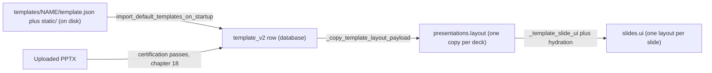
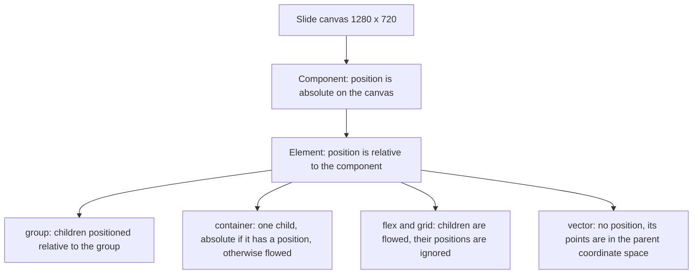

# Template v2 format

<div class="chapter-meta" markdown>
**Reads:** `templates/general/template.json`, `servers/fastapi/templates/v2/models/elements.py`, `servers/fastapi/templates/v2/models/layouts.py`, `servers/fastapi/templates/default_templates.py`, `servers/fastapi/models/sql/template_v2.py`, `layouts.json`  ·  **Builds on:** [Data model](07-data-model.md)  ·  **Time:** ~35 min
</div>

## What you will learn

Every slide Presenton generates is a copy of a "Template v2" layout with some values swapped out. This chapter specifies that format field by field, from the Pydantic models that validate it and from the 16 template bundles that ship in the repository. You will learn the top-level `template.json` keys, how layouts, components and elements nest inside a 1280 x 720 canvas, every element type and property, the `decorative`/`name`/limit flags that turn an element into a content field, and how the same data is stored in the `template_v2` table. The chapter ends with the inventory of built-in templates and an explanation of the stray `layouts.json` file at the repository root.

## Step 1: One template, three shapes

A Template v2 template exists in three places during its life, and the shape changes slightly between them. Keep this map in mind; the rest of the chapter refers back to it.



| Shape | Where | `layouts` | `merged_components` | Fonts, icons, thumbnail |
| --- | --- | --- | --- | --- |
| Bundle | `templates/<name>/template.json` | bare list | bare list | top-level `fonts`, `icon_type`, `thumbnail` |
| Row | `template_v2` table | `{"layouts": [...]}` | `{"components": [...]}` | inside the `assets` JSON column |
| Deck | `presentations.layout` | `{"layouts": [...], "icon_type", "icon_weight", "name", "template_id"}` | not copied | `presentations.fonts` |
| Slide | `slides.ui` | one layout object | not copied | not copied |

The wrapping happens in `_coerce_slide_layouts` and `_coerce_merged_components` (`servers/fastapi/templates/default_templates.py:202` and `:210`), which accept either a bare list or an already wrapped object. The deck copy is built by `_copy_template_layout_payload` (`servers/fastapi/api/v1/ppt/endpoints/presentation.py:232`). Chapter 17 walks through those transitions; this chapter is about the data itself.

## Step 2: The top-level `template.json` keys

Each bundle directory contains one `template.json` and a `static/` folder of assets. Here is the head of the General bundle and its last two keys, verbatim (the 17,000 lines of `merged_components` and `layouts` in between are elided):

```js title="templates/general/template.json (excerpt)"
{
  "id": "general",
  "name": "General",
  "description": "General template best for simple presentations, great spacing and clean layout.",
  "thumbnail": "static/thumbnail.png",
  "merged_components": [
  // ...
  "layouts": [
  // ...
  "fonts": {
    "Poppins": "https://fonts.googleapis.com/css2?family=Poppins:ital,wght@0,400;0,700;1,400&display=swap"
  },
  "theme": {
    "colors": {
      "primary": "#3B82F6",
      "background": "#9333EA",
      "card": "#FFFFFF",
      "stroke": "#E5E7EB",
      "primary_text": "#111827",
      "background_text": "#FFFFFF",
      "graph_0": "#EF4444",
      // ... graph_1 to graph_9
    },
    "fonts": {
      "textFont": {
        "name": "Poppins",
        "url": "https://fonts.googleapis.com/css2?family=Poppins:wght@100..900&display=swap"
      }
    }
  }
}
```

The keys, what validates them, and where they end up:

| Key | Type | Required | Validation at import | Stored as |
| --- | --- | --- | --- | --- |
| `id` | string | no | stripped; falls back to the directory name; must not contain `/` or `\` (`default_templates.py:177`) | `template_v2.id` (primary key) |
| `name` | string | no | stripped; falls back to the id (`default_templates.py:189`) | `template_v2.name` |
| `description` | string | no | stripped; empty becomes `null` | `template_v2.description` |
| `thumbnail` | string | no | `static/...` rewritten (Step 10) | `assets.thumbnail` |
| `icon_type` | string | no | normalized to one of `bold`, `duotone`, `fill`, `light`, `regular`, `thin`; default `bold` (`servers/fastapi/utils/icon_weights.py:5`) | `assets.icon_type` and `assets.icon_weight` |
| `merged_components` | list | no | `MergedComponents` Pydantic model | `template_v2.merged_components` |
| `layouts` | list | yes | `SlideLayouts` Pydantic model, at least one layout | `template_v2.layouts` |
| `fonts` | object | no | must be an object, otherwise `{}` | `assets.fonts` |
| `theme` | object | no | none at import, stored if it is an object | `template_v2.theme` |
| `components` | object | no | stored only if it is an object (no bundle uses it) | `template_v2.components` |

`_load_default_template` (`servers/fastapi/templates/default_templates.py:113`) performs exactly these steps:

```python title="servers/fastapi/templates/default_templates.py (excerpt)"
def _load_default_template(template_dir: Path) -> TemplateV2:
    template_json_path = template_dir / "template.json"
    raw = json.loads(template_json_path.read_text(encoding="utf-8"))
    if not isinstance(raw, dict):
        raise ValueError(f"Default template must be a JSON object: {template_json_path}")

    template_id = _read_template_id(raw, template_dir)
    rewritten = _rewrite_static_asset_urls(raw, template_id)

    layouts = _coerce_slide_layouts(rewritten.get("layouts"))
    merged_components = _coerce_merged_components(rewritten.get("merged_components"))
    components = rewritten.get("components")
    theme = rewritten.get("theme")
    assets = _build_assets(rewritten, template_id, layouts, merged_components)
    # ...
```

!!! warning "Gotcha: the docstring says UUIDs, the data says names"
    `resolve_default_template_id` (`servers/fastapi/templates/default_templates.py:62`) explains that bundled templates "use UUIDs as database IDs" while clients send the public directory name. In this snapshot every one of the 16 bundles sets `"id"` equal to its directory name (`"general"`, `"momentum"`, and so on), so the translation is the identity. The code path still matters: if you ship a bundle whose `id` is a UUID, clients can keep sending the directory name and generation resolves it.

!!! warning "Gotcha: the theme is not validated at import"
    `theme` is copied into the row as a raw dict. It is only validated later, as `PresentationThemeData`, when `GET /api/v1/ppt/template/{template_id}` builds its response (`servers/fastapi/api/v1/ppt/endpoints/template.py:2149`). That call does not catch `ValidationError`, so a malformed theme in a bundle surfaces as a 500 on the template detail endpoint, not at startup. The `/theme` endpoint is more forgiving: it logs a warning and derives a replacement (chapter 19).

## Step 3: Layouts and components

A layout is one slide design. A component is a reusable region of that slide. Both are plain Pydantic models in `servers/fastapi/templates/v2/models/layouts.py`:

```python title="servers/fastapi/templates/v2/models/layouts.py (excerpt)"
class Component(BaseModel):
    id: str
    description: str
    position: Position
    elements: list[SlideElement] = Field(min_length=1)

# ...

class SlideLayout(BaseModel):
    id: str
    description: str
    components: list[Component]

    @model_validator(mode="after")
    def _component_ids_must_be_unique(self) -> "SlideLayout":
        ids = [component.id for component in self.components]
        if len(ids) != len(set(ids)):
            raise ValueError("component ids must be unique within a slide layout")
        return self


class SlideLayouts(BaseModel):
    layouts: list[SlideLayout] = Field(min_length=1)
```

| Model | Field | Rule | Source |
| --- | --- | --- | --- |
| `SlideLayout` | `id` | string, unique across the template | `layouts.py:98`, `layouts.py:114` |
| `SlideLayout` | `description` | string; the structure-selection LLM reads it (chapter 17) | `layouts.py:100` |
| `SlideLayout` | `components` | list; ids unique within the layout | `layouts.py:101`, `layouts.py:103` |
| `Component` | `id` | string; becomes the top-level key of the slide's content JSON | `layouts.py:55` |
| `Component` | `description` | string | `layouts.py:56` |
| `Component` | `position` | `{x, y}` on the 1280 x 720 canvas | `layouts.py:57` |
| `Component` | `elements` | at least one element | `layouts.py:58` |
| `SlideLayouts` | `layouts` | at least one layout | `layouts.py:112` |

There is no `size` on a component. The model omits it, and the repair prompt sent to the model during layout generation says so explicitly: "Each component must include position and local-coordinate elements. Do not include component size." (`servers/fastapi/templates/v2/generation.py:1331`). The renderer computes a component's extent from its children.

The `RawSlideLayout` model (`layouts.py:44`) is the pre-certification shape produced from a PPTX: `{id, description, elements}` with no components at all. Custom-template creation turns raw layouts into certified layouts (chapter 18).

Layout ids follow two conventions in the bundles. Hand-curated templates such as General use plain structural ids (`title_description_image`). Templates produced by the certification pipeline carry a random four-digit suffix such as `center_title_agenda_grid_wave_7815`, added by `_with_randomized_layout_ids` (`servers/fastapi/api/v1/ppt/endpoints/template.py:833`), which appends `random.randint(1000, 9999)`.

!!! warning "Gotcha: unknown keys are silently dropped"
    None of the element or layout models set `extra="forbid"`, so Pydantic ignores fields it does not know. Across the 16 bundles (layouts plus merged components), nine layouts carry a stray layout-level `"elements"` key (two in General, four in Modern), 126 elements (104 of them text) carry `__presenton_manual_position`, 22 Editorial groups carry `description`, 30 vectors in Editorial and Mosaic carry `decorative`, and two General vectors carry `max_length`. All of those vanish when the bundle is validated and dumped by `_coerce_slide_layouts` and `_coerce_merged_components`. That includes `__presenton_manual_position`, so the renderer's manual-placement exception (Step 4) never sees the flag on a built-in template row. If you add a new property to the JSON, add it to the Pydantic model too, or it will never reach the database.

## Step 4: The coordinate system and how positions nest

Layouts use a fixed 1280 x 720 pixel canvas (`docs/template-v2.md:159`; `TEMPLATE_V2_HTML_WIDTH`/`HEIGHT` at `servers/nextjs/lib/template-v2-json-to-html.ts:153`). Positions are always relative to the nearest positioned ancestor:



The rules come from two places that must agree: the compiler that writes layouts and the renderer that reads them.

- **Component origin.** When the certification compiler builds a component, it sets `position` to the top-left corner of the union bounds of the component's source elements, then subtracts that offset from each element (`_localize_top_level_element`, `servers/fastapi/templates/v2/certified_generation.py:3050`, and the `position` assignment at `:2998`).
- **Components render as groups.** `renderItem` treats any record with an `elements` array and no known element `type` as a component and renders it as a `group` whose children are its elements (`servers/nextjs/lib/template-v2-json-to-html.ts:308`).
- **Groups position children absolutely.** `renderGroup` renders every child in `"absolute"` mode, which emits `left`/`top` from the child's `position` (`template-v2-json-to-html.ts:839` and `frameStyleFromBox` at `:3209`).
- **Containers choose per child.** `renderContainer` renders its single `child` absolutely when the child has a `position`, otherwise in flow mode inside a flexbox that honors `alignment` and `padding` (`template-v2-json-to-html.ts:485`).
- **Flex and grid flow their children.** Children render in `"flow"` mode (`position: relative`, no `left`/`top`) and are laid out by the shared flow engine (`template-v2-json-to-html.ts:534`, `:777`). The one exception is a child flagged `__presenton_manual_position`, which the flow engine treats as manually placed (`htmlFlowLayoutDeps`, `template-v2-json-to-html.ts:583`).
- **Vectors have no position.** `readBox` derives a vector's box from the minimum and maximum of its `points` (`template-v2-json-to-html.ts:3221`, `polygonBox` at `:3413`), so the points themselves are coordinates in the parent's space. The compiler shifts vector points rather than a position when it localizes them (`certified_generation.py:3061`).

In Step 7 you will see the consequence: in a component placed at `(672, 199.47)`, a divider whose points run from `(0, 144)` to `(80, 148)` is drawn at canvas coordinates `(672, 343.47)` to `(752, 347.47)`.

## Step 5: The element catalog

Every element is a member of one discriminated union, keyed by `type`:

```python title="servers/fastapi/templates/v2/models/elements.py (excerpt)"
SlideElement: TypeAlias = Annotated[
    Union[
        Text,
        Container,
        Image,
        TextList,
        Table,
        Vector,
        Chart,
        Infographic,
        Flex,
        Grid,
        Group,
    ],
    Field(discriminator="type"),
]
```

The table below lists all eleven types, which schema fields each carries, and how often each appears across the 383 layouts of the 16 bundles (counted by walking every component, including nested children).

| `type` | Model | `decorative` | `name` | Limit fields | Count in bundles |
| --- | --- | --- | --- | --- | --- |
| `text` | `Text` (`elements.py:203`) | required | required | `max_length`, `min_length` | 3,623 |
| `image` | `Image` (`elements.py:240`) | required | required | none (`is_icon` required) | 2,251 |
| `group` | `Group` (`elements.py:611`) | absent | required | none | 2,038 |
| `flex` | `Flex` (`elements.py:567`) | absent | required | `max_children`, `min_children` | 1,132 |
| `vector` | `Vector` (`elements.py:342`) | absent | optional | none | 733 |
| `container` | `Container` (`elements.py:224`) | absent | absent | none | 255 |
| `chart` | `Chart` (`elements.py:361`) | required | required | none | 113 |
| `infographic` | `Infographic` (`elements.py:549`) | required | required | none | 51 |
| `grid` | `Grid` (`elements.py:589`) | absent | required | `max_children`, `min_children` | 45 |
| `text-list` | `TextList` (`elements.py:265`) | required | required | `max_items`, `min_items`, `max_item_length`, `min_item_length` | 35 |
| `table` | `Table` (`elements.py:302`) | required | required | `max_columns`, `min_columns`, `max_rows`, `min_rows` | 7 |

### 5.1 Shared geometry

Every type except `vector` has optional `position` (`{x, y}`, floats) and `size` (`{width, height}`, floats). Almost every type has `rotation` (degrees), `flip_h` and `flip_v`. The renderer turns them into one CSS transform, `rotate(...) scaleX(-1) scaleY(-1)` with `transform-origin:center` (`transformStyle`, `template-v2-json-to-html.ts:3478`).

### 5.2 Style primitives

| Model | Fields | Source |
| --- | --- | --- |
| `Font` | `size`, `family`, `color`, `bold`, `italic`, `underline`, `line_height`, `letter_spacing`, `ellipsis`, `opacity` (all optional) | `elements.py:126` |
| `Alignment` | `horizontal` in `left`, `center`, `right`, `justify`; `vertical` in `top`, `middle`, `bottom` | `elements.py:121` |
| `Fill` | `color` (required), `opacity` | `elements.py:139` |
| `Stroke` | `color`, `width` (required); `opacity`, `dash` (list of floats), `line_cap` (`butt`/`round`/`square`), `line_join` (`bevel`/`miter`/`round`), `start_marker`, `end_marker` | `elements.py:150` |
| `StrokeMarker` | `type` in `arrow`, `diamond`, `open`, `oval`, `stealth`, `triangle`; `length` and `width` in `sm`, `med`, `lg` | `elements.py:144` |
| `Shadow` | `color` (required), `blur`, `opacity`, `offset_x`, `offset_y` | `elements.py:168` |
| `BorderRadius` | `tl`, `tr`, `bl`, `br` (all required) | `elements.py:161` |
| `Padding` | `top`, `right`, `bottom`, `left` (all required) | `elements.py:114` |

`line_height` is read two ways downstream: values above 2 are treated as pixels, values up to 2 as a multiple of the font size (`_text_capacity_geometry`, `certified_generation.py:2499`, and the same rule in `_table_cell_typography`, `servers/fastapi/templates/v2/schema.py:152`).

### 5.3 `text`

```python title="servers/fastapi/templates/v2/models/elements.py (excerpt)"
class TextRun(BaseModel):
    text: str
    font: Optional[Font] = None
    # ... rejects any "type" other than None or "text"

class LatexTextRun(BaseModel):
    type: Literal["latex"]
    latex: str = Field(min_length=1, max_length=4000)
    display_mode: bool = False
    font: Optional[Font] = None

# ...

class Text(BaseModel):
    type: Literal["text"]
    position: Optional[Position] = None
    size: Optional[Size] = None
    # ... rotation, flip_h, flip_v
    font: Optional[Font] = None
    alignment: Optional[Alignment] = None
    fill: Optional[Fill] = None
    stroke: Optional[Stroke] = None
    shadow: Optional[Shadow] = None
    runs: list[TextRunValue]

    # Schema
    decorative: bool
    name: str
    max_length: int
    min_length: int
```

A text element has an element-level `font` and a list of `runs`, each with its own optional `font`. The renderer merges them per run (`{...font, ...run.font}`, `template-v2-json-to-html.ts:399`), so a run only needs to carry what differs. In the bundles, runs usually repeat the full font. A run can instead be a LaTeX run (`{"type": "latex", "latex": "...", "display_mode": false}`, up to 4,000 characters), which the HTML renderer typesets with KaTeX (chapter 17). `fill`, `stroke` and `shadow` on a text element style the box, not the glyphs; a `shadow` becomes a CSS `text-shadow` (`textShadowStyle`, `template-v2-json-to-html.ts:3460`).

`max_length` and `min_length` are character counts. They become `maxLength`/`minLength` in the content schema the LLM must satisfy (chapter 17). Certification computes them from geometry: characters per line times line count, multiplied by a 0.85 safety factor, never below the current text length (`_estimated_text_capacity`, `certified_generation.py:2375`, `TEXT_CAPACITY_SAFETY_FACTOR` at `:62`).

### 5.4 `image`

```python title="servers/fastapi/templates/v2/models/elements.py (excerpt)"
class Image(BaseModel):  # Konva Image
    type: Literal["image"]
    # ... position, size, rotation, flip_h, flip_v
    opacity: Optional[float] = None
    data: str
    fit: Optional[ImageFit] = None
    focus_x: Optional[float] = None
    focus_y: Optional[float] = None
    crop_scale: Optional[float] = None
    border_radius: Optional[BorderRadius] = None
    clip_path: Optional[str] = None
    color: Optional[str] = None

    # Schema
    decorative: bool
    name: str
    prompt: Optional[str] = None
    is_icon: bool
    icon_type: Optional[IconType] = None
```

| Field | Meaning |
| --- | --- |
| `data` | URL of the image. Replaceable images hold a placeholder: `/static/images/replaceable_template_image.png` for photos, `/static/icons/placeholder.svg` for icons (`certified_generation.py:63`). Decorative images keep their real asset URL. |
| `fit` | `contain`, `cover` or `fill`. The HTML renderer defaults to `contain` when it is missing (`imageFit`, `template-v2-json-to-html.ts:3980`). |
| `focus_x`, `focus_y` | Percentages (0 to 100) for CSS `object-position` (`imageFocusValue`, `:4008`). |
| `crop_scale` | Zoom factor clamped to 1 to 6, applied as a CSS `scale()` around the focus point (`imageCropScale`, `:3989`). |
| `border_radius` | Per-corner radius. |
| `clip_path` | A CSS `clip-path`. Only `path`, `polygon`, `circle`, `ellipse` and `inset` functions pass the sanitizer (`normalizeCssClipPath`, `:4026`). |
| `color` | Icon tint. When `color` is set and `is_icon` is true, the renderer draws the icon as a CSS mask filled with that color (`renderImage`, `:357`). |
| `opacity` | Element opacity. |
| `prompt` | The prompt or icon query that produced the current `data`, written back during hydration (chapter 17). |
| `is_icon` | Distinguishes a searchable icon from a photo or illustration. It changes the generated content field from `image_prompt` to `icon_query`. |
| `icon_type` | Icon style: `bold`, `duotone`, `fill`, `light`, `regular`, `thin`. |

### 5.5 `text-list`

```python title="servers/fastapi/templates/v2/models/elements.py (excerpt)"
class TextList(BaseModel):  # Konva Group
    type: Literal["text-list"]
    # ... position, size, rotation, flip_h, flip_v
    font: Optional[Font] = None
    marker: Optional[Marker] = None
    gap: Optional[float] = None
    marker_gap: Optional[float] = None
    items: list[list[TextRunValue]]

    # Schema
    decorative: bool
    name: str
    max_items: int
    min_items: int
    max_item_length: int
    min_item_length: int
```

`items` is a list of items, each item a list of runs. `marker` is `bullet`, `number` or `none`. `gap` is the vertical space between items in pixels and `marker_gap` the horizontal space between the marker and the text. The limits bound both the number of items and the characters per item.

### 5.6 `table`

```python title="servers/fastapi/templates/v2/models/elements.py (excerpt)"
class TableCell(BaseModel):
    color: Optional[Fill] = None
    font: Optional[Font] = None
    alignment: Optional[HorizontalAlignment] = None
    borders: Optional[TableCellBorders] = None
    runs: List[TextRunValue]


class Table(BaseModel):
    type: Literal["table"]
    # ... position, size, rotation, flip_h, flip_v
    columns: list[TableCell]
    rows: list[list[TableCell]]

    # Schema
    decorative: bool
    name: str
    max_columns: int
    min_columns: int
    max_rows: int
    min_rows: int
```

`columns` is the header row; `rows` are the body rows. A cell's background is its `color` (a `Fill`), and `borders` holds an optional `Stroke` per side (`TableCellBorders`, `elements.py:287`). The renderer treats row 0 as the header and bolds it unless the cell sets `bold` explicitly (`tableCellStyle`, `template-v2-json-to-html.ts:3559`). The certification compiler insists that every body row has exactly as many cells as `columns` (`certified_generation.py:3539`).

### 5.7 `vector`: polygons and ellipses

```python title="servers/fastapi/templates/v2/models/elements.py (excerpt)"
class VectorCurve(BaseModel):
    type: Literal["smooth"]
    tension: Optional[float] = Field(default=None, ge=0, le=1)
    segments: Optional[int] = Field(default=16, ge=1, le=96)


class Vector(BaseModel):
    type: Literal["vector"]
    name: Optional[str] = None
    shape: Optional[VectorShape] = None
    points: list[Position] = Field(min_length=2)
    closed: Optional[bool] = None
    curve: Optional[VectorCurve] = None
    corner_radii: Optional[list[Annotated[float, Field(ge=0)]]] = None
    start_marker: Optional[VectorMarker] = None
    end_marker: Optional[VectorMarker] = None
    # ... rotation, flip_h, flip_v
    opacity: Optional[float] = None
    fill: Optional[Fill] = None
    stroke: Optional[Stroke] = None
    shadow: Optional[Shadow] = None
```

Vectors replace the older `rectangle`/`line` types (you will see those in `layouts.json`, Step 12). The fields:

- `shape` is `polygon` (default) or `ellipse`. An ellipse is drawn inside the bounding box of its points, so two opposite corners are enough (`renderEllipseVector`, `template-v2-json-to-html.ts:1019`).
- `points` needs at least two entries. With two points and `closed` unset it is an open line; with three or more it is closed unless `closed` is false (`polygonClosed`, `:3403`).
- `corner_radii` lists one radius per vertex; the renderer rounds each corner with a quadratic curve, capping the radius at half of each adjacent edge (`roundedPolygonPoints`, `:3307`).
- `curve: {"type": "smooth"}` resamples the outline as a Hermite spline; `tension` defaults to 0.4 in the renderer and `segments` to 16, clamped to 1 to 96 (`curveSettings`, `:3336`).
- `start_marker`/`end_marker` (`none`, `arrow`, `stealth`, `triangle`, `circle`, `square`, `diamond`) only render on open paths. Markers can also sit on the `stroke`, where the PPTX names `oval` and `open` map to `circle` and `arrow` (`vectorMarker`, `:946`).
- `fill` applies to closed shapes only. An open path without a stroke color is drawn in black (`renderPolygon`, `:863`).

Vectors have no `decorative` flag and no content schema: they are always fixed artwork.

### 5.8 `chart`

`Chart` (`elements.py:361`) carries the chart type, the data, and its styling:

| Group | Fields |
| --- | --- |
| Type | `chart_type`: `bar`, `horizontal_bar`, `line`, `area`, `pie`, `donut`, `stacked_bar`, `horizontal_stacked_bar`, `scatter`, `radar`, `polar_area` (`ChartType`, `elements.py:76`) |
| Data | `categories` (list of strings), `series` (list of `{name, values}`), `source` |
| Text | `title`, `x_axis_title`, `y_axis_title` |
| Colors | `colors` (palette in renderer order), `title_color`, `legend_color`, `text_color`, `axis_color`, `grid_color` |
| Toggles | `x_axis`, `y_axis`, `x_axis_grid`, `y_axis_grid`, `legend`, `legend_position` (`left`/`right`/`top`/`bottom`), `data_labels` (`base`/`mid`/`top`/`outside`) |

Three validators run on every chart. Pie and donut charts keep only their first series (`elements.py:395`). A legacy boolean `data_labels: true` becomes `"top"` and `false` becomes `null` (`:405`). An explicit `size` smaller than 80 x 60 pixels is rejected (`:418`).

### 5.9 `infographic`

```python title="servers/fastapi/templates/v2/models/elements.py (excerpt)"
InfographicData = Annotated[
    Union[
        ProgressBarInfographicData,
        GaugeInfographicData,
        StructuralInfographicData,
    ],
    Field(discriminator="type"),
]


class Infographic(BaseModel):
    type: Literal["infographic"]
    # ... position, size, rotation, flip_h, flip_v
    data: InfographicData

    # Design
    colors: List[str] = Field(default_factory=list)
    text_color: Optional[str] = None

    # Schema
    decorative: bool
    name: str
```

`InfographicType` (`elements.py:427`) enumerates 27 kinds. Two are metrics with a strict shape (`extra="forbid"`): `progress_bar` and `gauge`, each `{type, min_value, max_value, value}` with `max_value > min_value` (`elements.py:464`, `:479`). The other 25 (`gantt`, `timeline`, `roadmap`, `milestone_timeline`, `staircase`, `supply_chain`, `stair_step_blocks`, `maturity_model`, `pillar_framework`, `transformation_hub`, `diagonal_circles`, `risk_matrix`, `chevron_process`, `radial_cycle`, `conversion_funnel`, `vertical_funnel`, `pyramid`, `segmented_wheel`, `customer_journey`, `before_after`, `impact_effort_matrix`, `comparison_matrix`, `org_chart`, `decision_tree`, `mind_map`) are "structural": the model allows extra keys and normalizes them through `normalize_infographic_data` in `servers/fastapi/utils/infographic_catalog.py` (`elements.py:523`). For metrics, `colors[0]` is the track and `colors[1]` the filled value (`infographicBaseColor`/`infographicHighlightColor`, `template-v2-json-to-html.ts:3037`). In the bundles the 51 infographics are 26 gauges, 19 progress bars, two timelines, two vertical funnels, one maturity model and one staircase.

### 5.10 `container`

`Container` (`elements.py:224`) is a styled box around exactly one optional `child`: `fill`, `stroke`, `border_radius`, `shadow`, `padding` and `alignment`. It has no `name` and no `decorative`, so it is pure layout; any content lives in its child.

### 5.11 `flex`, `grid` and `group`: flexible and repeated regions

These three types are how a template expresses "this region holds a variable number of items".

| Type | Layout fields | Schema fields | Behavior |
| --- | --- | --- | --- |
| `flex` | `direction` (`row`/`column`, required), `wrap`, `align_items`, `justify_content` (`flex-start`, `flex-end`, `center`, `stretch`), `gap`, `column_gap`, `row_gap`, `children` | `name`, `max_children`, `min_children` | One-dimensional flow. |
| `grid` | `columns` (required), `rows`, `gap`, `column_gap`, `row_gap`, `align_items`, `justify_items`, `children` | `name`, `max_children`, `min_children` | Two-dimensional flow. |
| `group` | `children` | `name` | Free placement; children keep absolute positions. |

When all children of a `flex` or `grid` expose the same editable fields, the content schema turns the region into an array whose length is bounded by `min_children` and `max_children` (chapter 17). A `group` whose children repeat becomes an array bounded by half to all of its items. The certification compiler sets `min_children` to `max(1, (n + 1) // 2)` for a repeated region of `n` items and to `n` for a fixed one, with `max_children = n` (`certified_generation.py:3301`).

## Step 6: The schema flags

Three kinds of fields decide whether an element is content or decoration.

**`decorative`** is the switch. Only elements with `decorative: false` whose `type` is one of `text`, `image`, `text-list`, `table`, `chart` or `infographic` become fields in the content schema (`CONTENT_TYPES` and `_is_editable_element`, `servers/fastapi/templates/v2/schema.py:15` and `:53`). Everything else is copied untouched into every slide. In the bundles, 3,584 of 3,623 text elements and 607 of 2,251 images are editable; all charts, tables, text lists and infographics are editable.

**`name`** is the field's key in the content JSON. Names are lowercase snake case; the semantic certification pass enforces `^[a-z][a-z0-9_]*$` and at most 80 characters (`SemanticElementAnnotation.name`, `layouts.py:128`). For `flex`, `grid` and `group`, the name becomes the key of the nested object or array.

**Limit pairs** (`min_length`/`max_length`, `min_items`/`max_items`, `min_item_length`/`max_item_length`, `min_columns`/`max_columns`, `min_rows`/`max_rows`, `min_children`/`max_children`) bound the generated content. Certification refuses negative limits and a minimum above its maximum (`_certify_element_tree`, `certified_generation.py:3531`).

!!! warning "Gotcha: the min-equals-half rule is defined but not enforced"
    `elements.py` opens with `_validate_min_max`, which raises unless a minimum equals half of its maximum, rounded up (`servers/fastapi/templates/v2/models/elements.py:13`). Nothing calls it. The "half rounded up" convention is applied by the generators instead (for example `(len(columns) + 1) // 2` for tables at `certified_generation.py:1513`), and the bundles do not follow it everywhere: the General title has `min_length: 8, max_length: 25`. Do not rely on the relation when you read or hand-edit templates.

## Step 7: A complete layout, annotated

Here is the entire `title_description_image` layout from the General bundle (`templates/general/template.json:9148`). Whitespace has been compacted so short objects fit on one line; every key and value is unchanged.

```json title="templates/general/template.json, layout title_description_image (compacted)"
{
  "id": "title_description_image",
  "description": "A clean split presentation layout with a large rounded visual card on the left and stacked headline copy on the right.",
  "components": [
    {
      "id": "slide_background",
      "description": "Full-canvas white background that provides a neutral base for the two-column content arrangement.",
      "position": {"x": 0, "y": 0},
      "elements": [
        {
          "type": "vector",
          "shape": "polygon",
          "fill": {"color": "#FFFFFF", "opacity": 1},
          "points": [{"x": 0, "y": 0}, {"x": 1280, "y": 0}, {"x": 1280, "y": 720}, {"x": 0, "y": 720}],
          "closed": true
        }
      ]
    },
    {
      "id": "left_visual_card",
      "description": "Large rounded image panel positioned on the left with subtle shadow treatment for visual emphasis.",
      "position": {"x": 88, "y": 184},
      "elements": [
        {
          "type": "vector",
          "shape": "polygon",
          "fill": {"color": "#FFFFFF", "opacity": 1},
          "shadow": {"color": "#000000", "blur": 15, "opacity": 0.1, "offset_x": 0, "offset_y": 10},
          "points": [{"x": 0, "y": 0}, {"x": 512, "y": 0}, {"x": 512, "y": 320}, {"x": 0, "y": 320}],
          "closed": true,
          "corner_radii": [16, 16, 16, 16]
        },
        {
          "type": "image",
          "position": {"x": 0, "y": 0},
          "size": {"width": 512, "height": 320},
          "rotation": 0,
          "data": "/static/images/replaceable_template_image.png",
          "fit": "cover",
          "border_radius": {"tl": 16, "tr": 16, "bl": 16, "br": 16},
          "decorative": false,
          "name": "main_visual_image",
          "is_icon": false
        }
      ]
    },
    {
      "id": "right_text_stack",
      "description": "Right-side vertical content stack containing a prominent title, short accent rule, and supporting paragraph.",
      "position": {"x": 672, "y": 199.47},
      "elements": [
        {
          "type": "text",
          "position": {"x": 0, "y": 0},
          "size": {"width": 530, "height": 118.79},
          "font": {
            "size": 60,
            "family": "Poppins",
            "color": "#111827",
            "bold": true,
            "italic": false,
            "line_height": 0.8
          },
          "alignment": {"horizontal": "left", "vertical": "top"},
          "runs": [
            {
              "text": "Product Overview",
              "font": {
                "size": 60,
                "family": "Poppins",
                "color": "#111827",
                "bold": true,
                "italic": false,
                "line_height": 0.8
              }
            }
          ],
          "decorative": false,
          "name": "primary_heading",
          "max_length": 25,
          "min_length": 8,
          "rotation": 0
        },
        {
          "type": "vector",
          "shape": "polygon",
          "fill": {"color": "#9333EA", "opacity": 1},
          "points": [{"x": 0, "y": 144}, {"x": 80, "y": 144}, {"x": 80, "y": 148}, {"x": 0, "y": 148}],
          "closed": true,
          "rotation": 0
        },
        {
          "type": "text",
          "position": {"x": 0, "y": 164.72},
          "size": {"width": 530, "height": 129.41},
          "font": {
            "size": 18,
            "family": "Poppins",
            "color": "#4B5563",
            "bold": false,
            "italic": false,
            "line_height": 1.24
          },
          "alignment": {"horizontal": "left", "vertical": "top"},
          "runs": [
            {
              "text": "Our product offers customizable dashboards for real-time reporting and data-driven decisions. It integrates with third-party tools to enhance operations and scales with business growth for improved efficiency.",
              "font": {
                "size": 18,
                "family": "Poppins",
                "color": "#4B5563",
                "bold": false,
                "italic": false,
                "line_height": 1.24
              }
            }
          ],
          "decorative": false,
          "name": "supporting_paragraph",
          "max_length": 274,
          "min_length": 105,
          "rotation": 0
        }
      ]
    }
  ]
}
```

Reading it top to bottom:

| What | Meaning |
| --- | --- |
| `slide_background` | A full-canvas white rectangle drawn as a closed vector. No editable elements, so it contributes nothing to the content schema. Components render in array order, so this one sits at the bottom. |
| `left_visual_card` at `(88, 184)` | A rounded white card (vector with `corner_radii` and a soft `shadow`) and, on top of it, a 512 x 320 image at the same local origin. The image is editable (`decorative: false`), is a photo (`is_icon: false`) and still points at the replaceable placeholder. Its schema field is `left_visual_card.main_visual_image.image_prompt`. |
| `right_text_stack` at `(672, 199.47)` | A 60 px bold heading limited to 8 to 25 characters, a purple 80 x 4 accent bar at local y 144, and an 18 px paragraph limited to 105 to 274 characters. The sample strings ("Product Overview" and the dashboard sentence) are placeholders the generator replaces. |
| Fonts | `Poppins` appears in both the element `font` and each run's `font`; the template's `fonts` map tells the browser where Poppins lives (chapter 19). |

Chapter 17 feeds this exact layout through the schema builder and the hydrator.

## Step 8: `merged_components`

`merged_components` is a catalog of interchangeable component variants collected from all layouts:

```python title="servers/fastapi/templates/v2/models/layouts.py (excerpt)"
class MergedComponent(BaseModel):
    id: str
    description: str
    variants: list[Component] = Field(min_length=1)


class MergedComponents(BaseModel):
    components: list[MergedComponent]

    @model_validator(mode="after")
    def _component_ids_must_be_unique(self) -> "MergedComponents":
        ids = [component.id for component in self.components]
        if len(ids) != len(set(ids)):
            raise ValueError("merged component ids must be unique")
        return self
```

Each entry groups full `Component` objects (with position and elements) that can stand in for one another. In General, the first group, `background_canvas`, holds the white full-slide rectangles from several layouts as separate variants. The catalog is produced by an LLM clustering pass plus a structural de-duplication step during custom-template creation (chapter 18).

The generation pipeline never reads `merged_components`. It is consumed by three side features: prompted layout generation passes up to eight matching groups to the model as reusable components (`servers/fastapi/templates/v2/generation.py:726`), the chat assistant turns them into insertable block candidates (`servers/fastapi/services/chat/memory_layer.py:2905`), and the template editor offers them as insertable blocks (chapter 18).

!!! warning "Gotcha: variants are copies, not references"
    A variant is a full copy of a component, not a pointer into `layouts`. Editing a layout does not update its variant, and `scripts/convert-presentation-template.mjs` exists precisely to push edited slide UIs back into both `layouts` and the matching variants by deep equality (chapter 18). If you hand-edit a bundle, edit both places.

## Step 9: The `fonts` and `theme` blocks

**`fonts`** maps a display family name to a URL: `{"Montserrat Semi-Bold": "static/Montserrat SemiBold.ttf", ...}`. A URL is either a bundle-relative `static/...` font file or a Google Fonts CSS URL. The bundles mix both: Civic ships six local font files, General only a Google Fonts URL for Poppins. Template fonts are stored as `assets.fonts` and later copied into `presentations.fonts`.

**`theme`** has the shape of `PresentationThemeData` (`servers/fastapi/models/theme_data.py:32`): a `colors` object with exactly 16 roles (`primary`, `background`, `card`, `stroke`, `background_text`, `primary_text`, `graph_0` to `graph_9`) and `fonts.textFont: {name, url}`. The theme is a semantic summary of the template's palette; layouts do not reference it, every element carries literal colors.

!!! warning "Gotcha: Google Fonts URLs in bundles are never fetched"
    A test asserts that runtime frontend code never loads `fonts.googleapis.com` (`servers/nextjs/local-font-loading-validation.test.mjs:26`). The browser-side font loader ignores any URL that is not a font file and maps the family name to the vendored copy in `servers/nextjs/public/vendor/fonts` instead. A Google Fonts URL in a bundle is therefore only a hint; if the family is missing from the vendored catalog, the text falls back to another font. Chapter 19 covers the font pipeline.

## Step 10: From bundle to row

`import_default_templates_on_startup` (walked through in chapter 17) turns each bundle into a `TemplateV2` row. The columns, from `servers/fastapi/models/sql/template_v2.py:16`:

| Column | Type | Built-in bundle value | Custom template value |
| --- | --- | --- | --- |
| `id` | string PK, default `uuid4()` | bundle `id` | UUID |
| `owner_id` | UUID FK to `user.id`, nullable, cascade delete | `null` | creating user |
| `name`, `description` | string | from bundle | from request or PPTX file name |
| `raw_layouts` | JSON | `null` | PPTX-to-JSON output, `{"layouts": [...]}` |
| `components` | JSON | `null` (unused) | `null` |
| `merged_components` | JSON | `{"components": [...]}` | from clustering |
| `layouts` | JSON | `{"layouts": [...]}` | certified layouts |
| `theme` | JSON | bundle `theme` | generated theme |
| `assets` | JSON | see below | see chapter 18 |
| `is_default` | bool | `true` | `false` |
| `created_at`, `updated_at` | timestamptz | set on insert / update | same |

Two rewrites happen before validation:

```python title="servers/fastapi/templates/default_templates.py (excerpt)"
def _rewrite_static_asset_url(value: str, template_id: str) -> str:
    if not value.startswith("static/"):
        return value

    relative = PurePosixPath(value)
    if relative.is_absolute() or ".." in relative.parts:
        raise ValueError(f"Invalid default template static asset path: {value}")
    return f"/app_data/templates/{template_id}/{relative.as_posix()}"
```

Every string anywhere in the JSON that starts with `static/` (image `data`, `thumbnail`, font URLs, even `theme.fonts.textFont.url`) is rewritten to `/app_data/templates/<id>/static/...`, and the bundle's `static/` folder is copied to `$APP_DATA_DIRECTORY/templates/<id>/static` (`default_templates.py:295`). Strings that start with `/static/` (with a leading slash), such as the image placeholder, are left alone because they are FastAPI's own static files.

`_build_assets` (`default_templates.py:220`) then assembles:

```json
{
  "template_id": "general",
  "icon_type": "bold",
  "icon_weight": "bold",
  "fonts": {"Poppins": "https://fonts.googleapis.com/css2?family=Poppins:ital,wght@0,400;0,700;1,400&display=swap"},
  "images": ["/static/images/replaceable_template_image.png", "/app_data/templates/general/static/image2-ec1c92dee7a3.png"],
  "thumbnail": "/app_data/templates/general/static/thumbnail.png"
}
```

The `images` list holds every distinct image `data` value found in `layouts` and `merged_components` (`_collect_image_urls`, `default_templates.py:267`); the two values shown are the first two real entries, and the full list for General has 18.

## Step 11: The 16 built-in templates

Counts were taken from the bundles in this snapshot. "Icon type" is the stored `icon_type`, with absent values shown as the import default `bold`. "Merged groups" counts entries in `merged_components`. "Static files" counts files under `static/`.

| Directory and `id` | Name | Layouts | Merged groups | Icon type | Theme text font | Static files |
| --- | --- | --- | --- | --- | --- | --- |
| `civic` | Civic | 29 | 38 | regular | Montserrat | 87 |
| `dynamic` | Dynamic | 32 | 40 | bold (absent) | Montserrat | 23 |
| `editorial` | Editorial | 24 | 9 | thin | DM Sans Bold | 116 |
| `executive` | Executive | 32 | 47 | bold (absent) | Montserrat Bold | 20 |
| `general` | General | 12 | 15 | bold (absent) | Poppins | 17 |
| `horizon` | Horizon | 28 | 29 | regular | Poppins | 84 |
| `landmark` | Landmark | 27 | 17 | regular | Poppins | 123 |
| `modern` | Modern | 10 | 19 | bold | Montserrat | 1 |
| `momentum` | Momentum | 28 | 27 | bold (absent) | Lato | 33 |
| `mosaic` | Mosaic | 34 | 67 | regular | Montserrat | 108 |
| `nova` | Nova | 28 | 26 | regular | Poppins | 102 |
| `pulse` | Pulse | 28 | 20 | regular | Inter 1 | 114 |
| `signal` | Signal | 24 | 20 | regular | Inter 1 | 98 |
| `standard` | Standard | 11 | 19 | bold | Playfair Display | 3 |
| `swift` | Swift | 9 | 20 | bold | Inter | 3 |
| `verdant` | Verdant | 27 | 31 | regular | DM Sans | 70 |
| **Total** | | **383** | **444** | | | |

The template picker shows Momentum, Dynamic and Executive first; the rest keep the API order, newest first (`FEATURED_BUILT_IN_TEMPLATE_ORDER`, `servers/nextjs/app/(presentation-generator)/hooks/useTemplateSummaries.ts:12`).

!!! warning "Gotcha: bundles are authoritative and read-only"
    Built-in rows are overwritten from disk on every start, their static folder is deleted and recopied, and rows for bundles that no longer exist are deleted along with their assets (`default_templates.py:142`, `:154`, `:305`). The API refuses to edit or delete them with `403 Built-in templates are read-only` (`_require_private_template`, `servers/fastapi/api/v1/ppt/endpoints/template.py:2170`). To change a built-in template, edit its bundle and restart.

## Step 12: `layouts.json` at the repository root

The repository root contains a 252 KB `layouts.json`. Its shape is a doubly wrapped layout list, `{"layouts": {"layouts": [...]}}`, holding 14 layouts with ids such as `business_proposal_cover_layout`, `content_index_slide` and `slide_14_component_layout`. It predates the current element union:

| Feature in `layouts.json` | Current format |
| --- | --- |
| `rectangle` (46 elements) and `line` (3) types | replaced by `vector` |
| `size` on components | not part of `Component` |
| chart fields `data`, `color`, `label_color`, `show_values` | replaced by `categories`, `series`, `colors`, `text_color`, `data_labels` |
| image URLs such as `http://127.0.0.1:8000/app_data/pptx-to-json/<session>/images/...` | bundle-relative `static/...` paths |

A search of the whole repository (excluding `node_modules` and this tutorial) finds no file that reads or references `layouts.json`: no Python module, no Next.js code, no script, no test, no Dockerfile. It was added in the commit "feat: template v2 rendering issues fix and adds ui in slide model to save the layout edits" and looks like a development artifact from an earlier PPTX conversion. It would not validate against `SlideLayouts` today, because `rectangle` and `line` are not members of the `SlideElement` union. Treat it as a historical sample, not as a reference.

## What you now know

- A template is a list of layouts; a layout is a list of components with canvas positions; a component is a list of elements whose positions are local to it, on a fixed 1280 x 720 canvas.
- There are eleven element types. Six of them (`text`, `image`, `text-list`, `table`, `chart`, `infographic`) can be content; `flex`, `grid` and `group` define fixed or repeatable regions; `vector` and `container` are always structure.
- `decorative: false` plus a `name` turns an element into a schema field, and the min/max pairs bound what the LLM may write.
- Bundles store layouts and merged components as bare lists, `static/` paths and loose top-level keys; the database row wraps the lists and moves fonts, icon type and thumbnail into `assets`.
- Unknown JSON keys are dropped on import, the theme is unvalidated until it is served, and built-in templates are rewritten from disk at every start.
- `layouts.json` at the repository root uses an obsolete element vocabulary and has no consumers.

## Next

Continue with [From template to schema to slide](17-template-to-slide.md) to see how these layouts are imported, turned into JSON Schemas for the LLM, hydrated with generated content and rendered to HTML.
