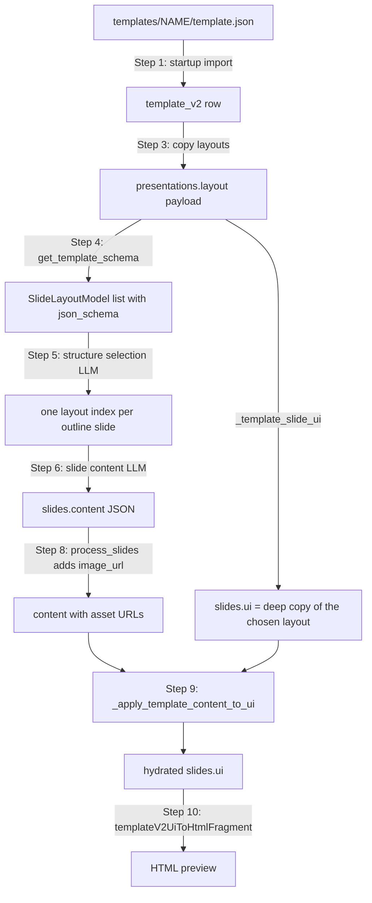

# From template to schema to slide

<div class="chapter-meta" markdown>
**Reads:** `servers/fastapi/templates/default_templates.py`, `servers/fastapi/templates/presentation_layout.py`, `servers/fastapi/templates/v2/schema.py`, `servers/fastapi/templates/v2/content.py`, `servers/fastapi/api/v1/ppt/endpoints/presentation.py`, `servers/fastapi/utils/ppt_utils.py`, `servers/nextjs/lib/template-v2-json-to-html.ts`, `servers/nextjs/app/(presentation-generator)/components/TemplateV2HtmlSlidePreview.tsx`  ·  **Builds on:** [Template v2 format](16-template-v2-format.md)  ·  **Time:** ~45 min
</div>

## What you will learn

This chapter follows one layout through its whole life: imported from a bundle at startup, stored as a row, turned into a JSON Schema the LLM has to fill, chosen for a slide, filled with generated content, hydrated back into a renderable layout tree, and finally drawn as HTML in the browser. You will see the schema builder's rules for every element type (including repeated regions and the length limits), the exact hydration algorithm that writes content back into elements, and every branch of the HTML renderer. A worked example runs a real General layout through the real schema builder and hydrator.



## Step 1: Importing the built-in templates at startup

The FastAPI lifespan calls `import_default_templates_on_startup()` after migrations, admin bootstrap and the cleanup of interrupted tasks (`servers/fastapi/api/lifespan.py:64`). The function is short enough to read in full:

```python title="servers/fastapi/templates/default_templates.py (excerpt)"
async def import_default_templates_on_startup(
    templates_root: Path | None = None,
) -> None:
    root = templates_root or _default_templates_root()
    if not root.is_dir():
        LOGGER.info("Default templates directory not found: %s", root)
        return

    template_dirs = [
        path
        for path in sorted(root.iterdir())
        if path.is_dir() and (path / "template.json").is_file()
    ]
    # ...
    async with async_session_maker() as session:
        imported_template_ids: set[str] = set()
        for template_dir in template_dirs:
            template = _load_default_template(template_dir)
            imported_template_ids.add(template.id)
            existing = await session.get(TemplateV2, template.id)

            _copy_default_template_static_assets(template_dir, template.id)
            if existing:
                _update_template_from_default(existing, template)
                session.add(existing)
                # ...
            else:
                session.add(template)
                # ...
            await session.commit()

        await _remove_stale_default_templates(session, imported_template_ids)
```

Step by step:

1. **Find the bundles.** The root is `Path(__file__).resolve().parents[3] / "templates"` (`default_templates.py:58`), which resolves to the repository-level `templates/` directory. Every subdirectory with a `template.json` is a bundle, processed in alphabetical order.
2. **Load and validate.** `_load_default_template` reads the JSON, rewrites `static/...` strings to `/app_data/templates/<id>/static/...`, validates `layouts` through `SlideLayouts` and `merged_components` through `MergedComponents` (dropping unknown keys), and assembles `assets` (chapter 16, Step 10). The row is built with `raw_layouts=None` and `is_default=True` (`default_templates.py:128`).
3. **Copy static assets.** `_copy_default_template_static_assets` deletes `$APP_DATA_DIRECTORY/templates/<id>/static` and copies the bundle's `static/` folder in its place. It raises `RuntimeError("APP_DATA_DIRECTORY must be set to import default templates")` if the variable is missing (`default_templates.py:295`).
4. **Upsert.** An existing row has every content column overwritten (`_update_template_from_default`, `default_templates.py:142`); otherwise the new row is inserted. Each template is committed on its own.
5. **Remove stale defaults.** Any `is_default` row whose id was not seen in this run is deleted, and its `templates/<id>` asset directory removed (`default_templates.py:154`, `:310`).

Built-in rows have `owner_id = NULL`, because no user context exists during startup. They are still visible to everyone: the session-level loader criteria for `TemplateV2` admit rows that belong to the current owner or rows with `owner_id IS NULL AND is_default IS TRUE` (`servers/fastapi/services/database.py:87`). User-created templates are stamped with the creator's id on flush (`services/database.py:100`). Chapter 25 covers the ownership model.

!!! warning "Gotcha: one broken bundle stops the server"
    The loop has no `try`/`except`. A `template.json` that fails `SlideLayouts` validation, a `static/../` path, or an id containing a slash raises out of the lifespan, and FastAPI does not start. The unit tests `test_bundled_general_template_json_matches_template_v2_shapes` and `test_new_bundled_templates_load_with_layouts_and_assets` (`servers/fastapi/tests/unit/test_default_templates.py:363`, `:382`) exist to catch this before release; run them after editing a bundle.

## Step 2: The row that comes out

After the import, a template is a `template_v2` row (`servers/fastapi/models/sql/template_v2.py:16`). The columns that matter for generation are:

| Column | Used for |
| --- | --- |
| `id` | lookup key; also written into every slide's `layout_group` |
| `layouts` | `{"layouts": [...]}`; the source of both the schemas and the slide UIs |
| `assets.fonts` | copied to `presentations.fonts` |
| `assets.icon_type` | the icon weight used when searching icons for this deck |
| `theme` | wrapped and copied to `presentations.theme` on the API path (chapter 19) |
| `raw_layouts`, `merged_components` | not used by generation |

Clients name templates either by id or, for built-ins, by directory name. `resolve_default_template_id` maps a directory name to the `id` stored in its `template.json`, after rejecting `.`, `..` and any name containing `/` or `\` (`default_templates.py:62`).

## Step 3: Resolving a template for a deck

Two endpoints resolve a template into a layout payload. The UI path, `POST /api/v1/ppt/presentation/prepare`, uses `_resolve_prepare_layout` (`servers/fastapi/api/v1/ppt/endpoints/presentation.py:1448`), which strips an optional `custom-` prefix and looks the id up directly, returning `404 Template layout not found` on a miss. The API path, `POST /api/v1/ppt/presentation/generate`, uses `_resolve_generation_layout` (`presentation.py:262`), which also accepts bundled directory names and answers `503` with "Restart the service to import bundled templates." when a bundle exists on disk but its row is missing.

Both end in `_copy_template_layout_payload`:

```python title="servers/fastapi/api/v1/ppt/endpoints/presentation.py (excerpt)"
def _copy_template_layout_payload(
    template: TemplateV2,
) -> dict[str, Any]:
    layout_payload = copy.deepcopy(template.layouts)
    if not isinstance(layout_payload, dict):
        raise HTTPException(
            status_code=400,
            detail="Template layout JSON must be an object",
        )

    icon_type = _template_icon_type(template, layout_payload)
    layout_payload["icon_type"] = icon_type
    layout_payload["icon_weight"] = icon_type
    layout_payload["name"] = _template_reference(template.id)
    layout_payload["template_id"] = template.id
    return layout_payload
```

This payload is stored in `presentations.layout`. From here on the deck is independent of the template row's `layouts`: later edits to the template do not change existing decks. `_template_icon_type` checks `assets`, then the payload, then `layouts`, and keeps the first value that is not the default `bold` (`presentation.py:250`).

## Step 4: Layouts become `SlideLayoutModel`s

The LLM never sees layout JSON. It sees one JSON Schema per layout, carried by two small models:

```python title="servers/fastapi/templates/presentation_layout.py (excerpt)"
class SlideLayoutModel(BaseModel):
    id: str
    name: Optional[str] = None
    description: Optional[str] = None
    json_schema: dict


class PresentationLayoutModel(BaseModel):
    name: str
    ordered: bool = Field(default=False)
    icon_type: str = Field(default=DEFAULT_ICON_TYPE)
    icon_weight: str = Field(default=DEFAULT_ICON_TYPE)
    slides: List[SlideLayoutModel]
```

`_build_template_layout_model` (`presentation.py:410`) produces them:

```python title="servers/fastapi/api/v1/ppt/endpoints/presentation.py (excerpt)"
    try:
        template_schema = get_template_schema(layout_payload)
    except ValueError as exc:
        raise HTTPException(
            status_code=400,
            detail=f"Invalid template layout JSON: {exc}",
        ) from exc
    # ...
    for index, schema_layout in enumerate(template_schema["layouts"]):
        # ...
        layout_id = (
            schema_layout.get("layout_id")
            or source_layout.get("id")
            or f"layout_{index + 1}"
        )
        layout_schema = schema_layout.get("schema")
        if not isinstance(layout_schema, dict):
            layout_schema = {
                "title": str(layout_id),
                "description": source_layout.get("description"),
            }

        slides.append(
            SlideLayoutModel(
                id=str(layout_id),
                name=source_layout.get("name") or layout_schema.get("title"),
                description=source_layout.get("description")
                or layout_schema.get("description"),
                json_schema=layout_schema,
            )
        )
```

`ordered` is always `False` for templates (`presentation.py:467`), so an LLM always chooses the layout for each slide. A layout with no editable elements still gets a model, with a stub schema containing only `title` and `description`; the content call for such a slide is skipped (Step 6). The same builder runs again when a prepared deck is streamed (`_get_presentation_stream_layout`, `presentation.py:1435`), so schemas are always regenerated from the stored payload rather than cached.

## Step 5: The schema builder

`get_template_schema` (`servers/fastapi/templates/v2/schema.py:257`) returns `{"source_file", "layout_count", "layouts": [{"slide", "layout_id", "schema"}]}`. Each layout schema is assembled by `_template_layout_schema` (`schema.py:585`), one property per component that has at least one editable field:

```python title="servers/fastapi/templates/v2/schema.py (excerpt)"
    schema = None
    if properties:
        schema = {
            "$schema": JSON_SCHEMA_URI,
            "type": "object",
            "title": layout.get("id") or f"slide_{slide_index}",
            "description": layout.get("description"),
            "additionalProperties": False,
            "properties": properties,
            "required": required,
        }

    return {
        "slide": slide_index,
        "layout_id": layout.get("id"),
        "schema": schema,
    }
```

### 5.1 Component keys

Each component's schema comes from `get_component_schema` (`schema.py:192`). The key under which it is placed is the component id. When the same id occurs more than once in a layout, the keys become `id_0`, `id_1`, and so on (`_template_component_key`, `schema.py:671`); the hydrator computes the same keys with `_template_component_content_keys` (`presentation.py:538`) so the two stay in sync. Within a component, a second field with the same name becomes `name_2`, then `name_3` (`_component_add_schema_property`, `schema.py:877`).

### 5.2 Which elements become fields

`_component_schema_nodes_for_element` (`schema.py:762`) walks the element tree:

- An element whose `type` is in `CONTENT_TYPES` (`text`, `image`, `text-list`, `table`, `chart`, `infographic`), whose `decorative` is exactly `False`, and which has a non-empty `name`, becomes a leaf field.
- A `container` passes through to its `child`. If the container itself has no name, the child's fields are lifted to the parent level.
- A `flex`, `grid` or `group` with a name becomes either an array (if its children repeat, Step 5.4) or a nested object. Without a name, its children's fields are lifted.
- Everything else (`vector`, decorative elements, unnamed leaves) contributes nothing.

### 5.3 Leaf field schemas

`_component_content_field_schema` (`schema.py:1200`) maps each leaf type:

| Element | Field schema | Constraint source |
| --- | --- | --- |
| `text` | `{"type": "string", "minLength", "maxLength"}` | `min_length`, `max_length` |
| `image`, `is_icon: false` | `{"type": "object", "properties": {"image_prompt": {"type": "string"}}, "required": ["image_prompt"]}` | none |
| `image`, `is_icon: true` | same with `icon_query` | none |
| `text-list` | `{"type": "array", "items": {"type": "string", "minLength", "maxLength"}, "minItems", "maxItems"}` | `min_items`, `max_items`, `min_item_length`, `max_item_length` |
| `table` | `{"columns": [string...], "rows": [[string...]...]}` object | `min/max_columns`, `min/max_rows`, plus computed text limits |
| `chart` | `{"chart_type", "title"?, "categories", "series"}` object | fixed caps (below) |
| `infographic` | `{"data": {...}}` object, per infographic type | per type (below) |

Every leaf also gets a human `title` (`main_visual_image` becomes `Main Visual Image`), `x-element-type` and `x-element-path`, and image fields get a `description` ("Prompt for the replacement image."). Those annotations are then removed for the layout schema: `_strip_component_schema_metadata` deletes every `$schema`, `title`, `description`, `x-element-type` and `x-element-path` keyword while preserving property names (`COMPONENT_SCHEMA_METADATA_KEYS`, `schema.py:40`, and `schema.py:647`).

**Table text limits.** Table cells have no stored character limits, so `_table_text_limits` (`schema.py:57`) estimates them from geometry:

```python title="servers/fastapi/templates/v2/schema.py (excerpt)"
    cell_width = max(
        1.0,
        width / column_count - 2 * TABLE_CELL_HORIZONTAL_PADDING,
    )
    cell_height = max(
        1.0,
        height / (row_count + 1) - 2 * TABLE_CELL_VERTICAL_PADDING,
    )
```

With `TABLE_CELL_HORIZONTAL_PADDING = 12`, `TABLE_CELL_VERTICAL_PADDING = 6`, a glyph width of `0.58 x font size` (`0.62` when bold) plus letter spacing, a line height of `1.2 x size` unless the font says otherwise, and a 14 px default font (`schema.py:47` to `:50`, `:128`). The maximum is `floor(chars_per_line x lines x 0.85)`, but never less than the longest existing cell; the minimum is 1 if every existing cell has text, otherwise 0 (`schema.py:106`).

**Chart fields.** `_chart_content_schema` (`schema.py:1490`) always requires `chart_type` (enum of 12 values: `area`, `bar`, `bubble`, `donut`, `horizontal_bar`, `horizontal_stacked_bar`, `line`, `pie`, `polar_area`, `radar`, `scatter`, `stacked_bar`), `categories` (at most 24 strings) and `series` (at most 12 objects `{name, values}` with at most 24 numbers). `title` is included only if the layout's chart already has a non-empty title.

**Infographic fields.** `_infographic_content_schema` (`schema.py:1448`) produces `{"data": {"type": {"const": "<type>"}, ...}}`. Progress bars and gauges require `min_value`, `max_value` and `value`. Gantt charts require `columns` and `rows` with `{name, start: {column, offset}, end: {...}}` spans. Comparison matrices require `criteria` and `items` with `values`. All other types require an `items` array of `{heading, description, label, focus, icon: {url, color}}`, with extra required fields for some kinds (`id`/`parent_id` for org charts and decision trees, `value` plus at most 8 items for funnels, labels for before/after and impact/effort matrices). An infographic whose type is not in the catalog falls back to `oneOf` progress bar or gauge.

!!! warning "Gotcha: the schema offers `bubble`, the model does not"
    `CHART_TYPE_VALUES` in the schema builder includes `bubble` (`schema.py:23`), and the hydrator accepts it (`presentation.py:1378`), but the Pydantic `ChartType` enum has no `bubble` (`servers/fastapi/templates/v2/models/elements.py:76`). A generated slide can therefore carry `"chart_type": "bubble"` in `slides.ui`, which the HTML renderer draws, but the same chart would fail validation if that UI were ever saved back as a template layout.

### 5.4 Repeated regions and their limits

When the children of a named `flex`, `grid` or `group` expose identical editable fields, the region becomes a JSON array (`_component_repeated_children_schema_result`, `schema.py:898`). The algorithm:

1. Compute the field nodes of every child. If any child has no editable fields, the region is not repeated.
2. With fewer than two children, repeat only if `max_children` is larger than the child count (`_can_expand_repeated_children`, `schema.py:561`). This is how a grid with one sample child can become an array of up to eight.
3. Try three name-normalization strategies in order: `numeric` strips an index token such as `_1` from names (`card_1_heading` and `card_2_heading` both become `card_heading`), `none` compares names as they are, and `prefix` strips the first underscore-separated token. The first strategy under which every child's item schema is identical wins.
4. If none matches but every child is a single wrapper with matching root names, flatten the wrappers to their leaf fields and try again. The comment at `schema.py:935` explains why: a leading divider can add an extra wrapper around every item after the first.
5. Bound the array. For `flex` and `grid`, `minItems`/`maxItems` are the element's `min_children`/`max_children`. For a `group`, they are `item_count // 2` and `item_count` (`_component_repeated_item_limits`, `schema.py:1038`).

A component whose top-level elements are all `group`s that repeat is collapsed into a single array field, named after the first group with its index token removed (`_component_repeated_top_level_group_node`, `schema.py:822`). The Civic layout `side_badges_with_comparison_rows_6038`, for example, has two `category_badge` groups and produces:

```json
"side_category_badges": {
  "type": "object",
  "additionalProperties": false,
  "properties": {
    "category_badge": {
      "type": "array",
      "minItems": 1,
      "maxItems": 2,
      "items": {
        "type": "object",
        "additionalProperties": false,
        "properties": {
          "category_label": {"type": "string", "minLength": 5, "maxLength": 15}
        },
        "required": ["category_label"]
      }
    }
  },
  "required": ["category_badge"]
}
```

!!! warning "Gotcha: `n // 2` for groups, `(n + 1) // 2` elsewhere"
    Groups use floor division for their minimum (`item_count // 2`), so three repeated groups allow a single item. Certification sets `min_children` for flex and grid to `max(1, (n + 1) // 2)`. The two rules differ by one for odd counts; do not assume they are interchangeable when you hand-edit limits.

## Step 6: Two LLM calls read the schemas

The schema is used twice during generation. Both prompts are covered in depth in [Prompts and schemas](09-prompts-and-schemas.md); here is what each sees of the template.

### 6.1 Structure selection: which layout for which slide

`generate_presentation_structure` (`servers/fastapi/utils/llm_calls/generate_presentation_structure.py:157`) sends `PresentationLayoutModel.to_string()`:

```python title="servers/fastapi/templates/presentation_layout.py (excerpt)"
    def to_string(self, with_schema: bool = False) -> str:
        message = "## Presentation Layout\n\n"
        for index, slide in enumerate(self.slides):
            message += f"### Slide Layout: {index}\n"
            message += f"- Name: {slide.name or slide.json_schema.get('title')}\n"
            message += f"- Description: {slide.description}\n"
            if with_schema:
                try:
                    schema_text = json.dumps(slide.json_schema, ensure_ascii=False)
                except (TypeError, ValueError):
                    schema_text = str(slide.json_schema)
                message += f"- Schema: {schema_text}\n"
            message += "\n"
        return message
```

For the General template the first entries read:

```text
## Presentation Layout

### Slide Layout: 0
- Name: title_intro
- Description: A clean split presentation layout with a large rounded image card and a structured text panel with attribution card.

### Slide Layout: 1
- Name: title_description_image
- Description: A clean split presentation layout with a large rounded visual card on the left and stacked headline copy on the right.
```

In the normal flow only names and descriptions are sent, in the user message ahead of the outline (`generate_presentation_structure.py:127`). When the user supplied slide-by-slide Markdown, the layouts go into the system prompt with full schemas (`to_string(with_schema=True)`, `generate_presentation_structure.py:151`). That is why layout descriptions matter so much: in the normal flow they are the only thing the selector knows about a layout. The answer is a list of layout indexes. The two paths repair it differently. The prepare path pads a short list and replaces any index outside `0..layout_count-1` with a random valid one (`_normalize_presentation_structure`, `presentation.py:384`). The API path truncates the list to the outline count and replaces only indexes at or above the layout count (`presentation.py:2904`); its branch for appending missing indexes tests `index >= total_outlines` inside `range(total_outlines)` and so never runs, which means a short list is not padded there.

When a table of contents is requested, `select_toc_or_list_slide_layout_index` (`servers/fastapi/utils/ppt_utils.py:59`) searches layout ids, names, descriptions and schema titles with case-insensitive regexes: first `table of contents`, `agenda`, `contents`, `outline`, `index`, `toc`; then `bullet list`, `numbered list`, `list`. The first matching layout index is inserted once per required table-of-contents slide, at position 1 when there is a title slide and at position 0 otherwise (`_insert_toc_layouts`, `presentation.py:361`). No TOC is inserted when no layout matches.

### 6.2 Slide content: filling the schema

For each slide, `get_slide_content_from_type_and_outline` (`servers/fastapi/utils/llm_calls/generate_slide_content.py:229`) prepares the chosen layout's schema:

```python title="servers/fastapi/utils/llm_calls/generate_slide_content.py (excerpt)"
def _prepare_response_schema(json_schema: Optional[dict]) -> Optional[dict]:
    if not isinstance(json_schema, dict):
        return None

    response_schema = remove_fields_from_schema(json_schema, ASSET_ONLY_FIELDS)
    if not _schema_has_content_fields(response_schema):
        return None
    # ...
    response_schema = add_field_in_schema(
        response_schema,
        {
            "__speaker_note__": {
                "type": "string",
                "minLength": 100,
                "maxLength": 500,
                "description": "Speaker note for the slide",
            }
        },
        True,
    )
    return ensure_array_schemas_have_items(response_schema)
```

`ASSET_ONLY_FIELDS` is `["__image_url__", "__icon_url__"]` (`generate_slide_content.py:86`). A layout without content fields returns `{}` immediately, with no LLM call. The schema is sent both as the structured-output response format (`strict=True`) and inline in the system prompt ("Follow this response schema exactly: ..."), and the response is validated against it with retries.

## Step 7: Worked example, part 1: layout to schema

Take the `title_description_image` layout printed in full in chapter 16, Step 7. Running `get_template_schema` on it produces this layout schema (output of the real function, reformatted):

```json title="get_template_schema output for title_description_image"
{
  "$schema": "https://json-schema.org/draft/2020-12/schema",
  "type": "object",
  "title": "title_description_image",
  "description": "A clean split presentation layout with a large rounded visual card on the left and stacked headline copy on the right.",
  "additionalProperties": false,
  "properties": {
    "left_visual_card": {
      "type": "object",
      "additionalProperties": false,
      "properties": {
        "main_visual_image": {
          "type": "object",
          "additionalProperties": false,
          "properties": {"image_prompt": {"type": "string"}},
          "required": ["image_prompt"]
        }
      },
      "required": ["main_visual_image"]
    },
    "right_text_stack": {
      "type": "object",
      "additionalProperties": false,
      "properties": {
        "primary_heading": {"type": "string", "minLength": 8, "maxLength": 25},
        "supporting_paragraph": {"type": "string", "minLength": 105, "maxLength": 274}
      },
      "required": ["primary_heading", "supporting_paragraph"]
    }
  },
  "required": ["left_visual_card", "right_text_stack"]
}
```

Note what is missing: `slide_background` contributes nothing (a vector only), and neither the accent bar nor any style information appears. The LLM fills three values: one image prompt and two strings.

A response that satisfies the prepared schema looks like this (an illustrative sample, not captured from a model):

```json title="Sample slide content returned by the LLM"
{
  "left_visual_card": {
    "main_visual_image": {
      "image_prompt": "Analyst team reviewing a revenue dashboard on a large monitor"
    }
  },
  "right_text_stack": {
    "primary_heading": "Q3 Revenue Review",
    "supporting_paragraph": "Revenue grew **18% year over year**, driven by enterprise renewals and a faster sales cycle in EMEA. Margins held steady while support costs fell for the second straight quarter."
  },
  "__speaker_note__": "Open with the headline number, then explain the two drivers: enterprise renewals and the shorter EMEA sales cycle. Close by noting that support costs declined again."
}
```

The system prompt tells the model to "Strictly use markdown to emphasize important points" (`generate_slide_content.py:120`), which is why `**18% year over year**` appears; the hydrator turns it into a bold run.

## Step 8: Creating the slide row and fetching assets

On the API path the slides are built in batches (`presentation.py:3013`):

```python title="servers/fastapi/api/v1/ppt/endpoints/presentation.py (excerpt)"
                slide = SlideModel(
                    presentation=presentation_id,
                    layout_group=layout_model.name,
                    layout=slide_layout.id,
                    index=i,
                    speaker_note=slide_content.get("__speaker_note__"),
                    content=slide_content,
                    ui=_template_slide_ui(layout_payload, slide_layout.id),
                )
```

`layout_group` is the template id (from the payload `name`), `layout` the layout id, `content` the raw LLM JSON, and `ui` a deep copy of the chosen layout found by id in the deck payload (`_template_slide_ui`, `presentation.py:490`).

Asset fetching then runs concurrently with the next batch's LLM calls (`process_slide_and_fetch_assets`, covered in [Images, icons, web search](12-images-icons-search.md)). For template slides it writes the result next to the prompt in `content`, under `image_url` or `icon_url` (`_asset_url_key`, `servers/fastapi/utils/process_slides.py:110`). Before generating images, `image_target_sizes_from_template` runs the hydrator once on a copy with unique marker URLs to learn each image slot's pixel size, so images can be generated at the right aspect ratio (`process_slides.py:35`). After this step the example content contains:

```json
"main_visual_image": {
  "image_prompt": "Analyst team reviewing a revenue dashboard on a large monitor",
  "image_url": "/app_data/images/5f1c0b7e-revenue.png"
}
```

(The file name is illustrative.) Only after all asset tasks finish does the pipeline hydrate every slide (`presentation.py:3084`) and commit.

## Step 9: Hydration, content back into the layout

Hydration is `_apply_template_content_to_ui(ui, content)` (`presentation.py:575`). It is called from `_hydrate_template_slide_ui` on the API path, from the streaming path for every slide it emits (`presentation.py:2396`, `:2431`, `:2455`, `:2487`), and from the edit and derive endpoints (`presentation.py:3325`, `:3376`).

### 9.1 Top level

```python title="servers/fastapi/api/v1/ppt/endpoints/presentation.py (excerpt)"
    component_keys = _template_component_content_keys(components)
    hydrated_ui = copy.deepcopy(ui)
    # ...
    for index, component in enumerate(hydrated_components):
        # ...
        component_id = component.get("id")
        component_content = content.get(component_keys[index])
        if not isinstance(component_content, dict) and isinstance(component_id, str):
            component_content = content.get(component_id)
        if not isinstance(component_content, dict):
            component_content = {}

        elements = component.get("elements")
        if isinstance(elements, list):
            repeated_groups = hydrate_repeated_top_level_groups(
                elements,
                component_content,
                apply_item=lambda element, item: _apply_template_content_to_element(
                    element,
                    item,
                    direct_value=True,
                ),
            )
            component["elements"] = (
                repeated_groups
                if repeated_groups is not None
                else _apply_template_content_to_element_list(
                    elements,
                    component_content,
                )
            )
```

1. Deep-copy the layout; the input `ui` is never mutated.
2. For each component, find its content object by the same key the schema used (`id`, or `id_0`, `id_1`... for duplicates), falling back to the bare id.
3. If every top-level element is a repeated `group`, hand the component to `hydrate_repeated_top_level_groups` (`servers/fastapi/templates/v2/content.py:57`): one generated array item per group.
4. Otherwise walk the elements with `_apply_template_content_to_element`.

### 9.2 Matching an element to its value

`_apply_template_content_to_element` (`presentation.py:626`) looks up the element's `name` in the current content object. `_template_content_name_candidates` (`presentation.py:743`) tries three keys in order: the name itself, the name with a `_<digits>` token removed (`metric_2_value` becomes `metric_value`), and that result with its first underscore-separated prefix removed (`metric_value` becomes `value`). For the second and later occurrences of the same name in one scope, it first tries `name_2`, `name_3` and so on, mirroring the schema builder's de-duplication (`_template_repeated_content_keys_for_name`, `presentation.py:851`).

A value is applied only if the element has `decorative: False`, a name, a found value, and a type in `GENERATED_VALUE_ELEMENT_TYPES` (`text`, `math`, `image`, `text-list`, `table`, `chart`, `infographic`; `presentation.py:503`). Otherwise the element is copied as is, and containers, flex, grid and group elements recurse into their children with the nested content object.

When an array item is applied to a repeated child (`direct_value=True`) and the item is not wrapped in the child's name, the item itself is the value. The comment at `presentation.py:674` gives the example: three repeated image children are emitted as `[{"image_prompt": ..., "image_url": ...}, ...]`, not as `[{"gallery_photo": {...}}, ...]`.

### 9.3 Expanding and contracting repeated regions

For a `flex`, `grid` or `group` whose value is a list, `_apply_template_content_to_children` builds one child per item (`presentation.py:758`). The template child used for item `i` comes from `repeated_child_source_index`:

```python title="servers/fastapi/templates/v2/content.py (excerpt)"
def repeated_child_source_index(
    index: int,
    *,
    template_count: int,
    content_count: int,
    center_when_reduced: bool,
) -> int:
    """Return the template child used for a repeated content item."""
    if center_when_reduced and content_count < template_count:
        start = (template_count - content_count) // 2
        return start + index
    return min(index, template_count - 1)
```

- **More items than template children:** extra items reuse the last child. `_repeated_child_for_index` deep-copies it, removes `__presenton_manual_position`, and renumbers index tokens in every nested name to the new position (`_normalize_repeated_names`, `presentation.py:813`, which rewrites `_\d+` to `_<index+1>`).
- **Fewer items, `flex` or `grid`:** the first `n` children are used and the flow engine re-spaces them.
- **Fewer items, `group` or top-level groups:** `center_when_reduced` is true, so the middle `n` children are used. Their absolute positions are kept, which centers the remaining items within the original spread.

Running the real hydrator on the Momentum layout `center_title_agenda_grid_wave_7815`, whose `grid` (`min_children: 1`, `max_children: 8`, `columns: 4`) holds a single sample child, with three agenda items produces three copies of that child:

```text
grid name=grid_items_elements_with_descrtipiton_title  min_children=1 max_children=8 columns=4 rows=2
  group name=agenda_items
    vector
    text name=agenda_item_label        '01'
    text name=agenda_item_description  'Market overview'
  group name=agenda_items
    vector
    text name=agenda_item_label        '02'
    text name=agenda_item_description  'Product roadmap'
  group name=agenda_items
    vector
    text name=agenda_item_label        '03'
    text name=agenda_item_description  'Hiring plan'
```

!!! warning "Gotcha: expansion copies geometry verbatim"
    A copied child keeps the source child's `position` and `size`. Inside `flex` and `grid` that is harmless because the flow engine places children. Inside a free-form `group`, a copy beyond the template count lands exactly on top of the last child. The schema prevents this for groups by capping `maxItems` at the number of template groups, but if you raise `max_children` on a hand-edited group, expect overlapping items.

### 9.4 Writing each value type

`_apply_template_content_value` (`presentation.py:865`) dispatches by element type:

| Type | Function | What it does |
| --- | --- | --- |
| `text` | `_apply_template_text_content` (`:946`) | Accepts a string, a number, or `{"text": ...}`. Builds new `runs` from the first existing run's style. Inline Markdown `**x**`/`__x__` becomes `{"bold": true}` and `*x*`/`_x_` becomes `{"italic": true}`; when any emphasis is present, `bold` and `italic` are removed from the base run so plain segments inherit the element font. Strings with `<latex>...</latex>` tags or an unbalanced leading `**` go through `replace_text_runs` instead (`:1163`). Adjacent runs with identical style are merged. An empty string leaves the element unchanged. |
| `image` | `_apply_template_image_content` (`:965`) | Takes the URL from `image_url`, `icon_url`, `__image_url__`, `__icon_url__` or `url`, in that order, and writes it to `data`. Writes the prompt (`image_prompt` or `icon_query` first, depending on `is_icon`) to `prompt`. Sets `fit: "cover"` unless the element is an icon, already `cover`, has a `clip_path`, or the URL is an SVG (`_normalize_generated_image_fit`, `servers/fastapi/services/chat/slide_ui_helpers.py:412`). No URL means no change. |
| `text-list` | `_apply_template_text_list_content` (`:1007`) | Replaces `items` with one run list per non-empty string, each styled like the existing item at the same index. |
| `table` | `_apply_template_table_content` (`:1047`) | Rebuilds `columns` and `rows` to the generated lengths. Extra cells copy the last template cell's style; missing template cells fall back to built-in defaults (`GENERATED_TABLE_TEXT_FONT`: Sniglet, 12 px, `#082314`; fill `#F8F4E9`; stroke `#D8D3C4`, `presentation.py:512`). Each cell's text is cut to 80 characters (`_read_template_table_text`, `:1319`). |
| `chart` | `_apply_template_chart_content` (`:1367`) | Copies `chart_type` (if in the allowed set), `title`, `categories`, `series`, `colors`, axis, grid and legend colors, axis titles, `source`, boolean axis and grid toggles, and `data_labels`, accepting both `snake_case` and `camelCase` keys. Removes stale `data_labels_color` and `grid`. |
| `infographic` | `_apply_template_infographic_content` (`:884`) | Strips inline Markdown from every string in `data` (`infographic_markdown_to_plain_text`, `content.py:27`), keeps the template's `data.type`, merges the rest over the existing data, and copies `colors` if given. |
| `math` | `_apply_template_math_content` (`:913`) | Writes `latex`, stripping `$$...$$` or `\[...\]` delimiters and capping at 4,000 characters. No Pydantic element has this type; it only matters for legacy UIs. |

!!! warning "Gotcha: table cells are silently truncated to 80 characters"
    The schema may allow longer cell text (its limit comes from geometry, Step 5.3), but hydration keeps only the first 80 characters of every cell. If you build templates with wide, text-heavy tables, raise both limits together.

## Step 10: Worked example, part 2: the hydrated slide

Feeding the sample content (with the `image_url` added in Step 8) to `_apply_template_content_to_ui` changes exactly three elements of the layout. The rest of the output is identical to the input layout.

```js title="Hydrated slides.ui, changed elements only (real hydrator output)"
// left_visual_card, element 1
{
  "type": "image",
  // ... position, size, rotation, border_radius unchanged
  "data": "/app_data/images/5f1c0b7e-revenue.png",
  "fit": "cover",
  "decorative": false,
  "name": "main_visual_image",
  "is_icon": false,
  "prompt": "Analyst team reviewing a revenue dashboard on a large monitor"
}
// right_text_stack, element 0: runs replaced, element font unchanged
"runs": [
  {
    "text": "Q3 Revenue Review",
    "font": {"size": 60, "family": "Poppins", "color": "#111827", "bold": true, "italic": false, "line_height": 0.8}
  }
]
// right_text_stack, element 2: Markdown emphasis became three runs
"runs": [
  {"text": "Revenue grew ",
   "font": {"size": 18, "family": "Poppins", "color": "#4B5563", "line_height": 1.24}},
  {"text": "18% year over year",
   "font": {"size": 18, "family": "Poppins", "color": "#4B5563", "line_height": 1.24, "bold": true}},
  {"text": ", driven by enterprise renewals and a faster sales cycle in EMEA. Margins held steady while support costs fell for the second straight quarter.",
   "font": {"size": 18, "family": "Poppins", "color": "#4B5563", "line_height": 1.24}}
]
```

Observe that the plain runs lost their `"bold": false, "italic": false` keys. They still render as regular text because the renderer merges each run over the element-level font, which keeps `bold: false` (`servers/nextjs/lib/template-v2-json-to-html.ts:399`). `slides.content` keeps the raw LLM JSON (with `image_url`) and `slides.ui` the hydrated tree; the editor and exporters render `ui`.

## Step 11: The HTML renderer

The Next.js app has two renderers for the same `ui` tree: a Konva canvas renderer used by the slide editor ([Slide editor](22-slide-editor.md)) and a pure string renderer, `servers/nextjs/lib/template-v2-json-to-html.ts`, used for previews and thumbnails. This step documents the string renderer.

### 11.1 Entry points and payload

```typescript title="servers/nextjs/lib/template-v2-json-to-html.ts (excerpt)"
function templateV2RenderPayload(
  ui: unknown,
  options: TemplateV2HtmlOptions
): TemplateV2RenderPayload | null {
  const record = readRecord(ui);
  const rootElements = readArray(record.elements);
  const components = readArray(record.components);
  const items = [...rootElements, ...components].map((item) =>
    readRecord(normalizeTemplateV2AssetUrls(item))
  );

  if (items.length === 0) {
    return null;
  }

  const width = options.width ?? TEMPLATE_V2_HTML_WIDTH;
  const height = options.height ?? TEMPLATE_V2_HTML_HEIGHT;
  const background = normalizeCssColor(readString(record.background) ?? "#FFFFFF");
  // ...
```

- `templateV2UiToHtmlFragment` (`:172`) returns font-face CSS, the math CSS and one root `div`. It is the only entry point used by application code (`TemplateV2HtmlSlidePreview.tsx:247`).
- `templateV2UiToHtml` (`:156`) returns a complete HTML document that also embeds Chart.js scripts and a small inline bootstrap that renders every chart canvas. In this snapshot it is only exercised by tests (`servers/nextjs/tests/infographic-rendering.test.mjs:69`).
- Root-level `elements` (used by blank slides, `servers/nextjs/app/(presentation-generator)/_shared/blank-slide.ts:4`) render before `components`.
- Every image `data` is passed through `resolveBackendAssetUrl` so relative `/app_data/...` paths point at the backend (`normalizeTemplateV2AssetUrls`, `:221`).
- `renderFontAssetTags` turns the `fonts` option into `@font-face` rules for vendored or template fonts (`:301`, chapter 19).

The root is `<div data-template-v2-html-slide="true" style="position:relative;width:1280px;height:720px;overflow:hidden;background:...;font-family:Arial,Helvetica,sans-serif">` (`renderSlideRoot`, `:286`).

### 11.2 Dispatch and z-order

```typescript title="servers/nextjs/lib/template-v2-json-to-html.ts (excerpt)"
function renderItem(item: JsonRecord, mode: RenderMode): string {
  if (isComponent(item)) {
    const { size, ...component } = item;
    void size;
    return renderGroup(
      { ...component, type: "group", children: item.elements },
      mode
    );
  }

  switch (readString(item.type)) {
    case "vector":
      return renderPolygon(item, mode);
    case "svg":
      return renderSvg(item, mode);
    case "image":
      return renderImage(item, mode);
    // ... text, text-list, table, container
    case "flex":
    case "list-view":
      return renderFlex(item, mode);
    case "grid":
    case "grid-view":
      return renderGrid(item, mode);
    // ... group, chart, infographic
```

There is no z-index anywhere. Paint order is document order: components in array order, elements in array order within a component, children in array order within a group. To move something to the front, move it later in the array. `svg`, `list-view` and `grid-view` are legacy types the renderer still understands but the Pydantic union does not allow.

### 11.3 Element by element

| Type | Rendering |
| --- | --- |
| `text` | A `div` at the element's box with `display:flex`, `align-items` from `alignment.vertical` (`top`/`middle`/`bottom` to `flex-start`/`center`/`flex-end`), `justify-content` and `text-align` from `alignment.horizontal`, element font on the box, and one `span` per run with the merged run font. Line height defaults to 1.1 when the font has none (`renderText`, `:391`). Residual Markdown in run text is rendered through the editor's `normalizeRawTextMarkdownElement`. LaTeX runs become KaTeX MathML spans (`renderTextRunHtml`, `:3877`; `renderMathHtml`, `servers/nextjs/lib/math.ts:25`, which caps LaTeX at 4,000 characters). |
| `text-list` | `ul` (or `ol` for `number`) with 24 px left padding. When `marker_gap` is set, native markers are hidden and each item becomes a two-column grid of a literal `•` or `N.` and the text, separated by `marker_gap` px; `gap` becomes `margin-top` between items (`renderTextList`, `:415`). |
| `table` | A CSS grid of equal columns and equal rows over the element box. Row 0 is `columns`; header cells are bold unless a cell font sets `bold`. Cells get `padding:4px 6px`, `overflow:hidden`, borders from `borders` per side or a 1 px `#D1D5DB` stroke, and a base font of Arial 18 px `#111827` with line height 1.15 unless the table sets `font` (`renderTable`, `:454`; `tableBaseFont`, `:3548`). |
| `image` | An `img` with `object-fit` from `fit` (default `contain`) and `object-position` from `focus_x`/`focus_y`. With `crop_scale` or `clip_path`, the image is wrapped in a clipping `div`. An icon with a `color` becomes a `div` filled with that color and masked by the icon file (`renderImage`, `:352`). |
| `vector` | An absolutely positioned `div` sized to the points' bounding box, containing an SVG `polygon` or `polyline` (points translated to the box origin) with `preserveAspectRatio="none"`, rounded corners, smoothed curves, dashes, caps, joins and SVG `marker` definitions for arrowheads (`renderPolygon`, `:847`). Ellipses become one SVG `ellipse` (`:1019`). Shadows are not drawn for vectors by this renderer. |
| `chart` | A `canvas` carrying the whole Chart.js configuration in a `data-chart-config` attribute (`renderChart`, `:1074`). `chartConfig` (`:2261`) maps kinds to Chart.js types (`donut` to `doughnut`, `area` to a filled `line`, `polar_area` to `polarArea`, horizontal kinds to `bar` with `indexAxis: "y"`), shows the legend automatically for pie-like or multi-series charts, sizes fonts from the chart height (`clamp(height x 0.033, 9, 18)` for labels), disables tooltips and animation, and configures `chartjs-plugin-datalabels` from `data_labels`. Charts are drawn later by the browser (Step 11.5). |
| `infographic` | Gauges draw a 120 x 72 SVG arc; progress bars draw a pill track with a value bar and, when the box is at least 28 px tall, a right-aligned value label (`:1238`, `:1271`). The 23 structural kinds listed in `FIXED_INFOGRAPHIC_RENDERERS` draw at a fixed design size (for example 720 x 260 for `timeline`, 560 x 520 for `radial_cycle`) and are scaled uniformly and centered into the element box (`FIXED_INFOGRAPHIC_RENDERERS`, `:1096`; `renderScaledInfographic`, `:1163`). Org charts and decision trees use 720 x 360. |
| `container` | A styled `div` (fill, border, radius, shadow, padding) that centers or aligns its child with flexbox. Overflow is hidden only when explicitly requested, when the child image has a clip path, or when a positioned child image overflows the box (`containerOverflowStyle`, `:500`). |
| `flex` | A flexbox with `direction`, `wrap`, `gap`, `align_items` (default `stretch`) and `justify_content` (default `flex-start`). Child sizes come from the shared flow engine, `layoutFlowChildren` in `servers/nextjs/components/slide-editor/layout/flowLayout.ts:69`, the same code the Konva editor uses. The box grows if its children need more room than its declared size (`flexFrameStyle`, `:678`). |
| `grid` | A CSS grid with `columns` equal tracks (fixed pixel tracks when the grid has a width) and, when `rows` is set, at least that many rows (`renderGrid`, `:777`). |
| `group` | A `div` sized to its declared size or to its children's extent, with absolutely positioned children (`renderGroup`, `:839`). |

!!! warning "Gotcha: no auto-shrink, overflow is visible"
    Nothing in this renderer measures text and reduces the font size. Text boxes use `overflow:visible;white-space:pre-wrap;overflow-wrap:anywhere` (`textOverflowStyle`, `:3612`), so text that exceeds its box spills out below it. The only protection against overflow is upstream: `max_length` limits in the schema, which certification derives from the box geometry with a 0.85 safety factor. If you shrink a text box in a template without lowering `max_length`, generated slides will overflow. The flow engine does measure text, but only to size auto-width children inside `flex` (`intrinsicTextMainSize`, `flowLayout.ts:549`; covered by `servers/nextjs/tests/flow-layout-text-sizing.test.mjs`).

### 11.4 Scaling the slide into the page

`TemplateV2HtmlSlidePreview` (`servers/nextjs/app/(presentation-generator)/components/TemplateV2HtmlSlidePreview.tsx:218`) always renders the slide at its native 1280 x 720 and scales it with a CSS transform. A `ResizeObserver` tracks the container width, and the natural scale is:

```typescript title="TemplateV2HtmlSlidePreview.tsx (excerpt)"
  const naturalScale = fixedSize
    ? 1
    : containerWidth
      ? Math.min((containerWidth / TEMPLATE_V2_HTML_WIDTH) * 0.98, 1)
      : 0;
```

so previews never upscale beyond 100% and leave a 2% margin. With `fitBounds`, the component instead zooms to a sub-rectangle of the slide, with default padding of 8% horizontally and 10% vertically (`:376`). The slide is hidden (`opacity: 0`) until a scale is known, which avoids a flash at the wrong size. The markup is injected with `dangerouslySetInnerHTML` and `pointer-events: none`.

### 11.5 Drawing the charts

After the HTML is in the DOM, a layout effect finds every `canvas[data-presenton-chart]`, loads the vendored Chart.js runtime (`/vendor/chart-4.5.1.umd.min.js` and `/vendor/chartjs-plugin-datalabels-2.2.0.min.js`, `servers/nextjs/lib/chart-browser.ts:1`), parses the configuration, re-attaches the function-valued options that JSON cannot carry (axis tick formatters, per-bar border radii, data label formatters), and constructs each chart with animation disabled (`TemplateV2HtmlSlidePreview.tsx:271`). Progress is published on `window.__PRESENTON_JSON_CHARTS__` as `{status: "pending" | "ready" | "error", pending, rendered}`, which lets an automated browser wait for charts before taking a screenshot.

### 11.6 Where the HTML preview is used

`TemplateV2HtmlSlidePreview` is imported by the template editor's thumbnail strip, the presentation's new-slide picker, the insert palette, the presentation actions menu, the chat panel and its widgets, and both copies of the blank-slide prompt overlay (`servers/nextjs/app/(presentation-generator)/template-preview/components/editor/ThumbnailStrip.tsx:19`, `presentation/components/NewSlide.tsx:18`, `InsertPalettePreview.tsx:18`, `PresentationActions.tsx:95`, `Chat.tsx:49`, `chat/chat-widgets.tsx:5`, `components/V1ContentRender.tsx:11` and `_shared/TemplateV2PromptOverlay.tsx:6`). The main editing surface does not use it; it draws slides with Konva.

## Step 12: Themes in rendering

The renderer has no notion of a theme: every color it emits is a literal from the element JSON, and it never reads `presentations.theme` or CSS variables. Theme roles (`primary`, `card`, `graph_0` to `graph_9` and so on) are applied when the editor inserts new elements, through `servers/nextjs/lib/template-theme.ts` and `components/slide-editor/insert/insert-elements.ts`; the presentation page also writes them as CSS variables. [Themes and fonts](19-themes-and-fonts.md) traces all of that.

## Step 13: `V1ContentRender`, `V1SelectEdit` and the v1 legacy path

Despite their names, the "V1" components are part of the current Template v2 stack.

- **`V1ContentRender`** (`servers/nextjs/app/(presentation-generator)/components/V1ContentRender.tsx:159`) is the slide body used by the presentation page. It renders `TemplateV2KonvaSlide`, the Konva editor surface, for every slide, using the slide's `ui` or, for blank slides, `BLANK_TEMPLATE_V2_LAYOUT`. It wraps the surface in an error boundary and, in edit mode, can overlay `TemplateV2PromptOverlay`, a prompt box that previews the layout through `TemplateV2HtmlSlidePreview` at a scale of 0.085 and dispatches a `PRESENTON_BLANK_SLIDE_PROMPT_EVENT` window event when submitted.
- **`V1SelectEdit`** (`servers/nextjs/app/(presentation-generator)/components/V1SelectEdit.tsx`) exports `HtmlSelectionEditor`, a hover-and-select overlay that would send `complete_code`, `section_code`, `edit_prompt` and `slide_id` to an "edit selection HTML" API. The API call and the state update are commented out (`V1SelectEdit.tsx:569`), and no file imports the component. It is dead code from the HTML-template era.
- **v1 decks** are rejected outright. When a presentation's `version` is `v1-standard`, `usePresentationData` shows "Unsupported presentation" and redirects to the dashboard (`servers/nextjs/app/(presentation-generator)/presentation/hooks/usePresentationData.ts:33`). New decks are created with `version=V2_STANDARD` (`presentation.py:2944`).

!!! warning "Gotcha: two renderers must agree"
    The Konva editor and the HTML preview are separate implementations of the same format. They share the flow engine (`flowLayout.ts`) and the text-run normalization, but everything else (vector rounding, table cells, infographic drawings) is written twice. Tests such as `template-v2-json-to-html-metadata.test.mjs` ("allocates unsized flex children like the Konva renderer") and `template-v2-renderer-fields.test.mjs` pin the two together. When you add an element property, implement it in both renderers and in both exporters ([PPTX and PDF export](24-export-pipeline.md)).

## What you now know

- Bundles are re-imported, re-validated and re-copied on every start; a single invalid bundle prevents startup, and built-in rows are shared through `owner_id IS NULL AND is_default`.
- A deck stores a private copy of the template's layouts; schemas are rebuilt from that copy whenever generation or streaming needs them.
- The schema builder emits one object per component, one field per non-decorative named content element, arrays for repeated `flex`/`grid`/`group` regions with bounded lengths, and geometry-derived limits for tables.
- The structure selector sees only layout names and descriptions (plus schemas in the slides-Markdown flow); the content generator sees the schema plus a required 100 to 500 character speaker note.
- Hydration deep-copies the layout, matches values by name with suffix and prefix fallbacks, expands or contracts repeated children (centering reductions for groups), converts Markdown emphasis to runs, writes image URLs with `cover` fit, and truncates table cells to 80 characters.
- The HTML renderer paints in array order at 1280 x 720, never shrinks text, draws charts with Chart.js after mount, and ignores themes.

## Next

Continue with [Custom templates from PPTX](18-custom-templates.md) to see how a user's PowerPoint file becomes a certified Template v2 template.
