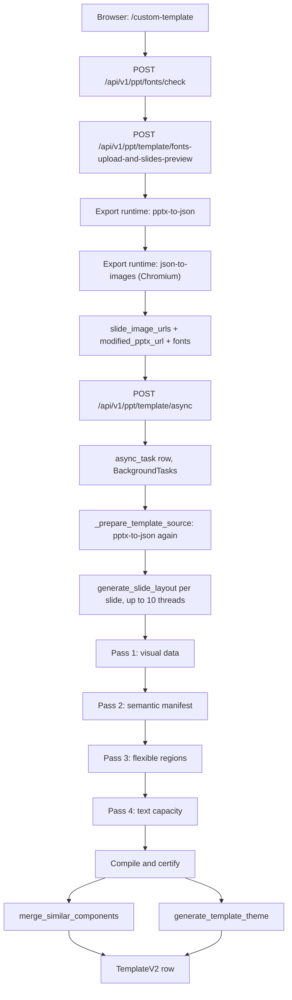
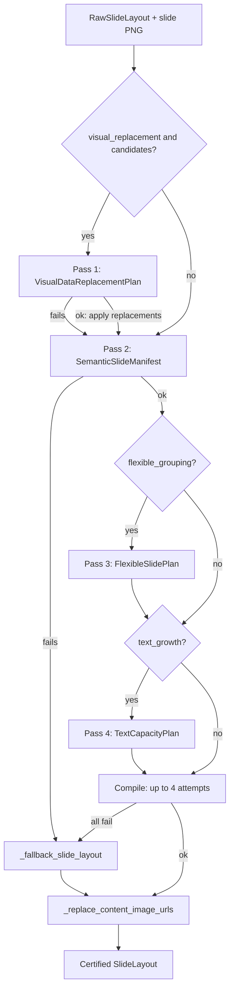

# Custom templates from PPTX

<div class="chapter-meta" markdown>
**Reads:** `servers/fastapi/api/v1/ppt/endpoints/template.py`, `servers/fastapi/templates/fonts_and_slides_preview.py`, `servers/fastapi/templates/pptx_font_utils.py`, `servers/fastapi/templates/v2/certified_generation.py`, `servers/fastapi/templates/v2/generation.py`, `servers/fastapi/templates/v2/theme.py`, `servers/nextjs/app/(presentation-generator)/custom-template/hooks/useTemplateCreation.ts`, `scripts/convert-template.mjs`  ·  **Builds on:** [From template to schema to slide](17-template-to-slide.md)  ·  **Time:** ~50 min
</div>

## What you will learn

This chapter follows a user's `.pptx` file from the upload dropzone to a persisted, certified `TemplateV2` row. You will see the font check and font replacement pass, how slide preview images are rendered, the four vision passes that turn raw PPTX elements into editable layouts (and every fallback when a pass fails), how reusable components are clustered and a semantic theme is derived, and every route in the template API. The chapter ends with the template studio and editor in Next.js and the two Node scripts that turn a stored template into a bundled `templates/<id>/template.json`.



## Step 1: The two creation workflows and the API surface

Everything lives under `TEMPLATE_ROUTER = APIRouter(prefix="/template", tags=["Templates"])` (`servers/fastapi/api/v1/ppt/endpoints/template.py:96`), mounted inside `API_V1_PPT_ROUTER` (prefix `/api/v1/ppt`, `servers/fastapi/api/v1/ppt/router.py:22`, include at `:39`). The font routes are a separate router, `FONTS_ROUTER = APIRouter(prefix="/fonts")` (`servers/fastapi/api/v1/ppt/endpoints/fonts.py:18`), included at `servers/fastapi/api/v1/ppt/router.py:25`.

There are two ways to turn preview images plus a PPTX into a template:

1. **One-shot asynchronous creation.** `POST /template/async` stores an `async_task` row and runs `_run_create_template_task` as a FastAPI background task. It certifies every slide in parallel, clusters components, derives a theme and inserts one `TemplateV2` row at the end. The template studio's **Generate Template** button uses this route, and so does the MCP tool flow.
2. **Incremental creation.** `POST /template/init` stores a row with `raw_layouts` and no `layouts`. The client then calls `POST /template/layouts/create` per slide, saves each result with `PATCH /template/{id}/layouts`, and finally calls `POST /template/generate-blocks` to cluster components and derive a theme. This is wired into the `useTemplateCreation` hook and is also what the template editor uses to "reconstruct" a single slide.

| Method and path | Handler | Request | Response |
| --- | --- | --- | --- |
| `GET /template/all` | `list_templates` (`template.py:1118`) | query `page` (default 1), `page_size` (default 20, max 100), `default` (optional bool) | `TemplateListResponse {items, total, page, page_size}` |
| `POST /template/fonts-upload-and-slides-preview` | `upload_template_fonts_and_slides_preview` (`:1193`) | multipart: `pptx_file`, `font_files[]`, `original_font_names[]`, `google_font_original_names[]`, `google_font_replacement_names[]`, `google_font_names[]`, `google_font_urls[]` | `FontsUploadAndSlidesPreviewResponse {slide_image_urls, pptx_url, modified_pptx_url, fonts}` |
| `POST /template/mcp-upload` | `upload_template_assets_for_mcp` (`:1220`) | JSON `{pptx: {filename, content_base64}, fonts: [{filename, content_base64, original_font_name}]}` | `{pptx_url, slide_image_urls, fonts}` |
| `POST /template/init` | `init_template` (`:1277`), status 201 | `InitTemplateRequest` | the new template id as a bare JSON string |
| `POST /template/async` | `create_template` (`:1574`), status 201 | `CreateTemplateRequest` (same fields as init) | `AsyncTaskModel` |
| `POST /template/async/{task_id}/retry` | `retry_create_template` (`:1626`), status 202 | none | `AsyncTaskModel` |
| `POST /template/layouts/generate` | `generate_template_layout_from_prompt` (`:1700`) | `{template_id or id, prompt}` | `{layout, response}` |
| `POST /template/layouts/create` | `create_template_slide_layouts` (`:1789`) | `{template_id or id, index or indices, generation_options?}` | `{layouts: [{index, layout}]}` |
| `POST /template/generate-blocks` | `generate_template_blocks` (`:1874`) | `{template_id or id}` | `TemplateResponse` |
| `PATCH /template/{template_id}/layouts` | `patch_template_slide_layout` (`:1929`) | `{index, layout}` or `{layouts: [{index, layout}]}` | `TemplateResponse` |
| `PATCH /template/{template_id}` | `update_template_metadata` (`:1976`) | `UpdateTemplateMetadataRequest` | `TemplateResponse` |
| `GET /template/{template_id}/theme` | `get_template_theme` (`:2093`) | none | `{template_id, theme}` |
| `GET /template/{template_id}` | `get_template` (`:2127`) | none | `TemplateResponse` |
| `DELETE /template/{template_id}` | `delete_template` (`:2158`), status 204 | none | empty |
| `POST /fonts/check` | `check_fonts_in_pptx_handler` (`fonts.py:152`) | multipart `pptx_file` | `FontCheckResponse {available_fonts, unavailable_fonts}` |

Every mutating route except creation calls `_require_private_template` (`template.py:2170`), which raises `403 "Built-in templates are read-only"` when `is_default` is true.

!!! warning "Gotcha"
    `GET /template/{template_id}/theme` must be registered before `GET /template/{template_id}`, otherwise FastAPI would match `theme` as a template id. The order in the file is deliberate and pinned by `test_get_template_theme_route_is_registered_before_template_detail_get` (`servers/fastapi/tests/unit/test_template_api.py:1127`).

## Step 2: Choose the file in the browser

The studio page is `servers/nextjs/app/(presentation-generator)/custom-template/page.tsx`. It redirects to `/dashboard` when `PRESENTATION_GENERATION_MODE` normalizes to `smart` (`page.tsx:8`), because smart-mode decks do not use templates (see [Smart mode](13-smart-mode.md)). Otherwise it renders `CustomTemplatePage`.

File selection goes through `useFileUpload` (`custom-template/hooks/useFileUpload.ts`). The only client-side checks are the extension and size:

```ts title="servers/nextjs/app/(presentation-generator)/custom-template/hooks/useFileUpload.ts (excerpt)"
    const lowerName = file.name.toLowerCase();
    const isPptx = lowerName.endsWith(".pptx");
    if (!isPptx) {
      notify.error("Invalid file", "Please select a valid PPTX file.");
      return;
    }

    const maxSize = 100 * 1024 * 1024;
    if (file.size > maxSize) {
      notify.error("File too large", "File size must be less than 100MB.");
      return;
    }
```

When the page mounts it also calls `showTemplateV2ModelWarningIfNeeded(llmConfig)` (`CustomTemplatePage.tsx:1296`). That helper (`custom-template/utils/templateModelWarning.ts`) shows a persistent toast unless the configured text model is on a hard-coded allow list: the `presenton` provider, OpenAI families such as `gpt-5`, `gpt-4.1`, `gpt-4o`, `gpt-4-turbo`, or any `claude-` model containing `opus` or `sonnet`. Dismissal is remembered in `localStorage` under `presenton.nonSotaTemplateToastDismissed`. This is only a warning; nothing blocks a weaker model.

!!! info "Model requirements"
    `docs/template-v2.md` is explicit that template creation sends each slide screenshot to the configured **text** LLM, so that model must accept image input and structured JSON output. Template creation requests up to 16,000 completion tokens (`TEMPLATE_GENERATION_MAX_COMPLETION_TOKENS = 16000`, `servers/fastapi/templates/v2/certified_generation.py:61`, and `SLIDE_LAYOUT_GENERATION_MAX_TOKENS = 16000`, `template.py:101`). Configuring an image-generation provider does not help. Generating a deck from an existing template does not need vision. Provider configuration is covered in [Configuration and LLM providers](06-configuration-and-providers.md).

## Step 3: Check the fonts in the PPTX

`checkFonts` in `useTemplateCreation.ts:135` posts the file as `pptx_file` to `POST /api/v1/ppt/fonts/check`. The route is registered without a decorator, as a call on the router:

```python title="servers/fastapi/api/v1/ppt/endpoints/fonts.py (excerpt)"
FONTS_ROUTER.post("/check", response_model=FontCheckResponse)(
    check_fonts_in_pptx_handler
)
```

`check_fonts_in_pptx_handler` (`servers/fastapi/templates/fonts_and_slides_preview.py:1160`) does the following, in order:

1. Rejects anything not ending in `.pptx` with 400 `"Invalid file type. Expected PPTX file"`.
2. Rejects uploads of 100 MB or more with 413 (`MAX_FONT_CHECK_UPLOAD_SIZE_BYTES = 100 * 1024 * 1024`, `:150`; the check is `size >= MAX`, `:1040`).
3. Writes the bytes to a temporary `presentation.pptx` and validates the ZIP package (`_validate_pptx_package`, `:1045`): `testzip()` must pass, and `[Content_Types].xml`, `ppt/presentation.xml` and at least one `ppt/slides/slide*.xml` must exist, otherwise 400 `"The uploaded PowerPoint file is corrupted or unsupported."`.
4. Extracts every font family and the variants actually used (`extract_used_font_variants_from_pptx`, `servers/fastapi/templates/pptx_font_utils.py:366`). Variants are one of `regular`, `bold`, `italic`, `bold_italic`, derived by `_font_style_variant` (`pptx_font_utils.py:330`) from the `b` and `i` attributes on run properties plus the family name itself. Theme references such as `+mj-lt` are resolved to the theme's major/minor fonts (`_resolve_theme_typeface`, `:193`).
5. Calls `get_available_and_unavailable_fonts_for_pptx` (`pptx_font_utils.py:813`). For every family/variant it first looks for a matching embedded font (`ppt/fonts/*.fntdata`), then the packaged catalog through `get_static_font_url` (`:177`). Anything left is unavailable.
6. For unavailable fonts, looks in the global `font_uploads` table (`get_font_uploads_for_names_by_variant`, `servers/fastapi/utils/font_uploads.py:406`). A previously uploaded file whose variant matches moves the entry into `available_fonts` with its `/app_data/fonts/...` URL.

A response looks like this (one entry per family and variant; `name` is the display name built by `_font_info_entry`, `fonts_and_slides_preview.py:874`):

```json
{
  "available_fonts": [
    {"name": "Montserrat Regular", "url": "/vendor/fonts/sans_serif/montserrat/Montserrat[wght].ttf",
     "original_name": "Montserrat", "family_name": "Montserrat",
     "variant": "regular", "variants": ["regular"]}
  ],
  "unavailable_fonts": [
    {"name": "Brand Sans Bold", "url": null, "original_name": "BrandSans-Bold",
     "family_name": "Brand Sans", "variant": "bold", "variants": ["bold"]}
  ]
}
```

!!! warning "Gotcha"
    Embedded fonts are reported as available with a fake URL. The code literally stores `"https://example.com/just-a-placeholder-url.ttf"` for embedded matches (`pptx_font_utils.py:860`, inside `get_available_and_unavailable_fonts_for_pptx`), because at check time nothing has been extracted yet. The real URL only appears after the next step extracts and persists the embedded file. Do not render or cache the URL from `/fonts/check` for embedded fonts.

The "packaged catalog" is `servers/fastapi/templates/assets/fonts.json`: a JSON array of 95 `{font_name, font_url}` objects whose URLs point at `/vendor/fonts/<category>/<dir>/<file>` (files that ship in the Next.js `public/` folder). It is loaded once with `@lru_cache(maxsize=1)` by `get_static_font_catalog` (`pptx_font_utils.py:162`) and keyed by `normalize_font_family_name(family).casefold()`. Normalization (`:130`) turns `_` and `-` into spaces, splits camelCase, and strips trailing weight/style tokens, so `Montserrat-SemiBold` and `MontserratSemiBold` both normalize to `Montserrat`. [Themes and fonts](19-themes-and-fonts.md) covers the catalog from the frontend side.

## Step 4: Replace fonts and render slide previews

If any font is missing, the studio shows a picker per missing font. The user can upload a font file or pick a fallback from the local catalog `LOCAL_FONT_OPTIONS` (`CustomTemplatePage.tsx:1199`); a default fallback is pre-selected by `preferredFallbackFont` (`:208`), which tries the font's `family_name` and `original_name` against the catalog and otherwise takes the first catalog entry. When every font is covered, `fontUploadAndPreview` (`useTemplateCreation.ts:259`) posts multipart form data to `POST /api/v1/ppt/template/fonts-upload-and-slides-preview`:

```ts title="servers/nextjs/app/(presentation-generator)/custom-template/hooks/useTemplateCreation.ts (excerpt)"
            uploadedFonts.forEach(font => {
                formData.append("font_files", font.file);
                formData.append("original_font_names", font.fontName);
            });
            Object.entries(googleFontReplacementsByOriginalName).forEach(
                ([originalFontName, googleFont]) => {
                    formData.append("google_font_original_names", originalFontName);
                    formData.append("google_font_replacement_names", googleFont.fontName);
                    formData.append("google_font_urls", googleFont.fontUrl);
                }
            );
```

!!! warning "Gotcha"
    The `google_font_*` form fields no longer carry Google Fonts. The values the studio sends are local catalog fonts (`fontUrl: selectedFont.sourceUrl`, a `/vendor/fonts/...` path, `CustomTemplatePage.tsx:1267`). The backend helpers that once called Google are now stubs that consult the packaged catalog (`get_google_font_file_urls`, `check_google_font_availability`, `pptx_font_utils.py:258` and `:264`). The field names are kept for API compatibility.

The route forwards to `upload_fonts_and_preview_handler` (`fonts_and_slides_preview.py:1304`, via the thin wrapper in `servers/fastapi/templates/preview.py`). Its steps:

1. **Validate the pairs.** `font_files` and `original_font_names` must both be present and equal in length (400 otherwise). `_selected_google_font_maps` (`:76`) applies the same rule to the replacement names and URLs and returns `selected_fonts {replacement_name: url}` plus `replacements {original_name: replacement_name}`.
2. **Save, validate and trim the PPTX.** The file is written to a temp dir, validated as in Step 3, then `_trim_pptx_to_max_slides` (`:1086`) removes slides beyond the cap. The cap is `MAX_TEMPLATE_PREVIEW_SLIDES = 50` (`:149`; `_resolve_template_preview_slide_cap`, `:1069`). Trimming edits `ppt/presentation.xml`, its `.rels`, and `[Content_Types].xml` directly, and writes `<stem>-first-50.pptx`.
3. **Create a session directory.** `session_id = uuid.uuid4()` and the directory `<uploads>/template-previews/<session_id>` (`_get_template_preview_session_dir`, `:676`).
4. **Fix fonts in the PPTX** (`upload_fonts_and_fix_fonts_in_pptx`, `:1503`):
    - Extract embedded `.fntdata` fonts, convert EOT to TTF when needed, and copy them to `<app_data>/fonts/embedded/<random uuid>/<name>.ttf` (`_prepare_embedded_fonts`, `:1826`).
    - Save uploaded font files with the 10 MB limit (`read_upload_with_size_limit`, `servers/fastapi/utils/font_uploads.py:148`), read their name tables with fontTools (`get_font_details`), and build `font_mapping {original: actual}` and `font_variant_mapping {original: {variant: actual}}` (`_save_uploaded_fonts_to_temp`, `:1769`).
    - Add the catalog replacements to the same maps (`_add_google_font_replacements_to_mapping`, `:1468`). Uploaded files win over catalog picks for the same original name.
    - For fonts still not replaced, reuse previously uploaded fonts from `font_uploads` when every required variant is covered.
    - Rewrite font names inside the PPTX XML with `replace_fonts_in_pptx` (`pptx_font_utils.py:1069`) into a file named by `_build_modified_pptx_filename`. If there is no mapping at all, the original file is used unchanged.
    - Persist uploaded fonts permanently with `persist_font_file` (`font_uploads.py:321`), which copies the file to `<app_data>/fonts/<stem>_<8 hex>.<ext>` and inserts a `font_uploads` row.
5. **Collect font URLs** for the response (`_build_upload_preview_font_urls`, `:1246`): embedded fonts, uploaded fonts, and every remaining family that resolves in the packaged catalog. The catalog replacement URLs from step 1 are merged last (`fonts.update(selected_google_fonts)`).
6. **Render previews** (`create_slide_previews`, `:1712`, which calls `render_pptx_slides_to_images`, `:775`).
7. **Persist the modified PPTX** into the session directory (`upload_presentations`, `:1751`) and convert every local path to a URL with `_public_urls_for_local_paths` (`:1924`), which produces `/app_data/<relative path>` URLs through `absolute_fastapi_asset_url`.

!!! warning "Gotcha"
    `replace_fonts_in_pptx` documents itself as "Replace fonts in a PPTX file using python-pptx", but its python-pptx loop only runs when both `font_mapping` and `font_variant_mapping` are empty. The only caller skips the call in that case (`fonts_and_slides_preview.py:1672`: `if font_mapping: ... else: modified_pptx_path = pptx_path`), so in practice every rewrite goes through the raw XML path `_replace_fonts_in_pptx_xml` (`pptx_font_utils.py:1038`). Edit that function, not the python-pptx branch.

### How previews are rendered (and who converts PPTX to JSON)

Python does not parse slide geometry. Both the conversion and the rendering are tasks for the Node **export runtime**, a `runner.mjs` resolved from `EXPORT_PACKAGE_ROOT` or a sibling `presentation-export` directory (`servers/fastapi/services/export_task_service.py:129` to `:151`) and spawned as a child process with `LITEPARSE_NODE_BINARY` (default `node`, `:124`). The runtime is synced into the image at build time (both `Dockerfile` and `Dockerfile.dev` run `node scripts/sync-presentation-export.cjs --force`); its internals are covered in [PPTX and PDF export](24-export-pipeline.md).

`render_pptx_slides_to_images` makes two runtime calls:

```python title="servers/fastapi/templates/fonts_and_slides_preview.py (excerpt)"
    pptx_document = await EXPORT_TASK_SERVICE.convert_pptx_to_json(modified_pptx_path)
    if not pptx_document.layouts:
        raise HTTPException(status_code=500, detail="PPTX-to-JSON returned no slides")

    slide_layouts = pptx_document.layouts
    if max_slides:
        slide_layouts = slide_layouts[:max_slides]

    width, height = await asyncio.to_thread(
        _preview_dimensions_from_pptx,
        modified_pptx_path,
    )
    # ...
    rendered = await EXPORT_TASK_SERVICE.render_jsons_to_images(
        data=slide_layouts,
        width=width,
        height=height,
        fonts=fonts or None,
    )
```

`convert_pptx_to_json` (`export_task_service.py:687`) sends `{"type": "pptx-to-json", "pptx_path": ...}` and returns `PptxToJsonDocument {layouts: list[dict]}` (`:101`). `render_jsons_to_images` (`:580`) sends `{"type": "json-to-images", "jsons": [...], "width", "height", "fonts"}` and expects exactly one PNG path per slide; a count mismatch is a 500 (`fonts_and_slides_preview.py:836`). The preview width is always 1280 and the height follows the PPTX aspect ratio (`_preview_dimensions_from_document`, `:165`): the code comment explains that the export runtime normalizes PPTX-to-JSON coordinates to a 1280px-wide canvas, so a 1707x960 deck is captured at 1280x720.

The previews are therefore a rendering of the **parsed JSON**, not of PowerPoint itself. That is intentional: the vision passes later compare the JSON against these pixels, so both views agree on fonts and geometry.

Each preview is copied to `<session_dir>/slide_<n>.png` (`create_slide_previews`, `:1741`). The response:

```json
{
  "slide_image_urls": [
    "http://localhost:8000/app_data/uploads/template-previews/3f1c.../slide_1.png",
    "http://localhost:8000/app_data/uploads/template-previews/3f1c.../slide_2.png"
  ],
  "pptx_url": "http://localhost:8000/app_data/uploads/template-previews/3f1c.../deck-modified.pptx",
  "modified_pptx_url": "http://localhost:8000/app_data/uploads/template-previews/3f1c.../deck-modified.pptx",
  "fonts": {
    "Brand Sans": "http://localhost:8000/app_data/fonts/BrandSans_1a2b3c4d.ttf",
    "Montserrat": "/vendor/fonts/sans_serif/montserrat/Montserrat[wght].ttf"
  }
}
```

The exact host prefix depends on `absolute_fastapi_asset_url`; the modified PPTX filename comes from `_build_modified_pptx_filename` (`:1033`).

!!! note
    `_build_slide_preview_html` (`:692`) builds a full HTML document with Tailwind, Chart.js and the datalabels plugin. It is still covered by unit tests (`servers/fastapi/tests/test_pptx_font_utils.py:719`) but no production code path calls it anymore; previews come from the JSON renderer only.

### The MCP variant

MCP clients cannot send multipart bodies, so `POST /template/mcp-upload` (`template.py:1220`) accepts base64. Each file is decoded with `base64.b64decode(..., validate=True)` (`_decode_mcp_upload`, `:211`); the PPTX may be up to 100 MiB, each font up to 10 MiB, and the combined decoded size is capped at `MCP_TEMPLATE_UPLOAD_MAX_TOTAL_BYTES = 100 * 1024 * 1024` (`:102`), with a pre-check on the encoded length in `McpTemplateUploadRequest.validate_combined_upload_size` (`:181`). The decoded bytes are wrapped in `UploadFile` objects and passed to the same `upload_fonts_and_slides_preview_handler`. MCP tooling in general is covered in [REST API, async tasks, webhooks, MCP](15-api-async-mcp.md).

## Step 5: Start creation

From the preview step, the **Generate Template** button opens a name/description modal and then calls `handleCreateTemplate` (`CustomTemplatePage.tsx:1446`):

```ts title="servers/nextjs/app/(presentation-generator)/custom-template/CustomTemplatePage.tsx (excerpt)"
        await TemplateService.createTemplate({
          pptx_url: state.previewData.modified_pptx_url,
          slide_image_urls: state.previewData.slide_image_urls,
          fonts: {
            ...state.previewData.fonts,
            ...selectedLocalFontAssets,
          },
          name,
          description: description || null,
        });
        // ...
        router.push("/templates?tab=custom");
```

`TemplateService.createTemplate` (`app/(presentation-generator)/services/api/template.ts:205`) posts that body to `/api/v1/ppt/template/async`. The request model is:

```python title="servers/fastapi/api/v1/ppt/endpoints/template.py (excerpt)"
class InitTemplateRequest(BaseModel):
    pptx_url: str = Field(
        min_length=1,
        # ...
    )
    slide_image_urls: list[str] = Field(
        min_length=1,
        # ...
    )
    fonts: dict[str, Any] = Field(default_factory=dict)
    name: Optional[str] = None
    description: Optional[str] = None
    icon_type: Optional[IconType] = DEFAULT_ICON_TYPE
    generation_options: LayoutGenerationOptions = Field(
        default_factory=LayoutGenerationOptions
    )
```

`LayoutGenerationOptions` (`servers/fastapi/templates/v2/models/layouts.py:34`) is `extra="forbid", strict=True` with three booleans, all default `true`: `text_growth`, `visual_replacement`, `flexible_grouping`. The semantic pass always runs.

`create_template` (`template.py:1574`) then:

1. Resolves `pptx_url` to a file with `resolve_app_path_to_filesystem`. A URL that is not a file inside Presenton's own app-data (for example a host application's attachment id) is rejected with 400 before any task is stored (`:1581`).
2. Pre-allocates `template_id = str(uuid.uuid4())`. The template row does not exist yet; the id is reserved in the task data so retries reuse it.
3. Inserts an `AsyncTaskModel` with `type="template.create"`, `status=PENDING`, `message="Queued for template creation"`, and `payload` equal to the request (with `generation_options` included only if the caller sent it, `_explicit_template_generation_options`, `:558`).
4. Sets `task.data` with `_template_task_progress_data` (`:396`).
5. Schedules `_run_create_template_task(task.id, get_current_owner_id())` on `BackgroundTasks` and returns the task.

The progress object stored in `task.data` and returned by the async-task API has this exact shape:

```json
{
  "async_task_id": "6f0c...",
  "template_v2_id": "a1b2c3d4-...",
  "attempt": 1,
  "created_layouts": 3,
  "remaining_layouts": 9,
  "slide_layout_statuses": [
    {"index": 0, "status": "completed"},
    {"index": 1, "status": "pending"}
  ],
  "name": "Quarterly Review",
  "thumbnail": "http://localhost:8000/app_data/uploads/template-previews/.../slide_1.png"
}
```

`thumbnail` is the first non-empty slide image URL (`_template_request_thumbnail`, `:444`); `name` falls back to the PPTX filename without extension via `_derive_template_name` (`:455`), and finally to `"Untitled template"`.

!!! warning "Gotcha"
    The background task runs in the same process as the API, through Starlette's `BackgroundTasks`. There is no queue or worker: if the process restarts mid-creation, the task stays `pending` forever and the template row is never written. Recovery is the retry route, which only accepts tasks in `ERROR` state (Step 9). The async-task table itself is described in [REST API, async tasks, webhooks, MCP](15-api-async-mcp.md).

## Step 6: Prepare the template source in the background

`_run_create_template_task` (`template.py:1482`) restores the owner context (`set_current_owner_id(owner_id)`, `set_current_owner_is_admin(False)`; see [Auth and multi-user](25-auth-and-multiuser.md)), opens its own session from `async_session_maker`, re-validates `task.payload` as a `CreateTemplateRequest`, sets `message="Creating template"` and then `"Generating slide layouts"`, and calls `_create_template_with_task_progress` (`:1403`).

That function begins with `_prepare_template_source` (`:925`), shared with `init`:

```python title="servers/fastapi/api/v1/ppt/endpoints/template.py (excerpt)"
    pptx_json = await EXPORT_TASK_SERVICE.convert_pptx_to_json(pptx_path)
    try:
        raw_layouts = RawSlideLayouts.model_validate(
            pptx_json.model_dump(mode="json")
        )
    except ValidationError as exc:
        # ...
        raise HTTPException(
            status_code=500,
            detail="PPTX-to-JSON export produced invalid slide layout JSON",
        ) from exc
    # ...
    if len(raw_layouts.layouts) > len(request.slide_image_urls):
        # ...
        raw_layouts = RawSlideLayouts(
            layouts=raw_layouts.layouts[: len(request.slide_image_urls)]
        )
    elif len(request.slide_image_urls) > len(raw_layouts.layouts):
        raise HTTPException(
            status_code=400,
            detail="Exactly one slide image is required for each slide layout",
        )
```

The PPTX is converted a second time (the preview step's JSON is not reused). The result validates into `RawSlideLayouts`, a list of `RawSlideLayout {id, description, elements}` (`layouts.py:44`); the element models are the Template v2 element union described in [Template v2 format](16-template-v2-format.md). Extra slides beyond the preview count are dropped silently, because the preview step may have trimmed the deck to 50 slides; extra preview images are an error. The function returns `(pptx_path, raw_layouts, raw_layouts_json, fonts)` where `fonts` is the request's font map cleaned by `_coerce_font_map` (`:863`, keeps only non-empty string keys and values).

A first progress commit with zero completed layouts follows (`_commit_template_task_progress`, `:664`).

## Step 7: Certify every slide (four vision passes)

`_generate_slide_layouts_with_task_progress` (`template.py:709`) is the async driver. It requires one image per raw slide, creates a `ThreadPoolExecutor(max_workers=min(MAX_PARALLEL_SLIDE_LAYOUTS, slide_count))` with `MAX_PARALLEL_SLIDE_LAYOUTS = 10` (`servers/fastapi/templates/v2/generation.py:47`), and submits one `generate_slide_layout` per slide with `max_tokens=SLIDE_LAYOUT_GENERATION_MAX_TOKENS`. Each submission runs inside `copy_context().run` so context variables such as the current owner survive the thread hop. As each future completes (`asyncio.as_completed`), the slide index is added to `completed_layout_indices` and progress is committed immediately, which is how the UI can show per-slide ticks. If any slide raises, the remaining tasks are cancelled and the error propagates.

`templates.v2.generation.generate_slide_layout` (`generation.py:612`) is a thin public wrapper over `certified_generation.generate_slide_layout` (`servers/fastapi/templates/v2/certified_generation.py:3651`). That is the core of the chapter.



Every pass uses the same machinery, `_generate_structured_with_provider_fallback` (`certified_generation.py:4305`): a system prompt, a user message containing the slide image (as raw bytes when the URL resolves to a local file, `_openai_image_part`, `:4194`) and a JSON payload, a JSON Schema response format with `strict=False`, Pydantic validation of the parsed JSON, and an `extra_validator` that checks semantic rules against the source. On any exception it appends the bad response and a repair prompt and tries again:

```python title="servers/fastapi/templates/v2/certified_generation.py (excerpt)"
    response_schema = _llm_output_json_schema(output_model)
    effective_max_tokens = max_tokens or TEMPLATE_GENERATION_MAX_COMPLETION_TOKENS
    attempts_per_provider = max(1, validation_retries)
    last_error: Exception | None = None

    for provider in providers or _template_structured_providers():
```

With `DEFAULT_VALIDATION_RETRIES = 5` (`:59`) that is **five attempts in total** per pass, not five retries after a first try. `_template_structured_providers` (`:4204`) returns a single provider built from the configured client and model (`get_client(config=get_llm_config())`, `get_model()`), resolved through the public `generation` module so tests and integrations can monkeypatch it. Gemini models get a special visual-data schema and an extra table-encoding instruction (`_response_schema_for_model`, `:4257`; `_messages_for_structured_provider`, `:4271`).

### Pass 1: visual data detection

Only when `options.visual_replacement` is true. `_visual_data_generation_payload` (`:1076`) sends the source layout id/description, every top-level element with its `source_index` (with `decorative` stripped), and `visual_region_candidates`: every `container`, `group` or non-icon `image` element at least 24x12 px, found recursively through `child` and `children` (`_visual_data_region_candidates_in_element`, `:1105`). Each candidate carries a path such as `elements.3.children.1`, its bounds, and a content preview.

The model returns a `VisualDataReplacementPlan` (`layouts.py:497`): a list of replacements discriminated by `kind` (`chart`, `infographic`, `table`, `text-list`; `layouts.py:173`, `:390`, `:432`, `:449`). Each names a primary `path`, the extra top-level `consumed_paths` it absorbs, typed data, and (except for text lists) new bounds. The intent, per `DETECT_VISUAL_DATA_REGIONS_SYSTEM_PROMPT` (`:180`), is to turn a chart that the PPTX stored as a picture or as a pile of shapes into a real editable `chart` element. `_apply_visual_data_replacement_plan` (`:1291`) swaps the elements in. If the pass fails for any reason the exception is logged and the source regions are kept.

### Pass 2: semantic manifest (the only mandatory pass)

`_semantic_generation_payload` (`:1555`) sends:

```json
{
  "source_layout": {"id": "slide_4", "description": "..."},
  "available_font_families": ["Brand Sans", "Montserrat"],
  "indexed_elements": [{"source_index": 0, "element": {"type": "vector", "...": "..."}}],
  "editable_candidates": [
    {"path": "elements.2", "type": "text", "current_name": null, "content_preview": "Quarterly results"}
  ]
}
```

Candidates are all `text`, `image`, `text-list`, `table`, `chart` and supported `infographic` elements at any depth (`_SEMANTIC_ELEMENT_TYPES`, `:1054`). The system prompt `GENERATE_SLIDE_LAYOUT_SYSTEM_PROMPT` (`:111`) is long and opinionated. Its key rules: partition the elements into the smallest useful reusable components; keep a repeated collection (cards, steps, metrics) together in one component; mark replaceable content `decorative=false` and scaffolding (backgrounds, logos, frames, connectors, rings) `decorative=true`; name fields in generic `snake_case` from structure, never from sample content; set `is_icon`, an icon `color` and an `icon_type` (`bold`, `duotone`, `fill`, `light`, `regular`, `thin`) on every image annotation.

The reply is a `SemanticSlideManifest` (`layouts.py:575`): `id` (snake_case, at most 80 chars), `description` (10 to 300 chars), `components` with `element_indices`, and one annotation per candidate path. `_validate_semantic_manifest` (`:1640`) enforces, among other things:

- every source index is assigned to exactly one component, in ascending order within each component;
- `repeated_items` must be null in this pass;
- annotation paths equal the candidate paths exactly (it reports `missing=` and `extra=` lists in the error so the repair prompt can fix them);
- only image annotations may carry `is_icon`; icon annotations must carry `color` and `icon_type`;
- charts, infographics, tables and text lists can never be decorative.

If this pass fails after five attempts, the slide does not fail. `generate_slide_layout` logs `"semantic pass failed; using fidelity-preserving fallback"` and returns `_fallback_slide_layout` (`:3874`). `_fallback_semantic_manifest` (`:3593`) puts every element into one component called `slide_content`, makes all text, charts, tables, lists and infographics editable, keeps images' existing `decorative` flag, and derives safe identifiers from the element names.

### Pass 3: flexible regions

Only when `options.flexible_grouping` is true. The payload is the manifest plus indexed elements (`_flexible_generation_payload`, `:1729`). The model returns a `FlexibleSlidePlan` (`layouts.py:696`, whose regions are `FlexibleRegionPlan` objects, `layouts.py:663`): at most one region per component, each a tree of flow nodes with `mode` `row`, `column`, `grid` or `group` and at least two items, each item either a list of source indices (a leaf) or a nested `flow_id`. `_validate_flexible_plan` (`:2512`) checks geometry: repeated items must be structurally equivalent (`_region_items_are_structurally_equivalent`, `:2649`), must not overlap, and regular repeats must have regular spacing (`_validate_regular_repeat_geometry`, `:2814`). Failure leaves `FlexibleSlidePlan(regions=[])`.

When compiled (`_compile_flow_node`, `:3088`), a flow becomes a `flex`, `grid` or `group` element. A repeatable flow gets elastic limits, which is what lets generation produce three cards from a four-card source:

```python title="servers/fastapi/templates/v2/certified_generation.py (excerpt)"
    min_children = max(1, (len(children) + 1) // 2) if repeatable else len(children)
    base: dict[str, Any] = {
        "type": "group" if mode == "group" else "grid" if mode == "grid" else "flex",
        "name": flow.name,
        "position": {"x": 0.0, "y": 0.0},
        "size": {
            "width": node_bounds["width"],
            "height": round(compiled_height, 2),
        },
        "children": children,
    }
    if mode != "group":
        base["min_children"] = min_children
        base["max_children"] = len(children)
```

So a repeated region with 4 source items accepts 2 to 4 items, and one with 5 accepts 3 to 5. How the schema builder exposes these limits to the content LLM is covered in [From template to schema to slide](17-template-to-slide.md).

### Pass 4: text capacity

Only when `options.text_growth` is true. The payload adds `editable_text_boxes` (the non-decorative text elements with their paths, `_text_capacity_generation_payload`, `:1746`). The model returns `TextCapacityAdjustment` items (`layouts.py:716`) per path: `left_characters` and `right_characters` (0 to 200), `top_lines` and `bottom_lines` (0 to 12), and a horizontal and vertical alignment. It never returns pixels; the compiler converts characters and lines into geometry and refuses growth that would collide with other content.

Independently of the LLM, every editable text box gets geometry-derived length limits (`_normalize_existing_text_box_limits`, `:2391`). The estimate is deliberately crude:

```python title="servers/fastapi/templates/v2/certified_generation.py (excerpt)"
def _estimated_text_capacity(element: dict[str, Any], *, max_lines: int) -> int:
    capacity_units = _estimated_text_capacity_units(
        element,
        max_lines=max_lines,
    )
    current_text = "".join(
        str(run.get("text") or run.get("latex") or "")
        for run in element.get("runs", [])
        if isinstance(run, dict)
    )
    return max(
        len(current_text),
        math.floor(capacity_units * TEXT_CAPACITY_SAFETY_FACTOR),
    )
```

Capacity units are `floor(width / char_width) * line_count`, where a character is `0.58 x font_size` wide (`0.62` when bold) plus letter spacing (`_estimated_text_character_width`, `:2449`), the font size defaults to 18 and the line height to `1.2 x font_size` (`_text_capacity_geometry`, `:2483`), and the line count is capped at 12. The safety factor is `TEXT_CAPACITY_SAFETY_FACTOR = 0.85` (`:62`). `max_length` is only ever raised, never lowered, and never set below the length of the sample text.

### Compile and certify

The four plans are fed to `_compile_semantic_layout` (`:2895`) with a fallback ladder:

```python title="servers/fastapi/templates/v2/certified_generation.py (excerpt)"
    compile_attempts = [
        (flexible_plan, text_capacity_plan),
        (flexible_plan, TextCapacityPlan(adjustments=[])),
        (FlexibleSlidePlan(regions=[]), text_capacity_plan),
        (FlexibleSlidePlan(regions=[]), TextCapacityPlan(adjustments=[])),
    ]
```

Duplicate combinations are skipped by a JSON signature. The compiler deep-copies the source elements, writes each annotation's `name`, `decorative`, `is_icon`, `color` and `icon_type` onto the element at its path, marks unsupported infographics decorative, applies text limits and growth, and then builds components. Two details matter when you modify it:

- Component **positions** are the bounding box of their elements on the 1280x720 canvas, and element positions are rewritten to be local to that box (`_localize_top_level_element`, `:3050`).
- Components are **sorted by their lowest source index**, not by the model's order. The code comment explains why: the model may return components in reading order, which could lift a full-slide background above the title and hide it.

`_certify_compiled_layout` (`:3491`) then rejects the result if any component is empty, any number is non-finite, any size is not positive, any `min_*` exceeds its `max_*` (`_SCHEMA_LIMIT_PAIRS`, `:1066`), a table row length differs from its column count, a chart series length differs from its categories, a `flex`/`grid` child count falls outside `min_children..max_children`, a grid's `columns x rows` cannot hold its children, or a component has editable elements but `get_component_schema` returns no schema. If all four attempts fail, the fidelity-preserving fallback is compiled instead.

### Placeholders for editable images and icons

The last step on every path is `_replace_content_image_urls` (`:3886`), which walks every element with `_replace_content_image_url_in_element` (`:3902`):

```python title="servers/fastapi/templates/v2/certified_generation.py (excerpt)"
    if isinstance(element, SlideImageElement) and element.decorative is False:
        if not replace_visuals:
            element.decorative = True
        elif element.is_icon:
            element.data = CONTENT_ICON_PLACEHOLDER_URL
        else:
            element.data = CONTENT_IMAGE_PLACEHOLDER_URL
            element.fit = ImageFit.COVER
```

Editable photos become `/static/images/replaceable_template_image.png` with `fit: cover`; editable icons become `/static/icons/placeholder.svg`. Decorative images keep their original `/app_data/...` URL. With `visual_replacement=false`, editable images are instead frozen as decorative.

!!! warning "Gotcha"
    `generate_slide_layout` never raises for LLM quality problems: semantic failure and compile failure both fall back to a one-component "preserve everything" layout. A template full of `slide_content` components with generic field names is the visible symptom of a weak or non-vision model. Check the logs for `semantic pass failed` before debugging the renderer.

After all slides finish, `_ensure_unique_async_slide_layout_ids` (`template.py:686`) suffixes duplicate ids with `_<n>`, and `_with_randomized_layout_ids` (`:833`) appends a random `_1000` to `_9999` suffix to every layout id, so a certified `title_with_image_cards` becomes, for example, `title_with_image_cards_4821`.

## Step 8: Cluster components and derive the theme, then persist

Two jobs run concurrently with `asyncio.gather` (`template.py:1447`), each in its own single-thread executor (`_run_template_generation_thread`, `:809`).

### Merged components

`merge_similar_components` (`certified_generation.py:550`) flattens every component of every layout into one indexed list and sends compact summaries (`_component_clustering_summary`, `:600`: id, description, position, content bounds, the flattened element type hierarchy, and the editable JSON schema) to the LLM with `CLUSTER_SIMILAR_COMPONENTS_SYSTEM_PROMPT` (`:445`). The reply is a `SimilarComponentsList` of index groups; `_validate_similarity_groups` (`:623`) rejects out-of-range or repeated indices. `_build_merged_components` (`:642`) turns each group into a `MergedComponent {id, description, variants}` (`layouts.py:81`), and every component not in a group becomes its own singleton.

A deterministic pass then runs: `_deduplicate_merged_components` (`:670`) computes a structural signature for every variant (`_component_duplicate_signature`, `:740`) and unions groups that share a signature. The signature ignores names and min/max limits (`_IGNORED_DUPLICATE_SCHEMA_KEYS`, `:79`), ignores replaceable content values (text runs, list items, image data, chart data; `_CONTENT_VALUE_KEYS_BY_ELEMENT_TYPE`, `:94`), and snaps positions and sizes to a grid relative to the component size (`_DUPLICATE_POSITION_GRID_UNITS = 5`, `:78`).

If clustering raises a `ValidationError` or `ValueError`, `_merge_generated_components` (`template.py:626`) stores an empty `MergedComponents(components=[])` and creation continues. Merged components feed the editor's insert palette and the prompted-layout generator (Step 10).

### Semantic theme

`generate_template_theme` (`servers/fastapi/templates/v2/theme.py:246`) profiles every color and font in the certified layouts (`build_theme_profile`, `:145`), asks the LLM to assign roles by profile id (`select_theme_roles_with_llm`, `:261`, 2 retries, 2,000 max tokens), falls back to `select_theme_roles_deterministically` (`:305`) on any error, and materializes a `PresentationThemeData` (`materialize_theme`, `:357`). If even that raises, `_generate_generated_theme` (`template.py:649`) stores `theme=None`. The profile, the role rules and the contrast repair are explained in [Themes and fonts](19-themes-and-fonts.md).

### The row

`_build_created_template` (`template.py:1320`) assembles the `TemplateV2` row with the pre-allocated id:

```python title="servers/fastapi/api/v1/ppt/endpoints/template.py (excerpt)"
    return TemplateV2(
        id=template_id or str(uuid.uuid4()),
        name=(request.name or "").strip() or _derive_template_name(
            request.pptx_url, pptx_path
        ),
        description=request.description,
        raw_layouts=raw_layouts_json,
        merged_components=merged_components.model_dump(
            mode="json", exclude_none=True
        ),
        layouts=generated_layouts.model_dump(mode="json", exclude_none=True),
        theme=(
            generated_theme.model_dump(mode="json", exclude_none=True)
            if generated_theme is not None
            else None
        ),
        assets={
            **_explicit_template_generation_options(request),
            "icon_type": icon_type,
            "icon_weight": icon_type,
            "fonts": available_fonts,
            "slide_image_urls": request.slide_image_urls,
            "images": _collect_image_urls_from_layouts(raw_layouts_json),
        },
    )
```

`icon_type` is the most common `icon_type` across all certified icon images (`_most_common_icon_type_in_layouts`, `:520`), falling back to the request's `icon_type`. `assets.images` lists every distinct `image.data` URL found in the **raw** layouts. `raw_layouts` is kept so a single slide can be re-certified later without re-uploading the PPTX. The column layout of `template_v2` is described in [Template v2 format](16-template-v2-format.md).

On success the task becomes `COMPLETED` with `message="Template creation completed"`. On any exception it becomes `ERROR` with `message="Template creation failed"` and `error` set to an `APIErrorModel` dump; non-HTTP exceptions are reduced to a generic 500 `"Template creation failed"` so internal messages do not leak.

## Step 9: Track progress and retry

The template library polls. `useTemplateSummaries({ includeProcessingTemplateTasks: true })` (`app/(presentation-generator)/hooks/useTemplateSummaries.ts`) loads default and custom templates with two `GET /template/all?page_size=100&default=...` calls, plus `GET /api/v1/async-tasks?type=template.create&order_by=created_at&order=desc&limit=50&offset=0&created_at=<one hour ago>` (`services/api/template.ts:219`). It keeps tasks whose status is `pending` or `error` and re-polls every 30 seconds (`setInterval(..., 30000)`), refreshing the template list whenever a pending task was seen. The panel (`(dashboard)/templates/components/TemplatePanel.tsx:69`) offers a retry button whose handler calls the hook's `retryTemplateTask`, which in turn calls `TemplateService.retryTemplateCreateTask` (`useTemplateSummaries.ts:194`).

`retry_create_template` (`template.py:1626`) only accepts a task that exists (404), has type `template.create` (400), is in `ERROR` (409), still has a dict payload (409), and whose reserved `template_v2_id` does not already exist as a row (409 `"Template has already been created"`). It resets the same task to `PENDING`, increments `attempt`, and schedules the same background function. The whole PPTX is processed again from scratch.

!!! warning "Gotcha"
    `GET /template/all` filters out any template whose `layouts` is empty (`if layout_count == 0: continue`, `template.py:1164`), and paginates in Python after loading every row. A row created by `init` stays invisible in the library until at least one layout is patched in. The frontend applies the same rule again in `filterTemplatesWithLayouts`.

## Step 10: The incremental routes

These routes exist for the per-slide flow, for the editor, and for API users who want control.

**`POST /template/init`** (`template.py:1277`) runs `_prepare_template_source` and immediately inserts a row with `layouts=None` and assets `{pptx_url, icon_type, icon_weight, fonts, slide_image_urls, images, layout_indexes: []}`. It returns the id as a JSON string.

**`POST /template/layouts/create`** (`:1789`) accepts `index` or `indices` (never both; at most `MAX_PARALLEL_SLIDE_LAYOUTS` = 10, unique, non-negative; `CreateTemplateLayoutsRequest._validate_indices`, `:241`). It loads `raw_layouts`, checks each index is in range and has a stored slide image, merges saved and override generation options (`_template_generation_options`, `:564`), and runs `_generate_indexed_slide_layouts` (`:1071`) in a thread. It **returns** `{layouts: [{index, layout}]}` but does not save anything.

**`PATCH /template/{id}/layouts`** (`:1929`) saves. It serializes concurrent patches to the same template with a per-template `asyncio.Lock` (`_get_template_layout_patch_lock`, `:916`) so out-of-order saves from parallel slide generations cannot overwrite each other. `_merge_template_layout_items` (`:1031`) keys existing layouts by their original slide index (stored in `assets.layout_indexes`), inserts or replaces the patched ones, sorts by index, and re-validates `SlideLayouts`. Duplicate layout ids are rejected by the `SlideLayouts` validator (test `test_patch_template_slide_layout_rejects_duplicate_layout_ids`, `test_template_api.py:1633`).

**`POST /template/generate-blocks`** (`:1874`) runs the Step 8 clustering and theme jobs on the saved layouts and stores `merged_components` and, if non-null, `theme`.

**`POST /template/layouts/generate`** (`:1700`) creates a brand-new layout from a text prompt. `generate_prompted_slide_layout` (`generation.py:631`) ranks existing layouts and merged components by how many prompt words (longer than two characters) appear in their ids and descriptions, sends at most 4 reference layouts and 8 reusable components (`PROMPTED_LAYOUT_MAX_REFERENCE_LAYOUTS`, `PROMPTED_LAYOUT_MAX_REUSABLE_COMPONENTS`, `:114`), trims the context to 160,000 characters, and asks for one `SlideLayout` under `GENERATE_PROMPTED_TEMPLATE_LAYOUT_SYSTEM_PROMPT` (`:88`). The extra validator requires a snake_case id matching `^[a-z][a-z0-9_]{2,79}$` that is not already used, at least one component, and at least one `decorative=false` element. Images marked editable get the standard placeholders. The result is a draft returned to the caller; the editor must save it.

**`PATCH /template/{id}`** (`:1976`) updates only the fields present in the body (`model_fields_set`): `name` (blank is 400), `description`, `merged_components` (validated), `layouts` (validated, `layout_indexes` recomputed, `icon_type` re-derived), `theme`, `thumbnail` (stored in `assets.thumbnail`; blank removes it), `fonts` (stored in `assets.fonts`), `icon_type`. An `id` in the body must match the path (400). A body with nothing to update returns the template without writing.

!!! note "The preview tool that production does not use"
    `templates/v2/tools.py` defines `PreviewSlideTool`, an LLM tool named `previewSlide` that renders a candidate `SlideLayout` to a 1280x720 PNG through the export runtime's `render_json_to_image` and saves debug artifacts to `<app_data>/preview_slide/<slide>/<n>.json|png`. `_generate_preview_candidate` (`generation.py:852`) implements a loop that lets the model call it at most twice (`MAX_PREVIEW_SLIDE_CALLS = 2`). In this snapshot that loop is exercised only by unit tests (`servers/fastapi/tests/unit/test_templates_v2_generation.py:141`); certified generation uses structured responses only, which matches the "Tool calling: Optional" row in `docs/template-v2.md`.

## Step 11: The template editor

After creation, the library links to `/template-preview?templateV2Id=<id>` (`TemplatePanel.tsx:59`). `TemplatePreviewClient.tsx` loads the template with `GET /template/{id}` (`TemplateService.getTemplateDetails`, `services/api/template.ts:142`, which strips an optional `template-v2-` prefix from the id) and the theme with `GET /template/{id}/theme` (`TemplatePreviewClient.tsx:236`). Editing is allowed only when `!template.is_default` (`canEditTemplate`, `:275`).

What can be edited, and how it is saved:

| Action | Where | Backend call |
| --- | --- | --- |
| Move, resize, restyle elements on the Konva canvas | `handlePreviewLayoutChange` (`:405`) | none until Save |
| Edit layout `id` and `description` | `handleLayoutMetadataChange` (`:451`) | none until Save |
| Edit a schema field's sample value, its min/max constraint, or toggle `decorative` | `handleSchemaFieldChange` (`:493`), `handleSchemaConstraintChange` (`:512`), `handleSchemaDecorationChange` (`:529`) | none until Save |
| Preview content density (fill text and repeated arrays to min or max) | `applyContentDensity` | none (preview only) |
| Duplicate a layout | `duplicateActiveLayout` (id suffixed `-copy`) | none until Save |
| Generate a new slide from a prompt | `TemplatePreviewClient.tsx:648` | `POST /template/layouts/generate` |
| Re-certify the active slide from the original PPTX | `reconstructActiveLayout` (`:783`) | `POST /template/layouts/create` |
| Save | `saveTemplate` (`:1046`) | `PATCH /template/{id}` with the full template, edited `layouts` and `layout_count` |
| Delete | `:1139` | `DELETE /template/{id}` |

Before saving, the editor dispatches `COMMIT_TEMPLATE_V2_INLINE_TEXT_EVENT` and waits one tick so an open inline text editor flushes its pending change (`:1064`). `buildTemplateSavePayload` (`template-preview/components/editor/templatePreviewUtils.ts:1179`) clones the loaded template record and replaces `layouts`, `name`, `id` and `layout_count`. Every `TemplateService` write invalidates the 5-minute theme cache for that template (`invalidateTemplateTheme`). The Konva canvas and inline text editing are the same components the slide editor uses; see [Slide editor](22-slide-editor.md).

!!! warning "Gotcha"
    The studio also contains a second, per-slide creation path in `useTemplateCreation.ts` (`generateTemplateV2`, `:446`): `init`, then one `layouts/create` call per slide (`TEMPLATE_V2_LAYOUT_BATCH_SIZE = 1`, awaited sequentially), a `PATCH .../layouts` after each, then `generate-blocks`. In this snapshot `CustomTemplatePage` destructures only `retrySlide` from that part of the hook, so the button path is the async route. If you wire `initTemplateCreation` back in, remember that it processes slides one at a time and never benefits from the ten-thread pool.

## Step 12: Turning a stored template into a bundled template

Two Node scripts turn a stored template into the bundle format that the 16 built-in templates under `templates/<id>/template.json` use. Both are pure file transformations; neither talks to the API.

### `scripts/convert-template.mjs`

`node scripts/convert-template.mjs <input.json> [--output <path>] [--app-data <dir>]` converts a template JSON (for example a `GET /template/{id}` response saved to disk) into the bundle format:

1. `buildTargetShape` (`scripts/convert-template.mjs:81`) keeps exactly `id`, `name`, `description`, `thumbnail`, `merged_components`, `layouts`, `fonts` (`TOP_LEVEL_KEYS`, `:17`). `layouts` and `merged_components` may be arrays or wrapped objects (`{layouts: [...]}`, `{components: [...]}`) and are unwrapped. `id` falls back to the output directory name; `thumbnail` falls back to the first `assets.slide_image_urls` entry; `fonts` comes from `assets.fonts` or `fonts`.
2. `replaceEditableImages` (`:116`) rewrites every non-decorative image's `data` to the icon or image placeholder, exactly like Step 7.
3. `planAssets` (`:206`) finds every string that points into app-data (`/app_data/...` URLs, `app_data/...` paths, or absolute paths under the app-data root) or into a sibling `static/` folder, verifies each file exists, and plans a copy into `<output dir>/static/`. The thumbnail is renamed `thumbnail.<ext>`; name collisions get a 12-character SHA-256 suffix. Every planned path is checked with `assertInside` so a crafted path cannot escape the root.
4. `rewriteStrings` (`:257`) replaces those strings with `static/<name>`, the files are copied, stale files in `static/` are deleted (`cleanStaticDirectory`, `:268`), and the JSON is written with two-space indentation.

At startup, `default_templates.py` rewrites `static/...` back to `/app_data/templates/<id>/static/...` and copies the folder into app-data; see [From template to schema to slide](17-template-to-slide.md).

### `scripts/convert-presentation-template.mjs`

`node scripts/convert-presentation-template.mjs <presentation.json> [--output] [--app-data] [--id] [--name] [--description] [--thumbnail]` starts from a **presentation** detail response instead. This lets a designer tweak slides in the normal editor and fold those edits back into the template. `buildTemplateFromPresentation` (`scripts/convert-presentation-template.mjs:133`):

1. Reads the presentation's `layout` (the copied template payload), its `merged_components`, and its `slides`.
2. Collects each slide's edited `ui` tree keyed by its `layout` id; two slides with conflicting edits of the same layout are an error.
3. For each edited layout, finds every original component in the original merged catalog by deep equality (`findVariant`, `:80`; exactly one match required), replaces that variant with the edited component, marks removed components, and appends components that were added in the editor as new singleton groups.
4. Verifies every final component is present in the final catalog, then hands the result to `convertTemplateData` for asset packaging.

The scripts are covered by `scripts/convert-template.test.mjs` and `scripts/convert-presentation-template.test.mjs`.

!!! warning "Gotcha"
    `TOP_LEVEL_KEYS` in `convert-template.mjs` does not include `theme`, yet every bundled `template.json` in this snapshot has a `theme` block. Running the converter on a template drops its theme; you have to add it back by hand (or extend `buildTargetShape`) before committing a bundle, otherwise `get_template_theme` will derive a deterministic theme at first request.

## What you now know

- The studio does three requests: `POST /fonts/check`, `POST /template/fonts-upload-and-slides-preview` (font fixing, PPTX-to-JSON and Chromium previews in the Node export runtime, capped at 50 slides), and `POST /template/async`, which runs creation as an in-process background task with per-slide progress in `async_task.data`.
- Each slide is certified by up to four schema-validated vision passes (visual data, semantic manifest, flexible regions, text capacity), each with five total attempts, followed by a four-step compile ladder and a fidelity-preserving fallback, all with up to 10 slides in parallel.
- Text limits come from a character-width heuristic with a 0.85 safety factor; repeatable flows accept from half to all of their source items.
- Component clustering and the semantic theme run in parallel after certification; both degrade gracefully (empty catalog, deterministic or no theme).
- Incremental routes (`init`, `layouts/create`, `PATCH .../layouts`, `generate-blocks`, `layouts/generate`) let the editor re-certify or invent single slides, and built-in templates are read-only.
- `convert-template.mjs` and `convert-presentation-template.mjs` package stored templates and edited decks into `templates/<id>/template.json` plus `static/` assets.

## Next

Continue with [Themes and fonts](19-themes-and-fonts.md) to see how the theme derived here and the font maps collected here are stored, overridden and applied in the browser.
