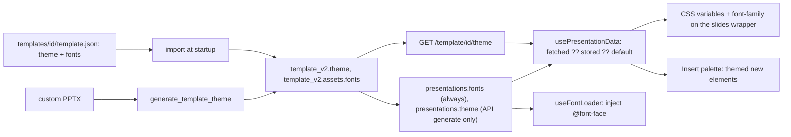

# Themes and fonts

<div class="chapter-meta" markdown>
**Reads:** `servers/fastapi/models/theme_data.py`, `servers/fastapi/templates/v2/theme.py`, `servers/fastapi/utils/font_uploads.py`, `servers/fastapi/api/v1/ppt/endpoints/fonts.py`, `servers/fastapi/templates/pptx_font_utils.py`, `servers/nextjs/lib/template-theme.ts`, `servers/nextjs/app/(presentation-generator)/presentation/utils/applyPresentationThemeDom.ts`, `servers/nextjs/components/slide-editor/text/local-fonts.ts`, `nginx.conf`  ·  **Builds on:** [Custom templates from PPTX](18-custom-templates.md)  ·  **Time:** ~35 min
</div>

## What you will learn

A Presenton "theme" is a small JSON object with sixteen color roles and one text font, and a "font map" is a dictionary from family name to font file URL. This chapter specifies both, shows how a theme is derived from a template's layouts, where themes and fonts are stored on templates and presentations and which one wins, how the browser loads fonts and applies the theme, and where fonts live on disk and on the wire. It also explains the one surprising fact that governs everything else: template slides carry literal colors and font families, so the theme mostly affects newly inserted content, not existing slides.



## Step 1: The theme data model

The backend contract is four Pydantic models in `servers/fastapi/models/theme_data.py`:

```python title="servers/fastapi/models/theme_data.py (excerpt)"
class PresentationThemeColors(BaseModel):
    primary: str
    background: str
    card: str
    stroke: str
    background_text: str
    primary_text: str
    graph_0: str
    graph_1: str
    # ... graph_2 to graph_8
    graph_9: str


class PresentationThemeTextFont(BaseModel):
    name: str
    url: str


class PresentationThemeFonts(BaseModel):
    textFont: PresentationThemeTextFont


class PresentationThemeData(BaseModel):
    colors: PresentationThemeColors
    fonts: PresentationThemeFonts
```

| Role | Meaning (from `THEME_ROLE_SYSTEM_PROMPT`, `servers/fastapi/templates/v2/theme.py:131`) | CSS variable set by the frontend |
| --- | --- | --- |
| `background` | a large, frequently repeated surface color | `--background-color` |
| `primary` | the dominant branded or accent color, not a neutral background | `--primary-color` |
| `card` | a secondary surface | `--card-color` |
| `stroke` | a subtle structural or border color | `--stroke` |
| `background_text` | text color that contrasts with `background` | `--background-text` |
| `primary_text` | text color that contrasts with `primary` | `--primary-text` |
| `graph_0` to `graph_9` | distinct chart and accent colors, in order | `--graph-0` to `--graph-9` |
| `fonts.textFont {name, url}` | the dominant readable font | `font-family`, `--heading-font-family`, `--body-font-family` |

Note the camelCase `textFont` inside an otherwise snake_case model; the frontend reads exactly that key. Every built-in `template.json` carries a `theme` block in this shape. For example, `templates/momentum/template.json` has `primary: "#213EBB"`, `background: "#F6F7FC"`, `primary_text: "#FFFFFF"`, `background_text: "#000000"` and `textFont: {"name": "Lato", "url": "static/Lato Regular.ttf"}`.

The TypeScript mirror is `TemplateTheme` in `servers/nextjs/lib/template-theme.ts`: a flat record of the same sixteen keys (`TEMPLATE_THEME_COLOR_KEYS`, `lib/template-theme.ts:1`) plus an optional `fonts.textFont`. The frontend flattens `colors` into the top level.

## Step 2: Where themes and fonts are stored

| Column | Type | Written by | Shape |
| --- | --- | --- | --- |
| `template_v2.theme` | JSON | default template import, template creation, `generate-blocks`, `PATCH /template/{id}`, lazy derivation in `GET /template/{id}/theme` | `PresentationThemeData` dump |
| `template_v2.assets.fonts` | inside JSON `assets` | default template import (`_build_assets`, `servers/fastapi/templates/default_templates.py`), template creation, `PATCH /template/{id}` with `fonts` | `{family: url}` |
| `presentations.fonts` | JSON (`servers/fastapi/models/sql/presentation.py:74`) | `POST /presentation/create/blank` (when a template id is given), prepare, generate, and the stream endpoint as a fallback (`presentation.py:2027`) | `{family: url}` copied from the template |
| `presentations.theme` | JSON (`servers/fastapi/models/sql/presentation.py:73`) | only the API generate path | a wrapper around the template theme (below) |
| `font_uploads` | table (`servers/fastapi/models/sql/font_upload.py`) | `POST /fonts/upload`, template font uploads, disk backfill | one row per font file |

The migrations are `servers/fastapi/alembic/versions/e4c7a9b2d6f1_add_theme_to_template_v2.py`, `f42ad4074449_add_theme_column_to_presentations.py` (an idempotent `_has_column` guard; `82abdbc476a7` has the same title), `9b2d1c4e5f6a_add_fonts_column_to_presentations.py` and `5d7e9a1b2c3f_add_font_uploads.py`. The schema as a whole is covered in [Data model](07-data-model.md).

### How a presentation gets its fonts and theme

When a presentation is created from a template, the backend copies the template's font map, never a mutable reference:

```python title="servers/fastapi/api/v1/ppt/endpoints/presentation.py (excerpt)"
def _extract_template_fonts_from_assets(assets: Any) -> Optional[dict[str, str]]:
    if not isinstance(assets, dict):
        return None
    return _coerce_presentation_font_map(assets.get("fonts"))
```

`_coerce_presentation_font_map` (`servers/fastapi/api/v1/ppt/endpoints/presentation.py:322`) keeps only non-empty string names and URLs and returns `None` for an empty map. The UI flow sets `presentation.fonts = template_fonts` in `prepare_presentation` (`presentation.py:1919`); blank presentations get them at creation (`:1810`); the API `generate_presentation_handler` sets both `fonts=template_fonts` and `theme=template_theme` (`:2957` to `:2958`).

The API path's theme is not the raw template theme but a wrapper built by `template_theme_for_presentation` (`servers/fastapi/templates/v2/theme.py:405`):

```python title="servers/fastapi/templates/v2/theme.py (excerpt)"
    if not isinstance(theme, dict):
        return None
    return {
        "name": f"{template_name} Theme",
        "description": template_description or "Theme generated from the template",
        "data": json.loads(json.dumps(theme)),
        "source": "template",
        "template_id": template_id,
    }
```

During streaming, the backend also emits the font map as an SSE event `{"type": "fonts", "fonts": {...}}` (`presentation.py:1953`, `:2037`), which `usePresentationStreaming.ts:407` merges into the Redux presentation. See [Streaming (SSE)](10-streaming.md).

!!! warning "Gotcha"
    There is no API that changes a presentation's theme. `PATCH /api/v1/ppt/presentation/update` (`presentation.py:2527`) accepts only `id`, `n_slides`, `title` and `slides`; a `theme` key in the body is ignored. `servers/fastapi/tests/unit/test_presentation_template_theme_updates.py` pins this: updates with `{"theme": None}` or a new theme leave the stored theme unchanged. The chat assistant reads the theme (`get_template_theme` in `servers/fastapi/services/chat/memory_layer.py:1265`, documented as "without offering theme customization") but cannot write it.

## Step 3: Deriving a theme from layouts

When a custom template is created (see [Custom templates from PPTX](18-custom-templates.md)), or when `GET /template/{id}/theme` finds no valid stored theme, the backend derives one in three stages.

### Stage 1: profile

`build_theme_profile(layouts, available_fonts)` (`theme.py:145`) walks every element of every layout with `_collect_element_profile` (`:431`) and records per-color statistics in `_ColorStats` (`:91`):

| Source in the element JSON | Counted as |
| --- | --- |
| `fill` | `fill` (with normalized area = width x height / (1280 x 720), clamped to 1) |
| `stroke` | `stroke` |
| `color` (icon tint) | `fill` |
| `font.color`, and `font.color` inside `runs`, `items`, `columns`, `rows` | `text` |
| table cell `color` fills inside `columns` and `rows` | `fill` |
| `colors[]` | `infographic` for infographic elements, else `chart` |
| `title_color`, `legend_color`, `text_color` | `text` |
| `axis_color`, `grid_color` | `stroke` |

Every text color is also paired with the nearest enclosing fill (the "effective background"); text with no enclosing fill is paired with the slide's largest fill. Fonts are counted by family (case-insensitive) with an average size (`_record_font`, `:590`).

Colors are then clustered: sorted by an importance score, and any color within RGB Euclidean distance 8 of an existing cluster is merged into it (`NEAR_COLOR_DISTANCE = 8.0`, `:30`; `_cluster_colors`, `:638`). The importance score is:

```python title="servers/fastapi/templates/v2/theme.py (excerpt)"
    @property
    def importance(self) -> float:
        return (
            self.fill_area * 12
            + self.fill_count
            + self.text_count * 1.5
            + self.stroke_count * 0.75
            + self.chart_count * 2
            + self.infographic_count * 2
            + len(self.slides)
        )
```

The profile keeps at most 14 colors (ids `c0`..`c13`), 8 foreground/background pairs with their WCAG contrast ratio, and 5 fonts (ids `f0`..`f4`) (`MAX_PROFILE_COLORS`, `MAX_PROFILE_PAIRS`, `MAX_PROFILE_FONTS`, `:27` to `:29`). Fonts that appear in the template's font map but not in the layouts are added with a usage count of zero, and each profile font carries its URL from the map when one exists (`_build_profile_fonts`, `:604`). If the layouts contain no colors at all, the profile is seeded with `#FFFFFF`, `#111111`, `#2563EB` and `#E5E7EB`.

### Stage 2: role selection

`generate_template_theme` (`:246`) first asks the LLM. `select_theme_roles_with_llm` (`:261`) sends the profile with font URLs removed, compact JSON, and requires a `ThemeRoleSelection` (`:77`) whose values are profile ids only. Its validator rejects unknown ids; it uses 2 validation retries and 2,000 max tokens. On any exception it falls back to `select_theme_roles_deterministically` (`:305`):

- `background`: max by `(fill_area, slide_count, fill_count, -saturation)`.
- `primary`: among the rest, max by `(chart_count + infographic_count, saturation, fill_count, slide_count)`.
- `card`: max by `(fill_area, fill_count, -saturation)`.
- `stroke`: max by `(stroke_count, fill_count)`.
- `graph_colors`: the rest sorted by chart usage, then saturation, first 10.
- `background_text` and `primary_text`: `_best_text_candidate` (`:664`), the most-used text color with contrast at least 4.5 against the surface.
- `text_font`: the most-used profile font.

`_derive_template_theme` in the template endpoint (`servers/fastapi/api/v1/ppt/endpoints/template.py:882`) skips the LLM entirely and always uses the deterministic selector.

### Stage 3: materialize

`materialize_theme` (`:357`) turns ids back into hex colors and repairs them:

- Text colors with contrast below 4.5 are replaced by the best observed text color that passes, or else by black or white, whichever contrasts more (`_repair_text_color`, `:680`).
- A `card` within RGB distance 10 of `background` becomes a background variant shifted by 0.06 lightness; a `stroke` within 12 becomes a 0.14 variant (`_surface_variant`, `:723`).
- Graph colors are de-duplicated, `primary` is appended, and the list is padded to exactly 10 by rotating the primary hue in steps of 0.137 with lightness clamped to 0.25..0.78 (`_complete_graph_colors`, `:698`).
- With no font, the text font defaults to `{"name": "Inter", "url": ""}`.

`servers/fastapi/tests/unit/test_template_theme.py` covers clustering of near colors (`:117`), contrast repair and graph completion (`:136`), that the LLM receives only the compact profile (`:163`), and the fallback path (`:197`).

## Step 4: Serving the template theme

`GET /api/v1/ppt/template/{template_id}/theme` (`template.py:2093`) returns `{"template_id": ..., "theme": PresentationThemeData | null}`. If the stored theme is missing or fails validation, it derives one deterministically and **writes it back** to the row before responding (`:2112` to `:2117`). A GET with a side effect is unusual; it means old templates acquire a theme the first time anyone opens them.

On the frontend, `TemplateService.getTemplateTheme` (`servers/nextjs/app/(presentation-generator)/services/api/template.ts:153`) caches results per template id for `TEMPLATE_THEME_CACHE_TTL_MS = 5 * 60 * 1000` (`:10`), de-duplicates concurrent requests, caches a 404 as "no theme" (old decks can outlive their template), and does not cache other failures so they can be retried. Every write through `TemplateService` invalidates the cache entry. These behaviors are tested in `servers/nextjs/tests/template-theme-infographics.test.mjs` (`:119`, `:176`, `:197`).

## Step 5: Normalizing any theme payload in the browser

The frontend receives themes in at least four shapes: the API response `{template_id, theme: {colors, fonts}}`, a bare `{colors, fonts}`, the presentation wrapper `{name, data: {colors, fonts}, source, template_id}`, and legacy flat `{primary, background, ...}`. `normalizeTemplateTheme` (`lib/template-theme.ts`) accepts all of them:

```ts title="servers/nextjs/lib/template-theme.ts (excerpt)"
export function normalizeTemplateTheme(value: unknown): TemplateTheme | null {
  const root = asRecord(value);
  if (!root) return null;
  const data = asRecord(root.data);
  const nestedTheme = asRecord(root.theme) ?? asRecord(data?.theme);
  const colors =
    asRecord(nestedTheme?.colors) ??
    asRecord(root.colors) ??
    asRecord(data?.colors) ??
    nestedTheme ??
    data ??
    root;

  if (
    !TEMPLATE_THEME_COLOR_KEYS.some(
      (key) => normalizedHex(colors[key]) != null,
    )
  ) {
    return null;
  }
  // ...
}
```

Each key must match `^#?[0-9a-f]{6}$` (six-digit hex only, no `rgb()`, no alpha) and is lower-cased; missing or invalid keys fall back to `DEFAULT_TEMPLATE_THEME` (`primary: "#4a6ebd"`, `background: "#ffffff"`, and so on). A text font is kept only when both `name` and `url` are non-empty. The Redux reducer `setPresentationData` runs every incoming theme through this function (`servers/nextjs/store/slices/presentationGeneration.ts:135`).

There is also a pure-frontend fallback, `resolveTemplateTheme` (`lib/template-theme.ts`), used by the template editor (`TemplatePreviewClient.tsx:159`). If the template has no explicit theme it scans the layouts' JSON keys for hex values, classifies them by key path (`font`, `text_color`, `title_color`, `legend_color` as text; `stroke`, `axis_color`, `grid_color` as stroke; `chart`, `infographic`, `colors` as graph; everything else as fill), and picks roles with simple weights and a 4.5 contrast rule. It is a cousin of the Python deterministic selector, not a copy, so the two can disagree.

## Step 6: Which theme wins when a deck opens

`usePresentationData.fetchUserSlides` (`servers/nextjs/app/(presentation-generator)/presentation/hooks/usePresentationData.ts:27`) decides:

```ts title="servers/nextjs/app/(presentation-generator)/presentation/hooks/usePresentationData.ts (excerpt)"
        const templateId = resolveTemplateIdFromPresentation(normalizedData);
        const responseTheme = normalizeTemplateTheme(normalizedData.theme);
        const fetchedTheme = templateId
          ? await TemplateService.getTemplateTheme(templateId)
          : null;
        const theme = fetchedTheme ?? responseTheme ?? DEFAULT_TEMPLATE_THEME;
```

`resolveTemplateIdFromPresentation` (`lib/template-theme.ts`) looks at `template_id`, then `design_v2_id`, then the first slide's `layout_group`, then `presentation.layout`, ignoring the placeholder values `no`, `blank` and `template-v2`.

So the precedence is: **the template's current theme**, then the presentation's stored theme, then the built-in default. The presentation's font map is loaded separately and in full (`useFontLoader(normalizedData.fonts)`, `:67`), and the theme's text font is loaded on top (`:71`). Finally the theme is applied to `#presentation-slides-wrapper` (`:74`).

!!! warning "Gotcha"
    Because the live template theme wins, editing a template's theme (with `PATCH /template/{id}`) restyles the theme-driven parts of every presentation made from it the next time they load (after the 5-minute client cache expires). The stored `presentations.theme` is only a fallback for decks whose template was deleted. If you need per-deck theme snapshots, the precedence in `usePresentationData.ts:52` is the line to change.

!!! warning "Gotcha"
    The PDF/export renderer page does not follow the same precedence. `PdfMakerPage.tsx` loads `presentation.fonts` (`:184`) and applies only the **stored** `presentation.theme` (`:186` to `:191`), wrapped in a try/catch so theme errors cannot block export. Decks created through the UI have `theme = null` (only the API generate path stores one), so their export page applies no theme variables at all. Whether that changes pixels depends on Step 7. The export pipeline itself is in [PPTX and PDF export](24-export-pipeline.md).

## Step 7: What applying a theme actually does

`applyPresentationThemeToElement(element, theme)` (`servers/nextjs/app/(presentation-generator)/presentation/utils/applyPresentationThemeDom.ts:38`) normalizes the theme and sets sixteen CSS custom properties as inline styles on the given element. If there is a text font, it loads it and sets three more properties:

```ts title="servers/nextjs/app/(presentation-generator)/presentation/utils/applyPresentationThemeDom.ts (excerpt)"
  const textFont = normalizedTheme.fonts?.textFont;
  if (!textFont) return;
  useFontLoader({ [textFont.name]: textFont.url });
  element.style.setProperty("font-family", `"${textFont.name}"`);
  element.style.setProperty("--heading-font-family", `"${textFont.name}"`);
  element.style.setProperty("--body-font-family", `"${textFont.name}"`);
```

It is called for the editor wrapper (`usePresentationData.ts:74`, and again in a `useLayoutEffect` in `PresentationPage.tsx:506` because leaving present mode remounts the tree and loses inline styles), for present mode (`PresentationMode.tsx:270`), and for export (`PdfMakerPage.tsx:188`). `clearPresentationThemeFromElement` (`:24`) removes the same properties; the outline page clears them with its own copy of the list (`outline/hooks/usePresentationGeneration.ts:66`).

Now the important part. The Template v2 HTML renderer writes **literal** styles. `fontStyle` in `servers/nextjs/lib/template-v2-json-to-html.ts:3491` emits `color:` from the element's `font.color` (default `#111827`) and `font-family:` from `font.family` when present, and the slide root sets `font-family:Arial,Helvetica,sans-serif` (`template-v2-json-to-html.ts:298`). The renderer contains no `var(--...)` references at all. The Konva editor surface likewise reads colors and families from the element JSON. Consequences:

- An existing template slide looks the same whatever theme is applied: its colors come from its own elements.
- The inherited `font-family` on the wrapper reaches only HTML that does not set its own family. Template text elements imported from PPTX almost always carry `font.family`, and the slide root resets to Arial anyway.
- The CSS variables exist for other UI that might read them, but a search of `app/`, `components/` and `lib/` finds no `var(...)` reference to any of the sixteen color variables or to `--heading-font-family` and `--body-font-family`.

Where the theme does matter is **new content**. The editor's insert palette passes `resolvePresentationTheme(presentationData)` (`PresentationActions.tsx:2121`) into `createTextInsertElements` and the other creators, which run `applyTemplateThemeToElement` (`servers/nextjs/components/slide-editor/insert/insert-elements.ts`, around `:3212`):

| Inserted element | Theme roles applied |
| --- | --- |
| text, text-list | `font.color = background_text`, `font.family = textFont.name` on the element and every run |
| table | header cells: fill `primary`, text `primary_text`; body cells: fill `background`, text `background_text` |
| chart | `color = graph_0`, `colors = graph_0..graph_9`, axis and grid `stroke`, title and legend `background_text`, data point colors cycle through the graph colors |
| infographic | `card_color = card`, `background_text_color = background_text`, icon tint `primary_text`; meters (progress bar, gauge) use `[card, primary]`, others `[background, graph..., card, stroke]` |
| vector | `fill.color = primary` when a fill exists, `stroke.color = stroke` when a stroke exists |
| image | icons get `color = primary`; photos are unchanged |
| container | fill `card`, stroke `stroke`, and the child is themed recursively; `flex`, `grid` and `group` theme their children |

These rules are tested in `servers/nextjs/tests/template-theme-infographics.test.mjs` (`:66`, `:82`).

!!! warning "Gotcha"
    If you expect "change theme, slides recolor", you will be surprised: that is not how Template v2 works. Recoloring existing slides would require rewriting element colors in `slides.ui` (or teaching the renderer to resolve role references), and neither exists in this snapshot. For a Superset-style product where a brand theme must apply to generated slides, plan for role references in the slide model from the start; see [Data-bound slide model](../superset/33-data-bound-model.md).

## Step 8: The font catalog

Presenton ships its fonts. There are two catalogs that must stay in sync:

- **Backend:** `servers/fastapi/templates/assets/fonts.json`, a JSON array of 95 `{"font_name", "font_url"}` entries, for example `{"font_name": "Anton", "font_url": "/vendor/fonts/display/anton/Anton-Regular.ttf"}`. It is read through `importlib.resources` (`get_static_font_catalog`, `servers/fastapi/templates/pptx_font_utils.py:162`), so it must be packaged into the wheel; the production `Dockerfile:22` asserts at build time that the catalog is non-empty, and `servers/fastapi/tests/unit/test_font_catalog_packaging.py` checks it loads outside the source tree.
- **Frontend:** `LOCAL_FONT_OPTIONS` in `servers/nextjs/components/slide-editor/text/local-fonts.ts:70`, 95 entries built with `font(family, category, dir, file, italicFile?)` for variable fonts and `staticFont(family, category, dir, files[])` for families with one file per weight. Weights are inferred from file names (`fontWeightFromFileName`, `:58`). One extra application font, Syne, is added outside the catalog (`APPLICATION_FONT_OPTIONS`, `:174`), and `inter variable` is aliased to Inter.

The files themselves live in `servers/nextjs/public/vendor/fonts/<category>/<dir>/` with categories `display`, `handwritten`, `monospace`, `sans_serif`, `script`, `serif`, `slab_serif`. `servers/nextjs/local-font-loading-validation.test.mjs` asserts exactly 95 catalog entries and 320 font files, and that runtime code under `app/`, `components/` and `lib/` never references `fonts.googleapis.com`, `fonts.gstatic.com` or `next/font/google`.

`next.config.mjs:18` adds one response header rule: `/vendor/fonts/:path*` gets `Access-Control-Allow-Origin: *`, because "Sandboxed community previews load public fonts from an opaque origin". `servers/nextjs/tests/font-cors.test.mjs` asserts this is the **only** wildcard CORS rule and that it never sets `Access-Control-Allow-Credentials`.

!!! warning "Gotcha"
    Built-in templates still contain Google Fonts URLs. `templates/general/template.json` maps `"Poppins"` to `https://fonts.googleapis.com/css2?family=Poppins:...` in both `fonts` and `theme.fonts.textFont.url`. Nothing downloads it: the frontend parser only accepts URLs ending in a font file extension (`isFontAssetUrl`, `local-fonts.ts:391`), so the stylesheet URL is discarded and the family name `Poppins` is matched against the local catalog instead. A custom family that is not in the catalog and only has a CSS URL will silently fall back to the browser default.

## Step 9: Loading fonts in the browser

The public entry point is a plain function with a hook-like name:

```tsx title="servers/nextjs/app/(presentation-generator)/hooks/useFontLoad.tsx"
import {
  ensureTemplateFontLoaded,
  localFontOptionsFromUnknown,
} from "@/components/slide-editor/text/local-fonts";

export const useFontLoader = (fonts: Record<string, string>) => {
  localFontOptionsFromUnknown(fonts).forEach((font) => {
    void ensureTemplateFontLoaded(font);
  });
};
```

`hooks/useFontLoader.tsx` only re-exports it. Despite the `use` prefix it uses no React state and is safe to call from event handlers and non-component code, which is exactly how `applyPresentationThemeToElement` calls it.

`localFontOptionsFromUnknown` (`local-fonts.ts:249`) is a tolerant parser that walks any value (a font map, a list of `{family, url}` objects, CSS text, nested structures) and produces `LocalFontOption` records:

- A `family -> url` pair is accepted only when the URL is a `data:font/` URI or ends in `.eot`, `.otf`, `.ttf`, `.woff` or `.woff2` (`isFontAssetUrl`, `:391`).
- If the family is in the local catalog and the URL starts with `/vendor/fonts/`, the full catalog option (with all its faces) is used.
- Otherwise a single-face option is created. Weight is read from an explicit `weight` field, else `100 900` for variable files whose name contains `[wght]`, else inferred from the filename; style is italic when the family or URL contains "italic". Aliases strip trailing weight words, so `Lato Bold` also registers as `Lato` (`fontFamilyAliases`, `:431`).
- Bare family names, and `font-family:` declarations inside CSS strings, are resolved against the catalog.

`ensureFontOptionLoaded` (`:558`) injects one `<style data-local-font-family="...">` per family into `document.head` with `@font-face` rules from `renderLocalFontFaceCss` (`:482`), using `font-display: swap` and a `format()` hint derived from the extension. A template-provided font is allowed to replace a catalog font's style tag, but not the other way round (`data-font-source` is `template` or `vendor`). It then waits for `400 16px "<family>"` and `700 16px "<family>"` through `document.fonts.load`, with a **3-second timeout** after which it resolves anyway (`waitForFontDescriptorsLoaded`, `:522`). Concurrent waits for the same descriptor set share one promise.

The Konva editor needs fonts loaded before it measures text, so `useFontLoadState` (`servers/nextjs/components/slide-editor/surface/fontLoading.ts:25`) collects font descriptors from every element, run, list item and table cell of a slide, triggers `ensureLocalFontsForDescriptors` (skipping system families such as Arial, Helvetica, Georgia and the generic families, `SYSTEM_FONT_FAMILY_KEYS`, `local-fonts.ts:181`) and `ensureTemplateFontsForDescriptors`, and bumps a revision counter when they are ready so the canvas re-measures. The editor surface is covered in [Slide editor](22-slide-editor.md).

The HTML renderer embeds fonts differently: `renderFontAssetTags` (`template-v2-json-to-html.ts:301`) runs the same parser over the font map passed in and inlines the resulting `@font-face` CSS in a `<style>` tag inside the generated HTML, so a standalone HTML slide carries its own font declarations.

!!! warning "Gotcha"
    Font descriptor parsing is a security boundary because family names come from user PPTX files. `fontFamilyFromFontDescriptor` (`local-fonts.ts:615`) uses an anchored regex (`^[^"]*"((?:\\.|[^"\\])*)"\s*$`) so a malformed name with thousands of escaped quotes cannot trigger catastrophic backtracking. `servers/nextjs/tests/font-descriptor-security.test.mjs` runs adversarial descriptors in a child process with a 2-second timeout and checks that quoted, escaped and Unicode family names (`Font "quoted"`, `Path\Face`, `日本語 Font`) still load. Keep that regex anchored if you touch it.

## Step 10: Uploading and serving font files

### The font upload API

`FONTS_ROUTER` (`servers/fastapi/api/v1/ppt/endpoints/fonts.py:18`) is mounted at `/api/v1/ppt/fonts`:

| Method and path | Purpose | Response |
| --- | --- | --- |
| `POST /fonts/upload` | multipart `font_file`; validates, stores, indexes | `{success, font_name, font_url, font_path, message}` |
| `GET /fonts/list` | all uploads with metadata | `{success, fonts: [{id, filename, font_name, original_name, font_url, font_path, font_type, file_size, family_name, subfamily_name, full_name, postscript_name, normalized_family_name, weight_class, width_class, format}], message}` |
| `GET /fonts/uploaded` | compact list | `{fonts: [{id, name, url}]}` |
| `POST /fonts/check` | PPTX font availability (see [Custom templates from PPTX](18-custom-templates.md)) | `FontCheckResponse` |
| `DELETE /fonts/delete/{filename}` | delete by stored filename or by row UUID | `{success, message}` |

In the files read for this chapter, the Next.js app calls only `/fonts/check`; the other routes are available to API and MCP clients (they appear in `servers/fastapi/openai_spec.json`).

`persist_upload_file` (`servers/fastapi/utils/font_uploads.py:346`) implements the upload:

1. `safe_font_filename` keeps only the basename and replaces slashes (`:126`).
2. The extension must be one of `.eot`, `.fntdata`, `.otf`, `.ttc`, `.ttf`, `.woff`, `.woff2` (`ALLOWED_FONT_EXTENSIONS`, `:24`), else 400.
3. The target name is `<stem>_<8 hex chars><ext>`, to avoid collisions, inside `<APP_DATA_DIRECTORY>/fonts/` (default `/tmp/presenton/fonts`, `get_fonts_directory`, `:68`).
4. The body is read in 64 KiB chunks and rejected with 413 as soon as it passes `MAX_FONT_UPLOAD_BYTES = 10 * 1024 * 1024` (`:35`, `read_upload_with_size_limit`, `:148`); only then is it written to the target path.
5. fontTools parses the name table (`get_font_details`); a parse error is a 400 and the written file is deleted (`remove_font_file_quietly`).
6. A `font_uploads` row is flushed, refreshed and only then committed, so a refresh failure cannot leave a committed row without a file (`_persist_built_font_upload`, `:304`).

`_font_display_name` (`fonts.py:41`) prefers `family_name`, then `full_name`, then the normalized family, then the filename stem. `_font_original_name` (`:50`) strips the 8-character suffix back off for display.

Variants for matching are computed by `get_font_upload_variant` (`font_uploads.py:75`): weight class 700 is bold, 400 is regular, and **any other weight class is `unsupported`** and ignored by matching; without a weight class, tokens like `bold` or `gras` in the metadata decide, and `medium` or `black` (with no `bold` token) make the file unsupported. Because the check is a substring match on the compacted metadata, `semibold`, `demibold` and `extrabold` all contain `bold` and are therefore classified as bold, not unsupported.

Every listing, deletion and match first calls `backfill_font_uploads_from_disk` (`:265`), which indexes any font file sitting in the fonts directory without a row. Dropping a `.ttf` into `<app_data>/fonts/` is therefore enough to make it available.

!!! warning "Gotcha"
    `font_uploads` has no `owner_id` column (compare `template_v2.owner_id`). Uploaded fonts are shared across all users of an instance: any user's `/fonts/list` shows them, `/fonts/check` will report another user's upload as available, and any user can delete any font by filename. This is consistent with how the files are served (below), but it matters for multi-tenant deployments; see [Auth and multi-user](25-auth-and-multiuser.md).

### Serving `/app_data/fonts/` without authentication

Font URLs are built by `_font_path_to_url` (`font_uploads.py:173`) as `/app_data/<path relative to app data>` through `absolute_fastapi_asset_url`. In Docker, nginx serves app-data directly with `alias`, and most locations are gated by `auth_request /_auth_check`, a subrequest to `/api/v1/auth/verify` (`nginx.conf:133`). Two are not:

```nginx title="nginx.conf (excerpt)"
    location /app_data/fonts/ {
      alias /app_data/fonts/;
      disable_symlinks on;
      expires 1y;
      add_header Cache-Control "private, max-age=31536000";
    }

    location /app_data/templates/ {
      alias /app_data/templates/;
      disable_symlinks on;
      expires 1y;
      add_header Cache-Control "private, max-age=31536000";
    }
```

FastAPI's own `SessionAuthMiddleware` mirrors this with `_PUBLIC_APP_DATA_PREFIXES = ("/app_data/fonts/", "/app_data/templates/")` (`servers/fastapi/api/middlewares.py:38`), and `servers/fastapi/tests/unit/test_session_auth_middleware.py:14` (named `test_only_shared_app_data_asset_prefixes_do_not_require_auth`) asserts that `/app_data/fonts/embedded/font.ttf` and `/app_data/templates/default/thumbnail.png` are public while images, uploads and conversion outputs under `/app_data/pptx-to-html/...` are not.

The code does not state the reason in a comment. What it does show is that these are the two **shared** asset trees: fonts are not owner-scoped (above), and `/app_data/templates/<id>/static/` holds bundled template assets such as `static/Lato Regular.ttf` from `templates/momentum`, which `default_templates.py` rewrites to `/app_data/templates/momentum/static/Lato Regular.ttf` and which every user's presentation references. Fonts are also fetched by `@font-face` and by headless renderers, where attaching session credentials is less straightforward than for page requests. Treat both directories as public: never write user-private files there.

## Step 11: Fonts in Docker and at export

The production image installs only Noto fonts system-wide and then deletes everything else:

```dockerfile title="Dockerfile (excerpt)"
# Remove any non-Noto fonts that may have been installed as dependencies.
RUN find /usr/share/fonts -type f ! -iname 'Noto*' -delete \
    && find /usr/share/fonts -type d -empty -delete \
    && fc-cache -fsv
```

The apt package list includes `fonts-liberation` alongside the Noto packages (`Dockerfile:98`), but the cleanup removes Liberation too. Chromium inside the container therefore resolves `Arial`, `Helvetica` and `sans-serif` through fontconfig to a Noto face. Any text whose family is not supplied as a web font (through the presentation font map, the theme text font, or the inlined `@font-face` CSS) renders in Noto in screenshots, previews and PDF exports, while the same deck in a desktop browser renders in the real Arial. The Template v2 renderer's root `font-family:Arial,Helvetica,sans-serif` is exactly such a case. `Dockerfile.dev:43` does the same.

How the export runtime receives and embeds fonts (the font map passed to `json-to-images` and to the PPTX writer, and PPTX font embedding) is covered in [PPTX and PDF export](24-export-pipeline.md). Template creation previews pass fonts the same way, as shown in [Custom templates from PPTX](18-custom-templates.md).

!!! warning "Gotcha"
    A missing font never fails loudly. Backend catalog misses fall through to "unavailable" only at `/fonts/check` time; the frontend parser silently drops unusable URLs; `waitForFontDescriptorsLoaded` resolves after 3 seconds even if nothing loaded; and Docker falls back to Noto. When a slide "looks wrong" in export but right in the editor, compare the presentation's `fonts` map against what the export page actually injected before suspecting layout code.

## What you now know

- A theme is sixteen hex color roles plus one `textFont {name, url}` (`PresentationThemeData`), stored on `template_v2.theme`; presentations store a font map always and a wrapped theme only when created through the API generate path.
- Custom template themes come from a color/font profile of the certified layouts, role selection by LLM with a deterministic fallback, and contrast and graph-color repair; `GET /template/{id}/theme` derives and persists a theme lazily.
- In the editor the live template theme beats the stored presentation theme; the export page applies only the stored one.
- Applying a theme sets CSS variables and a wrapper font, but Template v2 slides use literal colors and families, so the theme mainly styles newly inserted elements and chart palettes.
- Fonts come from a 95-family local catalog mirrored in `fonts.json` and `local-fonts.ts`, plus uploaded or embedded files under the shared, unauthenticated `/app_data/fonts/`; no remote font service is used at runtime, and Docker falls back to Noto for anything else.

## Next

Continue with [Next.js architecture](20-nextjs-architecture.md) to see how the frontend that loads these themes and fonts is organized.
