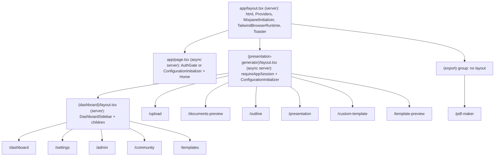
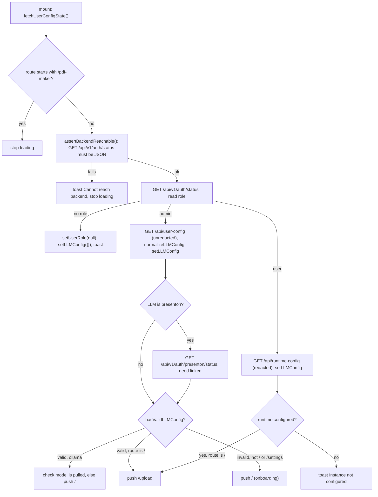
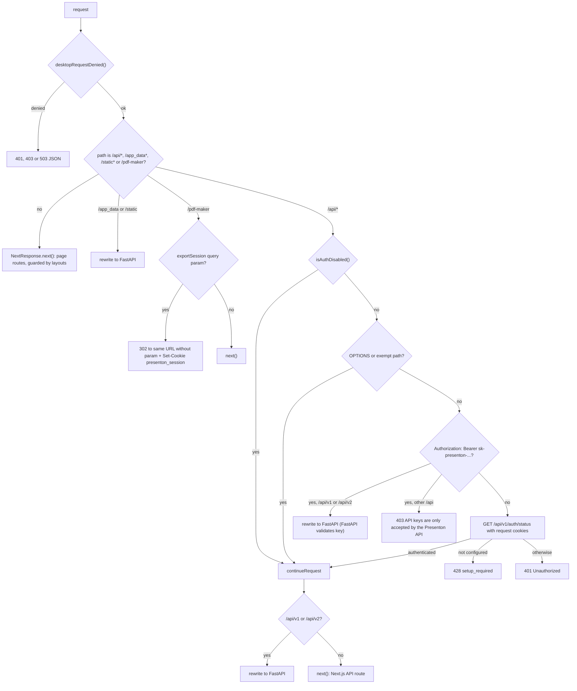

# Next.js architecture

<div class="chapter-meta" markdown>
**Reads:** `servers/nextjs/next.config.mjs`, `servers/nextjs/proxy.ts`, `servers/nextjs/app/layout.tsx`, `servers/nextjs/app/ConfigurationInitializer.tsx`, `servers/nextjs/store/store.ts`, `servers/nextjs/utils/api.ts`, `servers/nextjs/app/(presentation-generator)/services/api/`  ·  **Builds on:** [Runtime topology](03-runtime-topology.md)  ·  **Time:** ~40 min
</div>

This chapter takes the Next.js server apart layer by layer: how it is built, how URLs map to route files, which layouts run on the server and which components run in the browser, how the `proxy.ts` request hook gates and rewrites traffic to FastAPI, how the browser decides which origin to call, what lives in the Redux store, and which function calls which backend endpoint. By the end you should be able to open any file under `servers/nextjs` and know where it sits in the request path. All paths below are relative to the repository root; inside prose, `servers/nextjs/` is abbreviated where the context is obvious.

## Step 1: The build configuration

Everything starts in `servers/nextjs/next.config.mjs`. The file is short, but each option has a deployment consequence.

```js title="servers/nextjs/next.config.mjs (excerpt)"
const nextjsRoot = path.dirname(fileURLToPath(import.meta.url));
const isElectronBuild = process.env.PRESENTON_ELECTRON_BUILD === "true";
const isElectronRuntime = process.env.PRESENTON_ELECTRON === "true";

const nextConfig = {
  reactStrictMode: false,
  distDir: ".next-build",
  output: "standalone",
  turbopack: {
    root: nextjsRoot,
  },
  async headers() {
    return [
      {
        source: "/vendor/fonts/:path*",
        // Sandboxed community previews load public fonts from an opaque origin.
        headers: [{ key: "Access-Control-Allow-Origin", value: "*" }],
      },
    ];
  },
  // ...
  images: {
    // ...
    unoptimized: isElectronBuild || isElectronRuntime,
```

| Option | Value | Where | Why it matters |
| --- | --- | --- | --- |
| `reactStrictMode` | `false` | `servers/nextjs/next.config.mjs:9` | Effects are not double-invoked in development, so the many `useEffect`-driven `EventSource` streams open once. |
| `distDir` | `.next-build` | `servers/nextjs/next.config.mjs:10` | Build output does not go to the default `.next` folder. Any Dockerfile, Electron packager or script that copies the build must look for `.next-build`. |
| `output` | `standalone` | `servers/nextjs/next.config.mjs:11` | Next.js emits a self-contained `server.js` plus a pruned `node_modules`, which is what the Docker image and the Electron bundle run (see [Docker build and deployment](26-docker-and-deployment.md)). |
| `turbopack.root` | directory of the config file | `servers/nextjs/next.config.mjs:12-14` | Pins Turbopack's workspace root to `servers/nextjs` instead of letting it walk up to the monorepo root. |
| `headers()` | `Access-Control-Allow-Origin: *` on `/vendor/fonts/:path*` | `servers/nextjs/next.config.mjs:15-23` | Community previews render in a sandboxed (opaque-origin) frame and still need the bundled fonts. |
| `allowedDevOrigins` | `127.0.0.1`, `localhost` | `servers/nextjs/next.config.mjs:24-31` | Only spread in when `NODE_ENV !== "production"`. |
| `images.unoptimized` | true when `PRESENTON_ELECTRON_BUILD` or `PRESENTON_ELECTRON` is `"true"` | `servers/nextjs/next.config.mjs:37` | The packaged desktop app lives in a read-only directory, and the image optimizer writes into `<distDir>/cache`. |
| `images.remotePatterns` | nine HTTPS hosts | `servers/nextjs/next.config.mjs:38-75` | Only these hosts can be used with `next/image`: an R2 bucket, two `pptgen-public` S3 hosts, `img.icons8.com`, `present-for-me.s3.amazonaws.com`, a Supabase project host, `images.unsplash.com`, `picsum.photos` and `unsplash.com`. |

The dependency versions that shape the rest of this chapter come from `servers/nextjs/package.json`: `next` 16.4.1, `react` 19.2.6, `@reduxjs/toolkit` ^2.2.8, `react-redux` ^9.1.2, `konva` ^10.3.0 with `react-konva` ^19.2.4, Tiptap 3.30.5, `@dnd-kit/core` ^6.3.1, `mixpanel-browser` ^2.67.0, and `tailwindcss` ^3.4.1 for the build-time stylesheet. The `scripts` block is minimal: `dev`, `build`, `start`, `lint` (`eslint .`) and `test` (`node --test`).

!!! warning "Gotcha"
    Two Tailwind versions coexist. The application chrome is compiled at build time with Tailwind 3 (`servers/nextjs/tailwind.config.ts`), but Smart-mode slides are LLM-generated HTML that uses arbitrary Tailwind classes, so a browser build of Tailwind 4.3.3 is served from `/vendor/tailwindcss-browser-4.3.3.js` (`servers/nextjs/lib/tailwind-browser.ts:1-3`) and scoped with `@scope ([data-tailwind-runtime-scope])` (`servers/nextjs/lib/tailwind-browser.ts:5-11`). If you upgrade one, do not assume the other follows.

## Step 2: The route map

The App Router directory `servers/nextjs/app` uses three route groups. A route group is a folder whose name is wrapped in parentheses: it organizes files and can carry its own `layout.tsx`, but it does not appear in the URL.



Every page, its file, and whether the page file is a server or a client component:

| URL | Page file (under `servers/nextjs/app/`) | Page kind | Guards and notes |
| --- | --- | --- | --- |
| `/` | `page.tsx` | async server | Auth disabled or signed in: renders `ConfigurationInitializer` around `Home` (onboarding). Otherwise renders `AuthGate` (`servers/nextjs/app/page.tsx:7-25`). |
| `/dashboard` | `(presentation-generator)/(dashboard)/dashboard/page.tsx` | server, renders client `DashboardPage` | Has `loading.tsx`. |
| `/settings` | `(presentation-generator)/(dashboard)/settings/page.tsx` | async server | Calls `getServerAuthStatus()` and renders `SettingPage` for admins, `UserAccountSettings` for everyone else (`.../settings/page.tsx:11-17`). |
| `/admin` | `(presentation-generator)/(dashboard)/admin/page.tsx` | async server | `requireAdminSession()` (`.../admin/page.tsx:8-11`). |
| `/community` | `(presentation-generator)/(dashboard)/community/page.tsx` | server, `dynamic = "force-dynamic"` | `notFound()` when `PRESENTON_COMMUNITY_ENABLED` is a disabled value (`.../community/page.tsx:7-19`). |
| `/templates` | `(presentation-generator)/(dashboard)/templates/page.tsx` | server | Redirects to `/dashboard` when `PRESENTATION_GENERATION_MODE` normalizes to `smart`. |
| `/upload` | `(presentation-generator)/upload/page.tsx` | server | Reads `PRESENTATION_GENERATION_MODE` and `PRESENTON_COMMUNITY_ENABLED` on the server and passes them as props to the client `UploadPage` (`.../upload/page.tsx:46-66`). |
| `/documents-preview` | `(presentation-generator)/documents-preview/page.tsx` | server wrapper | Renders the client `DocumentPreviewPage`. |
| `/outline` | `(presentation-generator)/outline/page.tsx` | server (exports `metadata`) | Renders the client `OutlinePage`. |
| `/presentation` | `(presentation-generator)/presentation/page.tsx` | client (`'use client'`) | Reads `?id`; shows "No presentation id found" without it. |
| `/custom-template` | `(presentation-generator)/custom-template/page.tsx` | server, `force-dynamic` | Redirects to `/dashboard` in smart-only mode. Covered in [Custom templates from PPTX](18-custom-templates.md). |
| `/template-preview` | `(presentation-generator)/template-preview/page.tsx` | server with `Suspense` | Redirects to `/dashboard` in smart-only mode. |
| `/pdf-maker` | `(export)/pdf-maker/page.tsx` | client | The headless export renderer, covered in [PPTX and PDF export](24-export-pipeline.md). |

`PRESENTATION_GENERATION_MODE` is normalized by `normalizePresentationGenerationMode()` to one of `standard`, `smart` or `both`, defaulting to `both` for anything else (`servers/nextjs/utils/presentationGenerationMode.ts:4-21`). `PRESENTON_COMMUNITY_ENABLED` is parsed by `isCommunityEnabled()`: empty or missing means enabled, and only `0`, `false`, `no`, `off` (case-insensitive) disable it (`servers/nextjs/utils/community.ts:1-5`).

The dashboard group's layout renders a fixed 114 px sidebar and the page beside it (`servers/nextjs/app/(presentation-generator)/(dashboard)/layout.tsx:6-23`). `DashboardSidebar` shows Dashboard, a Templates link (hidden in smart-only mode), Community (hidden when disabled), Settings, and an external Help link to `https://docs.presenton.ai/help` (`.../Components/DashboardSidebar.tsx:52-123`). The `defaultNavItems` array also lists a "Smart" entry keyed `designs`, but no link renders for it.

!!! warning "Gotcha"
    `/pdf-maker` lives in the `(export)` group, which has no `layout.tsx`. It therefore does not get `requireAppSession()` or `ConfigurationInitializer`; its authentication comes from the `exportSession` cookie handoff in `proxy.ts` (Step 6). `ConfigurationInitializer` still contains `/pdf-maker` checks (`servers/nextjs/app/ConfigurationInitializer.tsx:56`, `:206`, `:300`), which are inert for that route today because it never wraps it.

## Step 3: The root layout and the client provider shell

`servers/nextjs/app/layout.tsx` is a server component. It exports static `metadata` (title, Open Graph and Twitter cards pointing at `https://presenton.ai`) and renders the document shell:

```tsx title="servers/nextjs/app/layout.tsx (excerpt)"
  return (
    <html lang="en">
      <body className="antialiased">
        <Providers>
          <MixpanelInitializer>

            {children}

          </MixpanelInitializer>
        </Providers>
        <TailwindBrowserRuntime />
        <Toaster position="top-center" />
      </body>
    </html>
  );
```

Four client components hang off it.

### 3.1 `Providers`

`servers/nextjs/app/providers.tsx:7-12` is the only place the Redux store is attached to React: it wraps children in `react-redux`'s `Provider store={store}` and mounts `ChatGptAuthRedirectHandler` as a sibling. Because the store is a module-level singleton (`servers/nextjs/store/store.ts:7-14`), some non-component code (for example `syncStoreAfterCodexSignOut()` in `servers/nextjs/utils/storeHelpers.ts:376-392`) imports `store` directly and dispatches without React.

### 3.2 `ChatGptAuthRedirectHandler`

This component renders nothing. It listens on `window` for the custom event `presenton:chatgpt-auth-required` (`servers/nextjs/utils/chatgptAuth.ts:5`, listener at `servers/nextjs/app/ChatGptAuthRedirectHandler.tsx:50`). Any code that detects an expired ChatGPT (Codex OAuth) session calls `requestChatGptReauth()`, which tracks `Codex Reauth Required` and dispatches the event (`servers/nextjs/utils/chatgptAuth.ts:86-106`). The handler then:

1. Guards against re-entry with `handlingRef` and releases the guard after 2 seconds (`.../ChatGptAuthRedirectHandler.tsx:22-23`, `:45-47`).
2. Shows an 8 second error toast with id `chatgpt-auth-required` (`:25-30`).
3. Calls `logoutChatGptAuth()`, which posts to `/api/v1/ppt/codex/auth/logout` and then clears the Codex fields in Redux (`servers/nextjs/utils/chatgptAuth.ts:108-127`).
4. Navigates to `/settings?chatgpt=reauth`, using `replace` if already on `/settings` (`:38-43`).

Detection is centralized in `ApiResponseHandler.handleResponse()` (Step 9) and in the two SSE hooks, which call `isChatGptAuthRequiredMessage()` on `error` events. A response counts as "ChatGPT auth required" if it carries the header `x-presenton-auth-action: codex-reauth`, or if it is a 401/403 whose message contains `CHATGPT_AUTH_REQUIRED:`, `chatgpt authentication`, `chatgpt session` or `codex oauth` (`servers/nextjs/utils/chatgptAuth.ts:54-84`).

### 3.3 `MixpanelInitializer`

`servers/nextjs/app/MixpanelInitializer.tsx:7-20` calls `initMixpanel()` once and tracks a `Page View` event with `{ url: pathname }` on every pathname change. Whether anything is actually sent depends on `/api/telemetry-status`; the full mechanism is in [Settings, onboarding, auth UI](23-settings-and-auth-ui.md).

### 3.4 `TailwindBrowserRuntime` and `Toaster`

`servers/nextjs/components/runtime/TailwindBrowserRuntime.tsx:25-58` injects a `<style type="text/tailwindcss">` block and the browser Tailwind script with `strategy="afterInteractive"`. On `/pdf-maker` it renders nothing; on `/` it defers loading until some component dispatches `presenton:tailwind-runtime-request`, which `useTailwindRuntimeReady()` does on mount (`:60-76`). Once the script loads it fires `presenton:tailwind-runtime-ready` exactly once per page lifetime (`:17-23`). `Toaster` is the Sonner wrapper in `servers/nextjs/components/ui/sonner.tsx`; the rest of the app calls it through `notify.error/success/info/warning/loading(title, description, options)` plus `notify.dismiss(id)` (`servers/nextjs/components/ui/sonner.tsx:44-56`).

## Step 4: Server-side session gating in layouts

Page protection happens in server components, not in `proxy.ts`. The proxy comment states this explicitly (`servers/nextjs/proxy.ts:5-9`). The helpers are in `servers/nextjs/utils/serverAuth.ts`.

`getServerAuthStatus()` (`servers/nextjs/utils/serverAuth.ts:37-88`) reads the incoming cookie header with `headers()` and calls FastAPI `GET {base}/api/v1/auth/status` with `cache: "no-store"`, where `base` is `FAST_API_INTERNAL_URL`, else `NEXT_PUBLIC_FAST_API`, else `http://127.0.0.1:8000` (`:17-30`). It returns:

```ts title="servers/nextjs/utils/serverAuth.ts (excerpt)"
export type AuthStatus = {
  configured: boolean;
  authenticated: boolean;
  username: string | null;
  user_id: string | null;
  available: boolean;
  role: "admin" | "user" | null;
};
```

`available` is `false` when the backend could not be reached or answered non-2xx. When `DISABLE_AUTH` is truthy (`1`, `true`, `yes`, `on`, checked by `isAuthDisabled()` in `servers/nextjs/utils/auth.ts:1-20`), it short-circuits to an authenticated admin named `electron`.

Two guards are built on it:

| Guard | Used by | Not available | Not configured | Not authenticated | Wrong role |
| --- | --- | --- | --- | --- | --- |
| `requireAppSession()` (`servers/nextjs/utils/serverAuth.ts:94-108`) | `(presentation-generator)/layout.tsx:7` | redirect `/` | redirect `/` | redirect `/?reason=unauthorized` | not checked |
| `requireAdminSession()` (`servers/nextjs/utils/serverAuth.ts:110-121`) | `/admin` page | redirect `/?reason=unauthorized` | not distinguished | redirect `/?reason=unauthorized` | redirect `/dashboard` |

The root page (`servers/nextjs/app/page.tsx:7-26`) is the only entry that is not behind `requireAppSession()`: it renders `AuthGate` for setup and sign-in, which turns the `?reason=unauthorized` query into a toast. Because the guard lives in the `(presentation-generator)` layout, an unknown URL still produces the normal 404 page instead of a login redirect; the layout only executes for routes that exist under it.

!!! warning "Gotcha"
    The server guard only proves that a session cookie is valid. The browser-side role used by the UI comes from a second call to the same endpoint inside `ConfigurationInitializer` (Step 5). Until that resolves, `state.userConfig.role` is `null`, and components such as `Home` (`servers/nextjs/components/Home.tsx:19-27`) and `SettingPage` treat `null` as "not admin".

## Step 5: `ConfigurationInitializer`, the client bootstrap

`servers/nextjs/app/ConfigurationInitializer.tsx` wraps both the root page and every `(presentation-generator)` route. It is a client component that holds the page behind a full-screen "Loading Presenton..." screen until it has established three facts: the backend is reachable, who the user is, and whether a usable text provider is configured.



The key code paths:

1. **Reachability.** `assertBackendReachable()` (`servers/nextjs/utils/api.ts:155-179`) fetches `getApiUrl("/api/v1/auth/status")` with `credentials: "include"` and throws `BackendConnectionError` unless the response is 2xx, has a JSON content type, and parses to a non-array object. The JSON check exists because a same-origin Next.js 404 or 500 is HTML and must not be mistaken for a healthy backend.
2. **Role.** `role` becomes `"admin"` or `"user"` only if `authenticated` is true (`servers/nextjs/app/ConfigurationInitializer.tsx:226-249`).
3. **Admin config.** Admins load `/api/user-config`, which proxies FastAPI's `GET /api/v1/admin/provider-settings` with real secrets (Step 10). Validity is computed client-side with `hasValidLLMConfig()` plus, for `LLM === "presenton"`, a linked Presenton Cloud account (`:251-299`). An Ollama selection additionally calls `isOllamaModelAvailable()` and bounces to `/` if the model is not pulled (`:305-328`).
4. **User config.** Regular users load `/api/runtime-config`, whose secrets are redacted to `__configured__`, so validity comes from the server-computed `configured` flag rather than client validation (`:344-379`).
5. **Routing.** A valid config on `/` pushes `/upload`; an invalid admin config on any route other than `/` or `/settings` pushes `/` (where `Home` shows onboarding). Navigation completion is detected by polling `window.location.pathname` every 500 ms in `setLoadingToFalseAfterNavigatingTo()` (`:191-203`).
6. **Splash timing.** The loading screen stays up for at least `PRESENTON_SPLASH_MIN_DURATION_MS` (3000 ms, `servers/nextjs/components/ui/presenton-splash-loader.tsx:11`) even if everything resolves faster (`servers/nextjs/app/ConfigurationInitializer.tsx:178-189`, `:382-384`).

A second effect re-validates on every navigation once `role` is known (`:75-176`), skipping `/`, `/settings*` and `/pdf-maker*`. It re-fetches `/api/user-config` (admin) or `/api/runtime-config` (user) with `cache: "no-store"` and re-dispatches `setLLMConfig`. If the config is no longer valid it shows a "Provider setup required" warning toast and, for admins only, calls `router.replace('/')` (`:113-125`). For Presenton Cloud it re-checks `GET /api/v1/auth/presenton/status`; if the cloud link is gone it blanks `LLM` in Redux and sends the user to `/` (`:127-147`).

!!! warning "Gotcha"
    `fetchUserConfigState()` runs once per mount of `ConfigurationInitializer` with an empty dependency list (`servers/nextjs/app/ConfigurationInitializer.tsx:68-73`). Because the component sits in the `(presentation-generator)` layout, client-side navigation between pages under that layout does not remount it, so the full bootstrap does not re-run; only the lighter revalidation effect does. A hard reload is what re-runs the bootstrap.

## Step 6: `proxy.ts`, the request hook

Next.js 16 runs `servers/nextjs/proxy.ts` (the file convention formerly called middleware) before routing. Its matcher covers every path except `_next/static` and `favicon.ico` (`servers/nextjs/proxy.ts:174-176`). The function makes decisions in a fixed order:



### 6.1 The FastAPI base URL

`getFastApiBaseUrl()` resolves `FAST_API_INTERNAL_URL`, then `NEXT_PUBLIC_FAST_API`, then `http://127.0.0.1:8000`, stripping trailing slashes (`servers/nextjs/proxy.ts:10-23`). `rewriteToFastApi()` keeps the original path and query string (`:43-49`). The comment at `:107-109` explains why the rewrite is done at request time: in Docker, nginx already routes `/api/v1`, `/api/v2`, `/app_data` and `/static` to FastAPI, but Electron has no nginx and picks random loopback ports at start-up, so the destination cannot be baked into Next.js's build-time route manifest.

### 6.2 Path classes

| Class | Test | Lines |
| --- | --- | --- |
| FastAPI API | `/api/v1`, `/api/v1/*`, `/api/v2`, `/api/v2/*` | `servers/nextjs/proxy.ts:25-32` |
| FastAPI assets | `/app_data`, `/app_data/*`, `/static`, `/static/*` | `servers/nextjs/proxy.ts:34-41` |
| Auth-exempt API | `/api/v1/auth/*`, `/api/telemetry-status`, `/api/update-svg`, `/api/export-presentation-data/*` | `servers/nextjs/proxy.ts:87-95` |

Everything else under `/api/` is a Next.js API route (Step 10) and needs a valid session.

### 6.3 The `/pdf-maker` cookie handoff

The export pipeline opens `/pdf-maker?id=...&exportSession=<token>` in a headless browser that has no cookies. The proxy converts the query parameter into a cookie and redirects to the clean URL:

```ts title="servers/nextjs/proxy.ts (excerpt)"
  if (pathname === "/pdf-maker") {
    const exportSession = request.nextUrl.searchParams.get("exportSession");
    if (exportSession) {
      const redirectUrl = request.nextUrl.clone();
      redirectUrl.searchParams.delete("exportSession");

      const response = NextResponse.redirect(redirectUrl);
      response.cookies.set({
        name: SESSION_COOKIE_NAME,
        value: exportSession,
        maxAge: SESSION_TTL_SECONDS,
        httpOnly: true,
        secure:
          request.headers.get("x-forwarded-proto")?.toLowerCase() === "https" ||
          request.nextUrl.protocol === "https:",
        sameSite: "lax",
        path: "/",
      });
      return response;
    }
```

`SESSION_COOKIE_NAME` is `presenton_session` and `SESSION_TTL_SECONDS` is 30 days (`servers/nextjs/proxy.ts:62-63`). The token is not validated here; it becomes the session cookie and FastAPI validates it on the next API call. The rest of the export flow is in [PPTX and PDF export](24-export-pipeline.md).

### 6.4 API keys

Admin-issued API keys have the prefix `sk-presenton-`. A request whose `Authorization` header starts with `bearer sk-presenton-` (compared lowercase) is passed straight through to FastAPI for `/api/v1` and `/api/v2` paths, without a cookie check, because FastAPI owns key validation. The same header on any Next.js API route gets a 403 with `{"detail": "API keys are only accepted by the Presenton API"}` (`servers/nextjs/proxy.ts:146-156`). This keeps API keys away from local configuration routes like `/api/user-config`.

### 6.5 Session status responses

For everything else the proxy calls FastAPI `GET /api/v1/auth/status` forwarding the cookie header (`servers/nextjs/proxy.ts:65-85`). An error or non-2xx is treated as `{configured: true, authenticated: false}`, which yields 401. A deployment with no account yet yields `428 {"detail": "Login setup is required", "setup_required": true}`. Both carry `Cache-Control: no-store` (`:158-171`).

### 6.6 The desktop transport guard

When `PRESENTON_ELECTRON === "true"`, `desktopRequestDenied()` runs first for every matched request, including pages (`servers/nextjs/lib/desktop-auth.ts:14-44`). It requires `PRESENTON_DESKTOP_TOKEN` to be at least 32 characters and `PRESENTON_DESKTOP_ORIGINS` to be non-empty (else 503), the `Host` header to match one of those origins and any `Origin` header to be one of them (else 403), and the token to arrive either in the `x-presenton-desktop-token` header or the `presenton_desktop_session` cookie, compared with `timingSafeEqual` (else 401). Details belong to [Electron desktop app](27-electron.md).

!!! warning "Gotcha"
    The proxy calls FastAPI's `/api/v1/auth/status` for every authenticated Next.js API request and every proxied `/api/v1` or `/api/v2` call. That is one extra in-cluster HTTP round trip per API request. If you add a high-frequency endpoint, account for it, or add it to `isApiAuthExempt()` only if it is genuinely public.

## Step 7: How the browser picks the backend origin

Browser code never hardcodes the FastAPI host. It calls `getApiUrl(path)` from `servers/nextjs/utils/api.ts`.

```ts title="servers/nextjs/utils/api.ts (excerpt)"
export function getApiUrl(path: string): string {
  if (isAbsoluteHttpUrl(path)) {
    return path;
  }

  const normalizedPath = withLeadingSlash(path);
  const isFastApiEndpoint =
    normalizedPath.startsWith("/api/v1/") ||
    normalizedPath.startsWith("/api/v2/");
  if (!isFastApiEndpoint) {
    return normalizedPath;
  }

  if (typeof window === "undefined" && !getConfiguredFastApiUrl()) {
    return normalizedPath;
  }

  return resolveBackendPathForRuntime(normalizedPath);
}
```

The decision table:

| Runtime | Result for `/api/v1/...` | Source |
| --- | --- | --- |
| Browser, web or Docker, no `fastapiUrl` query | relative path, same origin (nginx or `proxy.ts` forwards it) | `servers/nextjs/utils/api.ts:88-100` |
| Browser, Electron (`window.electron` exists) | `window.env.NEXT_PUBLIC_FAST_API` (or `location.origin`) + path | `servers/nextjs/utils/api.ts:106-120` |
| Browser, trusted `?fastapiUrl=` query | that origin + path | `servers/nextjs/utils/api.ts:56-78` |
| Server, no configured URL | relative path | `servers/nextjs/utils/api.ts:136-138` |
| Non-API path such as `/api/user-config` | always relative | `servers/nextjs/utils/api.ts:132-134` |

The `?fastapiUrl=` override exists for export pages, but it is deliberately narrow: the value is accepted only if its origin equals the configured `NEXT_PUBLIC_FAST_API` origin or the page's own origin (`servers/nextjs/utils/api.ts:63-74`). A link can therefore select a backend the application already trusts, but never introduce a new destination for cookies or API keys. `tests/backend-connectivity.test.mjs:46-68` checks this against look-alike hosts such as `https://backend.example.evil.test` and `https://backend.example@collector.example`.

### 7.1 Asset URL normalization

The backend stores image, upload and font paths in several shapes (absolute file paths, `file:` URLs, absolute URLs on its own origin, relative paths). `resolveBackendAssetUrl()` (`servers/nextjs/utils/api.ts:292-343`) maps all of them to a URL the current runtime can load, using `toBackendServedPath()` (`:232-269`):

| Input contains | Output path | Lines |
| --- | --- | --- |
| `/_next/static/` or `/vendor/fonts/` | unchanged (served by Next.js) | `servers/nextjs/utils/api.ts:236-241` |
| `/app_data/` | slice from `/app_data/` | `:243-246` |
| `/static/` | slice from `/static/` | `:248-251` |
| last `/images/` | `/app_data/images/...` | `:253-256` |
| last `/uploads/` | `/app_data/uploads/...` | `:258-261` |
| last `/fonts/` | `/app_data/fonts/...` | `:263-266` |

`data:` and `blob:` URLs pass through; absolute URLs on any origin that is not one of this deployment's backends (configured, query, runtime, or page origin) are left alone so Presenton Cloud assets keep their full URL (`:315-323`). `normalizeBackendAssetUrls()` walks a whole JSON tree and rewrites every string that looks like an asset path (`:395-416`); the presentation loaders run every API response through it.

!!! warning "Gotcha"
    Server-side `getFastAPIUrl()` falls back to `http://127.0.0.1:5001` (`servers/nextjs/utils/api.ts:119`), while `proxy.ts`, `serverAuth.ts` and `lib/fastapi-internal.ts` fall back to `http://127.0.0.1:8000`. In Docker both are normally overridden by environment variables, but in a bare local run the two defaults disagree.

## Step 8: The Redux store

The store combines four slices (`servers/nextjs/store/store.ts:7-14`):

```ts title="servers/nextjs/store/store.ts (excerpt)"
export const store = configureStore({
  reducer: {
    presentationGeneration: presentationGenerationReducer,
    pptGenUpload: pptGenUploadReducer,
    userConfig: userConfigReducer,
    undoRedo: undoRedoReducer,
  },
});
```

No middleware, persistence or RTK Query is configured; all network I/O happens in components and hooks, which dispatch plain actions.

### 8.1 `presentationGeneration`

State (`servers/nextjs/store/slices/presentationGeneration.ts:53-79`):

| Field | Type | Initial | Meaning |
| --- | --- | --- | --- |
| `presentation_id` | `string` or `null` | `null` | Active deck id; the outline page falls back to it when `?id` is missing. |
| `isLoading` | boolean | `false` | Set false by `setError`; also read by autosave as a pause condition. |
| `isStreaming` | boolean or `null` | `null` | True while the presentation SSE stream is open; disables editing and autosave. |
| `outlines` | `{content: string}[]` | `[]` | Outline cards on the outline page, always passed through `limitOutlines()`. |
| `error` | `string` or `null` | `null` | Cleared by `setPresentationId`. |
| `presentationData` | `PresentationData` or `null` | `null` | The whole deck: metadata, `slides`, `theme`, `layout`, `fonts`. |
| `generationMetrics` | `GenerationMetrics` or `null` | `null` | Live token counts from Smart-mode streams. |
| `isSlidesRendered` | boolean | `false` | Has a reducer; no dispatcher in this snapshot. |
| `isLayoutLoading` | boolean | `false` | Read by autosave; no dispatcher in this snapshot. |
| `enableHtmlSelector` | boolean | `false` | Smart-mode "select an element for the AI" toggle. |
| `chatHtmlSelection` | `ChatHtmlSelection` or `null` | `null` | The element picked in a Smart slide, with its HTML and slide index. |

`PresentationData` (`:9-28`) has `id`, `language`, `layout`, `n_slides`, `title`, `slides`, `theme`, and optional `template_id`, `design_v2_id`, `version`, `generation_mode`, `can_regenerate`, `type`, `community_design_ids`, `components`, `fonts`, `structure`. `GenerationMetrics` (`:40-51`) has `model`, `input_tokens`, `output_tokens`, `thinking_tokens`, `total_tokens`, `tokens_per_second`, `duration_seconds`, `estimated`, `thinking_tokens_estimated`, `supports_thinking`.

Reducers:

| Action | Payload | Effect | Dispatched from |
| --- | --- | --- | --- |
| `setStreaming` | boolean | sets `isStreaming` | `usePresentationStreaming` |
| `setLoading` | boolean | sets `isLoading` | not dispatched (local `setLoading` state functions share the name) |
| `setLayoutLoading` | boolean | sets `isLayoutLoading` | not dispatched |
| `setPresentationId` | string | sets id, clears `error`, clears chat selection when the id changes | upload, outline and documents-preview pages |
| `setSlidesRendered` | boolean | sets flag | not dispatched |
| `setError` | string | sets `error`, `isLoading = false` | not dispatched (same-name local states) |
| `clearPresentationData` | none | nulls `presentationData`, `generationMetrics`, `chatHtmlSelection` | outline generate, stream start, regenerate |
| `setGenerationMetrics` | metrics or null | replaces metrics | `usePresentationStreaming` |
| `clearOutlines` / `setOutlines` | none / outlines | `setOutlines` runs `limitOutlines()` (max 50 items, 100 words each) | upload and outline pages |
| `deleteSlideOutline` | `{index}` | removes one outline | not dispatched |
| `setPresentationData` | `PresentationData` | replaces the deck, normalizes `theme` with `normalizeTemplateTheme()`, clears chat selection | streaming, loader, side panel reorder, chat, undo hook, `IconsEditor`, `/pdf-maker` |
| `setEnableHtmlSelector` / `setChatHtmlSelection` / `clearChatHtmlSelection` | boolean / selection / none | Smart-mode selection state | header, Smart HTML editor, chat |
| `updateTitle` | string | sets `presentationData.title` | header title editor |
| `addSlide` | `{slide, index}` | insert at `index`, reindex, cap 50 | not dispatched |
| `addNewSlide` | `{slideData, index}` | insert at `index + 1`, reindex, update `n_slides`, cap 50 | action bar, side panel, new-slide picker |
| `deletePresentationSlide` | index | remove (refuses if only one slide), reindex | action bar |
| `replaceSlidesWithBlankFallback` | `{slideData}` | replace all slides with one slide at index 0 | action bar, page fallback |
| `duplicatePresentationSlide` | `{index, slideId}` | deep-clone via `JSON.parse(JSON.stringify())`, insert after, reindex, cap 50 | action bar |
| `movePresentationSlide` | `{fromIndex, toIndex}` | splice move and reindex (does not touch `n_slides`) | action bar |
| `updateSlide` | `{index, slide}` | replace one slide | not dispatched (the word appears in chat only as an agent tool name) |
| `updateSlideHtmlContent` | `{slideIndex, html, slideId?}` | find by id, then by `index`, then by position; set `html_content` | Smart HTML editor |
| `updateSlideUi` | `{index, ui}` | set `slides[index].ui` | Template V2 editor surface |
| `updateSlideContent` | `{slideIndex, dataPath, content}` | set a nested string in `slide.content` | not dispatched |
| `updateSlideImage` / `updateSlideIcon` / `updateImageProperties` | path-based image, icon and property updates | legacy content-path editing | not dispatched |

!!! warning "Gotcha"
    The "dispatched from" column was built by collecting every symbol imported from `store/slices/presentationGeneration` across the Next.js source. Eleven action creators are never imported anywhere: `setLoading`, `setLayoutLoading`, `setSlidesRendered`, `setError`, `deleteSlideOutline`, `addSlide`, `updateSlide`, `updateSlideContent`, `updateSlideImage`, `updateImageProperties` and `updateSlideIcon`. The content-path ones are leftovers from the pre-Template-V2 editor, where slides were React components bound to `slide.content` by data paths. Today's standard slides are edited as `slide.ui` JSON (see [Slide editor](22-slide-editor.md)). Do not build new features on these reducers without checking that something renders their output.

### 8.2 `pptGenUpload`

State `{config: PresentationConfig or null, files: any}` with one reducer, `setPptGenUploadState`, that overwrites both fields from the payload (`servers/nextjs/store/slices/presentationGenUpload.ts:4-27`). `PresentationConfig` (`servers/nextjs/app/(presentation-generator)/upload/type.ts:122-132`) has `slides` (string or null), `language`, `prompt`, `tone`, `verbosity`, `instructions`, `includeTableOfContents`, `includeTitleSlide`, `webSearch`. The upload page stores the form here so the outline page can show and regenerate from the same settings; `files` holds the decompose responses (`[{name, file_path}]` arrays).

### 8.3 `userConfig`

State `{role: "admin" or "user" or null, llm_config: LLMConfig}` with initial `llm_config = {LLM: "", IMAGE_PROVIDER: "gpt-image-1.5"}` and `role = null`; reducers `setLLMConfig` (replace) and `setUserRole` (`servers/nextjs/store/slices/userConfig.ts:4-28`).

### 8.4 `undoRedo`

A deck-level history of `slides` arrays (`servers/nextjs/store/slices/undoRedoSlice.ts:4-26`):

| Field | Initial | Meaning |
| --- | --- | --- |
| `past` | `[]` | Older snapshots, at most `maxHistorySize`. |
| `present` | `null` | The current snapshot. |
| `future` | `[]` | Snapshots available to redo. |
| `maxHistorySize` | `30` | `past.shift()` drops the oldest beyond 30. |
| `isUndoRedoInProgress` | `false` | Guard while an undo/redo is being applied. |
| `pendingHistorySkips` | `0` | The next N `addToHistory` calls are ignored. |

Actions: `addToHistory({slides, actionType})`, `undo`, `redo`, `finishUndoRedo`, `clearHistory`. `finishUndoRedo` is exported but nothing dispatches it in this snapshot; `clearHistory` is dispatched by `usePresentationData` on a fresh load and by the header's regenerate action. The skip counter is what stops the undo from recording itself: `undo` sets `pendingHistorySkips = 1`, and the autosave effect's next `addToHistory` (fired because `presentationData` changed) consumes it (`:32-39`, `:88-105`). Snapshots are compared by reference, which is valid because Immer replaces changed arrays (`:46-58`). How this interacts with the per-slide editor history is covered in [Slide editor](22-slide-editor.md).

## Step 9: The API client layer

Browser calls to FastAPI live in `servers/nextjs/app/(presentation-generator)/services/api/`. Every function uses `getApiUrl()` and funnels the response through `ApiResponseHandler`.

### 9.1 Shared plumbing

`getHeader()` returns `Content-Type: application/json`, `Accept: application/json` and three `Access-Control-Allow-*` headers; `getHeaderForFormData()` returns only the three CORS headers so the browser can set the multipart boundary (`.../services/api/header.ts:1-17`). The CORS headers are response headers and have no effect when sent on a request; they are harmless.

`ApiResponseHandler.handleResponse(response, defaultMessage)` (`.../services/api/api-error-handler.ts:35-89`):

- 204 returns `true`; any other 2xx returns parsed JSON, or `{}` if parsing fails.
- Errors parse `{detail, message, error}` with `extractApiErrorMessage()` (`servers/nextjs/utils/apiErrorMessages.ts`), trigger `requestChatGptReauth()` when the response matches the ChatGPT rules, and throw `ApiResponseError` with `status`, optional `code`, and `retryable`.
- `retryable` comes from the body's `retryable` flag if present, else defaults to true for 408, 425, 429, 500, 502, 503, 504 (`servers/nextjs/utils/apiErrorMessages.ts:21-39`).
- If the error body is not JSON, a fixed message per status code is used (`api-error-handler.ts:142-169`).

`handleResponseWithResult()` (`:92-139`) is the non-throwing variant that returns `{success, message}`; delete calls use it.

### 9.2 Every client function

`PresentationGenerationApi` (`.../services/api/presentation-generation.ts`):

| Function | Method and path | Body or query |
| --- | --- | --- |
| `regenerateSmartPresentation(id)` (`:24`) | `POST /api/v1/ppt/presentation/{id}/regenerate` | none |
| `uploadDoc(files)` (`:32`) | `POST /api/v1/ppt/files/upload` | multipart, each file under `files` |
| `decomposeDocuments(keys, language)` (`:57`) | `POST /api/v1/ppt/files/decompose` | `{file_paths, language}` |
| `createPresentation({...})` (`:82`) | `POST /api/v1/ppt/presentation/create` | `{content, version, n_slides, file_paths, language, tone, verbosity, instructions, include_table_of_contents, include_title_slide, web_search, generation_mode, community_design_ids}`; `n_slides` clamped to 1..50 or `null`; `version` defaults to `v2-standard`; returns the response plus `type: generation_mode` |
| `createBlankPresentation(templateId?)` (`:154`) | `POST /api/v1/ppt/presentation/create/blank` | `{template_id}` or no body |
| `updatePresentationContent(body)` (`:185`) | `PATCH /api/v1/ppt/presentation/update` | object or pre-serialized string |
| `updatePresentationSlide(slide)` (`:204`) | `PATCH /api/v1/ppt/presentation/slide_update` | `{slide}` |
| `presentationPrepare(data)` (`:226`) | `POST /api/v1/ppt/presentation/prepare` | `{presentation_id, outlines, layout}` with outlines limited |
| `getOutlines(id)` (`:252`) | `GET /api/v1/ppt/outlines/{id}` | none |
| `updateOutlines(id, outlines)` (`:270`) | `PUT /api/v1/ppt/outlines/{id}` | `{slides}` limited |
| `generateImage({prompt, width?, height?})` (`:295`) | `GET /api/v1/ppt/images/generate` | query `prompt`, optional `width`, `height` |
| `getPreviousGeneratedImages()` (`:318`) | `GET /api/v1/ppt/images/generated` | none |
| `searchIcons({query, limit, icon_type?, icon_weight?})` (`:335`) | `GET /api/v1/ppt/icons/search` | query; string results run through `resolveBackendAssetUrl` |

`DashboardApi` (`.../services/api/dashboard.ts`):

| Function | Method and path | Notes |
| --- | --- | --- |
| `getPresentations(version?, {includeSlides})` (`:37`) | `GET /api/v1/ppt/presentation/all` | query `version`, and `include_slides=false` when requested; a 404 is treated as an empty list |
| `getPresentation(id, {cache})` (`:70`) | `GET /api/v1/ppt/presentation/{id}` | `credentials: "include"` |
| `deletePresentation(id)` (`:91`) | `DELETE /api/v1/ppt/presentation/{id}` | returns `{success, message}` |
| `duplicatePresentation(id)` (`:111`) | `POST /api/v1/ppt/presentation/{id}/duplicate` | |

`ImagesApi` (`.../services/api/images.ts`):

| Function | Method and path | Notes |
| --- | --- | --- |
| `testProvider(config, signal)` (`:15`) | `POST /api/v1/ppt/images/test` | throws if `image_url` is missing |
| `uploadImage(file)` (`:32`) | `POST /api/v1/ppt/images/upload` | multipart field `file` |
| `getUploadedImages()` (`:48`) | `GET /api/v1/ppt/images/uploaded` | |
| `getGeneratedImages()` (`:60`) | `GET /api/v1/ppt/images/generated` | |
| `generateImage(prompt, size?)` (`:70`) | `GET /api/v1/ppt/images/generate` | |
| `deleteImage(id)` (`:89`) | `DELETE /api/v1/ppt/images/{id}` | |
| `searchStockImages(query, limit = 12, {provider, apiKey, strictApiKey})` (`:101`) | `GET /api/v1/ppt/images/search` | sends `X-Provider-Api-Key` only if the key is not the redaction placeholder `__configured__` |

`TemplateService` (`.../services/api/template.ts`):

| Function | Method and path | Notes |
| --- | --- | --- |
| `getTemplateSummaries(isDefault?, {presentonCloudOnly})` (`:122`) | `GET /api/v1/ppt/template/all` | `page_size=100`, optional `default`, `presenton_cloud_only=true` |
| `getTemplateDetails(id)` (`:142`) | `GET /api/v1/ppt/template/{id}` | strips a `template-v2-` prefix first |
| `getTemplateTheme(id)` (`:153`) | `GET /api/v1/ppt/template/{id}/theme` | 5 minute in-memory cache, in-flight de-duplication, 404 cached as `null` |
| `createTemplate(payload)` (`:205`) | `POST /api/v1/ppt/template/async` | |
| `getRecentTemplateCreateTasks(from)` (`:219`) | `GET /api/v1/async-tasks` | `type=template.create`, `limit=50` |
| `retryTemplateCreateTask(id)` (`:237`) | `POST /api/v1/ppt/template/async/{id}/retry` | |
| `deleteTemplate(id)` (`:256`) | `DELETE /api/v1/ppt/template/{id}` | |
| `updateTemplate(id, payload)` / `updateTemplateMetadata` (`:281`, `:271`) | `PATCH /api/v1/ppt/template/{id}` | |
| `createTemplateLayout(payload)` (`:300`) | `POST /api/v1/ppt/template/layouts/create` | |
| `generateTemplateLayout(payload)` (`:322`) | `POST /api/v1/ppt/template/layouts/generate` | |

`CommunityPresentationApi` (`.../services/api/community.ts`): `list(page = 1, pageSize = 8, signal, filters)` calls `GET /api/v1/ppt/community/presentations` with `order_by=priority`, `order=desc` by default (`:99-127`), and `getById(id)` calls `GET /api/v1/ppt/community/presentations/{id}` (`:129-135`). Both convert a network failure into a retryable `ApiResponseError` with code `community_backend_unreachable` (`:74-96`).

`PresentationChatApi` (`.../services/api/chat.ts`): `listConversations` (`GET /api/v1/ppt/chat/conversations`), `getHistory` (`GET /api/v1/ppt/chat/history`), `deleteConversation` (`DELETE /api/v1/ppt/chat/conversation`), `sendMessage` (`POST /api/v1/ppt/chat/message`) and `streamMessage` (`POST /api/v1/ppt/chat/message/stream`, parsed as SSE `response` events of type `chunk`, `status`, `trace`, `complete`, `error`) (`:104-410`). The chat protocol is covered in [Editing and chat assistant](14-editing-and-chat.md).

Several features bypass the service classes and call `fetch(getApiUrl(...))` directly: the outline and presentation `EventSource` streams, provider model discovery in settings and onboarding, Codex and Presenton Cloud auth, and the admin panel (which uses relative `/api/v1/admin/...` paths). Those are covered where they are used.

## Step 10: Next.js API routes

The routes under `servers/nextjs/app/api/` run inside the Next.js server. They exist for work that needs the Next.js filesystem view, server-only secrets, or a same-origin endpoint.

| Route | Method | Auth inside the handler | Purpose |
| --- | --- | --- | --- |
| `/api/user-config` | GET | authenticated; admins get FastAPI's real settings, others get the redacted config | `servers/nextjs/app/api/user-config/route.ts:39-67` |
| `/api/user-config` | POST | `requireAdminApi()`; `Content-Type` must be `application/json` (415 otherwise); body must be a JSON object (400) | forwards as `PUT /api/v1/admin/provider-settings` (`:69-104`) |
| `/api/runtime-config` | GET | authenticated | `readRuntimeProviderConfig()`: `{configured, config}` with secrets redacted (`servers/nextjs/app/api/runtime-config/route.ts:7-20`) |
| `/api/telemetry-status` | GET | none (exempt in proxy) | `{telemetryEnabled}` from `DISABLE_ANONYMOUS_TRACKING` in env or the user config file |
| `/api/has-required-key` | GET | none in handler (proxy requires a session) | `{hasKey}`: whether `OPENAI_API_KEY` exists in the config file or env. Nothing in the Next.js source calls it. |
| `/api/read-file` | POST | authenticated | returns the text of a decomposed `.txt` document inside allowed directories (`servers/nextjs/lib/readable-local-file.ts`) |
| `/api/upload-image` | POST | authenticated | writes one image (max 20 MB) to `APP_DATA_DIRECTORY/uploads[/users/{id}]/<random>.png` and returns its absolute `filePath` |
| `/api/export-presentation` | POST | authenticated | runs the bundled exporter for `{format: "pdf" or "pptx", id, title}`, moves the result into the user's export folder, returns `{success, path: "/api/export-presentation/file?name=..."}` |
| `/api/export-presentation/file` | GET | authenticated, owner-scoped name | streams the file from `APP_DATA_DIRECTORY/exports` with a download `Content-Disposition` |
| `/api/export-presentation-data/[id]` | GET | `x-export-cookie` header required (exempt in proxy) | proxies `GET /api/v1/ppt/presentation/{id}` with that cookie for the headless renderer |
| `/api/update-svg` | GET | none (exempt in proxy) | recolors an SVG from `/static/icons/` only; max 5 MB; returns `image/svg+xml` |
| `/api/github-stars` | GET | none in handler | `{stars}` for `presenton/presenton`, revalidated hourly (`revalidate = 3600`); 502 on failure; used by the upload page's `GenerateHeader` |

Three of these deserve a closer look.

`/api/user-config` is the only path by which browser code writes provider settings. The POST forwards the raw body text to FastAPI along with the caller's cookie and, in Electron, the desktop token header (`servers/nextjs/app/api/user-config/route.ts:10-37`). FastAPI merges it into the stored settings and mirrors the result back to `USER_CONFIG_PATH` (`servers/fastapi/services/provider_settings.py:137-155`). The `Content-Type` check is a deliberate CSRF defence: a cross-site `text/plain` form post cannot set `application/json`, and `tests/desktop-security.test.mjs:77-99` asserts that the original `text/plain` attack is rejected with 415.

`/api/export-presentation` validates the body strictly (non-empty JSON object, string `id`, `format` in `pdf` or `pptx`), checks `bundledExportPackageAvailable()`, runs `runBundledPresentationExport()` with the caller's cookie header, and for multi-user deployments moves the output into `exports/users/{user_id}/` before building the download URL (`servers/nextjs/app/api/export-presentation/route.ts:16-162`). The download route refuses absolute names, backslashes, `..` segments, other users' folders, and anything whose real path escapes the exports directory (`.../export-presentation/file/route.ts:22-83`).

`/api/update-svg` resolves a static icon root from `PRESENTON_APP_ROOT` candidates or the working directory, then defends against traversal and time-of-check races: path containment checks before and after `realpath`, `O_NOFOLLOW` on open, a size check on the open handle, and a bounded read (`servers/nextjs/app/api/update-svg/route.ts:29-165`). Colors and numeric attributes are normalized by `lib/svg-color.ts` before `transformSvgMarkup()` rewrites the SVG.

!!! warning "Gotcha"
    `/api/upload-image` saves every upload with a `.png` extension regardless of the real format (`servers/nextjs/app/api/upload-image/route.ts:53`). No code in the repository calls this route: the image editor and the chat panel upload through FastAPI's `/api/v1/ppt/images/upload` via `ImagesApi.uploadImage()` (`servers/nextjs/app/(presentation-generator)/components/ImageEditor.tsx:326`, `.../presentation/components/Chat.tsx:1529`). Treat it as a leftover rather than a second upload path.

## Step 11: `lib/` and `utils/` helpers

`servers/nextjs/lib/`:

| File | Responsibility |
| --- | --- |
| `chart-browser.ts` | Loads `/vendor/chart-4.5.1.umd.min.js` plus a datalabels plugin into the browser (`loadChartBrowserRuntime()`). |
| `desktop-auth.ts` | Electron transport guard and desktop cookie header (Step 6.6). |
| `fastapi-internal.ts` | Server-side FastAPI base URL and optional HTTP Basic auth headers from `AUTH_USERNAME`/`AUTH_PASSWORD` env or the config file. |
| `math.ts` | LaTeX normalization (max 4000 chars), KaTeX HTML rendering and SVG data-URI generation for equations. |
| `provider-setup-navigation.ts` | Decides `ignore`, `warn` or `block` for link clicks while provider setup is incomplete. |
| `readable-local-file.ts` | Path policy for `/api/read-file`: `.txt` only, owner-scoped directories, symlink-safe. |
| `run-bundled-presentation-export.ts` | Locates and runs the bundled `presentation-export` package. |
| `runtime-limits.ts` | `BoundedTextBuffer` (keeps the last 8192 chars of process output) and `memorySnapshotMb()`. |
| `runtime-provider-config.ts` | Redacted provider config for non-admins. |
| `server-auth-role.ts` | `authStatusForRequest()` and `requireAdminApi()` for API routes. |
| `smart-slide-icons.ts` | Icon recoloring for Smart HTML slides. |
| `svg-color.ts` | SVG color normalization, `buildSvgUpdateUrl()`, `transformSvgMarkup()`. |
| `tailwind-browser.ts` | Browser Tailwind version, script URL, scoped style. |
| `template-theme.ts` | `TemplateTheme` type, defaults, `normalizeTemplateTheme()`, template id resolution. |
| `template-v2-json-to-html.ts` | Renders Template V2 `ui` JSON to an HTML string at 1280 by 720 (`templateV2UiToHtml()`). |
| `user-config-store.ts` | Locked, atomic, backed-up JSON file I/O for `userConfig.json`. |
| `utils.ts` | `cn()` class-name merge helper. |

`servers/nextjs/utils/`:

| File | Responsibility |
| --- | --- |
| `api.ts` | Origin selection, asset URL normalization, backend reachability (Step 7). |
| `apiErrorMessages.ts` | Extracts readable messages and retry metadata from FastAPI error bodies. |
| `analytics.ts` | `sanitizeAnalyticsError()` (single line, max 240 chars), `bucketFileSize()`, `bucketMessageLength()`. |
| `auth.ts`, `authErrors.ts`, `serverAuth.ts` | `DISABLE_AUTH` parsing, FastAPI `detail` formatting, server guards. |
| `chatgptAuth.ts` | ChatGPT re-auth detection, event and logout. |
| `clipboard.ts` | `copyTextToClipboard()` with an `execCommand("copy")` fallback. |
| `codexModels.ts` | Supported Codex model ids; default `gpt-5.6-luna`. |
| `community.ts` | `isCommunityEnabled()`. |
| `error_helpers.ts` | `wrap_errors()` re-throwing as `ApiError`. |
| `image-url-converter.ts` | Rewrites `img[src]` in the DOM with a `MutationObserver` using `resolveBackendAssetUrl()`. |
| `mixpanel.ts` | Telemetry (see [Settings, onboarding, auth UI](23-settings-and-auth-ui.md)). |
| `presentationGenerationMode.ts` | `standard`, `smart`, `both` handling. |
| `presentationLimits.ts` | `MAX_NUMBER_OF_SLIDES = 50`, `MAX_OUTLINE_CONTENT_WORDS = 100`, clamping helpers. |
| `providerConstants.ts` | Text, image and web-search provider catalogs with labels, icons and key fields. |
| `providerUtils.ts` | Ollama discovery, caching, pull streaming, and legacy config field mapping. |
| `settingsAccess.ts` | `getSettingsView(role)`: `admin` or `account`. |
| `storeHelpers.ts` | `normalizeLLMConfig()`, `getLLMConfigValidationError()`, `handleSaveLLMConfig()`. |
| `constant.ts` | Empty file. |

## Step 12: Types

`servers/nextjs/types/llm_config.ts:1-153` defines `LLMConfig`, a flat optional-field interface whose keys match the backend's environment-variable names. Groups:

| Group | Keys |
| --- | --- |
| Selection | `LLM` |
| Hosted text providers | `OPENAI_*`, `DEEPSEEK_*`, `GOOGLE_*`, `VERTEX_*`, `AZURE_OPENAI_*`, `BEDROCK_*`, `OPENROUTER_*` (including `OPENROUTER_PROVIDER_ORDER` as `string[]`), `FIREWORKS_*`, `TOGETHER_*`, `CEREBRAS_*`, `ANTHROPIC_*` |
| Gateways and local | `LITELLM_*`, `LMSTUDIO_*`, `OLLAMA_URL`, `OLLAMA_MODEL`, `CUSTOM_LLM_URL`, `CUSTOM_LLM_API_KEY`, `CUSTOM_MODEL` |
| Images | `DISABLE_IMAGE_GENERATION`, `IMAGE_PROVIDER`, `PEXELS_API_KEY`, `PIXABAY_API_KEY`, `COMFYUI_URL`, `COMFYUI_WORKFLOW`, `OPEN_WEBUI_IMAGE_*`, `OPENAI_COMPAT_IMAGE_*`, `GPT_IMAGE_2_QUALITY`, `GPT_IMAGE_1_5_QUALITY` |
| Generation controls | `DISABLE_THINKING`, `EXTENDED_REASONING`, `LLM_GENERATION_PROFILE`, `LLM_MAX_OUTPUT_TOKENS`, `LLM_REASONING_MODE`, `LLM_REASONING_EFFORT`, `LLM_REASONING_BUDGET_TOKENS` |
| Web search | `WEB_GROUNDING`, `WEB_SEARCH_PROVIDER`, `WEB_SEARCH_MAX_RESULTS`, `SEARXNG_BASE_URL`, `TAVILY_API_KEY`, `EXA_API_KEY`, `BRAVE_SEARCH_API_KEY`, `SERPER_API_KEY` |
| Codex OAuth | `CODEX_MODEL`, `CODEX_ACCESS_TOKEN`, `CODEX_REFRESH_TOKEN`, `CODEX_TOKEN_EXPIRES`, `CODEX_ACCOUNT_ID`, `CODEX_USERNAME`, `CODEX_EMAIL`, `CODEX_IS_PRO` |
| UI only | `USE_CUSTOM_URL`, `DISABLE_ANONYMOUS_TRACKING` (string) |

`servers/nextjs/app/(presentation-generator)/types/slide.ts:25-42` defines the client `Slide`: `id`, `index`, `type`, `design_index`, `images`, `properties`, `icons`, `graph_id`, optional `presentation`, `speaker_note`, `layout`, `layout_group`, `html_content`, `ui`, and `content` (a loose `SlideContent` with `title`, `body`, optional `description`, `graph`, `diagram`, `infographics`, `image_prompts`, `icon_queries`). In practice, standard slides carry their rendering in `ui` and Smart slides in `html_content`; the backend schema is in [Data model](07-data-model.md).

`servers/nextjs/types/presentation.ts:1-20` (`GenerateRequestBody`, `SlideData`, `PresentationResponse` with `thumbnail` and `file`) is a legacy shape; current pages type responses with `PresentationResponse` from `services/api/dashboard.ts:9-33` instead. `servers/nextjs/types/global.d.ts:16-32` declares `window.electron` (`exportPresentation`, `readFile`) and `window.env` (`NEXT_PUBLIC_FAST_API`, `APP_VERSION`, `DISABLE_AUTH`), which Electron injects at runtime.

## What you now know

- The build emits a standalone server into `.next-build`, disables image optimization in Electron, and serves fonts with open CORS; Smart slides depend on a second, browser-side Tailwind 4 runtime.
- Pages are guarded by server layouts (`requireAppSession`, `requireAdminSession`), while `proxy.ts` gates `/api/*`, rewrites FastAPI paths at request time, hands off export sessions as cookies, and keeps `sk-presenton-` API keys off Next.js routes.
- `ConfigurationInitializer` decides, once per mount, whether the backend is reachable, who the user is, and whether to send them to onboarding or `/upload`.
- The Redux store has four slices; several `presentationGeneration` reducers are dead code from the legacy content-path editor.
- Every FastAPI call goes through `getApiUrl()` and `ApiResponseHandler`, and the service tables above map each function to its endpoint.

## Next

Follow a user through those routes request by request in [User journey](21-user-journey.md).
