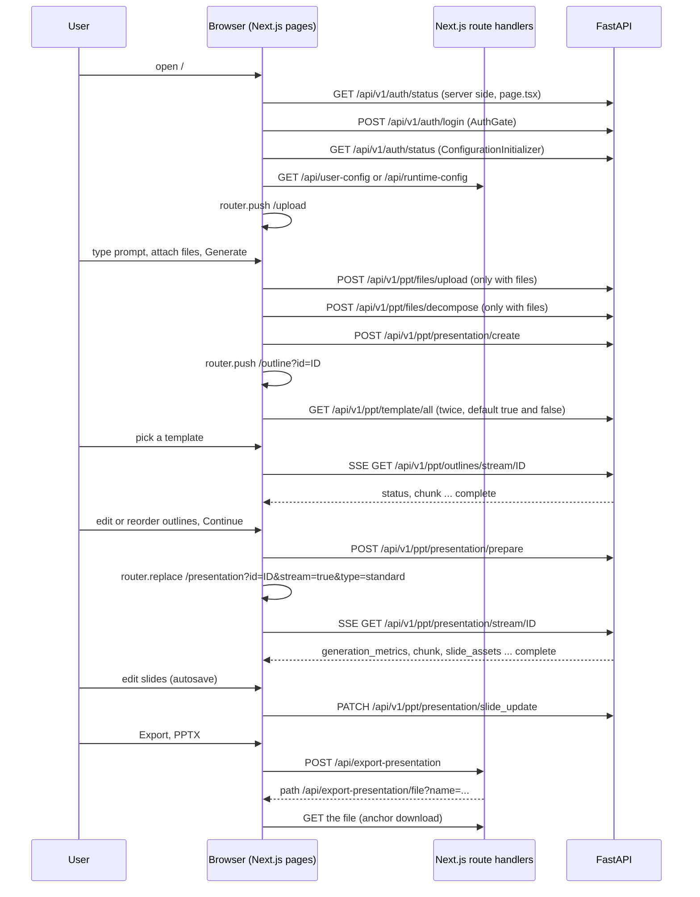
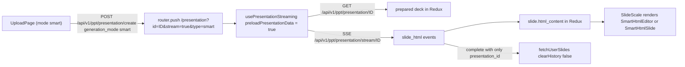

# User journey

<div class="chapter-meta" markdown>
**Reads:** `servers/nextjs/app/page.tsx`, `servers/nextjs/app/ConfigurationInitializer.tsx`, `servers/nextjs/components/Auth/AuthGate.tsx`, `servers/nextjs/app/(presentation-generator)/upload/components/UploadPage.tsx`, `servers/nextjs/app/(presentation-generator)/outline/components/OutlinePage.tsx`, `servers/nextjs/app/(presentation-generator)/outline/hooks/useOutlineStreaming.ts`, `servers/nextjs/app/(presentation-generator)/presentation/hooks/usePresentationStreaming.ts`, `servers/nextjs/app/(presentation-generator)/presentation/components/PresentationHeader.tsx`  ·  **Builds on:** [Next.js architecture](20-nextjs-architecture.md)  ·  **Time:** ~40 min
</div>

This chapter follows one user from the first page load to a downloaded PPTX, and records every HTTP request, every Server-Sent Events (SSE) stream and every Redux update along the way. You will see exactly which component fires which request, what the JSON body looks like, which slice action stores the response, and how the URL carries state between pages. The standard path (upload, then outline, then presentation) is covered first, then the Smart-mode variant that skips the outline page.

All paths are relative to `servers/nextjs/` unless they start with `servers/`. Endpoints written as `/api/v1/...` are FastAPI endpoints; the browser reaches them through `getApiUrl()` and the `proxy.ts` rewrite described in [Next.js architecture](20-nextjs-architecture.md). Endpoints written as `/api/<name>` without a version are Next.js route handlers under `app/api/`.

## The whole journey in one diagram



## Step 1: The first request to `/`

The root route is a Server Component. It runs on the Next.js server before any JavaScript reaches the browser.

```tsx title="servers/nextjs/app/page.tsx (excerpt)"
const page = async () => {
    if (isAuthDisabled()) {
        return (
            <ConfigurationInitializer>
                <Home />
            </ConfigurationInitializer>
        );
    }

    const status = await getServerAuthStatus();
    if (status.configured && status.authenticated) {
        return (
            <ConfigurationInitializer>
                <Home />
            </ConfigurationInitializer>
        );
    }

    return <AuthGate />;
};
```

`isAuthDisabled()` (`utils/auth.ts:18`) reads `DISABLE_AUTH` from `window.env` in the browser or `process.env` on the server and accepts `1`, `true`, `yes`, `on` (`utils/auth.ts:1`). Electron sets it, so the desktop app never shows a login form. Otherwise `getServerAuthStatus()` (`utils/serverAuth.ts:37`) forwards the incoming cookie to FastAPI `GET /api/v1/auth/status` and normalizes the reply to `{configured, authenticated, username, user_id, available, role}`. A network failure becomes `available: false, authenticated: false` (`utils/serverAuth.ts:78`).

Every other page in the app lives under `app/(presentation-generator)/layout.tsx`, which calls `requireAppSession()` (`utils/serverAuth.ts:94`). That helper redirects to `/` when FastAPI is unreachable or auth is not configured, and to `/?reason=unauthorized` when the user is not signed in. The [Auth and multi-user](25-auth-and-multiuser.md) chapter covers the cookie and the FastAPI side.

## Step 2: Setup or login in `AuthGate`

When the server decides the visitor is not signed in, it renders `AuthGate` (`components/Auth/AuthGate.tsx:30`), a client component with two modes chosen by `status.configured`:

| Mode | Shown when | Title | Endpoint | Password minimum |
|---|---|---|---|---|
| Setup | `configured === false` (no admin exists) | "Create your admin login" | `POST /api/v1/auth/setup` | 8 characters, plus a matching confirm field |
| Sign in | `configured === true` | "Sign in to continue" | `POST /api/v1/auth/login` | 6 characters |

On mount the component fetches `GET /api/v1/auth/status` again from the browser with `credentials: "include"` (`components/Auth/AuthGate.tsx:106`). It also keeps a splash screen up for at least `PRESENTON_SPLASH_MIN_DURATION_MS` so the page does not flash.

Client-side validation runs before any request (`components/Auth/AuthGate.tsx:170`): the username is trimmed and must be at least 3 characters (the input also strips whitespace on every keystroke and has `maxLength={128}`), and the password must meet the mode's minimum. The request body is the same for both modes:

```json
{ "username": "alice", "password": "correct horse" }
```

After a successful setup the gate does not sign the user in. It flips to sign-in mode and shows "Account created. Sign in with your new username and password to continue." (`components/Auth/AuthGate.tsx:280`). After a successful login the response carries `authenticated: true`, and an effect calls `window.location.replace("/")` (`components/Auth/AuthGate.tsx:80`), a full reload so the server re-renders `/` with the new cookie.

If the URL contains `?reason=unauthorized` (set by `requireAppSession()`), the gate shows an "Unauthorized" toast (only when auth is configured and the visitor is not signed in) and strips the query string with `history.replaceState` (`components/Auth/AuthGate.tsx:87`).

!!! warning "Gotcha"
    A 401 whose `detail` equals `UNAUTHORIZED_DETAIL` is rewritten to "The username or password is incorrect. Please try again." (`components/Auth/AuthGate.tsx:255`). Any other 401 detail is shown verbatim, so FastAPI error strings reach the user unchanged.

## Step 3: `ConfigurationInitializer` decides where you land

A signed-in request to `/` renders `<ConfigurationInitializer><Home /></ConfigurationInitializer>`. The initializer is also mounted by the `(presentation-generator)` layout, so it wraps every app page. Its job is to fill the `userConfig` slice and enforce "no provider, no app".

`fetchUserConfigState()` (`app/ConfigurationInitializer.tsx:205`) runs once on mount:

1. `assertBackendReachable()`; on failure, a "Cannot reach backend" toast and stop.
2. `GET /api/v1/auth/status` to learn the role. `dispatch(setUserRole("admin" | "user"))` (`app/ConfigurationInitializer.tsx:249`).
3. Admin branch: `GET /api/user-config` (the Next.js route that proxies FastAPI `GET /api/v1/admin/provider-settings` with real secrets), then `normalizeLLMConfig()` and `dispatch(setLLMConfig(config))`.
4. If `LLM === "presenton"`, `GET /api/v1/auth/presenton/status` to check the cloud link.
5. Valid config: if the current route is `/`, `router.push("/upload")`. Invalid config: if the route is not `/` and not `/settings`, `router.push("/")` so the admin lands on onboarding.
6. Regular-user branch: `GET /api/runtime-config`, which returns `{configured, config}` with secrets replaced by `"__configured__"`. If `configured` is false the user sees "Instance not configured. Ask the administrator..." and stays put.

A second effect (`app/ConfigurationInitializer.tsx:75`) re-validates the provider on every route change except `/`, `/settings` and `/pdf-maker`. For admins an invalid config forces `router.replace('/')`.

`Home` (`components/Home.tsx:11`) is the onboarding wizard. A non-admin who somehow lands on `/` is pushed to `/upload` (`components/Home.tsx:20`). Onboarding itself is described in [Settings, onboarding, auth UI](23-settings-and-auth-ui.md).

!!! warning "Gotcha"
    `ConfigurationInitializer` keeps the splash screen up until `window.location.pathname` actually equals the push target, polling every 500 ms (`app/ConfigurationInitializer.tsx:191`). If a push is swallowed (for example an earlier navigation wins), the polling interval is never cleared and the splash stays. When you change the redirect logic, keep the target path passed to `setLoadingToFalseAfterNavigatingTo()` identical to the path you push.

## Step 4: The dashboard

`/dashboard` renders `DashboardPage` (`app/(presentation-generator)/(dashboard)/dashboard/components/DashboardPage.tsx:392`) inside the `(dashboard)` layout, which adds `DashboardSidebar`. The layout reads two environment variables on the server: `PRESENTATION_GENERATION_MODE` (the "Standard" templates link is hidden when the mode is `smart`) and `PRESENTON_COMMUNITY_ENABLED` (the Community link is hidden when it is `0`, `false`, `no` or `off`; empty means enabled, `utils/community.ts:1`).

### 4.1 Listing

On mount `fetchPresentations()` fires two requests in parallel (`DashboardPage.tsx:426`):

| Call | Request | Purpose |
|---|---|---|
| `DashboardApi.getPresentations("v2-standard")` | `GET /api/v1/ppt/presentation/all?version=v2-standard` | Current decks, with slides (first slide drives the thumbnail) |
| `DashboardApi.getPresentations("v1-standard", { includeSlides: false })` | `GET /api/v1/ppt/presentation/all?version=v1-standard&include_slides=false` | Legacy decks, listed in `LegacyPresentationsTable` only |

A 404 is treated as "no presentations" and returns `[]` (`services/api/dashboard.ts:58`). Both lists are sorted newest first by `Date.parse(created_at)`, with unparsable dates sorted as 0 (`DashboardPage.tsx:200`). The grid/list toggle is local state (`deckViewMode`), not persisted.

### 4.2 Cards

`PresentationCard` (`.../dashboard/components/PresentationCard.tsx:31`) handles three actions:

| Action | Request | Result |
|---|---|---|
| Click card | none | `router.push("/presentation?id=ID&type=standard")` or `type=smart` when `presentation.type` or `generation_mode` is `smart` (`PresentationCard.tsx:74`) |
| Delete | `DELETE /api/v1/ppt/presentation/{id}` | card removed from local state via `onDeleted` |
| Duplicate | `POST /api/v1/ppt/presentation/{id}/duplicate` | returned deck is prepended via `onDuplicated` |

A `v1-standard` card is rendered with `aria-disabled` and clicking it shows "Unsupported presentation" instead of navigating (`PresentationCard.tsx:60`).

### 4.3 Blank presentation dialog

The "Blank Presentation" action card opens `BlankPresentationDialog` (`.../dashboard/components/BlankPresentationDialog.tsx`). It has two steps (`DialogStep = "choice" | "templates"`). Choosing a template loads the template list through `useTemplateSummaries()` (see Step 7). Either path calls `createBlankPresentation(templateId?)` (`DashboardPage.tsx:452`), which is guarded by a `useRef` flag so a double click cannot create two decks:

```ts title="servers/nextjs/app/(presentation-generator)/services/api/presentation-generation.ts (excerpt)"
      const response = await fetch(
        getApiUrl(`/api/v1/ppt/presentation/create/blank`),
        {
          method: "POST",
          headers: getHeader(),
          body: templateId
            ? JSON.stringify({ template_id: templateId })
            : undefined,
          cache: "no-cache",
        }
      );
```

Without a template the body is omitted entirely. `tests/blank-presentation.test.mjs:32` pins this: it asserts the URL ends in `/api/v1/ppt/presentation/create/blank`, the method is `POST`, the `Content-Type` header is `application/json`, and the body is `undefined` or `{"template_id": ...}`. The response must contain a string `id` or the client throws "Blank presentation response did not include an id". On success the user goes straight to `/presentation?id=ID&type=standard`, skipping upload and outline.

## Step 5: The upload page

`/upload` (`app/(presentation-generator)/upload/page.tsx:46`) is a Server Component that reads `PRESENTATION_GENERATION_MODE` and `PRESENTON_COMMUNITY_ENABLED` and passes them as props to the client component `UploadPage` (`.../upload/components/UploadPage.tsx:151`).

### 5.1 Local state and defaults

`UploadPage` keeps everything in React state until Generate is pressed. Nothing is written to Redux while you type.

| Field (`PresentationConfig`) | Default | Control |
|---|---|---|
| `slides` | `null` ("Auto slides") | `SlideCountSelect` in `ConfigurationSelects.tsx:79` |
| `language` | `LanguageType.Auto` = `"Auto (English)"` | `LanguageSelect` (searchable list of every `LanguageType` value) |
| `prompt` | `""` | `PromptInput` textarea |
| `tone` | `"default"` | Advanced settings |
| `verbosity` | `"standard"` | Advanced settings |
| `instructions` | `""` | Advanced settings |
| `includeTableOfContents` | `false` | Advanced settings |
| `includeTitleSlide` | `false` | Advanced settings |
| `webSearch` | `false`, then overwritten by `llmConfig.WEB_GROUNDING` (`UploadPage.tsx:227`) | no UI control on this page |

`ToneType` values are `default`, `casual`, `professional`, `funny`, `educational`, `sales_pitch`; `VerbosityType` values are `concise`, `standard`, `text-heavy` (`upload/type.ts:134`).

The URL can preload state (`UploadPage.tsx:179`): `?prompt=...` fills the prompt, `?mode=smart|standard` picks the mode if the deployment allows it, and `?communityId=N` (positive safe integer, community enabled, smart mode available) fetches `GET /api/v1/ppt/community/presentations/{N}` and preselects that design as a reference. The Community page uses these parameters (see [Settings, onboarding, auth UI](23-settings-and-auth-ui.md)).

### 5.2 Prompt input and supporting documents

`PromptInput` (`.../upload/components/PromptInput.tsx:23`) is a plain `Textarea`; `Cmd+Enter` or `Ctrl+Enter` submits (`PromptInput.tsx:33`). Selected community references render as removable chips above it.

`SupportingDoc` (`.../upload/components/SupportingDoc.tsx:27`) renders the paperclip and the round submit arrow. Files are filtered by extension only:

```ts title="servers/nextjs/app/(presentation-generator)/upload/components/SupportingDoc.tsx (excerpt)"
const MAX_SUPPORTED_FILES = 8;
const ALLOWED_EXTENSIONS = [
  ".pdf", ".txt", ".doc", ".docx", ".docm", ".odt", ".rtf",
  ".ppt", ".pptx", ".pptm", ".odp", ".xls", ".xlsx", ".xlsm",
  ".ods", ".csv", ".tsv", ".jpg", ".jpeg", ".png", ".gif",
  ".bmp", ".tiff", ".webp",
];
```

Drag and drop goes through the same `addFiles()`. Extra files beyond 8 are dropped with a "Maximum file limit reached" warning (`SupportingDoc.tsx:46`). The files stay as browser `File` objects in local state; nothing is uploaded until Generate.

### 5.3 Slide count and language

The slide-count popover offers presets `5, 8, 9, ... 20` plus a free numeric field (`ConfigurationSelects.tsx:59`). Every change goes through `clampSlideCountValue()` (`utils/presentationLimits.ts:39`): non-digits are stripped, leading zeros removed, and the value is capped at `MAX_NUMBER_OF_SLIDES = 50`. On submit `parseLimitedSlideCount()` turns `null` or `""` into `null`, which the backend reads as "decide automatically".

### 5.4 Advanced settings

`AdvanceSettings` (`.../upload/components/AdvanceSettings.tsx:23`) edits a draft copy. Changes reach `config` only on Save (`AdvanceSettings.tsx:57`); Escape or the close button discards them. While open, it sets `document.body.style.overflow = "hidden"`.

### 5.5 Generation mode dialog

The "Presentation Mode" link opens `GenerationModeDialog` (`.../upload/components/GenerationModeDialog.tsx:15`): two cards with autoplaying videos (`/Standard.mp4`, `/Smart.mp4`). Hovering a card pauses the other video. The segmented control next to it does the same thing without the dialog. Availability comes from `isGenerationModeAvailable()` (`utils/presentationGenerationMode.ts:23`):

| `PRESENTATION_GENERATION_MODE` | Initial mode | Smart button | Standard button |
|---|---|---|---|
| unset, invalid, or `both` | `standard` | enabled | enabled |
| `standard` | `standard` | disabled | enabled |
| `smart` | `smart` | enabled | disabled |

### 5.6 Community reference picker

Only in Smart mode with community enabled, `CommunityReferencePicker` (`.../upload/components/CommunityReferencePicker.tsx:19`) loads `GET /api/v1/ppt/community/presentations?page=1&page_size=8&order_by=priority&order=desc` and shows the first four, filtered client side by title, author or prompt. `Cmd+K` or `Ctrl+K` focuses its search box when no dialog is open. Previewing a card calls `GET /api/v1/ppt/community/presentations/{id}` for full slides. "Use design" stores the selection as `communityReference`; "Use prompt" copies the design's prompt into the textarea.

### 5.7 What fires on Generate

`handleGeneratePresentation()` (`UploadPage.tsx:410`) runs in this order:

1. `validateConfiguration()` (`UploadPage.tsx:377`): language must be set; with files attached the language may not be `Auto` ("Please choose a language before processing uploaded documents."); there must be a prompt, a file, or (Smart plus community) a selected reference.
2. In Standard mode only, `ensureStockImageProviderReady()` (`UploadPage.tsx:342`): unless `DISABLE_IMAGE_GENERATION` is set, when the image provider is `pexels` or `pixabay`, a probe `GET /api/v1/ppt/images/search?query=business&limit=1&provider=pexels&strict_api_key=true` is sent, with the key in an `X-Provider-Api-Key` header unless it is the redacted placeholder `"__configured__"` (`services/api/images.ts:120`). A failure aborts with "Image provider unavailable".
3. With files: `handleDocumentProcessing()`. Without files: `handleDirectPresentationGeneration()`.

The document path makes three calls in sequence:

| # | Call | Body |
|---|---|---|
| 1 | `POST /api/v1/ppt/files/upload` | `multipart/form-data`, one `files` part per file |
| 2 | `POST /api/v1/ppt/files/decompose` | `{"file_paths": <upload response>, "language": "English"}` |
| 3 | `POST /api/v1/ppt/presentation/create` | see below, with `file_paths` taken from the decompose response |

`getDocumentPaths()` (`UploadPage.tsx:131`) flattens the decompose response and keeps every `file_path` string. How the backend extracts text is in [Document ingestion](11-document-ingestion.md). The create body built by `PresentationGenerationApi.createPresentation()` (`services/api/presentation-generation.ts:82`) looks like this for a prompt-only Standard run:

```json
{
  "content": "Quarterly results for the board",
  "version": "v2-standard",
  "n_slides": 8,
  "file_paths": [],
  "language": "English",
  "tone": "professional",
  "verbosity": "standard",
  "instructions": null,
  "include_table_of_contents": false,
  "include_title_slide": true,
  "web_search": false,
  "generation_mode": "standard"
}
```

`community_design_ids: [id]` is added only in Smart mode with a selected reference. `n_slides` is clamped again inside the API helper to `1..50` (`presentation-generation.ts:112`). The helper returns the FastAPI response spread with `type: generation_mode`.

Then the same three Redux writes on both paths. The prompt-only path (`UploadPage.tsx:568`) stores `files: []`; the document path (`UploadPage.tsx:505`) stores `files: responses`, the raw decompose results:

```ts title="servers/nextjs/app/(presentation-generator)/upload/components/UploadPage.tsx (excerpt)"
    dispatch(setPptGenUploadState({
      config,
      files: [],
    }));
    dispatch(clearOutlines());
    dispatch(setPresentationId(createResponse.id));
```

`pptGenUpload` keeps the config and the decompose results so the outline page can regenerate later. `clearOutlines()` empties `presentationGeneration.outlines`, which matters because the outline stream only starts when that array is empty. Finally `getGenerationDestination()` (`UploadPage.tsx:309`) picks the next URL:

| Mode | Destination |
|---|---|
| Standard | `/outline?id=ID` |
| Smart | `/presentation?id=ID&stream=true&type=smart` |

The overlay loader shows "Processing documents..." (90 s progress bar) and then "Generating presentation outline..." (40 s), or "Preparing outline generation..." (30 s) without files. In Smart mode the second message is "Starting Smart presentation..." on both paths. These durations only drive the fake progress bar.

!!! warning "Gotcha"
    The create call does not generate anything. It stores the request on a new presentation row and returns its `id`. The LLM work starts later, when the outline or presentation page opens an SSE connection. The [Standard generation pipeline](08-standard-pipeline.md) chapter covers the server side.

## Step 6: The documents preview page (dormant)

`app/(presentation-generator)/documents-preview/` still exists. `DocumentPreviewPage` (`.../documents-preview/components/DocumentPreviewPage.tsx:50`) reads `pptGenUpload.files`, loads each extracted text through `window.electron.readFile` or `POST /api/read-file` with `{"filePath": "..."}`, and has its own `handleCreatePresentation()` that posts to `/api/v1/ppt/presentation/create` and then calls `router.replace("/outline")`.

No code path navigates there any more. A search of `app`, `components`, `utils`, `lib` and `store` finds `/documents-preview` only in the dashboard `Header` component's active-route list (`.../dashboard/components/Header.tsx:13`). `UploadPage` decomposes documents itself and goes straight to the outline.

!!! warning "Gotcha"
    If you revive this page, note that it navigates to `/outline` without `?id=`. `OutlinePage` would then fall back to `presentationGeneration.presentation_id` from Redux, which survives only within the same tab session. It also omits `generation_mode`, so it always creates a Standard deck.

## Step 7: The outline page, template stage

`/outline` renders `OutlinePage` (`.../outline/components/OutlinePage.tsx:113`). The presentation id comes from the URL first and Redux second:

```tsx title="servers/nextjs/app/(presentation-generator)/outline/components/OutlinePage.tsx (excerpt)"
  const queryPresentationId = searchParams.get("id")?.trim() || null;
  const suggestedTemplate = searchParams.get("template")?.trim() || null;
  const presentation_id = queryPresentationId || storedPresentationId;
```

An effect copies the URL id into Redux with `setPresentationId` (`OutlinePage.tsx:161`). Without any id the page shows `EmptyStateView`.

The page opens in the template stage (`isTemplateStage = true`). `TemplateSelection` (`.../outline/components/TemplateSelection.tsx:38`) calls `useTemplateSummaries()`, which issues two parallel requests (`hooks/useTemplateSummaries.ts:107`):

```text
GET /api/v1/ppt/template/all?page_size=100&default=true
GET /api/v1/ppt/template/all?page_size=100&default=false
```

When the text provider is `presenton`, both gain `&presenton_cloud_only=true` and the result is deduplicated by `default|custom` plus lowercased name. Templates whose `layout_count` is `0` are dropped. Built-in templates are reordered so `momentum`, `dynamic`, `executive` come first (`useTemplateSummaries.ts:12`). With no custom templates, a single "Templates" grid is shown; otherwise "Custom" and "Built-In" sections. The "Create custom template" card is hidden for Presenton Cloud users.

`?template=` in the URL preselects a template whose `id` matches or whose name, lowercased with non-alphanumerics replaced by `-`, matches (`TemplateSelection.tsx:35`). The user still has to click it to proceed.

Clicking a card runs `handleTemplateSelect()` (`OutlinePage.tsx:209`): it stores `selectedTemplateId`, sets `isTemplateStage = false` and scrolls to the top. That flip is what starts the outline stream.

!!! warning "Gotcha"
    The outline does not stream while the user browses templates. `useOutlineStreaming(presentation_id, !isTemplateStage && hasSelectedTemplate)` (`OutlinePage.tsx:139`) is disabled until a template is picked, so the LLM call for the outline is deferred to that moment.

## Step 8: Streaming the outline

`useOutlineStreaming()` (`.../outline/hooks/useOutlineStreaming.ts:18`) opens a native `EventSource`:

```text
GET /api/v1/ppt/outlines/stream/{presentation_id}
```

It returns early when disabled, when there is no id, or when `outlines` already has entries (`useOutlineStreaming.ts:52`). That last check is why the upload page dispatches `clearOutlines()`. All messages arrive as the named SSE event `response` with a JSON `data` field, handled by type:

| `data.type` | Handling | Redux |
|---|---|---|
| `status` | `setStatusMessage(data.status)` | none |
| `chunk` | append `data.chunk` to a string buffer, run `jsonrepair()` on the whole buffer, `JSON.parse`; if the result has `slides`, apply `limitOutlines()` | `setOutlines(nextSlides)` on every parsable chunk |
| `complete` | read `data.presentation.outlines.slides`, apply `limitOutlines()` | `setOutlines(final)`; close the stream |
| `closing` | reset state, status "Outline ready" | close the stream |
| `error` | if the detail mentions ChatGPT auth, request re-auth; otherwise retry | none |

`jsonrepair` turns a truncated JSON prefix such as `{"slides":[{"content":"# Intro` into valid JSON, so each chunk renders as a growing outline. The hook also tracks which slide index changed last (`activeSlideIndex`) and the highest index seen; `OutlineItem` uses these to render the active item through `marked.parse()` with a 60 ms throttle (`.../outline/components/OutlineItem.tsx:120`) and to auto-scroll it into view.

Retries: up to `MAX_STREAM_RETRIES = 3`, waiting `1000 ms * retryCount` (1 s, 2 s, 3 s) between attempts (`useOutlineStreaming.ts:14`). Each retry resets the buffer, so the server replays from the start. When retries run out, a server `error` event produces the toast "Outline streaming failed" and a dropped connection (`onerror`) produces "Connection failed".

`limitOutlines()` (`utils/presentationLimits.ts:24`) caps the list at 50 entries and each `content` at 100 words (`MAX_OUTLINE_CONTENT_WORDS`), cutting at the end of the 100th word. The `setOutlines` reducer applies it again (`store/slices/presentationGeneration.ts:128`). The SSE event format on the server side is in [Streaming (SSE)](10-streaming.md).

## Step 9: Editing and reordering outlines

While streaming, items are rendered with keys `streaming-outline-{index}` and dragging is disabled. After the stream ends, `OutlineContent` (`.../outline/components/OutlineContent.tsx:40`) wraps them in a dnd-kit `SortableContext`. Stable ids come from `useStableOutlineIds()` so React keys survive reorders. The pointer sensor needs 6 px of movement before a drag starts (`OutlineContent.tsx:54`), and the keyboard sensor uses `sortableKeyboardCoordinates`.

| Interaction | Handler | Redux |
|---|---|---|
| Drag and drop | `useOutlineManagement().handleDragEnd(old, new)` uses `arrayMove` (`.../outline/hooks/useOutlineManagement.ts:11`) | `setOutlines(reordered)` |
| Click an item, edit markdown, blur | `OutlineItem.handleMarkdownBlur()` calls `onUpdate` only if the draft changed (`OutlineItem.tsx:90`); `OutlinePage.handleUpdateOutline()` trims to 100 words | `setOutlines(updated)` |
| Tab key in the editor | inserts a literal tab character | none |
| Add slide | appends `{content: "Outline title"}`, refused at 50 (`useOutlineManagement.ts:30`) | `setOutlines([...outlines, new])` |

None of these edits is saved to the server immediately. They live in Redux until Continue, or until the outline assistant is used.

### 9.1 Regenerate with different settings

`OutlinePromptBar` edits a draft copy of the saved upload config (slides, language, advanced settings). "Regenerate" runs `handleRegenerateOutline()` (`OutlinePage.tsx:223`), which creates a brand new presentation with `POST /api/v1/ppt/presentation/create` (no `generation_mode`, so `standard`), stores the draft with `setPptGenUploadState`, clears outlines, and replaces the URL with the new id:

```tsx title="servers/nextjs/app/(presentation-generator)/outline/components/OutlinePage.tsx (excerpt)"
      // The URL owns the active ID; its sync effect updates Redux. Updating
      // Redux alone lets the previous URL restore the old ID and stalls SSE.
      const nextParams = new URLSearchParams(searchParams.toString());
      nextParams.set("id", createResponse.id);
      router.replace(`/outline?${nextParams.toString()}`, { scroll: false });
```

The new id re-runs the streaming effect, which opens a fresh `EventSource`. The old presentation row is left behind.

### 9.2 Outline assistant

When a template is selected, the right rail renders `<Chat variant="outline">` (`OutlinePage.tsx:470`). Before each message, `handleBeforeOutlineChatSend()` pushes the current Redux outlines to the server with `PUT /api/v1/ppt/outlines/{id}` and body `{"slides": [{"content": "..."}]}` (`services/api/presentation-generation.ts:270`). After the assistant changes the outline, `handleOutlineChanged()` reloads it with `GET /api/v1/ppt/outlines/{id}` and dispatches `setOutlines`. The chat protocol itself is covered in [Editing and chat assistant](14-editing-and-chat.md).

## Step 10: Continue, prepare and navigate

`GenerateButton` (`.../outline/components/GenerateButton.tsx:13`) is disabled while the stream is loading or running and before a template is chosen. Its label walks through "Select a Template", "Loading...", "Continue", and the loading message. Clicking it calls `usePresentationGeneration().handleSubmit()` (`.../outline/hooks/usePresentationGeneration.ts:87`):

1. Read the newest outlines straight from the store with `store.getState()` (not from a stale closure).
2. Validate: at least one outline, a template id, at most 50 outlines.
3. `POST /api/v1/ppt/presentation/prepare`:

```json
{
  "presentation_id": "7c1e...",
  "outlines": [{ "content": "## Market overview\n- ..." }],
  "layout": "<selected template id>"
}
```

4. On success: `dispatch(clearPresentationData())`, `clearTheme()` removes the inline CSS variables `--primary-color`, `--background-color`, `--card-color`, `--stroke`, `--primary-text`, `--background-text` and `--graph-0` to `--graph-9` from `#presentation-page` (`usePresentationGeneration.ts:66`), then `router.replace("/presentation?id=ID&stream=true&type=standard")`.

The overlay shows "Generating presentation data..." with a 30 s progress bar during the prepare call. What prepare stores (the chosen layouts per slide) is explained in [From template to schema to slide](17-template-to-slide.md).

## Step 11: The presentation page loads

`/presentation` is a client page (`app/(presentation-generator)/presentation/page.tsx:7`). Without `?id` it shows "No presentation id found". Otherwise it renders `PresentationPage` (`.../presentation/components/PresentationPage.tsx:144`). `mode`, `slide` and `stream` are read by `usePresentationNavigation()` (`.../presentation/hooks/usePresentationNavigation.ts:16-20`); `type` and `editor` are read by `PresentationPage` itself (`PresentationPage.tsx:188-198`):

| Parameter | Meaning |
|---|---|
| `stream=true` | open the generation stream instead of fetching the saved deck (any non-empty value counts) |
| `type=smart` | Smart deck; also enables preloading the prepared presentation |
| `mode=present&slide=N` | presentation mode at slide N |
| `editor=v2` | also enables preloading (`PresentationPage.tsx:188`) |

The hooks are wired in this order: `useAutoSave({debounceMs: 2000, enabled})` (`PresentationPage.tsx:275`), `usePresentationData()` (provides `fetchUserSlides`), `usePresentationNavigation()`, then `usePresentationStreaming()` (`PresentationPage.tsx:306`).

Without `stream`, `usePresentationStreaming` simply calls `fetchUserSlides()` (`usePresentationStreaming.ts:133`). That function (`.../presentation/hooks/usePresentationData.ts:27`) does:

1. `GET /api/v1/ppt/presentation/{id}` with `cache: "no-store"` and `credentials: "include"`.
2. A `v1-standard` deck triggers "Unsupported presentation" and `router.replace("/dashboard")`.
3. `normalizeBackendAssetUrls(data)` rewrites asset URLs for the current runtime.
4. Resolve the template id and fetch its theme with `TemplateService.getTemplateTheme()`; fall back to the response theme, then `DEFAULT_TEMPLATE_THEME`.
5. `dispatch(setPresentationData(themedData))` and, by default, `dispatch(clearHistory())` to reset undo.
6. Load fonts with `useFontLoader()` and apply the theme CSS variables to `#presentation-slides-wrapper`.

## Step 12: Streaming the presentation

With `stream=true`, `startStream()` (`usePresentationStreaming.ts:690`) dispatches `setStreaming(true)`, `clearPresentationData()` and `setGenerationMetrics(null)`, optionally preloads the prepared deck with `GET /api/v1/ppt/presentation/{id}` (so the template layout and theme are known before the first slide), and then opens:

```text
GET /api/v1/ppt/presentation/stream/{presentation_id}
```

Event handling (`usePresentationStreaming.ts:315`):

| `data.type` | Handling | Redux |
|---|---|---|
| `generation_metrics` | merge counters, keeping maxima across events | `setGenerationMetrics(next)` |
| `fonts` | store the font map | `setPresentationData({...prev, fonts})` |
| `slide_html` | Smart mode: build or take `data.slide`, `html_content = data.html` | `setPresentationData` with one slide merged in |
| `chunk` | (a) if the chunk alone parses as one slide object with string `layout`, number `index` and object `content`, merge that slide; (b) also append to a buffer, `jsonrepair` it, and if it has `slides`, merge them all | `setPresentationData` |
| `slide_assets` | a slide whose image and icon URLs are now resolved; `warnings[].detail` shown once each as "Some images could not be generated" (12 s toast) | `setPresentationData` |
| `complete` | full presentation in `data.presentation`, or (Smart) only `presentation_id`, in which case `fetchUserSlides({clearHistory: false})` | `setPresentationData`, `setStreaming(false)` |
| `closing` | same as complete with `data.presentation` | `setPresentationData`, `setStreaming(false)` |
| `error` | `retryable === false` fails immediately; otherwise retry; the message appends "N of M slides were saved and will be reused." when `completed_slides > 0` | `setStreaming(false)` on final failure |

After completion the hook removes `stream` from the URL with `history.replaceState` (`usePresentationStreaming.ts:610`), so a page refresh loads the saved deck instead of streaming again. Retries use the same 3 attempts and linear 1 s backoff as the outline hook.

### 12.1 `streamAssetMerge`: never regress an image

Chunk events replay slides with placeholder assets even after a `slide_assets` event delivered the real URL. `streamAssetMerge.ts` prevents flicker back to the placeholder:

```ts title="servers/nextjs/app/(presentation-generator)/presentation/utils/streamAssetMerge.ts (excerpt)"
function mergeTreePreservingResolvedAssets(previous: any, incoming: any): any {
  if (incoming === undefined) return previous;

  if (
    isPlaceholderAssetUrl(incoming) &&
    isResolvedAssetUrl(previous)
  ) {
    return previous;
  }

  if (incoming === null || typeof incoming !== "object") return incoming;
```

A string counts as a placeholder when it contains any of `/static/images/placeholder`, `/static/images/replaceable_template_image`, `/static/icons/placeholder`, `placeholder.jpg`, `placeholder.svg` or `replaceable_template_image.png` (`streamAssetMerge.ts:1`). The walk is recursive over objects and arrays, so it covers both `content` fields and Template V2 `ui` trees. `mergeSingleSlidePreservingResolvedAssets()` (`streamAssetMerge.ts:109`) finds the previous slide by `index` (falling back to array position), merges, and re-sorts the array by `index`, so slides arriving out of order still display in order.

### 12.2 Rendering as content arrives

`PresentationPage` renders only the selected slide in the main canvas (`SlideContent` at `PresentationPage.tsx:929`) and thumbnails in `SidePanel`. While `isStreaming` is true, an effect keeps selecting the newest slide (`PresentationPage.tsx:359`), so the canvas follows generation. `editingDisabled = isStreaming === true` (`PresentationPage.tsx:204`) is passed down, the thumbnail list is not sortable, the slide action bar is hidden, autosave is paused, and export and Present are disabled. The canvas shows a skeleton until the first slide exists. The overlay says "Creating your presentation" with a 90 s progress bar until the first slide lands.

### 12.3 `StreamingGenerationMetrics`

`PresentationHeader` renders `<StreamingGenerationMetrics metrics={generationMetrics} />` (`PresentationHeader.tsx:608`) when metrics exist. The pill shows `In`, `Out`, optionally `Think`, and tokens per second. A `~` prefix and a pulsing purple dot mean the numbers are estimates; a green dot means the provider reported final usage (`.../presentation/components/StreamingGenerationMetrics.tsx:40`). The hook keeps `input_tokens`, `output_tokens`, `total_tokens`, `duration_seconds` and `thinking_tokens` monotonic with `Math.max` against the previous event, except that `thinking_tokens` is taken as-is once the provider marks it exact (`thinking_tokens_estimated === false`). `tokens_per_second` is simply the latest value, and `supports_thinking` stays true once any event sets it.

!!! warning "Gotcha"
    A metrics event is ignored until it carries something non-zero or `supports_thinking` (`usePresentationStreaming.ts:393`). An all-zero first event therefore produces no pill, which is intended, not a bug.

## Step 13: Editing and autosave, briefly

Once streaming ends, the editor is live. Every edit changes `presentationData` in Redux, `useAutoSave` waits 2 s and then sends either one `PATCH /api/v1/ppt/presentation/slide_update` per changed slide, a title-only `PATCH /api/v1/ppt/presentation/update`, or a whole-deck `PATCH /api/v1/ppt/presentation/update` when slides were added, removed or reordered. The header shows a saving indicator from `isSaving`. The diff algorithm and the editor internals are the subject of [Slide editor](22-slide-editor.md).

## Step 14: Export and download

The export controls are in `PresentationHeader`, not in `PresentationActions`. `PresentationActions` (`.../presentation/components/PresentationActions.tsx:2110`) is the right-hand tool rail (AI, Blocks, Texts, Charts, Infograph, Tables, Images, Shapes; `PresentationActions.tsx:212`), covered in the next chapter. The header's `ExportOptions` popover (`PresentationHeader.tsx:469`) has two buttons, PDF and PPTX, wired to `handleExportPdf()` (`PresentationHeader.tsx:308`) and `handleExportPptx()` (`PresentationHeader.tsx:226`).

Both handlers return immediately while streaming, build a safe file name, and pick a runtime:

| Runtime | Detected by | Mechanism |
|---|---|---|
| `electron` | `window.electron?.exportPresentation` exists | IPC call `exportPresentation(id, title, format)` |
| `browser_api` | otherwise | `POST /api/export-presentation`, then anchor download |

`buildSafeExportFileName()` (`PresentationHeader.tsx:62`) replaces every character outside `[a-zA-Z0-9\s_-]` with `-`, collapses whitespace and repeated separators, trims them from both ends, truncates to 40 characters (`MAX_EXPORT_TITLE_LENGTH`) and falls back to `presentation`. A deck titled "Q3 Results: Final.v2" exports as `Q3-Results-Final-v2.pptx`.

The browser path:

```ts title="servers/nextjs/app/(presentation-generator)/presentation/components/PresentationHeader.tsx (excerpt)"
        const response = await fetch("/api/export-presentation", {
          method: "POST",
          body: JSON.stringify({
            format: "pptx",
            id: presentation_id,
            title: safePptxTitle,
          }),
        });
```

The route handler (`app/api/export-presentation/route.ts:92`) checks the session with `authStatusForRequest()`, validates `id` and `format`, runs the bundled exporter with the caller's cookie, moves the file into `APP_DATA_DIRECTORY/exports/users/{user_id}/` when there is a user id, and returns:

```json
{ "success": true, "path": "/api/export-presentation/file?name=users%2F<user_id>%2F<exported file name>" }
```

`downloadLink()` (`PresentationHeader.tsx:426`) then creates an `<a href=path download=fileName rel="noopener">` (the `download` attribute carries the safe name, so the browser saves `Q3-Results-Final-v2.pptx` whatever the server-side file is called), clicks it and removes it. A loading toast is replaced by "Export complete" or "Export failed". Export lifecycle analytics are sent with `trackEventImmediately` (beacon transport) so they survive the download navigation. How the exporter renders slides and builds the PPTX is in [PPTX and PDF export](24-export-pipeline.md).

The header's other controls on the same path: inline title edit (`updateTitle` in Redux, saved by autosave), Undo and Redo, Present (`?id=ID&mode=present&slide=N`, plus `&type=smart` for Smart decks), Regenerate (only when the server set `can_regenerate`), and the keyboard shortcut dialog.

!!! warning "Gotcha"
    The export `fetch` sends no `Content-Type` header. The route reads the raw text with `req.text()` and `JSON.parse`s it itself (`route.ts:16`), so this works, but do not "fix" the route to use `req.json()` with a content-type check, or the browser export breaks.

## Step 15: The Smart-mode variant

Smart mode skips the outline page and the template picker entirely.



Differences from the standard path:

| Aspect | Standard | Smart |
|---|---|---|
| After create | `/outline?id=ID` | `/presentation?id=ID&stream=true&type=smart` |
| Stock provider probe before create | yes | skipped (`UploadPage.tsx:422`) |
| Community reference | not sent | `community_design_ids: [id]` when selected |
| Outline review | yes | no |
| Template selection | required | none |
| Preload prepared deck | with `editor=v2`, or forced as soon as a Template V2 slide arrives while Redux has no Template V2 layout (`preloadPreparedPresentation(true)`) | always (`type=smart`) |
| Slide payload | Template V2 `ui` JSON in `chunk` events | HTML string in `slide_html` events |
| Final event | `complete` with full `presentation` | `complete` may carry only `presentation_id`, then the client refetches |
| Editor | Konva surface | `SmartHtmlEditor` (contenteditable HTML) |
| Right rail | all insert tools | AI only (`aiOnly` in `PresentationActions.tsx:2118`) |
| Header extra | none | "select to edit" toggle stored in `localStorage["html-selector-mode"]` |

When a `slide_html` event has no `slide` object, the client builds one: `{id: slide_id, index, layout: "smart-html", layout_group: "smart-html", content: {title: "Slide N"}, html_content: html}` (`usePresentationStreaming.ts:429`). The rendering decision is made in `SlideScale` (the default export of `app/(presentation-generator)/components/PresentationRender.tsx:139`): any slide with a non-empty `html_content` string is rendered as HTML, everything else goes to the Template V2 renderer. What Smart mode does on the server is in [Smart mode](13-smart-mode.md).

!!! warning "Gotcha"
    For Smart decks the `complete` handler is `async` and awaits `fetchUserSlides()` inside the `EventSource` listener (`usePresentationStreaming.ts:585`). If that fetch fails, the handler schedules a retry, which re-opens the stream. The server is expected to answer a re-opened stream for a finished deck quickly with another `complete`; if you change the server so it regenerates instead, a transient GET failure would trigger a second generation.

## What you now know

- `/` is a Server Component that chooses `AuthGate` or onboarding, and `ConfigurationInitializer` loads the role and provider config before any app page renders, redirecting admins with an invalid config back to `/`.
- The upload page keeps all settings local, then sends optional `files/upload` and `files/decompose`, one `presentation/create`, and stores the config, the decompose results and the new id in Redux before navigating.
- The outline stream starts only after a template is picked; chunks are repaired with `jsonrepair`, capped at 50 slides and 100 words each, and edits stay in Redux until `presentation/prepare`.
- The presentation stream merges slides by `index`, never lets a placeholder URL overwrite a resolved one, and removes `stream=true` from the URL when done.
- Export lives in `PresentationHeader`: Electron uses IPC, the browser posts to `/api/export-presentation` and downloads the returned path with a temporary anchor.
- Smart mode goes from upload straight to a streamed presentation of HTML slides, with no outline or template stage.

## Next

The next chapter opens up the editor you landed in at Step 13, from the component tree down to undo, autosave and keyboard shortcuts: [Slide editor](22-slide-editor.md).
