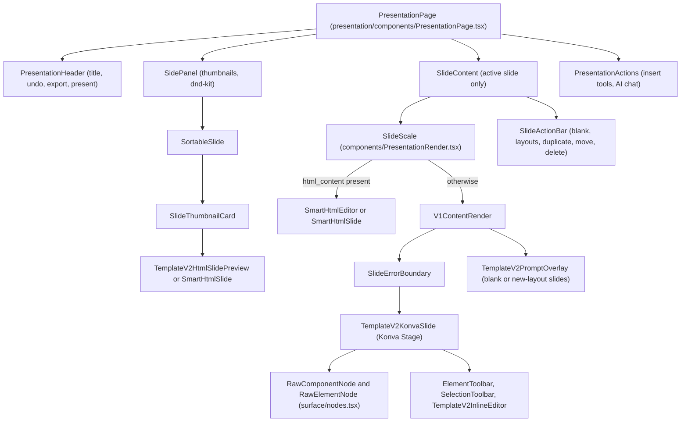
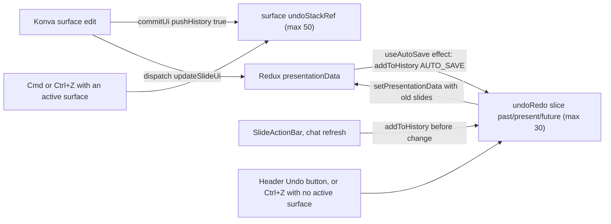

# Slide editor

<div class="chapter-meta" markdown>
**Reads:** `servers/nextjs/app/(presentation-generator)/presentation/components/PresentationPage.tsx`, `servers/nextjs/app/(presentation-generator)/components/PresentationRender.tsx`, `servers/nextjs/app/(presentation-generator)/components/V1ContentRender.tsx`, `servers/nextjs/components/slide-editor/surface/TemplateV2KonvaSlide.tsx`, `servers/nextjs/components/slide-editor/text/TiptapInlineTextEditor.tsx`, `servers/nextjs/app/(presentation-generator)/presentation/hooks/useAutoSave.tsx`, `servers/nextjs/app/(presentation-generator)/presentation/utils/autoSaveDiff.ts`, `servers/nextjs/store/slices/undoRedoSlice.ts`  ·  **Builds on:** [User journey](21-user-journey.md)  ·  **Time:** ~45 min
</div>

This chapter takes the editor apart: how a slide object in Redux becomes pixels, how a double-click turns into a Tiptap editor and then back into JSON, how images are replaced, how slides are added, moved and deleted, how the two undo systems coexist, how autosave decides what to send, and how presentation mode, wheel navigation, keyboard shortcuts and the clipboard work. The behaviors are cross-checked against the unit tests in `servers/nextjs/tests/`.

Paths are relative to `servers/nextjs/`. The editor has two slide flavors and you need to keep them apart from the start:

| Flavor | Data on the slide | Editor | Redux write |
|---|---|---|---|
| Template V2 (Standard mode, blank decks) | `slide.ui`, a JSON layout of components and elements on a 1280 x 720 canvas | `TemplateV2KonvaSlide` (Konva canvas plus DOM overlays) | `updateSlideUi({index, ui})` |
| Smart HTML (Smart mode) | `slide.html_content`, an HTML string styled with Tailwind | `SmartHtmlEditor` (`contenteditable` in place) | `updateSlideHtmlContent({slideIndex, slideId, html})` |

The Template V2 JSON format itself is documented in [Template V2 format](16-template-v2-format.md).

## Step 1: The component tree



### 1.1 `PresentationPage`

`PresentationPage` (`app/(presentation-generator)/presentation/components/PresentationPage.tsx:144`) renders only the selected slide in the main canvas, not a scrolling list:

```tsx title="servers/nextjs/app/(presentation-generator)/presentation/components/PresentationPage.tsx (excerpt)"
  const totalSlides = presentationData?.slides?.length ?? 0;
  const activeSlideIndex =
    totalSlides > 0
      ? Math.min(Math.max(selectedSlide, 0), totalSlides - 1)
      : 0;
  const activeEditorSlide = presentationData?.slides?.[activeSlideIndex];
```

`selectedSlide` is local React state, changed by thumbnail clicks, arrow keys, the mouse wheel, the `TEMPLATE_V2_SURFACE_SELECTED_EVENT` window event, and chat "follow mode". After each change an effect dispatches `TEMPLATE_V2_ACTIVATE_SURFACE_EVENT` with `{slideIndex}` on the next animation frame (`PresentationPage.tsx:768`) so the Konva surface for that slide claims keyboard focus.

### 1.2 `SlideContent` and `SlideScale`

`SlideContent` (`presentation/components/SlideContent.tsx:34`) is memoized with a hand-written comparator over 14 props (`SlideContent.tsx:143`). It computes `canEditSlide = !editingDisabled && isStreaming !== true` and renders `SlideScale` plus `SlideActionBar`.

`SlideScale` (`app/(presentation-generator)/components/PresentationRender.tsx:10`) draws every slide at its native 1280 x 720 and scales it with a CSS transform:

```tsx title="servers/nextjs/app/(presentation-generator)/components/PresentationRender.tsx (excerpt)"
    if (fitToContainer) {
      if (box.w < 1 || box.h < 1) return 1;
      const sx = box.w / BASE_WIDTH;
      const sy = box.h / BASE_HEIGHT;
      return Math.min(sx, sy);
    }
    const safeWidth = Math.max(0, box.w + 20);
    if (!safeWidth) return 1;
    return Math.min((safeWidth / BASE_WIDTH) * 0.98, 1);
```

A `ResizeObserver` keeps `box` current. The editor passes `fitToContainer`, so the slide grows to fill the canvas; present mode passes `presentMode`, which may scale above 1. When `isClickable` is false a transparent `z-30` div is laid over the slide to swallow clicks (`PresentationRender.tsx:133`). The branch that picks the renderer is the important part:

| Condition | Renderer |
|---|---|
| `slide.html_content` is a non-empty string, edit mode, clickable, not present, not fixed size | `SmartHtmlEditor` |
| `slide.html_content` non-empty, any other case | `SmartHtmlSlide` (read only) |
| otherwise | `V1ContentRender`, which in this snapshot always renders Template V2 |

### 1.3 `V1ContentRender` and the error boundary

Despite its name, `V1ContentRender` (`app/(presentation-generator)/components/V1ContentRender.tsx:159`) contains no legacy renderer. It reads `slide.ui` as a `TemplateV2Layout`, substitutes `BLANK_TEMPLATE_V2_LAYOUT` for blank slides, and renders:

```tsx title="servers/nextjs/app/(presentation-generator)/components/V1ContentRender.tsx (excerpt)"
        <SlideErrorBoundary label={`Slide ${(safeSlide.index ?? 0) + 1}`}>
            <div className="relative h-full w-full">
                <TemplateV2KonvaSlide
                    layout={directLayout ?? BLANK_TEMPLATE_V2_LAYOUT}
                    isEditMode={isEditMode}
                    slideId={safeSlide.id ?? null}
                    presentationId={presentationId}
                    slideIndex={safeSlide.index ?? 0}
```

`SlideErrorBoundary` (`app/(presentation-generator)/components/SlideErrorBoundary.tsx:16`) is a class component. A render error in one slide shows a red box titled "Slide N render error" with the message in a `<pre>`, while the rest of the editor keeps working. It resets only when its `resetKey` prop changes (`SlideErrorBoundary.tsx:37`).

!!! warning "Gotcha"
    `V1ContentRender` does not pass `resetKey`, so a slide that crashed once stays in the error state until the component remounts (for example by switching to another slide and back, since only the active slide is mounted). If you fix data that caused a crash, for instance through undo, pass `resetKey={slide.ui}` to make the boundary recover in place.

### 1.4 `TemplateV2KonvaSlide`

`TemplateV2KonvaSlide` (`components/slide-editor/surface/TemplateV2KonvaSlide.tsx:3399`, exported as `memo(TemplateV2KonvaSlideComponent)`) is a 3,400-line component that owns all editing state for one slide. Its props:

| Prop | Purpose |
|---|---|
| `layout` | the slide's `ui` JSON |
| `isEditMode` | false makes it a static renderer |
| `slideId`, `slideIndex`, `renderIndex` | identity; `renderIndex` wins for event targeting (`TemplateV2KonvaSlide.tsx:906`) |
| `displayScale` | the scale `SlideScale` applied, used to place DOM overlays correctly |
| `enableViewportCulling` | skip rendering when off screen (`isRenderActive` is true when culling is off or the slide is near the viewport, `TemplateV2KonvaSlide.tsx:478`) |
| `historyCommand` | `{action, token}` used by the template preview editor to trigger undo/redo from outside |
| `onLayoutChange`, `onHistoryAvailabilityChange` | callbacks for the template preview editor |

When the `layout` prop arrives and is not the object the surface last committed, the surface clones it, runs `normalizeMarkdownTextInUi()`, stores it as `uiDraft`, clears selection and inline editing, and empties its own undo and redo stacks (`TemplateV2KonvaSlide.tsx:981`). The Konva `Stage` renders `MemoizedRawElementNode` for root elements and `MemoizedRawComponentNode` for components from `surface/nodes.tsx`. The detailed per-element rendering rules are listed in `components/slide-editor/README.md`; this chapter focuses on the data flow.

### 1.5 Thumbnails are HTML, not Konva

`SlideThumbnailCard` does not mount a Konva stage per thumbnail. For v2 slides `shouldRenderTemplateV2HtmlPreview()` (`components/TemplateV2HtmlSlidePreview.tsx:205`) is true and it renders `TemplateV2HtmlSlidePreview`, a DOM renderer of the same JSON. Smart slides use `SmartHtmlSlide`. This keeps a 50-slide deck cheap, and it is also why a rendering feature must be implemented in both the Konva path and the HTML path to look the same in the side panel (`components/slide-editor/README.md` calls this "export parity").

## Step 2: How an edit becomes JSON

Every Template V2 edit, whatever the tool, ends in one function:

```tsx title="servers/nextjs/components/slide-editor/surface/TemplateV2KonvaSlide.tsx (excerpt)"
  const commitUi = useCallback(
    (nextUi: RawUi, pushHistory = true) => {
      if (!isEditMode) return;
      if (nextUi === currentUiRef.current) return;
      if (pushHistory) {
        undoStackRef.current.push(currentUiRef.current);
        if (undoStackRef.current.length > MAX_HISTORY_ENTRIES) {
          undoStackRef.current.shift();
        }
        redoStackRef.current = [];
      }
      currentUiRef.current = nextUi;
      setUiDraft(nextUi);
      onLayoutChange?.(nextUi as TemplateV2Layout);
      dispatch(
        updateSlideUi({
          index: surfaceSlideIndex ?? slideIndex,
          ui: nextUi as Record<string, unknown>,
        }),
      );
```

`updateSlideUi` (`store/slices/presentationGeneration.ts:309`) replaces `presentationData.slides[index].ui`. That Redux change is what autosave sees (Step 6).

### 2.1 Addressing an element

There are no string JSON paths in the Template V2 editor. A selection is a typed object (`components/slide-editor/model/core.ts:51`):

```ts title="servers/nextjs/components/slide-editor/model/core.ts (excerpt)"
export type ElementSelection = {
  kind: "element";
  componentIndex: number;
  elementPath: number[];
};
```

`componentIndex` points into `ui.components`, or is `ROOT_ELEMENTS_COMPONENT_INDEX = -1` (`core.ts:10`) for elements stored directly in `ui.elements`. `elementPath` is a list of indexes through nested child arrays. `updateElementInUi(ui, selection, updater)` (`model/model.ts:209`) walks the path with `updateElementArray()` (`model.ts:352`), which uses `childArrayInfo()` (`model.ts:1816`) to step into `children`, `elements` or a single `child` object (generated layouts use all three shapes), and rebuilds only the arrays along the path. Unchanged branches keep their references. Selections also have string keys for maps and Konva node refs (`keyForSelection`, `model.ts:1008`): `component:3`, `multi-component:1.4`, `element:2:0.1`.

So a text edit on the second child of the first element of component 2 produces `updateElementInUi(ui, {kind: "element", componentIndex: 2, elementPath: [0, 1]}, updater)`, and the resulting `ui` object is dispatched whole.

!!! warning "Gotcha"
    `presentationGeneration` still exports `updateSlideContent`, `updateSlideImage`, `updateSlideIcon` and `updateImageProperties`, reducers that write into `slide.content` using a dotted path such as `body[0].heading` (`store/slices/presentationGeneration.ts:323`). A search of `app`, `components` and `lib` finds no caller. They are leftovers from the pre-Template-V2 editor. Edits now go to `slide.ui` (Konva) or `slide.html_content` (Smart). Do not wire new features to the `dataPath` reducers expecting the renderer to pick them up.

## Step 3: Inline text editing with Tiptap

### 3.1 Opening

A double-click on an element calls `handleElementDoubleClick()` (`TemplateV2KonvaSlide.tsx:2725`), which dispatches by element type: `image` does nothing (images are replaced through the toolbar), `chart` opens the chart editor, vector types enter point editing, and everything else goes to `openInlineEditor()` (`TemplateV2KonvaSlide.tsx:1863`), which only acts on `text` and `text-list` elements and ignores other types.

For `text` the surface first normalizes stray Markdown (`normalizeRawTextMarkdownElement`); if that changed anything, the normalized element is written back immediately with `updateElement(selection, ..., false)`, which updates Redux without an undo entry. It then reads the style, and converts the element to word-wrapped `TextRun[]`. For `text-list` it also records the list marker, which is `number`, `none` or (default) `bullet`. It then calls `startInlineEdit({kind, selection, draft, runs, listMarker?, frame, style})`, where `frame` is the element's rendered box auto-sized for the runs.

### 3.2 The editor overlay

`TemplateV2InlineEditor` positions a DOM element over the Konva text, and inside it `TiptapInlineTextEditor` (`components/slide-editor/text/TiptapInlineTextEditor.tsx:284`) mounts Tiptap with a deliberately small schema:

```ts title="servers/nextjs/components/slide-editor/text/TiptapInlineTextEditor.tsx (excerpt)"
const TIPTAP_EXTENSIONS = [
  StarterKit.configure({
    heading: false,
    bulletList: false,
    orderedList: false,
    blockquote: false,
    codeBlock: false,
    horizontalRule: false,
    underline: false,
    link: false,
    listKeymap: false,
    trailingNode: false,
  }),
  Underline,
  RunStyle,
  LatexRun,
];
```

Lists are not Tiptap lists: the list marker belongs to the element, and Enter inside a list element is handled by `applyLineBreakBeforeInput()` (`TiptapInlineTextEditor.tsx:445`). `RunStyle` carries per-run font, color and spacing; `LatexRun` is an inline math node. Runs are converted to Tiptap JSON with `textRunsToTiptapContent()` and back with `tiptapContentToTextRuns()`.

Key handling inside the editor (`TiptapInlineTextEditor.tsx:430`):

| Key | Effect |
|---|---|
| Escape | `onEscape()` (close) |
| Cmd/Ctrl+Enter | flush pending runs, then `onCommitShortcut()` |
| Enter in a list element | line break with the list marker |
| any key | `event.stopPropagation()`, so slide shortcuts (Delete, arrows, Cmd+Z) do not fire while typing |

The editor's root has `data-inline-edit-ignore="true"`, which `isEditableTarget()` (`model/core.ts:192`) recognizes, so global handlers also skip it.

### 3.3 Typing without committing

On every Tiptap update, `scheduleRunsEmit()` (`TiptapInlineTextEditor.tsx:373`) coalesces changes into one `requestAnimationFrame`, converts the document to runs, compares a signature with the last emitted one, and calls `onRunsChange(runs)`. The surface's `commitInlineTextRuns()` (`TemplateV2KonvaSlide.tsx:1978`) only updates the inline-edit state (draft text, runs, and an auto-sized frame). Nothing reaches Redux while typing, which keeps typing responsive on large decks.

### 3.4 Closing and committing

`closeInlineEditor(commit = true, runsOverride?)` (`TemplateV2KonvaSlide.tsx:1909`) builds the final element with `elementWithInlineDraft()` (`model.ts:1854`), writes it through `updateElementInUi()`, grows the parent component to the text height with `syncComponentHeightToElement()`, and calls `commitUi()` once. That single commit is one undo step and one Redux update. If the plain text differs from before, an `Editor_Element_Text_Edited` analytics event is sent.

!!! warning "Gotcha"
    `app/(presentation-generator)/components/MarkdownInlineText.tsx` describes itself as the preview renderer "where Tiptap edit mode is off", but nothing imports it in this snapshot. Inline Markdown is now normalized away when a text element is opened (`normalizeRawTextMarkdownElement`) and when a layout is loaded (`normalizeMarkdownTextInUi`). Editing that file has no effect on the editor.

### 3.5 Smart HTML text

`SmartHtmlEditor` (`app/(presentation-generator)/components/SmartHtmlEditor.tsx`) injects `slide.html_content` into a container (after the Tailwind browser runtime is ready, see Step 11) and marks text-bearing elements with `contenteditable="true"` and `data-editable-text="1"`; bare text nodes are wrapped in a `span` marked `data-smart-text-wrapper="1"`. Input, cut, paste and drop set a dirty flag. On blur, `saveHtml()` clones the container, unwraps the wrapper spans, strips the editing attributes, and dispatches `updateSlideHtmlContent({slideIndex, slideId, html})` if the HTML changed (`SmartHtmlEditor.tsx:202`).

## Step 4: Image editing

There are two image editors, one per slide flavor.

### 4.1 Template V2 images (Konva)

Selecting an image element shows `ImageToolbar` (`components/slide-editor/images/ImageToolbar.tsx`), routed by `ElementToolbar`. Its operations, as documented in `components/slide-editor/README.md`:

| Operation | Stored as |
|---|---|
| Fit: Fill, Contain, Stretch | `fit` set to `cover`, `contain` or `fill` |
| Crop | `fit: "cover"` plus `focus_x`, `focus_y` (0 to 100) and optional `crop_scale` (not a pixel rectangle) |
| Flip | `flip_h`, `flip_v` |
| Opacity, corner radius | `opacity`, `border_radius` |
| Replace | new `data` URL |

Replace opens a hidden file input. `handleImageUploadChange()` (`TemplateV2KonvaSlide.tsx:2656`) rejects non-`image/*` files and files over 5 MB (5 x 1024 x 1024 bytes), uploads with `ImagesApi.uploadImage(file)` (`POST /api/v1/ppt/images/upload`, multipart field `file`), resolves the returned asset with `resolveBackendAssetSource()`, and writes:

```ts title="servers/nextjs/components/slide-editor/surface/TemplateV2KonvaSlide.tsx (excerpt)"
        updateElement(target, (element) => ({
          ...element,
          data: imageUrl,
          name: file.name,
          focus_x: 50,
          focus_y: 50,
          crop_scale: null,
        }));
```

Icons are image elements flagged `is_icon` (or SVG sources under static icon paths). Double-clicking an icon does nothing (it is an `image`); the toolbar's edit-icon action calls `openIconEditor()` (`TemplateV2KonvaSlide.tsx:2430`), which opens `IconsEditor`. It searches with `GET /api/v1/ppt/icons/search?query=...&limit=...` and can change icon weight by rewriting the URL.

### 4.2 Smart HTML images: `ImageEditor` and `ImageEditorToolbar`

In Smart slides, clicking an `` opens `ImageEditor` (`app/(presentation-generator)/components/ImageEditor.tsx:47`), or `IconsEditor` when the image looks like an icon (`image-type="icon"`, an `.svg` source, or "icon" in its alt text). `ImageEditor` is a right-side `Sheet` with three tabs, not a Konva canvas:

| Tab | Calls |
|---|---|
| Generate | `GET /api/v1/ppt/images/generate?prompt=...` (AI providers); with Pexels or Pixabay configured it becomes a stock search, `GET /api/v1/ppt/images/search?query=...&limit=20&provider=...`; previous results from `GET /api/v1/ppt/images/generated` |
| Upload | `POST /api/v1/ppt/images/upload` (5 MB limit, `image/*` only), list `GET /api/v1/ppt/images/uploaded`, delete `DELETE /api/v1/ppt/images/{id}` |
| Edit | `ImageEditorToolbar` (`components/ImageEditorToolbar.tsx:42`): fit dropdown (Fill = `cover`, Contain, Stretch = `fill`), focus-point toggle, Replace (switches to the Generate tab) |

Picking an image calls `onImageChange(url, prompt)`. `SmartHtmlEditor.replaceMedia()` (`SmartHtmlEditor.tsx:512`) sets the `` `src`, stores the prompt in a `prompt` (or `query` for icons) attribute, and saves the HTML on the next tick.

!!! warning "Gotcha"
    In the Edit tab, fit and focus-point changes are applied to the preview image inside the sheet and reported through `onFocusPointClick` (`ImageEditor.tsx:223`), which carries a `// TODO: Save to Redux store if needed` comment. `SmartHtmlEditor` does not pass `onFocusPointClick`, so on Smart slides those two settings are not persisted. Only replacing the image changes the slide.

## Step 5: Slide operations: add, duplicate, move, delete, reorder

### 5.1 `SlideActionBar`

Under the active slide, `SlideActionBar` (`presentation/components/SlideActionBar.tsx:62`) offers Blank, Layouts (template picker), a speaker-notes popover, and a menu with duplicate, move up, move down and delete. It is hidden while streaming. Before every structural change it snapshots the current slides into the app-level history:

```tsx title="servers/nextjs/app/(presentation-generator)/presentation/components/SlideActionBar.tsx (excerpt)"
  const rememberSlides = (actionType: string) => {
    const currentSlides = (store.getState() as RootState)
      .presentationGeneration.presentationData?.slides;
    if (!Array.isArray(currentSlides)) return;

    dispatch(
      addToHistory({
        slides: currentSlides,
        actionType,
      })
    );
  };
```

| Action | Reducer | Notes |
|---|---|---|
| Blank | `addNewSlide({slideData, index})` | inserts after `index` with a new uuid; the new slide shows the prompt overlay (`promptOverlayKind: "blank"`) |
| Layouts | `NewSlide` modal, then `addNewSlide` | slide is `{id, index, content: {}, ui: <layout JSON>, layout_group: templateID, layout: <layout id>, presentation}` (`NewSlide.tsx:208`) |
| Duplicate | `duplicatePresentationSlide({index, slideId})` | deep copy via `JSON.parse(JSON.stringify())`, new id |
| Move up or down | `movePresentationSlide({fromIndex, toIndex})` | |
| Delete | `deletePresentationSlide(index)` | refuses when only one slide is left |
| Delete the last slide | `replaceSlidesWithBlankFallback({slideData})` | the deck always keeps one (blank) slide |

Every one of these reducers renumbers `index` to match the array position and, except move, updates `n_slides`. Add and duplicate refuse at `MAX_NUMBER_OF_SLIDES = 50`, both in the action bar (toast) and in the reducer (silent return).

`NewSlide` (`presentation/components/NewSlide.tsx`) lists layouts from the presentation's embedded layout data, refreshed with `TemplateService.getTemplateDetails(templateID)` (`GET /api/v1/ppt/template/{id}`); if the refresh fails it falls back to the embedded layouts.

### 5.2 Drag to reorder with dnd-kit

The side panel wraps thumbnails in `DndContext` plus `SortableContext` with `verticalListSortingStrategy` (`presentation/components/SidePanel.tsx`). The pointer sensor needs 8 px of movement before a drag starts, so a click still selects.

`SortableSlide` (`presentation/components/SortableSlide.tsx:15`) registers ``useSortable({ id: slide.id || `${slide.index}` })``, renders `SlideThumbnailCard` with the transform and 50% opacity while dragging, and ignores a second click within 300 ms. Its memo comparator re-renders a thumbnail only when its own selected state flips, not on every selection change (`SortableSlide.tsx:68`).

On drop, `SidePanel.handleDragEnd()` finds both indices by `slide.id`, applies `arrayMove`, renumbers `index`, and dispatches `setPresentationData({...presentationData, slides: updatedArray})`. During streaming the list is rendered without `SortableContext`, so it cannot be dragged.

!!! warning "Gotcha"
    `SortableListItem.tsx` is a second sortable item component ("Slide N" text only) that nothing imports. The live one is `SortableSlide`. Also note that drag reorder, unlike the action bar, does not call `addToHistory` before the change, so the app-level undo history records the reordered deck only when the autosave effect runs.

### 5.3 The AI prompt on a new slide

A blank or freshly inserted layout slide shows `TemplateV2PromptOverlay` (defined in `V1ContentRender.tsx:38` and in `_shared/TemplateV2PromptOverlay.tsx`) with a "Write prompt" field. Submitting dispatches a window event:

```ts title="servers/nextjs/app/(presentation-generator)/components/V1ContentRender.tsx (excerpt)"
        window.dispatchEvent(
            new CustomEvent<BlankSlidePromptEventDetail>(
                PRESENTON_BLANK_SLIDE_PROMPT_EVENT,
                {
                    detail: {
                        prompt: trimmedPrompt,
                        slideIndex,
                        layoutId:
                            typeof layout.id === "string" ? layout.id : null,
                        promptKind: showLayoutPreview ? "layout" : "blank",
                        layout: showLayoutPreview ? layout : null,
                    },
                },
            ),
        );
```

`PresentationActions` listens for `presenton:blank-slide-prompt` (`PresentationActions.tsx:2145`, only in the `template-v2` variant and not for Smart decks), opens the AI panel, and hands the request to `Chat`. `Chat` sends the prompt with a hidden instruction such as "Create content on the existing selected slide 3. Update this slide; do not add another slide." or, for a layout slide, "Fill the existing selected slide 3 using its selected layout (layout id: ...) ..." (`Chat.tsx:2046`). When the assistant finishes, `PresentationPage.handlePresentationChanged()` records a `CHAT_ASSISTANT_BEFORE_REFRESH` history entry, refetches the deck, and records `CHAT_ASSISTANT_REFRESH`. The assistant itself is the subject of [Editing and chat assistant](14-editing-and-chat.md).

### 5.4 Inserting elements from the tool rail

The right rail (`PresentationActions`) has tabs AI, Blocks, Texts, Charts, Infograph, Tables, Images and Shapes (`PresentationActions.tsx:212`). Inserting dispatches `TEMPLATE_V2_INSERT_ELEMENTS_EVENT` (`presenton:template-v2-insert-elements`) with `{elements?, components?, label?, slideId?, slideIndex?}`. Every mounted surface listens, but `eventTargetsThisSlide()` lets only the targeted or active one act (`TemplateV2KonvaSlide.tsx:2810`). It appends the content with `appendInsertedContent()`, commits, selects the new component(s), and sets `detail.handled = true` so the sender knows the insert landed. `tests/image-placeholders.test.mjs:9` builds `insert/insert-elements.ts` and checks that every image insert kind (`image`, `image-frame-circle`, `image-grid`, `image-collage`) uses a `data` path ending in `image-placeholder.svg`, and that the SVG file has a `viewBox` and no embedded raster.

## Step 6: Autosave

`useAutoSave({debounceMs: 2000, enabled})` is created by `PresentationPage` with `enabled` false while there is no data, while streaming, and while the chat assistant is sending or mutating (`PresentationPage.tsx:275`). The hook adds its own pause conditions:

```ts title="servers/nextjs/app/(presentation-generator)/presentation/hooks/useAutoSave.tsx (excerpt)"
    const autoSavePaused =
        !enabled || isStreaming || isLoading || isLayoutLoading;
```

### 6.1 The acknowledged snapshot

The hook never compares two full decks. It keeps an `AutoSaveSnapshot` of what the server is believed to have (`presentation/utils/autoSaveDiff.ts:3`):

| Field | Content |
|---|---|
| `presentationId` | deck id |
| `slideOrder` | slide ids in order |
| `slideFingerprints` | `{[slideId]: JSON.stringify(slide)}` |
| `metadataFingerprint` | `JSON.stringify({title})` |

`createAutoSaveSnapshot()` builds it. While paused, every incoming `presentationData` replaces the snapshot, on the assumption that server-originated data (streaming, refetches) is already persisted (`useAutoSave.tsx:146`). The first active render after a pause is also treated as already saved (`useAutoSave.tsx:168`), because the final stream payload can land in the same render that re-enables editing.

### 6.2 The diff

`getAutoSaveChanges(acknowledged, data)` (`autoSaveDiff.ts:54`) classifies the change:

```ts title="servers/nextjs/app/(presentation-generator)/presentation/utils/autoSaveDiff.ts (excerpt)"
  const hasInvalidOrDuplicateIds =
    validIds.length !== slides.length || new Set(validIds).size !== validIds.length;
  const orderChanged =
    validIds.length !== acknowledged.slideOrder.length ||
    validIds.some((id, index) => id !== acknowledged.slideOrder[index]);
  const indicesChanged = slides.some(
    (slide: any, index: number) => slide?.index !== index
  );
  const structuralChange =
    hasInvalidOrDuplicateIds || orderChanged || indicesChanged;
```

If the change is not structural, `changedSlides` holds each slide whose fingerprint differs. `metadataChanged` compares the title only.

### 6.3 The save requests

After the 2 s debounce, `saveLatest()` (`useAutoSave.tsx:50`) picks one of three paths:

| Change | Request | Body |
|---|---|---|
| Structural (add, delete, reorder, missing or duplicate ids) | `PATCH /api/v1/ppt/presentation/update` | `createPresentationUpdatePayload(data)` = `{id, title, n_slides, slides}`, stringified once |
| Title changed (no structural change) | `PATCH /api/v1/ppt/presentation/update` | `{id, title}` |
| Slide content (no structural change) | `PATCH /api/v1/ppt/presentation/slide_update`, one per changed slide, sequentially | `{"slide": {...full slide...}}` |

The last two are not exclusive: when both the title and some slides changed in one debounce window, the title PATCH is sent first and the slide PATCHes follow in the same save (`useAutoSave.tsx:90-116`).

In the per-slide path each success updates that slide's fingerprint immediately, so a later failure does not resend the slides that already succeeded. The first error is rethrown after the loop and logged as "Auto-save failed"; there is no user-visible error toast. If an edit arrives while a save is in flight, `pendingSaveRef` is set and a follow-up save runs 250 ms after the current one finishes.

`tests/presentation-autosave.test.mjs` pins three behaviors: the whole-deck payload has exactly `id`, `title`, `n_slides`, `slides` and no `theme` (line 38); a theme-only change (template theme hydration) is not a change at all (line 49); and a title change, a content change and an added slide each hit their own path (line 60).

!!! warning "Gotcha"
    The theme is excluded on purpose. `usePresentationData` overwrites `presentationData.theme` with the template theme fetched from `/api/v1/ppt/template/...`; if theme were part of the payload or the fingerprint, opening any deck would immediately PATCH it. If you add a new mutable field (speaker notes are inside the slide, so they are covered), add it to `createPresentationUpdatePayload()` and to the metadata fingerprint, or it will never be saved.

## Step 7: Undo and redo: two systems

There are two independent histories.



### 7.1 Surface-local history

`TemplateV2KonvaSlide` keeps `undoStackRef` and `redoStackRef` of whole `ui` objects, capped at `MAX_HISTORY_ENTRIES = 50` (`model/core.ts:20`). `undo()` pops the previous layout, pushes the current one onto redo, and calls `commitUi(previous, false)` (`TemplateV2KonvaSlide.tsx:1282`). The shortcut handler is a capture-phase `keydown` on `document` that requires the surface to be active and the target not editable, accepts `metaKey` or `ctrlKey`, maps `z` to undo and `shift+z` or `y` to redo, and calls `stopImmediatePropagation()` (`TemplateV2KonvaSlide.tsx:2892`).

"Active" means `document.documentElement.dataset.templateV2KonvaActiveSurface` equals this surface's `useId()` (`TemplateV2KonvaSlide.tsx:1033`). A pointerdown inside the surface activates it; a pointerdown outside (other than on floating toolbars marked `data-template-v2-floating-toolbar` or `data-inline-edit-ignore`) clears it.

### 7.2 App-level history (`undoRedoSlice`)

`store/slices/undoRedoSlice.ts` holds `{past, present, future, maxHistorySize: 30, isUndoRedoInProgress, pendingHistorySkips}`. Entries are `{slides, timestamp, actionType}` and store the immutable Redux slide arrays by reference:

```ts title="servers/nextjs/store/slices/undoRedoSlice.ts (excerpt)"
      // Reference equality is sufficient because presentation updates go
      // through Redux Toolkit/Immer and therefore replace changed arrays.
      // It also avoids duplicate entries from explicit pre-operation captures.
      const presentSlides = state.present
        ? original(state.present)?.slides ?? state.present.slides
        : null;
      if (presentSlides === newSlides) {
        return;
      }
```

`useAutoSave` dispatches `addToHistory({slides, actionType: "AUTO_SAVE"})` on every active `presentationData` change (`useAutoSave.tsx:163`), immediately and independently of the network debounce. `undo` and `redo` set `pendingHistorySkips = 1`, so the `setPresentationData` that applies the snapshot does not itself become a new entry.

`usePresentationUndoRedo()` (`presentation/hooks/PresentationUndoRedo.ts:8`) applies an entry with `setPresentationData({...presentationData, slides: snapshot})` and binds `Ctrl+Z`, `Ctrl+Shift+Z` and `Ctrl+Y` through `useKeyboardShortcut()`. The header's Undo and Redo buttons call the same functions.

| | Surface history | App history |
|---|---|---|
| Scope | one slide's `ui` | the whole slides array |
| Capacity | 50 | 30 |
| Modifier keys | Cmd or Ctrl | Ctrl only (`event.ctrlKey`) |
| Triggered by | keyboard on the active surface, `historyCommand` prop | header buttons, Ctrl shortcuts when no surface is active |
| Cleared by | a new `layout` prop that is not the surface's own last commit | `clearHistory()` on deck load and on regenerate |

`useKeyboardShortcut()` (`app/(presentation-generator)/hooks/use-keyboard-shortcut.ts:10`) explicitly yields `z` and `y` when a surface is active (`use-keyboard-shortcut.ts:22`), so the two systems never both handle one keystroke.

!!! warning "Gotcha"
    On macOS, Cmd+Z only reaches the surface history. With no active surface (for example after clicking the side panel) Cmd+Z does nothing, because the app-level hook checks `ctrlKey` only. Also, applying an app-level undo replaces the slide's `ui` with an older object, which the surface sees as an external change and answers by emptying its own undo and redo stacks (`TemplateV2KonvaSlide.tsx:999`).

## Step 8: Keyboard shortcuts

| Shortcut | Where handled | Condition |
|---|---|---|
| Arrow Left/Up, Right/Down | `PresentationPage` window `keydown` (`PresentationPage.tsx:630`) | no modifiers, not repeat, not composing, target not editable, more than one slide, not present mode |
| Cmd/Ctrl+Z, Cmd/Ctrl+Shift+Z, Cmd/Ctrl+Y | surface (capture phase) | active surface |
| Ctrl+Z, Ctrl+Shift+Z, Ctrl+Y | `usePresentationUndoRedo` | no active surface |
| Cmd/Ctrl+C, Cmd/Ctrl+V | `useTemplateV2Clipboard` (capture phase) | active surface, target not editable |
| Mod+G (group), Alt+K / Alt+J (layer up/down), Shift+Alt+K / Shift+Alt+J (front/back) | surface capture handlers (`TemplateV2KonvaSlide.tsx:2239`, `2378`) | active surface |
| Backspace / Delete | surface window `keydown` (`TemplateV2KonvaSlide.tsx:2771`) | a selection, no modifiers, target not editable |
| `?` | `KeyboardShortcutsDialog` (`presentation/components/KeyboardShortcutsDialog.tsx:53`) | no Cmd, Ctrl or Alt, target not editable (checked by the dialog's own local `isEditableTarget()`, `KeyboardShortcutsDialog.tsx:198`) |

The help dialog renders `EDITOR_SHORTCUT_SECTIONS` (`components/slide-editor/shortcuts/editorShortcuts.ts:56`), five sections (Selection, Editing, Arrange, Slide navigation, Help) defined with abstract keys such as `Mod`. `shortcutKeyLabel()` prints `Mod` as `Ctrl` on Windows and Linux and as the command symbol on macOS; the dialog detects the platform with `useAppleShortcutPlatform()` and lets the user switch the displayed platform.

!!! warning "Gotcha"
    `package.json` lists `@tanstack/react-hotkeys`, but no file under `app`, `components` or `lib` imports it. All shortcuts are plain `addEventListener("keydown")` handlers, and their relative order depends on capture phase and `stopImmediatePropagation()`. When you add a shortcut, attach it in the capture phase on `document` if it must beat the surface handlers, and check `isEditableTarget()` so it does not fire while typing.

## Step 9: Wheel navigation

On screens at least 768 px wide, outside present mode, with more than one slide, and while neither loading nor streaming, `PresentationPage` attaches a non-passive `wheel` listener to the canvas (`PresentationPage.tsx:404-447`). Already-handled events (`defaultPrevented`), Ctrl or Cmd wheel (zoom) and wheels over editable targets are ignored. `preventDefault()` is called only when the slide actually changes, so a wheel at the first or last slide still scrolls normally. Everything else goes through `consumeWheelNavigation()` (`presentation/utils/wheelSlideNavigation.ts:20`), which returns `-1`, `0` or `1`.

The function's job is to turn one trackpad swipe, which produces dozens of decaying events, into exactly one slide change:

| Constant | Value | Meaning |
|---|---|---|
| `GESTURE_GAP_MS` | 100 | a gap longer than this starts a new gesture |
| `RESTART_DELAY_MS` | 60 | minimum time after a navigation before a restart counts |
| `RESTART_ACCELERATION` | 1.5 | a delta this much larger than the last, while decelerating, is a new swipe |
| `RESTART_MIN_DELTA` | 4 | smaller deltas never restart or reverse |

Events with `|deltaY| < 1` or with horizontal motion at least as large as vertical return 0. The first qualifying event of a gesture navigates; the rest of that gesture returns 0. A gesture "decelerates" when a delta drops below 85% of the previous one or 65% of the peak. `tests/wheel-slide-navigation.test.mjs` covers the cases: a ten-event swipe `[30, 55, 80, 70, 50, 32, 18, 8, 3, 1]` at 16 ms spacing yields `[1, 0, 0, 0, 0, 0, 0, 0, 0, 0]` (line 47); a reversal of at least 4 during momentum navigates back (line 62); an acceleration from 10 to 30 after deceleration restarts (line 70); a `-2` reversal does not (line 87).

A first-visit hint ("Navigate with arrow keys or scroll to change slides") is shown once per browser, remembered in `localStorage["presenton:editor-navigation-hint:v1"]`, and auto-dismissed after 5 s or on the first slide change (`PresentationPage.tsx:141`).

## Step 10: Presentation mode

The header's Present button navigates to `?id=ID&mode=present&slide=N` (plus `&type=smart` for Smart decks). `PresentationPage` then returns `PresentationMode` instead of the editor (`PresentationPage.tsx:796`), from `presentation/components/PresentationMode.tsx`.

Each slide is rendered by `SlideScale` with `isEditMode={false}`, `presentMode` and `isClickable={false}` (`PresentationMode.tsx:119`). Slide changes go through `usePresentationNavigation().handleSlideChange()`, which pushes `?id=ID&mode=present&slide=N` with `scroll: false` so the browser back button steps through slides.

| Input | Action |
|---|---|
| Right, Down, Space, PageDown | next slide (held Space, Right and Left are ignored as key repeats; Up and Down are not, `PresentationMode.tsx:306`) |
| Left, Up, PageUp | previous slide |
| Home / End | first / last |
| Escape | close the grid, else exit fullscreen, else exit present mode |
| F | toggle fullscreen on the mode's root element |
| G | toggle the thumbnail grid |
| N | toggle speaker notes (`slide.speaker_note`) |
| Click in the left fifth / right fifth of the screen | previous / next |

The controls fade after `CHROME_HIDE_MS = 2000` ms without activity, except while the grid or notes are open (`PresentationMode.tsx:242`). Exiting calls `handlePresentExit()`, which leaves fullscreen and pushes `/presentation?id=ID`, dropping `type=smart` from the URL.

!!! warning "Gotcha"
    There are two files named `PresentationMode.tsx`. The live one is `app/(presentation-generator)/presentation/components/PresentationMode.tsx` (610 lines). `app/(presentation-generator)/components/PresentationMode.tsx` is not imported anywhere. Make changes in the first.

## Step 11: The Tailwind browser runtime

Smart slides are HTML with Tailwind classes generated by the LLM, so the classes cannot be compiled ahead of time. `components/runtime/TailwindBrowserRuntime.tsx`, mounted once in the root layout, loads `/vendor/tailwindcss-browser-4.3.3.js` with `next/script` (`afterInteractive`) together with a `<style type="text/tailwindcss">` that limits generated utilities to elements under `[data-tailwind-runtime-scope]` using `@scope` (`lib/tailwind-browser.ts:5`). The app's own CSS is therefore unaffected.

On `/` the script is deferred until some component requests it (`TAILWIND_RUNTIME_REQUEST_EVENT`), and on `/pdf-maker` it is not rendered at all. `useTailwindRuntimeReady()` dispatches that request and returns true after the `presenton:tailwind-runtime-ready` event. `SmartHtmlEditor` renders a read-only `SmartHtmlSlide` until the runtime is ready, and its container carries `data-tailwind-runtime-scope`.

## Step 12: Clipboard

Two clipboard modules exist with different jobs.

### 12.1 Slide objects: `components/slide-editor/clipboard`

`useTemplateV2Clipboard()` (`components/slide-editor/clipboard/useClipboard.ts:21`) is wired by the surface with `onCopy = createClipboardPayload` and `onPaste = pasteClipboardPayload` (`TemplateV2KonvaSlide.tsx:1855`). Copy serializes the selected components (root elements are wrapped into a component-like item) and writes three places:

| Target | Format |
|---|---|
| native `copy` event data | MIME `application/x-presenton-template-v2` and `text/plain` with prefix `PRESENTON_TEMPLATE_V2:` |
| `navigator.clipboard.writeText` (keyboard path) | `PRESENTON_TEMPLATE_V2:` plus JSON |
| in-memory cache and `localStorage["presenton:template-v2-clipboard"]` | JSON |

The keyboard paste path (Cmd/Ctrl+V) reads the in-memory or `localStorage` cache first and `navigator.clipboard.readText()` second. A native `paste` event instead reads the event's MIME data or prefixed `text/plain` first and falls back to the cache only when the clipboard is empty. Either way the surface then calls `pasteTemplateV2ClipboardPayload()` (`clipboard/clipboard.ts:62`), which appends deep-cloned components with fresh ids at an offset of `16 * pasteSequence` pixels (`PASTE_OFFSET = 16`). Repeated pastes cascade; a new copy resets the sequence. Duplicate uses the same payload path without touching the system clipboard.

### 12.2 Plain text: `utils/clipboard.ts`

`copyTextToClipboard(text)` (`utils/clipboard.ts:1`) is used by the admin panel to copy API keys, not by the editor. It tries `navigator.clipboard.writeText`, falls back to a hidden off-screen `textarea` plus `document.execCommand("copy")`, restores the previous focus, and throws "Clipboard access is not available in this browser." if both fail. `tests/clipboard.test.mjs` checks all four branches: Clipboard API available (line 99), API missing (line 119), API denied (line 136), and neither available (line 156).

## What you now know

- The editor mounts only the active slide; `SlideScale` picks `SmartHtmlEditor` for `html_content` and the Konva-based `TemplateV2KonvaSlide` for everything else, wrapped in a per-slide error boundary.
- Template V2 edits address elements with `{componentIndex, elementPath}`, rebuild only the touched arrays, and land in Redux through a single `commitUi()` that dispatches `updateSlideUi`; Smart edits dispatch `updateSlideHtmlContent` on blur.
- Tiptap typing is buffered per animation frame and committed once when the editor closes; image replacement uploads to `/api/v1/ppt/images/upload` with a 5 MB limit.
- Autosave fingerprints each slide with `JSON.stringify`, sends per-slide `slide_update` PATCHes or a whole-deck `update` for structural changes, and deliberately ignores the theme.
- There are two undo systems: a 50-entry per-surface stack keyed on Cmd/Ctrl, and a 30-entry Redux history keyed on Ctrl, with explicit hand-offs between them.
- Wheel navigation, presentation mode and both clipboards are small, test-covered modules you can change in isolation.

## Next

The next chapter covers the screens that configure all of this: onboarding, settings, provider forms, admin and telemetry, in [Settings, onboarding, auth UI](23-settings-and-auth-ui.md).
