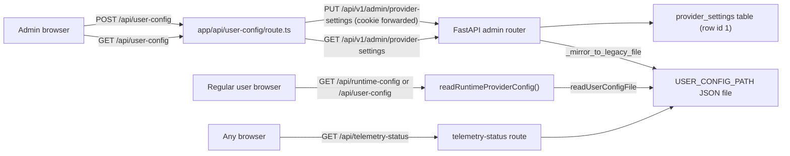
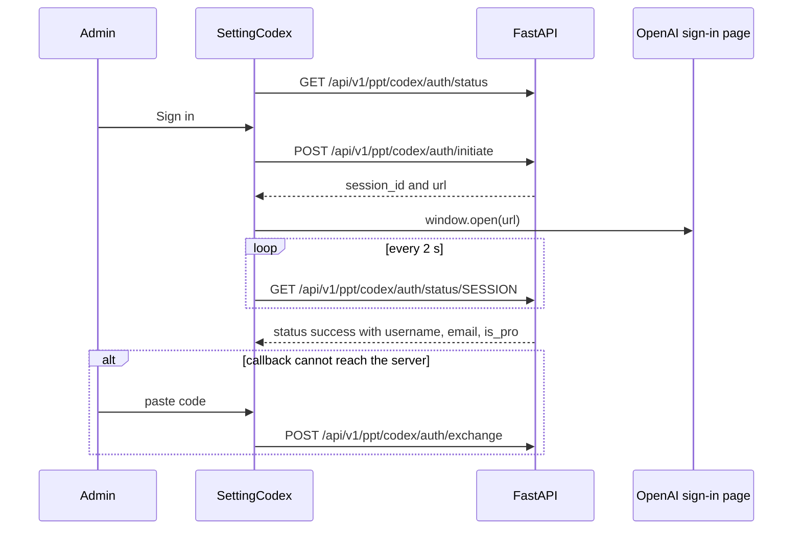

# Settings, onboarding, auth UI

<div class="chapter-meta" markdown>
**Reads:** `servers/nextjs/components/Home.tsx`, `servers/nextjs/components/OnBoarding/PresentonMode.tsx`, `servers/nextjs/app/(presentation-generator)/(dashboard)/settings/SettingPage.tsx`, `servers/nextjs/app/(presentation-generator)/(dashboard)/settings/TextProvider.tsx`, `servers/nextjs/utils/storeHelpers.ts`, `servers/nextjs/app/api/user-config/route.ts`, `servers/nextjs/lib/runtime-provider-config.ts`, `servers/nextjs/lib/user-config-store.ts`, `servers/nextjs/app/(presentation-generator)/(dashboard)/admin/AdminPanel.tsx`, `servers/nextjs/utils/mixpanel.ts`  ·  **Builds on:** [Configuration and LLM providers](06-configuration-and-providers.md)  ·  **Time:** ~40 min
</div>

This chapter covers every screen that configures a Presenton instance: the login gate, the onboarding wizard, the admin settings page with its text, image and web search provider forms, the ChatGPT (Codex) and Presenton Cloud sign-in flows, the admin panel for users and API keys, the Community page, and anonymous telemetry. For each one you will see the request it sends, the validation it runs first, and how the saved configuration flows back into the browser, including how secrets are hidden from non-admin users.

Paths are relative to `servers/nextjs/` unless they start with `servers/`. The server-side meaning of each configuration key (which provider class it selects, how it becomes environment variables) is in [Configuration and LLM providers](06-configuration-and-providers.md); this chapter stays in the browser and the Next.js route handlers.

## Step 1: Where configuration lives and how the browser reads it



The source of truth is the FastAPI `provider_settings` table. `save_provider_settings()` merges the incoming keys into the stored ones (patch semantics), commits, and mirrors the result into the JSON file at `USER_CONFIG_PATH` (`servers/fastapi/services/provider_settings.py:137`). Several Next.js routes read that file directly, which is why both copies matter.

### 1.1 `/api/user-config`

`app/api/user-config/route.ts` is the admin settings endpoint:

| Method | Caller role | Behavior |
|---|---|---|
| `GET` | admin | forwards to FastAPI `GET /api/v1/admin/provider-settings` with the caller's cookie and desktop token header; returns real secrets |
| `GET` | regular user | returns `readRuntimeProviderConfig().config` (redacted, see 1.3) |
| `GET` | anonymous | `401 {"detail": "Unauthorized"}` |
| `POST` | admin only (`requireAdminApi`, else 401 or 403) | requires `Content-Type: application/json` (else 415), a non-empty JSON object body (else 400), then forwards it as `PUT /api/v1/admin/provider-settings` |

The role check calls FastAPI `GET /api/v1/auth/status` from the server with the incoming cookie (`lib/server-auth-role.ts:20`); any failure counts as unauthenticated.

### 1.2 `/api/runtime-config`

`app/api/runtime-config/route.ts:7` returns `{configured, config}` for any authenticated user, from `readRuntimeProviderConfig()`. If reading fails it answers `200 {"configured": false, "config": {}}`. `ConfigurationInitializer` uses it for non-admins (see [User journey](21-user-journey.md)).

### 1.3 Redaction for non-admins

```ts title="servers/nextjs/lib/runtime-provider-config.ts (excerpt)"
export const REDACTED_SECRET_PLACEHOLDER = "__configured__";

// Match credential fields, not every field containing the word "token".
// Numeric settings such as LLM_MAX_OUTPUT_TOKENS must remain visible or the
// client-side config validator will reject an otherwise valid shared config.
const SECRET_FIELD =
  /(?:API_KEY|ACCESS_KEY_ID|SECRET_ACCESS_KEY|SESSION_TOKEN|ACCESS_TOKEN|REFRESH_TOKEN|PASSWORD)$/i;
```

`readRuntimeProviderConfig()` (`lib/runtime-provider-config.ts:23`) returns `{configured: false, config: {}}` when `USER_CONFIG_PATH` is unset; otherwise it reads the file, normalizes it, drops every key starting with `AUTH_`, and replaces each non-empty value whose key ends in one of those suffixes with `"__configured__"`. `configured` is computed from the full, unredacted config with `hasValidLLMConfig()`, so a regular user's browser can trust it without ever seeing a key. `tests/runtime-provider-config.test.mjs:49` verifies that `OPENROUTER_API_KEY` and `PEXELS_API_KEY` become `"__configured__"`, that `LLM_MAX_OUTPUT_TOKENS: 16384` survives, and that no `AUTH_` key, signing key or password hash appears in the JSON.

The placeholder is recognized on the way back: `ImagesApi.searchStockImages()` only sends an `X-Provider-Api-Key` header when the key is non-empty and not `"__configured__"` (`app/(presentation-generator)/services/api/images.ts:120`), so the backend falls back to the stored key.

!!! warning "Gotcha"
    Redaction is suffix based. A new provider whose secret is called, for example, `FOO_TOKEN` or `BAR_SECRET` would not match and would be sent to every signed-in user. Name new secret fields with one of the listed suffixes, or extend `SECRET_FIELD` and its test.

### 1.4 `lib/user-config-store.ts`

The Next.js side reads the JSON file with `readUserConfigFile()` (used by `readRuntimeProviderConfig()`, `/api/telemetry-status` and `/api/has-required-key`). The module also exports a locked writer, `updateUserConfigFile()`, but nothing in the Next.js source calls it in this snapshot; writes go through FastAPI's mirror instead. The mechanisms:

| Mechanism | Detail |
|---|---|
| Read | `readSnapshot()` (`lib/user-config-store.ts:78`) parses the primary file with `readJsonIfValid()` (`:60`); if it is missing, invalid, or not a JSON object, it falls back to `<path>.bak`, then `{}`; an empty file reads as `{}`. `readUserConfigFile()` takes no lock and returns `{}` on any error |
| Lock (writer only) | `<path>.lock` created with `fs.openSync(path, "wx")`; wait up to `LOCK_TIMEOUT_MS = 5000`, polling every 50 ms; a lock older than `LOCK_STALE_MS = 30000` is deleted |
| Write (writer only) | copy the primary to `.bak` if it was valid, write a uniquely named `<path>.<pid>.<time>.<random>.tmp` file, `fsync`, `rename` over the primary; after the rename `.bak` is only created if it does not exist yet (`copyBackupIfPossible(path, false)`), so it keeps the previous good version |
| Retries | `EPERM`, `EBUSY`, `EACCES` retried up to 6 times with 50 ms times attempt backoff, using a busy-wait `sleepSync` |

The busy-wait is deliberate: the functions are synchronous so they can be used from route handlers without worker primitives. Reads only busy-wait during the short retry backoff (at most 50 + 100 + ... + 250 ms); the 5 s lock wait would block the Node event loop only if something called the writer under contention.

## Step 2: The login gate and logout

The login and first-admin setup form is `components/Auth/AuthGate.tsx`, walked through request by request in [User journey](21-user-journey.md). In short: `POST /api/v1/auth/setup` with `{username, password}` (username at least 3 characters, password at least 8 plus confirmation) when no admin exists, `POST /api/v1/auth/login` (password at least 6) otherwise, and a full reload of `/` on success.

`LogoutButton` (`components/Auth/LogoutButton.tsx:19`) sends `POST /api/v1/auth/logout` with `credentials: "include"`, records the outcome with `trackEventImmediately` (beacon transport), and always ends with `window.location.replace("/")`, even if the backend call failed. It appears in the admin Settings "Sign out" section and in the regular user's account page.

The server-side guards used by pages, all in `utils/serverAuth.ts`:

| Helper | Used by | On failure |
|---|---|---|
| `getServerAuthStatus()` | `/`, `/settings` | returns `available: false` or `authenticated: false` |
| `requireAppSession()` (`utils/serverAuth.ts:94`) | `app/(presentation-generator)/layout.tsx` (every app page) | redirect `/` (backend down or not configured), `/?reason=unauthorized` (signed out) |
| `requireAdminSession()` (`utils/serverAuth.ts:110`) | `/admin` page | redirect `/?reason=unauthorized` or `/dashboard` for non-admins |

With `DISABLE_AUTH` truthy (Electron), all three short-circuit and report an `electron` admin. The cookie, sessions and roles are covered in [Auth and multi-user](25-auth-and-multiuser.md).

## Step 3: Onboarding

### 3.1 When it shows

Onboarding is the `Home` component rendered at `/` (`components/Home.tsx:11`). Only admins see it; a regular user is pushed to `/upload` (`Home.tsx:20`). And an admin only stays on `/` when the stored configuration is invalid, because `ConfigurationInitializer` redirects `/` to `/upload` as soon as `hasValidLLMConfig()` passes. So in practice onboarding is "the first admin login on a fresh instance", plus any later time the provider configuration becomes invalid (for example a Presenton Cloud disconnect clears `LLM`).

### 3.2 Structure

`Home` keeps two numbers: `step` (2 = provider wizard, 3 = finish) starting at 2, and `providerStep` (1 to 3) starting at 1. `OnBoardingHeader` (`components/OnBoarding/OnBoardingHeader.tsx:4`) shows four numbered dots, "Text Provider", "Image Provider", "Web Search", "Finish Setup"; clicking a dot only goes backwards. `OnBoardingSlidebar` is decoration (concentric circles hidden on the finish step).

`PresentonMode` (`components/OnBoarding/PresentonMode.tsx:58`) implements the three provider steps on a local copy of `userConfig.llm_config`:

| `providerStep` | Screen | Continue validates with |
|---|---|---|
| 1 | Text provider, in three tabs: "chatgpt" (Codex), "local" (`ollama`, `lmstudio`), "other" (every remaining provider except `presenton`); plus the Presenton Cloud card | `getLLMConfigValidationError({...config, DISABLE_IMAGE_GENERATION: true, WEB_GROUNDING: false})`, and for Codex a live `GET /api/v1/ppt/codex/auth/status` that must say `authenticated` |
| 2 | Image provider, or "disable image generation" | `getLLMConfigValidationError({...config, WEB_GROUNDING: false})` |
| 3 | Web search: off, `auto` (model-native), `searxng`, `tavily`, `exa`, `brave` | full `getLLMConfigValidationError(config)`, then save |

Switching tabs pre-selects `codex`, `ollama` or the first "other" provider (`PresentonMode.tsx:292`). Picking `ollama` fills `OLLAMA_URL` with `getDefaultOllamaUrl()` if empty. The validation trick in steps 1 and 2 is worth noting: by forcing the later sections off, each step validates only what the user has seen so far.

### 3.3 Saving

The final Continue runs `handleSaveConfig()` (`PresentonMode.tsx:720`). For Ollama it first checks that the chosen model is pulled at the given URL with `isOllamaModelAvailable()`, which calls `GET /api/v1/ppt/ollama/models/available?ollama_url=...`. Then `handleSaveLLMConfig(llmConfig)` (`utils/storeHelpers.ts:405`):

```ts title="servers/nextjs/utils/storeHelpers.ts (excerpt)"
export const handleSaveLLMConfig = async (llmConfig: LLMConfig) => {
  const normalizedConfig = normalizeLLMConfig(llmConfig);
  const validationError = getLLMConfigValidationError(normalizedConfig);
  if (validationError) {
    throw new Error(validationError);
  }

  const response = await fetch("/api/user-config", {
    method: "POST",
    headers: { "Content-Type": "application/json" },
    body: JSON.stringify(normalizedConfig),
  });
```

On success it dispatches `setLLMConfig(normalizedConfig)` so the rest of the app sees the new provider without a reload, and `PresentonMode` calls `setStep(3)`.

Choosing Presenton Cloud is a shortcut: `handlePresentonContinue()` (`PresentonMode.tsx:890`) checks `GET /api/v1/auth/presenton/status` for `linked: true`, saves `{...config, LLM: "presenton"}` and goes straight to `/upload`, skipping the image and web search steps (Cloud provides both).

### 3.4 Finish step

`FinalStep` (`components/OnBoarding/FinalStep.tsx:30`) fires confetti, reads `GET /api/telemetry-status`, and shows a "share anonymous usage data" switch plus buttons to `/dashboard` and `/upload`. The switch uses the same code path as the Privacy settings page (Step 8).

## Step 4: Validation and normalization, shared by onboarding and settings

`normalizeLLMConfig()` (`utils/storeHelpers.ts:28`) runs on every load and every save:

| Rule | Effect |
|---|---|
| `IMAGE_PROVIDER === "dall-e-3"` | migrated to `gpt-image-2`; `GPT_IMAGE_2_QUALITY` defaults to `high` if the old `DALL_E_3_QUALITY` was `hd`, else `medium`; `DALL_E_3_QUALITY` deleted |
| `DISABLE_IMAGE_GENERATION`, `WEB_GROUNDING`, three `OPENROUTER_*` flags | strings `1/true/yes/on` and `0/false/no/off` parsed to booleans |
| `LLM_MAX_OUTPUT_TOKENS` | numeric string parsed to an integer |
| `LLM_GENERATION_PROFILE` | cleared unless it is `model_max` with no manual token limit |
| `LLM_REASONING_BUDGET_TOKENS` | always set to `""` (no longer user-facing; empty removes it on the server) |
| `LLM_REASONING_EFFORT === "none"` | set to `""` |
| `OPENROUTER_PROVIDER_ORDER` as a comma string | split into an array |

`getLLMConfigValidationError()` (`utils/storeHelpers.ts:100`) returns the first problem as a user-facing sentence, or `null`. Its rules per text provider:

| `LLM` | Required |
|---|---|
| empty | fails first with "Select a text provider." |
| `presenton` | nothing (returns immediately) |
| `openai`, `deepseek`, `google`, `openrouter`, `cerebras`, `fireworks`, `together`, `anthropic` | `<PROVIDER>_API_KEY` and `<PROVIDER>_MODEL` |
| `vertex` | `VERTEX_MODEL`, and either `VERTEX_API_KEY` or `VERTEX_PROJECT`, but not an API key together with project or location |
| `azure` | `AZURE_OPENAI_API_KEY`, `AZURE_OPENAI_ENDPOINT`, `AZURE_OPENAI_API_VERSION`, `AZURE_OPENAI_MODEL` |
| `bedrock` | `BEDROCK_MODEL`, and `BEDROCK_API_KEY` or both AWS access key id and secret |
| `ollama` | `OLLAMA_URL` (trimmed) and `OLLAMA_MODEL` |
| `custom` | `CUSTOM_LLM_URL` and `CUSTOM_MODEL` |
| `litellm` | `LITELLM_BASE_URL` and `LITELLM_MODEL` |
| `lmstudio` | `LMSTUDIO_MODEL` |
| `codex` or `chatgpt` | `CODEX_MODEL`, and it must be in the supported Codex model list |
| anything else | "Unsupported or unknown text provider." |

Before the per-provider check, `LLM_MAX_OUTPUT_TOKENS` (if set) must be a positive integer, and an image provider is required unless image generation is disabled. After it, image providers need their key or URL (`pexels` and `pixabay` their own keys, `gpt-image-2` and `gpt-image-1.5` `OPENAI_API_KEY`, `gemini_flash` and `nanobanana_pro` `GOOGLE_API_KEY`, `comfyui` `COMFYUI_URL`, `open_webui` `OPEN_WEBUI_IMAGE_URL`, `openai_compatible` base URL plus key plus model), and with `WEB_GROUNDING` on, a `WEB_SEARCH_PROVIDER` must be chosen and it needs `SEARXNG_BASE_URL`, `TAVILY_API_KEY`, `EXA_API_KEY` or `BRAVE_SEARCH_API_KEY` (`auto` needs nothing).

!!! warning "Gotcha"
    The image providers `gpt-image-*` and `gemini_flash` reuse the text provider's `OPENAI_API_KEY` and `GOOGLE_API_KEY`. An admin who uses Anthropic for text and GPT Image for pictures must still fill `OPENAI_API_KEY`, which the image settings form asks for. If you add a new image provider, add a `case` here, or saving fails with "Select a valid image provider."

## Step 5: The settings page

### 5.1 Routing by role

`/settings` (`app/(presentation-generator)/(dashboard)/settings/page.tsx:11`) is a Server Component:

```tsx title="servers/nextjs/app/(presentation-generator)/(dashboard)/settings/page.tsx (excerpt)"
const page = async () => {
  const status = await getServerAuthStatus()

  return getSettingsView(status.role) === 'admin'
    ? <SettingPage />
    : <UserAccountSettings username={status.username ?? 'User'} />
}
```

`getSettingsView()` (`utils/settingsAccess.ts:3`) is a one-liner: `admin` gets `"admin"`, everyone else (including `null`) gets `"account"`. `UserAccountSettings` shows only "Signed in as" and a Sign out button. `SettingPage` additionally pushes non-admins to `/dashboard` on the client (`SettingPage.tsx:257`).

### 5.2 Sections

`SettingSideBar` (`settings/SettingSideBar.tsx:7`) defines the sections:

| `SettingsSection` | Component | Hidden when |
|---|---|---|
| `text-provider` | `TextProvider` | never |
| `image-provider` | `ImageProvider` | `LLM === "presenton"` |
| `web-search-provider` | `WebSearchProvider` | `LLM === "presenton"` |
| `privacy` | `PrivacySettings` ("Usage Analytics") | never |
| `admin` | `AdminPanel embedded` | never |
| `session` | Sign out card with `LogoutButton` | never |

All three provider sections edit one local `llmConfig` state in `SettingPage` (initialized from Redux). A floating "Save Configuration" button is shown on every section except `session` and `admin`. The page header shows a summary such as `OpenAI (gpt-4.1) · GPT Image 1.5 · Web search disabled`.

### 5.3 Save

`handleSaveConfig()` (`SettingPage.tsx:167`) runs, in order:

1. Codex selected: `GET /api/v1/ppt/codex/auth/status` must return `status: "authenticated"`, otherwise `requestChatGptReauth()` (Step 6.2).
2. Presenton selected: `GET /api/v1/auth/presenton/status` must return `linked: true`.
3. `getLLMConfigValidationError()`; on error, a "Cannot save settings" toast, and, only when the admin is on the image tab and the OpenAI or DeepSeek model is empty, a jump back to the text tab.
4. Stock image provider probe: `GET /api/v1/ppt/images/search?query=business&limit=1&provider=...&strict_api_key=true`.
5. Ollama model availability check.
6. `handleSaveLLMConfig()`, which posts to `/api/user-config` and updates Redux.

### 5.4 The "do not leave" guard

While the selected text provider is incomplete (no `LLM`, or the provider's model field empty, or Ollama without URL), an effect (`SettingPage.tsx:335`) installs three traps: a `beforeunload` prompt, a `popstate` handler that pushes the settings URL back, and a capture-phase document `click` handler that inspects anchors with `providerSetupNavigationAction()` (`lib/provider-setup-navigation.ts:1`):

| Link | Result |
|---|---|
| no `href`, or `#` | `ignore` |
| a protocol other than `http:` or `https:`, or an unparsable URL | `block` (prevented silently) |
| `target="_blank"` | `ignore` (documentation links still open) |
| anything else | `warn`: "Provider setup required" toast and navigation prevented |

`tests/provider-setup-navigation.test.mjs` covers these cases.

!!! warning "Gotcha"
    In `SettingPage` two `useEffect` hooks (`SettingPage.tsx:325` and `335`) are declared after the `if (!isAdmin) return null;` early return at line 263. React requires hooks to run in the same order on every render, so a render where `isAdmin` flips would change the hook count. It works today because the page only renders for admins, but if you reuse the component, move those effects above the early return.

## Step 6: Text provider forms and the endpoints they call

### 6.1 `TextProvider`

`settings/TextProvider.tsx:60` is the live text provider form. It shows a provider picker over `LLM_PROVIDERS` (`utils/providerConstants.ts:182`: `presenton`, `codex`, `openai`, `deepseek`, `google`, `vertex`, `azure`, `bedrock`, `openrouter`, `cerebras`, `litellm`, `fireworks`, `together`, `lmstudio`, `anthropic`, `ollama`, `custom`) and then a provider-specific body:

| Provider | Body | Model list request |
|---|---|---|
| `presenton` | `OnboardingPresentonAccount` (6.3) | none |
| `codex` | `SettingCodex` (6.2) | none; fixed list in `utils/codexModels.ts` |
| `ollama` | `OllamaConfig` | `GET /api/v1/ppt/ollama/models/available?ollama_url=...`, `GET /api/v1/ppt/ollama/models/library`, pull with `POST /api/v1/ppt/ollama/models/pull?model_name=...&ollama_url=...` (streamed progress) |
| `vertex`, `azure` | `VertexAzureManualFields` | none (manual model entry) |
| `bedrock` | `BedrockManualFields` | none (manual model entry) |
| `google` | API key plus `CreatableModelInput` | `POST /api/v1/ppt/google/models/available` with `{"api_key": "..."}` |
| `anthropic` | same | `POST /api/v1/ppt/anthropic/models/available` with `{"api_key": "..."}` |
| every other provider | same | `POST /api/v1/ppt/openai/models/available` with `{"url": "<base url>", "api_key": "..."}` |

The model fetch skips providers in `MANUAL_MODEL_PROVIDERS = {"vertex", "azure", "bedrock"}` and waits for an API key (or a URL for `custom` and `litellm`). For OpenAI-compatible providers the base URL comes from the provider's own field (`DEEPSEEK_BASE_URL`, `LMSTUDIO_BASE_URL` and so on) or the default URL in `LLM_PROVIDERS`. When the list loads and no model is set, a preferred default is chosen if present (otherwise the first model in the list): `gpt-4.1` (OpenAI and LiteLLM), `deepseek-chat`, `models/gemini-2.5-flash`, `claude-sonnet-4-20250514`, `openai/gpt-4o` (OpenRouter), `llama-3.3-70b` (Cerebras), and so on (`TextProvider.tsx:360`).

`AdvancedTextProviderSettings` (`components/AdvancedTextProviderSettings.tsx`) appears under the model field. It fetches token defaults with `POST /api/v1/ppt/generation/defaults` and body `{"provider": "<LLM>", "model": "<model>"}`, which returns `default_max_output_tokens` and `model_max_output_tokens`, and edits `LLM_MAX_OUTPUT_TOKENS`, `LLM_REASONING_MODE` and `LLM_REASONING_EFFORT`. For OpenRouter it can load upstream providers with `POST /api/v1/ppt/openrouter/providers/available` (`{"model", "api_key", "base_url"}`) to build `OPENROUTER_PROVIDER_ORDER`.

### 6.2 ChatGPT through Codex OAuth

`SettingCodex` (settings) and `components/CodexConfig.tsx` (onboarding) implement the same flow:



On success the form sets `CODEX_MODEL` to `DEFAULT_CODEX_MODEL` if the current one is unsupported. Sign out is `POST /api/v1/ppt/codex/auth/logout`, which also clears the `CODEX_*` token fields locally and calls `syncStoreAfterCodexSignOut()` so Redux matches. "Refresh" is `POST /api/v1/ppt/codex/auth/refresh`.

Re-authentication is event driven. Any stream or API response that indicates expired ChatGPT credentials (an `x-presenton-auth-action: codex-reauth` header, or a 401/403 whose message contains `CHATGPT_AUTH_REQUIRED:`, "chatgpt authentication", "chatgpt session" or "codex oauth"; `utils/chatgptAuth.ts:54`) calls `requestChatGptReauth()`, which dispatches `presenton:chatgpt-auth-required`. `ChatGptAuthRedirectHandler` (`app/ChatGptAuthRedirectHandler.tsx:12`), mounted once in `Providers`, shows a toast, calls `logoutChatGptAuth()`, and navigates to `/settings?chatgpt=reauth`; a 2 s latch prevents duplicate handling. `SettingPage` listens to the same event and switches to the text provider tab.

!!! warning "Gotcha"
    The Codex components report the model with the lowercase field name `"codex_model"`. `TextProvider` maps it to `CODEX_MODEL` before writing (`TextProvider.tsx:619`). If you embed `SettingCodex` or `CodexConfig` elsewhere without that mapping, you will save a lowercase `codex_model` key that the validator never reads.

### 6.3 Presenton Cloud device flow

`OnboardingPresentonAccount` (`components/OnBoarding/OnboardingPresentonAccount.tsx`) is used by both onboarding and settings (`variant`). It implements an OAuth device flow:

| Step | Request | Notes |
|---|---|---|
| Status | `GET /api/v1/auth/presenton/status` | `{enabled, linked, email, canManage}`; the card is disabled unless `canManage` |
| Start | `POST /api/v1/auth/presenton/device/start` with `{"device_name": "Presenton settings"}` or `"Presenton onboarding"` | returns `device_code`, `user_code`, `verification_uri`, `interval` (default 5 s), `expires_in` (default 900 s) |
| Approve | browser opens `verification_uri` | a blank tab is opened synchronously before the request so popup blockers allow it; Electron opens the system browser instead |
| Poll | `POST /api/v1/auth/presenton/device/poll` with `{"device_code": "..."}` every `interval` seconds | `202` means pending; `202` with `error: "slow_down"` adds 5 s to the interval; any other non-2xx ends the flow with "Presenton connection failed" |
| Done | non-202 success | reloads status; in onboarding, continues automatically |
| Disconnect | `POST /api/v1/auth/presenton/logout` | reloads status and calls the `onDisconnect` prop; in settings, `TextProvider` passes a callback that runs `syncStoreAfterPresentonDisconnect()`, which sets `LLM` to `""` in Redux (`TextProvider.tsx:593`) |

The user code can be copied with `navigator.clipboard.writeText`. Expiry is checked on every poll tick. The server side of Presenton Cloud is outside this chapter's scope; see [Configuration and LLM providers](06-configuration-and-providers.md).

### 6.4 Orphaned provider components

`components/LLMSelection.tsx` is a complete, older provider picker that wires `OpenAIConfig`, `GoogleConfig`, `AnthropicConfig`, `OllamaConfig`, `CustomConfig`, `CodexConfig` and `ImageSelectionConfig`. Nothing imports `LLMSelection` in this snapshot, so `OpenAIConfig`, `GoogleConfig`, `AnthropicConfig`, `CustomConfig` and `ImageSelectionConfig` are reachable only through it. They call the same model-list endpoints (`OpenAIConfig.tsx:60` posts `{url, api_key}` to `/api/v1/ppt/openai/models/available`, `GoogleConfig.tsx:54` and `AnthropicConfig.tsx:57` post `{api_key}` to their endpoints) but use lowercase field names such as `openai_api_key`. The live forms are `TextProvider` (settings) and `PresentonMode` (onboarding).

!!! warning "Gotcha"
    Similarly, `app/api/has-required-key/route.ts` (which reports whether `OPENAI_API_KEY` is set in the file or the environment) has no caller. Before deleting or changing any of these, search for imports, because some may be kept for the Electron build.

## Step 7: Image and web search settings

### 7.1 `ImageProvider`

`settings/ImageProvider.tsx` toggles `DISABLE_IMAGE_GENERATION` and lists `IMAGE_PROVIDERS` (`utils/providerConstants.ts:91`): `pexels`, `pixabay`, `gpt-image-2`, `gpt-image-1.5`, `gemini_flash`, `nanobanana_pro`, `comfyui`, `open_webui`, `openai_compatible`. GPT Image providers get a quality select (`low`, `medium`, `high`; the form defaults display `medium` for GPT Image 2 and `low` for GPT Image 1.5). `openai_compatible` renders `OpenAICompatibleImageFields`, which can list models with `POST /api/v1/ppt/openai/models/available`.

`ImageProviderTest` (`components/ImageProviderTest.tsx:18`) adds a test button. It sends only the image-related fields (`IMAGE_TEST_FIELDS`: provider, the keys and URLs for each image provider, ComfyUI workflow, and both quality fields) to `POST /api/v1/ppt/images/test` and expects `{"image_url": "..."}`, which it displays. The request is aborted if the configuration changes while it is running. For stock providers the button reads "Test image search", otherwise "Test image generation". The test uses the unsaved form values, so admins can verify a key before saving.

### 7.2 `WebSearchProvider`

`settings/WebSearchProvider.tsx` toggles `WEB_GROUNDING`; turning it on without a valid provider selects `auto` (`WebSearchProvider.tsx:59-73`). Each provider shows its URL or key field from `WEB_SEARCH_PROVIDERS`, plus `WEB_SEARCH_MAX_RESULTS` (default display `"5"`) for external providers. The upload page reads `WEB_GROUNDING` from Redux to preset its `webSearch` flag.

## Step 8: Telemetry and `DISABLE_ANONYMOUS_TRACKING`

### 8.1 Initialization

`MixpanelInitializer` (`app/MixpanelInitializer.tsx:7`) wraps the app in the root layout. On mount it calls `initMixpanel()`; on every pathname change it tracks `Page View` with `{url: pathname}`. `utils/mixpanel.ts` defines the token, the `MixpanelEvent` enum (168 event names) and the gate:

```ts title="servers/nextjs/utils/mixpanel.ts (excerpt)"
    trackingCheckPromise = (async () => {
      try {
        const res = await fetch('/api/telemetry-status');
        if (!res.ok) throw new Error(`telemetry-status returned ${res.status}`);
        const data = await res.json();
        const enabled = Boolean(data?.telemetryEnabled);
        window.__mixpanel_telemetry_enabled = enabled;
        return enabled;
      } catch {
        // If the API call fails, default to enabling tracking
        window.__mixpanel_telemetry_enabled = true;
        return true;
      }
    })();
```

`initMixpanel()` initializes the SDK only if the status call says enabled. The init options are `api_host: "https://api-eu.mixpanel.com"`, `track_pageview: false`, `autocapture: false`, `record_sessions_percent: 100`, `record_mask_text_selector: ""`, `record_block_selector: ""`, `record_collect_fonts: true` and `record_canvas: true`; the app version from `window.env.APP_VERSION` is registered as a super property. `track()` drops events when `window.__mixpanel_telemetry_enabled === false` and lazily initializes otherwise. `trackEventImmediately()` waits for the status and uses `transport: "sendBeacon"` so events survive a page unload (used for exports, sign-out and opt-out).

### 8.2 The status route

```ts title="servers/nextjs/app/api/telemetry-status/route.ts (excerpt)"
  const envDisabled =
    process.env.DISABLE_ANONYMOUS_TRACKING === "true" ||
    process.env.DISABLE_ANONYMOUS_TRACKING === "True";
  const isDisabled =
    envDisabled ||
    fileDisabled === "true" ||
    fileDisabled === "True";
  const telemetryEnabled = !isDisabled;
  return NextResponse.json({ telemetryEnabled });
```

`fileDisabled` is `DISABLE_ANONYMOUS_TRACKING` read from the `USER_CONFIG_PATH` file. The route is exempt from the API auth gate in `proxy.ts` (`isApiAuthExempt`, alongside `/api/v1/auth/*`), so the login page can check it before anyone signs in. `docker-compose.yml` passes `DISABLE_ANONYMOUS_TRACKING` through to the container.

### 8.3 Opting out from the UI

`PrivacySettings` (`settings/PrivacySettings.tsx:29`) and `FinalStep` share the toggle logic: when disabling, first send `Usage Analytics Disabled` with `trackEventImmediately`; then `setTelemetryEnabled(enabled)` (sets the window flag and resets the cached status); then `POST /api/user-config` with:

```json
{ "DISABLE_ANONYMOUS_TRACKING": "true" }
```

Re-enabling sends the same body with `"false"` (`PrivacySettings.tsx:44-49`, `FinalStep.tsx:72-77`). This POST does not go through `handleSaveLLMConfig()`, so no provider validation runs.

Because FastAPI merges provider settings, this partial body changes only that key, and the mirror to the JSON file makes `/api/telemetry-status` report the new value. If the POST fails, the toggle and the window flag are rolled back.

!!! warning "Gotcha"
    The environment check accepts only the exact strings `true` and `True`. `DISABLE_ANONYMOUS_TRACKING=1` or `TRUE` does not disable telemetry, unlike `DISABLE_AUTH`, which accepts `1`, `true`, `yes`, `on` in any case. Also, if `/api/telemetry-status` itself fails, the client defaults to enabled.

!!! warning "Gotcha"
    Opting out stops `track()` calls through the window flag, but the code never calls a Mixpanel opt-out or stop-recording API (a search for `opt_out` and `stop_session_recording` finds nothing). If the SDK was already initialized in the current page, whatever it does on its own, including the session recording configured above with an empty text-mask selector, is not explicitly stopped until the next full page load, when `initMixpanel()` sees the disabled status and skips initialization. This chapter did not verify the SDK's own default masking behavior; review it before relying on the "No personal information or presentation content is collected" wording shown in the Privacy section.

Regular users cannot change telemetry: `/api/user-config` `POST` requires admin, and the Privacy section exists only on the admin settings page.

### 8.4 What goes into event properties: `utils/analytics.ts`

Event properties are deliberately coarse. `utils/analytics.ts` holds three helpers that callers use instead of raw values:

| Helper | Output |
|---|---|
| `sanitizeAnalyticsError(error, fallback = "Unknown error")` (`utils/analytics.ts:1`) | the error message (or the string, or the fallback) with whitespace collapsed to single spaces and cut to 240 characters |
| `bucketFileSize(bytes)` (`:14`) | `"unknown"`, `"0"`, `"<100KB"`, `"100KB-1MB"`, `"1MB-5MB"`, `"5MB-20MB"`, `"20MB-100MB"` or `"100MB+"` |
| `bucketMessageLength(length)` (`:27`) | `"0"`, `"<50"`, `"50-199"`, `"200-499"`, `"500-999"`, `"1000-1999"` or `"2000+"` |

For example, the AuthGate failure events send `sanitizeAnalyticsError(detail, ...)` and the image replace events send `file_size_bucket: bucketFileSize(file.size)`. Note that a sanitized error message is still the server's message text, and some events carry ids such as `presentation_id` and counts such as `username_length`; only the helpers above coarsen values.

## Step 9: The admin panel

`AdminPanel` (`app/(presentation-generator)/(dashboard)/admin/AdminPanel.tsx:75`) is rendered both at `/admin` (guarded by `requireAdminSession()`) and embedded in Settings. It calls FastAPI through relative `/api/v1/admin/...` URLs, which `proxy.ts` rewrites to FastAPI after its session check, always with `credentials: "include"`:

| Action | Request | Body or notes |
|---|---|---|
| List users | `GET /api/v1/admin/users` | `[{id, username, role, created_at}]` |
| Add user | `POST /api/v1/admin/users` | `{"username": "...", "password": "..."}`; form `minLength` 3 and 8 |
| Reset password | `PUT /api/v1/admin/users/{id}/password` | `{"password": "..."}`; existing sessions of that user are signed out |
| Delete user | `DELETE /api/v1/admin/users/{id}` | confirmation dialog |
| List API keys | `GET /api/v1/admin/api-keys` | revoked keys (`revoked_at` set) are filtered out client side |
| Create API key | `POST /api/v1/admin/api-keys` | `{"user_id": "...", "label": "...", "expiry_days": 90}`; choices 30, 90, 180, 365; the token is shown and copied with `copyTextToClipboard()` |
| Reveal or copy a key | `GET /api/v1/admin/api-keys/{id}/token` | `{"token": "..."}`, cached in component state |
| Revoke a key | `POST /api/v1/admin/api-keys/{id}/revoke` | |

The API key owner select defaults to the first admin user. Keys look like `sk-presenton-...`; `proxy.ts` forwards requests carrying `Authorization: Bearer sk-presenton-...` to FastAPI and refuses them on Next.js-only routes with `403 {"detail": "API keys are only accepted by the Presenton API"}`. How the keys are stored and validated is in [Auth and multi-user](25-auth-and-multiuser.md) and their use in [REST API, async tasks, webhooks, MCP](15-api-async-mcp.md).

## Step 10: The Community page

`/community` (`app/(presentation-generator)/(dashboard)/community/page.tsx`) calls `notFound()` when `PRESENTON_COMMUNITY_ENABLED` is `0`, `false`, `no` or `off`. `CommunityPage` lists designs 20 per page (`PAGE_SIZE = 20`) with `GET /api/v1/ppt/community/presentations?page=N&page_size=20&order_by=...&order=...` plus optional filters from `CommunityPresentationFilters` (`created_at_gt`, `created_at_lt`, `views`, `likes` with `_gt` and `_lt` variants). Opening a card fetches `GET /api/v1/ppt/community/presentations/{id}` and shows `CommunityDesignPreviewDialog`, which renders the HTML slides with `SmartHtmlSlide`.

The two calls to action hand off to the upload page through the URL, which [User journey](21-user-journey.md) explains:

| Button | Navigation |
|---|---|
| Use design | `/upload?mode=smart&communityId=<id>` |
| Use prompt | `/upload?mode=smart&prompt=<shared prompt>` (error toast if the design has no prompt) |

Network failures are mapped to a retryable `ApiResponseError` with the code `community_backend_unreachable` and the message "Could not reach the Presenton server while loading Community..." (`services/api/community.ts:86`).

## What you now know

- Provider settings live in FastAPI's `provider_settings` table and are mirrored to the `USER_CONFIG_PATH` file; admins read and write them through `/api/user-config`, regular users get a redacted copy where secrets read `"__configured__"`.
- Onboarding is the admin-only wizard at `/`, validating each of its three steps with the same `getLLMConfigValidationError()` that Settings uses, and saving with `handleSaveLLMConfig()`.
- Each text provider form maps to a specific model-list endpoint; Codex uses a polled OAuth flow with an event-driven re-auth path, and Presenton Cloud uses a device flow.
- The admin panel manages users and `sk-presenton-` API keys through `/api/v1/admin/*`, and the Community page feeds Smart-mode generation through upload URL parameters.
- Telemetry is gated by `/api/telemetry-status`, which honors `DISABLE_ANONYMOUS_TRACKING` (exactly `true` or `True`) from the environment or the config file, and the UI toggle writes that key through the admin config route.

## Next

With the UI covered, the next chapter follows the Export button into the bundled exporter and explains how PPTX and PDF files are produced: [PPTX and PDF export](24-export-pipeline.md).
