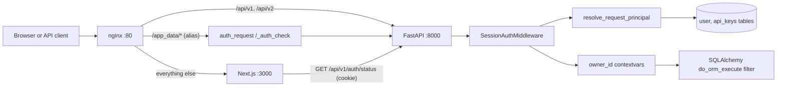
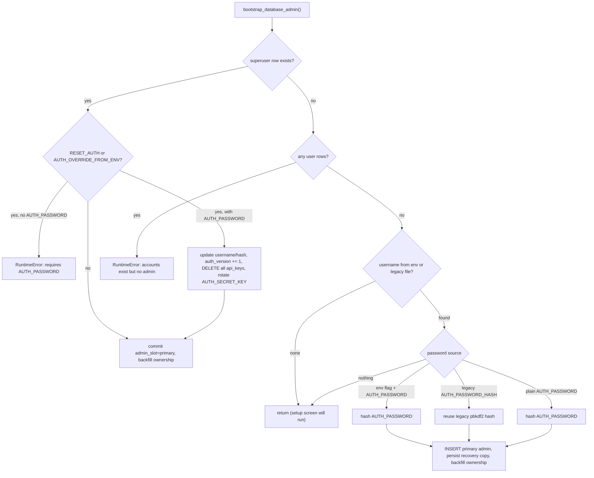
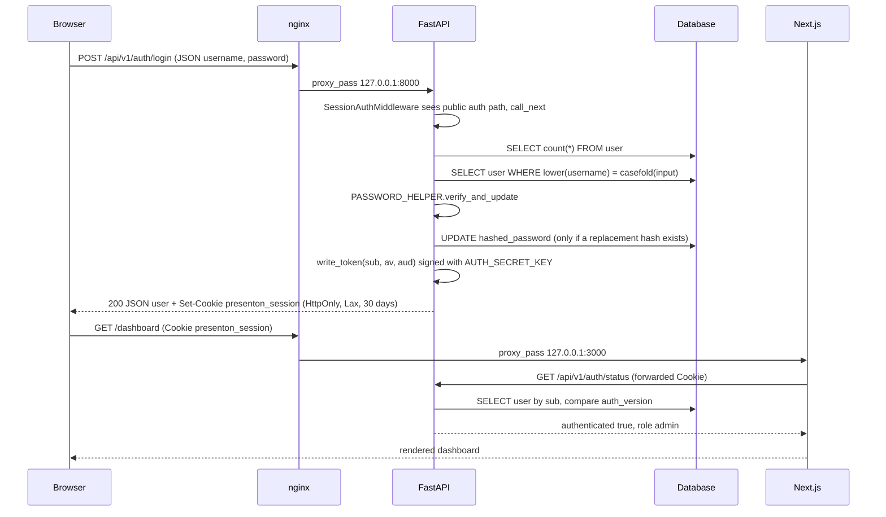
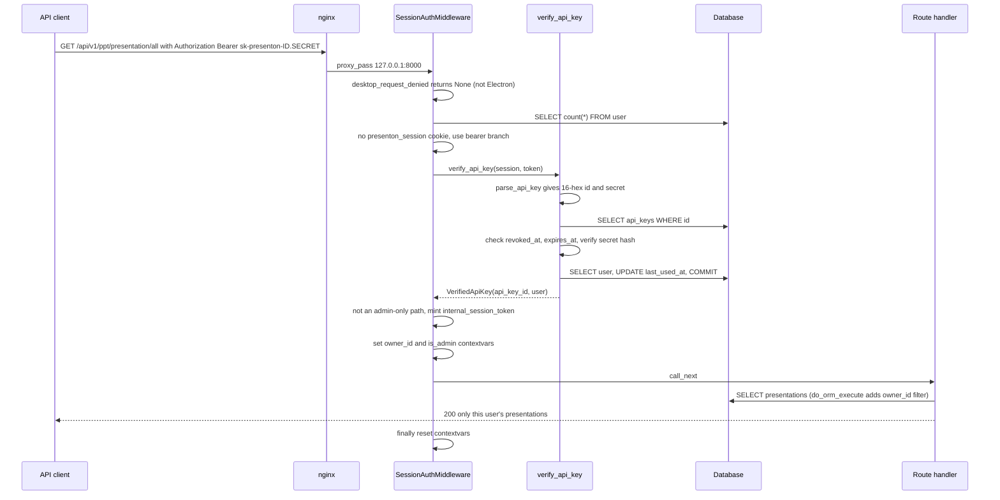

# Auth and multi-user

<div class="chapter-meta" markdown>
**Reads:** `servers/fastapi/api/v1/auth/*.py`, `servers/fastapi/api/middlewares.py`, `servers/fastapi/api/v1/admin/router.py`, `servers/fastapi/services/api_keys.py`, `servers/fastapi/services/database.py`, `servers/nextjs/proxy.ts`, `servers/nextjs/utils/serverAuth.ts`, `servers/nextjs/lib/server-auth-role.ts`, `nginx.conf`  ·  **Builds on:** [FastAPI app and startup](05-fastapi-startup.md), [Data model](07-data-model.md)  ·  **Time:** ~45 min
</div>

Presenton ships a complete, self-contained account system: a username and password login backed by a database `user` table, a signed JWT session cookie, admin-issued API keys for REST and MCP clients, a per-user data partition enforced at the ORM layer, and a separate "desktop transport guard" that protects the auth-less Electron build. This chapter walks through every request path in execution order: how the first administrator is created, what the login endpoint writes into the cookie, how each incoming request is turned into a principal, how that principal silently scopes every `SELECT`, how nginx authorizes static files it serves directly, and how the Next.js server double-checks the same state before rendering pages.

## Step 0: The map of the auth system

Before reading code, fix the moving parts in your head. Authentication happens in four places, in this order on a Docker deployment:

| Layer | File | What it decides |
|---|---|---|
| nginx `auth_request` | `nginx.conf:133` | Whether nginx may serve a private file under `/app_data/` (images, exports, uploads, pptx-to-html, pptx-to-json) straight from disk |
| `SessionAuthMiddleware` | `servers/fastapi/api/middlewares.py:29` | Who the caller is (cookie JWT or API key), whether the path is admin-only, which owner ID scopes the request |
| Route dependencies | `servers/fastapi/api/v1/auth/users.py:211`, `:219` | Per-route `get_current_user` / `get_current_admin` checks (admin router, settings) |
| Next.js proxy and layouts | `servers/nextjs/proxy.ts:97`, `servers/nextjs/utils/serverAuth.ts:94` | Whether Next.js API routes and pages may run; they ask FastAPI `/api/v1/auth/status` |

Everything is owned by FastAPI. Next.js never verifies a JWT itself; it forwards the browser's cookie to `GET /api/v1/auth/status` and trusts the answer.



The topology itself (which process listens where, how `start.js` supervises them) is covered in [Runtime topology](03-runtime-topology.md). Here we only follow credentials.

## Step 1: The data model behind accounts

### 1.1 The `user` table

`User` is a plain SQLAlchemy declarative model that shares `SQLModel.metadata` so Alembic and `create_all` see it with the rest of the schema (`servers/fastapi/models/sql/user.py:12`).

```python title="servers/fastapi/models/sql/user.py (excerpt)"
class User(UserBase):
    """Username-only account model used by the FastAPI Users manager."""

    __tablename__ = "user"

    id: Mapped[uuid.UUID] = mapped_column(
        Uuid, primary_key=True, default=uuid.uuid4
    )
    username: Mapped[str] = mapped_column(
        String(128), unique=True, index=True, nullable=False
    )
    admin_slot: Mapped[Optional[str]] = mapped_column(
        String(32), unique=True, nullable=True
    )
    hashed_password: Mapped[str] = mapped_column(String(1024), nullable=False)
    # ...
    auth_version: Mapped[int] = mapped_column(
        Integer, nullable=False, default=1, server_default=text("1")
    )
```

| Column | Meaning |
|---|---|
| `id` | UUID primary key; every owned row points here through `owner_id` |
| `username` | Unique, case-preserved login name (max 128) |
| `admin_slot` | `"primary"` for the bootstrap administrator, `NULL` for everyone else. The column is `unique=True`, so the database itself refuses a second primary admin (migration `servers/fastapi/alembic/versions/e1b3c5d7f9a2_primary_admin_slot.py`) |
| `hashed_password` | Hash produced by `PASSWORD_HELPER` |
| `is_active`, `is_verified` | Required by FastAPI Users; Presenton always writes `True` |
| `is_superuser` | The role bit: `True` means "admin", `False` means "user" |
| `auth_version` | Integer embedded in every JWT; bumping it revokes every outstanding session for this user |

There is no email column. FastAPI Users expects one, so `UsernameUserDatabase.get_by_email` reinterprets the "email" argument as a username and compares case-insensitively with `func.lower` (`servers/fastapi/api/v1/auth/users.py:56`).

### 1.2 Roles

There are exactly two roles, derived from one boolean. `serialize_user` is the only place the string is produced:

```python title="servers/fastapi/api/v1/auth/users.py (excerpt)"
def serialize_user(user: User) -> dict[str, Any]:
    return {
        "id": str(user.id),
        "username": user.username,
        "role": "admin" if user.is_superuser else "user",
        "created_at": user.created_at.isoformat() if user.created_at else None,
    }
```

In practice there is exactly one admin: the setup endpoint and the bootstrap code create the only `is_superuser=True` row, and `POST /api/v1/admin/users` always creates `is_superuser=False` (`servers/fastapi/api/v1/admin/router.py:201`). No endpoint promotes a user.

### 1.3 The `api_keys` table

`ApiKey` (`servers/fastapi/models/sql/api_key.py:12`) is a SQLModel table:

| Column | Type | Notes |
|---|---|---|
| `id` | `str(64)` PK | 16 hex characters from `secrets.token_hex(8)` |
| `secret_hash` | `String(512)` | Hash of the secret half only |
| `token_encrypted` | `String(1024)`, nullable | Fernet ciphertext of the full token, so an admin can reveal it again; `exclude=True` keeps it out of serialized models |
| `user_id` | FK `user.id`, `ON DELETE CASCADE` | The account the key acts as |
| `created_by_id` | FK `user.id`, `ON DELETE CASCADE` | The admin who issued it |
| `label` | `str(120)` | Default `"API client"` |
| `created_at`, `expires_at`, `last_used_at`, `revoked_at` | timezone-aware datetimes | `expires_at` and `revoked_at` are indexed |

!!! warning "Gotcha: there are no API key scopes"
    An API key carries no scope list. It authenticates as its `user_id` with that user's full permissions, minus one thing: every admin-only path requires `principal.method == "jwt"`, so a key issued to the admin still cannot reach `/api/v1/admin/*` (see Step 5). The MCP verifier even hard-codes `scopes=[]` when it wraps a key (`servers/fastapi/mcp_server.py:307`).

## Step 2: Signing material and the recovery copy in `userConfig.json`

The JWT signing secret does not come from an environment variable. It lives in `userConfig.json` (the file at `USER_CONFIG_PATH`, which `start.js` sets to `$APP_DATA_DIRECTORY/userConfig.json`, see `start.js:481`).

```python title="servers/fastapi/api/v1/auth/config.py (excerpt)"
SESSION_COOKIE_NAME = "presenton_session"
SESSION_TTL_SECONDS = 60 * 60 * 24 * 30
AUTH_CONFIG_FIELDS = ("AUTH_USERNAME", "AUTH_PASSWORD_HASH", "AUTH_SECRET_KEY")
# ...
def get_or_create_auth_secret() -> str:
    """Return the deployment signing secret used by database-backed JWT auth."""
    config = _load_user_config()
    secret = config.get("AUTH_SECRET_KEY")
    if isinstance(secret, str) and secret:
        return secret

    secret = _base64url_encode(secrets.token_bytes(32))
    config["AUTH_SECRET_KEY"] = secret
    _save_auth_config(config)
    return secret
```

- `get_or_create_auth_secret` (`servers/fastapi/api/v1/auth/config.py:71`) lazily creates a 32-byte, base64url secret on first use and merges only the three `AUTH_CONFIG_FIELDS` into the file through `update_user_config_file` (a lock-file plus atomic-rename writer, mode `0600`, see [CI, tests, security](28-ci-tests-security.md)).
- `persist_admin_credentials` (`config.py:95`) writes `AUTH_USERNAME` and `AUTH_PASSWORD_HASH` next to the secret. This is a "rollback/recovery credential copy": the database is the source of truth, but the file keeps a hash that the bootstrap code can migrate from (Step 3).
- With `rotate_secret=True` the function also replaces `AUTH_SECRET_KEY`, which invalidates every JWT ever issued, for every user.

!!! warning "Gotcha: the signing secret is read on every token operation"
    `get_jwt_strategy()` (`servers/fastapi/api/v1/auth/users.py:176`) builds a new `VersionedJWTStrategy` and calls `get_or_create_auth_secret()` each time a token is read or written, so it reads `userConfig.json` per request. Deleting `AUTH_SECRET_KEY` from the file logs everyone out at once; deleting the whole file also drops the recovery hash. The README explicitly warns against editing these fields by hand.

!!! warning "Gotcha: API key ciphertext depends on the same secret"
    `_api_key_cipher` derives a Fernet key from `sha256(AUTH_SECRET_KEY)` (`servers/fastapi/services/api_keys.py:39`). Rotating the secret makes every stored `token_encrypted` undecryptable, so `reveal_api_key` returns `None` and the admin endpoint answers `409 "This API key cannot be revealed"`. Rotation through `RESET_AUTH` or `AUTH_OVERRIDE_FROM_ENV` deletes all keys anyway (Step 3.2), so this only bites if you rotate the secret some other way.

## Step 3: Creating the first administrator

There are two ways to get the first admin: the interactive setup screen, or environment bootstrap at startup.

### 3.1 Interactive setup: `POST /api/v1/auth/setup`

When the database has zero users, the root page renders `AuthGate` in setup mode (`servers/nextjs/app/page.tsx:25`, `servers/nextjs/components/Auth/AuthGate.tsx:39`). The client validates username length 3 and password length 8 (setup) or 6 (sign-in) before sending (`AuthGate.tsx:174`, `:186`), then posts:

```http
POST /api/v1/auth/setup
Content-Type: application/json

{"username": "admin", "password": "secret123"}
```

The body is validated by `AuthCredentialsRequest` (`servers/fastapi/api/v1/auth/schemas.py:28`): username 3 to 128 characters matching `^\S+$` (no whitespace anywhere), password 8 to 128. Then `setup_credentials` (`servers/fastapi/api/v1/auth/router.py:110`) runs:

1. `_account_count(session)` (`router.py:35`) counts all users. Any non-zero count returns `409 {"detail": "Credentials already configured"}`.
2. The username is stripped and re-checked for length.
3. A `User` is created with `is_superuser=True`, `admin_slot="primary"`, `auth_version=1` and the hash from `PASSWORD_HELPER.hash`.
4. `session.flush()` is wrapped in `try/except IntegrityError`: two simultaneous setup requests race on the unique `admin_slot`, and the loser gets `409`.
5. `persist_admin_credentials(username, password_hash)` writes the recovery copy and, if missing, a signing secret.

The response does not log the user in:

```json
{"configured": true, "authenticated": false, "username": "admin", "role": "admin"}
```

`AuthGate` shows "Account created. Sign in with your new username and password to continue." and flips to sign-in mode (`AuthGate.tsx:268`).

!!! warning "Gotcha: setup is unauthenticated by design"
    `/api/v1/auth/setup` is in `_PUBLIC_AUTH_PATHS` (`servers/fastapi/api/middlewares.py:30`). On a fresh instance exposed to a network, whoever reaches the setup screen first becomes the administrator. For unattended deployments, set `AUTH_USERNAME` and `AUTH_PASSWORD` so the account exists before the port opens.

### 3.2 Environment bootstrap: `bootstrap_database_admin`

`app_lifespan` calls `bootstrap_database_admin()` after migrations and `create_db_and_tables` and before the app accepts requests (`servers/fastapi/api/lifespan.py:58`). The function (`servers/fastapi/api/v1/auth/bootstrap.py:43`) reads four variables:

| Variable | Parsed by | Effect |
|---|---|---|
| `AUTH_USERNAME` | `.strip()` | Username for creation, rotation or recovery; must be at least 3 characters if set, or startup raises `RuntimeError` |
| `AUTH_PASSWORD` | raw | Must be at least 8 characters when it is used |
| `RESET_AUTH` | `_truthy` (`1/true/yes/on`) | Recover the existing primary admin |
| `AUTH_OVERRIDE_FROM_ENV` | `_truthy` | Rotate the existing primary admin's credentials |

The decision tree, in code order:



The rotation branch is the interesting one:

```python title="servers/fastapi/api/v1/auth/bootstrap.py (excerpt)"
            if (reset_requested or override_requested) and env_password:
                _validate_new_environment_password(env_password)
                if env_username:
                    admin.username = env_username
                admin.hashed_password = PASSWORD_HELPER.hash(env_password)
                admin.auth_version += 1
                await session.execute(delete(ApiKey))
                await session.flush()
                await session.commit()
                persist_admin_credentials(
                    admin.username,
                    admin.hashed_password,
                    rotate_secret=True,
                )
```

Four things happen at once: the hash changes, `auth_version` increments (killing the admin's JWTs even before the secret rotation), every API key in the database is deleted (not only the admin's), and the signing secret is regenerated (killing every other user's JWT). The admin's `id` is preserved, so owned rows keep pointing at the same account.

!!! warning "Gotcha: `RESET_AUTH` and `AUTH_OVERRIDE_FROM_ENV` are not one-shot"
    Both flags are evaluated on every startup. If you leave `RESET_AUTH=true` in your compose file, every container restart rotates the secret, deletes all API keys and logs out every user. The README tells operators to remove the flag after a successful startup. The two flags are behaviorally identical in code; they differ only in intent.

!!! warning "Gotcha: plain `AUTH_USERNAME`/`AUTH_PASSWORD` only matter on an empty database"
    Without one of the two flags, the env credentials are used only when no user exists at all (`bootstrap.py:91` onward). Changing `AUTH_PASSWORD` on a running deployment does nothing until you also set `AUTH_OVERRIDE_FROM_ENV=true` for one start.

### 3.3 Migrating a pre-multi-user install

Older Presenton releases had a single account stored only in `userConfig.json` as `AUTH_USERNAME` plus an `AUTH_PASSWORD_HASH` of the form `pbkdf2_sha256$<iterations>$<salt>$<digest>`. Bootstrap picks those up through `get_legacy_admin_credentials` (`config.py:84`) and inserts them as the primary admin without rehashing. Two cooperating pieces make that work:

- `LegacyAwarePasswordHelper.verify_and_update` (`servers/fastapi/api/v1/auth/users.py:31`) recognises the `pbkdf2_sha256$` prefix, verifies with `verify_legacy_password_hash` (`config.py:50`, `hmac.compare_digest` on a PBKDF2-SHA256 digest), and returns a modern replacement hash. Login then stores the replacement (`router.py:176`), so the legacy hash disappears after the first successful sign-in.
- `LoginCredentialsRequest` allows passwords of 6 characters (`schemas.py:45`) because the legacy system did; new passwords still need 8.

Finally `_backfill_legacy_ownership` (`bootstrap.py:128`) claims all orphaned data for the admin:

```python title="servers/fastapi/api/v1/auth/bootstrap.py (excerpt)"
    for model in owned_models:
        await session.execute(
            update(model)
            .where(model.owner_id.is_(None))
            .values(owner_id=admin.id)
        )
    # Built-in templates intentionally remain shared; only custom templates
    # migrate into the bootstrap admin's private workspace.
    await session.execute(
        update(TemplateV2)
        .where(TemplateV2.owner_id.is_(None), TemplateV2.is_default.is_(False))
        .values(owner_id=admin.id)
    )
```

The owned models are presentations, slides, async tasks, async presentation generation tasks, chat history, image assets and webhook subscriptions. This runs on every startup when an admin exists, so any row created with a `NULL` owner (for example while `DISABLE_AUTH` was on) is adopted by the admin on the next boot.

!!! warning "Gotcha: toggling `DISABLE_AUTH` off hands desktop data to the admin"
    Rows written while auth was disabled have `owner_id = NULL`. The next startup with an admin present runs the backfill, and they all become the primary admin's private data. Normal users never see them.

## Step 4: Login, the cookie, and the JWT

### 4.1 `POST /api/v1/auth/login`

```http
POST /api/v1/auth/login
Content-Type: application/json

{"username": "ADMIN", "password": "secret123"}
```

`login` (`servers/fastapi/api/v1/auth/router.py:155`) executes:

1. If there are no users: `428 {"detail": "Login setup is required"}`.
2. Look up the user with `func.lower(User.username) == username.casefold()`.
3. If missing or inactive: hash the submitted password anyway (`PASSWORD_HELPER.hash(body.password)`, a timing equalizer so "unknown user" and "wrong password" take similar time) and return `401 {"detail": "Unauthorized"}`.
4. `PASSWORD_HELPER.verify_and_update(password, user.hashed_password)`; on failure `401`. On success with a replacement hash (legacy or outdated algorithm), store it and commit.
5. `get_jwt_strategy().write_token(user)` produces the token.
6. Build the JSON body and attach the cookie with `_set_login_cookie`.

The response:

```http
HTTP/1.1 200 OK
Set-Cookie: presenton_session=eyJhbGciOi...; HttpOnly; Max-Age=2592000; Path=/; SameSite=lax
Content-Type: application/json

{"configured": true, "authenticated": true,
 "id": "3f6c...", "username": "admin", "role": "admin",
 "created_at": "2026-11-02T10:00:00+00:00"}
```

The token is never in the body; the integration test asserts `"access_token" not in payload` and that the `set-cookie` header contains `HttpOnly` (`servers/fastapi/tests/integration/test_auth_endpoints.py:134`).

```python title="servers/fastapi/api/v1/auth/router.py (excerpt)"
def _secure_request(request: Request) -> bool:
    return (
        request.headers.get("x-forwarded-proto", "").lower() == "https"
        or request.url.scheme == "https"
    )


def _set_login_cookie(response: JSONResponse, token: str, request: Request) -> None:
    response.set_cookie(
        SESSION_COOKIE_NAME,
        token,
        max_age=SESSION_TTL_SECONDS,
        httponly=True,
        secure=_secure_request(request),
        samesite="lax",
        path="/",
    )
```

| Cookie attribute | Value | Source |
|---|---|---|
| Name | `presenton_session` | `config.py:11` |
| Max-Age | 2,592,000 s (30 days) | `config.py:12` |
| HttpOnly | always | `router.py:51` |
| Secure | only when `X-Forwarded-Proto: https` or the request scheme is https | `router.py:39` |
| SameSite | `lax` | `router.py:53` |
| Path | `/` | `router.py:54` |

!!! warning "Gotcha: there is no login rate limit"
    `test_repeated_failed_logins_are_not_rate_limited` posts ten wrong passwords and expects ten `401`s (`servers/fastapi/tests/integration/test_auth_endpoints.py:244`). Brute-force protection, if you need it, belongs in your reverse proxy.

!!! warning "Gotcha: `lower()` versus `casefold()`"
    Login compares SQL `lower(username)` with Python `str.casefold()`. For ASCII names they agree. For some non-ASCII names they can differ (for example `casefold()` maps "ß" to "ss", and SQLite's built-in `lower()` only folds ASCII), which could make such a user unable to sign in. The username pattern `^\S+$` does allow non-ASCII characters.

### 4.2 Inside the JWT

`VersionedJWTStrategy` (`servers/fastapi/api/v1/auth/users.py:136`) subclasses FastAPI Users' `JWTStrategy` and overrides both directions:

```python title="servers/fastapi/api/v1/auth/users.py (excerpt)"
    async def write_token(self, user: User) -> str:
        return generate_jwt(
            {
                "sub": str(user.id),
                "av": user.auth_version,
                "aud": self.token_audience,
            },
            self.encode_key,
            self.lifetime_seconds,
            algorithm=self.algorithm,
        )
```

The payload has three Presenton-visible claims plus the `exp` that `generate_jwt` adds from `lifetime_seconds`:

```json
{"sub": "3f6c0d4e-...", "av": 1, "aud": ["fastapi-users:auth"], "exp": 1764673200}
```

The algorithm and audience are not set in Presenton code; they are the FastAPI Users `JWTStrategy` defaults (HMAC with the `AUTH_SECRET_KEY` secret, audience `fastapi-users:auth` in the library). `read_token` (`users.py:137`) rejects a token when decoding fails, when `sub` is missing, when `av` is not an `int`, when the user no longer exists, when `is_active` is false, or when `user.auth_version != av`. That last check is the revocation mechanism: the admin password reset endpoint increments the target user's `auth_version` (`servers/fastapi/api/v1/admin/router.py:231`), so that user's existing cookies stop working immediately without a session table.

### 4.3 Why FastAPI Users is configured but its routers are not mounted

`users.py:187` builds a `CookieTransport`, an `AuthenticationBackend` named `cookie-jwt` and a `FastAPIUsers` instance, but no `FASTAPI_USERS.get_auth_router(...)` is ever included. The comment at `users.py:185` explains: the explicit `/login` route handles the dynamic `Secure` flag, and the backend object only "centralizes the package's account/auth abstractions". What Presenton actually uses from the library is `BaseUserManager`, `BaseUserDatabase`, `PasswordHelper`, `JWTStrategy`, and the `decode_jwt`/`generate_jwt` helpers. `UserManager` disables self-service flows (the token secrets at `users.py:110` are placeholders) and enforces 8 to 128 character passwords in `validate_password` (`users.py:116`). The password hashing itself is the FastAPI Users `PasswordHelper`, which wraps `pwdlib` (locked at 0.3.0 alongside `argon2-cffi` and `bcrypt` in `servers/fastapi/uv.lock`).

### 4.4 Status, verify and logout

| Endpoint | Auth required by middleware | Handler | Response |
|---|---|---|---|
| `GET /api/v1/auth/status` | No | `router.py:58` | `{"configured", "authenticated", "username", "user_id", "role"}` from the cookie only |
| `GET /api/v1/auth/verify` | No (it authenticates itself) | `router.py:81` | `{"authenticated": true, id, username, role, created_at, "method": "jwt" or "api_key"}` or `401`/`403` |
| `POST /api/v1/auth/setup` | No | `router.py:110` | see Step 3.1 |
| `POST /api/v1/auth/login` | No | `router.py:155` | see Step 4.1 |
| `POST /api/v1/auth/logout` | No | `router.py:191` | `{"success": true}` plus a cookie deletion with the same attributes |

`status` reads only the cookie (`read_user_from_cookie`, `users.py:202`); an API key never makes `status` report `authenticated: true`. `verify` uses the full principal resolution (cookie, then bearer key) and is the endpoint nginx calls for static files (Step 8).

Logout is stateless: it deletes the cookie in the browser. The JWT itself stays valid until expiry or until `auth_version`/the secret changes. `LogoutButton` calls it and always navigates to `/` even if the call fails (`servers/nextjs/components/Auth/LogoutButton.tsx:36`, `:59`).



## Step 5: Resolving a principal on every request

### 5.1 Middleware order

`servers/fastapi/api/main.py:94` to `:103` registers middleware in this order: `CORSMiddleware`, `UserConfigEnvUpdateMiddleware`, `SessionAuthMiddleware`, and then the `@app.middleware("http")` icon fallback at `main.py:106`. Starlette wraps each newly added middleware around the previous ones, so at runtime a request passes through the icon fallback, then `SessionAuthMiddleware`, then `UserConfigEnvUpdateMiddleware`, then CORS, then the router. Authentication therefore runs before CORS and before provider settings are reloaded into `os.environ`.

### 5.2 Which paths need auth

```python title="servers/fastapi/api/middlewares.py (excerpt)"
class SessionAuthMiddleware(BaseHTTPMiddleware):
    _PUBLIC_AUTH_PATHS = {
        "/api/v1/auth/status",
        "/api/v1/auth/verify",
        "/api/v1/auth/setup",
        "/api/v1/auth/login",
        "/api/v1/auth/logout",
    }
    _PUBLIC_AUTH_PREFIXES: tuple[str, ...] = ()
    _PUBLIC_APP_DATA_PREFIXES = (
        "/app_data/fonts/",
        "/app_data/templates/",
    )
    _PROTECTED_NON_API_PATHS = {"/docs", "/openapi.json", "/redoc"}

    def _requires_auth(self, path: str) -> bool:
        if any(path.startswith(prefix) for prefix in self._PUBLIC_AUTH_PREFIXES):
            return False
        if path.startswith("/api/"):
            return True
        if any(path.startswith(prefix) for prefix in self._PUBLIC_APP_DATA_PREFIXES):
            return False
        if path.startswith("/app_data/"):
            return True
        return path in self._PROTECTED_NON_API_PATHS
```

Every `/api/*` path requires a principal except the five exact auth paths. That includes the Presenton OAuth routes under `/api/v1/auth/presenton/`, which are not in the public set (tested by `test_presenton_provider_endpoints_require_a_local_session`, `servers/fastapi/tests/unit/test_session_auth_middleware.py:39`). `/app_data/fonts/` and `/app_data/templates/` are public; every other `/app_data/` path is protected. The interactive API docs (`/docs`, `/openapi.json`, `/redoc`) require a session too, and everything else (for example `/static/...`) is public.

### 5.3 The dispatch sequence

`SessionAuthMiddleware.dispatch` (`middlewares.py:55`) runs these steps:

1. **Desktop transport guard.** `desktop_request_denied(request)` runs first, for every path, including public ones (Step 9).
2. **Auth disabled.** If `DISABLE_AUTH` is truthy, the request passes through after a possible Presenton Cloud proxy hop, with no principal and no owner context.
3. **Skip** `OPTIONS`, non-protected paths, and the five public auth paths.
4. **Setup gate.** If the `user` table is empty: `428 {"detail": "Login setup is required", "setup_required": true}`.
5. **Resolve** `(principal, user) = await resolve_request_principal(request, session)`. `None` means `401 {"detail": "Unauthorized"}`.
6. **Admin-only gate** (below).
7. **Publish** `request.state.auth_principal`, `current_user`, `auth_username`, and for API keys a freshly minted `internal_session_token` JWT.
8. **Set owner contextvars** to `principal.user_id` and `principal.is_admin`.
9. For cookie sessions, give `maybe_proxy_presenton_cloud_request` a chance to answer (provider proxying is covered in [Configuration and LLM providers](06-configuration-and-providers.md)).
10. For `/app_data/` paths, run `is_app_data_path_authorized`; failure is `404 {"detail": "Asset not found"}` (not 403, to avoid confirming existence).
11. `call_next`, and in `finally` reset both contextvars.

### 5.4 `resolve_request_principal`: cookie first, then API key

```python title="servers/fastapi/api/v1/auth/principal.py (excerpt)"
async def resolve_request_principal(
    request: Request, session: AsyncSession
) -> tuple[AuthPrincipal | None, User | None]:
    cookie_token = request.cookies.get(SESSION_COOKIE_NAME)
    if cookie_token:
        user_db = UsernameUserDatabase(session)
        user = await get_jwt_strategy().read_token(cookie_token, UserManager(user_db))
        if user:
            return (
                AuthPrincipal(
                    user_id=user.id,
                    username=user.username,
                    is_admin=user.is_superuser,
                    method="jwt",
                ),
                user,
            )

    authorization = request.headers.get("Authorization", "")
    if authorization.lower().startswith("bearer "):
        token = authorization.split(" ", 1)[1].strip()
        verified = await verify_api_key(session, token)
        if verified is None:
            return None, None
        # ...
    return None, None
```

The resolution order is:

1. `presenton_session` cookie, if present and valid, wins. `method = "jwt"`.
2. Otherwise an `Authorization: Bearer ...` header is treated as an API key. `method = "api_key"`.
3. Otherwise no principal.

`AuthPrincipal` (`principal.py:14`) is a frozen dataclass of `user_id`, `username`, `is_admin` and `method`. Note the type annotation: `method` is `Literal["jwt", "api_key"]`. There is no third "internal" method. Internal callers (the export browser, background tasks, the MCP server) authenticate by presenting a normal `presenton_session` JWT that the server minted for them (Step 7).

!!! warning "Gotcha: a valid cookie always beats a bearer header"
    If the cookie is present but invalid, the code falls through to the bearer branch, so a client that sends both a stale cookie and a valid API key still authenticates with the key. If the cookie is valid, the bearer header is ignored entirely, even if it names a different user.

### 5.5 Admin-only paths

```python title="servers/fastapi/api/middlewares.py (excerpt)"
            admin_only = (
                path.startswith("/api/v1/admin/")
                or path.startswith("/api/v1/ppt/codex/auth/")
                or (
                    path.startswith("/api/v1/ppt/fonts/")
                    and request.method in {"POST", "DELETE"}
                )
                or path in {
                    "/api/v1/ppt/ollama/models/pull",
                    "/api/v1/ppt/ollama/models/available",
                    "/api/v1/ppt/openai/models/available",
                    "/api/v1/ppt/images/test",
                    "/api/v1/ppt/openrouter/providers/available",
                }
            )
            if admin_only and (principal.method != "jwt" or not principal.is_admin):
                return JSONResponse(
                    status_code=403,
                    content={"detail": "Admin browser session required"},
                )
```

| Admin-only path | Why it is privileged |
|---|---|
| `/api/v1/admin/*` | Users, API keys, provider settings |
| `/api/v1/ppt/codex/auth/*` | ChatGPT/Codex OAuth credentials for the whole installation |
| `POST`/`DELETE /api/v1/ppt/fonts/*` | Shared font library mutations |
| Ollama pull and available, OpenAI and OpenRouter discovery, image provider test | Outbound requests to admin-supplied URLs (SSRF surface) or shared secrets |

The rule is "admin AND browser session": an admin's API key gets `403` too (`test_api_keys_cannot_access_browser_admin_routes`, `servers/fastapi/tests/unit/test_session_auth_middleware.py:162`). The helper `require_browser_admin_principal` (`principal.py:67`) encodes the same rule for route-level use.

### 5.6 Route-level dependencies

Some routes add their own checks on top of the middleware:

- `get_current_user` (`users.py:211`) and `get_current_admin` (`users.py:219`) read only the cookie. The admin router's user and key endpoints depend on `get_current_admin`, so they need a cookie even before the middleware rule.
- `require_settings_admin` (`servers/fastapi/api/v1/admin/router.py:131`) allows the provider-settings endpoints when `DISABLE_AUTH` is on (Electron) and otherwise requires a cookie admin.
- `require_presenton_manager` (`servers/fastapi/api/v1/auth/presenton_oauth.py:65`) does the same for the Presenton Cloud device flow.

## Step 6: API keys end to end

### 6.1 Format

```python title="servers/fastapi/services/api_keys.py (excerpt)"
API_KEY_PREFIX = "sk-presenton-"
DEFAULT_EXPIRY_DAYS = 90
MAX_EXPIRY_DAYS = 365
API_KEY_ID_PATTERN = re.compile(r"^[0-9a-f]{16}$")
# ...
def build_api_key(api_key_id: str, secret: str) -> str:
    return f"{API_KEY_PREFIX}{api_key_id}.{secret}"
```

A key looks like `sk-presenton-1f2e3d4c5b6a7980.Wq3...` (prefix, 16 hex ID, dot, a `secrets.token_urlsafe(40)` secret of roughly 54 characters). `parse_api_key` (`api_keys.py:50`) rejects anything without the prefix, without the dot, with an ID that is not exactly 16 lowercase hex characters, or with a secret shorter than 32 characters. The ID half is a lookup key; only the secret half is hashed.

### 6.2 Creation: `POST /api/v1/admin/api-keys`

The admin panel (`servers/nextjs/app/(presentation-generator)/(dashboard)/admin/AdminPanel.tsx:310`) sends:

```json
{"user_id": "8b1d...-...", "label": "Automation", "expiry_days": 90}
```

`AdminCreateApiKeyRequest` (`schemas.py:56`) enforces `label` 1 to 120 characters (default `"API client"`) and `expiry_days` 1 to 365 (default 90); the UI offers 30, 90, 180 and 365. `create_api_key` (`admin/router.py:60`) checks that the target user exists and is active (`404 "Active user not found"` otherwise) and calls `issue_api_key` (`api_keys.py:79`):

```python title="servers/fastapi/services/api_keys.py (excerpt)"
    secret = secrets.token_urlsafe(40)
    api_key_id = secrets.token_hex(8)
    token = build_api_key(api_key_id, secret)
    api_key = ApiKey(
        id=api_key_id,
        user_id=user_id,
        created_by_id=created_by_id,
        label=label.strip() or "API client",
        secret_hash=PASSWORD_HELPER.hash(secret),
        token_encrypted=encrypt_api_key(token),
        expires_at=get_current_utc_datetime() + timedelta(days=expiry_days),
    )
```

The `201` response is `ApiKeyCreated` (`schemas.py:75`), the public fields plus the plaintext `token`:

```json
{"id": "1f2e3d4c5b6a7980", "user_id": "8b1d...", "created_by_id": "3f6c...",
 "label": "Automation", "created_at": "...", "expires_at": "...",
 "last_used_at": null, "revoked_at": null,
 "token": "sk-presenton-1f2e3d4c5b6a7980.Wq3..."}
```

The admin panel copies the token to the clipboard and keeps it in component state.

### 6.3 List, reveal, revoke

| Endpoint | Handler | Behavior |
|---|---|---|
| `GET /api/v1/admin/api-keys` | `admin/router.py:44` | All keys for all users, newest first, as `ApiKeyPublic` (no token, no hash) |
| `GET /api/v1/admin/api-keys/{id}/token` | `admin/router.py:85` | Decrypts `token_encrypted`; `404` unknown, `410` revoked, `409` undecryptable; sets `Cache-Control: no-store` |
| `POST /api/v1/admin/api-keys/{id}/revoke` | `admin/router.py:111` | Sets `revoked_at` once (idempotent) and returns the key |

There is no hard delete endpoint for keys. Revocation is permanent: `verify_api_key` rejects any key with `revoked_at` set.

!!! warning "Gotcha: keys are reversible, not only hashed"
    Because the admin can re-display a key, the full token is stored encrypted with a key derived from `AUTH_SECRET_KEY`. Anyone who can read both the database and `userConfig.json` can recover every active API key. Protect `app_data` accordingly.

### 6.4 Verification on each request

`verify_api_key` (`api_keys.py:107`) runs: parse, `session.get(ApiKey, id)`, reject revoked, reject if `expires_at <= now` (naive datetimes are treated as UTC by `_utc_aware`), `PASSWORD_HELPER.verify_and_update(secret, secret_hash)`, load the user and reject inactive or missing, then set `last_used_at = now`, store any upgraded hash, and commit. Every API-key request therefore performs a password-hash verification and a write.

Back in the middleware, an API-key principal causes one extra step:

```python title="servers/fastapi/api/middlewares.py (excerpt)"
            if principal.method == "api_key" and user is not None:
                request.state.internal_session_token = (
                    await get_jwt_strategy().write_token(user)
                )
```

That JWT is what downstream code hands to the export browser so headless Chromium can load the user's slides with a normal cookie (Step 7).



### 6.5 The same keys on MCP

The MCP server (port 8001, behind nginx `/mcp`) validates the same keys with `PresentonTokenVerifier` (`servers/fastapi/mcp_server.py:285`): it ignores anything that does not start with `sk-presenton-`, calls `verify_api_key`, and stores a one-hour JWT (`MCP_INTERNAL_SESSION_TTL_SECONDS = 60 * 60`, `mcp_server.py:39`) in the access-token claims. When the MCP server calls back into FastAPI, `attach_request_auth_header` (`mcp_server.py:365`) sends that JWT as a `presenton_session` cookie rather than forwarding the raw key. The MCP tool surface itself is covered in [REST API, async tasks, webhooks, MCP](15-api-async-mcp.md).

## Step 7: Internal auth for trusted server-side callers

Several server-side components must call Presenton as the user: the export runtime opens `/pdf-maker` in headless Chromium, background tasks finish work after the HTTP request has returned, and the MCP server proxies tool calls. None of them has the user's password. They all use the same trick: mint a short or normal-lifetime JWT for the current owner and present it as a cookie.

`authenticated_internal_request_headers` (`servers/fastapi/api/v1/auth/internal.py:10`) packages that:

```python title="servers/fastapi/api/v1/auth/internal.py (excerpt)"
async def authenticated_internal_request_headers() -> dict[str, str]:
    """Issue a database-backed JWT for the current trusted internal request."""
    if is_disable_auth_enabled():
        cookie = desktop_cookie_header()
        return {"Cookie": cookie} if cookie else {}

    owner_id = get_current_owner_id()
    if owner_id is None:
        return {}

    async with async_session_maker() as session:
        user = await session.get(User, owner_id)
        if user is None or not user.is_active:
            return {}
        token = await get_jwt_strategy().write_token(user)
    return {"Cookie": f"{SESSION_COOKIE_NAME}={token}"}
```

In this snapshot that helper is exercised by `servers/fastapi/tests/unit/test_internal_auth_headers.py` but no production module imports it. The production paths build the same header inline:

- `build_export_cookie_header` (`servers/fastapi/api/v1/ppt/endpoints/presentation.py:1473`) prefers, in order: the desktop cookie (Electron, appended to any incoming cookie), the request's own `Cookie` header, `request.state.internal_session_token` (API-key callers), and finally the bare session cookie.
- Background tasks receive that header plus the owner ID as arguments and re-enter the owner context themselves (Step 10.3).

The export path that consumes the header is described in [PPTX and PDF export](24-export-pipeline.md).

## Step 8: nginx `auth_request` and per-user asset paths

### 8.1 Why nginx needs a subrequest

In Docker, nginx serves `/app_data/*` directly from disk with `alias` for speed, so the FastAPI middleware never sees those requests. The `auth_request` module fills the gap:

```nginx title="nginx.conf (excerpt)"
    location = /_auth_check {
      internal;
      proxy_pass http://localhost:8000/api/v1/auth/verify;
      proxy_pass_request_body off;
      proxy_set_header Content-Length "";
      proxy_set_header X-Original-URI $request_uri;
      proxy_set_header Host $host;
      proxy_set_header Cookie $http_cookie;
      proxy_set_header Authorization $http_authorization;
    }
    # ...
    location /app_data/images/ {
      auth_request /_auth_check;
      alias /app_data/images/;
      disable_symlinks on;
      expires 1y;
      add_header Cache-Control "private, max-age=31536000";
    }
```

| Location | `auth_request` | Notes |
|---|---|---|
| `/app_data/images/`, `/exports/`, `/uploads/`, `/pptx-to-html/`, `/pptx-to-json/` | yes | private, owner-checked |
| `/app_data/fonts/`, `/app_data/templates/` | no | shared, public |
| `/mcp`, `/mcp/` | no | FastMCP validates the bearer key itself (`nginx.conf:79`) |

`/api/v1/auth/verify` resolves the principal from the forwarded `Cookie` or `Authorization`, then checks the `X-Original-URI` header with `is_app_data_path_authorized` (`router.py:96`). nginx treats `2xx` as allow and `401`/`403` as deny. All private locations also set `disable_symlinks on`, so even an authorized path cannot follow a planted symlink.

### 8.2 The ownership rules

`servers/fastapi/api/v1/auth/assets.py` defines the namespaces:

```python title="servers/fastapi/api/v1/auth/assets.py (excerpt)"
PRIVATE_APP_DATA_ROOTS = {
    "images",
    "exports",
    "uploads",
    "pptx-to-html",
    "pptx-to-json",
}
SHARED_APP_DATA_ROOTS = {"fonts", "templates"}
# ...
def _namespace_authorized(parts: tuple[str, ...], *, user_id: uuid.UUID, is_admin: bool) -> bool:

    root = parts[0]
    if root in SHARED_APP_DATA_ROOTS:
        return True
    if root not in PRIVATE_APP_DATA_ROOTS or len(parts) < 2:
        return False

    relative_parts = parts[1:]
    if relative_parts[0] == "users":
        return (
            len(relative_parts) >= 3
            and relative_parts[1] == str(user_id)
        )

    # Pre-multi-user assets remain in the legacy root and belong only to the
    # migrated primary administrator.
    return is_admin
```

Concretely:

| URL | Caller | Result |
|---|---|---|
| `/app_data/fonts/Inter.ttf` | anyone | allowed |
| `/app_data/images/users/<own-uuid>/a.png` | that user | allowed |
| `/app_data/images/users/<other-uuid>/a.png` | any user, including admin | denied |
| `/app_data/images/users/<own-uuid>` (no file segment) | owner | denied (needs at least 3 parts after the root) |
| `/app_data/images/legacy.png` | admin | allowed (legacy pre-multi-user layout) |
| `/app_data/images/legacy.png` | normal user | denied |
| `/app_data/fastapi.db` or `/app_data/userConfig.json` | anyone | denied (root not in either set) |

New files land in the per-user layout because `_owned_directory` (`servers/fastapi/utils/asset_directory_utils.py:23`) appends `users/<owner_id>` whenever an owner is in context.

### 8.3 Traversal and alias defenses

`normalized_app_data_parts` (`assets.py:47`) is deliberately paranoid:

1. Take only the URL path (`urlsplit`).
2. URL-decode repeatedly, up to 8 times, until stable; if it is still changing after 8 rounds, fail closed. This defeats `%252e%252e` style double-encoding regardless of how many layers a proxy decodes.
3. Reject NUL bytes, backslashes, and anything not starting with `/app_data/`.
4. Split and reject empty, `.` or `..` segments.

`is_app_data_path_authorized` (`assets.py:78`) then authorizes twice: once on the visible namespace, and once on the canonical target after `os.path.realpath`, relative to the realpath of the asset root (so a symlinked volume root is allowed, but a symlink inside it that points into another user's folder is not). When FastAPI itself serves the file (Electron, or direct access to port 8000), `_OwnerScopedStaticFiles.lookup_path` (`assets.py:25`) repeats the check on the exact filesystem path `StaticFiles` resolved, and returns "not found" on failure.

## Step 9: `DISABLE_AUTH` and the desktop transport guard

### 9.1 What `DISABLE_AUTH` turns off

`is_disable_auth_enabled()` (`servers/fastapi/utils/get_env.py:79`) is true for `1`, `true`, `yes` or `on`. When it is true:

- The middleware skips principal resolution entirely (`middlewares.py:59`).
- `/api/v1/auth/status` returns a fixed admin: `{"configured": true, "authenticated": true, "username": "electron", "user_id": null, "role": "admin"}` (`router.py:63`); `/verify` returns `"method": "local"`.
- Settings and Presenton Cloud management dependencies allow the call.
- No owner contextvar is set, so the ORM filter is inactive and every row is visible (Step 10).
- Next.js mirrors the same switch through `isAuthDisabled()` (`servers/nextjs/utils/auth.ts:18`), which reads `window.env.DISABLE_AUTH` in the renderer (exposed by the Electron preload) or `process.env.DISABLE_AUTH` on the server.

Electron starts both servers with `DISABLE_AUTH=true` unless `ELECTRON_DISABLE_AUTH` or `DISABLE_AUTH` is explicitly set to a false value (`electron/app/main.ts:150`). The full desktop process model is in [Electron desktop app](27-electron.md).

!!! warning "Gotcha: never set `DISABLE_AUTH=true` on a shared server"
    With auth disabled, any network caller is the admin and sees every user's presentations (the owner filter is off). The desktop guard below only engages when `PRESENTON_ELECTRON=true`; on Docker nothing replaces the login.

### 9.2 The desktop guard

Disabling accounts on a loopback server is still dangerous: any local process, or any web page performing DNS rebinding against `127.0.0.1`, could call the API. Electron therefore authenticates itself to its own servers with a per-launch capability token. The FastAPI half is `desktop_request_denied` (`servers/fastapi/api/v1/auth/desktop.py:25`):

```python title="servers/fastapi/api/v1/auth/desktop.py (excerpt)"
def desktop_request_denied(request: Request) -> JSONResponse | None:
    if os.getenv("PRESENTON_ELECTRON") != "true":
        return None

    token = desktop_token()
    origins = set(filter(None, os.getenv("PRESENTON_DESKTOP_ORIGINS", "").split(",")))
    hosts = {urlsplit(origin).netloc for origin in origins}
    if len(token) < 32 or not hosts:
        return JSONResponse({"detail": "Desktop session unavailable"}, status_code=503)
    # Check the actual Host, not forwarded headers: DNS rebinding must not turn
    # an attacker's hostname into an authorized local application origin.
    origin = request.headers.get("origin")
    if request.headers.get("host") not in hosts or (
        origin is not None and origin not in origins
    ):
        return JSONResponse({"detail": "Forbidden desktop origin"}, status_code=403)
    # ...
    supplied = request.headers.get(DESKTOP_TOKEN_HEADER) or request.cookies.get(
        DESKTOP_COOKIE_NAME, ""
    )
    if not hmac.compare_digest(supplied.encode(), token.encode()):
        return JSONResponse({"detail": "Unauthorized"}, status_code=401)
    return None
```

| Check | Failure |
|---|---|
| `PRESENTON_DESKTOP_TOKEN` shorter than 32 characters, or no `PRESENTON_DESKTOP_ORIGINS` | `503 Desktop session unavailable` (fail closed) |
| `Host` header not one of the two loopback `host:port` values | `403 Forbidden desktop origin` |
| `Origin` present but not exactly one of the two origins | `403` |
| CORS preflight from an exact origin | passes so `CORSMiddleware` can answer |
| Token in `x-presenton-desktop-token` header or `presenton_desktop_session` cookie does not match | `401 Unauthorized` (constant-time compare) |

The Next.js half, `desktopRequestDenied` (`servers/nextjs/lib/desktop-auth.ts:14`), implements the same Host, Origin and token rules with `timingSafeEqual` (it has no CORS preflight exemption, because Next.js routes do not need one) and runs first in `proxy()` (`servers/nextjs/proxy.ts:98`) for every request except `_next/static` and `favicon.ico` (the matcher at `proxy.ts:175`), so pages, the image optimizer and `/pdf-maker` are covered too. `servers/nextjs/tests/desktop-security.test.mjs:59` asserts that ten different URLs, including `/dashboard` and `/_next/image?url=private`, return `401` without the token.

The token is generated, attached and kept off the renderer by the Electron main process; Step 6 of [Electron desktop app](27-electron.md) traces that flow.

## Step 10: Multi-user isolation through contextvars

### 10.1 The two contextvars

`servers/fastapi/api/v1/auth/context.py` is 34 lines: two `ContextVar`s (`presenton_current_owner_id`, default `None`, and `presenton_current_owner_is_admin`, default `False`) with get, set and reset helpers. The middleware sets them around `call_next` and resets them in `finally` (`middlewares.py:127` to `:152`). Starlette runs the downstream app in a task that copies the current context, so route handlers and everything they call observe the values.

### 10.2 Automatic stamping and filtering in `services/database.py`

Isolation is enforced by two global SQLAlchemy ORM event listeners, not by hand-written `WHERE` clauses:

```python title="servers/fastapi/services/database.py (excerpt)"
_STRICT_OWNER_MODELS = (
    PresentationModel,
    SlideModel,
    ChatHistoryMessageModel,
    ImageAsset,
    AsyncTaskModel,
    AsyncPresentationGenerationTaskModel,
    WebhookSubscription,
)


@event.listens_for(Session, "do_orm_execute")
def _scope_owned_selects(execute_state) -> None:
    """Apply tenant criteria to every ORM SELECT performed during a request."""
    owner_id = get_current_owner_id()
    if (
        owner_id is None
        or not execute_state.is_select
        or execute_state.execution_options.get("skip_owner_scope")
    ):
        return

    statement = execute_state.statement
    for model in _STRICT_OWNER_MODELS:
        statement = statement.options(
            with_loader_criteria(
                model,
                lambda row: row.owner_id == owner_id,
                include_aliases=True,
            )
        )
    # ...
```

- **Reads.** `_scope_owned_selects` (`database.py:67`) adds `with_loader_criteria(model, owner_id == current)` for the seven strict models on every ORM `SELECT`, including joins and aliases. `TemplateV2` gets a looser rule (`database.py:87`): the caller's own templates or `owner_id IS NULL AND is_default`, so built-in templates stay shared.
- **Writes.** `_stamp_new_owned_rows` (`database.py:100`) runs on `before_flush` and overwrites `owner_id` on every new instance of those eight models with the current owner. In addition, each model's `owner_id` field has `default_factory=get_current_owner_id` (for example `servers/fastapi/models/sql/presentation.py:25`), and `exclude=True` keeps `owner_id` out of API responses.
- **Escape hatch.** Any statement executed with `execution_options(skip_owner_scope=True)` bypasses the read filter. In this snapshot, no production code passes that option (only `database.py:74` mentions it).

### 10.3 Verifying with real endpoints

The dashboard list endpoint `GET /api/v1/ppt/presentation/all` (`servers/fastapi/api/v1/ppt/endpoints/presentation.py:1499`) builds `select(PresentationModel, SlideModel).join(...)` with no owner clause at all. It still returns only the caller's presentations because the event adds the criteria to both entities. The unit test `test_owned_queries_are_isolated_and_only_default_templates_are_shared` (`servers/fastapi/tests/unit/test_owner_isolation.py:14`) proves exactly this: with owner A in context, `select(PresentationModel)` returns only A's row, and `select(TemplateV2)` returns only the shared default template, not an unowned custom one nor B's private one.

Bulk deletes are different. Smart regeneration deletes slides like this:

```python title="servers/fastapi/api/v1/ppt/endpoints/presentation.py (excerpt)"
    await sql_session.execute(
        delete(SlideModel).where(
            SlideModel.presentation == id,
            SlideModel.owner_id == get_current_owner_id(),
        )
    )
```

The explicit `owner_id` predicate (`presentation.py:1633`, and again at `:2490`, `:3330`, and in `servers/fastapi/services/chat/sql_chat_history.py:137`, `:184`) is required because the read filter checks `execute_state.is_select` and does nothing for `DELETE` or `UPDATE` statements.

Background tasks lose the request context, so they receive the owner explicitly and re-enter it. The async generation endpoint schedules `_run_generate_presentation_task(..., get_current_owner_id())` (`presentation.py:3270`) and the task starts with:

```python title="servers/fastapi/api/v1/ppt/endpoints/presentation.py (excerpt)"
    owner_token = set_current_owner_id(owner_id)
    admin_token = set_current_owner_is_admin(False)
```

(`presentation.py:3205`). Template creation does the same: the endpoint passes `get_current_owner_id()` to the task (`servers/fastapi/api/v1/ppt/endpoints/template.py:1616`) and `_run_create_template_task` re-enters it with `set_current_owner_id` (`template.py:1486`).

Filesystem isolation follows the same owner ID: `_owned_directory` (`servers/fastapi/utils/asset_directory_utils.py:23`) for images, exports and uploads, and `TempFileService._owner_base_dir_realpath` (`servers/fastapi/services/temp_file_service.py:21`) for `TEMP_DIRECTORY/<owner_id>`.

!!! warning "Gotcha: admins are tenants too"
    Nothing in `_scope_owned_selects` consults `is_admin`. The administrator sees only presentations they own, exactly like a normal user. `is_admin` only widens access to legacy `/app_data/<root>/<file>` assets that predate the per-user layout.

!!! warning "Gotcha: new bulk statements must carry their own owner predicate"
    If you add an `update(...)` or `delete(...)` against an owned model, add `Model.owner_id == get_current_owner_id()` yourself. The ORM event will not protect you, and a missing predicate deletes other tenants' rows.

!!! warning "Gotcha: `owner_id IS NULL` in auth-disabled mode"
    With `DISABLE_AUTH`, `get_current_owner_id()` is `None`, the read filter is off, and `Model.owner_id == None` compiles to `IS NULL` in the delete predicates above. Desktop deletes therefore only touch unowned rows, which is all of them in a pure desktop database.

## Step 11: The admin panel endpoints

All routes live under `/api/v1/admin` (`servers/fastapi/api/v1/admin/router.py:41`) and are double-guarded: by the middleware's admin-browser rule and by the route dependency.

| Method and path | Dependency | Request | Response and rules |
|---|---|---|---|
| `GET /users` | `get_current_admin` | none | `PublicUser[]` ordered by `created_at desc, username asc` |
| `POST /users` | `get_current_admin` | `{"username", "password"}` (same rules as setup) | `201 PublicUser`; `409 "Username already exists"` (case-insensitive); always `is_superuser=False` |
| `PUT /users/{id}/password` | `get_current_admin` | `{"password"}` (8 to 128) | Rehash and `auth_version += 1`; `403` for self or any superuser ("managed through deployment settings") |
| `DELETE /users/{id}` | `get_current_admin` | none | `204`; `403` for self or superuser; cascades rows by FK and removes per-user directories |
| `GET/POST /api-keys`, `GET /api-keys/{id}/token`, `POST /api-keys/{id}/revoke` | `get_current_admin` | see Step 6 | see Step 6 |
| `GET /provider-settings` | `require_settings_admin` | none | Saved provider settings plus `PRESENTON_CONNECTED` and `PRESENTON_EMAIL` |
| `PUT /provider-settings` | `require_settings_admin` | JSON object | Saved settings; then `update_env_with_user_config()` |

User deletion cleans up storage carefully:

```python title="servers/fastapi/api/v1/admin/router.py (excerpt)"
    roots = (
        os.path.join(get_app_data_directory_env(), "images", "users"),
        os.path.join(get_app_data_directory_env(), "exports", "users"),
        os.path.join(get_app_data_directory_env(), "uploads", "users"),
        os.path.join(get_app_data_directory_env(), "pptx-to-html", "users"),
        os.path.join(get_app_data_directory_env(), "pptx-to-json", "users"),
        get_temp_directory_env() or "/tmp/presenton",
    )
    for root in roots:
        owned_dir = os.path.realpath(os.path.join(root, str(user_id)))
        root_dir = os.path.realpath(root)
        if owned_dir.startswith(f"{root_dir}{os.sep}") and os.path.isdir(owned_dir):
            shutil.rmtree(owned_dir)
```

Database rows go through `ON DELETE CASCADE` on every `owner_id` foreign key (for example `servers/fastapi/models/sql/slide.py:17`) and on `api_keys.user_id`/`created_by_id`. On SQLite those cascades only fire because `services/database.py` enables `PRAGMA foreign_keys=ON` on every new connection (`servers/fastapi/services/database.py:45`).

!!! warning "Gotcha: the primary admin password cannot be changed in the UI"
    The reset endpoint refuses superusers. The only way to change the admin's password is `AUTH_OVERRIDE_FROM_ENV=true` with a new `AUTH_PASSWORD` for one startup (Step 3.2).

The Next.js page is a server component that calls `requireAdminSession()` before rendering `AdminPanel` (`servers/nextjs/app/(presentation-generator)/(dashboard)/admin/page.tsx:8`). The panel calls the endpoints above with `credentials: "include"`. The UI side of settings and onboarding is in [Settings, onboarding, auth UI](23-settings-and-auth-ui.md).

## Step 12: Presenton OAuth (the cloud provider, not a login)

`PRESENTON_OAUTH_ROUTER` (`servers/fastapi/api/v1/auth/presenton_oauth.py:29`) is mounted under `/api/v1/auth/presenton`. Despite the folder, it does not sign anyone into Presenton. It links the installation to Presenton Cloud as a text-generation provider using the OAuth 2.0 device authorization grant (`DEVICE_GRANT_TYPE = "urn:ietf:params:oauth:grant-type:device_code"`). The issuer and client ID are constants: `https://api.presenton.ai` and `ptc_presenton_open_source` (`servers/fastapi/utils/get_env.py:7`).

| Endpoint | Guard | Upstream call |
|---|---|---|
| `GET /status` | any authenticated principal | none; returns `enabled`, `issuer`, `linked`, `can_manage`, and the linked email only to managers |
| `POST /device/start` | admin cookie or `DISABLE_AUTH` | `POST {issuer}/oauth/device_authorization` with `client_id`, `device_name` (max 120) |
| `POST /device/poll` | admin cookie or `DISABLE_AUTH` | `POST {issuer}/oauth/token`, then `GET {issuer}/oauth/userinfo`, then store credentials |
| `POST /logout` | admin cookie or `DISABLE_AUTH` | revoke and clear; if `LLM == "presenton"`, set `LLM` to `None` |

Details worth knowing:

- Every upstream call goes through `_provider_request` (`presenton_oauth.py:77`) with a 15-second timeout and `follow_redirects=False`.
- `device/start` validates that all six RFC fields are present, then overwrites `verification_uri_complete` with the plain `verification_uri` so the user code never appears in a URL, browser history or logs (`presenton_oauth.py:204`). Responses carry `Cache-Control: no-store`.
- `device/poll` maps `authorization_pending` and `slow_down` to `202 {"status": "pending", "error": ...}`, validates the profile with `PresentonUserInfo`, defaults `expires_in` to 30 days when absent, and in a `finally` block revokes the fresh access token if storing it failed (`presenton_oauth.py:310`).

How the stored credential is used for generation is covered in [Configuration and LLM providers](06-configuration-and-providers.md).

## Step 13: The Next.js side

Next.js has three auth helpers, all of which ask FastAPI rather than decoding tokens:

| Helper | File | Used by | Behavior |
|---|---|---|---|
| `proxy()` | `servers/nextjs/proxy.ts:97` | every request (middleware) | Desktop guard; rewrites `/api/v1`, `/api/v2`, `/app_data`, `/static` to FastAPI when not behind nginx; gates Next's own `/api/*` routes |
| `requireAppSession()` / `requireAdminSession()` | `servers/nextjs/utils/serverAuth.ts:94`, `:110` | server layouts and pages | Redirect to `/` or `/?reason=unauthorized`; non-admins on admin pages go to `/dashboard` |
| `authStatusForRequest()` / `requireAdminApi()` | `servers/nextjs/lib/server-auth-role.ts:20`, `:56` | route handlers such as `app/api/user-config/route.ts` | `401`/`403` JSON responses |

### 13.1 `proxy()` decision order

1. `desktopRequestDenied` (Electron only).
2. Non-API, non-asset pages (except `/pdf-maker`) pass through; layouts protect them.
3. `/app_data/*` and `/static/*` are rewritten to FastAPI at request time (needed in Electron, where there is no nginx and ports are random).
4. `/pdf-maker?exportSession=<jwt>` converts the query parameter into an `HttpOnly` `presenton_session` cookie and redirects to the same URL without it (`proxy.ts:114`). This is how the export browser receives a session.
5. With `DISABLE_AUTH`, continue.
6. `OPTIONS` and exempt paths continue: `/api/v1/auth/*`, `/api/telemetry-status`, `/api/update-svg`, `/api/export-presentation-data/*` (`proxy.ts:87`).
7. `Authorization: Bearer sk-presenton-...`: FastAPI paths are rewritten (FastAPI validates the key); Next.js's own API routes answer `403 {"detail": "API keys are only accepted by the Presenton API"}` (`proxy.ts:147`).
8. Otherwise call `GET /api/v1/auth/status` with the cookie and return `428` (not configured) or `401` (not authenticated), both with `Cache-Control: no-store`.

!!! warning "Gotcha: in Docker, nginx bypasses `proxy.ts` for FastAPI paths"
    nginx sends `/api/v1/` and `/api/v2/` straight to port 8000 (`nginx.conf:45`, `:59`), so those requests never reach Next.js. In Docker, `proxy.ts` only gates Next.js's own routes under `/api/*` (for example `/api/user-config`, `/api/export-presentation`). The rewrite branches exist for Electron.

!!! warning "Gotcha: an unreachable FastAPI looks like \"logged out\""
    `getAuthStatus` in `proxy.ts:65` and `getServerAuthStatus` in `serverAuth.ts:37` both map network errors and non-2xx responses to `authenticated: false`. `requireAppSession` then redirects to `/` because `available` is false (`serverAuth.ts:99`). A crashed backend therefore shows the login screen, not an error page.

### 13.2 Role-aware route handlers

`app/api/user-config/route.ts` shows the pattern for routes that serve both roles: `GET` returns the real provider settings to admins (forwarded from `/api/v1/admin/provider-settings`) and a redacted copy to regular users, where every non-empty value whose key ends in `API_KEY|ACCESS_KEY_ID|SECRET_ACCESS_KEY|SESSION_TOKEN|ACCESS_TOKEN|REFRESH_TOKEN|PASSWORD` becomes `"__configured__"` and `AUTH_*` keys are dropped (`servers/nextjs/lib/runtime-provider-config.ts:12`). `POST` requires `requireAdminApi` and a `Content-Type` of exactly `application/json` (else `415`), which blocks the classic `text/plain` cross-site form post.

`utils/authErrors.ts` normalizes FastAPI `detail` payloads for toasts, and `utils/chatgptAuth.ts` is unrelated to Presenton accounts: it detects ChatGPT/Codex provider re-authentication (`x-presenton-auth-action: codex-reauth` or a `CHATGPT_AUTH_REQUIRED:` marker) and dispatches a browser event.

## What you now know

- Accounts live in a username-only `user` table; one primary admin is enforced by the unique `admin_slot`, and the role is just `is_superuser`.
- Login writes a 30-day `HttpOnly`, `SameSite=Lax` `presenton_session` JWT whose `av` claim is checked against `user.auth_version`, giving per-user revocation without a session store; the signing secret lives in `userConfig.json`.
- `SessionAuthMiddleware` resolves the cookie first and `Bearer sk-presenton-...` second, rejects API keys on admin paths, mints internal JWTs for API-key callers, and sets owner contextvars.
- Two ORM event listeners stamp and filter `owner_id` on every `SELECT` and insert, but bulk `DELETE`/`UPDATE` must carry explicit owner predicates.
- nginx gates private `/app_data` files through `/api/v1/auth/verify` with `X-Original-URI`, using repeated decoding, realpath checks and `disable_symlinks`.
- `DISABLE_AUTH` removes accounts and tenant isolation; Electron compensates with a per-launch desktop token checked on both servers.

## Next

Continue with [Docker build and deployment](26-docker-and-deployment.md) to see how this auth system is packaged into the production image and configured through `AUTH_*` variables and reverse proxies.
