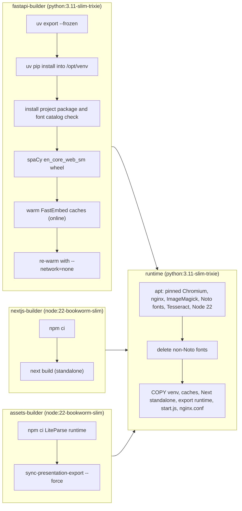

# Docker build and deployment

<div class="chapter-meta" markdown>
**Reads:** `Dockerfile`, `Dockerfile.dev`, `docker-compose.yml`, `.dockerignore`, `nginx.conf`, `start.js`, `scripts/sync-presentation-export.cjs`, `.do/deploy.template.yaml`, `.github/workflows/docker-release.yml`, `docs/multi-docker-build.md`, `docs/presenton-resource-usage.md`, `servers/fastapi/utils/db_utils.py`  ·  **Builds on:** [Runtime topology](03-runtime-topology.md), [Running it locally](04-running-locally.md)  ·  **Time:** ~40 min
</div>

This chapter is about producing and shipping the Presenton container: what each of the four Dockerfile stages builds and why, what the final image contains and what makes it large, how the development image differs, how `docker-compose.yml` forwards configuration, how the multi-architecture image reaches `ghcr.io`, and what you must configure for a real deployment (public URL, reverse proxy, external database, air-gapped mode, sizing). The processes that run inside the container (nginx, FastAPI, MCP, Next.js, optional Ollama) and how `start.js` supervises them are covered in [Runtime topology](03-runtime-topology.md); this chapter only touches `start.js` where it matters for deployment.

## Step 0: The build context and `.dockerignore`

`docker build .` sends the repository root as the build context, filtered by `.dockerignore`:

| Pattern | Why it is excluded |
|---|---|
| `.git`, `node_modules`, `**/node_modules`, `**/.next`, `**/.next-build`, `**/.venv` | Host build outputs and dependencies are rebuilt inside the image for Linux |
| `**/.pytest_cache`, `**/__pycache__`, `**/*.pyc`, `**/debug` | Python caches |
| `**/fastembed_cache`, `**/chroma`, `.cache` | Model and vector caches are regenerated by the warm-up step |
| `app_data`, `container.db` | User data must never be baked into an image |
| `presentation-export` | Re-downloaded at the pinned version by the assets stage |
| `servers/fastapi/tests`, `servers/nextjs/cypress`, `servers/nextjs/cypress.config.ts`, `**/*.cy.ts`, `**/*.cy.tsx` | Tests are not shipped |
| `electron/*` with negations | Only `electron/resources/document-extraction/liteparse_runner.mjs` survives |

The Electron block is a three-level negation (`.dockerignore:30` to `:35`): exclude `electron/*`, re-include `electron/resources`, exclude its children, re-include `document-extraction`, exclude its children, re-include the one runner file. Docker and the desktop app therefore share the exact same LiteParse runner.

!!! warning "Gotcha: tests are not in the image"
    Because `servers/fastapi/tests` is ignored, you cannot run `pytest` inside the production image. CI runs tests on the source tree instead (see [CI, tests, security](28-ci-tests-security.md)).

## Step 1: The stage graph



The file starts with `# syntax=docker/dockerfile:1.7` (`Dockerfile:1`). That front end is required for the `RUN --mount=type=cache` and `RUN --network=none` instructions used below.

## Step 2: Stage `fastapi-builder`

### 2.1 A pip-less virtual environment managed by uv

```dockerfile title="Dockerfile (excerpt)"
FROM python:3.11-slim-trixie AS fastapi-builder

WORKDIR /app/servers/fastapi

ENV UV_COMPILE_BYTECODE=1 \
    UV_LINK_MODE=copy

RUN python -m venv --without-pip /opt/venv \
    && pip install --no-cache-dir uv

COPY servers/fastapi/pyproject.toml servers/fastapi/uv.lock ./
RUN --mount=type=cache,target=/root/.cache/uv \
    uv export --frozen --no-dev --no-emit-project -o /tmp/requirements.txt \
    && uv pip install --python /opt/venv/bin/python -r /tmp/requirements.txt
```

- The venv is created without pip; uv is installed into the base interpreter and pointed at the venv with `--python /opt/venv/bin/python`. Only `/opt/venv` is copied to the runtime stage, so neither pip nor uv exists at runtime.
- `UV_COMPILE_BYTECODE=1` compiles `.pyc` files at install time, so the first import in the container does not pay that cost. `UV_LINK_MODE=copy` avoids hard links into the cache mount, which would dangle once the cache is unmounted.
- `uv export --frozen --no-dev --no-emit-project` turns `uv.lock` into a fully pinned requirements file without the dev group (`pytest`, `pytest-cov`) and without the project itself. `--frozen` means the lock is used as-is; a lock that disagrees with `pyproject.toml` is not silently re-resolved.
- Copying only `pyproject.toml` and `uv.lock` first means dependency layers are reused when only application code changes.

### 2.2 Installing the application and checking packaged data

```dockerfile title="Dockerfile (excerpt)"
COPY servers/fastapi /app/servers/fastapi
RUN --mount=type=cache,target=/root/.cache/uv \
    uv pip install --python /opt/venv/bin/python --no-deps . \
    && cd /tmp \
    && /opt/venv/bin/python -c "from templates.pptx_font_utils import get_static_font_catalog; assert get_static_font_catalog(), 'Packaged font catalog is empty'"
```

`uv pip install --no-deps .` installs the `presenton-backend` package defined by `servers/fastapi/pyproject.toml`, whose setuptools configuration includes the `api*`, `models*`, `services*`, `utils*`, `templates*` (and other) packages and ships `templates/assets/fonts.json` as package data (`pyproject.toml:48` to `:61`). The assertion runs from `/tmp`, so `templates` is imported from the installed package, not from the source checkout; the build fails if the font catalog JSON did not make it into the wheel.

### 2.3 The spaCy model

```dockerfile title="Dockerfile (excerpt)"
# mem0/spaCy BM25 lemmatization loads en_core_web_sm at runtime; spaCy tries pip to
# download it otherwise. Runtime image has no pip in PATH (--without-pip venv).
RUN --mount=type=cache,target=/root/.cache/uv \
    uv pip install --python /opt/venv/bin/python \
    "https://github.com/explosion/spacy-models/releases/download/en_core_web_sm-3.8.0/en_core_web_sm-3.8.0-py3-none-any.whl"
```

The model is not in `uv.lock`; it is fetched by URL at a fixed version (3.8.0). The comment states the reason: without it, spaCy would try to `pip install` the model at runtime, which cannot work in a pip-less venv.

### 2.4 Baking FastEmbed weights, then proving they work offline

```dockerfile title="Dockerfile (excerpt)"
ENV HF_HOME=/root/.cache/huggingface \
    FASTEMBED_CACHE_PATH=/root/.cache/presenton/fastembed \
    PRESENTON_FASTEMBED_ICON_CACHE_DIR=/root/.cache/presenton/fastembed-icons
# Warm FastEmbed caches into the image (not a BuildKit cache mount, or HF weights would be missing).
RUN /opt/venv/bin/python scripts/warm_fastembed_cache.py
RUN --network=none HF_HUB_OFFLINE=1 /opt/venv/bin/python scripts/warm_fastembed_cache.py
```

`servers/fastapi/scripts/warm_fastembed_cache.py` initializes three models: the icon-search embedding index through `ICON_FINDER_SERVICE.ensure_initialized()` (the docstring names `AllMiniLML6V2`), the Mem0 dense embedder (`MEM0_EMBEDDER_MODEL`, default `BAAI/bge-small-en-v1.5`, `warm_fastembed_cache.py:28`) and the `Qdrant/bm25` sparse model (`warm_fastembed_cache.py:49`). The first `RUN` downloads them into normal image layers. The second `RUN` repeats the warm-up with networking disabled and `HF_HUB_OFFLINE=1`: if any weight is missing, initialization tries the network, fails, and the build stops. This is the image's offline guarantee for embeddings.

!!! warning "Gotcha: changing the embedder model at runtime defeats the bake"
    Only the default `BAAI/bge-small-en-v1.5` (or whatever `MEM0_EMBEDDER_MODEL` was at build time) is cached. Setting a different `MEM0_EMBEDDER_MODEL` in compose makes the container download weights on first use, which fails in air-gapped deployments. The Dockerfile declares no `ARG` or `ENV` for `MEM0_EMBEDDER_MODEL` in the `fastapi-builder` stage, so to bake a different model you must add one before the warm-up `RUN` lines and rebuild.

## Step 3: Stage `nextjs-builder`

```dockerfile title="Dockerfile (excerpt)"
FROM node:22-bookworm-slim AS nextjs-builder

WORKDIR /app/servers/nextjs

ENV NEXT_TELEMETRY_DISABLED=1

COPY servers/nextjs/package.json servers/nextjs/package-lock.json ./
RUN --mount=type=cache,target=/root/.npm \
    npm ci

COPY servers/nextjs /app/servers/nextjs
RUN npm run build \
    && rm -rf .next-build/cache
```

`servers/nextjs/next.config.mjs:10` sets `distDir: ".next-build"` and `output: "standalone"`, so the build emits a self-contained `server.js` plus only the traced `node_modules` under `.next-build/standalone`. The build cache is deleted in the same layer so it never reaches the final image. `npm ci` honors the `overrides` in `servers/nextjs/package.json` (pinned `brace-expansion`, `minimatch`, `glob`, `systeminformation` floors), which are covered in [CI, tests, security](28-ci-tests-security.md).

!!! warning "Gotcha: no `NEXT_PUBLIC_*` at build time"
    The Docker build passes no `NEXT_PUBLIC_FAST_API` or `NEXT_PUBLIC_URL`. Browser code therefore uses same-origin paths like `/api/v1/...`, which nginx routes. If you add build-time `NEXT_PUBLIC_*` values, remember Next.js inlines them into the client bundle, so the image becomes tied to one hostname.

## Step 4: Stage `assets-builder`

This stage produces two Node runtimes that FastAPI shells out to: the LiteParse document parser and the closed-source export engine.

```dockerfile title="Dockerfile (excerpt)"
COPY package.json package-lock.json /app/

RUN mkdir -p /app/document-extraction-liteparse \
    && cp /app/package.json /app/package-lock.json /app/document-extraction-liteparse/ \
    && npm --prefix /app/document-extraction-liteparse ci --omit=dev

COPY electron/resources/document-extraction/liteparse_runner.mjs /app/document-extraction-liteparse/liteparse_runner.mjs
COPY scripts/sync-presentation-export.cjs /app/scripts/sync-presentation-export.cjs
COPY scripts/run-presentation-export.mjs /app/scripts/run-presentation-export.mjs
COPY scripts/export-permissions.cjs /app/scripts/export-permissions.cjs
RUN rm -rf /app/presentation-export \
    && node /app/scripts/sync-presentation-export.cjs --force
```

### 4.1 LiteParse runtime

The root `package.json` declares exactly two dependencies, `@llamaindex/liteparse ^1.5.2` and `sharp ^0.35.5`, with `overrides` that force LiteParse's own `sharp` and `zod` to safe versions (`package.json:16` to `:25`). `npm ci --omit=dev` installs them from the lock file into `/app/document-extraction-liteparse`, next to the shared runner script. How FastAPI calls this runner is covered in [Document ingestion](11-document-ingestion.md).

### 4.2 The pinned export engine

`scripts/sync-presentation-export.cjs --force` installs `@presenton/export-core` at the version pinned in the root `package.json` (`"presentationExportVersion": "v1.0.51"`, `package.json:4`). Its `main()` (`scripts/sync-presentation-export.cjs:359`) does the following:

1. Read the pin (`readPinnedVersion`, `:155`). `EXPORT_RUNTIME_VERSION` is honored only with `--allow-version-override`, so the Docker build always uses the pin.
2. Download `presenton-export-core-opensource-1.0.51.tgz` from `https://github.com/presenton/presenton-export/releases/download/v1.0.51/` (or copy `EXPORT_CORE_ARCHIVE` if set), following at most 5 redirects.
3. `installRuntime` (`:295`) empties `/app/presentation-export` (it clears contents instead of deleting the directory because the development compose service mounts a named volume there), copies `runner.mjs` and `export-permissions.cjs`, writes a `package.json` that depends on the tarball and overrides `sharp` to `0.35.5` and `katex` to `0.18.10`, then runs `npm install --omit=dev --ignore-scripts --no-package-lock --no-fund --no-audit`.
4. Write `presenton-export-version.json` and re-validate with `validateExistingRuntime` (`:253`): the installed version and package name must match, `sharp` must be at least 0.35.5 with the exact native `@img/sharp-<platform>` package its manifest expects, and `katex` must be at least 0.18.2.

`getRuntimePlatformArch` (`:40`) distinguishes glibc from musl Linux, so the check expects `@img/sharp-linux-x64` or `@img/sharp-linux-arm64` on these Debian-based images.

!!! warning "Gotcha: `--ignore-scripts` is deliberate"
    Lifecycle scripts never run for the export engine or its dependencies. If a future dependency needs a postinstall step, the install will not run it and `validateExportRuntime` (or the export itself) is where you will see the failure.

## Step 5: Stage `runtime`

### 5.1 Arguments and environment

```dockerfile title="Dockerfile (excerpt)"
ARG INSTALL_TESSERACT=true
ARG CHROMIUM_VERSION=149.0.7827.196-1~deb13u1
ARG CHROMIUM_SNAPSHOT=20260625T180000Z
```

| Variable (`Dockerfile:82` to `:92`) | Value | Consumer |
|---|---|---|
| `APP_DATA_DIRECTORY` | `/app_data` | Everything persistent: SQLite DB, `userConfig.json`, assets |
| `TEMP_DIRECTORY` | `/tmp/presenton` | Per-owner scratch space |
| `EXPORT_PACKAGE_ROOT` | `/app/presentation-export` | Export runner location |
| `PRESENTON_APP_ROOT` | `/app` | Next.js route handlers locating FastAPI static files |
| `HF_HOME`, `FASTEMBED_CACHE_PATH`, `PRESENTON_FASTEMBED_ICON_CACHE_DIR` | under `/root/.cache` | Must match the paths used at bake time |
| `PATH` | `/opt/venv/bin:$PATH` | `python` resolves to the venv |
| `NODE_ENV` | `production` | Next.js and Node scripts |
| `START_OLLAMA` | `false` | `start.js` |
| `PUPPETEER_EXECUTABLE_PATH` | `/usr/bin/chromium` | Export engine uses system Chromium |

### 5.2 Pinned Chromium from a Debian snapshot

```dockerfile title="Dockerfile (excerpt)"
RUN set -eux; \
    printf 'Acquire::Check-Valid-Until "false";\n' > /etc/apt/apt.conf.d/99snapshot; \
    printf 'deb [check-valid-until=no] http://snapshot.debian.org/archive/debian-security/%s trixie-security main\n' "$CHROMIUM_SNAPSHOT" > /etc/apt/sources.list.d/chromium-snapshot.list; \
    # ...
    if [ "$INSTALL_TESSERACT" = "true" ]; then packages="$packages tesseract-ocr tesseract-ocr-eng"; fi; \
    apt-get update; \
    apt-get install -y --no-install-recommends --allow-downgrades \
    $packages \
    chromium="${CHROMIUM_VERSION}" \
    chromium-common="${CHROMIUM_VERSION}" \
    chromium-driver="${CHROMIUM_VERSION}"; \
    apt-mark hold chromium chromium-common chromium-driver; \
    curl -fsSL https://deb.nodesource.com/setup_22.x | bash -; \
    apt-get install -y --no-install-recommends nodejs; \
    rm -rf /var/lib/apt/lists/*
```

The export engine's rendering is sensitive to the browser build, so the image does not take "whatever Chromium trixie-security has today". It adds a `snapshot.debian.org` source frozen at `20260625T180000Z`, disables `Valid-Until` checks (snapshot metadata is old by design), installs exactly `149.0.7827.196-1~deb13u1` (with `--allow-downgrades` in case the live mirror is newer), and holds the packages. The same build ID (`149.0.7827.196`) is pinned for the desktop app in `electron/package.json:6`, so Docker and Electron export with the same browser revision.

The rest of the package list provides `nginx`, `fontconfig`, `imagemagick`, `zstd`, `curl`, the Chromium shared libraries (`libgtk-3-0t64`, `libnss3`, `libgbm1` and others), and fonts. Node.js 22 comes from the NodeSource setup script, not from Debian.

### 5.3 A Noto-only font set

```dockerfile title="Dockerfile (excerpt)"
# Remove any non-Noto fonts that may have been installed as dependencies.
RUN find /usr/share/fonts -type f ! -iname 'Noto*' -delete \
    && find /usr/share/fonts -type d -empty -delete \
    && fc-cache -fsv
```

Every system font whose filename does not start with `Noto` is deleted and the fontconfig cache rebuilt. This makes font fallback during export deterministic: when a slide requests a font the image does not have, Chromium falls back to a Noto family rather than whichever font a dependency happened to pull in. Template fonts are loaded separately (see [Themes and fonts](19-themes-and-fonts.md)).

!!! warning "Gotcha: deleting files in a later layer does not shrink the image"
    `fonts-liberation` is installed by the apt layer and then removed by this one. The bytes remain in the earlier layer, so the deletion changes behavior (no Liberation fallback) but not image size. The same applies to anything you "clean up" in a separate `RUN`.

### 5.4 Directories and the assembly copies

```dockerfile title="Dockerfile (excerpt)"
RUN mkdir -p /app_data/exports /app_data/images /app_data/uploads /app_data/fonts /app_data/templates /app_data/pptx-to-html /app_data/pptx-to-json \
    && chmod -R a+rX /app_data

COPY --from=fastapi-builder /opt/venv /opt/venv
COPY --from=fastapi-builder /app/servers/fastapi /app/servers/fastapi
COPY --from=fastapi-builder /root/.cache/huggingface /root/.cache/huggingface
# ...
COPY --from=assets-builder /app/presentation-export /app/presentation-export
# ...
RUN test -f /app/presentation-export/runner.mjs \
    && test -f /app/presentation-export/node_modules/@presenton/export-core/dist/index.js

COPY --from=nextjs-builder /app/servers/nextjs/.next-build/standalone/ /app/servers/nextjs/
COPY --from=nextjs-builder /app/servers/nextjs/public /app/servers/nextjs/public
COPY --from=nextjs-builder /app/servers/nextjs/.next-build/static /app/servers/nextjs/.next-build/static
```

| Destination | Source stage | Purpose |
|---|---|---|
| `/opt/venv` | fastapi-builder | Python dependencies, project package, spaCy model |
| `/app/servers/fastapi` | fastapi-builder | Source tree (FastAPI runs from here, so `static/`, `assets/`, `alembic/` are found relative to the working directory) |
| `/root/.cache/huggingface`, `/root/.cache/presenton/fastembed*` | fastapi-builder | Baked model weights |
| `/app/templates` | build context | Bundled template packs |
| `/app/document-extraction-liteparse` | assets-builder | LiteParse runtime and runner |
| `/app/presentation-export` | assets-builder | Export engine (guarded by two `test -f` checks) |
| `/app/scripts/*` | assets-builder and context | Export sync and permission helpers, banner, `user-config-env.cjs`, `run-node-script.mjs` |
| `/app/servers/nextjs/` | nextjs-builder | Standalone server, `public/`, and hashed static chunks |
| `/app/start.js`, `LICENSE`, `NOTICE` | context | Supervisor and license files |
| `/etc/nginx/nginx.conf` | context | Reverse proxy |

The image ends with `EXPOSE 80` and `CMD ["node", "/app/start.js"]` (`Dockerfile:152`). There is no `USER` instruction, so the container runs as root unless the orchestrator overrides it. `start.js` spawns the Next.js standalone server only when `servers/nextjs/server.js` exists and the process is not in `--dev` mode (`start.js:35`, `:539`).

## Step 6: What makes the image large

The repository contains no measured image size, so this is a qualitative inventory of what the Dockerfile puts into layers:

| Contributor | Where | Notes |
|---|---|---|
| Chromium 149 plus GTK, NSS, X11 and audio libraries | `Dockerfile:97` to `:111` | Required by the export engine and template previews |
| Noto font families, including `fonts-noto-cjk` and `fonts-noto-cjk-extra` and color emoji | `Dockerfile:98` to `:99` | CJK coverage is the largest font component |
| Python ML stack: `fastembed` (ONNX Runtime), `mem0ai[nlp]` (spaCy), `pandas`, `pdfplumber`, provider SDKs | `/opt/venv` | Driven by `servers/fastapi/pyproject.toml:12` to `:39` |
| Baked embedding weights | `/root/.cache` | Three models (Step 2.4) |
| Node.js 22 runtime | NodeSource | Needed by Next.js, LiteParse and export |
| Export engine with `sharp`/libvips native binaries and KaTeX | `/app/presentation-export` | Pinned v1.0.51 |
| LiteParse with its own `sharp` | `/app/document-extraction-liteparse` | Separate install from the export engine |
| Tesseract OCR with English data | optional | Skip with `--build-arg INSTALL_TESSERACT=false` |
| ImageMagick, nginx | apt | Document conversion and reverse proxy |

The only size knob the Dockerfile exposes is `INSTALL_TESSERACT`. Building without it removes OCR for scanned documents; nothing in the Dockerfile substitutes another OCR engine.

## Step 7: `Dockerfile.dev`

The development image is a single stage built for bind-mounted source:

| Aspect | `Dockerfile` | `Dockerfile.dev` |
|---|---|---|
| Stages | 4 | 1 |
| Python packages | `/opt/venv` (no pip, no uv at runtime) | System site-packages via `UV_SYSTEM_PYTHON=1` and `uv pip install --system`, uv installed with the astral.sh script |
| Tesseract | optional (`INSTALL_TESSERACT`) | always installed |
| LiteParse install | `npm ci --omit=dev` | `scripts/sync-document-dependencies.cjs` (fingerprinted, see below) |
| Next.js | prebuilt standalone | not built; `start.js --dev` runs `npm ci` then `next dev --webpack` |
| Command | `node /app/start.js` | `node /app/start.js --dev` |

The comment at `Dockerfile.dev:68` explains the system-site-packages choice: the compose bind mount `.:/app` would hide a `.venv` inside `servers/fastapi`, so dependencies must live outside `/app`.

`scripts/sync-document-dependencies.cjs` is the development counterpart to the production `npm ci`. It computes a SHA-256 fingerprint of `package-lock.json`, the `dependencies` and `overrides` blocks, and `process.platform:arch:modules` (`sync-document-dependencies.cjs:35`), and reinstalls only when the stored marker differs, a critical package version (`@llamaindex/liteparse`, `sharp`, `zod`, `axios`, `form-data`, `follow-redirects`) does not match the lock, or `import('@llamaindex/liteparse')` and `import('sharp')` fail. A failed reinstall throws "Document dependencies do not match the reviewed lockfile" and never writes the marker.

In `--dev` mode `start.js` also: runs `npm ci` in `servers/nextjs` on every start (`start.js:171`), re-syncs the document dependencies (`:226`), forces a fresh export runtime sync if the check fails (`:463`), copies the bind-mounted `nginx.conf` over `/etc/nginx/nginx.conf` (`:468`), starts FastAPI with `--reload true`, waits for log lines instead of HTTP probes (`:633`), and restarts FastAPI or Next.js if either exits with code 0 (`:582`).

## Step 8: `docker-compose.yml`

### 8.1 Four services, not profiles

The compose file defines four services (no Compose `profiles:` key is used): `production` (`docker-compose.yml:2`), `production-gpu` (`:130`), `development` (`:264`) and `development-gpu` (`:395`). You pick one by name: `docker compose up production`.

| Service | Dockerfile | Volumes | GPU |
|---|---|---|---|
| `production` | `Dockerfile` | `./app_data:/app_data`, `./servers/fastapi/templates:/app/servers/fastapi/templates:ro` | no |
| `production-gpu` | `Dockerfile` | `./app_data:/app_data` | 1 NVIDIA device |
| `development` | `Dockerfile.dev` | `.:/app`, three named volumes, `./app_data:/app_data` | no |
| `development-gpu` | `Dockerfile.dev` | same as development | 1 NVIDIA device |

All four publish `${PRESENTON_HTTP_HOST_PORT:-5001}:80` and `1455:1455`. Port 1455 is commented as "Required for Codex OAuth callback (OpenAI redirects browser directly to localhost:1455)" (`docker-compose.yml:11`).

### 8.2 Bind mounts versus named volumes in development

```yaml title="docker-compose.yml (excerpt)"
    volumes:
      - .:/app
      - presenton_root_node_modules:/app/node_modules
      - presenton_document_extraction_liteparse:/app/document-extraction-liteparse
      - presenton_presentation_export:/app/presentation-export
      - ./app_data:/app_data
```

The whole repository is mounted at `/app` so source edits reload live. Three named volumes are mounted on top of paths inside that bind mount; they shadow whatever the host has there. This keeps Linux-built native modules (`sharp`, the export engine) inside Docker-managed storage, isolated from a macOS or Windows host's `node_modules`. This is also why `installRuntime` clears the contents of `/app/presentation-export` rather than deleting the directory: deleting a mount point fails with `EBUSY` (`scripts/sync-presentation-export.cjs:296`). The root test `package-metadata.test.mjs` asserts that `presenton_presentation_export:/app/presentation-export` appears exactly twice in the compose file and is declared under top-level `volumes:` (`scripts/package-metadata.test.mjs:56`).

The `production` service's read-only templates mount replaces the image's `servers/fastapi/templates` package with the host copy. FastAPI is started as `python server.py` from `/app/servers/fastapi` (`start.js:521`), so that directory is first on `sys.path` and the mounted package is the one imported.

### 8.3 GPU services

```yaml title="docker-compose.yml (excerpt)"
    deploy:
      resources:
        reservations:
          devices:
            - driver: nvidia
              count: 1
              capabilities: [gpu]
```

The image contains no CUDA libraries. The GPU reservation matters for an Ollama server started inside the container with `START_OLLAMA=true`, which `start.js` installs at startup from `https://ollama.com/install.sh` if the binary is missing (`start.js:433`) and then runs as `ollama serve` (`:662`). The NVIDIA Container Toolkit must be installed on the host.

### 8.4 Environment forwarding

Every service forwards roughly 110 variables using the pattern `- NAME=${NAME:-default}`. Most defaults are empty, which forwards an empty string. Two mechanisms make empty values harmless:

- `start.js` seeds `userConfig.json` from the environment through `scripts/user-config-env.cjs`. `envValue` treats both `undefined` and `""` as "not set" (`scripts/user-config-env.cjs:130`), so an empty compose variable never erases a value saved in the UI.
- `setupUserConfigFromEnv` (`start.js:490`) writes the file only if it is empty or at least one recognised key is non-empty; otherwise it leaves a UI-managed configuration alone.

Non-empty compose defaults worth knowing:

| Variable | Compose default | Effect |
|---|---|---|
| `MIGRATE_DATABASE_ON_STARTUP` | `true` (hard-coded, not `${...:-true}`, so a shell variable cannot override it) | Run Alembic at startup (otherwise `create_all` on a fixed table list) |
| `PRESENTATION_GENERATION_MODE` | `both` | Standard and Smart generation |
| `PRESENTON_COMMUNITY_ENABLED` | `true` | Community gallery on |
| `START_OLLAMA` | `false` | No in-container Ollama |
| `ENABLE_PARALLEL_IMAGE_GENERATION` | `true` | |
| `MAX_OUTLINE_WORDS` | `100` | |
| `MEM0_LLM_MODEL` | `${OLLAMA_MODEL:-llama3.1:latest}` | Mem0 points at Ollama by default |
| `MEM0_LLM_BASE_URL` | `${OLLAMA_URL:-http://host.docker.internal:11434}` | |
| `MEM0_EMBEDDER_MODEL`, `MEM0_EMBEDDING_DIMS` | `BAAI/bge-small-en-v1.5`, `384` | Matches the baked weights |
| `LITEPARSE_DPI`, `LITEPARSE_NUM_WORKERS` | `120`, `1` | Document parsing cost |
| `PUPPETEER_EXECUTABLE_PATH` | `/usr/bin/chromium` | |

Authentication variables (`AUTH_USERNAME`, `AUTH_PASSWORD`, `AUTH_OVERRIDE_FROM_ENV`, `RESET_AUTH`) are forwarded by all four services; their semantics are in [Auth and multi-user](25-auth-and-multiuser.md). `DISABLE_AUTH` is not forwarded by compose, which keeps accounts on for Docker unless you add it yourself.

!!! warning "Gotcha: two different host-port variable names"
    The port mapping uses `PRESENTON_HTTP_HOST_PORT`, but the environment block forwards `PRESENTON_HOST_HTTP_PORT` (note the word order), defaulting to `5001` (and to `5000` in `production-gpu`). Inside the container that value only feeds the startup banner (`scripts/presenton-terminal-banner.mjs:97`). If you only set `PRESENTON_HTTP_HOST_PORT=8080`, the app works on 8080 but the banner still prints `5001`.

!!! warning "Gotcha: `platform` defaults to `linux/amd64`"
    Every service sets `platform: ${PRESENTON_DOCKER_PLATFORM:-linux/amd64}`. On Apple Silicon or ARM servers, compose builds and runs an emulated amd64 image unless you export `PRESENTON_DOCKER_PLATFORM=linux/arm64`.

## Step 9: Multi-architecture release

### 9.1 The CI workflow

`.github/workflows/docker-release.yml` runs on `release: published` and on `workflow_dispatch`:

```yaml title=".github/workflows/docker-release.yml (excerpt)"
      - name: Build and push multi-architecture image
        uses: docker/build-push-action@c3c9e263c25d99ce0380d002d59b67737d91b0dc # v7
        with:
          context: .
          platforms: linux/amd64,linux/arm64
          push: true
          tags: ${{ steps.docker-tags.outputs.tags }}
          cache-from: type=gha
          cache-to: type=gha,mode=max
```

1. Check out the release tag (or the dispatched ref).
2. Set up QEMU and Buildx (both actions pinned by commit SHA), log in to `ghcr.io` with `secrets.GITHUB_TOKEN` (the job has `packages: write`).
3. Tag: `ghcr.io/presenton/presenton:<release tag>` for releases, `ghcr.io/presenton/presenton:dev` (`MOVING_TAG`) for manual runs.
4. Build both platforms in one Buildx invocation with the GitHub Actions cache backend.
5. `docker buildx imagetools inspect` the pushed tag and `grep` for both `linux/amd64` and `linux/arm64`.

The `concurrency` group keys on the tag with `cancel-in-progress: false`, so two releases never cancel each other.

!!! warning "Gotcha: CI never moves `latest`"
    The workflow pushes only the release tag or `dev`. The `latest` tag used by `docker run ghcr.io/presenton/presenton:latest` and by the DigitalOcean template is promoted by hand, following `docs/multi-docker-build.md` step 4.

### 9.2 The documented manual flow

`docs/multi-docker-build.md` describes the alternative used when building natively on two machines: build on macOS (arm64) and Linux (amd64), tag the local image `presenton-3-production:latest` as `ghcr.io/presenton/presenton:<version>-arm64` and `-amd64`, push both, then stitch them with `docker buildx imagetools create -t ghcr.io/presenton/presenton:<version> <amd64> <arm64>`, promote with a second `imagetools create -t ...:latest ...:<version>`, and verify that both manifests list `linux/amd64` and `linux/arm64`. Native builds avoid QEMU emulation, which matters for a build that compiles Python bytecode, installs Chromium and warms ONNX models.

Because Buildx runs the `assets-builder` stage once per platform, each architecture gets its own `@img/sharp-linux-<arch>` native package, and `validateSharpRuntime` checks the right one.

## Step 10: Platform templates

### 10.1 DigitalOcean App Platform

```yaml title=".do/deploy.template.yaml (excerpt)"
  services:
    - name: presenton
      image:
        registry_type: GHCR
        registry: ghcr.io
        repository: presenton/presenton
        tag: latest
      http_port: 80
      instance_count: 1
      instance_size_slug: apps-s-1vcpu-2gb
      envs:
        - key: MIGRATE_DATABASE_ON_STARTUP
          value: "true"
          scope: RUN_TIME
          type: GENERAL
```

The template deploys the prebuilt `latest` image to one `apps-s-1vcpu-2gb` instance on port 80, sets `MIGRATE_DATABASE_ON_STARTUP=true` and `START_OLLAMA=false`, and alerts on `DEPLOYMENT_FAILED` and `DOMAIN_FAILED`. It declares no volume and no `DATABASE_URL`, so the SQLite database, `userConfig.json` (with the JWT signing secret) and all generated assets live on the container filesystem under `/app_data`. If the platform does not persist that filesystem across deploys, every redeploy resets accounts and data; add a managed database through `DATABASE_URL` and check your provider's storage options before relying on it.

### 10.2 Railway

The repository contains no Railway configuration file. The README links to a hosted Railway template (`https://railway.com/deploy/presenton-ai-presentations`); its contents are not part of this source tree and are not verified here.

### 10.3 Kubernetes and OpenShift

No Helm chart or manifest ships in the repository. What the code does provide is tolerance for volumes owned by an arbitrary UID:

```javascript title="start.js (excerpt)"
// Volumes mounted by the host (e.g. a Kubernetes/OpenShift PVC owned by an
// arbitrary non-root UID) may already have sufficient permissions without
// letting this process chmod them. Treat chmod as best-effort so a restricted
// environment doesn't crash the whole process on startup.
const chmodBestEffort = (path, mode) => {
  try {
    chmodSync(path, mode);
  } catch (error) {
    if (error && (error.code === "EPERM" || error.code === "EACCES")) {
      return;
    }
    throw error;
  }
};
```

At startup `start.js` creates the seven asset directories with mode `0755` (`start.js:93`), applies `chmodBestEffort` to them and to `userConfig.json`/`.bak` (`0600`, `:104`), and normalizes permissions under `exports`, `pptx-to-html` and `pptx-to-json` with `legacy: true` (`start.js:89`). In legacy mode an existing directory keeps its owner and group bits and only loses world access (`stat.mode & 0o7770`) instead of being forced to `0750`; a non-root process also switches to legacy mode on its own for any directory it does not own (`scripts/export-permissions.cjs:24`). When running as root, exported files are re-grouped to `www-data` (or `nginx`) and set to `0640` so the nginx worker (`user www-data;`, `nginx.conf:1`) can read them without making them world-readable (`exportReaderGid`, `scripts/export-permissions.cjs:4`).

!!! warning "Gotcha: one replica only"
    `start.js` runs FastAPI, the MCP server, Next.js and nginx inside one container, async generation tasks are in-process `BackgroundTasks` that are marked failed after a restart (`servers/fastapi/api/lifespan.py:60`), and assets are on local disk. Nothing in the repository coordinates multiple replicas; run one instance per data volume.

## Step 11: Public URL and reverse proxies

### 11.1 Header handling in nginx

```nginx title="nginx.conf (excerpt)"
  client_max_body_size 100M;
  # Keep the browser-facing origin supplied by an outer reverse proxy. Direct
  # deployments fall back to this nginx listener's own scheme and Host header.
  map $http_x_forwarded_proto $presenton_forwarded_proto {
    "" $scheme;
    default $http_x_forwarded_proto;
  }
  map $http_x_forwarded_host $presenton_forwarded_host {
    "" $http_host;
    default $http_x_forwarded_host;
  }
```

| Location | Upstream | Body limit | Timeouts | Forwarded headers |
|---|---|---|---|---|
| `/` | Next.js `:3000` | 100M | read/connect 30m | `Host $http_host`, `X-Real-IP`, `X-Forwarded-For`, mapped `X-Forwarded-Proto`/`-Host`, WebSocket upgrade |
| `/api/v1/` | FastAPI `:8000` | 110M, `413` returns `{"detail":"File size must be less than 100MB."}` | read/send/connect 30m | same (no upgrade) |
| `/api/v2/` | FastAPI `:8000` | 100M | 30m | same |
| `/mcp`, `/mcp/` | MCP `:8001` | 145M | 30m | `Host localhost:8001` (FastMCP host allowlist) plus mapped forwarded headers |
| `/docs`, `/openapi.json` | FastAPI | 100M | 30m | `Host $host`, `X-Forwarded-Proto $scheme` |
| `/static/` | `alias` to `/app/servers/fastapi/static/` | | | public, `Cache-Control: public, immutable` |
| `/app_data/*` | `alias` to `/app_data/*` | | | see [Auth and multi-user](25-auth-and-multiuser.md) |

The 30-minute timeouts exist for long SSE generation streams and exports. `Host $http_host` (not `$host`) keeps the port, which the comment at `nginx.conf:34` says Next.js needs for redirects and absolute URLs.

Downstream, the forwarded headers drive three behaviors: the `Secure` flag on the session cookie (`_secure_request`, `servers/fastapi/api/v1/auth/router.py:39`), MCP result links (`absolute_mcp_url`, `servers/fastapi/utils/mcp_public_urls.py:17`) and the `/pdf-maker` session cookie in `servers/nextjs/proxy.ts:126`.

!!! warning "Gotcha: nginx trusts incoming `X-Forwarded-*`"
    The `map` blocks pass any client-supplied `X-Forwarded-Proto` or `X-Forwarded-Host` through unchanged. When nginx is directly exposed (no outer proxy), a client can set them. Put a proxy in front that overwrites these headers, or set `PRESENTON_PUBLIC_URL` so generated links do not depend on them.

### 11.2 `PRESENTON_PUBLIC_URL`

```python title="servers/fastapi/utils/get_env.py (excerpt)"
def get_presenton_public_url() -> str | None:
    value = (os.getenv("PRESENTON_PUBLIC_URL") or "").strip().rstrip("/")
    if value.startswith(("http://", "https://")):
        return value
    return None
```

The value must start with `http://` or `https://` or it is ignored. When set it is used for:

- MCP links: `absolute_mcp_url` prefers it over `X-Forwarded-Proto`/`X-Forwarded-Host` for `path`, `edit_path` and `preview_url` fields (`servers/fastapi/utils/mcp_public_urls.py:22`).
- The MCP DNS-rebinding allowlist: its origin is appended to the loopback origins (`get_mcp_allowed_origins`, `servers/fastapi/mcp_server.py:128`). Without it, browser-based MCP clients on your public hostname are rejected.
- Template endpoints answering MCP requests (`servers/fastapi/api/v1/ppt/endpoints/template.py:109`).
- The trusted-origin check for custom provider discovery (`servers/fastapi/api/v1/ppt/endpoints/ollama.py:29`).

### 11.3 Outer proxy checklist

From the code above, an outer proxy (Traefik, Caddy, a cloud load balancer) in front of the container should: terminate TLS and send `X-Forwarded-Proto: https` (otherwise the `presenton_session` cookie is issued without `Secure`), send `X-Forwarded-Host` or preserve `Host` with its port, allow request bodies of at least 110 MB on `/api/v1/` (145 MB on `/mcp`), and use idle timeouts long enough for streaming generation (nginx itself allows 30 minutes).

## Step 12: External databases with `DATABASE_URL`

`get_database_url_and_connect_args` (`servers/fastapi/utils/db_utils.py:57`) decides the runtime URL:

| Input | Runtime URL | Alembic URL (`to_sync_sqlalchemy_url`, `:103`) |
|---|---|---|
| unset | `sqlite+aiosqlite:///$APP_DATA_DIRECTORY/fastapi.db` (default `/tmp/presenton/fastapi.db`) | `sqlite:///...` |
| `sqlite://...` | `sqlite+aiosqlite://...`, parent directory created | `sqlite:///...` |
| `postgresql://...` | `postgresql+asyncpg://...` | `postgresql+psycopg://...` |
| `mysql://...` | `mysql+aiomysql://...` | `mysql+pymysql://...` |
| anything else | unchanged | unchanged |

All three drivers are in `pyproject.toml` (`aiosqlite`, `asyncpg`, `aiomysql`, `psycopg[binary]`). For server databases, `services/database.py:38` adds pool settings from `get_pool_kwargs` (`db_utils.py:34`): `DB_POOL_SIZE` (5), `DB_MAX_OVERFLOW` (10), `DB_POOL_TIMEOUT` (30 s), `DB_POOL_RECYCLE` (1800 s), `DB_POOL_PRE_PING` (true).

```python title="servers/fastapi/utils/db_utils.py (excerpt)"
        if split_result.query:
            query_params = parse_qsl(split_result.query, keep_blank_values=True)
            driver_scheme = split_result.scheme
            for k, v in query_params:
                key_lower = k.lower()
                if key_lower == "sslmode" and "postgresql+asyncpg" in driver_scheme:
                    if v.lower() != "disable" and "sqlite" not in database_url:
                        connect_args["ssl"] = ssl.create_default_context()

            database_url = urlunsplit(
                (
                    split_result.scheme,
                    split_result.netloc,
                    split_result.path,
                    "",
                    split_result.fragment,
                )
            )
```

!!! warning "Gotcha: every query parameter is dropped"
    The only query parameter that is interpreted is `sslmode` on PostgreSQL, which turns into a default `ssl.SSLContext` unless it equals `disable`. The whole query string is then removed, so options like `?charset=utf8mb4` or `?sslrootcert=...` never reach the driver.

!!! warning "Gotcha: `postgres://` is not rewritten"
    Only the `postgresql://` prefix is mapped to `asyncpg`. A `postgres://` URL (common in hosted database dashboards) is passed through unchanged and will not select the async driver. Rename the scheme before setting `DATABASE_URL`.

Moving to Postgres or MySQL does not move `userConfig.json` (signing secret, provider keys) or the asset directories; `/app_data` still needs persistent storage. How migrations run at startup is covered in [FastAPI app and startup](05-fastapi-startup.md).

## Step 13: Air-gapped deployments

### 13.1 The switch

```python title="servers/fastapi/utils/get_env.py (excerpt)"
def is_community_enabled() -> bool:
    """Return whether cloud-backed community features are available."""
    value = (os.getenv("PRESENTON_COMMUNITY_ENABLED") or "").strip().lower()
    if not value:
        return True
    return value not in {"0", "false", "no", "off"}
```

An unset or empty value means enabled. With `PRESENTON_COMMUNITY_ENABLED=false`:

- `require_community_enabled` returns `404` with code `community_disabled` and message "Community is disabled for this deployment." (`servers/fastapi/services/community_presentations.py:150`).
- Presentation creation that references community design IDs fails with `422 "Community references are disabled"` (`servers/fastapi/api/v1/ppt/endpoints/presentation.py:1717`).
- The Presenton Cloud proxy answers community paths with `404 community_disabled` and payloads carrying `community_design_ids` with `422 community_references_disabled` (`servers/fastapi/services/presenton_cloud_proxy.py:424`, `:468`).
- The Next.js dashboard layout, community page and upload page read the same variable to hide the feature.

### 13.2 Other outbound dependencies to plan for

| Dependency | Offline status in the image |
|---|---|
| Embedding weights | Baked and verified with `--network=none` (Step 2.4) |
| spaCy model | Baked (Step 2.3) |
| Export engine and Chromium | Baked; `start.js` only runs `--check-only` in production and throws if it is missing (`start.js:455`) |
| Ollama | `START_OLLAMA=true` downloads Ollama from the internet at startup; point `OLLAMA_URL` at an internal server instead |
| Text and image providers | Must be local or internal (Ollama, LM Studio, LiteLLM, OpenAI-compatible, ComfyUI); see [Configuration and LLM providers](06-configuration-and-providers.md) |
| Error reporting | Sentry initializes only when `SENTRY_DSN` is set (`servers/fastapi/api/main.py:32`) |
| Frontend analytics | Controlled by `DISABLE_ANONYMOUS_TRACKING`, forwarded by compose |
| Mem0 LLM | Defaults to `http://host.docker.internal:11434`; set `MEM0_ENABLED=false` or an internal URL |

## Step 14: Resource usage findings

`docs/presenton-resource-usage.md` reports a controlled k6 test of a single container. The workflow it exercised is exactly the standard pipeline described in [Standard generation pipeline](08-standard-pipeline.md):

| Order | Request |
|---|---|
| setup | `POST /api/v1/auth/login` once per test account (`Testuser1` to `Testuser4`), sequentially |
| 1 | `POST /api/v1/ppt/presentation/create` |
| 2 | `GET /api/v1/ppt/chat/conversations?presentation_id={id}&presentation_type=standard` |
| 3 | `GET /api/v1/ppt/outlines/stream/{id}` (SSE) |
| 4 | `POST /api/v1/ppt/presentation/prepare` |
| 5 | `GET /api/v1/ppt/presentation/stream/{id}` (SSE) |

The load shape was four waves with a 60-second cooldown; in each wave four virtual users ran one workflow each (10, 20, 30 and 40 slides), for 16 workflows, 96 HTTP requests and zero failures over a 51 minute 50 second window sampled every 2 seconds (1,551 samples). PPTX export was deliberately excluded.

| Metric | Start | Median | P95 | Max | End |
|---|---:|---:|---:|---:|---:|
| CPU (100% = one core) | 0.53% | 3.70% | 43.27% | 1,087.09% | 579.11% |
| Memory utilization | 17.42% | 20.19% | 21.36% | 37.09% | 37.09% |
| Available memory | 6,031.36 MB | 5,828.61 MB | 5,985.28 MB | 6,031.36 MB | 4,594.69 MB |
| "Heap" (sum of process `VmData`) | 2,670.32 MB | 3,170.68 MB | 3,273.54 MB | 11,866.22 MB | 11,086.41 MB |

The report's conclusions: CPU is bursty with a near-empty run queue (zero in 97.4% of samples); memory grew slowly during the run (+4.07 points, about +601 MB of `VmData` before 18:19:13); and about four minutes after the last k6 wave finished, a one-minute burst drove average CPU to 337.87%, memory to 37.09% and `VmData` to 11.9 GB. The capture ended during that burst, so the report cannot say which process caused it or whether memory was released. The report notes that `heap_memory_mb` is not a managed-runtime heap counter but the sum of Linux `VmData` across the container's processes, to be read as aggregate data/heap allocation rather than resident memory.

For sizing, the start and end rows are consistent with a host of about 7.3 GB total memory (derived arithmetic: 6,031.36 / (1 - 0.1742) and 4,594.69 / (1 - 0.3709) both give roughly 7,300 MB). That implies roughly 1.3 GB in use at the start and 2.7 GB at the peak, so the 2 GB DigitalOcean template leaves little headroom for concurrent generation. The report itself recommends repeating the test with stage markers, a recovery period, and OOM and swap counters.

## Step 15: Production checklist

| Item | Why | Where |
|---|---|---|
| Persist `/app_data` on a real volume | Database (default SQLite), `userConfig.json` with the JWT secret and provider keys, all assets | `Dockerfile:82`, `start.js:56` |
| Back up `userConfig.json` together with the database | API key ciphertext and all sessions depend on `AUTH_SECRET_KEY` | [Auth and multi-user](25-auth-and-multiuser.md) |
| Create the admin before exposing the port (`AUTH_USERNAME`, `AUTH_PASSWORD`) | `/api/v1/auth/setup` is open on an empty database | `servers/fastapi/api/v1/auth/bootstrap.py:43` |
| Remove `RESET_AUTH`/`AUTH_OVERRIDE_FROM_ENV` after one start | They rotate the secret and delete all API keys on every boot | `bootstrap.py:61` |
| Never add `DISABLE_AUTH=true` | Removes login and tenant isolation | `servers/fastapi/api/middlewares.py:59` |
| Terminate TLS upstream and send `X-Forwarded-Proto: https` | `Secure` session cookie | `servers/fastapi/api/v1/auth/router.py:39` |
| Overwrite `X-Forwarded-Host`/`-Proto` at the edge, set `PRESENTON_PUBLIC_URL` | nginx forwards client values; MCP links and origins | `nginx.conf:16`, `servers/fastapi/utils/get_env.py:17` |
| Allow 110 MB bodies and long idle timeouts upstream | Uploads and SSE | `nginx.conf:46`, `:41` |
| Pin an image tag instead of `latest` | `latest` is promoted manually | `docs/multi-docker-build.md` |
| Set `PRESENTON_DOCKER_PLATFORM` on ARM hosts | Compose defaults to amd64 | `docker-compose.yml:3` |
| Use `postgresql://` (not `postgres://`) and no extra query options | URL rewriting rules | `servers/fastapi/utils/db_utils.py:64` |
| Keep `MIGRATE_DATABASE_ON_STARTUP=true` | Alembic migrations, including the primary-admin constraint | `docker-compose.yml:20` |
| Run a single replica per volume | In-process tasks, local assets | `servers/fastapi/api/lifespan.py:60` |
| For air-gapped sites set `PRESENTON_COMMUNITY_ENABLED=false`, keep `START_OLLAMA=false`, use internal providers | No outbound calls | Step 13 |
| Size memory well above 2 GB for concurrent users | Measured burst behavior | Step 14 |
| Put rate limiting in front of `/api/v1/auth/login` | No built-in throttling | `servers/fastapi/tests/integration/test_auth_endpoints.py:244` |

## What you now know

- The production image is assembled from three builder stages (Python venv with baked models, Next.js standalone, Node runtimes for LiteParse and the pinned export engine) and a Debian trixie runtime with a snapshot-pinned Chromium and Noto-only fonts.
- The build fails early if packaged data, offline embedding weights, or the export runtime are missing, and pins every moving dependency (uv lock, npm lock and overrides, Chromium snapshot, export-core v1.0.51).
- `docker-compose.yml` offers four services; development bind-mounts the repo while named volumes protect native modules, and empty forwarded variables never overwrite UI-saved settings.
- Releases are multi-arch through Buildx in CI or native builds plus `imagetools`, and `latest` is moved by hand.
- Real deployments need persistent `/app_data`, a TLS proxy that sets forwarded headers, `PRESENTON_PUBLIC_URL` for MCP, careful `DATABASE_URL` formatting, and `PRESENTON_COMMUNITY_ENABLED=false` when offline.

## Next

Continue with [Electron desktop app](27-electron.md) to see the same servers packaged as a desktop application with a PyInstaller backend and per-launch loopback security.
