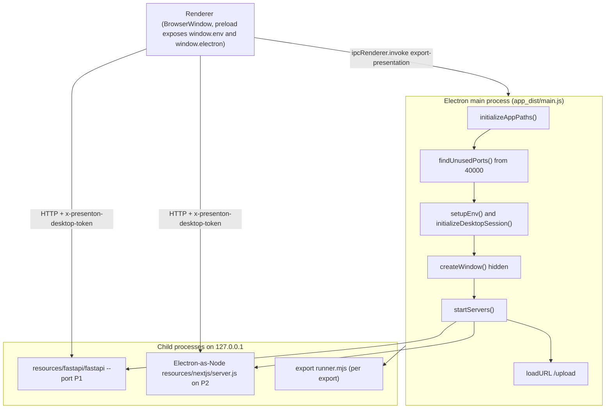
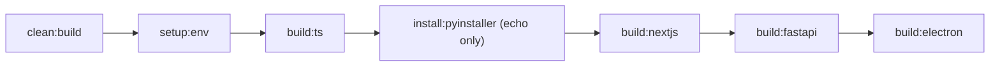
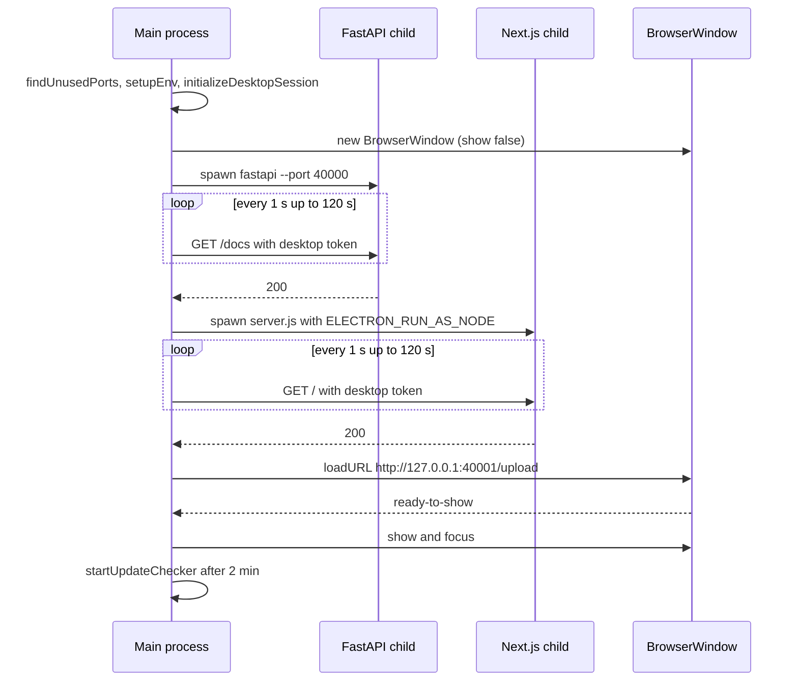

# Electron desktop app

<div class="chapter-meta" markdown>
**Reads:** `electron/package.json`, `electron/build.js`, `electron/tsconfig.json`, `electron/app/main.ts`, `electron/app/utils/*.ts`, `electron/app/ipc/*.ts`, `electron/app/preloads/index.ts`, `electron/scripts/*.cjs`, `servers/fastapi/server.spec`, `servers/fastapi/api/v1/auth/desktop.py`, `servers/nextjs/lib/desktop-auth.ts`, `servers/nextjs/tests/desktop-security.test.mjs`, `docs/macos/dev/*.md`, `.github/workflows/electron-linux-ubuntu22.yml`, `.github/workflows/sync-releaes-to-r2.yml`  ·  **Builds on:** [Runtime topology](03-runtime-topology.md), [Auth and multi-user](25-auth-and-multiuser.md), [Docker build and deployment](26-docker-and-deployment.md)  ·  **Time:** ~45 min
</div>

The desktop app is the same two servers you met in the Docker image (FastAPI and the Next.js standalone server), but with no nginx, no `start.js`, and no account system. Electron's main process takes over every job those pieces did: it picks loopback ports, writes the environment, spawns a PyInstaller-frozen FastAPI binary and the Next.js `server.js`, mints a per-launch secret that both servers check on every request, and runs the PPTX/PDF export runner as a child process. This chapter follows the code from `npm run build:all` through first launch to shutdown, then covers signing, notarization, the Linux CI build, and how release files reach Cloudflare R2.

## Step 0: The map



The rest of this chapter walks the boxes in order.

## Step 1: The `electron/` package and its scripts

`electron/package.json` is both the npm manifest and the release metadata store. Besides `version` (`0.9.12-beta`, `electron/package.json:4`) it carries three custom keys the build scripts read:

| Key | Value | Read by |
|---|---|---|
| `exportVersion` | `v1.0.51` (`electron/package.json:5`) | `scripts/sync-export-runtime.cjs:15`, `app/utils/export-msix-runtime.ts:28` |
| `exportChromiumBuildId` | `149.0.7827.196` (`electron/package.json:6`) | `scripts/prepare-export-chromium.cjs:44`, `app/utils/export-chromium.ts:60` |
| `exportMacChromiumBuildIds` | `darwin-arm64: 1625085`, `darwin-x64: 1625072` (`electron/package.json:7`) | same two files, macOS branch |

`main` points at `app_dist/main.js` (`electron/package.json:11`), the compiled output of `app/**` produced by `tsc` with `tsconfig.json` (`rootDir: ./app`, `outDir: ./app_dist`, `module: commonjs`, `target: es2016`, `strict: true`, `sourceMap` with `inlineSources`, `noEmitOnError`; `electron/tsconfig.json:12` to `:103`). Electron itself is pinned exactly to `42.11.16` and electron-builder to `26.15.0` (`electron/package.json:94` and `:95`).

The scripts form a pipeline. The full release chain is `build:all` (`electron/package.json:65`):



| Script | What it does |
|---|---|
| `setup:env` | `npm install`, `uv sync` in `servers/fastapi`, `npm install` in `servers/nextjs`, then `setup:export-runtime` and `prepare:imagemagick` (`:38`) |
| `build:ts` | Deletes `app_dist` then runs `tsc` (`:42`) |
| `build:nextjs` | `node scripts/build-nextjs-resources.cjs` (`:54`) |
| `build:fastapi` | Deletes `resources/fastapi`, runs the echo-only `build:vectorstore`, runs `ensure-spacy-model.cjs` with `MEM0_SPACY_STRICT=true`, then `uv run --with pyinstaller python -m PyInstaller --distpath ../../electron/resources server.spec`, then `copy-fastapi-assets.cjs` (`:55`) |
| `build:electron` | `copy:templates`, `generate:version`, `build:export-runtime`, `prepare:export-chromium`, `prepare:imagemagick`, `typecheck`, `build:ts`, `check:main-no-undef`, then `node build.js` (`:58`) |
| `build:electron:mac:signed` and `build:all:mac:signed` | Same chain with `PRESENTON_MAC_TARGET=dmg PRESENTON_REQUIRE_MAC_SIGNING=1` (`:59`, `:66`) |
| `build:electron:mas-dev`, `build:electron:mas` | `PRESENTON_MAC_TARGET=mas-dev` or `mas` (`:60`, `:61`) |
| `dist:*` | Package-only reruns: `node build.js` with the same env, no rebuild (`:62` to `:64`) |
| `dev` | `setup:desktop-runtime`, `copy:templates`, delete `app_dist`, `tsc`, then `electron . --no-sandbox` (`:36`) |
| `test:security` | `build:ts` then `node --test scripts/security-dependencies.test.cjs scripts/private-storage.test.cjs` (`:41`) |
| `cleanup:installed-app-cache` | Removes Chromium caches from an installed app's profile (`:70`) |

!!! warning "Gotcha: `install:pyinstaller` installs nothing"
    The script is literally `echo 'pyinstaller will be installed via uv run --with when building'` (`electron/package.json:39`). PyInstaller is pulled in ephemerally by `uv run --with pyinstaller` inside `build:fastapi`. Do not look for it in `servers/fastapi/pyproject.toml`.

## Step 2: What each build script produces

All scripts live in `electron/scripts/`. Every one writes into `electron/resources/`, which `build.js` later packs.

### 2.1 `build-nextjs-resources.cjs`

It deletes `resources/nextjs` and `servers/nextjs/.next-build`, then runs `npm run build` in `servers/nextjs` with two extra variables: `PRESENTON_ELECTRON_BUILD=true` and `NEXT_PUBLIC_PRESENTON_ELECTRON_PLATFORM=<process.platform>` (`electron/scripts/build-nextjs-resources.cjs:26` to `:36`). Those two flags change the Next.js build:

- `next.config.mjs:5` and `:37` set `images.unoptimized` when `PRESENTON_ELECTRON_BUILD` is `true`, because a packaged app lives in a read-only directory such as `/opt/Presenton` and Next's image optimizer writes into `<distDir>/cache`.
- `app/(presentation-generator)/components/SmartHtmlSlide.tsx:22` switches to an in-page renderer when the platform constant is `linux`.

The script then copies `.next-build/standalone/*` into `resources/nextjs/`, and copies `.next-build/static` and `public/` to both the bundle root and the nested `servers/nextjs/` directory (`electron/scripts/build-nextjs-resources.cjs:51` to `:86`), because Next.js 16 standalone output traces the app under `servers/nextjs/` and runs `server.js` from there.

### 2.2 `ensure-spacy-model.cjs` and `server.spec` (FastAPI)

`ensure-spacy-model.cjs` creates `servers/fastapi/.venv` if missing, checks `spacy.load("en_core_web_sm")` through `uv run python -c`, and otherwise installs the pinned wheel `en_core_web_sm-3.8.0-py3-none-any.whl` from the explosion/spacy-models GitHub release (`electron/scripts/ensure-spacy-model.cjs:8` to `:14`). With `MEM0_SPACY_STRICT=true` (set by `build:fastapi`) a failure aborts the build; without it the script only warns that "Mem0 will self-disable at runtime" (`:92` to `:98`).

PyInstaller then freezes `server.py` using `servers/fastapi/server.spec`. The spec matters because much of FastAPI's dependency tree is loaded dynamically:

- `collect_all` for `fastembed`, `fastembed_vectorstore`, `onnxruntime`, `pptx`, `docx2everything`, `greenlet`, `llmai`, `spacy`, `en_core_web_sm`, wrapped in `safe_collect_all` so a missing optional package yields empty lists (`servers/fastapi/server.spec:13` to `:40`).
- `datas` ships `assets`, `templates/assets/fonts.json`, `static`, `alembic`, and a pre-warmed `fastembed_cache` only if that directory exists (`:42` to `:44`, `:66` to `:71`).
- Hidden imports for mem0's string-loaded vector stores and embedders: `mem0.configs.vector_stores.*`, `mem0.embeddings.fastembed`, `mem0.llms.openai`, `mem0.vector_stores.qdrant` (`:48` to `:52`).
- `EXE(name="fastapi", console=True, upx=False, exclude_binaries=True)` plus `COLLECT(name="fastapi")` produce a one-folder build (`:111` to `:136`), so the output is `electron/resources/fastapi/fastapi` with `_internal/` next to it.

`server.py` is the entry point. It accepts `--port` (required), `--reload` (`"true"` or anything else), and `--log-level` (default `info`), and always binds `host = "127.0.0.1"` (`servers/fastapi/server.py:7` to `:21`). Finally `copy-fastapi-assets.cjs` copies `servers/fastapi/static` and `servers/fastapi/assets` beside the binary (`electron/scripts/copy-fastapi-assets.cjs:8` to `:11`), because FastAPI resolves read-only resources relative to its working directory (see `servers/fastapi/utils/path_helpers.py:15`).

!!! warning "Gotcha: dynamic imports break the frozen binary silently"
    If you add a dependency that imports modules by string (plugins, provider registries), PyInstaller will not trace it. The symptom is an `ImportError` only in the packaged app, never in `npm run dev` (which runs `uv run python server.py`). Add it to `hiddenimports` or a `safe_collect_all` call in `server.spec`.

### 2.3 Export runtime, Chromium and ImageMagick

| Script | Output | Key behavior |
|---|---|---|
| `sync-export-runtime.cjs` | `resources/export/` | Runs the root `scripts/sync-presentation-export.cjs` to fetch `@presenton/export-core` at `exportVersion`, copies `presentation-export/` into `resources/export`, then validates the version and the Sharp native runtime with `validateExportRuntime` (`electron/scripts/sync-export-runtime.cjs:35` to `:73`). Flags: `--check-only`, `--force`, `--allow-version-override` |
| `prepare-export-chromium.cjs` | `resources/chromium/` plus `presenton-runtime.json` | Uses `@puppeteer/browsers` to install Chrome for Testing `149.0.7827.196` (Windows, Linux) or Chromium snapshot builds on macOS; validates the binary (`codesign --verify --deep --strict` on macOS, `--version` on Linux, a layout check on Windows), canonicalizes macOS framework symlinks and ad-hoc re-signs; writes a manifest with `browser`, `buildId`, `platform`, `nodePlatform`, `arch`, `executable` (`electron/scripts/prepare-export-chromium.cjs:143` to `:240`, `:463` to `:535`). `SKIP_BUNDLED_CHROMIUM=1` skips it |
| `prepare-imagemagick.cjs` | `resources/imagemagick/<platform>-<arch>/` | ImageMagick `7.1.2-18` by default (`IMAGEMAGICK_VERSION`). Windows: portable Q16 `.7z` extracted with `7zip-bin`. Linux x64 only: the release AppImage. macOS: copies a Homebrew or `IMAGEMAGICK_VENDOR_DIR` prefix, relinks dylibs, ad-hoc signs (`electron/scripts/prepare-imagemagick.cjs:9`, `:134` to `:157`, `:642` to `:678`) |
| `copy-templates.cjs` | `resources/templates/` | Copies the repository `templates/` directory (`electron/scripts/copy-templates.cjs:5` to `:16`) |
| `generate-version.cjs` | `electron/version.json` | Writes `version`, `message` (from `UPDATE_MESSAGE` or the existing file), and GitHub release download URLs for `.deb`, `.dmg`, `.exe` (`electron/scripts/generate-version.cjs:17` to `:30`) |
| `check-main-no-undef.cjs` | none | Type-checks `app_dist/**/*.js`, `build.js` and `scripts/*.cjs` with `allowJs`/`checkJs` and fails only on diagnostic code 2304 ("Cannot find name") (`electron/scripts/check-main-no-undef.cjs:50` to `:76`) |
| `clean-build.cjs` | none | Deletes everything in `resources/` except `document-extraction` and `ui`, and deletes `app_dist` (`electron/scripts/clean-build.cjs:6` to `:24`) |
| `upload-sourcemaps.cjs` | none | Uploads `app_dist/**/*.js.map` with `sentry-cli sourcemaps upload --release presenton-electron@<version> --url-prefix app:///app_dist --rewrite --validate` (`electron/scripts/upload-sourcemaps.cjs:74` to `:104`) |
| `cleanup-installed-app-cache.cjs` | none | Deletes `Cache`, `GPUCache`, `Crashpad`, `Code Cache`, `Shared Dictionary` and related folders under each candidate user-data dir; `--dry-run`, `--include-puppeteer`, `--verbose` |
| `rebuild_notice_all.py` | `NOTICE` | Regenerates the third-party notice file from Python and Node license files |

Two directories are checked into git and preserved by `clean:build`: `resources/document-extraction/liteparse_runner.mjs` (the LiteParse document parser runner, shared with Docker) and `resources/ui/` (fonts, images and Tailwind CSS for the splash).

## Step 3: Packaging with `build.js`

`node build.js` calls `electron-builder` programmatically (`electron/build.js:1016`). Before it does, two guards run:

1. `assertSourceBundleResourcesReady()` (`electron/build.js:730`, called at `:987`) uses `collectMissingBundleResources` (`:674` to `:728`) to require the FastAPI binary, `fastapi/_internal/llmai/data/models.json`, a Next.js `server.js` (root or nested), `export/runner.mjs`, `export/node_modules/@presenton/export-core/dist/index.js`, and a valid Sharp runtime. Missing items produce an error that tells you to run `npm run build:nextjs && npm run build:fastapi` first.
2. `assertDirectMacReleaseReadiness()` (`:516`, called at `:993`) runs only when `PRESENTON_REQUIRE_MAC_SIGNING=1` (Step 10).

The electron-builder configuration (`electron/build.js:874` to `:979`):

| Setting | Value | Why |
|---|---|---|
| `appId` | `com.presenton.presenton` (`:13`) | Bundle ID |
| `asar` | `true` | App code is packed |
| `asarUnpack` | `resources/**`, `node_modules/**` (`:878` to `:882`) | Child processes need real files: the FastAPI binary, Chromium, ImageMagick, and LiteParse which "runs from FastAPI via Electron-as-Node" |
| `files` | `resources`, `app_dist`, `NOTICE` (`:888` to `:892`) | Nothing else from `electron/` ships |
| `extraResources` | root `scripts/user-config-env.cjs` to `user-config-env.cjs` (`:893` to `:898`) | Shared env-to-config normalizer, loaded from `process.resourcesPath` |
| `mac.target` | `PRESENTON_MAC_TARGET` or `dmg` (`:902`) | `dmg`, `mas-dev`, `mas` |
| `mac.hardenedRuntime` | `!isMasBuild` (`:904`) | Required for notarization |
| `mac.notarize` | `true` unless MAS or `PRESENTON_SKIP_NOTARIZATION=1` (`:912`) | |
| `linux.target` | `AppImage`, `deb`, category `Office` (`:939` to `:944`) | `deb.afterInstall` uses `build/after-install.tpl` |
| `win.target` | `nsis`, `appx` (`:948` to `:953`) | NSIS is per-user, lets the user change the install dir (`:954` to `:966`) |
| `dmg.size` | `2300m` (`:969`) | The app is large |
| `artifactName` | `Presenton-${version}.${ext}` | The R2 sync workflow parses this name (Step 12) |

The `afterPack` hook (`electron/build.js:764` to `:796`) runs only for macOS. It re-checks the packaged resources (so a signed app can never ship without its servers), `chmod 0o755` the FastAPI binary, prunes native `prebuilds/` folders for other architectures (`pruneUnsupportedPackagedPrebuilds`, `:811`), and canonicalizes the bundled Chromium framework symlinks (`normalizeBundledMacChromiumForPackaging` from `prepare-export-chromium.cjs`).

!!! warning "Gotcha: the resources are unpacked, so paths end in `app.asar.unpacked`"
    In a packaged app `app.getAppPath()` returns `.../app.asar`. `constants.ts` derives `resourceBaseDir` as `${baseDir}.unpacked` (`electron/app/utils/constants.ts:12` to `:13`), and every resource path (FastAPI dir, Next.js dir, export root, Chromium cache, ImageMagick) is built from it. If you add a new bundled binary, put it under `resources/` or it will be inside the asar and cannot be spawned.

## Step 4: Process start-up, before any window exists

`main.ts` runs top-level code before `app.whenReady()`. In order:

1. `require("dotenv").config()` (`electron/app/main.ts:1`): a `.env` in the working directory is loaded into `process.env`. This is how a developer feeds provider keys to `npm run dev`.
2. `installSafeConsole()` (`:57`) replaces `console.log/warn/error` with writers that drop `EPIPE` and "write after end" errors (`electron/app/utils/safe-console.ts:14` to `:27`, `:88` to `:100`). A GUI app launched from Finder or a `.desktop` file may have no attached stdout.
3. Platform switches: macOS appends `use-mock-keychain` to avoid Keychain prompts for Chromium's encrypted storage (`:61` to `:63`). Linux disables the Chromium sandbox only when `chrome-sandbox` is missing or not root-owned `4755`, and adds `disable-dev-shm-usage` only when `/dev/shm` is not writable (`:67` to `:91`). `gtk-version 3` and `app.disableHardwareAcceleration()` follow (`:183`, `:187`).
4. `app.requestSingleInstanceLock()` (`:189` to `:192`). A second launch quits, and the first instance's `second-instance` handler restores and focuses its window (`:324` to `:328`).
5. `initializeAppPaths()` (`:194`) decides every directory (Step 5).
6. `prepareChromiumCacheRecovery()` (`:195`) quarantines a corrupt `Shared Dictionary` cache once per app version and Electron version, recording a sentinel `chromium-cache-recovery.json`. `PRESENTON_CHROMIUM_CACHE_RECOVERY=off|force` overrides (`electron/app/utils/chromium-cache-recovery.ts:19` to `:31`).
7. `initMainSentry()` (`:201`) initializes `@sentry/electron/main` with a hard-coded DSN unless `SENTRY_ENABLED` is `0/false/no/off`. Traces sample at `0.2` when packaged and `1.0` otherwise; `sendDefaultPii` defaults to false (`electron/app/sentry/main.ts:53` to `:80`).

!!! warning "Gotcha: crash reporting is on by default"
    The desktop app reports errors and breadcrumbs (export starts and finishes with presentation `id`, `title`, and memory snapshots, `electron/app/ipc/export_handlers.ts:71` to `:76`) to Presenton's Sentry project unless the environment sets `SENTRY_ENABLED=false`. A fork that ships its own build should replace the DSN in `electron/app/sentry/main.ts:58`.

## Step 5: Where user data lives

`initializeAppPaths()` (`electron/app/utils/constants.ts:240` to `:301`) tries candidates in order and keeps the first that `ensurePrivateDirectory` accepts:

| Path | Candidates (first usable wins) |
|---|---|
| App data base | Windows: `%APPDATA%`, `%LOCALAPPDATA%`, `~/AppData/Roaming`. macOS: `~/Library/Application Support`. Linux: `$XDG_CONFIG_HOME`, `~/.config`. Fallback `<tempRoot>/presenton-app-data` (`:142` to `:176`) |
| `userDataDir` | Electron's `userData`, then `<base>/Presenton Open Source`, then `<tempRoot>/presenton-user-data` (`:247` to `:254`) |
| `appDataDir` | Packaged: same as `userDataDir`. Dev: `electron/app_data` (`:255` to `:260`) |
| `tempDir` | `<tempRoot>/presenton` (not on Windows), then `<userData>/temp` |
| `logsDir` | `<userData>/logs` |
| `cacheDir` | `<userData>/Cache` (also passed as `--disk-cache-dir`) |
| `userConfigPath` | `<userData>/userConfig.json` (`:287`) |
| Downloads | Electron `downloads`, then `XDG_DOWNLOAD_DIR` from `~/.config/user-dirs.dirs` on Linux, then `~/Downloads`, then `<userData>/exports` (`:198` to `:222`) |

The fallback directory name `Presenton Open Source` (`:21`) matches `productName` in `electron/package.json`. The first candidate, however, is Electron's own `userData` path, which Electron derives from the application name, and `build.js` passes `productName: "Presenton"` to electron-builder (`electron/build.js:876`); which folder name an installed build ends up using was not verified for this chapter. FastAPI receives the chosen path as `APP_DATA_DIRECTORY`, so its SQLite file and `images/`, `uploads/`, `exports/` subfolders all land there.

`ensurePrivateDirectory` (`electron/app/utils/private-storage.ts:26` to `:55`) is stricter than `mkdir`. On POSIX it walks every parent from `/` down, and throws if any parent is owned by someone other than the user or root, or is group/world-writable without the sticky bit, until it reaches a parent that is already private (`0o077` bits clear). It then creates the directory with mode `0o700`, rejects it if it belongs to another user, resolves symlinks to the canonical path, and `chmod`s it to `0o700`. `writePrivateFileSync` (`:57` to `:69`) writes through a random temp file opened with `wx` and `0o600`, `fsync`s, and renames, so a planted symlink at the target is replaced rather than followed.

`userConfig.json` itself is written by `updateUserConfigFile` (`electron/app/utils/user-config-store.ts:220` to `:233`): a `.lock` file opened with `wx` and mode `0o600` (5 s timeout, 30 s stale threshold, `:11` to `:14`), a read of the primary or the `.bak` backup if the primary is corrupt, then an atomic temp-file write with `fsync` and rename, and a refreshed `.bak`.

## Step 6: `whenReady`, ports, environment and the desktop secret

The `app.whenReady()` callback (`electron/app/main.ts:455` to `:530`) is the real boot sequence.

### 6.1 Auth mode

```ts title="electron/app/main.ts (excerpt)"
function resolveElectronDisableAuth(): string {
  const raw = (
    process.env.ELECTRON_DISABLE_AUTH ?? process.env.DISABLE_AUTH
  )?.trim().toLowerCase();
  if (!raw) {
    return "true";
  }
  if (["0", "false", "no", "off"].includes(raw)) {
    return "false";
  }
  if (isDisableAuthEnabledValue(raw)) {
    return "true";
  }
  return "true";
}
```

Auth is disabled unless someone explicitly sets `ELECTRON_DISABLE_AUTH` or `DISABLE_AUTH` to a false value (`:150` to `:164`). The result is written back into `process.env.DISABLE_AUTH`, `ELECTRON_DISABLE_AUTH`, and `PRESENTON_ELECTRON=true` (`:456` to `:459`). With auth disabled, FastAPI's `SessionAuthMiddleware` skips account checks (see [Auth and multi-user](25-auth-and-multiuser.md)), and rows are created with a null `owner_id`.

### 6.2 Ports

`findUnusedPorts(40000, 2)` (`electron/app/utils/index.ts:39` to `:66`) probes ports upward from 40000 by opening a `net.createServer()` on each and closing it. The first free port becomes FastAPI's, the second Next.js's. Typical result: FastAPI `40000`, Next.js `40001`.

!!! warning "Gotcha: the port probe is not a reservation"
    The probe calls `server.listen(port)` with no host, closes the server, and moves on. Another process can take the port between the probe and the child's bind. There is no retry; the symptom would be the `Server did not start within 120000ms` error from Step 7.

### 6.3 Environment published to the renderer

`setupEnv(fastApiPort, nextjsPort)` (`electron/app/utils/index.ts:5` to `:22`) sets:

| Variable | Value |
|---|---|
| `APP_VERSION` | `app.getVersion()` |
| `SENTRY_RELEASE` | `presenton-electron@<version>` unless set |
| `SENTRY_ENVIRONMENT` | `production` when packaged, else `development`, unless set |
| `NEXT_PUBLIC_FAST_API` | `http://127.0.0.1:<fastApiPort>` |
| `FAST_API_INTERNAL_URL` | same as `NEXT_PUBLIC_FAST_API` |
| `TEMP_DIRECTORY` | `tempDir` |
| `NEXT_PUBLIC_URL` | `http://127.0.0.1:<nextjsPort>` |
| `USER_CONFIG_PATH` | `<userData>/userConfig.json` |

The comment at `electron/app/main.ts:464` to `:467` explains the ordering: renderer processes snapshot the environment at launch, so these must be set before the first `BrowserWindow`. The preload (`electron/app/preloads/index.ts:3` to `:14`) then exposes exactly three values and two functions:

```ts title="electron/app/preloads/index.ts"
contextBridge.exposeInMainWorld('env', {
  NEXT_PUBLIC_FAST_API: process.env.NEXT_PUBLIC_FAST_API || '',
  APP_VERSION: process.env.APP_VERSION || '',
  DISABLE_AUTH: process.env.DISABLE_AUTH || '',
});


contextBridge.exposeInMainWorld('electron', {
  exportPresentation: (id: string, title: string, format: "pptx" | "pdf") =>
    ipcRenderer.invoke("export-presentation", id, title, format),
  readFile: (filePath: string) => ipcRenderer.invoke("read-file", filePath),
});
```

The Next.js client reads `window.env.NEXT_PUBLIC_FAST_API` to find FastAPI (`servers/nextjs/utils/api.ts:45`), `window.env.DISABLE_AUTH` to skip login (`servers/nextjs/utils/auth.ts:7`), and `window.electron` to export and to preview documents (`app/(presentation-generator)/presentation/components/PresentationHeader.tsx:213`, `app/(presentation-generator)/documents-preview/components/DocumentPreviewPage.tsx:96`).

### 6.4 The per-launch desktop secret

Running two HTTP servers on loopback with auth disabled would let any web page or local process drive them. `initializeDesktopSession` closes that gap (`electron/app/utils/desktop-auth.ts:12` to `:50`):

```ts title="electron/app/utils/desktop-auth.ts (excerpt)"
  const token = randomBytes(32).toString("hex");
  // Never persist this credential in userConfig or expose it through preload.
  process.env.PRESENTON_DESKTOP_TOKEN = token;
  process.env.PRESENTON_DESKTOP_ORIGINS = origins.join(",");
  await session.cookies.set({
    url: origins[0],
    name: DESKTOP_COOKIE_NAME,
    value: token,
    httpOnly: true,
    sameSite: "strict",
    path: "/",
  });
```

It is called with origins `[http://127.0.0.1:<nextjsPort>, http://127.0.0.1:<fastApiPort>]` (`electron/app/main.ts:471` to `:474`). Three things happen:

1. A 64-hex-character token is generated and placed only in the main process environment, which both children inherit.
2. An `httpOnly`, `SameSite=Strict` cookie `presenton_desktop_session` is set for the Next.js origin.
3. `session.webRequest.onBeforeSendHeaders` rewrites every outgoing request: it removes any `x-presenton-desktop-token` header the page tried to set, adds the real one only when the request origin exactly equals one of the two app origins, and strips the desktop cookie from requests to any other origin (cookies are scoped by host, not port, so another loopback service would otherwise receive it).

Step 9 shows the server side of this handshake.

## Step 7: Spawning the two servers

After `createWindow()` creates the hidden window (Step 8) and `syncUserConfigFromEnv()` seeds `userConfig.json` from environment variables using the same normalizer Docker uses (`electron/app/utils/user-config-env.ts:28` to `:45`; it skips the write when a config exists and no config variables are set), `startServers(fastApiPort, nextjsPort)` runs (`electron/app/main.ts:330` to `:423`).

### 7.1 Pre-flight

It resolves the ImageMagick runtime (bundled `resources/imagemagick/<platform>-<arch>` first, then the system `magick` on `PATH`, each validated by running `-version`; `electron/app/utils/imagemagick-runtime.ts:177` to `:195`), the export runtime root (on Microsoft Store installs it copies `resources/export` into the user cache because `WindowsApps` blocks native addons; `electron/app/utils/export-msix-runtime.ts:67` to `:91`), and a launchable Chromium (`resolveLaunchableExportChromiumPath`, `electron/app/utils/export-chromium.ts:424`). Missing Chromium or ImageMagick only logs a warning.

### 7.2 FastAPI

The environment passed on top of the inherited `process.env` (`electron/app/main.ts:367` to `:389`):

| Variable | Value |
|---|---|
| `DEBUG` | `True` in dev, `False` packaged |
| `APP_DATA_DIRECTORY`, `TEMP_DIRECTORY`, `USER_CONFIG_PATH` | From Step 5 |
| `MIGRATE_DATABASE_ON_STARTUP` | `True` |
| `DISABLE_AUTH` | Result of Step 6.1 |
| `PRESENTON_ELECTRON` | `true` |
| `IMAGEMAGICK_BINARY`, `MAGICK_HOME`, `MAGICK_CONFIGURE_PATH`, `PATH` | When ImageMagick was found (`:166` to `:181`) |
| `LITEPARSE_RUNNER_PATH` | `resources/document-extraction/liteparse_runner.mjs` (`electron/app/utils/liteparse-check.ts:4`) |
| `LITEPARSE_NODE_BINARY`, `ELECTRON_RUN_AS_NODE` | `process.execPath` and `1`: LiteParse runs on Electron's embedded Node |
| `EXPORT_PACKAGE_ROOT` | Export runtime root |
| `PUPPETEER_CACHE_DIR`, `PUPPETEER_TMP_DIR`, `PUPPETEER_EXECUTABLE_PATH` | `<cache>/puppeteer`, `<temp>/puppeteer`, bundled Chromium |

`startFastApiServer` (`electron/app/utils/servers.ts:127` to `:196`) chooses the command:

```ts title="electron/app/utils/servers.ts (excerpt)"
  if (isDev) {
    command = "uv";
    args = ["run", "python", "server.py", "--port", port.toString(), "--reload", "true"];
  } else {
    const binary = process.platform === "win32" ? "fastapi.exe" : "fastapi";
    command = path.join(directory, binary);
    args = ["--port", port.toString()];
  }
```

The child runs with `cwd` set to the FastAPI directory, `stdio: ["ignore", "pipe", "pipe"]`, and `windowsHide` when packaged on Windows. Every stdout and stderr chunk is appended to `<logs>/fastapi-server.log` and echoed to the console (`:146` to `:179`). Readiness is polled at `http://127.0.0.1:<port>/docs` (`:193`).

### 7.3 Readiness polling

`waitForServer(url, 120000, signal)` (`electron/app/utils/servers.ts:365` to `:428`) loops for up to 120 s: each attempt is an `http.get` carrying the `x-presenton-desktop-token` header, with a 5 s socket timeout. Any status from 200 to 499 counts as ready; errors or 5xx wait 1 s and retry. An `AbortController` cancels the wait if the server is stopped.

!!! warning "Gotcha: a 401 means ready"
    Because the probe accepts any status below 500, a FastAPI that answers `401 Unauthorized` or `428` (setup required) on `/docs` (for example when you run with auth enabled) is treated as up. The probe checks liveness, not correctness.

### 7.4 Next.js

Only after FastAPI is ready does `startNextJsServer` run (`electron/app/main.ts:395` to `:417`). It forwards `NEXT_PUBLIC_FAST_API`, `FAST_API_INTERNAL_URL`, `TEMP_DIRECTORY`, `NEXT_PUBLIC_URL`, `USER_CONFIG_PATH`, `APP_DATA_DIRECTORY`, `DISABLE_AUTH`, `EXPORT_PACKAGE_ROOT`, `PRESENTON_APP_ROOT=<resourceBaseDir>`, and the Puppeteer variables. In development it runs `npm run dev -- -H 127.0.0.1 -p <port>` in `servers/nextjs` (`electron/app/utils/servers.ts:207` to `:218`). Packaged, it locates `server.js` (`:17` to `:32`), copies static assets beside it if missing (`:65` to `:87`), and spawns it with Electron in Node mode:

```ts title="electron/app/utils/servers.ts (excerpt)"
    nextjsProcess = spawn(
      nodeExecutable,
      [serverScript],
      {
        cwd,
        stdio: ["ignore", "pipe", "pipe"],
        env: {
          ...process.env,
          ...env,
          ELECTRON_RUN_AS_NODE: "1",
          HOSTNAME: "127.0.0.1",
          PORT: port.toString(),
        },
        windowsHide: process.platform === "win32",
      }
    );
```

On macOS `nodeExecutable` is `Contents/Frameworks/<name> Helper.app/Contents/MacOS/<name> Helper` when it exists (`:34` to `:62`): the helper is marked `LSUIElement`, so the Node child does not appear as a second Dock icon. Logs go to `<logs>/nextjs-server.log`.

Because there is no nginx, the Next.js `proxy.ts` rewrites `/app_data/*` and `/static/*` requests to FastAPI at request time (`servers/nextjs/proxy.ts:107` to `:112`), using the `FAST_API_INTERNAL_URL` that only exists at runtime.

### 7.5 Failure

Any exception in `startServers` stops both children and is rethrown. `whenReady` shows `dialog.showErrorBox("Presenton Could Not Start", ...)` and calls `forceQuitApp(1)` (`electron/app/main.ts:492` to `:502`).



## Step 8: The window and navigation rules

`createWindow(appOrigin)` (`electron/app/main.ts:247` to `:310`) builds a 1280x720 window with `show: false`, background `#f3f5ff`, and these `webPreferences`: `contextIsolation: true`, `nodeIntegration: false`, `sandbox: false`, and the preload `app_dist/preloads/index.js`. It is revealed on `ready-to-show`.

Navigation is locked to the Next.js origin:

- `will-navigate` and `will-redirect` call `isAllowedMainWindowUrl`, which compares `new URL(url).origin` to `appOrigin`. Anything else is cancelled and handed to `openUrlOutsideApp` (`:285` to `:293`).
- `setWindowOpenHandler` denies every new window and opens the URL externally (`:297` to `:300`).
- `openExternalUrl` only accepts `http:` and `https:` (`electron/app/utils/open-target.ts:6`, `:20` to `:46`). Other schemes are blocked with a warning.

Once servers are up, the window loads `http://127.0.0.1:<nextjsPort>/upload` when auth is disabled, or the root path otherwise (`electron/app/main.ts:511` to `:515`).

There is no custom application menu, tray icon, deep-link protocol handler or `autoUpdater` in `electron/app/**`; a search for `Menu`, `setAsDefaultProtocolClient`, `open-url` and `autoUpdater` finds nothing. Electron's default menu applies.

## Step 9: The desktop transport guard on the servers

Both servers enforce the secret from Step 6.4 before anything else. FastAPI's version (`servers/fastapi/api/v1/auth/desktop.py:25` to `:48`) is the first statement of `SessionAuthMiddleware.dispatch` (`servers/fastapi/api/middlewares.py:55` to `:58`):

```python title="servers/fastapi/api/v1/auth/desktop.py (excerpt)"
def desktop_request_denied(request: Request) -> JSONResponse | None:
    if os.getenv("PRESENTON_ELECTRON") != "true":
        return None

    token = desktop_token()
    origins = set(filter(None, os.getenv("PRESENTON_DESKTOP_ORIGINS", "").split(",")))
    hosts = {urlsplit(origin).netloc for origin in origins}
    if len(token) < 32 or not hosts:
        return JSONResponse({"detail": "Desktop session unavailable"}, status_code=503)
    # Check the actual Host, not forwarded headers: DNS rebinding must not turn
    # an attacker's hostname into an authorized local application origin.
    origin = request.headers.get("origin")
    if request.headers.get("host") not in hosts or (
        origin is not None and origin not in origins
    ):
        return JSONResponse({"detail": "Forbidden desktop origin"}, status_code=403)
    if request.method == "OPTIONS" and origin in origins and request.headers.get("access-control-request-method"):
        return None  # The exact-origin CORS middleware answers without executing a route.
    supplied = request.headers.get(DESKTOP_TOKEN_HEADER) or request.cookies.get(
        DESKTOP_COOKIE_NAME, ""
    )
    if not hmac.compare_digest(supplied.encode(), token.encode()):
        return JSONResponse({"detail": "Unauthorized"}, status_code=401)
    return None
```

The Next.js twin (`servers/nextjs/lib/desktop-auth.ts:14` to `:44`) runs first in `proxy()` (`servers/nextjs/proxy.ts:97` to `:99`) and therefore covers pages, API routes, `/_next/image` and the asset rewrites. It uses `crypto.timingSafeEqual` after a length check. Decision table, identical on both servers:

| Condition | Response |
|---|---|
| `PRESENTON_ELECTRON` is not `true` | Guard is a no-op (Docker, local dev without Electron) |
| Token shorter than 32 chars or no origins configured | `503 {"detail":"Desktop session unavailable"}` |
| `Host` header not one of the two `127.0.0.1:<port>` values, or an `Origin` header that is not exactly one of the two origins | `403 {"detail":"Forbidden desktop origin"}` |
| CORS preflight from an allowed origin (FastAPI only) | Passed to the CORS middleware |
| Header or cookie token does not match | `401 {"detail":"Unauthorized"}` |
| Otherwise | Request proceeds |

A request from a malicious web page to `http://127.0.0.1:40000/api/...` therefore fails three ways: its `Origin` is wrong, it cannot read the `httpOnly` cookie, and the `onBeforeSendHeaders` hook will not attach the header to a foreign-origin request. A DNS-rebinding page fails the `Host` check, which deliberately ignores `X-Forwarded-Host`.

Server-to-server calls carry the token too. The Electron export task gets `cookieHeader: desktopCookieHeader()` (`electron/app/ipc/export_handlers.ts:89`), and both servers expose a `desktop_cookie_header()` helper that returns `presenton_desktop_session=<token>` only when `PRESENTON_ELECTRON=true` (`servers/fastapi/api/v1/auth/desktop.py:18` to `:22`, `servers/nextjs/lib/desktop-auth.ts:7` to `:12`).

!!! warning "Gotcha: anonymous desktop calls do not inherit admin"
    `DISABLE_AUTH=true` makes the desktop single-user, but the guard still runs first. `servers/fastapi/tests/unit/test_desktop_security.py:76` to `:79` asserts that `/api/v1/auth/status`, `/api/v1/auth/verify`, `/api/v1/admin/provider-settings`, `/docs`, `/openapi.json` and `/app_data/userConfig.json` all return 401 without the token. If you add a new route that should be reachable from a non-Electron client in desktop mode, it will not be.

### 9.1 The tests that pin this down

`servers/nextjs/tests/desktop-security.test.mjs` bundles `lib/desktop-auth.ts`, `proxy.ts`, the `user-config` and `read-file` routes, and the Electron `desktop-auth.ts` and `readable-file-access.ts` with esbuild (`:16` to `:45`), sets a 64-character token and origins `127.0.0.1:40001,127.0.0.1:40000`, and checks:

| Test (line) | Assertion |
|---|---|
| `:59` | Anonymous requests to ten paths, including `/api/v1/auth/status`, `/app_data/fastapi.db`, `/static/icon.svg`, `/pdf-maker?exportSession=arbitrary`, `/dashboard` and `/_next/image?url=private`, all get 401 |
| `:65` | A valid token with `Origin: https://attacker.example`, `Origin: null`, a wrong `Host`, a wrong port, or `X-Forwarded-Host` spoofing gets 403; a wrong token gets 401; a valid cookie alone passes; a missing server token gets 503 |
| `:77` | The original `text/plain` CSRF attack against `/api/user-config` gets 401 without the token and 415 with it; only `application/json` updates succeed |
| `:167` | Document readers deny credentials files, task files, traversal and symlinks |
| `:196` | `initializeDesktopSession` generates a fresh 64-hex token per call, sets an `httpOnly` `SameSite=Strict` cookie, injects the header only for the two exact origins, and strips both header and cookie for `https://external.example`, `127.0.0.1:40002`, `127.0.0.1:40001.attacker.example` and `localhost:40001` |

On the Electron side, `npm run test:security` runs `scripts/private-storage.test.cjs` (private directory modes, rejection of writable parents and foreign owners, symlink handling, `0o600` config/lock/backup files, Windows temp placement) and `scripts/security-dependencies.test.cjs` (electron-builder's updater strips `Authorization` and `PRIVATE-TOKEN` on cross-origin redirects, AppImage `LD_LIBRARY_PATH` never contains an empty entry, packaging file filters still match, plus the shared glob checks from `scripts/glob-security-checks.cjs`).

## Step 10: IPC handlers

Only two channels exist (`electron/app/ipc/index.ts:4` to `:7`).

### 10.1 `export-presentation`

`ipcMain.handle("export-presentation", (_, id, title, exportAs))` (`electron/app/ipc/export_handlers.ts:57` to `:176`) is the desktop replacement for the server-side export task described in [PPTX and PDF export](24-export-pipeline.md):

1. Fail fast with a reinstall message if no export Chromium is available (`:60` to `:69`).
2. Build `http://127.0.0.1:<nextjsPort>/pdf-maker?id=<id>&fastapiUrl=<NEXT_PUBLIC_FAST_API>` and the task JSON:

    ```json
    {
      "type": "export",
      "url": "http://127.0.0.1:40001/pdf-maker?id=...&fastapiUrl=http%3A%2F%2F127.0.0.1%3A40000",
      "format": "pptx",
      "title": "Quarterly review",
      "fastapiUrl": "http://127.0.0.1:40000",
      "cookieHeader": "presenton_desktop_session=<64 hex>"
    }
    ```

3. Write it to `<temp>/export-XXXX/export_task.json` with flag `wx` and mode `0o600` (`:92` to `:97`).
4. Spawn `runner.mjs export_task.json` with `NODE_ENV=development` and the Puppeteer variables (`:129` to `:144`). The runtime is chosen from a fallback list: `EXPORT_NODE_BINARY`, `NODE_BINARY`, `node`, `/usr/bin/node`, `/usr/local/bin/node` (or `node.exe`, `node.cmd` on Windows), and finally Electron itself with `ELECTRON_RUN_AS_NODE=1` (`:179` to `:216`). Only spawn errors `ENOENT`, `EACCES`, `EPERM`, `EAGAIN` move to the next candidate (`:218` to `:222`); a broken Puppeteer cache folder is deleted and the same runtime retried once (`:303` to `:326`).
5. Read `export_task.response.json` (retrying once if missing), resolve `path` or a `file:` URL, move the file to the Downloads directory (copy and unlink across devices), and show an "Open File / Open Folder / Cancel" dialog (`:145` to `:161`, `electron/app/utils/dialog.ts:6` to `:43`).
6. Always delete the temp directory (`:171` to `:175`). Active export children are tracked and killed on quit (`stopActiveExportProcesses`, `:44` to `:54`).

The renderer receives `{ success: true, message: "Export completed." }` or `{ success: false, message }`.

### 10.2 `read-file`

`read-file` returns `{ content }` for a local text file (`electron/app/ipc/read_file.ts:4` to `:13`), but `resolveReadableLocalFile` (`electron/app/utils/readable-file-access.ts:45` to `:70`) only allows paths that resolve (with `path.resolve`) to a `.txt` file under `<appData>/{images,uploads,exports,pptx-to-html,pptx-to-json,fonts,templates}` or the temp directory, and still lie there after `realpath` (so a symlink out is rejected). It is used to preview extracted document text.

## Step 11: Shutdown and the update banner

`forceQuitApp(exitCode)` (`electron/app/main.ts:441` to `:452`) is idempotent. It unregisters global shortcuts, stops the update checker, kills active export children, stops both servers, and calls `app.exit`. `window-all-closed`, `before-quit` and `will-quit` all route to it (`:532` to `:546`), cancelling the default quit so cleanup finishes first.

Each server's `stop()` calls `terminateChildProcess` (`electron/app/utils/lifecycle.ts:110` to `:146`): `tree-kill` with `SIGTERM`, wait up to 5 s for `close`, then `SIGKILL` and wait 2 s, then destroy the stdio streams. `tree-kill` matters because `uv run` and `npm run dev` spawn grandchildren.

The "auto-update" is a notification, not an updater. `startUpdateChecker` (`electron/app/utils/update-checker.ts:329` to `:384`) waits 2 minutes after the page loads (10 s in dev), then fetches `UPDATE_SERVER_URL` or `https://raw.githubusercontent.com/presenton/presenton/refs/heads/main/electron/version.json` up to 3 times, 1 minute apart (`:10` to `:24`). `isNewerVersion` strips everything but digits and dots and compares numerically (`:48` to `:66`). When newer, it injects a fixed banner into the page with `executeJavaScript`, HTML-escaping the release message (`:175` to `:182`), whose "Download update" link points to `https://presenton.ai/download` and opens in the system browser through `setWindowOpenHandler`. The banner is re-injected after each full navigation.

`electron/version.json` is the file that feeds it, and `generate-version.cjs` rewrites it on every `build:electron`. At the snapshot (the long multi-line `message` string between `version` and `downloads` is omitted here):

```json title="electron/version.json (excerpt)"
{
  "version": "0.9.12-beta",
  "downloads": {
    "linux": "https://github.com/presenton/presenton/releases/download/electron-v0.9.12-beta/Presenton-0.9.12-beta.deb",
    "mac": "https://github.com/presenton/presenton/releases/download/electron-v0.9.12-beta/Presenton-0.9.12-beta.dmg",
    "windows": "https://github.com/presenton/presenton/releases/download/electron-v0.9.12-beta/Presenton-0.9.12-beta.exe"
  }
}
```

!!! warning "Gotcha: pre-release labels are ignored in version comparison"
    `0.9.12-beta` and `0.9.12` both become `[0, 9, 12]`, so moving from a beta to the final release of the same number shows no banner. Also note that the `downloads` URLs are not used by the banner; it always links to the website.

!!! warning "Gotcha: `test_server.py` does not match the updater's schema"
    The root `test_server.py` is described as a stub for the version endpoint, but it serves `GET /versions` with keys `latest`, `versions`, `download_url`, `release_notes` (`test_server.py:19` to `:29`), while the updater reads `data.version` and `data.message` from the URL it is given. Pointing `UPDATE_SERVER_URL` at the stub makes `isNewerVersion` throw on `undefined.replace`, which is caught and logged as "Update check failed". Serve a copy of `electron/version.json` instead.

## Step 12: Signing, notarization and releases

### 12.1 macOS direct distribution (DMG)

`npm run build:all:mac:signed` sets `PRESENTON_REQUIRE_MAC_SIGNING=1`, and `assertDirectMacReleaseReadiness` (`electron/build.js:516` to `:530`) then requires:

1. macOS as the build host.
2. A `Developer ID Application` identity, either `PRESENTON_MAC_SIGN_IDENTITY`/`CSC_NAME` (which must exist in the keychain and must not be a development, Apple Distribution or MAS certificate) or the first one found by `security find-identity -v` (`:532` to `:583`).
3. Notarization credentials: one complete group of `APPLE_ID` + `APPLE_APP_SPECIFIC_PASSWORD` + `APPLE_TEAM_ID`, or `APPLE_API_KEY` + `APPLE_API_KEY_ID` + `APPLE_API_ISSUER`, or `APPLE_KEYCHAIN_PROFILE`. `PRESENTON_SKIP_NOTARIZATION=1` is rejected in this mode (`:593` to `:623`).
4. A preflight `codesign --force --sign <identity> --options runtime` on a temp file with a 30 s timeout, which catches a locked keychain before electron-builder starts (`:625` to `:650`).

Signing uses `signDirectMacApp` (`:216` to `:238`), which wraps `@electron/osx-sign` in two ways: nested data files with extensions such as `.pak`, `.onnx`, `.pyc`, `.ttf`, `.wasm`, `.json` are signed with `timestamp: "none"` (Apple requires secure timestamps for Mach-O code only; `:61` to `:95`), and `codesign` calls that fail with a timestamp error are retried with exponential backoff capped at 30 s, `PRESENTON_CODESIGN_TIMESTAMP_RETRIES` times (default 4; `:240` to `:287`). The direct entitlements (`electron/build/entitlements.mac.plist`) are `allow-jit`, `allow-unsigned-executable-memory` and `disable-library-validation`. The last one lets a hardened-runtime app load libraries that are not signed by the same team; that this is needed for the PyInstaller and ImageMagick libraries is an inference, the plist carries no comment.

`docs/macos/dev/direct-distribution.md` documents the one-time setup (install a Developer ID Application certificate, `xcrun notarytool store-credentials "presenton-notary"`, then `export APPLE_KEYCHAIN_PROFILE="presenton-notary"`) and the verification commands: `codesign --verify --deep --strict`, `xcrun stapler validate`, and `spctl --assess` expecting `source=Notarized Developer ID`. `docs/macos/dev/signed-dmg-build-steps.md` records the full manual flow including post-build steps: sign the DMG container with `codesign --timestamp`, `xcrun notarytool submit --wait`, `xcrun stapler staple`, regenerate the `.blockmap` with `app-builder blockmap`, and update `sha512`/`size` in `latest-mac.yml`.

!!! warning "Gotcha: the docs and `build.js` disagree on DMG signing"
    Both macOS docs say `dmg.sign` is `false`. In `build.js` it is `shouldSignDirectMacDmg = isDirectMacBuild && requireDirectMacSigning` (`electron/build.js:54`, `:968`), so the `:mac:signed` scripts ask electron-builder to sign the DMG while plain `build:all` does not. The manual "sign the DMG container" steps in the doc may therefore be redundant for `:mac:signed` builds. Verify with `codesign -dv` on the DMG before repeating them.

### 12.2 Mac App Store

`PRESENTON_MAC_TARGET=mas-dev` or `mas` switches to sandboxed builds. `build.js` requires a decodable provisioning profile in `electron/build/` (`AppleDevelopment.provisionprofile`, `AppleDev.provisionprofile` or `AppDev.provisionprofile` for `mas-dev`; `MacAppStore.provisionprofile` or `AppDistri.provisionprofile` for `mas`), checked with `security cms -D` then `openssl cms -verify -noverify` (`:19` to `:35`, `:146` to `:205`). MAS distribution also needs both an app certificate (`Apple Distribution` or `3rd Party Mac Developer Application`) and a `3rd Party Mac Developer Installer` certificate with the same team qualifier (`:326` to `:364`), derives `CFBundleShortVersionString` from the package version or `PRESENTON_APP_STORE_VERSION` (must be `X.Y.Z`), and the build number from `PRESENTON_APP_STORE_BUILD` (`:96` to `:135`). The MAS entitlements add `app-sandbox`, the application group `S6W5C54KL6.com.presenton.presenton`, `network.client`, `network.server`, user-selected and Downloads read-write (`electron/build/entitlements.mas.plist`). The repository ships only `MacAppStore.provisionprofile.replace_me`.

### 12.3 Linux CI build

`.github/workflows/electron-linux-ubuntu22.yml` builds on `ubuntu-22.04` (to link against an older glibc) and runs only on pushes to the `electron-linux-ubuntu22` branch or manual dispatch, guarded again by `if: github.ref_name == 'electron-linux-ubuntu22'` (`:3` to `:19`). Steps: Node 22 with npm cache keyed on both lockfiles, Python 3.11, `astral-sh/setup-uv` pinned by commit SHA, `apt-get install build-essential fakeroot libarchive-tools rpm`, then `npm run build:all` in `electron/` with `CI=false` (electron-builder 26 otherwise attempts an implicit GitHub publish) and `CSC_IDENTITY_AUTO_DISCOVERY=false` (`:47` to `:62`). It asserts that at least one `.deb` and one `.AppImage` exist, uploads them as the `presenton-electron-linux-ubuntu-22` artifact, and publishes them to a temporary prerelease tagged `presenton-electron-linux-ubuntu-22` in the `presenton/presenton-export` repository using the `RELEASE_REPO_TOKEN` secret (`:64` to `:110`).

The `.deb` post-install script `electron/build/after-install.tpl` links `/usr/bin/<executable>` through `update-alternatives`, sets `chrome-sandbox` to `4755` only if unprivileged user namespaces are unavailable, refreshes MIME and desktop databases, and installs an AppArmor profile when the host's AppArmor accepts it (needed on Ubuntu 24+).

### 12.4 Release files to R2

`.github/workflows/sync-releaes-to-r2.yml` (the file name is misspelled in the repository) triggers on `release: published`, runs in the `sync_r2` environment, downloads the release's `*.deb`, `*.dmg`, `*.exe` and `*.AppImage` assets with `gh release download`, extracts the version from the first file name with `sed -E 's/^Presenton-(.+)\.(deb|dmg|exe|AppImage)$/\1/'`, installs rclone, writes an rclone config for Cloudflare R2 from `R2_ACCESS_KEY`, `R2_SECRET_KEY` and `R2_ACCOUNT_ID`, and runs `rclone copy assets r2:presenton-desktop/<version> --transfers=8` (`:3` to `:56`).

!!! warning "Gotcha: the R2 sync depends on `artifactName`"
    The version extraction only works because `build.js` names every artifact `Presenton-${version}.${ext}`. The same `release: published` event also triggers the Docker release workflow (see [CI, tests, security](28-ci-tests-security.md)), so a GitHub release that carries no desktop assets will make the R2 job fail (nothing matches the download patterns), and a release with an unexpected file name would upload to a wrong R2 prefix.

There is no workflow in the snapshot that builds macOS or Windows installers; those are built on maintainer machines with the scripts above.

## Step 13: Running it yourself

From `electron/` on a machine with Node, npm, Python 3.11 and `uv` (the steps in `CONTRIBUTING.md` and `docs/macos/dev/README.md`):

```bash
cd electron
npm run setup:env      # first time: all dependencies, export runtime, ImageMagick
npm run dev            # export Chromium, templates, tsc, then electron . --no-sandbox
npm run build:all      # unsigned installers into electron/dist/
```

In `dev` mode `isDev` is `!app.isPackaged` (`electron/app/utils/constants.ts:10`): FastAPI runs as `uv run python server.py --reload true` from `servers/fastapi`, Next.js runs `next dev`, app data goes to `electron/app_data`, and a `.env` in `electron/` is loaded by `dotenv`. Logs are always in `<userData>/logs/fastapi-server.log` and `nextjs-server.log`.

!!! warning "Gotcha: a missing referenced doc"
    `docs/macos/dev/README.md`, `docs/macos/dev/mac-app-store-setup.md` and `electron/.gitignore` refer to `docs/electron-dependency-strategy.md`, which does not exist in the snapshot. The behavior it would describe (bundled Chromium, ImageMagick, export runtime) is what Steps 2.3 and 7.1 reconstruct from the scripts.

## What you now know

- The desktop app is FastAPI frozen by PyInstaller (`server.spec`) plus the Next.js standalone server run on Electron's own Node, both bound to `127.0.0.1` on ports found from 40000 upward, with resources unpacked from the asar.
- `main.ts` disables account auth by default, publishes `NEXT_PUBLIC_FAST_API`, `NEXT_PUBLIC_URL` and friends before creating the window, and exposes only `window.env` (three values) and `window.electron` (export and read-file) through the preload.
- A random 32-byte token, delivered as an `httpOnly` cookie and an injected header for exactly two origins, is checked by `desktop_request_denied` and `desktopRequestDenied` on every request, together with exact `Host` and `Origin` checks.
- User data lives in a private (`0o700`) per-user directory named `Presenton Open Source`, and `userConfig.json` is written atomically with locks, backups and `0o600` permissions.
- Exports run `runner.mjs` as a child with a runtime fallback chain and land in Downloads; updates are a polled banner, not an in-place updater.
- macOS releases are Developer ID signed and notarized by `build.js` guards, Linux packages come from an Ubuntu 22.04 workflow, and published release assets are mirrored to R2 by version.

## Next

Continue with [CI, tests, security](28-ci-tests-security.md) for every workflow, the test suites, and a catalogue of the hardening measures referenced throughout this chapter.
